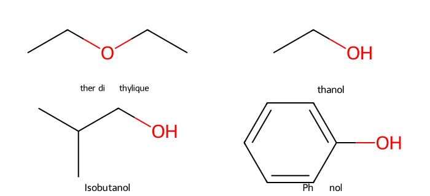
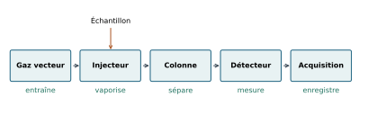
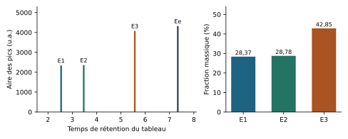
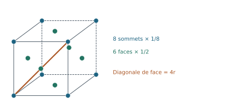
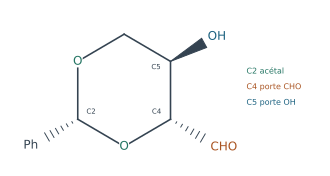
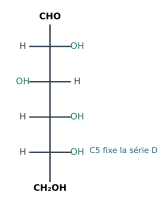

# ENS de Lyon — Second concours, Chimie 2017 · Corrigé guidé

*Corrigé rédigé par IA, non officiel.*

**Rédaction (tour 1)** · GPT-6.2 Astra Ultra · vitesse non renseignée

Ces éditions traitent 45 des 59 questions numérotées. La chromatographie, les calculs de Faraday et de cristallographie, la portée des fiches de données de sécurité et le passage du pH à l’activité sont corrigés. En C, les structures, la stéréochimie, la nomenclature de l’ester réellement dessiné, le glucose, le rendement cumulé et le principe de l’hydrolyse d’un acétal sont traités. Les questions B20 à B22, C12 à C18 et C20 à C23 restent hors couverture. Le sujet officiel et le rapport de jury ont été consultés.

## A.I. Des ions dans l’eau

### Question A1 — Lire l’étiquette d’une eau

> [!INDICATION]
> Repérer ce qui identifie l’origine de l’eau et ce qui décrit sa composition.

#### Solution

On trouve notamment la dénomination de l’eau, son origine ou sa source et, pour une eau minérale naturelle, une composition analytique caractéristique. Les teneurs des principaux ions sont généralement données en mg par litre. On peut aussi lire le résidu sec à 180 °C, le pH, le caractère gazeux et des informations de conditionnement. L’étiquetage exact dépend de la catégorie de l’eau.

### Question A2 — Ions usuellement dosés

> [!INDICATION]
> Choisir deux cations et deux anions courants.

#### Solution

Par exemple, on dose **$\mathrm{Ca^{2+}}$, $\mathrm{Mg^{2+}}$, $\mathrm{HCO_3^-}$ et $\mathrm{Cl^-}$**. Le sodium, les sulfates et les nitrates figurent également parmi les ions fréquemment quantifiés.

### Question A3 — Électroneutralité

> [!INDICATION]
> Pourquoi faut-il employer les concentrations molaires et tenir compte du nombre de charges de chaque ion ?

#### Solution

Dans un volume macroscopique d’eau, $\sum_i z_ic_i=0$. Ainsi, un millimole de $\mathrm{Ca^{2+}}$ compte pour deux millimoles de charges positives. La somme s’effectue sur **tous** les ions présents, dont les ions de l’eau et les ions minoritaires. Les seules teneurs massiques de quatre ions, ajoutées sans conversion, ne permettraient pas ce contrôle.

### Question A4 — Une technique pour les ions

> [!INDICATION]
> Quelle méthode peut séparer plusieurs ions avant de les quantifier ?

#### Solution

On peut utiliser la **chromatographie ionique avec détection conductimétrique**. Les cations et les anions sont généralement analysés sur des colonnes d’échange adaptées à la famille considérée.

### Question A5 — Quantifier après séparation

> [!INDICATION]
> Distinguer le rôle du temps de rétention de celui de l’aire du pic.

#### Solution

Les ions sont entraînés par l’éluant et retenus différemment par la phase stationnaire de la colonne. Un détecteur enregistre les pics successifs. Des étalons permettent d’attribuer les temps de rétention et de relier l’aire de chaque pic à sa concentration. Pour une analyse dans le domaine linéaire, on interpole l’aire de l’échantillon sur la droite de l’ion concerné et on tient compte d’une éventuelle dilution.

## A.II. Séparation en phase gazeuse

### Question A6 — Fonction de l’injecteur

> [!INDICATION]
> Dans quel état le composé doit-il entrer dans la colonne de CPG ?

#### Solution

Le composé doit passer en **phase vapeur** et être entraîné par le gaz vecteur vers la colonne. Pour une solution liquide, l’injecteur assure la vaporisation d’une prise d’essai. La méthode suppose que les espèces soient suffisamment volatiles et stables dans les conditions de l’analyse.

### Question A7 — Ordre de sortie des quatre composés

> [!INDICATION]
> S’appuyer d’abord sur les températures d’ébullition, dans l’hypothèse simplifiée de cette question.

#### Solution

Les structures sont celles de l’éther diéthylique $\mathrm{CH_3CH_2OCH_2CH_3}$, de l’éthanol $\mathrm{CH_3CH_2OH}$, de l’isobutanol $(\mathrm{CH_3})_2\mathrm{CHCH_2OH}$ et du phénol $\mathrm{C_6H_5OH}$. L’ordre prévu est **éther diéthylique, éthanol, isobutanol, phénol**. Leurs températures d’ébullition normales sont environ 35, 78, 108 et 182 °C. Cet ordre suit le modèle de volatilité demandé. Les interactions avec la colonne peuvent modifier une séparation réelle.

### Question A8 — Polarité des analytes

> [!INDICATION]
> Identifier les liaisons polarisées et distinguer donneur et accepteur de liaison hydrogène.

#### Solution

L’éthanol, l’isobutanol et le phénol possèdent une fonction OH polaire. Ils peuvent donner et accepter une liaison hydrogène, avec des forces et des contributions hydrophobes différentes. L’éther possède deux liaisons C–O et un moment dipolaire non nul. Il accepte une liaison hydrogène mais n’en donne pas et est moins polaire que les petits alcools. Un cycle aromatique ou une chaîne alkyle atténue la polarité globale sans supprimer le caractère polaire de la fonction.

### Question A9 — Choix de phase stationnaire

> [!INDICATION]
> Dans quelle phase les interactions entre fonctions oxygénées et phase stationnaire contribuent-elles à la sélectivité ?

#### Solution

Une **colonne polaire** convient pour exploiter les différences de polarité et les interactions, notamment avec les fonctions OH. Le pouvoir de séparation dépend aussi de la volatilité et du type précis de phase. Une phase peu polaire ferait davantage ressortir le classement par température d’ébullition de A7.

### Question A10 — Chaîne de mesure en chromatographie gazeuse

> [!INDICATION]
> Suivre l’échantillon depuis son entrée dans le gaz vecteur jusqu’à l’enregistrement du signal.

#### Solution

Le **gaz vecteur** fournit le flux mobile. L’**injecteur** introduit l’échantillon sous forme de vapeur. La **colonne** dans son enceinte thermique assure la séparation par partage entre gaz et phase stationnaire. Le **détecteur** transforme le passage de chaque analyte en signal. L’acquisition enregistre le chromatogramme, soit le signal en fonction du temps. Le temps et l’aire des pics fournissent deux informations distinctes.

## A.III. Étalonnages

### Question A11 — Mesurer un colorant

> [!INDICATION]
> Quel signal varie avec la concentration d’une espèce qui absorbe dans le visible ?

#### Solution

On choisit un **spectrophotomètre UV–visible**, ou un colorimètre dont la bande passante recouvre l’absorption du colorant. L’absorbance dans le visible permet un étalonnage.

### Question A12 — Étalonnage externe du sirop

> [!INDICATION]
> Comment choisir la longueur d’onde et vérifier que l’échantillon appartient au domaine interpolable ?

#### Solution

À partir d’une référence connue du colorant, on constitue une gamme de concentrations encadrant la solution étudiée. On mesure le spectre de référence et on choisit un maximum d’absorption, puis on règle le blanc dans le même milieu. Le jaune d’alizarine dépendant du pH, on maintient le même pH pour la gamme et pour le sirop dilué. À longueur de cuve constante, on ajuste $A=ac+b$ sur la partie linéaire. Pour un facteur de dilution $F_d$, **$c_{\rm sirop}=F_d(A_{\rm dilué}-b)/a$**. Un blanc de matrice ou un contrôle spectral est utile si le sirop contient d’autres espèces absorbantes.

### Question A13 — Étalon interne des esters

> [!INDICATION]
> Résoudre séparément la relation fournie pour les trois concentrations avant de les normaliser.

#### Solution

Avec $c_e=20\ \mathrm{mg\,L^{-1}}$ et $A_e=4320{,}7$, $c_i=c_eA_i/(k_{i/e}A_e)$. On obtient **11,79 ; 11,96 ; 17,81 mg/L** pour E1, E2 et E3. Leur somme vaut 41,55 mg/L. Rapportées aux trois esters du mélange initial, les fractions massiques sont **28,37 %, 28,78 % et 42,85 %**. L’étalon ajouté sert à la mesure et ne compte pas dans la composition du mélange initial.

### Question A14 — Signification de la rétention

> [!INDICATION]
> Quel événement détermine le temps marqué au sommet de chaque pic ?

#### Solution

Le **temps de rétention** $t_R$ est le temps qui sépare l’injection et le maximum du pic de l’espèce considérée. Le temps de rétention ajusté serait $t_R-t_M$ après soustraction du temps de passage de la phase mobile.

## B.I. Relations électrochimiques

### Question B1 — Espèce métallique dissoute

> [!INDICATION]
> Distinguer l’élément chimique et la charge de l’espèce qui le contient.

#### Solution

Un métal dissous est présent dans des **espèces solvatées**, souvent des cations hydratés $\mathrm{M^{z+}(aq)}$. Selon les ligands, il peut appartenir à un complexe cationique, neutre ou anionique. Le métal possède alors un état d’oxydation déterminé, même lorsque la charge de l’ensemble est différente.

### Question B2 — Du métal dissous au solide

> [!INDICATION]
> L’état d’oxydation augmente-t-il ou diminue-t-il lors de la formation du métal ?

#### Solution

Le passage de l’état d’oxydation positif à zéro est une **réduction**. Pour l’ion libre, le bilan électronique est $\mathrm{M^{z+}+ze^-\to M(s)}$.

### Question B3 — Électrode de réduction

> [!INDICATION]
> La définition de la cathode dépend-elle du signe de sa borne ?

#### Solution

La réduction se produit à la **cathode**. Dans un électrolyseur alimenté en courant continu, elle est reliée à la borne négative du générateur.

### Question B4 — Courant et quantité d’électrons

> [!INDICATION]
> Relier successivement courant, charge et quantité en moles.

#### Solution

En valeurs absolues, $Q=\int I\,dt=Fn(e^-)$. À courant constant, **$n(e^-)=It/F$** et $dn(e^-)/dt=I/F$. Le faraday s’exprime en coulombs par mole.

## B.II. Or, laiton et nickel

### Question B5 — Deux emplois d’un dépôt d’or

> [!INDICATION]
> Chercher un objet pour lequel l’apparence compte et un autre pour lequel la surface rend un service électrique.

#### Solution

Un **bijou plaqué** reçoit une surface décorative de couleur dorée en employant peu de métal précieux. Un **contact de connecteur** utilise une couche d’or pour limiter l’oxydation et conserver une résistance de contact faible et stable.

### Question B6 — Configuration électronique de l’or

> [!INDICATION]
> Compter les électrons d’une sous-couche 5d pleine et d’une sous-couche 6s à moitié pleine.

#### Solution

L’or, symbole **Au**, a $Z=79$. Sa configuration fondamentale complète est $1s^2\,2s^2\,2p^6\,3s^2\,3p^6\,3d^{10}\,4s^2\,4p^6\,4d^{10}\,4f^{14}\,5s^2\,5p^6\,5d^{10}\,6s^1$, soit **$[\mathrm{Xe}]\,4f^{14}5d^{10}6s^1$**. Les exposants totalisent 79.

### Question B7 — Le laiton comme support

> [!INDICATION]
> Quels sont ses principaux constituants et quelles propriétés expliquent son emploi ?

#### Solution

Le **laiton** est un alliage de cuivre et de zinc. Sa couleur, son aptitude à l’usinage, au formage et au polissage, ainsi que son coût inférieur à celui de l’or massif, en font un support pour des objets décoratifs.

### Question B8 — Bilan électronique du nickel

> [!INDICATION]
> Combien d’électrons faut-il à chaque ion Ni(II) ?

#### Solution

Le bilan de réduction est **$\mathrm{Ni^{2+}(aq)+2e^-\to Ni(s)}$**. Un dépôt d’une mole de nickel correspond théoriquement à une charge de $2F$.

### Question B9 — Loi de croissance du dépôt

> [!INDICATION]
> Exprimer la même masse par l’épaisseur d’une couche uniforme et par la loi de Faraday.

#### Solution

À rendement de courant égal à un, $dm/dt=MI/(2F)$. Un dépôt d’aire $S$, de masse volumique $\rho$ et d’épaisseur $e$ a $m=\rho Se$. On obtient **$de/dt=jM/(2F\rho)$**, avec $j=I/S$. Si le rendement est $\eta$, le membre de droite doit être multiplié par $\eta$.

### Question B10 — Représentation de la maille du nickel

> [!INDICATION]
> Quelles positions distingue-t-on dans un cube à faces centrées ?

#### Solution

Le nickel est représenté par un cube portant un atome à chacun des **huit sommets** et un au **centre de chacune des six faces**. Le centre du cube lui-même est vide dans cette maille conventionnelle.

### Question B11 — Population, coordinence et compacité

> [!INDICATION]
> Considérer successivement le partage des sites, les distances minimales et le volume des sphères.

#### Solution

La population est $8/8+6/2=\mathbf{4}$ atomes par maille. Chaque site a **12 plus proches voisins** à distance $a/\sqrt2$. Avec $a=2\sqrt2r$, la compacité vaut $4(4\pi r^3/3)/a^3=\pi/(3\sqrt2)=\mathbf{0{,}740}$, soit 74,0 %.

### Question B12 — Contact sur une diagonale de face

> [!INDICATION]
> Combien de rayons métalliques compte la diagonale qui traverse le centre de face ?

#### Solution

La diagonale de face joint deux sommets en passant par un centre de face. Les trois centres sont alignés et les sphères voisines se touchent, donc **$a\sqrt2=4r$**, soit $a=2\sqrt2r$.

### Question B13 — Masse volumique cristalline

> [!INDICATION]
> Utiliser quatre atomes par cube et employer partout les unités du SI.

#### Solution

Avec $r=124$ pm, $a=350{,}7$ pm. La masse volumique vaut $\rho=4M_{\rm Ni}/(N_Aa^3)$, avec $M_{\rm Ni}=0{,}0587\ \mathrm{kg\,mol^{-1}}$. On trouve **$\rho\simeq9{,}04\times10^3\ \mathrm{kg\,m^{-3}}$**. La valeur provient du rayon arrondi de l’annexe.

### Question B14 — Vitesse numérique du modèle

> [!INDICATION]
> Vérifier le nombre d’électrons et convertir la vitesse en micromètres par heure.

#### Solution

Avec les valeurs du sujet, $de/dt=5(0{,}0587)/[2(96\,000)(9{,}04\times10^3)]\simeq\mathbf{1{,}69\times10^{-10}\ m\,s^{-1}}$, soit **0,61 µm/h**. Le résultat suppose le modèle de couche compacte et le rendement unitaire de B9.

## B.II. Information de sécurité et pH

### Question B15 — Objet du règlement REACH

> [!INDICATION]
> Que représentent les quatre mots de l’acronyme anglais ?

#### Solution

Le règlement européen (CE) nº 1907/2006 organise l’**enregistrement, l’évaluation, l’autorisation et la restriction des substances chimiques** (Registration, Evaluation, Authorisation and Restriction of Chemicals). Il impose, selon les situations, aux acteurs concernés de documenter les substances et leurs usages ainsi que les conditions de maîtrise des risques.

### Question B16 — Rôle et transmission de la fiche de données de sécurité

> [!INDICATION]
> Qui fournit ce document et à quel destinataire dans la chaîne d’approvisionnement ?

#### Solution

La fiche de données de sécurité, ou FDS, communique notamment l’identité du produit et du fournisseur, les dangers, la composition pertinente, les premiers secours, les règles de stockage et de protection, les propriétés, les informations toxicologiques et écologiques, ainsi que les dispositions relatives aux déchets, au transport et à la réglementation. Ses seize rubriques normalisées comprennent aussi les mesures en cas d’incendie et de dispersion, la réactivité et les autres informations. Selon l’article 31 de REACH, le fournisseur transmet notamment une FDS pour les substances ou mélanges classés dangereux à leurs destinataires professionnels, ainsi que dans d’autres cas prévus, dont certaines substances préoccupantes et certains mélanges sur demande.

### Question B17 — Champ d’application de ces obligations

> [!INDICATION]
> Distinguer industrie, utilisateurs professionnels et vente au grand public.

#### Solution

REACH concerne la chaîne d’approvisionnement dans l’Union européenne et s’applique également dans l’Espace économique européen. Les acteurs concernés incluent fabricants, importateurs, distributeurs et utilisateurs professionnels en aval, par exemple un atelier, un laboratoire ou un établissement d’enseignement. La transmission des FDS suit les conditions du règlement. Pour les produits proposés au grand public, une information suffisante sur les précautions peut dispenser de remise systématique de la FDS, sous réserve notamment d’une demande d’un utilisateur en aval ou d’un distributeur. Le classement et l’étiquetage relèvent du règlement CLP.

### Question B18 — Du pH à l’activité

> [!INDICATION]
> Une valeur de pH donne-t-elle d’abord une activité ou une concentration ?

#### Solution

Pour le pH fourni, $a(\mathrm{H_3O^+})=10^{-3{,}6}=2{,}51\times10^{-4}$, sans unité. Dans l’approximation de solution idéale diluée, **$[\mathrm{H_3O^+}]\simeq2{,}5\times10^{-4}\ \mathrm{mol\,L^{-1}}$**. La concentration exacte exige le coefficient d’activité.

### Question B19 — Limites de l’approximation

> [!INDICATION]
> Quel facteur intervient entre l’activité d’un ion et la valeur numérique de sa concentration ?

#### Solution

En solution aqueuse, $\mathrm{pH}=-\log_{10}a(\mathrm{H_3O^+})$ et $a=\gamma c/c^\circ$, avec $c^\circ=1\ \mathrm{mol\,L^{-1}}$. Remplacer l’activité par $c/c^\circ$ revient à poser $\gamma\simeq1$. Une force ionique importante peut invalider cette approximation. La température et le solvant précisent le cadre des activités et de la mesure.

*Question B20 hors couverture.*

*Question B21 hors couverture.*

*Question B22 hors couverture.*

## C.I. Fonctions et stéréochimie

### Question C1 — Fonctions du composé initial

> [!INDICATION]
> Un carbone saturé lié aux deux oxygènes du cycle porte-t-il une fonction particulière ?

#### Solution

Le composé initial porte un **aldéhyde** $\mathrm{-CHO}$, un **alcool secondaire** et un **acétal cyclique** au carbone lié aux deux oxygènes du cycle. Il contient aussi un **noyau phényle** aromatique. L’acétal est un motif fonctionnel à deux liaisons C–O sur le même carbone.

### Question C2 — Centres stéréogènes du composé initial

> [!INDICATION]
> Un carbone portant deux oxygènes peut-il être stéréogène lorsque les deux chemins dans le cycle sont différents ?

#### Solution

Il y a **trois centres stéréogènes**. Ce sont le carbone acétalique portant le phényle, le carbone du cycle portant le formyle et celui portant OH. Chacun a quatre substituants différents. Les deux chemins qui partent par les oxygènes du carbone acétalique ne sont pas équivalents.

### Question C3 — Configurations du cycle initial

> [!INDICATION]
> Numéroter le 1,3-dioxane avec le carbone acétalique en C2 et le substituant formyle en C4.

#### Solution

Avec cette numérotation, le composé initial est **$(2R,4R,5R)$**. En C2, l’oxygène conduisant vers C4 précède celui qui conduit vers le $\mathrm{CH_2}$ C6, puis viennent Ph et H. En C4, l’ordre est O du cycle, CHO, C5, H. Le carbone du formyle porte formellement la liste O,O,H et C5 la liste O,C,H. En C5, l’ordre est OH, C4, C6, H. C4 porte O,C,H contre O,H,H pour C6. On lit les trois suites sur les liaisons en perspective de l’original, en réorientant chaque fois le groupe de priorité 4 vers l’arrière.

### Question C4 — Origine du nom leucotriène

> [!INDICATION]
> Compter toutes les doubles liaisons, puis isoler celles qui alternent effectivement avec une seule liaison simple.

#### Solution

« Leuco » fait référence aux leucocytes. « Triène » renvoie aux **trois doubles liaisons conjuguées**. La molécule en possède une quatrième, séparée du système conjugué, ce qui explique l’indice 4 de la série. Le dessin final du sujet représente l’ester méthylique de la leucotriène A4.

### Question C5 — Fonctions du produit dessiné

> [!INDICATION]
> Examiner l’extrémité OMe du schéma et distinguer acidité et estérification.

#### Solution

Le schéma final porte un **ester méthylique** $\mathrm{-COOCH_3}$, un **époxyde** (éther cyclique à trois chaînons) et **quatre liaisons C=C**, dont trois conjuguées. Le leucotriène A4 sous sa forme acide libre aurait une fonction acide carboxylique à l’endroit où le dessin indique l’ester.

### Question C6 — Signaux infrarouges attendus

> [!INDICATION]
> Quel groupe donne à la fois une forte bande C=O et des bandes C–O ?

#### Solution

Pour l’ester dessiné, on attend une bande C=O intense vers **1 735–1 750 cm$^{-1}$**, avec des bandes C–O dans la région **1 000–1 300 cm$^{-1}$**, à laquelle contribue aussi l’époxyde. Les alcènes peuvent donner des bandes C=C vers 1 600–1 680 et des étirements =C–H au-dessus de 3 000 cm$^{-1}$. La conjugaison modifie les positions par rapport aux valeurs de l’annexe pour composés non conjugués. La bande O–H très large d’un acide libre n’est pas attendue pour cet ester.

### Question C7 — Nom systématique du produit dessiné

> [!INDICATION]
> Numéroter depuis le carbonyle de l’ester, puis relever les quatre indices d’insaturation et les deux carbones de l’époxyde.

#### Solution

Le squelette principal compte vingt carbones. Le produit est le **(5S,6S,7E,9E,11Z,14Z)-5,6-époxyicosa-7,9,11,14-tétraénoate de méthyle**. On peut nommer le cycle oxygéné comme oxirane, par exemple **4-[(2S,3S)-3-[(1E,3E,5Z,8Z)-tétradéca-1,3,5,8-tétraén-1-yl]oxiran-2-yl]butanoate de méthyle**. Les formes E ou Z sont obtenues en comparant les chaînes carbonées, prioritaires sur H, de part et d’autre de chaque double liaison. Pour l’acide libre, le suffixe d’ester serait remplacé par le nom de l’acide.

## C.II. Glucose et rendements

### Question C8 — Famille du D-glucose

> [!INDICATION]
> Combien de carbones et quel type de carbonyle comporte sa forme ouverte ?

#### Solution

Le D-glucose est un **ose**, plus précisément un **aldohexose**. La forme ouverte comporte six carbones, un aldéhyde en C1 et plusieurs fonctions alcool. En solution aqueuse, il est surtout sous forme d’hémiacétals cycliques.

### Question C9 — Disponibilité du glucose

> [!INDICATION]
> Quelle macromolécule abondante fournit des unités de glucose par hydrolyse ?

#### Solution

Le glucose est courant dans le vivant. L’hydrolyse de réserves végétales comme l’amidon fournit des unités de D-glucose. L’abondance de ces ressources et leur transformation à grande échelle rendent le D-glucose largement disponible.

### Question C10 — Projection de Fischer du D-glucose

> [!INDICATION]
> Dans la série D, où se trouve le OH du centre chiral le plus éloigné du carbonyle ?

#### Solution

Dans la projection de Fischer de la forme ouverte, placer **CHO en haut et CH₂OH en bas**. De C2 à C5, les OH sont **à droite, à gauche, à droite, à droite**. Les liaisons horizontales sont dirigées vers le lecteur. Le OH à droite en C5 fixe la série D.

### Question C11 — Rendement cumulé

> [!INDICATION]
> Les pourcentages successifs portent-ils sur la quantité initiale ou sur la quantité transmise à chaque étape ?

#### Solution

Les rendements de blocs successifs se multiplient, en utilisant des fractions. Le schéma donne quatre rendements, 65 %, 69 %, 65 % et 58 %. Le produit $0{,}65\times0{,}69\times0{,}65\times0{,}58=0{,}1691$ correspond à **environ 16,9 %**. Chaque pourcentage de bloc est compté une seule fois.

*Question C12 hors couverture.*

## C.III. Première étape

*Question C13 hors couverture.*

*Question C14 hors couverture.*

## C.IV. Deuxième étape

*Question C15 hors couverture.*

*Question C16 hors couverture.*

*Question C17 hors couverture.*

## C.V. Troisième étape

*Question C18 hors couverture.*

### Question C19 — Réversibilité d’un acétal

> [!INDICATION]
> Écrire l’équilibre d’acétalisation dans le sens qui redonne le carbonyle.

#### Solution

L’inverse de l’acétalisation est une **hydrolyse catalysée par un acide en milieu aqueux**. L’eau déplace l’équilibre vers le carbonyle et l’alcool ou le diol. Ce principe distingue les acétals, relativement stables en milieu basique, des hémiacétals.

*Question C20 hors couverture.*

*Question C21 hors couverture.*

*Question C22 hors couverture.*

*Question C23 hors couverture.*
