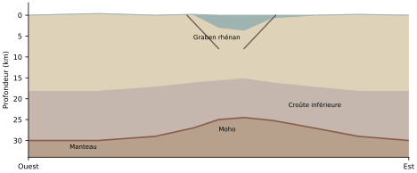
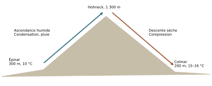
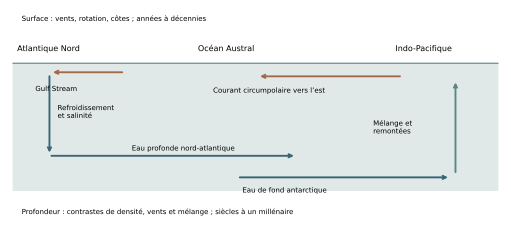

# ENS de Lyon, second concours 2017 — Géosciences · Corrigé brut

*Corrigé rédigé par IA, non officiel. Signalez toute erreur.*

**Rédaction** · GPT-6.2 Astra Ultra · vitesse non renseignée

## 1 — Topographie et lithosphère océanique

### Question 1a — Deux grands domaines d’altitude

La carte oppose de vastes domaines océaniques, généralement à 3–5 km sous le niveau marin, à des continents en moyenne proches de 0,8 km au-dessus de ce niveau. Les plaines abyssales s’étendent sur des centaines à des milliers de kilomètres. Les dorsales sont des chaînes sous-marines larges de plusieurs centaines à quelques milliers de kilomètres, à sommets typiquement vers −2,5 km, où se construit la lithosphère océanique. Aux marges convergentes, des fosses allongées et plus étroites, souvent moins de 100 km de large, descendent vers −6 à −11 km par flexure d’une plaque en subduction. Les plaines et plateaux continentaux contrastent avec les chaînes de collision ou de marge active qui s’élèvent à plusieurs kilomètres. Les chaînes forment des bandes longues de centaines à milliers de kilomètres. Les reliefs volcaniques sont plus localisés.
La distribution des fréquences d’altitude est bimodale, avec une population continentale près du niveau marin et une autre autour des plaines abyssales. Sur une courbe hypsométrique cumulée cela se traduit par deux vastes domaines de pente faible séparés par la transition des marges. Croûte continentale épaisse et relativement légère et croûte océanique mince et mafique ne flottent pas au même niveau. L’âge et le refroidissement de la lithosphère océanique, les racines orogéniques, la flexure et l’érosion modulent ces deux populations.

### Question 1b — Dater la croûte océanique

Un profil magnétique traversant les bandes d’anomalies de part et d’autre d’une dorsale enregistre les inversions de polarité au refroidissement du basalte. Corréler la succession de largeur et de signe avec l’échelle géomagnétique calibrée permet d’attribuer un âge aux isochrones. Une mesure radiochronologique de basaltes forés peut fournir une autre contrainte si l’altération et la fermeture du système isotopique le permettent. La biostratigraphie ou la magnétostratigraphie des premiers sédiments déposés sur le basalte fournit une borne, car le plancher doit être antérieur à ces sédiments.

### Question 1c — Subsidence thermique

Dans les trois océans le plancher s’approfondit vite lorsqu’il est jeune, puis de plus en plus lentement. Les courbes s’écartent davantage d’une loi simple aux grands âges. À la dorsale, la lithosphère chaude est mince. En s’éloignant, elle perd de la chaleur par conduction, se contracte et incorpore à sa base de l’asthénosphère refroidie. L’épaississement de la couche froide et dense augmente la masse par unité de surface. L’équilibre isostatique avec les colonnes voisines s’établit à une altitude moindre. Les sédiments, les plateaux volcaniques et la convection mantellique expliquent une partie des écarts régionaux.

### Question 1d — Termes de la loi d’âge

La diffusion thermique atteint une épaisseur caractéristique proportionnelle à $\sqrt{\kappa t}$. Dans le modèle de demi-espace refroidissant, la contraction intégrée et donc la subsidence sont également proportionnelles à $\sqrt t$. Le terme 2500 m de $z(t)=2500+350\sqrt t$ est la profondeur de référence de la dorsale pour un plancher neuf, à $t=0$. Le coefficient 350 s’exprime en $\mathrm{m\,Ma^{-1/2}}$ pour utiliser $t$ en Ma.

### Question 1e — Ennoiement d’un volcan

Au début, le socle a 16 Ma. Pour submerger un sommet situé 700 m au-dessus de la mer, il doit s’enfoncer de 700 m si l’on néglige érosion, volcanisme ultérieur et variations eustatiques. Ainsi $350(\sqrt{t_f}-\sqrt{16})=700$, d’où $\sqrt{t_f}=6$ et $t_f=36$ Ma. Le temps écoulé est **20 Ma**. Si la croissance du récif suit la subsidence, une barrière puis un atoll peuvent subsister près de la surface alors que le sommet volcanique disparaît.

## 2 — Dynamique du fossé rhénan

### Question 2a — Coupe du fossé rhénan

D’ouest en est, la figure 3 traverse le bassin Sarre–Nahe, le Donnersberg, le bassin de Mayence, le graben rhénan septentrional puis l’Odenwald. Le graben est limité par des failles normales qui décalent le toit du socle. Les réflecteurs superficiels empilés dessinent son remplissage sédimentaire. Les bordures moins affaissées encadrent le bassin. Plus bas se distinguent le socle supérieur et une croûte inférieure riche en réflecteurs, puis la transition au manteau. Le Moho, près de 30 km sous les domaines externes, remonte vers 24–26 km sous la zone amincie. Le profil est compatible avec l’étirement de la croûte, l’affaissement du toit et la remontée de la base.

### Question 2b — Trois subsidences isostatiques

La croûte initiale a $H=30$ km. Après amincissement $\beta=2$, il reste $H/\beta=15$ km. À une profondeur de compensation commune, égaliser la masse de la colonne initiale avec celle de la colonne étirée, sur laquelle repose un remplissage d’épaisseur $s$ et de densité $\rho_f$. La croûte initiale remplacée par du manteau apporte un excès de masse $(\rho_m-\rho_c)(H-H/\beta)$. Celui-ci est compensé par un déficit $(\rho_m-\rho_f)s$. Ainsi
$$s=\frac{(\rho_m-\rho_c)H(1-1/\beta)}{\rho_m-\rho_f}.$$
Avec les densités relatives 3,3 et 2,8 du manteau et de la croûte, on obtient pour l’air $7500/3{,}3\simeq2270$ m, pour l’eau $7500/2{,}3\simeq3260$ m et pour les sédiments $7500/1{,}1\simeq6820$ m. Le dernier résultat est l’enfoncement du toit du socle sous la charge des sédiments, non la hauteur d’eau résiduelle.

### Question 2c — Érosion et rebond

Une érosion de 100 m enlève une masse par unité de surface $\rho_c\times100\ \mathrm m$. Le réajustement isostatique local fait remonter la colonne de $u$ avec $\rho_m u=\rho_c\times100\ \mathrm m$. On trouve $u=(2{,}8/3{,}3)\times100\simeq85$ m. L’altitude finale de la surface a donc baissé d’environ 15 m seulement, bien que 100 m de roches aient été enlevés. Une compensation flexurale régionale répartirait le soulèvement dans l’espace.

### Question 2d — Dater l’exhumation

Prélever le long d’un profil altitudinal du même bloc des roches contenant de l’apatite, en relevant structure, altitude et position. Mesurer les âges de traces de fission et, si possible, les distributions de longueur des traces. Le recuit progressif dépend de la température. En combinant âges, longueurs et modèle thermique, on date une phase de refroidissement, puis on estime l’exhumation nécessaire avec un gradient géothermique. Pour des échantillons passés successivement sous une isotherme approximativement stationnaire, la pente $\Delta z/\Delta t$ de la relation altitude–âge fournit un taux moyen. Un dénivelé de 1 km pour 5 Ma correspondrait à 0,2 mm/an, à titre illustratif. Vérifier une éventuelle reprise thermique, les rejets de faille et le déplacement des isothermes. Le refroidissement date l’exhumation. Des dépôts syntectoniques ou une discordance aident à relier cette date à la naissance du relief.

### Question 2e — Trois environnements de dépôt

**A, secteur de Wolfoch.** Des galets arrondis, de tailles variées, sont enchâssés dans une matrice plus fine et gréseuse. C’est un conglomérat gréseux. La fourniture détritique depuis les bordures et le transport par des cours d’eau ou cônes alluviaux énergiques sont compatibles avec ce grain grossier.
**B, Wittelsheim.** Les bandes rouges et claires de roche cristalline correspondent aux évaporites du bassin potassique, typiquement à sylvite et halite, la teinte rouge pouvant venir d’impuretés. L’identification de chaque sel demanderait une analyse. Le dépôt requiert des saumures concentrées par évaporation dans un bassin à communication restreinte.
**C, Pechelbronn.** Des niveaux sédimentaires montrent une imprégnation sombre et des suintements noirs. Le rapport du jury retient des schistes à bitume. La matière organique a été préservée dans des sédiments fins, puis transformée pendant l’enfouissement. Des hydrocarbures ont pu migrer vers des horizons poreux et suinter en surface. Cette observation ne suffit pas à identifier la roche mère exacte.

## 3 — Le foehn

### Question 3a — Effet de foehn

Le vent d’ouest force l’air à monter sur le versant vosgien. La détente adiabatique le refroidit. Dans l’air saturé, la vapeur se condense, libère de la chaleur latente et peut précipiter. Une fois le sommet franchi, l’air appauvri en eau descend vers Colmar. La pression augmente et l’air se réchauffe par compression suivant un gradient sec si la descente est non saturée. À altitude comparable le versant sous le vent devient plus chaud et plus sec.

### Question 3b — Température au Hohneck

Épinal est à 300 m et 10 °C. Suivre sur le panneau humide de la figure 7 l’adiabatique passant par cet état jusqu’à 1 300 m. Sur 1 km de montée, la lecture donne environ 5 à 6 °C de refroidissement dans cette gamme, donc **environ 4 à 5 °C au Hohneck**. La pente humide varie avec la température et la pression, d’où l’intérêt d’une lecture graphique.

### Question 3c — Descente vers Colmar

De 1 300 à 200 m, la descente représente 1,1 km. L’adiabatique sèche du panneau inférieur donne près de 9,8 °C/km, soit un réchauffement de $1{,}1\times9{,}8\simeq10{,}8$ °C. Depuis 4–5 °C au sommet, la masse d’air arrive à Colmar vers **15–16 °C**. Une différence d’environ un degré entre lectures graphiques est raisonnable.

### Question 3d — Climat des deux versants

Les ascendances et les pluies orographiques rendent le versant ouest et les sommets plus arrosés. À l’est, le déficit d’humidité et le réchauffement à la descente créent une ombre pluviométrique, sensible notamment dans la plaine de Colmar. Lors des épisodes d’ouest, l’évaporation et le dessèchement augmentent sous le vent. Répétés, ces épisodes expliquent un contraste climatique régional, distinct d’un changement du climat mondial.

## 4 — Circulation océanique et climat

### Question 4a — Mesurer le rapport isotopique

Extraire et nettoyer les tests calcaires d’espèces benthiques identifiées dans une carotte datée. Faire réagir le carbonate avec un acide à température contrôlée et mesurer par spectrométrie de masse le rapport $R={}^{18}\mathrm O/{}^{16}\mathrm O$ du dioxyde de carbone produit. Après correction des fractionnements analytiques, rapporter le carbonate à un étalon, usuellement VPDB. On exprime $\delta^{18}\mathrm O=1000(R_{\rm échantillon}/R_{\rm étalon}-1)$ en pour mille. Des répétitions et une calibration interespèces limitent les effets biologiques.

### Question 4b — Fractionnement et volume des glaces

Le fractionnement à l’équilibre entre le carbonate et l’eau dépend de la température. À composition isotopique de l’eau fixée, la calcite incorpore relativement plus de $^{18}\mathrm O$ lorsque l’eau est plus froide. Une augmentation de $\delta^{18}\mathrm O$ benthique suggère donc un refroidissement des eaux profondes. En outre, une calotte continentale stocke préférentiellement l’eau enrichie en $^{16}\mathrm O$. L’océan résiduel s’enrichit alors en $^{18}\mathrm O$, ce qui augmente aussi le signal des tests. Il faut estimer la composition de l’eau ou disposer d’un autre thermomètre pour séparer refroidissement et croissance des glaces.

### Question 4c — Circulation de l’océan actuel

Les vents, le frottement, la rotation terrestre et la forme des bassins entretiennent les gyres subtropicaux. Les courants de bord ouest comme le Gulf Stream et le Kuroshio emportent de l’eau chaude vers des latitudes plus hautes, avec des vitesses locales pouvant approcher le mètre par seconde. La traversée d’un bassin en surface se mesure en années à décennies. Dans l’océan Austral, le courant circumpolaire antarctique s’écoule vers l’est à travers le passage de Drake sous l’action des vents d’ouest et des gradients de pression.
Aux hautes latitudes, refroidissement et variations de salinité changent la densité. Des eaux profondes formées dans l’Atlantique Nord gagnent le sud, et des eaux de fond d’origine antarctique s’étalent vers les bassins abyssaux. Le mélange, les vents et les remontées d’eau, notamment dans l’océan Austral et l’Indo-Pacifique, complètent le retournement. Les eaux profondes se déplacent plus lentement et la ventilation globale couvre des siècles à environ un millénaire. La figure sépare le sens des voies profondes et superficielles sans réduire tous les flux à un trajet unique.

### Question 4d — Ouverture du passage de Drake et refroidissement

Les cartes de la figure 8 montrent une connexion d’abord limitée entre l’extrémité sud-américaine et l’Antarctique puis un passage progressivement ouvert et approfondi. Un couloir continu permet l’établissement ou l’intensification d’un courant circumpolaire d’ouest en est. Il modifie le transport méridien de chaleur et isole davantage la marge antarctique des eaux chaudes de plus basses latitudes. Refroidissement et accumulation de neige favorisent une calotte, dont l’albédo renforce le refroidissement. L’effet sur les eaux profondes et sur le volume de glace contribue aux valeurs benthiques de $\delta^{18}\mathrm O$ de plus en plus élevées.
La transition Éocène–Oligocène vers 34 Ma marque un saut important, tandis que l’optimum du Miocène moyen et les glaciations plus récentes interrompent toute lecture monotone. L’ouverture de Drake s’est faite en plusieurs étapes. La baisse du $\mathrm{CO_2}$ atmosphérique, l’évolution des autres passages océaniques et, à des échelles plus courtes, les variations orbitales contribuent également. Les courbes établissent une cohérence chronologique et physique, mais leur seule superposition n’isole pas une cause unique.

[Sujet officiel](https://banques-ecoles.fr/cms/wp-content/uploads/2017/10/2017_2CC_sujet_ST.pdf) · [Rapport du jury](https://banques-ecoles.fr/cms/wp-content/uploads/2017/09/17_2CC_rap_eST.pdf)
