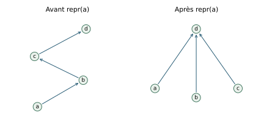
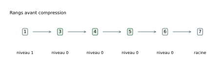

# ENS de Lyon · Second concours · Informatique 2017 · Corrigé brut

*Corrigé rédigé par IA, non officiel. Signalez toute erreur.*

**Rédaction** · GPT-6.2 Astra Ultra · vitesse non renseignée · 24 novembre 2026

## 2 · Ensembles disjoints par forêts

### Question 2.1 · Comparabilité des ascendants

Notons $p(x)$ le parent de $x$. Il existe $a,b\ge0$ tels que $x_j=p^a(x_i)$ et $x_\ell=p^b(x_i)$. Si $a\le b$, alors $x_\ell=p^{b-a}(x_j)$, donc $x_j\preceq x_\ell$. Si $b\le a$, on obtient la relation inverse. L'argument utilise l'unicité du parent.

### Question 2.2 · Existence et unicité d'une racine

Deux termes de la suite des parents coïncident parmi ses $n+1$ premiers termes. Elle atteint donc un cycle. Deux nœuds d'un même cycle sont ascendants l'un de l'autre, ce qui, par acyclicité au sens de l'énoncé, les rend égaux. Le cycle se réduit à un point fixe du parent, une racine. Après ce point la suite demeure constante, donc cette racine est unique.

### Question 2.3 · Trouver le représentant

Chaque passage monte d'une arête. D'après 2.2 le parcours termine sur la racine de l'arbre de départ. Pour $s$ nœuds sur le trajet, le coût est $\Theta(s)\subseteq O(n)$ et l'espace auxiliaire est constant. En Python, les nœuds sont des listes susceptibles de se référencer elles-mêmes. Le test d'identité évite de comparer récursivement le contenu de deux listes distinctes.

```python
def repr(x):
    while x[1] is not x:
        x = x[1]
    return x
```

### Question 2.4 · Tester l'appartenance

Deux nœuds sont dans le même arbre exactement quand ils mènent au même objet racine. Le test coûte au plus deux recherches, donc $O(n)$.

```python
def meme_ensemble(x, y):
    return repr(x) is repr(y)
```

### Question 2.5 · Attacher deux racines

Les préconditions de l'appel depuis la fonction `union` garantissent que $x$ et $y$ sont des racines distinctes. Une affectation suffit, en $\Theta(1)$. L'ancien arbre de $y$ rejoint celui de $x$ sans cycle.

```python
def relie(x, y):
    y[1] = x
```

### Question 2.6 · Compter les unions

Après les créations, il y a exactement $n$ arbres. Chaque union autorisée fusionne deux arbres distincts et diminue ce nombre de 1. Une recherche le conserve. Pour $n\ge1$, il reste au moins un arbre, donc il y a au plus $n-1$ unions. Avec zéro création, il n'y a aucun appel sur un nœud.

### Question 2.7 · Majoration naïve

Une création est en $O(1)$, une recherche en $O(n)$ et une union en $2O(n)+O(1)=O(n)$. Les $m$ instructions coûtent donc $O(mn)$ pour $n\ge1$.

### Question 2.8 · Atteindre la borne

Pour $k\ge0$, prendre $n_k=k+2$ singletons $x_1,\ldots,x_n$. Pour $i=1,\dots,n-1$, appeler `union(x[i+1], x[i])`, avec indices mathématiques commençant à 1. Avant chaque appel $x_i$ et $x_{i+1}$ sont racines. Q2.5 rattache $x_i$ à $x_{i+1}$ et forme la chaîne $x_1\to\cdots\to x_n$. Faire ensuite $n$ appels à `repr(x[1])`. La longueur de la séquence $m_k=3n_k-1$ croît. Les recherches finales traversent à elles seules $n(n-1)\ge n^2/2\ge nm_k/6$ arêtes. On peut prendre $M=1/6$, $K_0=0$ dans l'unité où traverser une arête coûte au moins un.

### Question 2.9 · Compression complète

Le premier parcours localise la racine sans modifier l'arbre. Le second rattache directement à cette racine chaque nœud de l'ancien chemin. Sauvegarder le parent permet de poursuivre sur le chemin d'origine. Le représentant et la partition sont conservés. Pour $s$ nœuds du chemin, on parcourt au plus $2(s-1)$ liens, en $O(s)$ et en espace supplémentaire constant. Une seconde recherche immédiate sur le même nœud n'a plus qu'une arête au plus à franchir.

```python
def repr(x):
    racine = x
    while racine[1] is not racine:
        racine = racine[1]
    while x is not racine:
        parent = x[1]
        x[1] = racine
        x = parent
    return racine
```



## 3 · Arbres avec nœuds classés

### Question 3.1 · Union par rang

Les arguments sont des racines distinctes. Si les rangs diffèrent, le plus grand dépasse déjà tous les descendants du nouvel arbre et satisfait la borne imposée par son ancien rang. S'ils sont égaux à $r$, le nouveau parent doit dépasser le rang $r$ de l'autre racine, d'où le rang minimal $r+1$. L'échange éventuel des références ne modifie pas les objets, le coût reste constant.

```python
def relie(x, y):
    if x[2] < y[2]:
        x, y = y, x
    y[1] = x
    if x[2] == y[2]:
        x[2] += 1
```

### Question 3.2 · Croissance des fonctions itérées

**(i)** $A_0(j)=j+1$ est strictement croissante et dépasse son argument. Supposons ces propriétés vraies pour $A_k$. Chaque itération augmente strictement son argument, donc $A_{k+1}(j)=A_k^{(j+1)}(j)>j$. Partir de $j+1$ au lieu de $j$ augmente le résultat après $j+1$ itérations, et la définition de $A_{k+1}(j+1)$ applique encore une itération. La croissance stricte suit par récurrence.

**(ii)** Pour $j>0$, $j+1\ge2$ et $A_k^{(j+1)}(j)>A_k(j)$. Enchaîner cette inégalité de $k$ à $\ell-1$.

**(iii)** Les entiers $A_k(1)$ forment une suite strictement croissante, donc non bornée. Tout entier $j$ est atteint ou dépassé.

### Question 3.3 · Invariants des rangs

**(i)** Initialement tout nœud est sa propre racine. Un rattachement rend le rang du parent strictement supérieur à celui de l'enfant, y compris dans le cas d'égalité des rangs initiaux. Une compression remplace le parent par un ascendant, dont le rang est au moins celui de l'ancien parent. Ainsi $r(x)\le r(p(x))$, avec égalité exactement à la racine.

**(ii)** Seule la racine qui gagne une union de rangs égaux voit son rang augmenter, d'une unité. Un nœud déjà non racine garde donc son rang, et tous les rangs sont non décroissants.

**(iii)** Tout rang part de zéro et n'augmente qu'à l'occasion d'un rattachement. Il y a au plus $n-1$ rattachements en tout, donc $r(x)\le n-1$.

### Question 3.4 · Sommer les coûts amortis

En posant $P_k=\sum_x\Phi_k(x)$, l'égalité (2) donne $\sum_{k=n+1}^m c_k=\sum_{k=n+1}^m\widehat c_k+P_n-P_m$. Par hypothèse $P_n=0$ et $P_m\ge0$. La somme des coûts réels est ainsi majorée par $O((m-n)\alpha(n))$. Les créations initiales ajoutent $O(n)$ et la décomposition des unions multiplie au plus par trois le nombre d'instructions. Pour inclure les tout petits $n$ où $\alpha(n)=0$, la borne uniforme s'écrit $O(m\max(1,\alpha(n)))$.

### Question 3.5 · Potentiel initial

Chaque nœud est une racine de rang nul. Par la première branche de la définition, $\Phi_n(x)=\alpha(n)\times0=0$.

### Question 3.6 · Bornes sur niveau, itération et potentiel

Écrivons $a=\alpha(n)$, $r=r(x)\ge1$, $R=r(p(x))$, $q=\mathrm{niv}(x)$ et $i=\mathrm{iter}(x)$. Le nœud est non racine.

**(i)** $R\le n-1<n\le A_a(1)\le A_a(r)$. **(ii)** $A_0(r)=r+1\le R$ et les $A_j(r)$ croissent strictement avec $j$, donc $0\le q<a$. **(iii)** $A_q(r)\le R$ donne $i\ge1$. **(iv)** La maximalité de $q$ donne $R<A_{q+1}(r)=A_q^{(r+1)}(r)$. Puisque les itérés croissent, $i\le r$.

**(v)** $\Phi=(a-q)r-i\le ar-1<ar$. **(vi)** Comme $a-q\ge1$ et $i\le r$, $\Phi\ge r-i\ge0$.

### Question 3.7 · Borne commune à tous les nœuds

Pour une racine ou un rang nul, $\Phi_k(x)=\alpha(n)r(x)\ge0$. Pour les autres nœuds, appliquer 3.6(v–vi). Dans les deux cas $0\le\Phi_k(x)\le\alpha(n)r(x)$.

### Question 3.8 · Variation du potentiel d'un non-racine

Le nœud reste non racine. Si $r=0$, son potentiel reste nul. Sinon, le rang du parent courant ne diminue pas, même quand la compression change le parent. Le niveau $q$ ne décroît donc pas. À niveau constant le nombre d'itérations autorisé ne diminue pas, donc $\Delta\Phi\le0$. Si le niveau augmente d'au moins 1, sa contribution fait baisser $\Phi$ d'au moins $r$ tandis que la réinitialisation de l'itération peut rendre au plus $r-1$ unités ($1\le i,i'\le r$). Dans ce cas $\Delta\Phi\le-1$.

### Question 3.9 · Coût amorti du lien

Les non-racines antérieures ne gagnent aucun potentiel, d'après 3.8. La racine rattachée, de rang inchangé, a au plus son ancien potentiel $ar$. Les autres racines demeurent inchangées sauf la gagnante, dont le potentiel augmente d'au plus $a$. Le coût réel est constant. Donc $\widehat c_k\le O(1)+a=O(\max(1,a))$.

### Question 3.10 · Potentiel pendant une recherche

Les racines conservent le potentiel $ar$, les non-racines relèvent de 3.8. Ainsi pour tout $x$, $\Phi_k(x)\le\Phi_{k-1}(x)$.

### Question 3.11 · Deux nœuds du chemin de même niveau

Notons $r=r(x)$, $q=\mathrm{niv}(x)=\mathrm{niv}(y)$ et $i=\mathrm{iter}(x)$ avant l'opération.

**(i)** On a $r(y)\ge r(p(x))\ge A_q^{(i)}(r)$ car $y$ est un ascendant strict de $x$. La définition du niveau de $y$ donne $r(p(y))\ge A_q(r(y))\ge A_q^{(i+1)}(r)$.

**(ii)** Après compression, le parent de $x$ est la racine, de rang au moins celui de l'ancien parent de $y$. Il satisfait donc la même borne.

**(iii)** Le niveau de $x$ augmente, ou il reste $q$, auquel cas la nouvelle itération est au moins $i+1$. **(iv)** Dans le premier cas, le calcul de 3.8 donne une baisse d'au moins une unité. Dans le second, la soustraction de l'itération accrue diminue également le potentiel d'au moins un.

### Question 3.12 · Coût amorti de la compression

Soit $s$ le nombre de nœuds traversés. Le rang est strictement croissant avant la racine, donc il y a au plus une exception de rang zéro en dehors d'elle. Parmi les non-racines de rang positif, pour chaque niveau $0,\ldots,a-1$, seule sa dernière occurrence échappe à 3.11. Avec la racine, il y a au plus $a+2$ exceptions. Tous les autres perdent au moins une unité, sans aucune hausse. Ainsi $\Delta P\le -s+a+2$.

En normalisant comme unité le coût borné du traitement d'un nœud, $c_k\le s+O(1)$ et $\widehat c_k\le a+O(1)$. Si l'on compte littéralement toutes les instructions Python, il existe une constante $C$ telle que $c_k\le Cs+C$. On emploie alors le potentiel $C\Phi$, qui paie les deux passages et rend la même preuve applicable. La borne totale est $O(m\max(1,\alpha(n)))$, donc $O(m\alpha(n))$ asymptotiquement.



## 4 · La fonction d’Ackermann

### Question 4.1 · Premiers itérés explicites

$A_1(j)=A_0^{(j+1)}(j)=2j+1$. L'itéré d'ordre zéro vérifie $A_1^{(0)}(j)=j=2^0(j+1)-1$. Si la formule vaut au rang $i$, appliquer $u\mapsto2u+1$ donne $2[2^i(j+1)-1]+1=2^{i+1}(j+1)-1$. D'où $A_1^{(i)}(j)=2^i(j+1)-1$.

### Question 4.2 · Tour d'exponentielles

Q4.1 donne $A_2(j)=2^{j+1}(j+1)-1>2^j$ pour $j\ge1$. En particulier $A_2(1)=7$ et $A_3(1)=A_2(7)=2047>4=t(1)$. Si $A_3(i)>t(i)$ pour $i\ge1$, alors
$$A_3(i+1)=A_2^{(i+2)}(i+1)>A_2(A_3(i))>2^{A_3(i)}>2^{t(i)}=t(i+1).$$
La première inégalité utilise la croissance stricte des $i+1$ premières itérations par rapport à l'argument. Ceci conclut pour tout $i>0$.

### Question 4.3 · Seuil de l'inverse d'Ackermann

$A_4(1)=A_3(A_3(1))=A_3(2047)>t(2047)\ge t(4)=2^{65536}$. Or $2^{10}>10^3$, donc $2^{270}>10^{81}$ et a fortiori $A_4(1)>10^{80}$. Même en imaginant un nœud physique par atome de l'univers, le nombre de nœuds pratiquement réalisable vérifie $n\le A_4(1)$, d'où $\alpha(n)\le4$ par définition.
