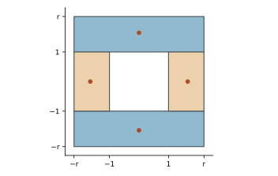

# ENS de Lyon · Second concours · Mathématiques 2017 · Corrigé guidé

*Corrigé rédigé par IA, non officiel. Signalez toute erreur.*

**Rédaction** · GPT-6.2 Astra Ultra · vitesse non renseignée

**Révision** · GPT-6.2 Astra Ultra · vitesse non renseignée · 26 novembre 2026

Le rapport présente les deux objectifs de la composition de trois heures, la concavité de la racine du déterminant et l’inégalité de Brunn–Minkowski dans le plan. La dernière question demande aussi la quarrabilité de la somme pour tous les compacts de la définition. Un contre-exemple en précise la limite.

## 1. Matrices symétriques définies positives

### Question 1.1

> [!INDICATION]
> Tester la forme quadratique sur un vecteur non nul et vérifier les deux inclusions demandées pour un cône.

#### Solution

Pour $\lambda>0$ et $S\in\mathrm{SDP}_n$, $\lambda S$ reste symétrique et $x^t(\lambda S)x=\lambda x^tSx>0$ si $x\ne0$. La multiplication par $1/\lambda$ donne l’inclusion réciproque, donc $\lambda\mathrm{SDP}_n=\mathrm{SDP}_n$. Pour $S,T$ de ce cône et $0\le\theta\le1$, la symétrie est conservée et la forme de $\theta S+(1-\theta)T$ est une moyenne pondérée de deux nombres strictement positifs en chaque $x\ne0$. Cela donne la convexité.

### Question 1.2

> [!INDICATION]
> Exprimer la forme quadratique dans une base orthonormale de vecteurs propres.

#### Solution

Par le théorème spectral réel, $S=U\operatorname{diag}(s_1,\ldots,s_n)U^t$ avec $U$ orthogonale. Pour $y=U^tx$, on a $x^tSx=\sum_i s_i y_i^2$. Si tous les $s_i>0$, cette somme est positive dès que $x\ne0$. Réciproquement, tester sur chaque colonne de $U$ donne $s_i>0$.

### Question 1.3

> [!INDICATION]
> Conserver la base propre pour inverser la matrice.

#### Solution

Le déterminant est $\prod_i s_i>0$. L’inverse $U\operatorname{diag}(s_1^{-1},\ldots,s_n^{-1})U^t$ reste symétrique et toutes ses valeurs propres sont positives. Il appartient donc à $\mathrm{SDP}_n$.

### Question 1.4

> [!INDICATION]
> Employer le milieu pour passer de la concavité à la suradditivité, puis pondérer les arguments pour revenir.

#### Solution

Pour $x,y\in A$, le milieu appartient à $A$, puis $x+y$ aussi par la propriété de cône. Si $f$ est concave, $f(x+y)=2f((x+y)/2)\ge f(x)+f(y)$. Réciproquement, pour $0<\theta<1$, appliquons la suradditivité à $\theta x$ et $(1-\theta)y$. L’homogénéité donne $f(\theta x+(1-\theta)y)\ge\theta f(x)+(1-\theta)f(y)$. Aux deux bornes il y a égalité.

### Question 1.5

> [!INDICATION]
> Appliquer la convexité au logarithme de chacun des nombres positifs.

#### Solution

La dérivée seconde de l’exponentielle est $e^s>0$ sur $\mathbb R$, donc elle est convexe. L’inégalité de convexité pour la moyenne de $\ln a_1,\ldots,\ln a_n$ donne $\exp(n^{-1}\sum_j\ln a_j)\le n^{-1}\sum_j\exp(\ln a_j)$. C’est $(\prod_j a_j)^{1/n}\le n^{-1}\sum_j a_j$.

### Question 1.6

> [!INDICATION]
> Prendre les racines carrées dans la décomposition spectrale.

#### Solution

Dans la notation de 1.2, posons $T=U\operatorname{diag}(\sqrt{s_1},\ldots,\sqrt{s_n})U^t$. Elle est symétrique, de valeurs propres strictement positives, et $T^2=S$.

### Question 1.7a

> [!INDICATION]
> Faire la conjugaison par la racine carrée de $S$.

#### Solution

Comme $T$ est inversible et symétrique, $T^{-1}(SH)T=THT=T^tHT$. Cette matrice est symétrique et, pour $x\ne0$, $(Tx)^tH(Tx)>0$. Elle possède donc une base propre et des valeurs propres réelles strictement positives. La similitude transmet ces propriétés à $SH$, même lorsque le produit n’est pas symétrique.

### Question 1.7b

> [!INDICATION]
> Appliquer l’inégalité arithmético-géométrique au spectre du produit.

#### Solution

Les valeurs propres de $SH$ sont positives par 1.7a. Leur produit est $\det(SH)=\det S\det H$ et leur somme $\operatorname{Tr}(SH)$. L’inégalité 1.5 donne $(\det S\det H)^{1/n}\le\operatorname{Tr}(SH)/n$.

### Question 1.8

> [!INDICATION]
> Après la minoration générale, chercher une matrice $H$ pour laquelle $SH$ est un multiple de l’identité.

#### Solution

Pour tout $H\in\mathrm{SDP}_n$, 1.7b donne $\operatorname{Tr}(SH)/(n(\det H)^{1/n})\ge(\det S)^{1/n}$. Le choix $H=S^{-1}$ est permis par 1.3. Alors $SH=I_n$ et $\det H=(\det S)^{-1}$, ce qui donne l’égalité. L’infimum annoncé est donc atteint.

Tous les cas d’égalité se lisent aussi dans la moyenne arithmético-géométrique. Les $n$ valeurs propres positives de $SH$ doivent être égales à un même $c$. Comme $SH$ est diagonalisable, cela équivaut à $SH=cI_n$, soit $H=cS^{-1}$ avec $c>0$.

### Question 1.9

> [!INDICATION]
> Évaluer le même fonctionnel linéaire aux deux matrices comparées.

#### Solution

Pour chaque $H$, notons $L_H(S)=\operatorname{Tr}(SH)/(n(\det H)^{1/n})$, linéaire en $S$. Par 1.8, $L_H(S)\ge F(S)$ et $L_H(T)\ge F(T)$. Ainsi $L_H(\theta S+(1-\theta)T)\ge\theta F(S)+(1-\theta)F(T)$. En prenant l’infimum en $H$ à gauche on obtient la concavité de $F$ sur le cône convexe.

## 2. Aire des domaines quarrables

### Question 2.1

> [!INDICATION]
> Établir aussi une borne inférieure sur le nombre de pièces du dessin.

#### Solution

Prenons les bandes $[-r,r]\times[1,r]$ et $[-r,r]\times[-r,-1]$, puis les rectangles $[-r,-1]\times[-1,1]$ et $[1,r]\times[-1,1]$. Leurs intérieurs sont disjoints et leur union est $K$. Pour prouver la minimalité, avec $t=(1+r)/2$ considérons $(\pm t,0),(0,\pm t)$. Tout rectangle aligné sur les axes qui contient deux de ces points contient aussi l’origine, exclue de $K$. Il faut donc au moins quatre pavés. La somme des aires donne $2(2r)(r-1)+2\cdot2(r-1)=4(r^2-1)$.

### Question 2.2

> [!INDICATION]
> Utiliser une paire approchante pour encadrer la différence entre les deux bornes.

#### Solution

Tout domaine simple intérieur est inclus dans tout domaine simple extérieur, donc le supremum $s$ des aires intérieures est au plus l’infimum $i$ des aires extérieures. Ces nombres sont finis car $D$ est borné et la définition fournit un domaine intérieur. Pour tout $\varepsilon>0$, la paire approchante donne $i-s\le\operatorname{aire}(A')-\operatorname{aire}(A)\le\varepsilon$. Ainsi $s=i$.

### Question 2.3

> [!INDICATION]
> Exprimer d’abord les deux extrémités pour des intervalles compacts.

#### Solution

Pour $I_1=[a,b]$ et $I_2=[c,d]$, la somme est un intervalle par convexité, contient $a+c,b+d$ et se trouve entre ces bornes. Elle vaut donc $[a+c,b+d]$ et a pour longueur $(b-a)+(d-c)$. Le même argument par infimum et supremum traite les intervalles ouverts ou semi-ouverts, la présence des bornes étant sans effet sur la longueur. Une extrémité infinie donne une longueur infinie.

### Question 2.4a

> [!INDICATION]
> Additionner les deux coordonnées indépendamment.

#### Solution

La somme est $(I+I')\times(J+J')$, car les deux choix de coordonnées sont indépendants. C’est un pavé d’aire $(|I|+|I'|)(|J|+|J'|)$.

### Question 2.4b

> [!INDICATION]
> Élever au carré et comparer les termes croisés.

#### Solution

Notons $a,b$ les côtés de $P$ et $c,d$ ceux de $P'$. La différence entre $(a+c)(b+d)$ et $(\sqrt{ab}+\sqrt{cd})^2$ est $ad+bc-2\sqrt{abcd}=(\sqrt{ad}-\sqrt{bc})^2\ge0$. Les deux quantités à comparer sont positives, d’où l’inégalité après racine.

### Question 2.5

> [!INDICATION]
> Examiner les projections des deux intérieurs sur les axes.

#### Solution

Si les intervalles ouverts des deux projections se rencontraient dans les deux coordonnées, la paire des coordonnées ainsi choisies appartiendrait aux deux intérieurs. L’une des paires d’intervalles ouverts est donc disjointe. Une valeur entre leurs extrémités adjacentes définit une droite verticale ou horizontale qui sépare les pavés, le contact sur cette droite étant permis.

### Question 2.6a

> [!INDICATION]
> Séparer deux pavés choisis parmi les $p$, puis tronquer les autres par la même droite.

#### Solution

Choisissons deux pavés distincts de la décomposition de $A$ et une droite séparatrice donnée par 2.5. De chaque côté, conservons les morceaux d’intérieur non vide des pavés coupés, avec leur bord. Ils forment deux domaines simples dont l’union est $A$ ; les morceaux d’un même côté ont des intérieurs disjoints. Aucun côté ne reçoit de morceau de surface positive de l’un des deux pavés choisis, donc chacun utilise au plus $p-1$ pièces. Les deux côtés sont non vides et d’aire positive. En échangeant les coordonnées au besoin on suppose la droite horizontale, à la hauteur $a$.

### Question 2.6b

> [!INDICATION]
> Faire varier la quantité d’aire située sous la droite.

#### Solution

Notons $v=|B|$, $u_-=|A_-|$ et $u_+=|A_+|$, où les barres désignent les aires. La fonction $b(t)=|B_-(t)|$ est continue car, sur un pavé $[c,d]\times[e,f]$, la contribution est $(d-c)\max(0,\min(t,f)-e)$. On somme sur la décomposition et $|B_+(t)|=v-b(t)$. Comme $b$ vaut successivement zéro puis $v$ en dehors des hauteurs de $B$, elle atteint $v u_-/(u_-+u_+)$. À une telle hauteur $u$, on a $(v-b(u))u_-=b(u)u_+$. Les segments de bord isolés que peut laisser la coupe ont une aire nulle et peuvent être omis dans les pavages.

### Question 2.6c

> [!INDICATION]
> Localiser les deux sommes par rapport à la hauteur $a+u$.

#### Solution

Les ensembles $A_-+B_-(u)$ et $A_++B_+(u)$ sont inclus dans $A+B$ et situés respectivement dans $x_2\le a+u$ et $x_2\ge a+u$. Leur intersection a donc une aire nulle. Chacune est une réunion finie de rectangles, éventuellement avec des segments aux bords pour les coupes exactes. L’additivité des aires et la monotonie donnent $|A+B|\ge |A_-+B_-|+|A_++B_+|$. On peut aussi ne conserver que les pièces de coupe d’aire positive pour obtenir directement la même minoration nécessaire à la récurrence. Pour les coupes exactes, ajouter à un rectangle un segment de bord reste un rectangle, d’où la même inégalité écrite ci-dessus.

### Question 2.6d

> [!INDICATION]
> Exploiter le fait que les proportions d’aire sont les mêmes des deux côtés.

#### Solution

Écrivons $U=|A|$, $V=|B|$ et $\tau=|A_-|/U=|B_-|/V\in(0,1)$. Chaque couple de sous-domaines utilise au plus $(p-1)+p'=m$ pavés après suppression des éléments sans aire et les sommes obtenues sont incluses dans les sommes exactes. Par $(P_m)$ et 2.6c, $|A+B|\ge(\sqrt{\tau U}+\sqrt{\tau V})^2+(\sqrt{(1-\tau)U}+\sqrt{(1-\tau)V})^2=(\sqrt U+\sqrt V)^2$. Cela établit $(P_{m+1})$ pour $p+p'=m+1$, les cas inférieurs étant déjà connus.

### Question 2.7

> [!INDICATION]
> Initialiser la récurrence au plus petit nombre total de pavés.

#### Solution

Chaque domaine simple est non vide. Pour $p+p'=2$, il s’agit de deux pavés, cas démontré en 2.4b. La récurrence 2.6 prouve donc tous les $(P_m)$, et toute paire de domaines simples admet une décomposition finie. On obtient $\sqrt{|A+B|}\ge\sqrt{|A|}+\sqrt{|B|}$.

### Question 2.8

> [!INDICATION]
> Vérifier séparément le passage à la borne intérieure et l’existence de l’aire de Jordan de la somme.

#### Solution

La conclusion sur la quarrabilité est fausse avec la définition générale imprimée. La partie valide est l’inégalité pour l’aire intérieure de $C+D$. En effet, pour tout $\varepsilon>0$, choisissons des domaines simples $A\subset C$, $B\subset D$ dont les aires approchent celles de $C,D$ à $\varepsilon$ près. Le domaine simple $A+B$ est inclus dans $C+D$. En appliquant 2.7 et en prenant la limite, on obtient pour l’aire intérieure $m_*$ la borne $\sqrt{m_*(C+D)}\ge\sqrt{|C|}+\sqrt{|D|}$. Elle vaut notamment pour l’aire de Lebesgue de la somme, qui est compacte. Si l’on suppose en plus $C+D$ quarrable, elle donne exactement l’inégalité d’aires de Jordan demandée.

Voici un contre-exemple à la première assertion. Posons $a_j=2^{-j}+4^{-j}$ pour $j\ge1$ et formons $K$ de toutes les sommes $\sum_{j\ge1}\varepsilon_ja_j$ avec $\varepsilon_j\in\{0,1\}$. Ces ensembles de sommes sont compacts par extraction diagonale et convergence uniforme des queues. La somme de la queue après $j$ vaut $T_j=2^{-j}+4^{-j}/3<a_j$. Après $j$ choix, $K$ est donc couvert par $2^j$ intervalles disjoints de longueur $T_j$, emboîtés d’une étape à la suivante. Leur intersection est exactement $K$, car chaque point de l’intersection suit une chaîne et $T_j\to0$. Il en résulte que $K$ est sans intérieur et que sa longueur de Lebesgue est $\lim_j2^jT_j=1$.

En effet, un intervalle contenu dans $K$ devrait tenir à chaque étage dans un seul intervalle de longueur $T_j$, car ces intervalles sont séparés par des lacunes ouvertes. Sa longueur serait donc nulle. En revanche, la longueur totale à l’étage $j$ vaut $1+2^{-j}/3$. La continuité de la mesure sur cette suite décroissante donne exactement 1 à la limite.

Soient $E$ et $F$ les ensembles de sous-sommes obtenues en ne gardant que les indices impairs, respectivement pairs. On a $E+F=K$. Après les $2m$ premiers indices, chacun est couvert par $2^m$ intervalles de longueur au plus $T_{2m}$, dont la longueur totale tend vers zéro. Avec le carré $Q=[10,11]^2$, posons $C=Q\cup(E\times[0,1])$ et $D=Q\cup(F\times[0,1])$. Chacun est quarrable d’aire un. Le carré fournit l’approximation intérieure et les fines bandes verticales jointes au carré donnent les approximations extérieures.

Près de l’origine, dans $(-1,3)^2$, la somme $C+D$ coïncide avec $K\times[0,2]$, car tout terme qui fait intervenir $Q$ a ses coordonnées trop grandes. Ce produit est fermé, d’intérieur vide et d’aire de Lebesgue deux. Il appartient donc à la frontière de $C+D$. Un compact quarrable a une frontière d’aire nulle car si $A\subset D\subset A'$ sont ses approximations simples, sa frontière est contenue dans $A'\setminus\operatorname{int}A$, d’aire au plus $|A'|-|A|$. Ici cette condition échoue. Le rapport du jury présente l’inégalité de Brunn–Minkowski visée et ne donne pas d’hypothèse supplémentaire pour ce passage.
