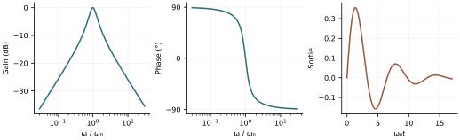
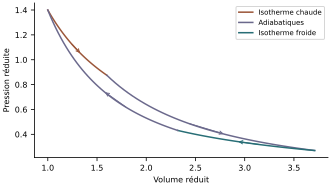
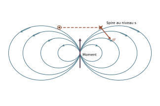
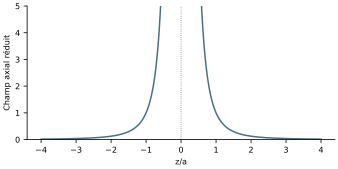
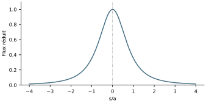
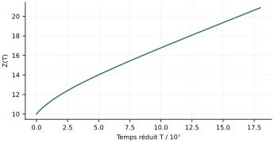
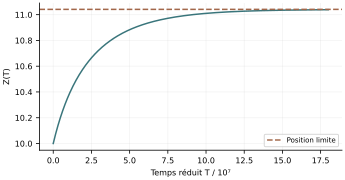
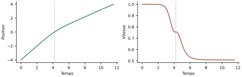

# ENS de Lyon, second concours 2017 — Physique · Corrigé brut

*Corrigé rédigé par IA, non officiel. Signalez toute erreur.*

**Rédaction** · GPT-6.2 Astra Ultra · vitesse non renseignée

## A — Questionnaire de physique

### Question A1 — Condensateur

En convention récepteur, le courant entrant par la borne positive d’un condensateur linéaire de capacité constante est $i=C\,\mathrm du/\mathrm dt$, où $u$ est la tension de cette borne relativement à l’autre.

### Question A2 — Passe-bande et réponse à un échelon

Un exemple d’ordre deux est $H(p)=H_m(\omega_0/Q)p/[p^2+(\omega_0/Q)p+\omega_0^2]$ avec $H_m>0$. Le gain monte à +20 dB/décade, atteint $H_m$ en module à $\omega_0$ puis redescend à −20 dB/décade. La phase passe de +90° à 0° puis à −90°. Un échelon continu n’est pas transmis à long terme. Pour $Q>1/2$, la sortie part de zéro, présente une oscillation amortie et revient à zéro. Pour une excitation unité, $y(t)=H_m\omega_0 e^{-\omega_0t/(2Q)}\sin(\omega_dt)/(Q\omega_d)$ avec $\omega_d=\omega_0\sqrt{1-1/(4Q^2)}$. Un passe-bande plus amorti donne un transitoire sans oscillation.

### Question A3 — Force d’inertie de Coriolis

Dans un référentiel tournant de vitesse angulaire $\boldsymbol\Omega$ par rapport à un galiléen, un point de masse $m$ et de vitesse relative $\mathbf v'$ subit la force d’inertie $\mathbf F_C=-2m\boldsymbol\Omega\times\mathbf v'$. Cette force est perpendiculaire à la vitesse relative.

### Question A4 — Cycle de Carnot

Pour un gaz parfait moteur dans le plan $(V,P)$, faire suivre l’isotherme chaude $T_h$ en détente, l’adiabatique réversible en détente jusqu’à $T_c$, l’isotherme froide en compression et l’adiabatique réversible en compression de retour à l’état initial. Le cycle est horaire et l’aire intérieure donne le travail fourni. En sens inverse on obtient un cycle récepteur.

### Question A5 — Interférences lumineuses

Deux ondes cohérentes de même polarisation donnent $I=I_1+I_2+2\sqrt{I_1 I_2}\cos(\varphi_2-\varphi_1)$ au point d’observation.

### Question A6 — Loi de Fick

Le vecteur densité de flux diffusif est $\mathbf j=-D\nabla c$ pour une concentration $c$ et un coefficient de diffusion isotrope $D$. Le signe indique une diffusion vers les concentrations moindres.

### Question A7 — Tension superficielle

La tension superficielle $\gamma$ est le coût en énergie libre par unité d’aire supplémentaire d’une interface à l’équilibre, dans les conditions thermodynamiques appropriées. Elle représente aussi une force par unité de longueur, tangentielle à l’interface et normale à la ligne de contact. Son unité est le N/m ou le J/m².

### Question A8 — Acier

Le module de Young de l’acier est de l’ordre de $2\times10^{11}$ Pa, soit 200 GPa.

### Question A9 — Diamètre terrestre

Le diamètre moyen de la Terre est approximativement $1{,}27\times10^7$ m, soit 12 700 km.

### Question A10 — Année

Une année julienne vaut $365{,}25\times24\times3600=31\,557\,600$ s, soit environ $3{,}16\times10^7$ s.

## B — Freinage magnétique. Étude qualitative

### Question B1 — Moment magnétique

Le moment magnétique s’exprime en $\mathrm{A\,m^2}$ ou en $\mathrm{J\,T^{-1}}$. Une petite boucle parcourue par un courant permanent $I$ a pour moment $I S\mathbf n$, avec la normale orientée par la règle de la main droite. À distance grande devant ses dimensions, elle produit le champ d’un dipôle.

### Question B2 — Champ du dipôle

Dans un plan méridien les lignes sortent du pôle dirigé vers $+z$, se recourbent et reviennent par le côté opposé. Elles sont symétriques autour de l’axe et plus serrées près de la source. Pour un dipôle idéal, $r_{\rm sph}=C\sin^2\varphi$ décrit une ligne de champ, où $\varphi$ est la colatitude. La spire est centrée sur l’axe dans un plan horizontal à l’altitude $s$.

### Question B3 — Champ sur l’axe

De part et d’autre d’un dipôle de moment $\mathcal M\mathbf e_z$ avec $\mathcal M>0$, $B_0(z)=\mu_0\mathcal M/(2\pi|z|^3)$ pour $z\ne0$. Le champ est orienté vers $+z$ sur les deux demi-axes. Son graphe est positif, pair, décroissant en $|z|$ et tend vers zéro à l’infini. La divergence à l’origine est une singularité du dipôle ponctuel, absente pour un aimant réel.

### Question B4 — Flux à travers la spire

Orienté suivant $+\mathbf e_z$, le flux extérieur est positif, pair en $s$, maximal au passage du plan équatorial et tend vers zéro loin de l’aimant. Pour la boucle de rayon $a$, la circulation du potentiel vecteur dipolaire sur le contour donne
$$\Phi(s)=\frac{\mu_0\mathcal M a^2}{2(a^2+s^2)^{3/2}}.$$
Cette formule régulière pour le contour donne aussi la limite physique quand un petit aimant traverse l’intérieur de la spire. La valeur de $B_0$ en un seul point n’est pas le flux dans ce domaine.

### Question B5 — Courant lorsque la boucle s’éloigne

Pour $s>0$, $\mathrm d\Phi/\mathrm ds<0$. Si $\dot s>0$, le flux extérieur positif décroît. Par la loi de Lenz le courant induit tend à maintenir un flux vers $+z$. Il circule donc dans le sens antihoraire pour un observateur situé du côté $+z$ regardant la boucle.

### Question B6 — Force locale

Pour le sens de B5, $\mathrm d\boldsymbol\ell=a\,\mathrm d\theta\,\mathbf e_\theta$ et $\mathrm d\mathbf F=i\,\mathrm d\boldsymbol\ell\times\mathbf B=ia\,\mathrm d\theta(B_z\mathbf e_r-B_r\mathbf e_z)$. Dans le domaine lointain supérieur, $B_r>0$ et $B_z>0$. La force est donc dirigée vers l’extérieur du cercle et vers le bas. Au voisinage du plan du dipôle la composante $B_z$ sur le fil peut changer de signe.

### Question B7 — Effets mécaniques

Les composantes radiales opposées se compensent dans la résultante mais sollicitent mécaniquement l’anneau. Là où $iB_z>0$ elles tendent à l’élargir. Les composantes axiales s’ajoutent et freinent sa translation vers $+z$. Les moments transversaux des éléments diamétralement opposés se compensent et le couple total autour du centre est nul. Le travail mécanique perdu est dissipé sous forme de chaleur par effet Joule.

### Question B8 — Retourner l’aimant

Le retournement $\mathcal M\to-\mathcal M$ change le signe du champ, du flux, de la f.é.m. et du courant induit. Le produit $i\mathbf B$ reste inchangé. Les efforts locaux, la force de freinage et l’absence de couple sont donc identiques pour la même position et la même vitesse.

### Question B9 — Liberté de basculement

Dans la configuration exactement coaxiale, les deux éléments diamétralement opposés donnent des moments opposés autour de tout diamètre. La translation seule ne déclenche donc aucun retournement. L’approximation dipolaire de la boucle dans un champ presque uniforme aboutit au même résultat, car son moment induit est parallèle au champ axial et le produit vectoriel est nul. Une inclinaison initiale constituerait un autre problème.

## Champ, courant et force de freinage

### Question B10 — Composantes cylindriques

Notons $\rho$ la distance sphérique et $r$ le rayon cylindrique. Les vecteurs sphériques valent $\mathbf e_\rho=\sin\varphi\,\mathbf e_r+\cos\varphi\,\mathbf e_z$ et $\mathbf e_\varphi=\cos\varphi\,\mathbf e_r-\sin\varphi\,\mathbf e_z$. La substitution donne
$$\mathbf B=\frac{\mu_0\mathcal M}{4\pi\rho^3}\big[3\sin\varphi\cos\varphi\,\mathbf e_r+(3\cos^2\varphi-1)\mathbf e_z\big].$$
Il n’y a pas de composante azimutale.

### Question B11 — Champ près de l’axe supérieur

Pour $z>0$ et $r/z\ll1$, $\rho=z[1+O((r/z)^2)]$, $\sin\varphi\simeq r/z$ et $\cos\varphi\simeq1$. Il reste
$$\mathbf B\simeq\frac{\mu_0\mathcal M}{4\pi z^3}
\left(2\mathbf e_z+3\frac r z\mathbf e_r\right).$$
Pour tout le disque de la spire, il faut que son rayon $a$ soit petit devant $s$, puisque $r$ peut prendre toute valeur jusqu’à $a$.

### Question B12 — Flux dans l’approximation lointaine

Sur le disque, $B_z\simeq\mu_0\mathcal M/(2\pi s^3)$ est uniforme à l’ordre retenu. D’où $\Phi(s)\simeq\pi a^2B_z=\mu_0\mathcal M a^2/(2s^3)$ pour $s\gg a$. On retrouve le terme dominant du flux exact de B4.

### Question B13 — Intensité du courant

L’auto-inductance est négligée pour la spire résistive dans ce modèle. Faraday et Ohm donnent $Ri=-\mathrm d\Phi/\mathrm dt=-\Phi'(s)\dot s$, d’où
$$i=\frac{3\mu_0\mathcal M a^2}{2R s^4}\dot s.$$
Le signe est positif pour la translation vers $+z$ envisagée.

### Question B14 — Force résultante

L’intégration de la composante axiale de B6 donne $F_z=-2\pi ai B_r(a,s)=i\Phi'(s)$. En substituant le courant,
$$\mathbf F=-\frac{\Phi'(s)^2}{R}\dot s\,\mathbf e_z=-\frac{9\mu_0^2\mathcal M^2a^4}{4Rs^8}\dot s\,\mathbf e_z.$$
La puissance mécanique vaut $F_z\dot s=-Ri^2$. Cela vérifie indépendamment le signe du freinage.

## Mouvement et conditions initiales

### Question B15 — Temps caractéristique

Posons $C=9\mu_0^2\mathcal M^2a^4/(4R)$. Newton donne $m\ddot s=-C\dot s/s^8$. Avec $s=aZ$ et $t=\tau T$, il vient $Z''=-[C\tau/(ma^8)]Z'/Z^8$. Pour obtenir le coefficient 7 imposé, choisir
$$\tau=\frac{7ma^8}{C}=\frac{28mRa^4}{9\mu_0^2\mathcal M^2}.$$

### Question B16 — Évolution de la vitesse au carré

Posons $V=Z'$. La multiplication de $V'=-7V/Z^8$ par $2V$ donne $(V^2)'=-14V^2/Z^8\le0$. Le carré de la vitesse et l’énergie cinétique décroissent avec le temps. Tant que $Z>0$, le signe de $V$ est conservé pour une trajectoire de durée finie, puisque l’équation en $V$ est homogène.

### Question B17 — Première intégrale

Sur une branche où $V\ne0$, $V'=(\mathrm dV/\mathrm dZ)V$, donc $\mathrm dV/\mathrm dZ=-7/Z^8$. L’intégration depuis l’état initial donne
$$V-V_0=Z^{-7}-Z_0^{-7},\qquad Z_0=z_0/a,\qquad V_0=\tau v_0/a.$$
La relation se prolonge par continuité jusqu’à une éventuelle vitesse limite nulle.

### Question B18 — Trajectoire du cas (a)

Le portrait (a) part de $Z_0=10$ avec une vitesse positive qui diminue en restant au-dessus d’une asymptote positive. En temps, la position croît avec une pente d’abord plus élevée puis décroissante. Elle tend vers une droite de pente $V_\infty=V_0-Z_0^{-7}>0$. L’axe temporel commence à $Z(0)=Z_0$. La faiblesse du freinage lointain permet la poursuite du mouvement.

### Question B19 — Trajectoire du cas (b)

La branche accessible va du point initial jusqu’à son intersection avec $V=0$, vers $Z\simeq11$ sur le graphe. En temps, $Z(T)$ croît d’abord puis s’aplatit et tend asymptotiquement vers la valeur finie $Z_\infty=(Z_0^{-7}-V_0)^{-1/7}$. La prolongation du dessin vers $V<0$ au-delà de cette abscisse ne fait pas partie de cette trajectoire initialement positive.

### Question B20 — Les deux régimes

En dessous d’une vitesse seuil, le freinage dissipe toute l’énergie cinétique et la boucle tend vers une position finie. Au-dessus du seuil, elle s’échappe avec une vitesse limite positive après avoir dissipé une partie de l’énergie initiale. À la séparation des deux cas, elle va à l’infini tout en ralentissant vers zéro.

### Question B21 — Frontière

La frontière satisfait $V_0=Z_0^{-7}$. Dans ce cas $Z'=Z^{-7}$ et $Z(T)=(Z_0^8+8T)^{1/8}$. Les cas (a) et (b) sont respectivement $V_0>Z_0^{-7}$ et $0<V_0<Z_0^{-7}$.

### Question B22 — Seuil en unités physiques

$v_0^\star=(a/\tau)(a/z_0)^7$. Avec B15,
$$v_0^\star=\frac{9\mu_0^2\mathcal M^2 a^4}{28mR z_0^7}.$$
Cette forte dépendance en $z_0$ découle du gradient du flux de champ lointain. Elle s’applique dans le domaine $z_0\gg a$.

### Question B23 — Analogie céleste

On peut appeler ce seuil « vitesse de libération » ou « vitesse d’échappement ». Ici le seuil est lié au freinage dissipatif intégré le long de la trajectoire. En gravitation newtonienne usuelle, il découle d’un potentiel conservatif.

### Question B24 — Arrêt asymptotique

Au voisinage de la limite finie, $V'\simeq-(7/Z_\infty^8)V$. D’où $V(T)\simeq V_*e^{-7(T-T_*)/Z_\infty^8}$ à partir d’un temps $T_*$ suffisamment tardif. L’écart $Z_\infty-Z$ décroît avec la même constante de temps $Z_\infty^8/7$ en unités réduites. Ce comportement explique pourquoi le mobile ne traverse pas le zéro de B19.

### Question B25 — Passage à travers le plan du dipôle

Pour traverser la région $|s|\lesssim a$, utiliser le flux exact de B4. La loi de freinage résistive reste $m\ddot s=-\Phi'(s)^2\dot s/R$. Le coefficient est pair, maximal de chaque côté près de $|s|=a/2$, nul au centre et négligeable à grande distance. Pour l’état initial assez rapide demandé, $s(t)$ croît toujours. Loin en amont, sa pente est presque constante. Elle diminue surtout dans les deux zones proches de l’aimant et devient de nouveau presque constante, plus faible, loin en aval. Au plan médian, la vitesse est positive et l’accélération instantanément nulle. Le courant change de signe lorsque le flux recommence à décroître. Une extrapolation en $1/s^8$ jusque sur l’aimant donnerait une fausse singularité.

### Question B26 — Spire supraconductrice

Avec $R=0$, la loi de Faraday impose $\mathrm d(Li+\Phi)/\mathrm dt=0$ pour une inductance propre constante. Posons $\Phi_c=Li(0)+\Phi(s_0)$. La force est $i\Phi'(s)$, d’où
$$m\ddot s=\frac{\Phi_c-\Phi(s)}L\Phi'(s)=-\frac{\mathrm d}{\mathrm ds}
\left[\frac{(\Phi(s)-\Phi_c)^2}{2L}\right].$$
L’énergie $\tfrac12m\dot s^2+(\Phi-\Phi_c)^2/(2L)$ est conservée. La force dépend de la position et du flux initial, sans terme de freinage ohmique. Si $i(0)=0$ et $\Phi'(s_0)\ne0$, le potentiel possède un minimum local en $s_0$ et la pulsation des petites oscillations est $|\Phi'(s_0)|/\sqrt{mL}$. Selon l’énergie et le flux piégé, on peut obtenir oscillations, retournement ou échappement. Dans le domaine lointain on peut insérer $\Phi(s)\simeq\mu_0\mathcal M a^2/(2s^3)$ dans la même équation.

[Sujet officiel](https://banques-ecoles.fr/cms/wp-content/uploads/2017/10/2017_2CC_sujet_Phy.pdf) · [Rapport du jury](https://banques-ecoles.fr/cms/wp-content/uploads/2017/12/17_2CC_rap_ePhy.pdf)
