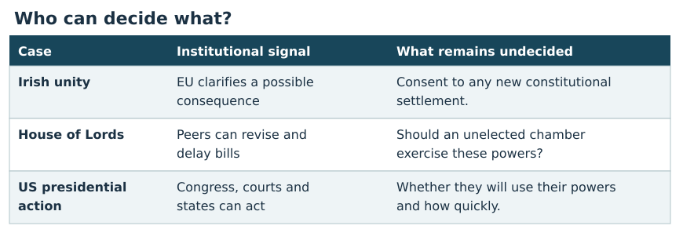

# ENS de Lyon · Série SES (B/L) · Anglais oral 2017 — Corrigé guidé

*Corrigé rédigé par IA, non officiel. Signalez toute erreur.*

**Rédaction** · GPT-6.2 Astra Ultra · vitesse non renseignée

**Révision** · GPT-6.2 Astra Ultra · vitesse non renseignée

Trente-trois notices sont recensées dans la liste SES. Les pages 103–131 du cahier hors programme fournissent vingt-neuf coupures SES : vingt-six concordances certaines, une coupure liée aux deux notices contradictoires sur l’immigration et deux billets supplémentaires. Les trente-cinq entrées sont commentées en anglais. Cinq titres de la liste restent sans coupure SES.

## Thirty-three notices in the SES list

The papers distributed to SES candidates survive on pages 103–131 of the official supplementary booklet. Numbers 1–33 follow the separate SES catalogue. Numbers 34 and 35 are printed as SES papers but were omitted from that list. One paper, on immigration, has three different periodical attributions across the two sources.

> [!INDICATION]
> Prepare for one hour without a dictionary. Build a six-to-eight-minute introduction and synthesis, followed by twelve to fourteen minutes of organised commentary. Select a short passage from the copy actually distributed and read it aloud during the twenty-minute presentation. Leave any conclusions the headline cannot support for the evidence in that copy. The interview lasts ten minutes.

### 1. The parallels between Scottish nationalism and racism are clear

_The Guardian · 27/02/2017._

Claire Heuchan examines the response to Sadiq Khan’s comparison between political divisions. Her crucial qualification is that Scottish nationalism and racism are different things. The parallel concerns a boundary drawn between an “us” and a “them”. By writing as a Black Scottish woman she tests the assumption that a civic account of Scottishness has already solved the problem of belonging. A strong commentary would ask whether a movement’s inclusive programme can coexist with exclusion in some of its supporters’ speech. The two claims involve different kinds of evidence. [Publication or author’s copy](https://www.theguardian.com/commentisfree/2017/feb/27/parallels-scottish-nationalism-racism-sadiq-khan)

**In the examination copy.** Claire Heuchan begins by qualifying Sadiq Khan’s analogy and then asks what an “us and them” politics leaves unexamined. At the end she points to inequalities in British recruitment. The movement from the language of nationhood to employment discrimination shows what she thinks identity debates can divert attention from. [Fascicule des extraits, p. 127](https://www.ens-lyon.fr/sites/default/files/2017-11/anglais-hors-prgramme2017_1506588702296.pdf#page=127)

**Follow-up.** Would an analogy establish equivalence? No. It identifies a relation worth comparing. Treating the two ideologies as interchangeable would erase the author’s own qualification.

### 2. The stories that won’t make headlines in George Osborne’s Evening Standard

_The Guardian · 01/05/2017._

When George Osborne became editor of the *Evening Standard*, his career as a Conservative chancellor and his other interests made editorial silence a story in its own right. The piece imagines subjects unlikely to make the front page. That device turns the familiar idea of a newspaper’s “line” into a question about what readers never get to discuss. A conflict of interest is about incentives and credibility even when no instruction to suppress a story can be proved. A list of hypothetical omissions therefore raises a legitimate question while leaving the newsroom’s actual future decisions open to examination. [Publication or author’s copy](https://www.theguardian.com/media/2017/may/01/george-osborne-evening-standard-stories-that-wont-make-headlines)

**In the examination copy.** The piece imagines which London stories might fail to reach a future front page, starting from visible homelessness and moving to tax credits. Its closing numerical estimate attributes an effect to a particular policy. The piece challenges an editor’s priorities by reconstructing the consequences of decisions made in his previous office. [Fascicule des extraits, p. 120](https://www.ens-lyon.fr/sites/default/files/2017-11/anglais-hors-prgramme2017_1506588702296.pdf#page=120)

**Follow-up.** How could one test the argument? Compare the prominence and treatment of similar stories, including ones that reflect badly on political opponents, over time.

### 3. EU backing for Irish unity after Brexit is a big deal – but it’s not a solution

_The Guardian · 04/05/2017._

Fintan O’Toole distinguishes an important concession from a settlement of the Irish question. After Brexit, Northern Ireland could return to the European Union as part of a united Ireland, subject to the democratic process for reunification. This gave Irish unity a potential European consequence that it did not previously have. It did not settle whether voters wished to reunify, how British identity would be protected or what should happen at the border in the meantime. The piece is particularly revealing about the difference between removing a legal obstacle and winning political consent. [Publication or author’s copy](https://www.theguardian.com/commentisfree/2017/may/04/eu-irish-unity-brexit-europe-northern-ireland)

**In the examination copy.** The clipping first establishes an exceptional EU position on possible Irish unity. Its last lines return to political and economic problems on the island which neither Westminster nor EU leaders can settle by issuing a statement. The conjunction in the headline therefore signals the actual structure of the argument. [Fascicule des extraits, p. 111](https://www.ens-lyon.fr/sites/default/files/2017-11/anglais-hors-prgramme2017_1506588702296.pdf#page=111)

**Follow-up.** Why might recognition from Brussels have little immediate effect on the ground? It clarifies a future option while leaving the border, institutions and people on both sides in their present relationship.

### 4. The Mob Vetoes Ann Coulter

_The American Conservative · 27/04/2017._

After Ann Coulter’s planned speech at Berkeley fell through, the writer portrays the disruption as a veto exercised by a hostile crowd. The noun “mob” assigns blame before the sequence of cancellations and rescheduling has been recounted. The strongest free-speech argument concerns the precedent created when anticipated disorder determines who can appear. It also leaves an important institutional problem: a university must protect speakers, peaceful protesters and students. To analyse this opinion one should distinguish a right to speak, an invitation to use a specific venue and a duty to take threats seriously. [Publication or author’s copy](https://www.theamericanconservative.com/__trashed-2/)

**In the examination copy.** Peter Van Buren treats problems at Berkeley as a test of whether a platform can be denied to a speaker and identifies a wider danger for democratic deliberation. Its close describes free speech as a means of defence against coercive politics. An oral response can question his jump from specific campus decisions to a national diagnosis. [Fascicule des extraits, p. 125](https://www.ens-lyon.fr/sites/default/files/2017-11/anglais-hors-prgramme2017_1506588702296.pdf#page=125)

**Follow-up.** Does vigorous protest itself amount to a veto? No. Counter-speech is an exercise of the same freedom. The threshold changes when opposition makes the event impossible through intimidation.

### 5. Common Sense About Immigration

_The American Conservative · 15/12/2016._

The list attributes this title to The American Conservative. The surviving page identifies Gilbert T. Sewall as the author and The American Spectator as the publisher. Sewall first ventriloquises a position that sees immigration as an unquestioned national good, then targets the motives he ascribes to affluent supporters of that view. His rhetoric selects a class of adversaries and presents their account as self-congratulation. Calling this “common sense” makes an argumentative position sound like agreement already in place. A reader can test the jump from the private interests ascribed to particular people to conclusions about migration policy. [Fascicule des extraits, p. 123](https://www.ens-lyon.fr/sites/default/files/2017-11/anglais-hors-prgramme2017_1506588702296.pdf#page=123)

**Follow-up.** What warrants correcting the periodical? The dated heading on the page distributed states The American Spectator and names Sewall. The other two titles remain bibliographical variants of the list, not independently established sources for the passage.

### 6. NFL Idiots Dissing Our National Anthem Is Another Reason Why Trump Will Win!

_American Thinker · 14/09/2016._

The writer of this *American Thinker* column interprets players’ refusal to stand during the national anthem as an insult that will help Trump win. The exclamation and the word “idiots” perform the anger they claim to diagnose among voters. In the players’ account the protest concerned racial injustice; for the columnist the anthem stands for a nation that deserves a public sign of loyalty. The disagreement thus involves competing meanings of one gesture. The leap from that disagreement to an electoral prediction is another matter: a reader would need evidence about voters’ priorities to assess it. [Publication or author’s copy](https://www.americanthinker.com/articles/2016/09/nfl_idiots_dissing_our_national_anthem_is_another_reason_why_trump_will_win.html)

**In the examination copy.** Lloyd Marcus opens at home as a spectator hoping to enjoy a game. He ends by claiming to know how a national majority will vote. The difference in scale places the burden of proof exactly where the personal voice sounds most certain. His prediction belongs to September 2016. [Fascicule des extraits, p. 121](https://www.ens-lyon.fr/sites/default/files/2017-11/anglais-hors-prgramme2017_1506588702296.pdf#page=121)

**Follow-up.** Does the election result prove the columnist’s explanation? It verifies the prediction of a winner. It cannot by itself show that a particular protest caused enough votes to change.

### 7. Common Sense About Immigration

_American Thinker · 15/12/2016._

The second catalogue attribution, American Thinker, differs both from no. 5 and from page 123. Only the page headed The American Spectator establishes the words given in a surviving SES paper. A second route through that page would examine its conclusion. The writer asks who benefits from economic and cultural changes, then answers for a loosely defined group of Americans. Whose voice is represented in the answer? No migrant is directly made the final speaker. This distributes rhetorical power unevenly even before one evaluates the policy claims. [Fascicule des extraits, p. 123](https://www.ens-lyon.fr/sites/default/files/2017-11/anglais-hors-prgramme2017_1506588702296.pdf#page=123)

**Follow-up.** Were two separate articles handed out? The booklet establishes one sheet by Sewall. Neither variation in the magazine names nor repetition in the list establishes a second distinct sheet.

### 8. Soldiers Speak Out on 9/11: ‘I Never Handed Out a Bouquet of Flowers during Combat’

_American Thinker · 11/09/2016._

Elise Cooper’s article, published around the fifteenth anniversary of September 11, juxtaposes two soldiers’ perspectives with changing civilian attitudes to the attacks and the military response. The bouquet in the headline turns a civilian sign of goodwill into a pointed contrast with a soldier’s experience. An interview earns authority by letting named participants speak, but selection and a prominently placed quotation also shape how the reader hears them. One should distinguish respect for a witness’s experience from endorsement of every broader political inference drawn from it. [Author and date in the publisher’s archive](https://www.americanthinker.com/articles/2016/09/)

**In the examination copy.** The anniversary piece gives the floor to soldiers Irving and Smith and closes by extending their claims to people in uniform more generally. It also brings Kaepernick’s protest into the argument. Keeping the interviewees’ experiences separate from the writer’s choice of topical comparison helps explain how commemoration becomes commentary. [Fascicule des extraits, p. 104](https://www.ens-lyon.fr/sites/default/files/2017-11/anglais-hors-prgramme2017_1506588702296.pdf#page=104)

**Follow-up.** What does the anniversary add? It sets memories formed in 2001 beside their interpretation during an election campaign fifteen years later.

### 9. Trump’s Crash Course in the African American Experience

_The American Prospect · 31/03/2017._

The “crash course” casts the president as a beginner in a history that already belongs to the country he governs. The encounter with the Congressional Black Caucus sets an institution with a policy record against public gestures claiming concern for Black Americans. The irony allows the writer to challenge what qualifies as listening. A policy conversation would require confronting inequalities in representation, employment and justice; holding a meeting provides a public photograph well before it demonstrates agreement or change. Distinguish the caucus, an organisation of legislators, from a claim to speak for every Black citizen. [Publication or author’s copy](https://prospect.org/2017/03/31/trump-s-crash-course-african-american-experience/)

**In the examination copy.** Gabrielle Gurley sets up the Congressional Black Caucus visit as something other than a ceremonial photo opportunity. The final classroom metaphor asks what an inattentive president stands to lose if he disregards the agenda. Its cutting answer makes the electoral incentives part of the diagnosis. [Fascicule des extraits, p. 117](https://www.ens-lyon.fr/sites/default/files/2017-11/anglais-hors-prgramme2017_1506588702296.pdf#page=117)

**Follow-up.** Why use a schoolroom metaphor? It reverses expected authority: occupying the highest office does not make someone the most knowledgeable participant in a discussion.

### 10. Editorial – Are Confederate monuments ‘our story?’

_Baltimore Sun · 24/05/2017._

The Baltimore editorial’s question turns on who can claim the possessive “our”. A monument presents a version of local belonging through its subject, site and inscription. A Confederate figure may be part of a city’s past without representing every inhabitant’s chosen civic ideal. A commentary should distinguish historical knowledge from public honour and ask when and by whom a memorial was erected. Relocation and the addition of interpretation answer different questions. The Baltimore debate also offers a comparison with New Orleans at no. 20, provided the two cities’ monuments and decisions are kept distinct.

**In the examination copy.** The editorial begins with a Baltimore mayoral commission that recommended removing two of four monuments. The distinction matters: the choice was already being made object by object. At the close the editorial asks which forms of public commemoration might permit a common future. Its possessive “our” remains contested throughout. [Fascicule des extraits, p. 119](https://www.ens-lyon.fr/sites/default/files/2017-11/anglais-hors-prgramme2017_1506588702296.pdf#page=119)

**Follow-up.** Would removal erase all historical evidence? The archival record, museums and teaching have different functions from an honoured place in a civic square.

> [!INDICATION]
> To move from synthesis into commentary, name one word that does political work. Examples include *our* in the Baltimore editorial, *vetoes* in the Berkeley column and *checks* in the Boston piece. Each directs attention to an identifiable actor or institution.

### 11. Northern Ireland women to get abortions free on NHS

_BBC News · 29/06/2017._

On 29 June 2017 the news concerned funding in England for abortion care for women travelling from Northern Ireland. The jurisdiction and the journey are essential to the story: a change to charges in England did not at that point rewrite the criminal law in Northern Ireland. What looks like a national entitlement under the name “NHS” can involve devolved health systems, different territorial rules and costs borne by patients. The 2017 argument must also be separated from subsequent changes in the law. A report answers who announced what and where before an oral commentary assesses unequal access. [Subsequent official statement on funding](https://questions-statements.parliament.uk/written-statements/detail/2017-10-23/HCWS192)

_The supplementary booklet contains no identifiable SES copy of this title._

**Follow-up.** Why does location matter so much in this headline? It determines both the applicable rules and who pays for care. Travel itself can remain an obstacle after the charge is removed.

### 12. Vote early, vote often

_The Economist · 04/02/2017._

The *Economist* leader uses “vote early” to argue about the age at which citizens should first vote. The second half of the familiar phrase now concerns participation over a lifetime. Lowering the voting age to sixteen may allow the first election to happen while school and family still provide support for political discussion. If voting becomes habitual, that first experience could help reduce the age gap in turnout. This is a hypothesis about participation, distinct from the normative question of who deserves representation. Evidence from countries such as Austria matters more than a stereotype about young voters’ maturity. [Reproduction of the Economist leader](https://cahier-de-prepa.fr/pc%2A-descartes/download?id=2178)

**In the examination copy.** The leader compares turnout across age groups and asks when voting habits are formed. It explicitly dates the US figures and notes that the latest election data were then unavailable. The closing appeal to catch voters early translates a descriptive age gap into a proposal about democratic education. [Fascicule des extraits, p. 105](https://www.ens-lyon.fr/sites/default/files/2017-11/anglais-hors-prgramme2017_1506588702296.pdf#page=105)

**Follow-up.** Could low youth turnout justify postponing the first vote? It could equally be an argument for earlier access and better civic education. The causal direction needs investigation.

### 13. Sliding towards Scoxit

_The Economist · 18/02/2017._

“Scoxit” borrows the language of Brexit for the possible departure of Scotland from the United Kingdom. In 2014 Scotland voted to remain in the UK; in 2016 a Scottish majority voted to remain in the EU while the UK as a whole voted to leave. The two results were taken under different constitutional questions. Nationalists could therefore claim changed circumstances, while unionists could continue to invoke the earlier decision. The pun suggests momentum, yet a referendum requires political authorisation and its outcome cannot be inferred by adding up the two sets of votes.

**In the examination copy.** The conclusion deliberately puts desirability and likelihood on different tracks. Brexit could make independence more politically attractive while complicating Scotland’s economic case for leaving the UK. The leader asks readers to test the very different political and economic consequences of a single referendum result. [Fascicule des extraits, p. 103](https://www.ens-lyon.fr/sites/default/files/2017-11/anglais-hors-prgramme2017_1506588702296.pdf#page=103)

**Follow-up.** Could an independence voter also have voted for Brexit? Yes. The ballots asked distinct questions. Assuming identical coalitions would remove much of the political difficulty the article describes.

### 14. Let the work permits flow

_The Economist · 21/01/2017._

The Bagehot column’s title captures a contradiction in the British debate after the referendum. Ending automatic free movement was politically salient, while employers still wanted access to labour from abroad. A work-permit system could change the authority deciding admission without necessarily reducing the number of people working in Britain. It could also privilege certain sectors or salaries and increase the costs of hiring. The question to carry into the commentary is who defines the national interest: a minister, an employer facing vacancies, a local community or the worker whose status may depend on a particular job? [Bibliographical identification of the Bagehot column](https://www.regione.toscana.it/documents/10180/14551890/Saggio%2B1%2B-%2BSturm.pdf/d69fe745-1926-4994-a56b-7a43798f868c)

_The supplementary booklet contains no identifiable SES copy of this title._

**Follow-up.** Does control guarantee a particular level of immigration? No. Control describes a procedure and a decision-maker. The results depend on the criteria adopted and the demand for labour.

### 15. Perils of Indigenous People’s Day

_San Francisco Chronicle · 06/10/2016._

This San Francisco opinion piece questions what is achieved by replacing Columbus Day with an observance of Indigenous peoples. Commemorations select civic ancestors and carry the history of earlier groups seeking recognition. The example of competing claims about early European arrivals makes the choice of a “discoverer” look less self-evident. An oral commentary should ask what frame of time each proposed holiday adopts. Starting the story with a European landing makes already existing societies appear only when outsiders see them. A more inclusive public calendar also has to decide whether a renamed day is enough to change what is taught. [Publication or author’s copy](https://www.sfchronicle.com/opinion/openforum/article/Perils-of-Indigenous-People-s-Day-9885906.php)

_The supplementary booklet contains no identifiable SES copy of this title._

**Follow-up.** Is recognising Indigenous histories the same as choosing another European explorer? No. The former changes who has historical agency, while the latter may merely change the winner of a familiar race.

### 16. The opinion pages – Dismantling Climate Rules Isn’t So Easy

_The New York Times · 08/12/2016._

The date, after Trump’s election but before his inauguration, makes this a prospective question about executive power. An administration can change political priorities quickly. Replacing an environmental rule may require statutory authority, notice, reasons and an opportunity for judicial review. Scientific findings and the administrative record can constrain a reversal. The difficulty suggested in the headline therefore has a precise institutional meaning. It does not guarantee the survival of any individual regulation. In an oral response, explain the particular power involved before asking whether procedural friction is a safeguard or a delay.

**In the examination copy.** William W. Buzbee begins with Trump’s nomination of Scott Pruitt and then traces constraints running through statute, courts and state action. The candidate chosen for an agency helps establish an intention. Whether that intention can survive administrative procedure and legal review is the analytical question which follows. [Fascicule des extraits, p. 124](https://www.ens-lyon.fr/sites/default/files/2017-11/anglais-hors-prgramme2017_1506588702296.pdf#page=124)

**Follow-up.** Why can announcing a reversal be easier than implementing it? A speech signals a preference. An enforceable replacement has to survive the legal process that governs the agency.

### 17. Britons are sensible and shun extremes. Right? So how to explain the popularity of a Marxist zealot?

_The Daily Mail · 08/06/2017._

The *Daily Mail* headline first attributes moderation to a British collective, then presents Jeremy Corbyn as a puzzle that this collective must explain. “Marxist zealot” loads the answer into the question: the reader is invited to see support for him as a departure from national good sense. Yet votes for a Labour candidate might reflect public services, local loyalties or dissatisfaction with the Conservatives without amounting to endorsement of a political label. The date is election day. A disciplined explanation should preserve that uncertainty and resist using later results as if the writer already knew them.

**In the examination copy.** Stephen Glover measures Corbyn against an image of a moderate Britain and closes by shifting from political denunciation to a first-person admission of anxiety. Reading the tense and tone of the last lines aloud makes clear that the election still lies in the future for the columnist. [Fascicule des extraits, p. 122](https://www.ens-lyon.fr/sites/default/files/2017-11/anglais-hors-prgramme2017_1506588702296.pdf#page=122)

**Follow-up.** What does the opening “Right?” do? It invites a conversational assent, then makes the reader’s presumed agreement a platform for the accusation that follows.

### 18. Harry and Co should be careful what they wish for. If they are so reluctant to be Royals do we really need them anyway?

_The Daily Mail · 19/06/2017._

The headline moves from Harry’s reported reluctance about royal duties to a question about the need for hereditary monarchy. Its force comes from a reversal: if the public role feels burdensome to the family, the writer asks why citizens should wish to preserve it. A commentary should distinguish unwillingness to accept a particular personal burden from rejection of an institution, and then consider what public consent means when succession is hereditary. Keep the chronology in 2017. Later decisions by Harry and Meghan cannot be evidence that the journalist possessed at the time.

_The supplementary booklet contains no identifiable SES copy of this title._

**Follow-up.** Who is the “we” in the question? The writer invites readers to imagine themselves as a public entitled to assess the return on its loyalty and attention.

### 19. How to feel about the House of Lords if you’re left-wing

_The New Statesman · 03/03/2017._

A left-wing defence of the House of Lords appears paradoxical because its members are unelected and some places remain hereditary. Yet an upper chamber can amend bills, scrutinise ministers and oblige a government with a Commons majority to reconsider. The title asks a reader to decide what democratic legitimacy should measure: the manner of appointment, the effect on legislation or both. Support for a particular amendment does not settle the institutional question. An oral commentary can use this ambivalence to distinguish the case for scrutiny from the case for the existing composition of the chamber. [Publication or author’s copy](https://www.instituteforgovernment.org.uk/article/ifg-news/how-feel-about-house-lords-if-youre-left-wing)

**In the examination copy.** Anoosh Chakelian gives the apparent contradiction a concrete parliamentary setting when the Lords amend a housing policy. The barbed social description at the end acknowledges an aristocratic institution even as the writer welcomes its resistance to government. That unresolved discomfort explains the joke in the subheading. [Fascicule des extraits, p. 115](https://www.ens-lyon.fr/sites/default/files/2017-11/anglais-hors-prgramme2017_1506588702296.pdf#page=115)

**Follow-up.** Does scrutiny make the Lords sovereign over the Commons? No. Its delaying and revising powers operate within an order in which the elected chamber has the stronger claim.

### 20. New Orleans Is Wrong to Remove Its Confederate Monuments

_The Federalist · 25/04/2017._

The *Federalist* piece explicitly opposes New Orleans’s removal of Confederate memorials. Its case gives continuity and historical memory considerable weight. A careful answer would ask whether leaving a monument in place is as neutral as its defenders suggest. Its original installation was a public choice, and maintaining it in an honoured space is also a decision. Removing it may be interpreted as correcting a landscape of unequal citizenship, while preserving it with context expresses a different theory of remembrance. Identify the position of this particular author before comparing the Baltimore editorial at no. 10. [Publication or author’s copy](https://thefederalist.com/2017/04/25/new-orleans-wrong-remove-confederate-monuments/)

**In the examination copy.** John Daniel Davidson uses the debate following the Charleston church shooting to place the New Orleans decisions within a changing national context. His close invites readers to look at statues and contemplate why men fought. That invitation rests on a view of what a civic monument does, which can be tested against Baltimore’s different account. [Fascicule des extraits, p. 106](https://www.ens-lyon.fr/sites/default/files/2017-11/anglais-hors-prgramme2017_1506588702296.pdf#page=106)

**Follow-up.** Why distinguish the date of a war from the date of a monument? The latter can reveal political purposes belonging to the generation that commissioned the monument.

### 21. The ‘British Bill of Rights’ will not protect our human rights

_The Independent · 10/12/2016._

Richard Burgon responds to proposals for a British Bill of Rights by defending the protections made available through the Human Rights Act. A national adjective makes the proposed bill sound like the recovery of something foreign. Yet British lawyers helped shape the European Convention and UK courts already adjudicate many rights claims. Distinguish the Convention and its Strasbourg court from the European Union, a particularly important point in December 2016. The argumentative question is what remedies a claimant could actually use under a replacement, beyond the appeal of the name. [Publication or author’s copy](https://www.the-independent.com/voices/british-bill-of-human-rights-day-richard-burgon-theresa-may-a7467281.html)

**In the examination copy.** Shadow Justice Secretary Richard Burgon opens by recalling headline-making cases and turns their notoriety into an argument for the universality of rights. A right that protects only those whom readers already like would offer little protection. Naming his institutional and party role helps place his criticism of the proposed British Bill of Rights. [Fascicule des extraits, p. 128](https://www.ens-lyon.fr/sites/default/files/2017-11/anglais-hors-prgramme2017_1506588702296.pdf#page=128)

**Follow-up.** Would leaving the EU by itself terminate Convention membership? No. The Convention belongs to a different international organisation, the Council of Europe.

### 22. Opinion – Checks and balances can slow Trump

_The Boston Globe · 22/02/2017._

The Boston opinion piece tests the optimistic proposition that constitutional checks can restrain a president. Courts review legal grounds for executive action, Congress controls legislation and appropriations, and states may have standing to challenge a federal measure. Each check takes time and depends on somebody invoking it. Delay may give opponents room to organise or force an administration to revise a measure, without permanently vetoing the policy. The verb “slow” avoids promising a complete institutional rescue. The commentary should examine what would make a check effective when a president’s party also has a congressional majority. [Publication or author’s copy](https://www.bostonglobe.com/opinion/2017/02/22/checks-and-balances-can-slow-trump/vCRVdVpYUSc9qZqlp8nlUM/story.html)

**In the examination copy.** Alan Dershowitz starts from a high-school civics lesson and then qualifies it. The branches do not operate in three sealed boxes, and institutions outside the simplified classroom scheme may also impose checks. A barrier slowing a policy is a distinct claim from certainty that it will ultimately prevent that policy. [Fascicule des extraits, p. 110](https://www.ens-lyon.fr/sites/default/files/2017-11/anglais-hors-prgramme2017_1506588702296.pdf#page=110)

**Follow-up.** Why is a formal power not always an effective check? Its holder may share the president’s goals or lack the incentive and resources to use it.

### 23. Voting Restrictions Won’t ‘Make America Great Again’

_NPR.ORG · 03/09/2016._

The title adapts Trump’s campaign slogan to argue that restrictions on voting weaken the democracy they claim to protect. Registration rules, identification requirements and limits on early voting affect distinct stages of participation. A formally identical rule can be costlier for voters who have less flexible work or poorer access to documents. The counterargument about electoral integrity deserves a precise test: what problem is documented, and would the proposed restriction address it in proportion to its burden? The article appeared before the November election, when barriers and rhetoric could already influence participation. [Context on changes to voting rules](https://www.brennancenter.org/our-work/research-reports/new-voting-restrictions-america)

_The voting-restrictions article is present in the A/L section on page 2. Its inclusion there does not establish that the SES cutting was identical._

**Follow-up.** Can one infer intent from unequal effects? Effects provide evidence about the consequences. Establishing a particular intention may require additional legislative and historical evidence.

### 24. Opinion – The other California: A flyover state within a state

_Orange Country Register · 09/04/2017._

“A flyover state within a state” turns a familiar coastal stereotype back on California. Joel Kotkin contrasts internationally visible coastal prosperity with the jobs, housing costs and prospects of inland communities. An aggregate statewide figure can rise while particular regions struggle. The essay invites the reader to view a successful economy from the perspective of those who cannot afford entry to its most prosperous labour markets. The metaphor also simplifies a socially varied interior. The interesting test is which geographic and economic indicators support the contrast and which complicate it. [Publication or author’s copy](https://joelkotkin.com/the-other-california-a-flyover-state-within-a-state/)

**In the examination copy.** Joel Kotkin reports the “flyover” complaint from Kern County, using a metaphor usually applied between US regions inside a single state. Local economic circumstances and the decisions of Sacramento are the two levels to follow. The biographical note also locates the writer in institutions concerned with urban development. [Fascicule des extraits, p. 116](https://www.ens-lyon.fr/sites/default/files/2017-11/anglais-hors-prgramme2017_1506588702296.pdf#page=116)

**Follow-up.** Why does the title repeat “state”? It places the political unity of California against divisions substantial enough to resemble a boundary between states.

### 25. Trump the War President?

_Project Syndicate · 11/04/2017._

Ian Buruma asks what happens when military action suddenly changes the way a president is described. After the US strike in Syria in April 2017, praise for an apparently decisive leader could displace earlier scrutiny of Trump. The question mark makes “war president” a possible public role, not a settled doctrine. A successful commentary would distinguish the immediate response to images of suffering, the legal and political question of authorisation and the longer-term strategy required after a single act. The language of presidential stature may move faster than answers to any of those questions. [Publication or author’s copy](https://www.project-syndicate.org/commentary/trump-syria-missiles-media-reactions-by-ian-buruma-2017-04)

**In the examination copy.** Ian Buruma sets praise for a US strike in Syria beside the possibility of a dangerous escalation elsewhere. The ironic last sentence echoes the language of approval the column has been scrutinising. The target is the incentive to win public recognition by appearing decisive, rather than a claim to know each private motive of the president. [Fascicule des extraits, p. 126](https://www.ens-lyon.fr/sites/default/files/2017-11/anglais-hors-prgramme2017_1506588702296.pdf#page=126)

**Follow-up.** Why pay attention to the media reaction? It helps explain how an action abroad can redefine a president’s authority in domestic debate.

### 26. Cheating Britain out of Europe

_Project Syndicate · 04/05/2017._

Jacek Rostowski questions whether an early general election would give British voters a meaningful opportunity to revisit Brexit. Winning seats under first-past-the-post and securing a majority on a single referendum question are different mandates. A voter may choose a party for domestic reasons while disagreeing on the terms of withdrawal. The title’s accusation of “cheating” is a polemical claim about the choices available, not by itself an allegation of ballot fraud. This distinction allows the commentary to examine the relationship between the referendum result and representative discretion over its implementation. [Publication or author’s copy](https://www.project-syndicate.org/commentary/uk-snap-election-brexit-accountability-by-jacek-rostowski-2017-05)

**In the examination copy.** Jacek Rostowski begins by acknowledging that an earlier prediction of his was mistaken. He then asks how May’s early election could shape scrutiny of Brexit and the range of choices available to voters. The opening concession is an argumentative move worth reading alongside the title’s accusation. [Fascicule des extraits, p. 130](https://www.ens-lyon.fr/sites/default/files/2017-11/anglais-hors-prgramme2017_1506588702296.pdf#page=130)

**Follow-up.** Would a general election automatically ratify every aspect of the winning party’s Brexit policy? No. Each vote bundles policies, candidates and strategic choices into a single mark.

### 27. Jeff Sessions’ sentencing policy is a giant step backward in public safety

_The Seattle Times · 29/05/2017._

Jeff Sessions directed federal prosecutors to pursue more serious, readily provable charges. Charging decisions influence sentences because some offences carry mandatory minimums. The columnist challenges the assumption that more severe punishment necessarily produces more public safety. Longer terms may incapacitate some offenders but can also discourage cooperation, widen disparities and absorb resources. A comparison between different criminal-justice policies must specify the offence, jurisdiction and desired outcome. Federal charging guidelines do not directly rewrite all state sentencing laws. [Background on the May 2017 directive](https://www.hrw.org/news/2017/06/20/q-us-attorney-general-jeff-sessions-policy-change-sentencing)

**In the examination copy.** John and Mike McKay introduce a major change in charging policy as a decision liable to be lost amid other Trump news. Their credentials as former US attorneys help explain their attention to prosecutorial discretion. Institutional experience supports the interpretation but leaves its empirical claim about public safety open to examination. [Fascicule des extraits, p. 131](https://www.ens-lyon.fr/sites/default/files/2017-11/anglais-hors-prgramme2017_1506588702296.pdf#page=131)

**Follow-up.** Why discuss the prosecutor before the judge? The choice of charge can determine the range of punishment open to the court and influence plea negotiations.

### 28. John Bercow was right to criticise Donald Trump

_The Spectator · 07/02/2017._

Speaker John Bercow objected to Donald Trump addressing Parliament. Agreement with his criticism need not settle whether intervention was consistent with the Speaker’s expected impartiality. An address in Westminster Hall is a parliamentary honour, distinct from the government’s invitation to a state visit or a foreign leader’s ability to speak elsewhere. The argument also faces the question of consistency when previous visitors from governments with poor rights records were heard. The opportunity for an oral analysis lies in this collision between precedent, conscience and the representative character of the venue. [Publication or author’s copy](https://spectator.com/article/john-bercow-was-right-to-criticise-donald-trump/?edition=us)

**In the examination copy.** Shashank Joshi acknowledges that controversial leaders have addressed Parliament before. The concession narrows the defence of Bercow to this visit and this moment. Its final advice is directed to the British government, which gives a dispute about a parliamentary invitation wider diplomatic consequences. [Fascicule des extraits, p. 129](https://www.ens-lyon.fr/sites/default/files/2017-11/anglais-hors-prgramme2017_1506588702296.pdf#page=129)

**Follow-up.** Would withholding this invitation amount to censoring Trump? It would deny a particular institutional platform. It would not prevent him from expressing his views.

### 29. The newly refurbished National Army Museum is full of inaccuracies and post-colonial guilt

_The Spectator · 03/06/2017._

The review of the refurbished National Army Museum attacks both inaccuracies and what it calls post-colonial guilt. These are different charges: an incorrect date or caption can be checked, whereas the choice of which experiences a gallery foregrounds involves interpretation. The reviewer’s picture of what military history ought to do therefore matters just as much as the particular display criticised. A museum may teach about soldiers’ lives, imperial rule and the experiences of colonised peoples together. The question is whether its evidence and arrangement allow visitors to establish the relationships among them. [Publication or author’s copy](https://spectator.com/article/national-army-museum/)

**In the examination copy.** Andrew Roberts praises the physical quality of the objects and the impact of the new building before attacking interpretation and the loss of a chronological itinerary. That separation matters for a fair summary. His closing appeal about national institutions expands a dispute about exhibition design into a political claim. [Fascicule des extraits, p. 118](https://www.ens-lyon.fr/sites/default/files/2017-11/anglais-hors-prgramme2017_1506588702296.pdf#page=118)

**Follow-up.** How would you assess a charge of distortion? Identify the exhibit, verify the factual claim, then examine what an alteration to the display would change about the historical argument.

### 30. Why the British addiction to period drama is driving away our best black and Asian actors

_The Spectator · 28/11/2016._

Period drama appears to offer a neutral appeal to historical accuracy, yet its focus on particular households, periods and social ranks is already selective. The industry’s preference for these stories can narrow the range of roles available to Black and Asian British actors. The logical issue is wider than whether a particular character could have held a particular position. It concerns how casting decisions, commissioning and which past gets dramatised shape a working actor’s career. The jury explicitly mentions diversity in period drama as an appropriate line of commentary. [Context on British television casting](https://www.vogue.co.uk/article/thandie-newton-on-lack-of-diversity-in-uk-television-series)

**In the examination copy.** The clipping brings together accounts from Black British actors, including Sophie Okonedo’s comparison between British and US scripts. The closing suggestion to ask again in ten years makes duration the test of promises to change. Casting, writing and commissioning each contribute to the horizon of possibilities the actors describe. [Fascicule des extraits, p. 113](https://www.ens-lyon.fr/sites/default/files/2017-11/anglais-hors-prgramme2017_1506588702296.pdf#page=113)

**Follow-up.** Can historical accuracy settle every casting decision? It informs some decisions. It does not explain why certain histories repeatedly attract investment and others remain untold.

### 31. Local Activists’ Voices Drive New Effort to Invest in Girls and Women of Color

_The Nation · 26/04/2017._

This title places local activists in the subject position rather than presenting girls and women of colour only as recipients of help. Investment can mean more than funding programmes already designed elsewhere. It can change who defines the problems, sets priorities and decides what success looks like. A commentary could examine the passage, if present, in which a personal account becomes an institutional demand. Identify the named organisation before attributing a commitment, since a promised investment and money already distributed are not equivalent.

**In the examination copy.** The account moves from the pressures on girls of colour to changes in who should influence funding decisions. Its conclusion argues that established local initiatives have been starved of philanthropic resources. Following the path from personal experience to grant-making helps explain why the word “voices” matters in the headline. [Fascicule des extraits, p. 114](https://www.ens-lyon.fr/sites/default/files/2017-11/anglais-hors-prgramme2017_1506588702296.pdf#page=114)

**Follow-up.** Why might local knowledge matter to a national initiative? It can expose needs hidden by broad categories and enable participants to challenge a plan before the money is spent.

### 32. Inspired by Standing Rock, West Texans Take Action to Fight Another Pipeline

_The Nation · 09/12/2016._

The headline traces a connection from Standing Rock to a struggle over another pipeline in West Texas. It presents one protest as an example that communities elsewhere could draw on. The comparison should retain local differences in land rights, representation and the route proposed. A pipeline can be framed by developers as infrastructure and by opponents as a decision about water, land and whose consent matters. A commentary would test whether the article gives local voices room to articulate those differences or mainly uses the more familiar national story to attract readers. [Contemporary reporting on the West Texas dispute](https://www.pbs.org/newshour/nation/new-pipeline-clashes-call-standing-rock-playbook)

**In the examination copy.** Sasha von Oldershausen follows protesters opposing the Trans-Pecos Pipeline and reports communal singing near the end. Standing Rock supplies a political reference and an example of solidarity. The observers, named places and experiences belong to West Texas and need their own explanation. [Fascicule des extraits, p. 108](https://www.ens-lyon.fr/sites/default/files/2017-11/anglais-hors-prgramme2017_1506588702296.pdf#page=108)

**Follow-up.** Why is “inspired by” more precise than calling them the same movement? It allows ideas and visibility to travel without assuming identical organisers, legal claims or interests.

### 33. Why Chicago’s Crime Problem Is Growing

_The National Review · 04/02/2017._

John Lott’s *National Review* column attributes Chicago’s rising violence to policing choices and contests explanations centred on the absence of stricter gun laws. This is a causal claim, not simply a description of the rise. A defensible commentary asks what period is compared, whether changes in enforcement preceded the rise and what other factors might have changed at the same time. Municipal, state and federal rules also differ. A single city’s simultaneous changes cannot settle every national dispute about firearms or policing. The author’s institutional affiliation helps locate his intervention in that dispute. [Publication or author’s copy](https://www.nationalreview.com/articles/chicago-crime-police-gun-control-laws-growing-crime)

**In the examination copy.** John R. Lott Jr. argues that Chicago’s policing policies explain a change in crime, and contests an explanation centred on gun control. The newspaper identifies his research organisation and advocacy work at the foot of the piece. A sound challenge concerns which comparisons could distinguish policing effects from changes in other variables. [Fascicule des extraits, p. 112](https://www.ens-lyon.fr/sites/default/files/2017-11/anglais-hors-prgramme2017_1506588702296.pdf#page=112)

**Follow-up.** Would showing that crime rose after a policy changed prove that policy caused the rise? It establishes a sequence. A stronger argument must distinguish the proposed cause from plausible alternatives.

## Two further papers bearing the SES heading

### 34. A foot in the door

_The Economist, 10 December 2016. Official SES paper, p. 107._

Lady Margaret Hall’s foundation year is presented through the experience of Varaidzo Kativhu, who felt that getting to Oxford was almost unimaginable. A tuition-free year makes an ordinary application possible for pupils whose grades or school circumstances otherwise put it out of reach. The article then places the initiative between two explanations of inequality. Oxford can argue that schools send too few applicants, while critics point to selection inside the university. The final turn towards attainment in schools suggests that outreach may work at more than one stage. The foundation year is a testable intervention, rather than proof by itself of system-wide change. [Fascicule des extraits, p. 107](https://www.ens-lyon.fr/sites/default/files/2017-11/anglais-hors-prgramme2017_1506588702296.pdf#page=107)

**Follow-up.** Which outcome would test the intervention fairly? Following entry, completion and progression for eligible pupils over several years is more revealing than counting publicity events or successful applications in one intake.

### 35. Parliament has diminished itself at this turning point in our history

_Andrew Rawnsley, The Guardian, 12 February 2017. Official SES paper, p. 109._

Rawnsley opens with an imagined wildlife commentator observing unlikely parliamentary pairings. Their common vote on the Brexit bill makes the joke politically serious. The commanding Commons majority differs both from the narrow public referendum result and from what many MPs had said they believed. In the columnist’s view they have surrendered scrutiny by treating the result as a mandate for the government’s negotiating strategy. His criticism thus concerns the terms of departure and the role of representatives, not simply whether leaving the EU was a legitimate public choice. The final image of a vehicle crashing on leaves Parliament noisy yet unable to steer. [Fascicule des extraits, p. 109](https://www.ens-lyon.fr/sites/default/files/2017-11/anglais-hors-prgramme2017_1506588702296.pdf#page=109)

**Follow-up.** Why compare the two numerical margins? They illustrate the political pressure generated by the referendum. They do not prove that the Commons should reproduce the referendum tally: an MP votes on a specific bill under different institutional rules.

[Fascicule officiel des sujets](https://www.ens-lyon.fr/sites/default/files/2017-11/sujet-ses-oral-2017_1506590888219.pdf#page=10) · [Rapport du jury](https://www.ens-lyon.fr/sites/default/files/2018-03/SES_2017.pdf#page=8)
