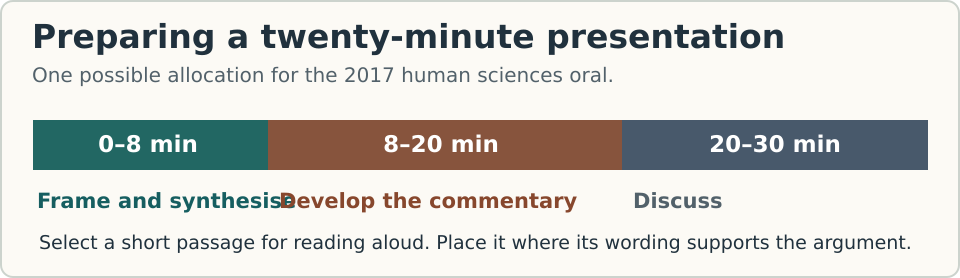
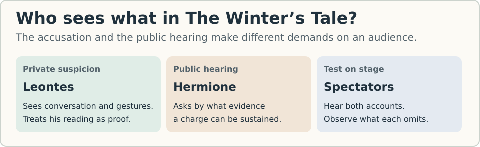
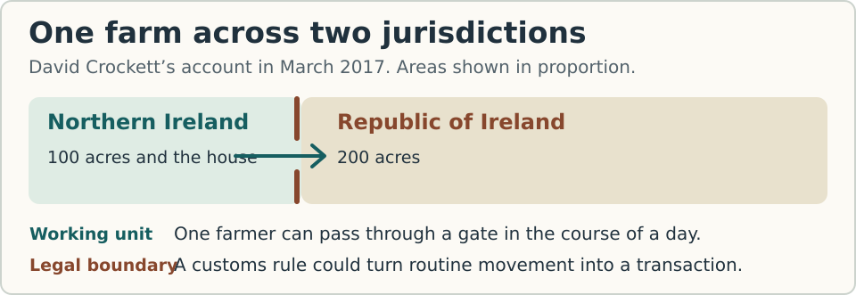

# ENS de Lyon — Anglais oral 2017 · Corrigé brut

*Corrigé rédigé par IA, non officiel.*

**Rédaction** · GPT-6.2 Astra Ultra · vitesse non renseignée

L’archive réunit **171 billets**. La liste de six pages donne 127 références de presse et 43 passages de littérature. Le recueil des coupures ajoute à la série Lettres et arts un article de Michelle Chen sur le choix de l’école. Ses pages 1–102 reproduisent 27 billets de Lettres et arts, 43 de LV1, 21 de LV2 et 11 de Sciences humaines. Les 29 pages suivantes appartiennent à la série Sciences économiques et sociales. Des 37 références de presse de Sciences humaines, 26 restent dépourvues de coupure d’examen identifiée, même quand l’article publié est accessible. Les 43 explications littéraires suivent les bornes du jury.

Les identifiants suivent l’ordre du fascicule dans chaque série. Chaque réponse propose en anglais un argument à partir du billet. Les développements en fin de volume montrent comment passer d’une analyse resserrée à une prise de parole suivie.

## Forme de l’oral

En presse, le candidat présente le document, en synthétise le mouvement, choisit des lignes à lire et développe un commentaire. En littérature, l’explication suit un extrait délimité ou un poème entier. La discussion avec le jury permet de reprendre un choix de mot, un enchaînement ou un fait de civilisation.

## Lettres et arts · Presse

#### LA01 · Bagehot: The machine splutters

The Economist · 10/11/2016 · [Coupure du jury, p. 3](https://www.ens-lyon.fr/sites/default/files/2017-11/anglais-hors-prgramme2017_1506588702296.pdf#page=3)

A machine can break down although every part is doing its job. That is a useful way to approach the constitutional quarrel over Brexit in November 2016. Voters had answered whether Britain should leave. They had not specified who could change rights created by Parliament. The High Court's insistence on parliamentary authority could therefore look like an obstruction to one reader and the proper working of the constitution to another. The referendum disclosed a conflict between two sources of authority that normally appear to work together. Bagehot opens with the execution of Charles I to locate the royal prerogative in a history of conflict. The column ends by asking whether Brexit is Britain’s overdue occasion to debate a written constitution.

#### LA02 · The not-so-United Kingdom: Britain is sliding towards Scoxit

The Economist · 18/02/2017 · [Coupure du jury, p. 9](https://www.ens-lyon.fr/sites/default/files/2017-11/anglais-hors-prgramme2017_1506588702296.pdf#page=9)

The invented word “Scoxit” turns the language of British withdrawal against the union that voted to leave Europe. Scotland had voted to remain in the EU. Its government could therefore claim that Brexit altered the terms on which Scots had rejected independence in 2014. Yet a majority for European membership is not automatically a majority for Scottish independence, particularly where a new border would affect trade and family ties. The forecast in the headline depends on how people rank two overlapping loyalties. The Economist draws a pointed double conclusion. Scotland’s economic dependence on trade with the rest of Britain makes separation more damaging, even as being taken out of the EU against its majority vote makes separation more likely.

#### LA03 · The last big frontier. Wilderness living

The Economist · 06/08/2016 · [Coupure du jury, p. 25](https://www.ens-lyon.fr/sites/default/files/2017-11/anglais-hors-prgramme2017_1506588702296.pdf#page=25)

In the inland north-west of the United States, moving to the countryside can mean choosing one's neighbours politically. The report from Idaho follows people drawn by the prospect of greater independence from government as well as by land and space. Calling it a “frontier” makes an inhabited region sound open to a new beginning. Yet organised migration also depends on property markets and changes the politics of existing communities. An ideal of individual self-reliance becomes a collective project as soon as people move there together. The report calls this proposed refuge the American Redoubt. Its population is difficult to measure because some of those moving there, including the movement’s promoter, prize secrecy.

#### LA04 · Review: In ‘Loving’ They Loved. A Segregated Virginia Did Not Love Them Back

The New York Times · 03/11/2016 · [Coupure du jury, p. 5](https://www.ens-lyon.fr/sites/default/files/2017-11/anglais-hors-prgramme2017_1506588702296.pdf#page=5)

The title makes “Loving” do three jobs: it names a couple, a film and an action that Virginia's laws treated as a crime. Richard and Mildred Loving wanted to live as a married couple in their home state. Their challenge reached the Supreme Court in 1967. A film review can ask what a courtroom account would leave out. The time spent simply trying to make a home makes the constitutional question intelligible, while the legal context prevents their story from becoming an interchangeable romance. Dargis notices the wary looks before the police appear and sets them beside archival footage of the real couple. A glance exchanged at home can carry what a statement of constitutional principle leaves unsaid.

#### LA05 · Op-Ed: Theresa May’s Empire of the Mind

The New York Times · 15/02/2017 · [Coupure du jury, p. 6](https://www.ens-lyon.fr/sites/default/files/2017-11/anglais-hors-prgramme2017_1506588702296.pdf#page=6)

An empire “of the mind” can persist after the relationships that made empire possible have disappeared. As Theresa May set out Britain's ambitions beyond the European Union, imperial language could give an uncertain future a familiar shape. It invited readers to imagine old commercial connections as ready-made partnerships. Former colonies, however, have their own priorities and memories. The political work of nostalgia lies in letting the speaker assume reciprocity without having to ask former subjects what they want. Whyman compares a Daily Mail cartoon of May on the cliffs of Dover with an 1892 caricature of Cecil Rhodes astride Africa. He then asks whether the apparently triumphant figure is about to step off the cliff.

#### LA06 · Bob Dylan wins Nobel Prize, redefining Boundaries of Literature

The New York Times · 13/10/2016 · [Coupure du jury, p. 22](https://www.ens-lyon.fr/sites/default/files/2017-11/anglais-hors-prgramme2017_1506588702296.pdf#page=22)

Awarding Bob Dylan the 2016 Nobel Prize in Literature changes what an institution publicly counts as literary achievement. The issue is not resolved by printing a song and judging whether its words look like a poem. Refrains, changes of voice and a listener's memory can make a line do things that disappear in silent reading. Conversely, popularity on stage cannot by itself settle a literary judgment. The decision gives critics a reason to articulate which features of verbal art they value across different media. The Swedish Academy invokes Homer and Sappho, poets whose work was delivered orally. Buried in an apparently modern dispute about pop music is a much older question about performance.

#### LA07 · Why British Hip-Hop Just Might Save the Labour Party

The New York Times · 01/06/2017 · [Coupure du jury, p. 27](https://www.ens-lyon.fr/sites/default/files/2017-11/anglais-hors-prgramme2017_1506588702296.pdf#page=27)

The political value of grime in the 2017 Labour campaign lay partly in who was speaking. Artists could reach young listeners who seldom encountered a party canvasser. An endorsement by someone with an independent voice could make registration or attendance at a polling station imaginable as an act of one's own. But attention, registration and a vote for Labour are three different outcomes. “Might” matters: a campaign may gain an audience from music without acquiring the power to tell that audience how to vote. A campaign website offered access to a grime show to people who registered to vote. Registration, which can be checked, is a different achievement from an artist’s endorsement or a vote for Labour.

#### LA08 · The Martian’s Guide to British Politics, or: Is There Intelligent Life on This Island?

The Nation · 28/04/2017 · [Coupure du jury, p. 19](https://www.ens-lyon.fr/sites/default/files/2017-11/anglais-hors-prgramme2017_1506588702296.pdf#page=19)

A Martian is an outsider for whom British political habits have not yet become common sense. That conceit turns an apparently simple election into a puzzle. Calling an election to strengthen authority may oblige the government to expose its own uncertainty; an opposition can be written off by commentators before anybody votes. The alien's questions make familiar explanations sound like assumptions in need of proof. The risk of the joke is that the amused reader too quickly mistakes detachment for a superior grasp of what voters need. Margaronis juxtaposes May’s claim of national unity with evidence of division and contrasts Britain’s entrenched parties with newer formations in France and Spain. The piece expects a Tory victory yet finds reasons for opposition groups to organise together.

#### LA09 · Education: Why do Tories love grammar schools?

The New Statesman · 09/03/2017 · [Coupure du jury, p. 4](https://www.ens-lyon.fr/sites/default/files/2017-11/anglais-hors-prgramme2017_1506588702296.pdf#page=4)

A grammar school promises advancement by examination rather than purchase. That is a powerful conservative story about merit. Its difficulty is that the children sitting the examination arrive with unequal opportunities to prepare, while the allocation also determines the schools available to those who fail. A photograph of a successful former pupil proves that selection can help someone. It says much less about its effect on an entire age group. The question in the headline invites us to examine the political attraction of the promise as well as its educational results. Elledge tests several explanations and ends with rising private-school fees. A formerly fee-paying family unable to afford the same education for its children might give selection a new constituency.

#### LA10 · The white working class is another form of identity politics

The New Statesman · 23/11/2016 · [Coupure du jury, p. 20](https://www.ens-lyon.fr/sites/default/files/2017-11/anglais-hors-prgramme2017_1506588702296.pdf#page=20)

The words “white working class” are sometimes offered as a corrective to identity politics. Naming the category already means choosing which identity will organise the argument. A worker can face insecure employment without race explaining the whole of that insecurity; another worker can face both insecurity and racial discrimination. Making whiteness the unspoken qualification for representing ordinary workers leaves the second person out. An argument about neglected places therefore has to ask whose wages and opportunities it is actually measuring. Goodfellow cites a projection that Americans of colour could form a majority of the working class by 2032. The example directly challenges the use of whiteness as a convenient proxy for class.

#### LA11 · Colonial nostalgia is back in fashion, blinding us to the horrors of empire?

The Guardian · 24/08/2016 · [Coupure du jury, p. 1](https://www.ens-lyon.fr/sites/default/files/2017-11/anglais-hors-prgramme2017_1506588702296.pdf#page=1)

*La coupure porte un titre affirmatif. Le point d’interrogation figure dans la seule liste.*

Nostalgia selects a vantage point. An account of empire organised around railways, maps or a colonial administrator's achievements will look different from one organised around the people who paid taxes, lost land or had no say in government. The point is not to replace pride with indiscriminate guilt. It is to ask how an inventory of achievements acquired the authority to stand for the experience of an entire political order. That same selective memory can then shape claims about Britain's future. Kehinde Andrews begins with an MP’s Internet medal table combining countries once ruled by Britain after the Rio Olympics. Awards won by independent nations become possessions of a vanished empire by a simple act of addition.

#### LA12 · Our Brexit-driven disregard for Ireland is perilous

The Guardian · 12/04/2017 · [Coupure du jury, p. 14](https://www.ens-lyon.fr/sites/default/files/2017-11/anglais-hors-prgramme2017_1506588702296.pdf#page=14)

In Britain an EU border could sound like a line to be controlled. On the island of Ireland it also runs through livelihoods, families and a peace settlement. An account focused only on Westminster decisions misses why the ability to cross without a conspicuous checkpoint acquired political significance. The criticism conveyed by “our disregard” is therefore about the scale of the debate. A policy described as restoring control to one electorate can make everyday cooperation harder for people whose lives cross its jurisdiction. Nicholas Searle recalls the political bargain that allowed incompatible ambitions to coexist after the Good Friday Agreement. Treating a renewed border as merely a commercial inconvenience underestimates the return of a constitutional question.

#### LA13 · Migrants are always the scapegoats. But now they’re taking on Ukip’s lies

The Guardian · 16/02/2017 · [Coupure du jury, p. 17](https://www.ens-lyon.fr/sites/default/files/2017-11/anglais-hors-prgramme2017_1506588702296.pdf#page=17)

A scapegoat is blamed for a problem on which blaming that person has little effect. The second half of the headline gives migrants the role usually reserved for campaigners speaking about them. They can contest which events count as evidence and whom political slogans allow to speak. Test the distinction on pressure on a local service: population growth may matter, but so do budgets, staffing and distribution. Identifying one visible group is a poor substitute for establishing the relative contribution of each cause. The opening follows Ake Achi from work on his family’s plantation in Ivory Coast. That specific life supports the writer’s closing contention that statistics alone cannot answer a story built on fear and belonging.

#### LA14 · Al-Britannia, My Country by James Fergusson review – a compelling survey of British Islam

The Guardian · 01/06/2017 · [Coupure du jury, p. 11](https://www.ens-lyon.fr/sites/default/files/2017-11/anglais-hors-prgramme2017_1506588702296.pdf#page=11)

James Fergusson's title joins a term associated with Islam to a possessive claim about Britain. The review thus invites an important distinction between a study of people imagined as outsiders and a study of citizens describing a country they share. A survey can make startlingly different lives visible under one heading. It can also encourage readers to treat its most memorable encounter as typical. The reviewer's selection of examples and the book's selection of communities are two filters through which British Islam reaches a newspaper reader. Christopher de Bellaigue credits Fergusson’s curiosity but notices how tensions and controversies command space in the survey. The Birmingham schools dispute is a test case for the distance between meeting people and generalising about British Islam.

#### LA15 · Opinion: By choice, I’ve never voted before. But Jeremy Corbyn has changed my mind

The Guardian · 12/05/2017 · [Coupure du jury, p. 21](https://www.ens-lyon.fr/sites/default/files/2017-11/anglais-hors-prgramme2017_1506588702296.pdf#page=21)

The phrase “by choice” refuses the usual explanation of abstention as ignorance or apathy. A person might know how elections work and withhold a vote because none of the available choices appears meaningful. The claim about Corbyn is consequently about a threshold of participation before it is about a change of allegiance. A first-person account can reveal what changed one voter's mind. It cannot turn that experience into a prediction of national turnout. Its political force lies in addressing readers who recognise the original hesitation. Akala explicitly connects foreign policy with Britons whose relatives live in the global South. He argues that voting on this occasion should supplement the other forms of collective action in which he already believes.

#### LA16 · Trump Is Scaring Indian Americans Into Finding Their Political Voice

The Atlantic · 27/03/2017 · [Coupure du jury, p. 7](https://www.ens-lyon.fr/sites/default/files/2017-11/anglais-hors-prgramme2017_1506588702296.pdf#page=7)

Fear may silence people, yet it can also make remaining publicly silent seem increasingly costly. Indian Americans who disagree about taxes, religion or party loyalty can recognise a common vulnerability to being treated as foreigners. At that point, organising or speaking at a meeting may become a means of claiming membership in American public life. The title describes people finding *a* political voice. It does not establish that a diverse population has suddenly acquired a single political opinion. The report contrasts the attention given to a pro-Trump rally with survey evidence that only about one in six Indian American voters backed him. Media prominence and a community’s distribution of opinion were quite different.

#### LA17 · The Usefulness of a March for Science

The New Yorker · 23/04/2017 · [Coupure du jury, p. 8](https://www.ens-lyon.fr/sites/default/files/2017-11/anglais-hors-prgramme2017_1506588702296.pdf#page=8)

A march cannot establish an experimental result. What scientists can make visible by marching are the public conditions under which results are produced, checked and used: funding, independent institutions and the right to publish unwelcome findings. Taking part may therefore defend scientific inquiry while exposing researchers to the accusation that scholarship has become partisan. The practical test is whether a speaker defends methods that opponents could use to challenge her own preferred conclusion. The title's modest word “usefulness” leaves room to weigh costs against gains. Alan Burdick rides a bus from Princeton’s Institute for Advanced Study with scientists whose theoretical work has no obvious short-term application. Their journey makes an apparently abstract argument about the use of knowledge unusually concrete.

#### LA18 · If the Church of England continues to smother liberal Anglicans, it is heading for a split

The Telegraph · 16/02/2017 · [Coupure du jury, p. 16](https://www.ens-lyon.fr/sites/default/files/2017-11/anglais-hors-prgramme2017_1506588702296.pdf#page=16)

An established church has to decide who speaks for a body that includes people with sharply different convictions. In this warning, “smother” presents the treatment of liberal Anglicans as an active silencing, while “split” projects a future institutional consequence. A compromise that preserves unity in a formal vote may leave some clergy and worshippers unable to participate on equal terms. Equally, dissent on doctrine does not by itself amount to secession. Distinguishing those stages makes the warning an argument one can assess. Michael Fabricant proposes an amicable separation if disagreement over marriage and women bishops absorbs the church’s energies. He judges the arrangement by whether it leaves congregations free to put love and charity into practice.

#### LA19 · Stifling the freedom to mock and attack will reduce our universities to irrelevant echo chambers

The Telegraph · 14/03/2017 · [Coupure du jury, p. 24](https://www.ens-lyon.fr/sites/default/files/2017-11/anglais-hors-prgramme2017_1506588702296.pdf#page=24)

The echo-chamber metaphor assumes that intellectual growth needs encounters with unwelcome speech. Mockery can indeed expose claims that sound unanswerable when expressed solemnly. But somebody who repeatedly becomes the object of personal ridicule may withdraw from discussion altogether. A university therefore has to consider two routes to a narrowed debate: suppressing disagreement and allowing powerful speakers to drive others out. The example that tests the headline is criticism directed at an idea whose advocate can answer on equal terms. Arif Ahmed deliberately gives “safe space” an unexpected use: an institution can shelter the freedom to scrutinise religious or political ideas severely. It is the opportunity for scepticism that he thinks an echo chamber would destroy.

#### LA20 · Bronze Plaques Matter

The National Review · 20/05/2017 · [Coupure du jury, p. 23](https://www.ens-lyon.fr/sites/default/files/2017-11/anglais-hors-prgramme2017_1506588702296.pdf#page=23)

A bronze plaque can change the account told by a monument without changing the figure on the pedestal. That is both the attraction and the limit of contextualisation. Visitors may learn why a statue was erected and whose story its original inscription omitted; they still encounter one figure elevated with public authority. The title intervenes in the 2017 dispute about commemorative objects. The strongest comparison is between ways of preserving historical evidence and ways of continuing to confer civic honour. Murdock responds to the removal of four New Orleans monuments by proposing a contest in which students could write explanatory inscriptions. The exercise would make pupils confront the difficult parts of the biographies themselves.

#### LA21 · A California-led alliance of cities and states vows to keep the Paris climate accord intact

Los Angeles Times · 02/06/2017 · [Coupure du jury, p. 18](https://www.ens-lyon.fr/sites/default/files/2017-11/anglais-hors-prgramme2017_1506588702296.pdf#page=18)

A city can change building standards or transport policy, and a state can place conditions on energy use within its jurisdiction. Those powers help explain the promise of continued action after Trump's announcement about the Paris agreement. They do not allow California to speak for the United States in a treaty negotiation. The alliance's claim therefore has two measures of success: emissions actually avoided and a signal of continuing American participation addressed to partners abroad. Neither measure should be inferred simply from the number of signatures. Halper names California, Washington and New York as partners and recalls California’s earlier action when George W. Bush was president. The local response has an institutional history predating Trump.

#### LA22 · Who were the big donors to the African American Museum? You’ll know the minute you walk in

The Washington Post · 22/09/2016 · [Coupure du jury, p. 15](https://www.ens-lyon.fr/sites/default/files/2017-11/anglais-hors-prgramme2017_1506588702296.pdf#page=15)

The visitor learns the donors' names simply by entering the museum. Visibility is thus part of the bargain through which private gifts help to sustain a national institution devoted to African American history. Recognising donors may broaden the public picture of who has the means and commitment to build museums. It also raises a curatorial question: do visitors see the history being exhibited or the public ceremony of paying for it first? The two can coexist without being identical. Peggy McGlone gives the cost of the new museum as \$540 million and reports that Congress contributed half. Naming donors therefore makes the public-private bargain visible even to a visitor who has never seen the accounts.

#### LA23 · Trump boasts about his philanthropy. But his giving falls short of his words

The Washington Post · 29/10/2016 · [Coupure du jury, p. 26](https://www.ens-lyon.fr/sites/default/files/2017-11/anglais-hors-prgramme2017_1506588702296.pdf#page=26)

Campaign philanthropy presents a problem of verification. An announced donation, money raised from other people and money personally paid out are distinct facts, even if a politician can describe all three with the language of generosity. The Washington Post's contrast between words and giving asks the reader to compare claims with records and with organisations that received funds. Establishing a discrepancy does more than invite a judgment of character. It tests the kind of evidence citizens should require for a claim of public service. Fahrenthold opens at a Manhattan charity’s ribbon cutting, where Trump sat in a place intended for a donor. The anecdote makes the later investigation of who actually paid more than a dispute over campaign rhetoric.

#### LA24 · Checks and balances can slow Trump

The Boston Globe · 22/02/2017 · [Coupure du jury, p. 12](https://www.ens-lyon.fr/sites/default/files/2017-11/anglais-hors-prgramme2017_1506588702296.pdf#page=12)

The title promises delay, a more limited claim than a promise to stop a president. Courts review legal authority in cases brought before them, while Congress controls legislation and appropriations. Both processes take time. To someone awaiting relief, delay may feel like failure; to an officeholder seeking immediate obedience, it is a real constraint. Constitutional design alone does not guarantee resistance, especially if legislators share the executive's priorities. Assess each brake by asking who can activate it and what decision it can reach. Alan Dershowitz moves beyond the three branches taught in school. The challenges brought by Washington and Minnesota to Trump’s executive order illustrate how states can initiate a federal check, while whistleblowers exercise a different kind of power.

#### LA25 · Had It In for the Voting Rights Act

Mother Jones · Nov/Dec/2016 · [Coupure du jury, p. 2](https://www.ens-lyon.fr/sites/default/files/2017-11/anglais-hors-prgramme2017_1506588702296.pdf#page=2)

*La coupure donne le titre complet, qui commence par « Chief Justice Roberts ». Son sous-titre annonce la réaction des juridictions inférieures.*

The history of the Voting Rights Act turns on the difference between having a right and being able to enforce it before an election. Federal preclearance required certain jurisdictions to obtain approval before changing voting rules. The Supreme Court's 2013 decision invalidated the coverage formula used to decide which jurisdictions were subject to that requirement. A voter can still sue, but the contested election may be over before relief arrives. A political profile can make that institutional change intelligible by tracing a sustained opposition to the Act. The article contrasts Roberts’s judgement that federal oversight was outdated with Ginsburg’s evidence from Alabama as recently as 2010. Its closing attention to lower-court decisions asks what safeguards remain once preclearance has been weakened.

#### LA26 · Does Brexit mean England can have Englishness?

The Spectator-Coffee House Blog · Nov/Dec/2016 · [Coupure du jury, p. 13](https://www.ens-lyon.fr/sites/default/files/2017-11/anglais-hors-prgramme2017_1506588702296.pdf#page=13)

*La coupure de David Goodhart est datée du 23 avril 2017. La liste reprend les mois de novembre et décembre 2016 du billet précédent.*

A voter can identify strongly as English yet speak through political institutions formally belonging to the United Kingdom. Brexit exposed the gap because England and Scotland voted differently, while the decision was taken for the UK as a whole. Asking whether England may “have Englishness” treats the ability to name a nation as a good. The next question is who gets to belong to that nation. An inclusive political identity and a test of ancestry have very different consequences for citizens already living together. Goodhart compares claims that Scottish identity is entirely civic while English identity is ethnic. He ends by asking whether a more publicly acknowledged Englishness could help preserve a reformed union.

#### LA27 · What Betsy DeVos’s Emphasis on ‘Choice’ Means for School Segregation

The Nation · 19/04/2017 · [Coupure du jury, p. 10](https://www.ens-lyon.fr/sites/default/files/2017-11/anglais-hors-prgramme2017_1506588702296.pdf#page=10)

*Ce billet de Michelle Chen est conservé page 10 du recueil de coupures. La liste récapitulative l’omet.*

Michelle Chen asks what a family can really choose when school places, information and funding are unequally distributed. Betsy DeVos presents choice as a route to diversity. Chen tests that claim against studies of voucher transfers, many of which increased segregation in the schools involved. A decision that helps one family reach a preferred school can alter the composition and resources of the school it leaves. That is why judging a programme requires following pupils on both sides of a transfer.

## Langues vivantes · Explication littéraire

### Thomas Hardy

#### HA01 · In Front of the Landscape

Pages 275–276 de l’édition du concours. Strophes 1–6, « Plunging and labouring » à « Now corporate ». [Texte de l’œuvre](https://www.gutenberg.org/files/2863/2863-h/2863-h.htm#page3)

*L’extrait s’arrête au dernier vers de la sixième strophe et le poème se poursuit.*

Hardy makes walking feel like swimming against a tide, although the speaker is crossing dry country. The opening participles put us inside the effort before we know what is resisting him. A chalk pit and a milestone ought to help a walker get his bearings. Here their outlines fade into gauze. The inversion becomes sharper when faces that belong to the past acquire tears one can almost taste, gestures one can fear, and voices one can address. The short lines interrupt the longer ones like sudden details breaking through the walker’s field of vision. At the end of the prescribed passage, music appears to vibrate beside lamps that have gone out. The final adjective, “corporate”, gives the bodies a new, literal material existence in the earth’s crust. The memories are vivid because the things they bring back are irrecoverable.

#### HA02 · The Going

Pages 307–308 de l’édition du concours. Poème entier. [Texte de l’œuvre](https://www.gutenberg.org/files/2863/2863-h/2863-h.htm#page95)

What sounds at first like an accusation against the dead changes its direction as the speaker talks. His opening question imagines that she could have warned him of her death. The swallow’s wing measures the impossible speed that even a last glimpse would require. By the second stanza he remembers his own stillness, watching morning light on the wall while her life was ending. The avenue briefly appears to restore her, but its converging branches frame an absence. The remembered rider on the Cornish cliff has a freedom of movement that the staring survivor lacks. When the questions return, their subject has become “we”: both might have spoken of those places while they could still revisit them. The proposed spring outing survives in direct speech, a plan uttered only after it has become impossible. The last admission gives back to her the ignorance with which he began.

#### HA03 · Places

Pages 320–321 de l’édition du concours. Poème entier. [Texte de l’œuvre](https://www.gutenberg.org/files/2863/2863-h/2863-h.htm#page123)

Three stanzas begin by telling us what nobody remembers, then give remarkably exact accounts of the missing memories. The first locates a birth in a region occupied with its own affairs. The second enters a child’s room and recreates the slightly faulty sound of a church tune after bedtime. By the third the girl is riding downhill past carters, and the parenthesis reassuring us that she never fell sounds like someone who can still see the danger. These places supply no public monument. Their value depends on a listener who can hear the tune or a witness who can follow the horse. The final stanza qualifies the repeated negative with an unnamed exception. Even here the speaker calls himself “one” and declines to claim that he saw her birth. Remembering another person can include imaginatively entering a world that existed before the two met.

#### HA04 · Rose-Ann

Pages 225 de l’édition du concours. Poème entier. [Texte de l’œuvre](https://www.gutenberg.org/files/2997/2997-h/2997-h.htm#page113)

Two kinds of repetition compete in this song. The young man keeps putting Rose-Ann’s name at the end of a line, as if calling her back to answer. He also repeats his charge so often that the listener begins to notice how little evidence he supplies for an actual promise. The third stanza briefly breaks the pattern. Stock ewes, chickens and clean linen give his hopes a physical reality and show the labour he has already invested in a shared future. They also expose a difficulty: all these preparations took place at his home, in the course of his own dreaming. His mother gets the only quoted reply in the poem, and it comes from a quarrel he now regrets. Rose-Ann’s silence leaves us to hear genuine hurt alongside the speaker’s determination to interpret her behaviour for her.

#### HA05 · The Place on the Map

Pages 292 de l’édition du concours. Poème entier. [Texte de l’œuvre](https://www.gutenberg.org/files/2863/2863-h/2863-h.htm#page37)

A varnished map makes a coast available to anyone who can read its outlines. For this viewer a purple height beside blue water holds the memory of a conversation that remains inaccessible even to the reader. The woman speaks calmly on a hot day. In the recollection, the drought extends from the sea itself to her eyes, so that she can be visibly tense without shedding a tear. The suggestion of something the couple must face before the following spring, together with their sense of joy constrained by social rules, invites the inference of a pregnancy. Hardy withholds an explicit identification. That restraint matters because the speaker sees the woman’s face much more clearly than he can name their predicament. When the scene returns in “pantomime”, its colours and gestures survive, while even the remembered words go unreported.

#### HA06 · Ah, Are You Digging on My Grave?

Pages 300–301 de l’édition du concours. Poème entier. [Texte de l’œuvre](https://www.gutenberg.org/files/2863/2863-h/2863-h.htm#page54)

A sound reaches a dead woman who can speak but cannot see who is making it. Digging has several possible meanings for her: a lover planting rue, relatives tending a grave, or an enemy still interested enough to disturb it. Each proposed visitor preserves some relationship between the living and the dead. The unseen respondent dismisses the possibilities one by one, in stanzas so regular that the procedure sounds almost reassuring. The dog’s appearance seems to reward her persistence. She immediately turns his presence into a general tribute to canine fidelity, speaking for him before he has explained himself. His polite correction is devastating precisely because he remains recognisably affectionate. A bone and the prospect of future hunger have brought him here, and he has forgotten what lies under this particular patch of ground. His ordinary appetite breaks the design she wanted the digging to have.

#### HA07 · Where the Picnic Was

Pages 325 de l’édition du concours. Poème entier. [Texte de l’œuvre](https://www.gutenberg.org/files/2863/2863-h/2863-h.htm#page39)

The winter climb is slow, while the evidence the speaker wants appears almost at once. A blackened circle and scraps of wood distinguish this spot from the rest of the grey grass. They are humble records of a pleasure whose participants had no reason to think a record necessary. For a moment it is hard to tell whether the last relic of the group is the charred wood or the person standing over it. The final stanza sets out the arithmetic of the visit. Four people came last year; one has returned, two have gone to live among the noises of towns, and the fourth has died. The pause before the last absence prevents the four lives from falling tidily into a list. Meanwhile the sea continues to send the same salty air uphill. That persistence lets the speaker measure exactly how much his company has changed.

#### HA08 · The Torn Letter

Pages 285–286 de l’édition du concours. Poème entier. [Texte de l’œuvre](https://www.gutenberg.org/files/2863/2863-h/2863-h.htm#page22)

The first stanza compares the strips of paper to feathers floating away from preening ducks. Its lightness captures the speed of a gesture whose cost will occupy the rest of the poem. That night a vision gives the unknown correspondent a voice, although the words the speaker hears are his own reconstruction of what the sender might have felt. He changes his mind and spends hours fitting the scraps together. The labour reverses the opening movement, piece by piece, until a practical obstacle defeats him: the name and address are missing. The message can now be valued, but no reply can be delivered. The closing address prolongs that contradiction. Its imagined recipient cannot know either the pain of the original rejection or the long remorse that followed it. What the speaker calls revenge has occurred without any intention on the sender’s part.

#### HA09 · Wessex Heights

Pages 290–291 de l’édition du concours. Poème entier. [Texte de l’œuvre](https://www.gutenberg.org/files/2863/2863-h/2863-h.htm#page32)

The heights have names that a walker could put on a map, yet the speaker values them for taking him imaginatively outside his lifetime. Their openness is set against lowland towns where he feels watched. The figures that pursue him have strikingly up-to-date habits: they behave like detectives, and one of them travels by train, its profile framed against the window. This makes the haunting as much a matter of social scrutiny as of supernatural belief. One of the most exacting observers is his earlier self, wondering what has become of the man he expected to be. The woman who occupies his thoughts gives a further turn to that imbalance: he imagines that she can replace a thought of him almost immediately. The named heights return at the end. The modest qualification in “some liberty” measures how far a change of place can relieve him.

#### HA10 · His Visitor

Pages 315–316 de l’édition du concours. Poème entier. [Texte de l’œuvre](https://www.gutenberg.org/files/2863/2863-h/2863-h.htm#page110)

*Le relevé imprime « His Wisitor ». Le titre de Hardy est « His Visitor ».*

The title identifies a visitor through a man, but the poem gives the visiting woman the whole speaking part. She can enter her old home without opening a door. What she cannot do is recover her former place in it. Flowers, paint and crockery make a precise inventory of changes that would be unremarkable to a new resident. To the former mistress each change removes one more small confirmation that this was once her daily world. The servants are sleeping and no longer know her. Remembering that she painted and sang lets us hear claims to a life beyond the management of rooms and meals, a life these strangers could never have witnessed. She times her departure by the mail train, contemporary movement heard from the edge of ordinary time. The last stanza gives her the decision to leave and a community of the dead to rejoin.

#### HA11 · After a Journey

Pages 317–318 de l’édition du concours. Poème entier. [Texte de l’œuvre](https://www.gutenberg.org/files/2863/2863-h/2863-h.htm#page115)

The verb “interview” promises questions and answers, but the visitor soon finds himself following a guide who cannot be pinned to a single point on the cliff. He sees the colour in her face while the water remains invisible and audible below him. Different senses seem to occupy different times. His questions about their marriage acknowledge a division between the earlier summer and the later autumn. The answer attributed to her comes back with a question mark, as if he could hear only his own attempt to supply it. At the waterfall and cave, an echo can cross forty years without certifying the presence he longs for. Dawn brings birds and seals absorbed in their own activities. His final request to be brought here again accepts that this visit will end, while his claim to be unchanged sounds more vulnerable after all he has admitted.

#### HA12 · The Ghost of the Past

Pages 279–280 de l’édition du concours. Poème entier. [Texte de l’œuvre](https://www.gutenberg.org/files/2863/2863-h/2863-h.htm#page12)

Hardy gives the Past a domestic role. It accompanies the speaker up and down the stairs, and there is no quarrel between the two inhabitants of the house. The opening repeated phrases make living with a ghost sound like a settled routine. The speaker wants the companion to remain as it once appeared, before old promises had been broken. Memory can briefly preserve even the past’s sense of having a future. Then the direction of the repetitions changes. Words recur just as the echoes they describe grow fainter, making the reader hear how repetition can register loss as well as maintain company. The eventual image of a distant skeleton reverses the intimate arrangement of the opening. The unsettling event here is the ghost’s gradual disappearance. The speaker loses the former life once through time and again through the failing power to imagine it.

#### HA13 · The Walk

Pages 309 de l’édition du concours. Poème entier. [Texte de l’œuvre](https://www.gutenberg.org/files/2863/2863-h/2863-h.htm#page99)

The speaker went up the hill alone before his companion died, and he goes alone again today. That simple arrangement allows Hardy a remarkably exact comparison. The first stanza names the physical reason for her absence and admits, without dressing it as a moral lesson, that he did not particularly mind walking alone. The second preserves the route, the ground and the solitary observer. Its short lines briefly suggest a practical check in which all the conditions turn out to be identical. Then a question exposes what such an inventory misses. The difference belongs to the return rather than the outward journey, and to a room whose appearance the poem leaves undescribed. The reader must imagine what someone entering that room could once expect to find. The final line carries a whole household relation into a walk that seemed to take place entirely outdoors.

#### HA14 · Beeny Cliff

Pages 319 de l’édition du concours. Poème entier. [Texte de l’œuvre](https://www.gutenberg.org/files/2863/2863-h/2863-h.htm#page119)

Two March dates give the reader the distance between a ride together and the act of remembering it. The first three stanzas offer a scene capable of change within the memory itself. Seabirds cry below the riders, a small cloud interrupts the sunshine, and the water takes on several colours before the sun returns. The woman riding freely above the sea belongs to that sequence of moving impressions. In the fourth stanza, the continued existence of the cliff seems to make a return visit possible. A question slips from the recurrence of March to the hope that the couple might say the same things again. The last stanza allows the landscape its permanence while withholding that hope. The pauses around “elsewhere” make the rider hard to place in any geography, and the closing negative leaves the much-loved coast without her answering gaze.

### Nathaniel Hawthorne

#### HW01 · Armour, mirror and garden

Pages 97–99 de l’édition du concours. « On the wall hung » à « gentlemen along with him » [Texte de l’œuvre](https://standardebooks.org/ebooks/nathaniel-hawthorne/the-scarlet-letter/text/chapter-7)

Before the governor arrives, his possessions have already received his visitors. Painted ancestors appear to watch Hester from the walls. The armour that catches Pearl’s eye, meanwhile, is recent English workmanship that the governor has worn in New England. A child discovers an unexpected use for this sign of office. The polished breastplate makes the scarlet letter so large that Hester nearly disappears behind it. Pearl’s reflected smile undergoes a distortion of its own, making the mother momentarily see a strange creature in her child. The optical effect shows how easily an observer can take an altered image for the whole person. At the window a pumpkin has invaded the planned ornamental garden, providing an earthy counterpoint to the hall's solemn collection. Pearl wants a red rose. Hester has to quiet her just as the actual authorities come within earshot.

#### HW02 · Who judges Hester?

Pages 48–50 de l’édition du concours. « It was a circumstance to be noted » à « apartment of the prison » [Texte de l’œuvre](https://standardebooks.org/ebooks/nathaniel-hawthorne/the-scarlet-letter/text/chapter-2)

Hester is discussed at length before she is allowed to appear. Several women claim standing to judge her through their authority as reputable church members. Their increasingly severe proposals compete with one another, until a young mother suggests a pain no visible punishment could measure. The presence of her child gives us a quiet anticipation of Hester’s entrance. The narrator also puts the crowd on display, tracing bodies and voices back to English food, clothing and Queen Elizabeth. His amusement at these ancestors invites us to consider what assumptions shape his own judgement of women. The prison door finally opens. The beadle lays a hand on Hester as an embodied representative of the law, and she removes it. The baby turns away from the brightness that allows everyone else to see her. The same public exposure thus has different meanings for each person on the threshold.

#### HW03 · The surveyor and the embroidered letter

Pages 30–32 de l’édition du concours. « But the object that most drew my attention » à « the authenticity of the outline » [Texte de l’œuvre](https://standardebooks.org/ebooks/nathaniel-hawthorne/the-scarlet-letter/text/introduction)

*Le relevé imprime « objet » et le texte porte « object ».*

The narrator measures the letter to a quarter of an inch, yet its use escapes him. His exactness lends the account the manner of an inventory and exposes the limits of that kind of knowledge. He depends on women to identify the lost embroidery technique. When he lays the cloth against his own breast, a sensation of heat gives him an altogether different reason to take the object seriously. Only afterwards does he untwist the papers that offer historical testimony. Even that testimony travels through several people, from elderly witnesses to Surveyor Pue and then to the narrator now addressing us. His final claim to authenticity is carefully restricted to an outline. Readers have already felt how much the story owes to imagination: a scrap of damaged fabric can suggest a life that a measurement or an official paper alone could never recover.

#### HW04 · The minister on the scaffold at night

Pages 139–41 de l’édition du concours. « A good evening to you » à « The three formed an electric chain » [Texte de l’œuvre](https://standardebooks.org/ebooks/nathaniel-hawthorne/the-scarlet-letter/text/chapter-12)

Dimmesdale imagines calling Father Wilson onto the scaffold, then discovers that the words have remained inside his head. The scene distinguishes being able to formulate a confession from allowing another person to hear it. A second fantasy turns a possible exposure into a comic public spectacle. Town dignitaries would rush out of bed half dressed and lose the composure on which their authority depends. The minister can invent their embarrassment much more easily than he can face his own. A real sound interrupts the performance he has staged for himself: Pearl’s laugh answers his. Hester and the child have actually been out that night, and their hands give his chilled body an almost electrical charge. The closing image joins three people who have a public reason to acknowledge one another, in a place designed for public recognition, while it is still dark.

#### HW05 · The forest meeting

Pages 176–78 de l’édition du concours. « Slowly as the minister walked » à « with a bitter smile » [Texte de l’œuvre](https://standardebooks.org/ebooks/nathaniel-hawthorne/the-scarlet-letter/text/chapter-17)

Hester must call the minister by his full name twice before he recognises her. He first makes out a shadow; the scarlet letter then identifies the woman whose voice has already reached him. Their questions about whether the other is still alive make the seven years of separation feel like a passage between worlds. Hawthorne keeps that elaborate supernatural comparison beside an ordinary physical fact. Both hands are cold, but contact establishes that the two people at least inhabit the same world. Even now their conversation has to begin with the weather and their health. Its hesitations allow the reader to feel how difficult a personal question has become for them. When Hester asks whether the good he does his congregation gives him comfort, his bitter smile brings the interview to an impasse. The reverence she offers as consolation is precisely what makes his position unbearable.

#### HW06 · The community adopts its penitent

Pages 150–151 de l’édition du concours. « The rulers, and the wise and learned men » à « so transfigured » [Texte de l’œuvre](https://standardebooks.org/ebooks/nathaniel-hawthorne/the-scarlet-letter/text/chapter-13)

*Le relevé imprime « learned me » et le texte porte « learned men ».*

The town’s leaders are the slowest to revise their judgement. The narrator makes the delay visible in their faces, where rigid wrinkles might, given enough years, soften into something approaching kindness. Other townspeople claim Hester as their own, yet the same speakers whisper her old disgrace to strangers. A public capable of converting the letter into the equivalent of a nun’s cross still depends on the original story for its pleasure in the change. The reported miracle of the arrow falling harmlessly from the badge takes the process of legend-making almost to caricature. The narrative then turns from the garment to its wearer. A hidden or shorn head of hair becomes evidence for competing explanations of what suffering has done to her capacity for tenderness. The narrator’s hesitation matters: a community may change its reading of a woman without acquiring access to her inner life.

#### HW07 · A view from the scaffold

Pages 54–56 de l’édition du concours. « Accordingly, the crowd » à « all else had vanished » [Texte de l’œuvre](https://standardebooks.org/ebooks/nathaniel-hawthorne/the-scarlet-letter/text/chapter-2)

A thousand eyes concentrate upon one point on Hester’s breast, but the passage soon asks what she can see from the same spot. The solemn silence of the town is especially painful because it gives her nothing definite to answer. Her mind begins to furnish a crowd of its own. Childhood squabbles, the coat of arms above a poor house and the familiar expressions of her parents occupy the same vivid plane as consequential events. An older scholar’s uneven shoulders and unexpectedly penetrating gaze emerge among these images before the reader knows his full significance. The scaffold becomes a vantage point from which an entire life briefly comes into view. A bodily action ends the sequence: she holds the infant more tightly, the baby cries, and her finger touches the letter. Public judgement has condensed what memory expanded into a person’s history.

#### HW08 · Pearl across the brook

Pages 189–91 de l’édition du concours. « Such was the sympathy » à « for she saw the clergyman » [Texte de l’œuvre](https://standardebooks.org/ebooks/nathaniel-hawthorne/the-scarlet-letter/text/chapter-18)

*Le relevé accole « forshe » et le texte porte « for she ».*

Hester assumes that her newly recovered happiness will extend naturally to the whole family. Dimmesdale asks twice whether Pearl will love him. Across the brook the child is visible in a moving shaft of light that alternately gives her the outlines of a person and an apparition. The narrative makes the adults wait while it follows her independent life among the animals. A mother partridge defends her brood, a squirrel offers a partly eaten nut, and the narrator pauses to question a particularly obliging wolf. These touches of uncertainty and comedy give the forest a variety of responses to Pearl. Hester’s calls eventually draw her back from this world of makeshift costumes and companions. The repeated adverb at the end gives the last word to the child’s own judgement of the situation. She has recognised the clergyman, and she can decide how quickly to approach.

#### HW09 · A green letter on the shore

Pages 164–166 de l’édition du concours. « Pearl, whose activity of spirit » à « why does the minister keep his hand over his heart » [Texte de l’œuvre](https://standardebooks.org/ebooks/nathaniel-hawthorne/the-scarlet-letter/text/chapter-15)

Left to herself, Pearl continuously invents uses for the objects she finds. Birch bark carries fleets, sea foam becomes snow, and eelgrass supplies the missing ornament on a mermaid’s costume. In between, a game with stones ends when the child imagines that a bird has been hurt. That moment complicates the easy idea that she lives entirely outside ordinary sympathy. Making a green letter on her breast is another game, yet this one reconstructs the sign by which her mother is publicly known. Pearl can identify the letter from her reading primer. She can also connect it with the minister’s habit of covering his heart, without being able to explain the connection. Hester’s smile gives way to pallor. The exchange shows a child capable of recognising a relationship that the adults have devoted considerable effort to keeping outside the realm of speech.

#### HW10 · The captain’s extra passenger

Pages 217–219 de l’édition du concours. « But the sea, in those old times » à « and fearful meaning » [Texte de l’œuvre](https://standardebooks.org/ebooks/nathaniel-hawthorne/the-scarlet-letter/text/chapter-21)

The opening movement from an unruly sea to a regulated settlement promises that Hester might travel between two different moral worlds. The elegantly conspicuous captain already travels between them: a scar and a costume that might attract punishment on a townsman become almost natural ornaments on a sailor. The townspeople tolerate his conversation with the reputable physician. Around Hester they leave a gap even in the crowded marketplace, and for once this habit offers the privacy she needs. Then the captain announces an extra berth. His joking account of having two medical men aboard tells the reader how thoroughly he misunderstands the news he brings. Hester tries to preserve her outward composure. From the opposite side of the square Chillingworth’s smile reaches her through the intervening bustle. A voyage that seemed to promise escape has already been entered into another person’s plans.

#### HW11 · The witnesses after the event

Pages 240–242 de l’édition du concours. « After many days » à « may be inferred » [Texte de l’œuvre](https://standardebooks.org/ebooks/nathaniel-hawthorne/the-scarlet-letter/text/chapter-24)

The conclusion opens with the delay required for witnesses to arrange their thoughts. That apparently innocent phrase prepares a series of incompatible accounts of the minister’s last appearance. Some observers agree that they saw a letter but give it different causes, ranging from deliberate penance to the bodily consequences of remorse. Others insist that there was nothing to see. Their loyalty allows them to turn the entire scene into an illustration of universal human imperfection, preserving their minister’s reputation even in the act of apparently admitting that all are sinners. The narrator allows the reader a choice among causes, then intervenes sharply against this last interpretation. His supporting evidence has itself travelled through oral testimony into an old manuscript. The final threefold appeal to be true is arresting because the preceding pages have shown how difficult it is for a public to recognise a disclosed truth.

#### HW12 · The confession and the kiss

Pages 237–239 de l’édition du concours. « It was on him » à « departed spirit » [Texte de l’œuvre](https://standardebooks.org/ebooks/nathaniel-hawthorne/the-scarlet-letter/text/chapter-23)

Dimmesdale speaks about the guilty man in the third person while directing all eyes towards his own body. Religious eloquence gives him a way to make a public declaration, but the reader is denied a description of the final visible evidence. Instead the scene turns towards the people close enough to touch him. Chillingworth repeats that his captive has escaped. Pearl’s kiss and tears bring the child into an acknowledged relation with her father at the moment she is losing him. Hester asks a different question, one that public confession cannot settle: will they have a life together beyond death? The minister’s answer reads his ordeals as signs of divine mercy and leaves the possibility of reunion uncertain. When his voice ends, the assembled witnesses produce only a murmur. The sermon-like speech has given way to a sound from which no single interpretation can yet be distinguished.

#### HW13 · Hester’s needlework

Pages 217–219 de l’édition du concours. « Lonely as was Hester’s situation » à « garments for the poor » [Texte de l’œuvre](https://standardebooks.org/ebooks/nathaniel-hawthorne/the-scarlet-letter/text/chapter-5)

*Le relevé répète les pp. 217–219 du billet « But the sea ». Les bornes verbales de celui-ci identifient le chapitre V, indiqué ici.*

The badge that excludes Hester from respectable society also advertises the skill by which she feeds her child. Hawthorne follows the products of her needle across a remarkable range of colonial occasions. The governor wears her work, babies wear it, and the dead take it into their coffins. The supposed simplicity of Puritan dress proves compatible with elaborate distinctions of office and wealth. Most revealing is a commission she never receives. A bridal veil is the one item on which customers refuse to let her exercise the skill they willingly employ elsewhere. The social boundary therefore runs through the very market that provides her livelihood. Her own decisions complicate that arrangement. She dresses plainly herself, makes imaginative garments for Pearl and spends time producing coarse clothes for poor people who can insult her in return. The movement from ceremonial luxury to that final labour changes what the reader understands by the value of her art.

#### HW14 · The sunlight on the forest path

Pages 217–219 de l’édition du concours. « The road, after the two wayfarers » à « the Black Man, mother » [Texte de l’œuvre](https://standardebooks.org/ebooks/nathaniel-hawthorne/the-scarlet-letter/text/chapter-16)

*Le relevé répète les pp. 217–219 du billet « But the sea ». Les bornes verbales de celui-ci identifient le chapitre XVI, indiqué ici.*

The path into the forest narrows until the two walkers can see only broken patches of sky. Hester understands its darkness through her own experience. Pearl interprets the moving sunlight differently, imagining a playmate who runs away in fear of the badge. Her assumption that a woman’s letter might appear naturally when she grows up shows what it is like to know the punishment before knowing the rule. The mother’s attempt to grasp the light fails, yet she can imagine that Pearl has absorbed it and might carry some brightness further into the wood. The child then asks for a story about the figure Puritan folklore calls the Black Man, the devil who carries a book for signatures. The question suddenly becomes personal. Hester has been invited to say how a story about a mark on someone’s breast relates to her own visible one.

### William Shakespeare

#### WT01 · Winning another week

I.2.1-85, « Nine changes of the watery star » à « Is he won yet » [Texte de l’œuvre](https://shakespeare.mit.edu/winters_tale/winters_tale.1.2.html)

Polixenes begins with an account that can never be settled. Nine moons measure his absence from Bohemia, while a single expression of thanks is supposed to multiply all his previous ones. Leontes answers by bargaining over days. Hermione succeeds when she changes the terms of the conversation: a guest can stay by choice, whereas a prisoner would incur a keeper’s fees. Her mock ultimatum gives Polixenes a graceful way of agreeing. Once the childhood friends become the subject, their account of having been innocent twin lambs requires a world without adult women. Hermione refuses the implication that the two wives must therefore be devils. She answers in the language of marital fidelity and keeps everyone inside the joke. Leontes’ final question measures the gulf between having asked his wife to speak and actually following the conversation in which she has won his guest.

#### WT02 · Perdita receives the guests

IV.4.1-75, « These your unusual weeds » à « all the winter long » [Texte de l’œuvre](https://shakespeare.mit.edu/winters_tale/winters_tale.4.4.html)

The lovers begin by looking at each other’s costumes. Florizel sees a goddess presiding over a feast. Perdita sees that a prince can choose to dress as a shepherd, while she will have to bear the consequences if his father objects. His stories of gods changing shape celebrate freedom of movement across rank; her questions test who can afford that freedom once the festivities are over. The audience will soon recognise the disguised father whom she already fears. A different model of authority comes from the Shepherd’s recollection of his wife, moving up and down the table, serving, organising and joining the dance. Perdita can learn how to be mistress of the feast from this account of work. As she offers winter herbs to the elderly strangers, she is already giving hospitality to the very person whose presence made her afraid.

#### WT03 · Paulina brings the child

II.3.1-72, « Nor night, nor day » à « Traitors » [Texte de l’œuvre](https://shakespeare.mit.edu/winters_tale/winters_tale.2.3.html)

Leontes begins alone, trying to explain his sleeplessness. His thoughts repeatedly reach towards Polixenes and recoil because the foreign king is beyond his power. His wife, by contrast, is within reach. Even the report of Mamillius’s illness becomes an opportunity for him to attribute his own beliefs to his son. Outside the same room Paulina offers a competing diagnosis: the courtiers who hover quietly around him are helping to keep him awake. She enters claiming the duties of a physician and counsellor. When Leontes questions the description of Hermione as a good queen, Paulina repeats it until the adjective becomes almost a public oath. The infant she presents requires an action from the father, his blessing, for which no amount of abuse can substitute. His final cry of treason enlarges his accusation to include a whole room full of people.

#### WT04 · A father looks for his own face

I.2.118-88, « Mamillius, art thou my boy » à « boy, play » [Texte de l’œuvre](https://shakespeare.mit.edu/winters_tale/winters_tale.1.2.html)

*Le relevé abrège la borne finale sous la forme « 118-88 », soit 118–188. Les mots d’ouverture et de clôture correspondent au même passage.*

A father wiping his son’s dirty nose might offer one of the scene’s simplest gestures of affection. For Leontes the nose immediately becomes a test of paternity. Pet names, jokes about cattle and anxious questions compete so rapidly that Mamillius can scarcely know what answer is expected. The child’s qualification that he is his father’s calf if the king wishes briefly makes the uncertainty audible. Leontes then appeals to imagination itself, constructing an argument in which its ability to work with unreal things becomes grounds for believing a particular suspicion real. Other characters can see his distraction and ask about it, but they cannot hear all the turns the audience has followed. He gives them an account of parental tenderness instead. When he finally sends the boy off to play, an ordinary parental instruction has become entangled with his own sense of being made ridiculous.

#### WT05 · The statue descends

V.3.56-121, « Indeed, my lord » à « Our Perdita is found » [Texte de l’œuvre](https://shakespeare.mit.edu/winters_tale/winters_tale.5.3.html)

Paulina can change what people see by threatening to draw a curtain. Each time she proposes closing it, Leontes finds a further sign of life in Hermione’s image. He sees colour, imagines breath and proposes a kiss. Paulina’s practical explanation that wet paint might mark his lips prolongs the uncertainty while keeping him physically at a distance. The theatrical arrangement is unusually exact: an actor has to remain still while other actors discuss how art can counterfeit movement. When music begins, those who have been watching must themselves remain still so that the slightest change in the figure becomes perceptible. Touch finally provides the warmth that looking could only infer. Yet Hermione has still said nothing when Paulina turns towards Perdita. The final cue takes the scene beyond a husband’s desire for restoration and allows a daughter to approach her mother for a blessing.

#### WT06 · The child’s likeness in court

II.3.81-145, « A nest of traitors » à « You’re liars all » [Texte de l’œuvre](https://shakespeare.mit.edu/winters_tale/winters_tale.2.3.html)

When Leontes discovers traitors everywhere, Paulina identifies the one betrayal that a courtier can see directly: the king has brought his own family into disgrace. She invites the lords to inspect the baby’s face. The accumulating details, down to dimples and a characteristic frown, almost require the audience to lean forward with them. A newborn onstage cannot independently settle a dynastic dispute for an entire theatre. What can be witnessed is Paulina’s care and the king’s refusal to look with her. Her mock prayer that the child might escape its father’s jealousy lets resemblance become a matter of temperament as well as appearance. The exchange then turns on who controls a wife’s speech. Once Paulina leaves, the king immediately accuses Antigonus of having instructed her. Even a unanimous statement from the lords cannot alter a judgement that has already classified every dissenting witness as disloyal.

#### WT07 · Hermione answers the indictment

III.2.10-80, « Silence » à « I’ll lay down » [Texte de l’œuvre](https://shakespeare.mit.edu/winters_tale/winters_tale.3.2.html)

The officer reads the charges in an impersonal prose of titles, relationships and alleged acts. Hermione’s opening sentence identifies the obstacle to her defence before she tries to present it. Since her integrity has already been counted as deceit, the very person who can speak from knowledge has been disqualified as a witness. She appeals to Leontes both as her judge and as the person who knows her history best. Her public situation is extraordinary enough, she observes, to strain belief even in a play designed to attract spectators. The audience is thereby made to consider its own position among those who have come to watch. Hermione admits loving Polixenes and carefully specifies the obligations of hospitality her husband had imposed on her. Leontes hears an admission where she has made a distinction. Their failure to share a language makes the king’s imagined version of events physically consequential.

#### WT08 · Camillo is pressed to agree

I.2.281-346, « Is whispering nothing » à « thou hast advised me » [Texte de l’œuvre](https://shakespeare.mit.edu/winters_tale/winters_tale.1.2.html)

The opening questions are so short that the audience may see a succession of gestures before it can decide whether any actually occurred. Leontes piles whispered words, touching faces and private wishes together, then argues that denying his conclusion would empty the entire world of meaning. Camillo initially answers him quite plainly. His honest disagreement, however, becomes another supposed offence, and the king invokes the career he has provided for his servant. The scene exposes how easily a reward for past service can become leverage over present speech. When Camillo appears to accept the king’s demand, he attaches conditions meant to protect Hermione and the prince. Between them the two men then construct the friendly appearance Leontes is to maintain in public. An accusation founded on the interpretation of other people’s gestures ends by requiring the accuser to rehearse misleading gestures of his own.

#### WT09 · A witness interrupts a contract

IV.4.363-438, « But to your protestation » à « thou art tender to’t » [Texte de l’œuvre](https://shakespeare.mit.edu/winters_tale/winters_tale.4.4.html)

Florizel offers the lovers’ declaration to an ever wider audience, calling upon the earth and heavens as witnesses. Perdita’s shorter response borrows a craft image: she can cut out the pattern of his intentions from what she knows of her own. The Shepherd moves to join their hands. At that practical moment one of the invited witnesses asks a question about the absent father. The audience knows that the father is conducting the inquiry himself. Polixenes elicits an affectionate description of his own health and competence, then advances a plausible case for consultation. Florizel can accept the principle while refusing the disclosure, which makes the alternation of short requests and refusals sound increasingly like a contest of wills. The disguised stranger’s sudden announcement of divorce turns a witness into a sovereign. The consequences of that change fall most heavily on the two people of lower apparent rank.

#### WT10 · A winter story interrupted

II.1.15-81, « Hark ye, » à « Do but mistake » [Texte de l’œuvre](https://shakespeare.mit.edu/winters_tale/winters_tale.2.1.html)

The ladies’ light teasing imagines the arrival of another prince while Mamillius is still able to sit beside his mother and choose what story to tell. He selects a frightening one, but adjusts the performance to suit an intimate audience. He lowers his voice so that even the crickets will not hear. The approach of Leontes interrupts the tale just after its beginning and replaces its fictional terrors with the king’s account of actual betrayal. His image of discovering something repellent in a drink makes distress depend on what a person thinks he knows. Yet he treats his own distress as confirmation of the belief that caused it. Hermione first wonders if the removal of her son is a game. Her gentle insistence that her husband is mistaken preserves, for a few lines, a possibility of correction that the new storyteller has already closed.

#### WT11 · Paulina announces a death

III.2.170-241, « Woe the while » à « these sorrows » [Texte de l’œuvre](https://shakespeare.mit.edu/winters_tale/winters_tale.3.2.html)

Paulina first asks for her clothing to be loosened, giving the actress a bodily difficulty before she begins a long public accusation. The speech repeatedly appears to pass over an offence in order to make the next one sound worse. In the process the audience hears a full account of what Leontes has done to his friend, his servant and his children. The delayed news about Hermione breaks that accumulation. Paulina challenges anyone who doubts it to restore colour, warmth or breath, tests that a later scene will make the audience remember. When a lord rebukes Paulina for speaking freely, her apology keeps naming the very losses she promises to leave unmentioned. Leontes now actively asks for the truth that he once criminalised. He ends by promising a daily visit to a grave where the cause of death will bear public witness against him.

#### WT12 · The reunion reported

V.2.20-101, « Here comes a gentleman » à « they intend to sup » [Texte de l’œuvre](https://shakespeare.mit.edu/winters_tale/winters_tale.5.2.html)

Shakespeare places the recognition of Perdita just out of the audience’s sight. Gentlemen bring in the news by stages, each one supposed to know more than the previous speaker. A mantle, a jewel and a recognisable handwriting give the report material supports. The witnesses also treat a young woman’s bearing as proof of royal descent, revealing what their society expects to see when it discovers a princess. Their accounts of the reunion repeatedly declare that language cannot describe it, then supply wonderfully particular details. The old shepherd stands like a weathered conduit, and Paulina looks down for her husband and up for the fulfilled oracle. A single face can register incompatible outcomes. As the party heads for the statue, the question of what it means to see something for oneself passes to the audience. The next encounter will require its own kind of witnessing.

#### WT13 · Apollo’s verdict at the trial

III.2.104-170, « Now, my liege » à « make the blacker » [Texte de l’œuvre](https://shakespeare.mit.edu/winters_tale/winters_tale.3.2.html)

Hermione invites a judgement from outside the king’s imagination. The precautions taken before the oracle is opened are carefully staged: named messengers swear that they received it sealed and never read it. The voice that emerges in the officer’s reading is remarkably compressed. A succession of brief declarations supplies a judgement on every participant, including the king himself. Leontes immediately refuses to recognise the verdict, although the assembled court has just watched him authorise the procedure. A messenger’s broken announcement of Mamillius’s death then gives the rejected oracle an authority the unbroken seal could not secure. Hermione’s collapse is visible while the king is already trying to revise his earlier conduct in speech. He retells Camillo’s departure as an act of honour, detailing the personal cost of disobedience. The final image puts his own tarnished conduct beside the brightness of the servant he had denounced.

#### WT14 · Hermione is taken away

II.1.59-129, « Bear the boy hence, » à « your Queen, your son » [Texte de l’œuvre](https://shakespeare.mit.edu/winters_tale/winters_tale.2.1.html)

Leontes removes Mamillius before addressing the lords. He supplies his audience with gestures and noises, a shrug or a hesitation, that they are to insert between admiration of the queen’s appearance and any claim for her honesty. He thus acts out the very process by which a reputation can be ruined. Hermione’s reply is concerned with the future as much as the present. Once her supposed guilt has been made public, a later acknowledgement of error will not reach everyone who heard the original accusation. Refusing to weep on cue exposes her to a second misunderstanding, and she has to ask her observers to consider the difference between visible tears and unexpressed grief. Her practical request that her women accompany her recalls the physical vulnerability of a pregnant prisoner. Only after she leaves does a lord openly ask whether what the king calls justice might amount to violence.

#### WT15 · The young visitors in Sicilia

V.1.85-151, « One that gives out » à « the spring to th’earth » [Texte de l’œuvre](https://shakespeare.mit.edu/winters_tale/winters_tale.5.1.html)

The servant who announces Florizel and his companion risks an argument by praising Perdita’s beauty in front of Paulina. She remembers that he wrote equally extravagant praise of Hermione, and asks what his present language does to his earlier conviction. Leontes, meanwhile, looks for the political reason behind a royal visitor’s unusually small retinue. When attention turns to the prince’s age, Mamillius seems to die again in his father’s memory. The actual arrival generates a remarkable mistake of another kind. Leontes reads Polixenes’ features correctly in his son and practically sees himself as a young man again, while failing to recognise his own daughter beside him. Florizel then offers greetings supposedly sent by his father. The audience knows how far this account departs from the circumstances of the lovers’ flight. Yet hearing it allows Leontes to articulate a real wish to repair the friendship he damaged.

## Langues vivantes · Presse en LV1

#### LV101 · Labour’s slick on-line campaign outguns Tory press

The Financial Times · 09/06/2017 · [Coupure du jury, p. 55](https://www.ens-lyon.fr/sites/default/files/2017-11/anglais-hors-prgramme2017_1506588702296.pdf#page=55)

The striking word is “outguns”. Labour's online campaign and the Conservative-friendly press are treated as rival weapons, though a newspaper endorsement and a shared video reach people in quite different ways. Someone may pass on a clip because it amuses them without intending to vote Labour. The June result makes the comparison worth investigating, but votes are secret and exposure is uneven. I would ask who shared the material across political lines, and whose preferences were already settled. David Bond contrasts nearly sixteen million Facebook views for videos costing under £2,000 with hostile coverage in parts of the press. The suggestion that hostile headlines may have mobilised younger readers complicates a simple contest of audience size.

#### LV102 · Locals fear Brexit means new barriers along the UK-Irish border

The Financial Times · 30/01/2017 · [Coupure du jury, p. 59](https://www.ens-lyon.fr/sites/default/files/2017-11/anglais-hors-prgramme2017_1506588702296.pdf#page=59)

From Westminster a border looks like a line separating two legal jurisdictions. From a border village it may divide one's house from one's job, or one farm from its customers. “Locals fear” gives those routine journeys political weight and preserves the uncertainty of January 2017. An immigration agreement for people and an arrangement for the movement of goods solve different difficulties. A politician promising an invisible border has to explain what will happen to both. A trader in a village divided by the border worries that ordinary business dealings could suddenly be treated as smuggling. The collapse of Northern Ireland’s executive left the affected communities with less institutional representation during negotiations.

#### LV103 · The world loves our grammar schools, so why don’t we?

The Spectator · 27/05/2017 · [Coupure du jury, p. 30](https://www.ens-lyon.fr/sites/default/files/2017-11/anglais-hors-prgramme2017_1506588702296.pdf#page=30)

“The world” supplies flattering testimony, while “we” recruits the reader into a puzzled national family. A foreign observer can admire a selective school's examination results without seeing the children who failed the entrance test. To argue for expansion, one would need to compare outcomes across an entire local intake, including pupils in neighbouring schools. The appeal to international admiration therefore shifts the burden of proof before a single comparison has been made. James Tooley concedes that fewer than three per cent of English grammar-school pupils qualified for free school meals. He nevertheless turns to international comparisons and invokes Singapore, a shift from fairness of access to national competitiveness.

#### LV104 · The strange rebirth of Scottish conservatism

The Spectator · 06/05/2017 · [Coupure du jury, p. 48](https://www.ens-lyon.fr/sites/default/files/2017-11/anglais-hors-prgramme2017_1506588702296.pdf#page=48)

Calling this revival “strange” makes sense against the long decline of the Conservatives in Scotland. Yet support for a unionist candidate could express several preferences: for her economic platform, against a second independence referendum, or for a locally effective opponent of the SNP. These explanations would yield different predictions if independence faded as an election issue. A rise in seats could exaggerate a smaller shift in votes under first past the post. Alex Massie describes a second realignment after the movement of independence supporters from Labour to the SNP. Ruth Davidson could bring unionist voters together by making resistance to another referendum an independent reason to vote Conservative.

#### LV105 · Now, finally, we can have a real debate about immigration

The Spectator · 10/09/2016 · [Coupure du jury, p. 65](https://www.ens-lyon.fr/sites/default/files/2017-11/anglais-hors-prgramme2017_1506588702296.pdf#page=65)

The phrase “now, finally” tells a story about an earlier inability to speak. In September 2016 the referendum plainly made migration central to public debate. It does not follow that migration had previously received little attention, or that numbers alone were the real question. Employers, councils and people crossing borders encounter different effects. A more exact debate would specify whose experience is being described and how the proposed remedy would change it. The Spectator explicitly proposes immediate assurances for EU nationals already living in Britain and invites Remain voters to help shape future policy. Its distinction is between controlling future admissions and unsettling the lives of existing residents.

#### LV106 · Red Theresa’s Manifesto

The Spectator · 20/05/2017 · [Coupure du jury, p. 69](https://www.ens-lyon.fr/sites/default/files/2017-11/anglais-hors-prgramme2017_1506588702296.pdf#page=69)

Colour does much of the argument. Calling a Conservative prime minister “red” invites readers to measure her programme against expectations about the role of the state. A government might regulate labour markets or propose an industrial strategy while keeping ownership and much decision-making private. The apparently mischievous label therefore raises a serious question about party competition. Is May borrowing Labour's instruments, seeking its voters, or changing what a Conservative government is expected to deliver? Fraser Nelson’s example is an energy-price cap that had been associated with Ed Miliband. He asks whether the party once defined by lower taxation is instead becoming the party of Brexit.

#### LV107 · The Trump Pivot: Make the Plutocrats Happy. Keep Feeding his Voters Nativism

The Washington Post · 14/04/2017 · [Coupure du jury, p. 38](https://www.ens-lyon.fr/sites/default/files/2017-11/anglais-hors-prgramme2017_1506588702296.pdf#page=38)

“Pivot” usually promises moderation. The next two imperatives suggest that an administration can change its economic beneficiaries while retaining an exclusionary political language. There is a distributive question about who gains from tax or regulatory measures, and a symbolic question about who is told they belong. They require different evidence. The headline's weakest assumption is that voters who respond to a claim about national identity cannot also hold independently reasoned economic preferences. Greg Sargent contrasts softening economic nationalism with the administration’s continued defence of its travel restrictions in court. His objection is to an uneven change of course, which he follows separately in the two areas of policy.

#### LV108 · The two sins that defined this election

The Washington Post · 10/11/2016 · [Coupure du jury, p. 51](https://www.ens-lyon.fr/sites/default/files/2017-11/anglais-hors-prgramme2017_1506588702296.pdf#page=51)

Calling the election's failures “sins” borrows the language of moral responsibility. That is a consequential choice just after an election: it asks what citizens and parties failed to recognise about one another, as well as what campaign decisions cost votes. The image of cities at the centre of national life can register a genuine grievance while obscuring poverty inside cities and political differences outside them. Electoral maps colour territories uniformly; the ballots they represent do not. The column identifies elitism and race as the two issues. Its criticism reaches even a supposedly fair meritocracy, since poor test results or bad luck cannot strip anyone of a claim to dignity.

#### LV109 · New Orleans mayor made a speech on race and history we all need to hear

The Chicago Tribune · 23/05/2017 · [Coupure du jury, p. 33](https://www.ens-lyon.fr/sites/default/files/2017-11/anglais-hors-prgramme2017_1506588702296.pdf#page=33)

New Orleans' mayor asks what it means for a city to honour the Confederacy in its shared spaces. Visitors can learn that a statue once stood in a square even after it has been removed. Conversely, leaving a statue on a pedestal says something about present authority, regardless of its makers' original intentions. The column's invitation that “we all” hear one city’s mayor turns a local dispute into a national question about who gets to address the public in bronze. The Chicago Tribune columnist places threats to boycott New Orleans beside Landrieu’s account of the sanitised Confederacy celebrated by its monuments. The same removal can look like loss to one visitor and correction to another.

#### LV110 · Millennials are being forgotten in this general election – so it’s time we had our own political party

The Independent · 29/04/2017 · [Coupure du jury, p. 57](https://www.ens-lyon.fr/sites/default/files/2017-11/anglais-hors-prgramme2017_1506588702296.pdf#page=57)

A party organised around age would make visible issues such as housing costs and early employment that may be poorly represented where turnout is unequal. Yet a renter supporting a family and an inheritor of the same age encounter different risks. Generations also age out of the category. Under first past the post, building a separate party might split the votes needed to secure change. The proposal works as a challenge even for readers unconvinced by its electoral practicality. Charlotte Gill writes as a member of the generation under discussion and names the youngest MP, Mhairi Black. One unusually young representative does not persuade her that a party is attending to the material circumstances of her contemporaries.

#### LV111 · After the Fumble

The Nation · 01/03/2017 · [Coupure du jury, p. 62](https://www.ens-lyon.fr/sites/default/files/2017-11/anglais-hors-prgramme2017_1506588702296.pdf#page=62)

Matt Stoller reviews two books published before the 2016 election and asks what Democrats missed when they read them. Steve Fraser traces an earlier right-wing image of affluent liberals. Thomas Frank describes a Democratic Party that came to treat professional merit as a justification for inequality. Readers had welcomed Frank’s explanation of how Republicans exploited cultural issues in Kansas. Stoller thinks they overlooked the other half of his argument, about Democrats’ own retreat from class politics. That shift of attention makes the defeat more than the product of an opponent’s campaign.

#### LV112 · A balancing act to manage on second independence poll

The Herald · 14/10/2016 · [Coupure du jury, p. 58](https://www.ens-lyon.fr/sites/default/files/2017-11/anglais-hors-prgramme2017_1506588702296.pdf#page=58)

Holding a second Scottish independence vote involves two clocks. One measures whether Brexit has altered the circumstances of the 2014 decision. The other measures whether a fresh vote would command sufficient support and public acceptance. Acting too early risks losing a vote and exhausting the question. Waiting risks letting choices be taken without Scotland's consent. An opinion poll measures expressed preferences at one moment; it cannot decide which institution may authorise a referendum. The Herald juxtaposes Sturgeon’s promise of two million doorstep conversations with her need to reassure former No voters. A referendum bill could keep supporters engaged while also making her wider claim to be exploring alternatives harder to sustain.

#### LV113 · How Brexit damaged Britain’s democracy

The Economist · 30/03/2017 · [Coupure du jury, p. 28](https://www.ens-lyon.fr/sites/default/files/2017-11/anglais-hors-prgramme2017_1506588702296.pdf#page=28)

A large turnout can demonstrate democratic engagement while the aftermath exposes weaknesses in accountability. The 2016 ballot settled whether the UK should leave the EU. It did not select a trading arrangement or rank the concessions needed to obtain one. Ministers claiming the result as a mandate for each subsequent choice risk shifting responsibility to voters who never saw those options. Parliamentary scrutiny then becomes a way of identifying who owns a decision made in the referendum's name. The departing Bagehot columnist contrasts the mood of the 2012 London Olympics with the triggering of Article 50. The proposed Henry VIII clauses supply a concrete reason why a vote to restore parliamentary sovereignty might expand executive discretion.

#### LV114 · An American trade deal raises the prospect of more private involvement in British healthcare

The Economist · 09/02/2017 · [Coupure du jury, p. 34](https://www.ens-lyon.fr/sites/default/files/2017-11/anglais-hors-prgramme2017_1506588702296.pdf#page=34)

A trade agreement can change the rules under which a health service buys services without changing the principle that a patient receives treatment free at the point of use. That distinction makes the prospect of greater private involvement intelligible. Providers might gain access to contracts while taxpayers retain the bill, or legal commitments might narrow a future government's choices. Conversely, private provision already existed in the NHS. The question is what an agreement would add to the existing arrangements. The Economist mentions regional ambulance and community-health contracts alongside existing British private providers. It ultimately judges the NHS’s complexity, low profit opportunities and political sensitivity to be obstacles to the sweeping privatisation some campaigners predict.

#### LV115 · Death and Tax Cuts

The New York Times · 24/02/2017 · [Coupure du jury, p. 32](https://www.ens-lyon.fr/sites/default/files/2017-11/anglais-hors-prgramme2017_1506588702296.pdf#page=32)

The pun on death and taxes makes what sounds like a fiscal decision carry a human consequence. A tax reduction has identifiable beneficiaries; financing it by cutting health coverage could expose a different group to risk. The causal argument needs intermediate steps, including which people lose insurance, whether they obtain care elsewhere and which treatments are delayed. Evidence of a budget saving and evidence of a health effect answer separate questions even when the same bill produces both. Paul Krugman begins with the people asking Republican representatives what would happen to the roughly twenty million who gained insurance. The closing question about who benefits financially returns the reader from the promised replacement to its distributional consequences.

#### LV116 · The census Won’t Collect L.G.B.T. data. That’s a Problem

The New York Times · 10/05/2017 · [Coupure du jury, p. 61](https://www.ens-lyon.fr/sites/default/files/2017-11/anglais-hors-prgramme2017_1506588702296.pdf#page=61)

A census makes a population visible to policymakers through the questions it chooses to ask. Omitting a category can leave local authorities uncertain about unmet needs. Including it carelessly could also deter answers from people worried about confidentiality, or conflate identity, sexual orientation and household relationships. Household counts of same-sex couples, for example, do not count single people in the same way. The challenge is to define the information sought and protect the people whose lives make it measurable. The author gives transport, caregiver assistance and home-delivered meals as examples. If a federal agency does not collect relevant data, it cannot readily discover whether older LGBT residents face unequal access to those services.

#### LV117 · Trump’s One Public Service Was Exposing the Misogyny of the GOP

The New York Times Magazine · 10/10/2016 · [Coupure du jury, p. 37](https://www.ens-lyon.fr/sites/default/files/2017-11/anglais-hors-prgramme2017_1506588702296.pdf#page=37)

*L’en-tête monté et la liste donnent The New York Times Magazine. Des reprises contemporaines attribuent ce texte de Rebecca Traister à The Cut, dans New York Magazine.*

“One public service” is bitter praise. The writer presents Trump's conduct during the campaign as exposing something that was already present within a party. Evidence of an individual's misogyny can establish that individual's conduct. Establishing an institutional pattern requires another step: examining what colleagues tolerated, rewarded or publicly challenged, and whether their response changed when electoral costs rose. The timing of a denunciation can therefore matter alongside its content, without making every party member personally identical. Rebecca Traister considers the language of Republican politicians who responded by invoking their wives or daughters. She asks what such family-based expressions of concern leave unsaid about women as independent political subjects.

#### LV118 · Yes, Trump’s hard-line immigration stance helped him win the election – but il could be his undoing

The Los Angeles Times · 17/04/2017 · [Coupure du jury, p. 63](https://www.ens-lyon.fr/sites/default/files/2017-11/anglais-hors-prgramme2017_1506588702296.pdf#page=63)

*La coupure porte « it could » à la place du « il could » de la liste.*

A position that distinguishes a candidate in a primary can create difficulties once the winner must govern a diverse country. Immigration enforcement has effects on employers, families and local officials as well as on the voters who demanded it. “Could” leaves the claim open to disproof. If supporters value visible enforcement despite economic disruption, the promised political reversal might never come. The writer's forecast depends on which costs become salient and who is held responsible for them. The article contrasts Trump and Clinton voters’ answers about the importance of speaking English to being American. It concludes that a successful mobilisation in one election could generate an opposing mobilisation under the next administration.

#### LV119 · English nationalism is rising: but hard Brexit is not the way to assuage it

The Observer · 18/03/2017 · [Coupure du jury, p. 46](https://www.ens-lyon.fr/sites/default/files/2017-11/anglais-hors-prgramme2017_1506588702296.pdf#page=46)

England's relationship to the UK and the UK's relationship to Europe are separate questions. Brexit could return some powers to Westminster while leaving English regions feeling as remote from national decisions as before. If belonging is tied to local economic security or representation, a harder break with the EU might even aggravate the underlying grievance. The argument should allow for the voter who values legal sovereignty in its own right, since economic reassurance alone would not answer that voter. Michael Kenny traces one early cultural expression of English identification to St George’s flags at Euro 96. His concern is that a hard Brexit calls for central authority where the survival of the union has depended on flexibility.

#### LV120 · Making America White Again

The New Yorker · 21/11/2016 · [Coupure du jury, p. 41](https://www.ens-lyon.fr/sites/default/files/2017-11/anglais-hors-prgramme2017_1506588702296.pdf#page=41)

Replacing “great” with “white” asks readers what sort of past the campaign slogan invites Americans to recover. The altered phrase is the writer's interpretation and cannot be recorded as a statement by every Trump voter. Its force rests on evidence about exclusions in the idealised past, the campaign's language and the groups expected to gain or lose standing. The sharpest question is who can hear an invitation to return home and who hears a suggestion that they never belonged. Toni Morrison turns to Faulkner’s Absalom, Absalom! to show the lengths a fictional white family will go to preserve its racial self-image. The literary example places the election in a history longer than one campaign.

#### LV121 · Why Republicans Could regret Overturning Roe v. Wade

The New Yorker · 19/01/2017 · [Coupure du jury, p. 50](https://www.ens-lyon.fr/sites/default/files/2017-11/anglais-hors-prgramme2017_1506588702296.pdf#page=50)

In January 2017 overturning Roe was a possibility. A commitment to pursue it could mobilise a party coalition while leaving unanswered what rules individual states should adopt afterwards. Success might force legislators to specify exceptions and face voters who had supported an abstract aim but disagreed on its application. The forecast addresses the political consequences of winning. Its force depends on the gap between an effective campaign promise and the compromises required to turn it into law. The New Yorker observes that a constitutional guarantee allowed some Republicans to campaign against abortion without ever having to implement a blanket prohibition. Overturning Roe would expose choices that a distant campaign promise had kept abstract.

#### LV122 · Corbyn is leading his party into the grave

The Times · 26/01/2017 · [Coupure du jury, p. 40](https://www.ens-lyon.fr/sites/default/files/2017-11/anglais-hors-prgramme2017_1506588702296.pdf#page=40)

The grave is a dramatic destination for an institution as old as Labour. It turns concern about Corbyn's leadership into a forecast of political extinction. In January, before the snap election was announced, poor polling, divisions among MPs and mobilisation among party members could point in different directions. An account of the article must respect that horizon. The later general election offers a test of the prediction, while a single result would hardly settle whether Labour had a viable long-term coalition. Philip Collins begins by connecting museums and mausoleums, then moves to the Stoke-on-Trent Central by-election. A party divided over Brexit risks becoming an object of historical interest even in places it once regarded as politically secure.

#### LV123 · May has my vote but only with gritted teeth

The Times · 03/07/2017 · [Coupure du jury, p. 43](https://www.ens-lyon.fr/sites/default/files/2017-11/anglais-hors-prgramme2017_1506588702296.pdf#page=43)

*La coupure est datée du 3 juin 2017 et annonce le scrutin du jeudi suivant. La liste imprime le 3 juillet.*

Voting “with gritted teeth” describes the physical effort of making a reluctant choice. A ballot records endorsement of one candidate without recording the voter's reservations or second preference. Under first past the post, someone may back a local candidate mainly to prevent a rival winning. The resulting seat strengthens a national leader, even if the voter has misgivings about that leader. A first-person column can reveal that chain of reasoning, though it cannot count the voters who share it. Matthew Parris objects to the campaign’s repetitive slogans and its silence about unresolved Brexit choices. His promise to vote Conservative on Thursday makes clear how little the vote reveals about his assessment of May’s programme.

#### LV124 · Nigel Farage is still King Ukip – but Paul Nuttall is learning fast

The New Statesman · 17/02/2017 · [Coupure du jury, p. 42](https://www.ens-lyon.fr/sites/default/files/2017-11/anglais-hors-prgramme2017_1506588702296.pdf#page=42)

“King Ukip” points to a gap between an office and possession of a public identity. Paul Nuttall could hold the leadership while audiences still associated the party with Nigel Farage and its referendum campaign. Once the Brexit vote had happened, a successor needed both a distinctive purpose and an organisation capable of outlasting televised performances. Learning to command attention might solve the first problem only temporarily. Winning repeat support where the party has previously struggled would be a stronger test. At the meeting Kirstie McCrum attends, Nuttall’s demand for an unequivocal exit wins a response in language familiar from Farage. The audience connects the successor to his predecessor even while he tries to command the room himself.

#### LV125 · A government that includes the DUP is profoundly bad news for women

The New Statesman · 09/06/2017 · [Coupure du jury, p. 52](https://www.ens-lyon.fr/sites/default/files/2017-11/anglais-hors-prgramme2017_1506588702296.pdf#page=52)

After the June vote the Conservatives needed support in a hung Parliament. Northern Ireland's DUP held leverage greater than its number of MPs might suggest. A confidence-and-supply arrangement could affect Westminster priorities even without DUP ministers. The warning about women's rights invites a precise question about jurisdiction: policies in Northern Ireland, including its then distinctive abortion laws, did not automatically apply throughout the UK. The concern concerns bargaining power and whose claims might be traded away. Sarah Ditum notes that Northern Irish women travelling to England then faced travel costs and charges for treatment. She contrasts the large number of women elected to Westminster with the unusual bargaining leverage of ten DUP MPs.

#### LV126 · The Conservative Case for Voting for Clinton

The Atlantic · 02/11/2016 · [Coupure du jury, p. 36](https://www.ens-lyon.fr/sites/default/files/2017-11/anglais-hors-prgramme2017_1506588702296.pdf#page=36)

The appeal is addressed to readers who identify with the losing side of a familiar binary: a conservative need not treat Republican loyalty as the whole of conservatism. A voter might regard restraints on executive power, continuity of institutions and respect for allies as weightier than disagreement with Clinton on particular policies. The argument is persuasive only if the writer confronts the policies those readers would sacrifice. Its central question is which obligation takes priority when party and principle diverge. David Frum begins by accepting his own share of responsibility for having welcomed Trump’s challenge to some Republican dogmas. He ends by asking conservative readers to separate their preferred policy platform from the constitutional rules that protect the opposition.

#### LV127 · Brexitland: People can’t find homes – no wonder they were angry

The Guardian · 23/03/2017 · [Coupure du jury, p. 31](https://www.ens-lyon.fr/sites/default/files/2017-11/anglais-hors-prgramme2017_1506588702296.pdf#page=31)

“Brexitland” is an imaginative geography drawn through housing and anger. An unaffordable or insecure home can make national assurances about prosperity ring hollow. A family waiting for housing may also encounter visible newcomers before it ever encounters the budget or planning rules responsible for supply. The article's structural suggestion can explain why anger becomes politically available without assuming all poorly housed people voted Leave. Testing it would require comparing housing insecurity and voting patterns within similar communities. Owen Jones starts with a local mother unable to get on a housing register and later records residents attributing shortages to race. The gap between their experience of scarcity and their explanation of its cause drives the reporting.

#### LV128 · Hipsters, heritage and Handel – how cities can escape London’s shadow

The Guardian · 28/04/2017 · [Coupure du jury, p. 35](https://www.ens-lyon.fr/sites/default/files/2017-11/anglais-hors-prgramme2017_1506588702296.pdf#page=35)

The alliteration brings together a contemporary urban type, inherited buildings and an internationally recognised composer. It suggests that cultural ambition outside London can draw on institutions that predate a fashionable creative district. Describing success as escape from London's shadow still makes the capital the reference point. A better measure might ask whether residents can afford to stay, make art and find an audience locally. Tourist numbers alone would miss the conditions of those who sustain the work. Simon Jenkins asks whether HS2 would give Birmingham new opportunities or draw it further into London’s orbit. He would like Britain’s cities to acquire influence relative to the capital rather than merely compete for second place.

#### LV129 · The cause of death that dare not speak its name: austerity

The Guardian · 15/04/2017 · [Coupure du jury, p. 39](https://www.ens-lyon.fr/sites/default/files/2017-11/anglais-hors-prgramme2017_1506588702296.pdf#page=39)

Gary Younge asks why austerity is so rarely raised in arguments about young people dying from knife violence. He sets earlier explanations, from music to parenting, against accounts from youth workers of fear, distrust and services under pressure. The point is not that a single budget decision explains a particular death. It is that removing places where young people could find support changes the circumstances in which danger becomes more likely. A spending cut can disappear from view long before its effects do.

#### LV130 · How can we tackle hate crime within four school systems?

The Guardian · 28/02/2017 · [Coupure du jury, p. 67](https://www.ens-lyon.fr/sites/default/files/2017-11/anglais-hors-prgramme2017_1506588702296.pdf#page=67)

*Le titre de la coupure porte « with four school systems ». La liste donne « within ».*

Tim Brighouse compares four education systems that confer a common citizenship. Exams, admissions and curricula vary, while an English prescription for “British values” asks pupils to respect English law. What sounds like a shared national answer is therefore geographically narrower than its name. Brighouse values devolution and asks what teachers could learn by comparing practice across the four nations. Agreement on resisting hatred would leave room for disagreement over who should govern a school or set its tests. Brighouse contrasts English academies and free schools with different arrangements in the other three nations. That comparison grounds his question about what a common national response to division would require from four separate education systems.

#### LV131 · So, who are the DUP?

Open Democracy · 09/06/2017 · [Coupure du jury, p. 29](https://www.ens-lyon.fr/sites/default/files/2017-11/anglais-hors-prgramme2017_1506588702296.pdf#page=29)

In June 2017 many readers outside Northern Ireland suddenly needed to understand a party they had seldom encountered. The DUP's unionism concerns Northern Ireland's place in the United Kingdom, and its social conservatism concerns a different set of questions. Knowing only one does not explain its bargaining position. The parliamentary arithmetic gave its MPs influence over a UK government while peace arrangements required sensitivity to different traditions in Northern Ireland. That intersection explains the urgency of the apparently elementary title. The profile distinguishes the DUP from the unionist party it had overtaken. Its closing uncertainty about what the DUP might demand makes the timing clear: this is an assessment of a possible parliamentary bargain.

#### LV132 · New Year’s Resolution for the Left: Make Sure ‘Multiculturalism’ Includes White People

The Daily Beast · 30/12/2016 · [Coupure du jury, p. 44](https://www.ens-lyon.fr/sites/default/files/2017-11/anglais-hors-prgramme2017_1506588702296.pdf#page=44)

The proposed New Year's resolution treats multiculturalism as an unfinished practice and addresses the left as someone capable of changing it. White people also possess varied cultures, regions and classes. Recognising that variety could interrupt the assumption that whiteness is a neutral default. But acknowledging cultural particularity does not make all groups equally vulnerable to exclusion. An inclusive politics must be able to speak about a tradition someone values and an inequality they may not personally experience. The writer takes seriously critics who fear that Mark Lilla’s argument would relegate minority concerns to the sidelines. The proposed extension of multiculturalism is an attempt to answer that objection while broadening whom liberal politicians speak to.

#### LV133 · An Open Letter to Swing Voters Still Considering Donald Trump

The Daily Beast · 20/09/2016 · [Coupure du jury, p. 45](https://www.ens-lyon.fr/sites/default/files/2017-11/anglais-hors-prgramme2017_1506588702296.pdf#page=45)

An open letter has two audiences. It addresses a supposedly undecided voter directly while displaying to other readers what the writer considers a fair appeal. Its success depends on acknowledging why someone might still be undecided in September 2016. Insulting the addressee would entertain allies at the cost of persuasion. A more demanding test is whether the writer offers a reason an undecided conservative could accept without first adopting every conviction of the writer. The author checks Trump’s account of the false claim about Barack Obama’s birthplace, including his attempt to place the blame on Hillary Clinton. The letter uses a statement that readers can verify to test a judgement about character.

#### LV134 · The Grand Old Party’s Last Lions Roll Over

The Daily Beast · 12/06/2017 · [Coupure du jury, p. 49](https://www.ens-lyon.fr/sites/default/files/2017-11/anglais-hors-prgramme2017_1506588702296.pdf#page=49)

A lion is an emblem of strength, while rolling over suggests submission. The fall between the two images carries an accusation against senior Republicans expected to check a president of their own party. Congressional independence has practical expressions, including hearings, requests for records and votes against leadership. An occasional sharp remark is easier to make. The institutional question is what a lawmaker would be prepared to risk when the incentives of office make deference attractive. The Daily Beast contrasts John McCain’s response to Trump with Orrin Hatch’s accommodation to his party. The two examples let the writer distinguish personal humiliation from what he sees as a wider intellectual surrender.

#### LV135 · Posturing behind “the people

Prospect Magazine · 14/02/2017 · [Coupure du jury, p. 66](https://www.ens-lyon.fr/sites/default/files/2017-11/anglais-hors-prgramme2017_1506588702296.pdf#page=66)

A democracy must let people act collectively, yet a speaker claiming to embody “the people” can conceal disagreement among actual citizens. First ask who participates: voters, residents or supporters at a rally. Then ask what was decided. An election may award office while leaving the winner's individual policies contested. The rhetoric becomes dangerous to accountability when critics are dismissed as strangers to the community, because a claim of unity has been substituted for a reply to their evidence. Nick Cohen points out the peculiar result of calling Britain’s 48 per cent of Remain voters an elite. The joke exposes how a narrow numerical majority can be turned rhetorically into the whole legitimate nation.

#### LV136 · Black Voters vs. Populism: Why African-Americans so powerfully resisted the siren song of Donald Trump – and before him, Bernie Sanders

The New York Daily News · 15/10/2016 · [Coupure du jury, p. 64](https://www.ens-lyon.fr/sites/default/files/2017-11/anglais-hors-prgramme2017_1506588702296.pdf#page=64)

The column puts Trump and Sanders together under the word “populism”. Its argument invites a useful objection. Similar gestures against an establishment do not make two programmes equivalent, and distrust of a candidate's coalition can be politically rational. Black voters also differ by age, state and political experience. An explanation of aggregate voting should consider institutional memory, organisation and perceived stakes before speaking of a uniform group resisting a single “siren song”. The writer describes feeling newly estranged from his own country while watching the campaign. He uses that experience to reconsider a double standard that many Black Americans had already had ample reason to recognise.

#### LV137 · Why Conservative Intellectuals Are Pledging Loyalty to General Trump

The New Republic · 31/05/2017 · [Coupure du jury, p. 60](https://www.ens-lyon.fr/sites/default/files/2017-11/anglais-hors-prgramme2017_1506588702296.pdf#page=60)

Calling the president “General” changes the expected relationship between an intellectual and a political leader. Arguments are open to examination; loyalty to a commander suggests discipline when circumstances become difficult. The headline asks why conservative thinkers might value victory over a rival more highly than previously stated objections to executive power. To establish the charge, one would compare a writer's earlier principles with the reasons given for a new allegiance and allow for the possibility of a genuine change of mind. The author sets Michael Oakeshott’s suspicion of politics conducted like warfare against Carl Schmitt’s emphasis on existential antagonism. Dennis Prager’s call for solidarity with Trump becomes a dispute about rival conservative intellectual traditions.

#### LV138 · The Empire Strikes Back

Slate · 27/12/2016 · [Coupure du jury, p. 68](https://www.ens-lyon.fr/sites/default/files/2017-11/anglais-hors-prgramme2017_1506588702296.pdf#page=68)

Michelle Goldberg begins by admitting how close she came to believing that history was moving steadily towards equality for women. In a 1996 essay, Christopher Caldwell had feared the emergence of women as a political class. On the eve of the 2016 election, the prospect that alarmed him gave her hope. Trump’s victory forced her to reconsider her own forecast. She acknowledges how contingent the result was, then looks at appointments and public rhetoric for evidence that a narrow electoral victory could nevertheless give antifeminist reaction lasting institutional power.

#### LV139 · Will We Abandon Women’s Rights in the Name of Progressive Politics?

New York Magazine · 21/04/2017 · [Coupure du jury, p. 47](https://www.ens-lyon.fr/sites/default/files/2017-11/anglais-hors-prgramme2017_1506588702296.pdf#page=47)

*La liste donne New York Magazine pour cet article de Rebecca Traister. L’en-tête du montage porte The New York Times Magazine.*

A coalition often agrees to pursue some aims while leaving others open. The question here is who pays for that compromise when women's rights are treated as negotiable in the name of progressive politics. Disagreement between potential allies can be acknowledged while asking whether a concession changes policy, public language or simply who receives party support. Those effects differ. It also matters whether the people whose rights are at issue took part in making the bargain. Traister takes Sanders to task for treating reproductive rights as separable from economic questions. The ability to decide whether to have children, she argues, affects paid employment, income and security directly.

#### LV140 · Why Do Democrats Feel Sorry for Hillary Clinton?

New York Magazine · 14/04/2017 · [Coupure du jury, p. 53](https://www.ens-lyon.fr/sites/default/files/2017-11/anglais-hors-prgramme2017_1506588702296.pdf#page=53)

Sympathy after Clinton's defeat may express solidarity with someone subject to sexist treatment or a reluctance to confront a campaign's errors. These explanations can coexist. “Feel sorry” makes an emotion itself an object of political inquiry: what does this response allow Democrats to say, and what does it make awkward? A fair judgement would separate criticism of a campaign choice from condemnation of its candidate as a person. Otherwise empathy and accountability are falsely made alternatives. Andrew Sullivan contrasts an enthusiastic reception at the Women in the World event with the advantages Clinton had enjoyed as a candidate. The piece ends by assigning her principal responsibility, a notably stronger claim than the opening expression of impatience.

#### LV141 · The Law Can’t Stop Trump. Only Impeachment Can

New York Magazine · 15/05/2017 · [Coupure du jury, p. 70](https://www.ens-lyon.fr/sites/default/files/2017-11/anglais-hors-prgramme2017_1506588702296.pdf#page=70)

The headline opposes law to impeachment, although impeachment is itself a constitutional process. Its real distinction is between judicial remedies and a decision that elected legislators must take. Courts may block a particular executive action. Removing a president requires a House impeachment and a Senate conviction. Neither public outrage nor a court ruling produces those votes automatically. The column thus asks whether a problem of political accountability can be solved by litigation alone. The immediate example is the report about Trump sharing classified information with Russian officials. The columnist then distinguishes the private anxiety of Republican officials from a willingness to use their public powers in Congress.

#### LV142 · There’s a new “silent majority,” and it’s voting for Hillary Clinton

Vox · 19/10/2016 · [Coupure du jury, p. 54](https://www.ens-lyon.fr/sites/default/files/2017-11/anglais-hors-prgramme2017_1506588702296.pdf#page=54)

The “silent majority” traditionally evokes conservative voters whose views supposedly go unreported. Reclaiming the phrase for Clinton challenges a double standard about whose reticence counts. Yet the louder a candidate's supporters look on screen, the less we can infer about numbers without an independent measure. In October the result was still unknown. Polls could estimate support, turnout added a separate uncertainty, and national plurality would not itself award the presidency under the Electoral College. Vox sets Nixon’s use of the phrase in 1972 beside a different, less visibly aggrieved coalition in 2016. Clinton’s insider status appears twice over, as an electoral liability and as evidence of a long professional record.

#### LV143 · A Donald Trump presidency would bring shame on this country

Vox · 07/10/2016 · [Coupure du jury, p. 56](https://www.ens-lyon.fr/sites/default/files/2017-11/anglais-hors-prgramme2017_1506588702296.pdf#page=56)

“Shame” makes this a judgement about collective identity, addressed to people who might otherwise weigh a candidate only by taxes, appointments or party. A president's conduct can affect people who opposed him because the office speaks publicly in their name. Yet national responsibility has degrees: voting, dissenting, enforcing a policy and living under it are different acts. The strongest defence of the headline would identify a public standard the office represents and explain how particular conduct would compromise it. The leaked Access Hollywood recording leads the writer back to Joseph Welch’s public rebuke of Senator McCarthy. Invoking that earlier question about decency makes waiting for a verdict from future generations seem itself a choice.

## Langues vivantes · Presse en LV2

#### LV201 · The black vote is more important than ever at this election – only Jeremy Corbyn can offer us a stake in Britain’s future

The Independent · 30/05/2017 · [Coupure du jury, p. 75](https://www.ens-lyon.fr/sites/default/files/2017-11/anglais-hors-prgramme2017_1506588702296.pdf#page=75)

Huda Elmi moves from a disparity in youth unemployment to the practical meaning of political representation. The numerical contrast establishes what is at stake. Labour's proposed wage floor and measures against discrimination are then offered as material changes, alongside the visible diversity of its candidates. The ending returns to turnout and gives it a collective purpose. One can test the argument by asking whether a change in who holds office produces a change in hiring or pay. The article is an endorsement written before polling day.

#### LV202 · As a teacher, I know that more of us will leave the profession if the Tories win this election

The Independent · 31/05/2017 · [Coupure du jury, p. 87](https://www.ens-lyon.fr/sites/default/files/2017-11/anglais-hors-prgramme2017_1506588702296.pdf#page=87)

The teacher builds a recruitment argument from inside a school. Letters asking parents to pay for basics and the loss of visiting teachers show what a budget decision looks like to a family. Staff departures then form a feedback loop: those who stay shoulder more work, making further departures more likely. The writer offers Labour's programme as a way of breaking the loop. The experience gives the diagnosis immediacy; the prediction about a whole profession would also need evidence from a range of schools.

#### LV203 · The farmer straddling both sides of the Irish border: “People don’t want a return to violence

New Statesman · 06/03/2017 · [Coupure du jury, p. 91](https://www.ens-lyon.fr/sites/default/files/2017-11/anglais-hors-prgramme2017_1506588702296.pdf#page=91)

A farmer near Derry/Londonderry points across a fence. To reach land he farms routinely he crosses an international frontier by opening a gate. The interviewer has made a constitutional question visible before either man names a policy. Memories of violence interrupt that ordinary journey. Later, an EU-supported peace initiative gives the European connection a second, less tangible meaning. A customs delay might be measured in minutes. The return of a boundary once associated with fear could change behaviour even before anyone is stopped.

#### LV204 · Trump Defends Twitter Use as Aides Urge Him to Cut Back

The New York Times · 07/06/2017 · [Coupure du jury, p. 74](https://www.ens-lyon.fr/sites/default/files/2017-11/anglais-hors-prgramme2017_1506588702296.pdf#page=74)

Glenn Thrush stages a disagreement inside the presidency. Trump presents Twitter as protection against journalists who might distort his words. His remarks themselves become evidence that journalists, lawyers and judges can examine. George Conway's intervention about the votes needed in the Supreme Court sharpens the irony: a post may strengthen the President's bond with supporters while weakening the government's legal case. The article contrasts two audiences for the same sentence. The President can send it directly, but cannot confine it to his chosen readers.

#### LV205 · Op-Ed Contributor: Michelle Carter Didn’t Kill With a Text

The New York Times · 16/06/2017 · [Coupure du jury, p. 88](https://www.ens-lyon.fr/sites/default/files/2017-11/anglais-hors-prgramme2017_1506588702296.pdf#page=88)

Robby Soave challenges the conclusion drawn from Michelle Carter's conviction for involuntary manslaughter. He condemns her conduct while arguing that a court should be careful about the line between speech and criminal causation. The moral distinction is easier than the legal one: conduct can be profoundly harmful without making every cruel utterance the legal cause of another person's death. The difficult objection is that the court examined a particular relationship and course of behaviour. A fair account distinguishes the columnist's civil-liberties argument from the judge's ruling.

#### LV206 · Diversity progress at elite exam schools is lagging, study says

The Boston Globe (MA) · 02/06/2017 · [Coupure du jury, p. 72](https://www.ens-lyon.fr/sites/default/files/2017-11/anglais-hors-prgramme2017_1506588702296.pdf#page=72)

A civil-rights study compares admissions to Boston's three examination schools against the district they serve. Boston Latin School, Boston Latin Academy and the O'Bryant School have different records; grouping them together would conceal which practices need explanation. School officials point to enrichment offered earlier in a child's education. That response changes the time frame: access to demanding work years before an entrance test can shape who is ready to take it. To assess progress, one would follow pupils from eligibility to application, admission and enrolment.

#### LV207 · The GOP’s punitive, cruel new health care bill

The Boston Globe (MA) · 23/05/2017 · [Coupure du jury, p. 76](https://www.ens-lyon.fr/sites/default/files/2017-11/anglais-hors-prgramme2017_1506588702296.pdf#page=76)

Michael Cohen uses the House vote on health insurance to ask what the Republican Party is prepared to do to fulfil a campaign promise. He moves between projected losses of coverage, the lack of scrutiny of the revised proposal and the political risks to legislators. The harsh adjectives in the title are conclusions reached through this sequence. The estimate attached to an earlier bill must be distinguished from an assessment of the version actually passed. A House majority alone could not make that proposal law.

#### LV208 · Loving outside the racial box

The Boston Globe (MA) · 24/05/2017 · [Coupure du jury, p. 83](https://www.ens-lyon.fr/sites/default/files/2017-11/anglais-hors-prgramme2017_1506588702296.pdf#page=83)

Jeff Jacoby welcomes more interracial marriages and recalls the Supreme Court decision in Loving v. Virginia, which struck down state prohibitions. He then extends a claim about whom individuals may marry into an objection to official racial classifications. That step carries the argumentative burden. Freedom from a racial rule deciding one's partner does not by itself settle whether a public authority should collect information about discrimination. The report on marriage supports a change in social behaviour. Its wider political meaning depends on Jacoby's analogy.

#### LV209 · Free college’ shows how big ideas always get sanded down

The Boston Globe (MA) · 13/06/2017 · [Coupure du jury, p. 84](https://www.ens-lyon.fr/sites/default/files/2017-11/anglais-hors-prgramme2017_1506588702296.pdf#page=84)

James Murphy follows the promise of free college from Bernie Sanders' national ambition to Boston Bridge, a narrower local programme. Tuition is the most easily advertised cost to remove. Students still have to meet living expenses, and the route through participating institutions has eligibility conditions. The writer puts the beneficiaries of publicity alongside the students who might actually complete a degree. Judging the plan requires asking what happens to someone who can now enrol but cannot afford to remain enrolled.

#### LV210 · After Manchester, our values will only prevail if we speak up for them

The Observer · 27/05/2017 · [Coupure du jury, p. 82](https://www.ens-lyon.fr/sites/default/files/2017-11/anglais-hors-prgramme2017_1506588702296.pdf#page=82)

Nick Cohen starts from civic declarations after the Manchester attack. Their expressions of unity sound reassuring, but his interviews with Muslim writers and campaigners uncover disagreement about how to protect that unity. The example of Tell MAMA, a group monitoring anti-Muslim abuse, complicates any picture of a community speaking with one voice. The closing return to Theresa May's reassurance changes its force. Cohen asks who will define and publicly defend the values invoked. A fair account attributes the interviewees' claims without generalising them to British Muslims.

#### LV211 · Nordstrom drops Ivanka Trump brand: Business or politics?

The Christian Science Monitor (web site) · 03/02/2017 · [Coupure du jury, p. 71](https://www.ens-lyon.fr/sites/default/files/2017-11/anglais-hors-prgramme2017_1506588702296.pdf#page=71)

Nordstrom says weak sales explain its decision to stop stocking Ivanka Trump's line. A boycott campaign can claim the same outcome as a political success. The two accounts could describe consecutive steps: customers using purchases to express a view, followed by a retailer responding to sales. The reporter places the decision alongside designers' choices over dressing the first lady. The comparison matters because an outright refusal to associate with a political family and a change in orders can send similar signals for quite different reasons.

#### LV212 · Colorado becomes latest state to legalize physician-aided death

The Christian Science Monitor (web site) · 10/11/2016 · [Coupure du jury, p. 73](https://www.ens-lyon.fr/sites/default/files/2017-11/anglais-hors-prgramme2017_1506588702296.pdf#page=73)

The Colorado ballot measure placed a decision about end-of-life care before voters. The article presents advocates' emphasis on autonomy alongside religious and ethical objections, then examines the language used to describe the law. A title can frame the reader's judgement before a legal condition is explained. In the ballot's wake, the result establishes what a majority endorsed within this state's legal system. It does not resolve wider disagreements about dignity, the duties of clinicians or how vulnerable patients experience a choice.

#### LV213 · TransCanada refiles Keystone XL application in Nebraska, the next anti-pipeline battleground

The Christian Science Monitor (web site) · 18/02/2017 · [Coupure du jury, p. 90](https://www.ens-lyon.fr/sites/default/files/2017-11/anglais-hors-prgramme2017_1506588702296.pdf#page=90)

TransCanada's renewed application in Nebraska shows the limits of treating a pipeline as the personal project of a US president. A federal change of policy reopened a route for the company, while Nebraska still had to decide which route through the state to permit. Landowners, environmental groups and Indigenous organisers entered the story through distinct claims about land and authority. The geography matters: central approval cannot by itself settle the burdens borne in the places the proposed line would cross.

#### LV214 · More pot-growing licenses may be on the way

The Washington Post (DC) · 05/04/2017 · [Coupure du jury, p. 86](https://www.ens-lyon.fr/sites/default/files/2017-11/anglais-hors-prgramme2017_1506588702296.pdf#page=86)

Maryland legislators agreed in principle to expand the number of medical cannabis growers but differed over who should benefit. The first round of licences had opened some doors while excluding other applicants. Extra licences might address racial inequity, compensate companies disadvantaged by the earlier selection, or further entrench well-connected interests. The ethics investigation mentioned at the end changes how the reader hears the word “reform”. Regulatory design includes both who can enter a market and who may profit from writing its rules.

#### LV215 · Girls who go to private schools are more likely to have problems with alcohol and drugs

The Daily Telegraph · 01/06/2017 · [Coupure du jury, p. 79](https://www.ens-lyon.fr/sites/default/files/2017-11/anglais-hors-prgramme2017_1506588702296.pdf#page=79)

The newspaper's headline singles out girls, while the study discussed also followed boys in affluent American communities. Its striking finding concerns the coexistence of school success, adult approval and later substance-related problems. The data challenge the assumption that material comfort guarantees protection. They do not isolate the effect of private schooling from family resources, expectations, stress or the availability of support. A responsible reading asks what was measured, whom the investigators followed and how far UK readers may generalise from these cohorts.

#### LV216 · Nobody talks about it, but too many rich kids are at university who shouldn’t be there

The Daily Telegraph · 27/03/2017 · [Coupure du jury, p. 77](https://www.ens-lyon.fr/sites/default/files/2017-11/anglais-hors-prgramme2017_1506588702296.pdf#page=77)

Julia Shervington reverses a familiar question about university participation. Having asked which disadvantaged students are denied a place, she asks which affluent students attend through expectation when a different path would suit them. Experience illustrates how financial security can make an ill-fitting choice survivable and how the assumption that a degree marks success constrains choice. The reversal would be misused as a reason to ration opportunity. Its strongest implication is that all students deserve information and credible alternatives before choosing.

#### LV217 · Most community colleges won’t ban guns in classrooms with minors

The Texas Tribune · 02/03/2017 · [Coupure du jury, p. 85](https://www.ens-lyon.fr/sites/default/files/2017-11/anglais-hors-prgramme2017_1506588702296.pdf#page=85)

Texas community colleges faced a practical problem because teenagers enrolled in classes alongside adults. The report compares institutional interpretations as a state law was about to take effect, including the distinction some colleges drew between mixed classes and classes entirely for minors. The same statutory language could generate different decisions across campuses. Limited early experience at four-year universities was relevant evidence, but the student populations and settings were different. The report follows authorities making rules before they could fully observe the consequences.

#### LV218 · Texas House moves to require more abortion reporting data

The Texas Tribune · 11/05/2017 · [Coupure du jury, p. 89](https://www.ens-lyon.fr/sites/default/files/2017-11/anglais-hors-prgramme2017_1506588702296.pdf#page=89)

A Texas House vote proposed extending reporting duties for abortion-related complications to hospitals and other facilities. Supporters presented the additional figures as evidence needed to assess safety. Opponents questioned both the burden and the political use of such statistics after earlier restrictions had faced judicial scrutiny. Counting more events would not establish that the underlying risk had risen, since the change also altered whom the state required to report. That basic distinction gives substance to the competing speeches quoted by the reporter.

#### LV219 · Colonial nostalgia is back in fashion, blinding us to the horrors of empire

The Guardian · 24/08/2016 · [Coupure du jury, p. 78](https://www.ens-lyon.fr/sites/default/files/2017-11/anglais-hors-prgramme2017_1506588702296.pdf#page=78)

Kehinde Andrews opens with an MP's attempt to recalculate the Rio medal table along imperial lines. The joke quietly claims other countries' successes for Britain. Andrews follows that appropriation into everyday culture, including a restaurant's marketing, and into arguments about what British schools teach. His progression matters: imperial nostalgia survives through practices that appear too trivial to merit scrutiny. Repeating the argument for a language examiner, I would linger on the medal tally because the operation is easy to visualise and its political premise unusually clear.

#### LV220 · Brexit has disfigured the tolerant Britain I’ve known

The Guardian · 19/10/2016 · [Coupure du jury, p. 81](https://www.ens-lyon.fr/sites/default/files/2017-11/anglais-hors-prgramme2017_1506588702296.pdf#page=81)

Eimear McBride writes as someone whose sense of self draws on Ireland and Britain. Her account of British tolerance is qualified from the start by memories of racism and indifference to imperial history. That qualification gives the later accusation weight: she is mourning a public aspiration that she knew had never been uniformly realised. Northern Ireland gives the argument a concrete test. An abstract promise to restore national control must confront communities for whom peace depended on carefully negotiated ties across a border.

#### LV221 · Building Brexit on the myth of empire ignores our brutal history

The Guardian · 07/03/2017 · [Coupure du jury, p. 80](https://www.ens-lyon.fr/sites/default/files/2017-11/anglais-hors-prgramme2017_1506588702296.pdf#page=80)

Kehinde Andrews challenges the suggestion that former colonies constitute a natural post-Brexit trading network. He answers optimistic claims about Britain's twentieth-century record with examples from Bengal, Kenya and the Boer War. Describing a future arrangement through the language of empire asks former subjects to share an account of history they have good reason to dispute. The objection is diplomatic as well as moral. A country seeking commercial partners must take seriously the independent interests and historical knowledge those partners bring to negotiations.

## Sciences humaines · Presse

#### SH01 · A Lesson for Planned Parenthood’s Pinup Girls

National Review · 01/03/2017 · [Référence du jury, p. 5](https://www.ens-lyon.fr/sites/default/files/2017-11/anglais-2017_1506588084124.pdf#page=5) · [Publication ou reprise consultée](https://www.rasmussenreports.com/public_content/political_commentary/commentary_by_michelle_malkin/a_lesson_for_planned_parenthood_s_pinup_girls)

Michelle Malkin opens with celebrity donations to Planned Parenthood. Naming the donors and counting their dollars establishes how much publicity they command. She then gives the floor to Obianuju Ekeocha, a Nigerian-born critic of international abortion funding, who asks whose priorities that money serves. The column moves from a domestic fundraising story to a dispute about authority across borders. Interviews and survey results from several countries carry different kinds of weight. Neither, by itself, establishes a single position shared by African women.

#### SH02 · The Anti-Business Businessman

National Review · 19/01/2017 · [Référence du jury, p. 5](https://www.ens-lyon.fr/sites/default/files/2017-11/anglais-2017_1506588084124.pdf#page=5) · [Publication ou reprise consultée](https://www.nationalreview.com/articles/donald-trump-trade-policies-middle-class-will-suffer)

The headline turns Donald Trump’s business career into a test of his economic policy. National Review traces the route of an imported component into an American factory. A tariff can raise what the factory pays, make its finished goods more expensive abroad and put some American jobs at risk. A policy advertised as protecting workers can therefore benefit one group of producers at another’s expense. The practical question is which workers and consumers bear those costs, and how the columnist knows.

#### SH03 · Federal judge throws out Arizona challenge to Indian Child Welfare Act

Arizona Daily Star · 19/03/2017 · [Coupure du jury, p. 100](https://www.ens-lyon.fr/sites/default/files/2017-11/anglais-hors-prgramme2017_1506588702296.pdf#page=100)

Howard Fischer reports that Judge Neil Wake dismissed a challenge to federal rules for placing Native American children in foster and adoptive homes. The plaintiffs had failed to show that the law had harmed the children they represented. Their lawyer objects that requiring proof of harm makes it difficult to prevent harm. The two sides are arguing about when a court may intervene. That procedural disagreement leaves open the wider debate about tribal authority and the welfare of individual children.

#### SH04 · Real reform

Arkansas Times · 25/05/2017 · [Référence du jury, p. 5](https://www.ens-lyon.fr/sites/default/files/2017-11/anglais-2017_1506588084124.pdf#page=5) · [Publication ou reprise consultée](https://arktimes.com/columns/ernest-dumas/2017/05/25/real-reform)

Ernest Dumas asks what Arkansas voters are being offered when a proposed constitutional amendment bears the word “reform”. Legislators backed a measure that would limit the damages available to people injured by others. The Arkansas Bar Association was considering a competing proposal that would preserve the authority of juries and curb abuses of political power. Dumas treats the labels on the ballot as part of the dispute. His examples ask readers to trace who gains decision-making power under each proposal.

#### SH05 · Betsy DeVos and God’s Plan for Schools

The New York Times · 12/12/2016 · [Référence du jury, p. 5](https://www.ens-lyon.fr/sites/default/files/2017-11/anglais-2017_1506588084124.pdf#page=5) · [Publication ou reprise consultée](https://www.nytimes.com/2016/12/13/opinion/betsy-devos-and-gods-plan-for-schools.html)

Katherine Stewart reads Betsy DeVos’s support for school vouchers alongside remarks about the religious purposes of education. A voucher can send public money to a private school selected by a family, including a religious school. That arrangement gives the dispute two different centres of attention. One is the parent choosing a school. The other is the public institution financing the choice. Stewart’s argument asks whether the ordinary language of parental choice fully explains what this nominee hoped education policy would achieve.

#### SH06 · What President Trump Doesn’t Get About America

The New York Times · 20/01/2017 · [Référence du jury, p. 5](https://www.ens-lyon.fr/sites/default/files/2017-11/anglais-2017_1506588084124.pdf#page=5) · [Publication ou reprise consultée](https://www.nytimes.com/2017/01/20/opinion/what-president-trump-doesnt-get-about-america.html)

The New York Times editorial board reads Trump’s inaugural address as a dispute about American history. The president describes shuttered factories and political leaders who flourished while citizens lost out. His promise of national renewal depends on that account of decline. The editors challenge the picture of the country from which the promise starts. An inauguration gives their objection particular force. A campaigner can speak for those who feel abandoned, while the president taking the oath also speaks to citizens whose experience differs.

#### SH07 · What Happens When Women Legislate

The New York Times · 18/04/2017 · [Coupure du jury, p. 99](https://www.ens-lyon.fr/sites/default/files/2017-11/anglais-hors-prgramme2017_1506588702296.pdf#page=99)

Brittany Bronson starts with Nevada bills concerning menstrual products, workplace breaks for nursing mothers and the cost of contraception. Beginning with these everyday expenses gives a concrete meaning to the share of women in the legislature. The example concerns who gets an issue onto the agenda, even before a vote determines its fate. Bronson also makes a point about timing. The women who took office after the 2016 election had already chosen to run before the presidential result was known.

#### SH08 · Is President Trump Obstructing Justice?

The New York Times · 13/05/2017 · [Référence du jury, p. 5](https://www.ens-lyon.fr/sites/default/files/2017-11/anglais-2017_1506588084124.pdf#page=5) · [Publication ou reprise consultée](https://peter.murmann.me/?p=1522)

Nicholas Kristof’s question appeared days after President Trump dismissed FBI director James Comey while the bureau was examining Russian interference in the election. The office gave the president authority to remove the director. The succession of official explanations raised a separate question about his purpose in doing so. Reading the piece as a column from May 13 matters. A reader can weigh the evidence then available, including the president’s own account, without turning a question about intent into an established legal finding.

#### SH09 · Donald Trump’s Un-American Refugee Policy

The New York Times · 27/01/2017 · [Coupure du jury, p. 102](https://www.ens-lyon.fr/sites/default/files/2017-11/anglais-hors-prgramme2017_1506588702296.pdf#page=102)

David Miliband brings his experience at the International Rescue Committee to bear on the claim that suspending refugee admissions would make Americans safer. He describes screening that already involved several agencies, then shifts from Washington to cities where resettlement takes place. The figure of the Iraqi or Afghan interpreter who helped American troops gives the argument a sharper edge. Offering refuge to such a person turns what looks like a general humanitarian principle into an obligation arising from an existing relationship.

#### SH10 · In Defense of the Religious Right

The New York Times · 15/10/2016 · [Référence du jury, p. 5](https://www.ens-lyon.fr/sites/default/files/2017-11/anglais-2017_1506588084124.pdf#page=5) · [Publication ou reprise consultée](https://www.nytimes.com/2016/10/16/opinion/sunday/in-defense-of-the-religious-right.html)

Ross Douthat offers a limited defence of religious conservatism during an election that had exposed divisions among its leaders. His comparison is with the political right that might replace it. A movement less concerned with marriage and abortion, he argues, might still draw sharper boundaries around national or ethnic belonging. The argument therefore turns on what happens when a religious language of obligation loses influence. Its success depends on evidence that this language actually restrained political conduct as well as shaping public rhetoric.

#### SH11 · An Arizona Legislator Gave an Invocation That Didn’t Mention God. You Won’t Believe What Happened Next

The Nation · 21/04/2017 · [Référence du jury, p. 5](https://www.ens-lyon.fr/sites/default/files/2017-11/anglais-2017_1506588084124.pdf#page=5) · [Publication ou reprise consultée](https://www.thenation.com/article/archive/an-arizona-legislator-gave-an-invocation-that-didnt-mention-god-you-wont-believe-what-happened-next/)

Arizona representative Athena Salman delivered a humanist invocation that appealed to human goodness. The House leadership held that its opening prayer required an appeal to a higher power. The same words could therefore mark the beginning of legislative business for one listener and fail to qualify as prayer for another. The Nation’s teasing headline asks us to anticipate a surprising consequence. The underlying dispute is precise. An official rule for recognising prayer gives someone the authority to decide whose words count.

#### SH12 · Can a Champion of Black Lives Matter Become Mayor of St. Louis?

The Nation · 04/03/2017 · [Coupure du jury, p. 101](https://www.ens-lyon.fr/sites/default/files/2017-11/anglais-hors-prgramme2017_1506588702296.pdf#page=101)

Jimmy Tobias asks how a protest movement might gain an ally inside city government. St. Louis treasurer Tishaura Jones supplies a concrete example during her 2017 mayoral campaign. She proposes closing the Workhouse jail and directing the savings towards services including mental health care. An organiser interviewed by Tobias recognises a demand his group has pursued for years. The question in the headline is still open at publication. It concerns both an approaching election and what an organiser could achieve through an elected ally.

#### SH13 · Bernie Sanders Is Going to Mississippi to March With Workers This Weekend

The Nation · 04/03/2017 · [Référence du jury, p. 5](https://www.ens-lyon.fr/sites/default/files/2017-11/anglais-2017_1506588084124.pdf#page=5)

The future tense puts the reader on the eve of collective action. Workers at Nissan’s Canton plant were organising for union representation, and Sanders’s presence promised to put their local dispute before a national audience. Mississippi also gives the march a civil rights history: the right to speak collectively at work concerns who can exercise power in practice. The celebrity in the headline attracts attention, while the preposition “with” invites us to ask whose campaign he was joining.

#### SH14 · The Chilling of Middle Eastern studies

The Nation · 01/05/2017 · [Référence du jury, p. 5](https://www.ens-lyon.fr/sites/default/files/2017-11/anglais-2017_1506588084124.pdf#page=5) · [Publication ou reprise consultée](https://www.thenation.com/article/the-chilling-of-middle-eastern-studies/)

A Syrian graduate student describes the intellectual community she found among people studying her region in the United States. Her earlier work as a photographer gives the reader a concrete sense of the knowledge she brings. Uncertainty about whether scholars can travel, return or plan research can change a field before a restriction is finally settled in court. The title’s metaphor of cold captures this indirect effect. Knowledge about a region can become scarcer precisely when public demand for explanations grows.

#### SH15 · We don’t live in a world in which post-truth politics is inevitable

The New Statesman · 15/12/2016 · [Coupure du jury, p. 95](https://www.ens-lyon.fr/sites/default/files/2017-11/anglais-hors-prgramme2017_1506588702296.pdf#page=95)

Ngaire Woods takes seriously the desire for influence expressed in the slogan “take back control”. Her objection concerns what happens after a single vote: the ballot may register distrust without creating a way for people to deliberate together. She turns to experiments in sustained discussion and to the design of online spaces where different views might meet. This changes the question raised by the headline. A democracy’s ability to distinguish claims depends partly on the institutions through which its citizens encounter one another.

#### SH16 · From Netflix to rented homes, the decline of ownership

The New Statesman · 17/02/2017 · [Référence du jury, p. 6](https://www.ens-lyon.fr/sites/default/files/2017-11/anglais-2017_1506588084124.pdf#page=6) · [Publication ou reprise consultée](https://www.newstatesman.com/politics/2017/02/netflix-rented-homes-why-are-we-less-interested-ownership)

Ian Leslie begins on a single London street studied by anthropologist Daniel Miller. One home holds the photographs, furniture and ornaments a couple have accumulated over decades. A neighbour keeps possessions in storage so he can travel at short notice; his laptop and email address provide continuity. Placing these households near each other gives the historical shift towards renting a human scale. The contrast also leaves a question open: choosing fewer possessions for the sake of mobility differs from being unable to afford a home.

#### SH17 · The supermarket food gamble may be up

The Guardian · 20/12/2017 · [Coupure du jury, p. 92](https://www.ens-lyon.fr/sites/default/files/2017-11/anglais-hors-prgramme2017_1506588702296.pdf#page=92)

*La coupure donne le 20 février 2017. La liste imprime le 20 décembre 2017, après le concours.*

A shortage of familiar vegetables exposes the work involved in making the supermarket look seasonless. Felicity Lawrence asks why a retailer would fly lettuce across an ocean, even at a loss, rather than let a shelf stand empty. Customers have been taught to expect an assortment that obscures its reliance on distant water, transport and migrant labour. A temporary gap in supply becomes evidence of a more permanent vulnerability. The printed cutting gives 20 February 2017; the separate title list incorrectly says December.

#### SH18 · Brexit will spell the end of British art as we know it

The Guardian · 12/05/2017 · [Coupure du jury, p. 93](https://www.ens-lyon.fr/sites/default/files/2017-11/anglais-hors-prgramme2017_1506588702296.pdf#page=93)

An artist invites readers to picture Tate Modern’s extension abandoned to weeds and birds. The image answers a comparison between Brexit and Henry VIII’s break with Rome by asking what earlier upheaval looked like from inside the institutions it transformed. The argument then turns to less spectacular dependencies: funding, exhibitions and relationships with galleries across Europe. The qualification at the end of the headline matters. The article asks what kind of work will become harder to make and circulate under the name of British art.

#### SH19 · We need new ways to ensure our history is not forgotten

The Guardian · 04/02/2017 · [Référence du jury, p. 6](https://www.ens-lyon.fr/sites/default/files/2017-11/anglais-2017_1506588084124.pdf#page=6) · [Publication ou reprise consultée](https://www.theguardian.com/commentisfree/2017/feb/04/holocaust-memorial-best-way-remember-monuments-barbarous-history)

Ian Jack recalls understanding the Holocaust more fully as time passed, even as the events themselves grew more distant. Books, films and changing public language made that apparent paradox possible. He brings this experience to the debate over a proposed national memorial. A monument gives remembrance a permanent address, but permanence alone cannot tell visitors what happened or how to think about it. The essay asks readers to compare several ways of passing knowledge on to people with no living memory of the events.

#### SH20 · Blame the internet’ is just not a good enough response, Theresa May

The Guardian · 04/06/2017 · [Référence du jury, p. 6](https://www.ens-lyon.fr/sites/default/files/2017-11/anglais-2017_1506588084124.pdf#page=6) · [Publication ou reprise consultée](https://www.theguardian.com/commentisfree/2017/jun/04/internet-theresa-may-cyberspace-london-bridge)

Writing after the London Bridge attack, Charles Arthur tests the inference that widespread use of digital services makes the internet itself a cause. An activity shared by almost everyone tells investigators little on its own. The column then separates removing unlawful material from preventing harm, two outcomes political promises can easily run together. This gives its objection a practical standard: a proposed restriction needs an identifiable benefit as well as a recognisable target. The article also asks who would exercise the resulting authority.

#### SH21 · The pedlars of fake news are corroding democracy

The Guardian · 25/11/2016 · [Référence du jury, p. 6](https://www.ens-lyon.fr/sites/default/files/2017-11/anglais-2017_1506588084124.pdf#page=6) · [Publication ou reprise consultée](https://www.theguardian.com/commentisfree/2016/nov/25/pedlars-fake-news-corroding-democracy-social-networks)

Andrew Smith shifts attention from the person who invents a false story to the businesses that distribute it. A striking headline can earn advertising revenue precisely because people click before checking. His discussion of mathematician Cathy O’Neil adds another layer: readers usually cannot inspect the rules selecting the news they see. The image of a pedlar therefore raises a question about the whole marketplace. Greater transparency might help citizens assess whose interests a feed serves, even when individual posts are genuine.

#### SH22 · What Trump’s administration can do to help Chicago

Chicago Tribune · 28/02/2017 · [Référence du jury, p. 6](https://www.ens-lyon.fr/sites/default/files/2017-11/anglais-2017_1506588084124.pdf#page=6) · [Publication ou reprise consultée](https://www.chicagotribune.com/2017/02/28/what-trumps-administration-can-do-to-help-chicago/)

The Tribune takes Trump’s threat to send federal help to Chicago and asks why his Justice Department appears ready to pull back. Its concrete example is a possible court-supervised agreement on police reform after the killing of Laquan McDonald. Officials who fear that scrutiny will weaken policing and editors who see accountability as necessary to rebuild trust both claim to speak for public safety. The disagreement over what Washington can do turns on which form of federal involvement each side means.

#### SH23 · In this classless election, alienation of the young is Mrs May’s challenge

The Daily Telegraph · 28/04/2017 · [Référence du jury, p. 6](https://www.ens-lyon.fr/sites/default/files/2017-11/anglais-2017_1506588084124.pdf#page=6)

Calling an election “classless” is a provocative opening for a British newspaper. The rest of the title supplies an alternative division, between generations, and makes youthful alienation a problem for the prime minister seeking a new mandate. Age and class can also interact: two voters the same age may have very different access to secure work or housing. The surviving reference supports a discussion of these competing explanations. It does not establish which economic examples or remedies the columnist actually used.

#### SH24 · Sneering at the Middletons is just inverted snobbery

The Daily Telegraph · 20/05/2017 · [Référence du jury, p. 6](https://www.ens-lyon.fr/sites/default/files/2017-11/anglais-2017_1506588084124.pdf#page=6)

The title turns the charge of snobbery back on people who mock the Middleton family. Published on the date of Pippa Middleton’s wedding, it invites readers to notice how talk about taste or ambition can police boundaries of class. The reversal also deserves scrutiny. Criticising the public significance of wealth and mocking somebody’s accent or family background are different acts, even when both appear in coverage of the same wedding. The full column is unavailable, so this distinction is a reading of its headline.

#### SH25 · European migrants and business: Labour pains

The Economist · 14/01/2017 · [Référence du jury, p. 6](https://www.ens-lyon.fr/sites/default/files/2017-11/anglais-2017_1506588084124.pdf#page=6)

The Economist’s pun places anticipated difficulty for firms alongside the workers whose availability is at stake. Employers accustomed to recruiting from the European Union faced uncertainty about who would be able or willing to come to Britain after Brexit. A vacancy does not in itself tell us the solution: higher wages, training, investment in machinery and changes to immigration rules imply different costs and timescales. The account asks readers to see how a constitutional choice can alter the practical decisions of individual businesses.

#### SH26 · Higher education: Class warfare Competition between universities is hotting up. That is changing student life

The Economist · 25/02/2017 · [Coupure du jury, p. 97](https://www.ens-lyon.fr/sites/default/files/2017-11/anglais-hors-prgramme2017_1506588702296.pdf#page=97)

The article starts with a change in who competes for whom. Once the limit on student numbers was lifted, universities that depended on tuition income had a reason to recruit throughout the year. More places at sought-after institutions could benefit applicants who would previously have been crowded out. Yet a local university losing students could put its region’s less mobile applicants at a disadvantage. The examples challenge the assumption that expanding choice has the same effect on every prospective student.

#### SH27 · Theresa May saying she’d love the superpower ‘to end hunger’ in Vogue is an insult to people starving because of Tory policies

The Independent · 21/03/2017 · [Référence du jury, p. 6](https://www.ens-lyon.fr/sites/default/files/2017-11/anglais-2017_1506588084124.pdf#page=6) · [Publication ou reprise consultée](https://www.the-independent.com/voices/theresa-may-vogue-interview-superpower-end-hunger-dwp-deaths-decisions-starving-uk-a7641446.html)

A fashion magazine invites Theresa May to imagine a superpower. Her answer about ending hunger supplies the columnist with an awkward comparison: a prime minister already holds powers that shape household incomes. The piece juxtaposes the glamour of the interview with benefit sanctions, food parcels and the individual case of David Clapson. This gives an apparently harmless personal question public consequences. A careful reading can also distinguish the emotional force of one case from the wider evidence needed to establish a policy’s effects.

#### SH28 · Is this the end of free speech?

The Independent · 24/11/2016 · [Coupure du jury, p. 96](https://www.ens-lyon.fr/sites/default/files/2017-11/anglais-hors-prgramme2017_1506588702296.pdf#page=96)

Frank Furedi begins with a student union’s vote against three British tabloids and ends by examining the language of university mission statements. This shift matters: the explanation can no longer rest on the temperament of one generation of students. His opponents describe exclusionary coverage as a danger to a diverse campus. He reads institutional qualifications on free expression as evidence of a wider change of priorities. The article invites us to ask how much a single campus decision can prove about an entire sector.

#### SH29 · Sanctuary cities shouldn’t cave to Trump

The Boston Globe · 27/01/2017 · [Référence du jury, p. 6](https://www.ens-lyon.fr/sites/default/files/2017-11/anglais-2017_1506588084124.pdf#page=6) · [Publication ou reprise consultée](https://www.bostonglobe.com/opinion/editorials/2017/01/27/sanctuary-cities-shouldn-cave-trump/0qj7xPE4OQdxiJpysOC56H/story.html)

The Boston Globe tests a presidential threat against Boston’s actual responsibilities and finances. A rule allowing information to be exchanged does not, the editors argue, require local authorities to carry out every federal immigration request. They then ask why federal housing grants should be placed in jeopardy over a policing disagreement. The article closes by changing the measure of public safety: victims and witnesses who fear the local police may be less willing to report crimes affecting the entire city.

#### SH30 · Descendants of syphilis study subjects emerging from shadows

The Atlanta Voice · 12/05/2017 · [Référence du jury, p. 6](https://www.ens-lyon.fr/sites/default/files/2017-11/anglais-2017_1506588084124.pdf#page=6) · [Publication ou reprise consultée](https://medicalxpress.com/news/2017-05-descendants-syphilis-subjects-emerging-shadows.html)

The report follows descendants of the Black men whom the US government misled during the Tuskegee syphilis study. A memorial gathering makes a change in who can tell the story visible: relatives invite reporters and the public to hear about the men’s lives beyond their treatment as research subjects. The daughter of Freddie Lee Tyson speaks through a foundation formed by families. A formal apology can acknowledge wrongdoing, but it cannot by itself undo the stereotypes that survivors and relatives encountered afterwards.

#### SH31 · The Dark Side of America Optimism

The Atlantic · 19/01/2017 · [Coupure du jury, p. 98](https://www.ens-lyon.fr/sites/default/files/2017-11/anglais-hors-prgramme2017_1506588702296.pdf#page=98)

Derek Thompson asks why confidence in the American Dream might make social mobility harder to achieve. Survey respondents in the United States tended to overestimate the chances of moving up from poverty, while people in several European countries were more pessimistic. If an economic system seems to reward effort reliably, voters may see less reason for collective assistance. The article’s irony lies in the possible feedback between belief and policy. An association between two attitudes, however, cannot by itself prove the entire causal chain.

#### SH32 · The ties of affection that bind Scotland to the Union

Financial Times · 24/03/2017 · [Coupure du jury, p. 94](https://www.ens-lyon.fr/sites/default/files/2017-11/anglais-hors-prgramme2017_1506588702296.pdf#page=94)

John Lloyd follows an economic argument into a question about belonging. He notes a shift in the Scottish independence campaign from the promise of oil wealth to the right to choose a constitutional future. He then revisits Daniel Defoe’s judgement that the Union was an arrangement of policy. Three centuries of family, work and friendship, Lloyd proposes, may have generated attachments missing from that early account. His final hesitation matters: a plausible account of loyalty is different from a prediction of a referendum result.

#### SH33 · Memo to May: you get what you pay for in the health service

Financial Times · 14/01/2017 · [Référence du jury, p. 6](https://www.ens-lyon.fr/sites/default/files/2017-11/anglais-2017_1506588084124.pdf#page=6)

The memo form turns a national policy debate into advice addressed to a single decision-maker. In January 2017 NHS England’s chief executive and Downing Street publicly disputed how much extra funding the service had sought and received. More money in absolute terms could still leave provision stretched if demand and costs had risen faster. The headline invites that comparison between resources and expectations. The contemporary funding dispute is documented separately; the precise examples used in the Financial Times column remain unverified.

#### SH34 · Contributions one-sided so far for History Museum’s Ferguson collection

St Louis Post-Dispatch · 27/09/2016 · [Référence du jury, p. 6](https://www.ens-lyon.fr/sites/default/files/2017-11/anglais-2017_1506588084124.pdf#page=6) · [Publication ou reprise consultée](https://web.archive.org/web/20161001051151/http://www.stltoday.com:80/news/local/crime-and-courts/contributions-one-sided-so-far-for-history-museum-s-ferguson/article_63038c23-ea7f-506e-8514-9605c721c624.html)

Mike Faulk finds painted boards and protest clothing in the Missouri History Museum’s Ferguson collection, alongside a small number of items from supporters of law enforcement. The striking absence is material from City Hall. A museum curator thinks officials may underestimate the historical interest of ordinary objects. The mayor replies that some requested items never belonged to the city. Faulk’s distinction between what witnesses experienced and what institutions can donate explains how gaps can arise in a collection that actively seeks several perspectives.

#### SH35 · Poles living in UK ‘scared to report hate crimes

The Observer · 07/01/2017 · [Référence du jury, p. 6](https://www.ens-lyon.fr/sites/default/files/2017-11/anglais-2017_1506588084124.pdf#page=6) · [Publication ou reprise consultée](https://www.theguardian.com/society/2017/jan/07/poles-lin-uk-scared-to-speak-up-on-hate-crimes)

The report records a warning from Polish community representatives that uncertainty over the right to remain made people reluctant to report hate crimes after the referendum. The East European Resource Centre’s planned pilot scheme gives a practical response to that concern. It also exposes a problem of evidence: official reports measure what reaches the authorities, and changing confidence in those authorities can move the figures in either direction. The testimony establishes reasons for underreporting without supplying a precise national count of unreported incidents.

#### SH36 · Obama scorches Republicans for threatening more gridlock

Politico.com · 02/11/2016 · [Référence du jury, p. 6](https://www.ens-lyon.fr/sites/default/files/2017-11/anglais-2017_1506588084124.pdf#page=6) · [Publication ou reprise consultée](https://www.politico.com/story/2016/11/obama-republicans-gridlock-north-carolina-230658)

Writing in the final week of the 2016 US election, the political report treats gridlock as a disputed explanation of events. In North Carolina, Barack Obama pointed to Republican resistance to his Supreme Court nominee and to statements about a possible Clinton presidency. The word “threatening” presents future paralysis as a choice politicians could announce in advance. A reader can distinguish the president’s campaign argument from the constitutional fact that the Senate has its own role in appointments. Their difference is where the disagreement begins.

#### SH37 · Time to rid us of one of the most illiberal laws of modern times

Western Morning News · 01/06/2017 · [Référence du jury, p. 6](https://www.ens-lyon.fr/sites/default/files/2017-11/anglais-2017_1506588084124.pdf#page=6)

The headline condemns a law without naming it. The jury report confirms that hunting with hounds came up in this examination, and the 2017 Conservative manifesto promised a free vote on the Hunting Act. That makes the hunting ban a plausible referent; the original column has not been verified. On this reading, “illiberal” invites a debate about the limits of parliamentary restriction. The argument turns on whose interests count when a rural tradition and an animal-welfare claim conflict.

## Deux exemples développés

### LV2 03 · A border seen from one farm

Felipe Araujo begins his report for the *New Statesman* by accepting an invitation to visit a foreign country. There is no airport. David Crockett drives him to the edge of a field, where an ordinary gate marks the border with the Republic of Ireland. The opening would make a good choice for reading aloud. The reporter lets the invitation hang long enough for us to imagine a journey, then produces the most unremarkable of destinations. The frontier already exists in law. The point of the scene is how little of it either traveller needs to see.

That distinction gives the economic argument its precision. Two hundred acres of Crockett's three hundred are in the Republic, while his house sits on the northern side. Sending a tractor across the boundary belongs to a single day's work on a single farm. Separate rules could turn it into a transaction between jurisdictions. Araujo also records the farmer's memory of obtaining permissions from Dublin and London. At the time of the article, March 2017, the future arrangements remained unknown. The threat to Crockett's business helps us understand the cost of that uncertainty without treating every outcome he fears as an established consequence of the referendum.

A second crossing takes place in the structure of the report. The interviewer leaves the fields for the Bogside and the Free Derry Museum. Crockett is a Protestant farmer who recalls being a child during the Troubles. John Kelly, the museum's education officer, lost his brother on Bloody Sunday. The two men give different reasons for valuing movement across the border. Buying milk near one's home exemplifies the everyday convenience of peace. Remembering an army checkpoint explains why the reappearance of controls might signify a profound loss even to a person who seldom crosses. The EU's part in funding the museum gives a material footing to this link between economic policy and memory.

A reader could object that a reporter who interviews two people with misgivings has not represented the whole electorate. I agree. Araujo's achievement is narrower and, for that reason, more defensible. He does not need to prove that the same vote meant the same thing everywhere. The fence gives a nationwide choice a local scale. It shows why those designing its implementation owe an explanation to people who might have to divide one livelihood between two countries.

**Question.** Why keep the statistic about acreage? **Answer.** It makes dependence measurable. Most of Crockett's land is on the other side from his home. Asking him to avoid crossing would mean asking him to give up the ordinary organisation of his business.

**Question.** Could the article have ended at the farm? **Answer.** It would have made a good case about trade. Ending at a museum adds the question of what an official boundary meant in living memory. That change of witness alters the claim the report can make.

### Nathaniel Hawthorne, *The Scarlet Letter*, chapter XII

The passage from Dimmesdale’s imaginary greeting to Father Wilson to the three figures joined on the scaffold gives the minister two opportunities to address someone. The first invitation remains entirely in his head. The second brings Hester and Pearl up the steps to stand beside him. Between those invitations, Dimmesdale imagines a town waking up. Why should the sleepy habits of his neighbours take up so much room in the account of a guilty conscience? Hawthorne makes us experience how much easier it is for this particular man to invent a public than to speak to one other person.

At first even the reader has difficulty distinguishing speech from thought. We have heard the greeting before the narrator asks whether any sound has actually escaped his lips. Wilson takes another step, keeping his lantern trained on the mud. An apparently trivial physical obstacle has more claim on his attention than the moral crisis taking place within earshot. Only after the light disappears does Dimmesdale feel himself grow faint. The delay allows his body to disclose fear that his ceremonious politeness had been able to disguise, even from himself.

The long imagined morning reverses their positions. Everybody will look at the minister, but for most of the description it is the minister who inspects everybody else. He knows which clothes respectable people would put on in their hurry and exactly how disconcerting it would be to see a governor’s collar crooked. Even the women who worship him risk being embarrassed by the speed with which they come to witness his embarrassment. The conditional forms sustain this comedy for an extraordinary length of time. Then the question of whom the onlookers would see arrests it. The belated answer supplies his own name and Hester’s former position. His recoil from the sight produces one quite involuntary, audible act: he laughs.

Pearl’s answering laugh alters the possibilities of the platform. A sound that seemed to escape its maker calls up another sound that he recognises immediately. The distinctions between pleasure and pain, which his imagined scene could manage so neatly, become impossible to sustain. Hester arrives with practical business of her own, having measured the dead governor for his robe. Her work joins her to the very community that condemned her. When Dimmesdale asks mother and child to stand beside him, he finally acknowledges that he was absent on the earlier occasion. The touch of Pearl’s hand gives him an almost electrical sensation of renewed life. The moment belongs to three people, however. It still takes place in darkness. A real answering presence has made something possible that the elaborate fantasy of daylight could only rehearse.

**Examiner.** You describe the imagined neighbours as comic. Might the crooked collar direct the audience’s sympathies towards the neighbours rather than towards Dimmesdale?

**Candidate.** Yes. It briefly restores a body to a representative of public authority. Bellingham would be getting out of bed much like anyone else. But Dimmesdale also imagines everyone’s embarrassment very precisely. Making the judges ridiculous allows the prospective defendant to manage their appearance before they can judge his. The comic detail humanises the observers and discloses his wish to control them.

**Examiner.** Follow the laughter into the final movement. What changes when Dimmesdale asks Hester the second question in a lower voice?

**Candidate.** He can recognise Pearl without seeing her clearly, which makes her laugh an intimate piece of evidence. Lowering his voice to address Hester brings caution back into that intimacy. The invitation is genuine, and he reaches out for the child’s hand, but he already governs who may hear him. The bodily energy of the ending briefly exceeds the limits he places on the encounter.

[Text of the novel, chapter XII, Project Gutenberg](https://www.gutenberg.org/ebooks/25344)

## Sources du concours

Le rapport traite les oraux à partir de la page 18, dont la section Sciences humaines à la page 31. [Liste officielle des billets](https://www.ens-lyon.fr/sites/default/files/2017-11/anglais-2017_1506588084124.pdf) · [Rapport du jury](https://www.ens-lyon.fr/sites/default/files/2018-03/ANGLAIS_2017%20.pdf) · [Coupures hors programme, toutes séries](https://www.ens-lyon.fr/sites/default/files/2017-11/anglais-hors-prgramme2017_1506588702296.pdf)
