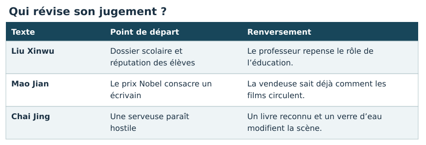

# ENS de Lyon · Séries LA/LV/SH (A/L) · Chinois oral 2017 — Corrigé brut

*Corrigé rédigé par IA, non officiel. Signalez toute erreur.*

**Rédaction** · GPT-6.2 Astra Ultra · vitesse non renseignée

**Révision** · GPT-6.2 Astra Ultra · vitesse non renseignée

Cinq billets sont recensés dans les séries Langues vivantes et Sciences humaines. Les deux passages littéraires sont bornés dans la liste. Le cahier complémentaire de six pages reproduit les trois textes hors programme et leur glossaire. L’ordre des deux textes de LV1 est inversé dans ce cahier.

## Langues vivantes · Explication d’un texte d’auteur (LV1)

### 1. 刘心武，《班主任》 · Liu Xinwu, *Le Professeur principal*

北京联合出版公司，2014，pp. 43–44，de « 他感到 » à « 冰雪了 ». La fin de la section VII d’une édition en caractères traditionnels permet de recouper les deux bornes. *冰雪* désigne la glace et la neige. Dans la dernière phrase, « des neiges que rien ne saurait faire fondre » restitue l’image enchâssée dans la tournure négative. [Section VII](https://www.haodoo.net/?L=book&M=u&P=H1444%3A7)

这个片段写张老师独自思考的时刻。开头反复出现的“他感到”，让读者进入人物的内心。老师先把学生的未来同国家的未来连起来，然后问自己，政治运动留下的伤害能不能只用经济损失来衡量。一个孩子被当成坏学生，另一个孩子看起来各方面都很积极，却同样可能受现成判断的束缚。张老师既不愿意放弃宋宝琦，也不愿意简单地责怪谢惠敏。两个人的处境不同，所以，负责任的教育也不能只有一种办法。

后半段的节奏发生了变化。老师有许多话想说，却考虑到这时候学生家里正在吃饭，于是决定晚一点再去家访。宏大的责任落实为一个很小的决定。丁香花的香味和结尾可以融化的冰雪给希望以感官形式。今天的读者也会注意到，这种希望使用了当时的政治语言。小说一面批评旧有标签，一面借助集体理想来恢复教师对学生的信任。

**追问：两名学生为什么要放在一起看？** 一个学生被排斥，一个学生得到赞许。并置之后，社会对青少年的影响就不能只凭谁守纪律、谁不守纪律来判断。

### 2. 王小波，《黄金时代》 · Wang Xiaobo, *L’Âge d’or*

译林出版社，2012，pp. 8–9，de « 我过二十一岁生日那天 » à « 她来了。 ». Le début se rend par « Le jour de mes vingt et un ans ». Le relevé de lecteurs confirme la scène du troupeau au bord de la rivière. La pagination varie selon l’édition. [Passages repérés dans l’œuvre](https://book.douban.com/subject/2015357/blockquotes?sort=score&start=120)

二十一岁生日通常适合写一场庆祝活动，王二却从河边放牛写起。这个落差一下子确定了叙述的口气：这里的生活并不按照纪念日的仪式展开。青年被派到云南农村，身体首先感受到的是草地、日晒和干季的气候。第一人称的幽默使被观察、被评判的人取得了讲述自己的权利。书名中的“黄金”也有双重意味。它既是回忆中的年轻岁月，也让人追问，在那么多外来约束下，个人究竟还有什么可以称为自己的东西。

叙述者既是当年那个年轻人，也是后来重新理解这段经历的人。把关于牛的意象读作青春活力可能受到驯服的比喻，可以说明两种时间为什么叠在一起。到结尾“她来了”，单独的“我”终于等到另一个人物进入画面。这个收束有意把判断留给此后两个人的相遇，而没有替读者下一个关于整个时代的结论。

**追问：“黄金时代”仅仅是怀旧吗？** 回忆保存了年轻人感受世界的能力，但讲述的幽默和日后的距离使读者同时看见，那种可能性并没有得到环境的保障。

## Langues vivantes · Analyse d’un texte hors programme (LV1)

### 1. 毛尖，《莫言低级和趣味》 · Mao Jian

La liste date la pièce du 16 août 2014. Le feuillet de Mao Jian se trouve aux pages 3 et 4 du cahier complémentaire. La scène de la boutique ouvre la page 3 et la remarque sur la publicité faite au Nobel la clôt. Le glossaire commence sur cette page et se poursuit sur la suivante. Certains mots du glossaire appartiennent à une version plus longue. [Publication de 2012](https://finance.sina.cn/sa/2012-10-19/detail-ikftpnnx7396380.d.html) · [Fascicule des extraits, p. 3–4](https://www.ens-lyon.fr/sites/default/files/2017-11/chinois-hors-programme2017_1506588773401.pdf#page=3)

毛尖从碟店写起，有意把诺贝尔文学奖拉到日常买卖的场景里。叙述者本想用自己对电影改编的了解考一考老板娘，没想到对方已经准备进货了。短短的对话让两种知识换了位置：懂文学的人未必懂作品怎样进入街头生活。顾客记住一部电影的理由，也许与评委授奖的理由完全不同。这种差距并没有简单证明大众品味低下。它反而让人看见，一本书可以在电影、广告和闲谈中获得新的生命。

考场上的文字没有展开讨论外国小说，而是从顾客的误会转到书名如何在日常生活中被重新使用。老板娘卖的电影并非顾客所说的作品，可是这种临时的替代却揭示了一个真实的流通机制。最后一句进一步倒转因果：不只是商人借莫言出名，诺贝尔奖也借获奖作家宣传了自己。开头的小小失算，由此成了观察文化声望的办法。

**追问：老板娘在结构上有什么作用？** 她使叙述者从一个自信的讲解者变成观察者；一场尴尬的对话引出了全文关于“趣味”的争论。

### 2. 张鸣，《饭桌上的言论自由》 · Zhang Ming

Le texte de Zhang Ming occupe la première page de l’annexe, suivi de son glossaire et du lien d’archive à la page 2. L’ouverture compare les conditions de parole avant et après les réformes. Le dernier trait s’adresse aux services chargés de la surveillance. *饭桌* est la table autour de laquelle on mange. [Republication signée](https://blog.wenxuecity.com/myblog/58437/201603/712206.html) · [Fascicule des extraits, p. 1–2](https://www.ens-lyon.fr/sites/default/files/2017-11/chinois-hors-programme2017_1506588773401.pdf#page=1)

一张饭桌既是实物，也是可以公开说话的人数与范围的比喻。饭友之间能谈政治，并不意味着这种议论可以发表、传播或要求政府作出回答。作者把微信上的私人交谈比作一顿饭，看起来相当现代的技术到了这里，可能只是扩大了旧饭桌的半径。问题不在于有没有手机，而在于谁可以形成一个公众。

文中先写书信和日记可能成为定罪材料，再写微博和微信怎样改变了言论的传播范围。议论的转折在于：当技术提供新的公共空间，限制也会随着平台转移。最尖锐的例子是个人公共账号：照作者的说法，即使想奉承当权者，未经许可也未必能谈时政。结尾认为，告密者和监狱不可能无限增加，于是用半带调侃的口吻反问管理者。私人交谈难以全面控制，与公开表达获得制度保障，仍是两个不同的判断。

**追问：作者为什么不用“网络自由”作题？** “饭桌”把认识的人和陌生的公众分开，比“网络”更能指出自由在什么地方受到限制。

## Sciences humaines · Analyse d’un texte hors programme

### 柴静，《托尔斯泰》 · Chai Jing, *Tolstoï*

Le texte attribué à Chai Jing est reproduit à la page 5. Il commence par le portrait de la serveuse et s’arrête sur le bref groupe « 热的 », suivi du point final. Le glossaire se poursuit à la page 6. La chute « 白开水，热的。 » peut se rendre par « De l’eau bouillie. Toute chaude. » [Billet de Chai Jing](https://blog.sina.com.cn/s/blog_48b0d37b0100mbty.html) · [Fascicule des extraits, p. 5–6](https://www.ens-lyon.fr/sites/default/files/2017-11/chinois-hors-programme2017_1506588773401.pdf#page=5)

读到标题时，我们也许会期待一篇谈俄国文学的文章。开头偏偏没有作家的名字，只有顾客等待入座和一个几乎不看人的服务员。柴静一再描写动作：姑娘把菜单放下，后退，站直。第一人称让我们和叙述者一样，只能从这些外在细节猜测她的态度。等书掉在地上，服务员认出作者，故事才第一次同标题相接。她仍然没有笑，也没有解释自己；结尾一杯热水却改变了我们对先前动作的理解。

这篇短文的妙处在于没有让服务员突然变成另一个人。读者既不知道她全部的想法，也不能确定她为什么喜爱托尔斯泰。文学在这里只创造了一个互相辨认的瞬间。最后的短句少了评价，多了温度，正好让读者自己完成重新判断。

**追问：能把最后一杯水理解为道歉吗？** 这是可能的猜想，文中没有明说。更有根据的是，送水的举动让“冷淡”这一种判断不够用了。

[Fascicule officiel des sujets](https://www.ens-lyon.fr/sites/default/files/2017-11/chinois-2017_1506588142976.pdf) · [Rapport du jury](https://www.ens-lyon.fr/sites/default/files/2018-03/CHINOIS_2017.pdf)
