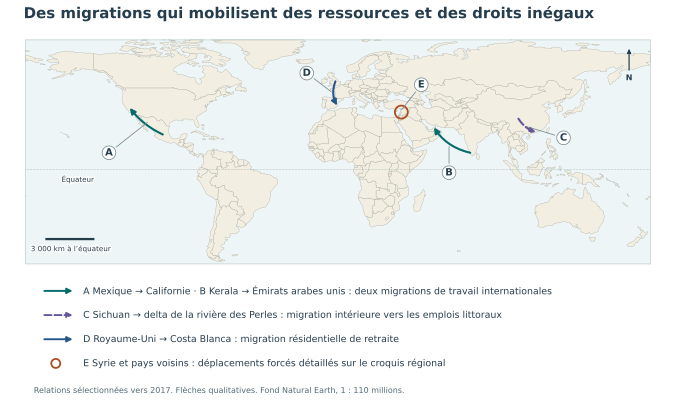
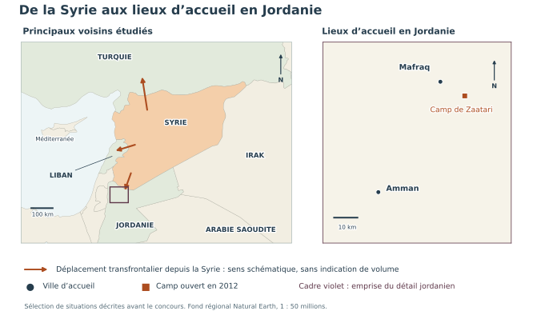

# ENS de Lyon · BEL A/L 2017 · Composition de géographie · Corrigé brut

*Corrigé rédigé par IA, non officiel. Signalez toute erreur.*

**Rédaction** · GPT-6.2 Astra Ultra · vitesse non renseignée

## Inégalités et migrations dans le monde

À quelques heures de vol du Kerala, un chantier de Dubaï offre à un ouvrier un salaire qui peut financer la scolarité de ses enfants en Inde. La proximité se mesure pourtant de deux manières. Pour l’employeur, le marché du travail s’étend de l’autre côté de la mer d’Arabie. Pour la famille, le coût du recrutement, le droit de séjour du travailleur et la difficulté de vivre ensemble introduisent autant de distances. Un écart de rémunération met ainsi des territoires en relation, puis le fonctionnement de cette relation produit des écarts de droits et de conditions de vie.

Migrer, c’est changer de lieu de résidence, à l’intérieur d’un État ou par-delà une frontière. Les inégalités sont des différences d’accès socialement organisées aux ressources, à la sécurité ou aux droits. Elles se lisent entre régions aussi bien qu’entre habitants d’une même ville. En 2015, l’ONU estime à 244 millions le nombre de migrants internationaux. Cet effectif de résidents, qui comprend des installations anciennes, laisse hors de son champ les changements de résidence internes. Comment les inégalités peuvent-elles à la fois susciter un départ, en priver certains habitants et se recomposer aux deux extrémités du trajet ? Il faut suivre les candidats au départ, les lieux qui sélectionnent les arrivants et les liens que maintiennent les ménages entre leurs lieux de vie.

### I. Les écarts entre territoires suscitent des projets migratoires dont la réalisation est sélective

La concentration de l’emploi trace des directions privilégiées. Depuis les réformes économiques chinoises, le delta de la rivière des Perles rassemble usines exportatrices, sous-traitants et services. Une personne quittant une campagne du Sichuan pour s’installer à Shenzhen transforme une différence entre marchés du travail en migration intérieure. Le delta offre des postes salariés accessibles à de jeunes adultes qui disposent de peu de terres. Un ancien ouvrier revenu au village peut expliquer où loger et présenter un nouvel arrivant à un recruteur. Le recrutement et les relations familiales contribuent de la sorte à reproduire un courant migratoire entre certains bassins de départ et certains quartiers d’arrivée. La différence de revenu aide à comprendre la direction du déplacement. Le réseau en explique la géographie plus fine.

Pouvoir partir est déjà une ressource inégalement répartie. Le billet, les démarches, le manque à gagner des premières semaines et une solution de garde constituent un seuil financier et familial. Entre le Kerala et les Émirats arabes unis, une recommandation dans un réseau professionnel ou l’hébergement par un parent peut abaisser ce seuil. L’enquête de 2014 du Centre for Development Studies estime à environ 2,4 millions les émigrés du Kerala à l’étranger, toutes destinations confondues. Derrière ce nombre se trouvent des ménages capables d’avancer les frais, d’autres qui empruntent et d’autres encore pour lesquels le projet reste inaccessible. Deux voisins exposés au même écart de salaire peuvent donc disposer de possibilités de déplacement très différentes.

La distance franchie dépend aussi de l’urgence et du droit de se mettre à l’abri. Après 2011, des familles syriennes ont trouvé refuge dans une autre partie de leur pays ou dans un État voisin. Le Haut-Commissariat des Nations unies pour les réfugiés distingue, à la fin de 2015, au moins 4,9 millions de réfugiés syriens à l’étranger et 6,6 millions de déplacés à l’intérieur de la Syrie. La Turquie au nord, le Liban à l’ouest et la Jordanie au sud sont des lieux d’accueil majeurs. La frontière la plus proche, la présence d’un parent et la possibilité de payer un loyer orientent l’installation. Il existe aussi des habitants dépourvus des ressources matérielles ou physiques nécessaires pour quitter le lieu du danger. Une carte des seules arrivées lointaines sous-estimerait à la fois les déplacements de proximité et cette inégalité devant le départ.

### II. Aux frontières et dans les villes, les droits différencient les expériences d’une même mobilité

Une frontière rapproche des marchés et sépare des statuts. Entre le Mexique et les États-Unis, les relations économiques et familiales et la demande de main-d’œuvre en Californie entretiennent des migrations de travail. L’agriculture irriguée, les services urbains et la construction ont recours à des salariés aux statuts divers. Un travailleur installé régulièrement, un titulaire de permis temporaire et une personne en situation irrégulière n’ont pas les mêmes possibilités de rester, de retrouver un emploi ou de faire venir leurs proches. À l’échelle de l’exploitation ou de la ville, la précarité du séjour peut réduire la capacité de revendiquer un salaire dû. Le corridor relie ainsi deux économies dont les écarts de salaire nourrissent le recrutement, tandis que les règles de séjour contribuent à maintenir une main-d’œuvre inégalement protégée.

Une frontière intérieure peut également subsister après le déplacement physique. En Chine, le *hukou*, système d’enregistrement des ménages, associe des droits au lieu d’enregistrement. Un ouvrier recruté dans le Guangdong peut vivre et travailler à Shenzhen tout en conservant son enregistrement dans sa commune d’origine. Les conditions locales d’accès à la scolarité ou à certains dispositifs sociaux compliquent l’installation de toute la famille. Certaines familles laissent des enfants aux grands-parents. D’autres supportent en ville des dépenses permettant la réunion du ménage. L’intégration de travailleurs dans la production littorale peut donc aller de pair avec une distribution inégale du coût de leur installation entre municipalité, employeur et famille rurale.

Le droit au séjour produit aussi une géographie de l’accueil. En Jordanie, le camp de Zaatari, ouvert en 2012 près de Mafraq, concentre logements, services humanitaires et administration sur un site délimité. D’autres Syriens louent un logement à Mafraq ou à Amman. Dans un quartier urbain, un parent et les possibilités d’emploi peuvent faciliter l’installation, mais les loyers pèsent sur les ménages aux ressources faibles, y compris les habitants déjà sur place. Dans un camp, la concentration des services facilite certaines prises en charge tandis que l’accès à l’emploi dépend fortement du cadre juridique et des possibilités de déplacement. Un même statut international se traduit par des conditions matérielles différentes selon le lieu de résidence. L’échelle de l’État permet de compter les personnes accueillies. L’échelle locale permet de voir qui accède au logement, à l’école et aux services.

### III. Les liens entre lieux de résidence redistribuent les ressources sans profiter également à tous

Une partie des revenus gagnés dans les villes du Golfe rejoint les ménages du Kerala. Une famille peut financer des soins, consolider son logement ou prolonger des études. Le salaire d’un travailleur installé aux Émirats devient ainsi une ressource disponible en Inde, où le ménage conserve une partie de ses dépenses et de ses relations. Localement, les chantiers de maisons et la consommation créent également une demande dont d’autres habitants peuvent bénéficier. Toutefois, une partie du premier salaire peut servir au remboursement du recrutement. Dans un même village, la famille qui reçoit régulièrement des fonds et la famille sans proche émigré n’ont pas la même capacité de faire face à une mauvaise récolte. Les transferts peuvent donc réduire l’écart de niveau de vie entre territoires tout en accroissant certains écarts entre ménages. Leur effet dépend des destinataires, du coût initial du départ et de l’usage des sommes reçues.

L’installation de ménages plus aisés fait apparaître le mécanisme inverse sur certains littoraux. En 2017, un retraité britannique choisissant de transférer durablement sa résidence sur la Costa Blanca espagnole mobilise sa pension, des économies, des liaisons aériennes et le cadre européen de circulation alors en vigueur. Il acquiert une capacité de choix résidentiel inaccessible à de nombreux actifs employés dans les services locaux. La demande de logements, de soins et de services apporte des revenus aux professionnels de la région d’accueil. Là où la pression foncière augmente, des ménages salariés peuvent être conduits à se loger plus loin des communes littorales. Le changement durable de résidence des premiers peut ainsi susciter une redistribution résidentielle des seconds. On comprend ici pourquoi distinguer la migration de retraite des séjours touristiques, même lorsque les deux se rencontrent dans les mêmes villes.

Ces effets dépendent enfin de décisions prises dans des territoires différents. À Shenzhen, ouvrir davantage les services urbains aux familles déjà présentes réduit le prix social de la migration intérieure, mais suppose de financer leur accueil à l’endroit où elles vivent. Dans une ville jordanienne, soutenir une école ou un service d’eau utilisés à la fois par les nouveaux résidents et leurs voisins peut atténuer la concurrence pour un équipement local. Au Kerala, l’accès au crédit, à l’information sur les contrats et à une protection du salaire change la part des gains qui reste au ménage migrant. L’enjeu commun est le décalage entre le territoire où se crée une richesse ou une obligation de protection et celui qui assume les coûts de logement, de travail ou d’éducation.

### Conclusion

Les écarts de salaires et de sécurité donnent une direction aux déplacements. La capacité de financer le voyage et le droit de s’installer sélectionnent ceux qui peuvent les accomplir et leur destination. Enfin, le salaire envoyé, la demande de logement ou le financement d’une école redistribuent les effets de la migration entre le lieu de départ et le lieu d’accueil. Selon que l’on compare des États, des villes ou les ménages d’un même quartier, une même migration peut ouvrir l’accès à une ressource et déplacer ailleurs le coût de cette ouverture.

### Sources

- [Sujet L 764, énoncé et planisphère, ENS de Lyon, 2017](https://www.ens-lyon.fr/sites/default/files/2017-11/17-bel-composition-de-geographie-lyon_1506586291986_0.pdf) · [Rapport du jury, épreuve commune, p. 1–4](https://www.ens-lyon.fr/sites/default/files/2018-03/GEO_TC_SPE_2017.pdf)
- [ONU, effectif des migrants internationaux en 2015, publié en janvier 2016](https://www.un.org/sustainabledevelopment/blog/2016/01/244-million-international-migrants-living-abroad-worldwide-new-un-statistics-reveal/) · [HCR, déplacements forcés à la fin de 2015, publié en juin 2016](https://www.unhcr.org/news/press-releases/1-human-every-113-affected-forced-displacement-hits-record-high)
- [Centre for Development Studies, Kerala Migration Survey 2014](https://cds.edu/wp-content/uploads/WP463.pdf) · [Banque mondiale et Development Research Center, Urban China, 2014](https://www.worldbank.org/content/dam/Worldbank/document/EAP/China/WEB-Urban-China.pdf)
