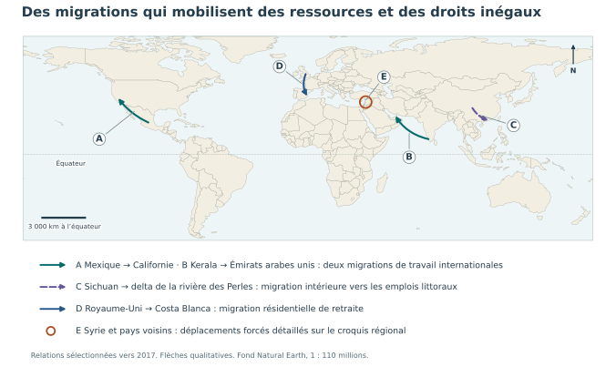
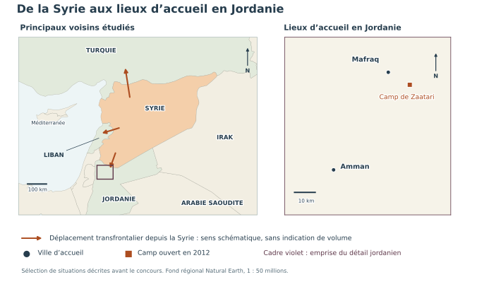

# ENS de Lyon · BEL A/L 2017 · Composition de géographie · Corrigé guidé

*Corrigé rédigé par IA, non officiel. Signalez toute erreur.*

**Rédaction** · GPT-6.2 Astra Ultra · vitesse non renseignée

## Inégalités et migrations dans le monde

L’épreuve dure cinq heures. Le sujet comporte un intitulé sur le premier feuillet et un planisphère sur le second. Le rapport de l’épreuve commune commence à la première page du rapport de géographie et s’arrête sur sa quatrième page, avant le commentaire de carte de spécialité. La proposition suivante se place à la date du concours.

### Poser une question à laquelle la carte puisse répondre

Sur un brouillon, dessinez un village, une frontière et deux quartiers de la même ville. Dans le village, demandez-vous qui peut financer un départ. À la frontière, demandez qui pourra résider et travailler dans le pays voisin. Dans la ville, demandez qui pourra payer son logement et accéder à une école. Vous disposez à présent de trois localisations différentes pour observer une inégalité.

Donnez un sens précis aux mots du sujet. Un trajet quotidien entre le domicile et le travail relève de la mobilité pendulaire. Le déménagement d’un salarié chinois du Sichuan vers Shenzhen constitue une migration même si la frontière d’État n’est jamais franchie. Un réfugié syrien qui s’installe en Jordanie relève à la fois de la migration internationale et d’une catégorie juridique de protection. Un habitant contraint de se déplacer de Homs à une autre ville syrienne relève du déplacement interne. Chaque cas dit quelque chose de différent sur l’accès à un emploi, à un logement ou à la sécurité.

**Introduction que l’on peut rédiger.** En 2015, les Nations unies évaluent à 244 millions l’effectif mondial des personnes vivant dans un pays différent de leur pays de naissance, avec la nationalité comme critère de remplacement dans certains pays. Il s’agit d’un stock de résidents. Le nombre de départs pendant l’année répondrait à une autre question, et les déplacements internes appelleraient d’autres sources. Dans une métropole comme Shenzhen, un changement de résidence à l’intérieur du pays peut transformer l’accès d’une famille au travail et à l’école. Dans la vallée du Jourdain ou sur les rivages du Golfe, le passage d’une frontière d’État peut ouvrir le marché de l’emploi sans garantir la même protection à tous. Comment le pouvoir de choisir son lieu de vie, les conditions de l’installation et les liens maintenus avec le lieu d’origine recomposent-ils les inégalités ? Nous suivrons d’abord les possibilités de départ, puis la distribution des droits à destination, avant de revenir sur les conséquences pour les ménages des deux territoires.

### I. Expliquer pourquoi le désir de partir ne suffit pas à dessiner les courants migratoires

**Construire le premier argument.** Prenez une différence repérable sur une carte et identifiez qui la convertit en migration. Dans le sud de la Chine, les activités exportatrices du delta de la rivière des Perles créent une demande de main-d’œuvre. Une jeune adulte du Sichuan peut y chercher un salaire plus régulier que dans sa commune rurale. Pour comprendre le choix de Shenzhen parmi plusieurs villes, ajoutez un intermédiaire concret, tel un ancien voisin qui transmet une offre d’emploi et accueille la nouvelle venue quelques jours. Écrivez alors une phrase de portée générale. La concentration de l’activité hiérarchise des destinations, et le réseau du ménage rend l’une d’elles accessible.

**Éprouver l’argument par une deuxième situation.** Un emploi à Dubaï peut offrir à un habitant du Kerala un revenu supérieur à celui disponible dans son district d’origine. Le prix du premier billet et du recrutement arrive néanmoins avant le premier salaire. Une famille disposant d’une épargne ou d’un parent déjà employé aux Émirats engage le départ dans de meilleures conditions qu’un ménage obligé d’emprunter. Le coût de l’immobilité mérite ici une phrase. Pour un ménage exposé à une baisse de revenu, rester au village peut traduire la difficulté de financer une diversification des ressources. La possibilité de partir constitue elle-même une inégalité.

**Changer de causalité avec la Syrie.** En situation de guerre, le souci immédiat est la protection. L’accès à un logement sûr dépend encore du lieu de départ, de l’ouverture des frontières, des ressources du ménage et des proches qui peuvent l’accueillir. En distinguant les 6,6 millions de déplacés internes syriens et les 4,9 millions au moins de réfugiés syriens à l’étranger à la fin de 2015, on fait apparaître l’importance des solutions proches et contraintes. Le nombre mondial de migrants et les deux statistiques du HCR couvrent des catégories et des dates définies. On peut les utiliser successivement pour poser deux questions, celle du volume de la migration internationale et celle des formes de la protection, sans en additionner les effectifs.

**Transition rédigée.** Les cartes de départ et d’arrivée dessinent ainsi des directions possibles. Mais le franchissement d’une limite administrative ou nationale ne suffit pas à établir un ménage dans les mêmes conditions que ses voisins. Suivons les droits qui lui sont effectivement accessibles au terme du déplacement.

### II. Situer les institutions qui sélectionnent et différencient les arrivants

**Un paragraphe à partir de la frontière mexicaine.** Commencez par identifier la relation plutôt que par énumérer des obstacles. Entre le Mexique et la Californie, les emplois agricoles et urbains et les liens de parenté soutiennent des installations durables. À l’échelle d’un même bassin d’emploi californien, les possibilités de rester ou de changer d’employeur dépendent notamment du titre de séjour, du contrat et des ressources du salarié. Un travailleur dont le séjour est précaire dispose d’une marge de négociation réduite. La frontière conserve donc des effets à distance de la ligne internationale, jusque dans les conditions de travail dans l’espace d’arrivée. Sur le planisphère, la flèche exprime une relation régionale. La phrase sur le bassin d’emploi en explique les conséquences concrètes.

**Le contrepoint d’une frontière de droits interne.** Reprenez Shenzhen sous un angle nouveau. En Chine, le *hukou* enregistre les ménages dans une localité. Le recrutement d’un ouvrier issu d’un village ne lui confère pas mécaniquement le même accès local à l’éducation et à certaines prestations qu’à un résident enregistré sur place. Si les enfants restent au village auprès de leurs grands-parents, le foyer vit entre deux territoires. La municipalité accueille un actif, tandis que sa commune d’origine conserve une partie des charges éducatives et familiales. On passe ainsi de l’affirmation générale « la migration crée des inégalités » à une explication qui nomme les institutions et répartit les coûts.

**Le camp et la ville, deux lieux d’une même région d’accueil.** Le conflit syrien a poussé des familles vers la Turquie, le Liban et la Jordanie. Zoomez sur le nord jordanien. Près de Mafraq, le camp de Zaatari, ouvert en 2012, concentre les interventions des autorités et de l’aide humanitaire. D’autres ménages résident en ville, à Mafraq même ou plus au sud à Amman. Un logement loué peut rapprocher d’un parent ou d’un emploi, tout en faisant peser une dépense considérable sur une famille dont les revenus sont irréguliers. Les résidents déjà présents partagent écoles, réseaux d’eau et marché du logement. La catégorie nationale « réfugiés accueillis » recouvre donc plusieurs géographies de l’accès aux ressources, que le logement en camp ne résume pas.

### III. Suivre les effets du déplacement jusqu’au lieu de départ

**Faire circuler une somme d’argent dans le raisonnement.** En 2014, l’enquête sur les migrations du Kerala estime à environ 2,4 millions le nombre d’émigrés originaires de l’État, vers l’ensemble des destinations étrangères. Dans une famille entre Kerala et Émirats, une fraction du salaire gagné à Dubaï revient payer des soins, les échéances d’un emprunt ou les études d’un enfant. Choisissez ensuite deux échelles de comparaison. Pour le ménage bénéficiaire, ces fonds peuvent desserrer une contrainte de revenu. Entre deux ménages voisins, celui qui reçoit des virements peut mieux financer un logement que celui qui en est privé. Enfin, la construction crée une demande pour d’autres métiers dans l’État d’origine. Ces trois résultats peuvent coexister, car ils concernent des groupes ou des échelles différents.

**Partir d’un autre lieu d’arrivée.** La Costa Blanca illustre la mise en concurrence de groupes ayant des ressources différentes pour se loger. Au moment de l’épreuve, des Britanniques retraités peuvent choisir une nouvelle résidence en Espagne en s’appuyant sur une pension, l’accès au marché immobilier et la circulation au sein de l’Union européenne. Des travailleurs locaux tirent un revenu des services demandés. Ceux qui ont les salaires les plus modestes peuvent cependant subir une pression sur les loyers dans les communes les plus recherchées. Pour établir un effet géographique, précisez le déplacement en jeu et sa condition : lorsqu’un ménage se reloge dans une commune intérieure moins chère, l’inégalité de pouvoir d’achat a changé la géographie résidentielle. Un touriste qui revient chaque année sur la même plage ne suffit pas à documenter ce mécanisme.

**Ouvrir la question des politiques à l’échelle pertinente.** Reprenez l’école comme fil directeur. À Shenzhen, les règles locales d’accès à la scolarité peuvent décider de la séparation ou de la réunion d’une famille. Dans les villes jordaniennes, financer des classes supplémentaires peut servir à la fois les enfants réfugiés et les enfants des résidents locaux. Dans un district du Kerala, une famille peut employer un transfert à financer des études que le revenu local aurait rendues difficiles. Le même équipement public, l’école, met en évidence un droit attaché au lieu, un besoin d’investissement dans le lieu d’arrivée et une ressource issue d’un revenu gagné ailleurs.

### Construire le planisphère et conclure

**Sur le fond fourni.** Placez le Mexique et la Californie, le Kerala et les Émirats arabes unis, le Sichuan et le sud du Guangdong. Une couleur indique les exemples de migration de travail, avec un figuré distinct pour la migration intérieure chinoise. Portez ensuite la relation résidentielle entre le Royaume-Uni et la côte méditerranéenne de l’Espagne. Un repère au Levant renvoie au croquis régional de l’accueil des réfugiés. Gardez la même épaisseur de trait pour tous les exemples de même catégorie, car vous n’avez pas calculé de volumes comparables. Indiquez dans la légende la fonction du tracé et le caractère sélectif des situations représentées.

**Conclusion que l’on peut rédiger.** Pour un actif du Sichuan, un réfugié syrien ou un retraité britannique, changer de lieu de résidence peut permettre de gagner un revenu, de se mettre à l’abri ou d’accéder à un cadre de vie recherché. Le coût du départ et le droit de séjour expliquent une part des différences entre trajectoires. La distribution finale des gains et des charges se joue ensuite dans le logement, les services et les liens familiaux entre lieux d’origine et d’installation. La géographie des inégalités doit ainsi suivre les personnes qui se déplacent autant que les habitants qui restent sur place et partagent les ressources transformées par ces déplacements.

### Sources pour vérifier les exemples

- [ENS de Lyon, sujet de cinq heures et fond de carte, session 2017](https://www.ens-lyon.fr/sites/default/files/2017-11/17-bel-composition-de-geographie-lyon_1506586291986_0.pdf) · [Rapport du jury de géographie, partie commune, p. 1–4](https://www.ens-lyon.fr/sites/default/files/2018-03/GEO_TC_SPE_2017.pdf)
- [ONU, migrants internationaux en 2015](https://www.un.org/sustainabledevelopment/blog/2016/01/244-million-international-migrants-living-abroad-worldwide-new-un-statistics-reveal/) · [HCR, réfugiés et déplacés internes en 2015](https://www.unhcr.org/news/press-releases/1-human-every-113-affected-forced-displacement-hits-record-high)
- [Centre for Development Studies, enquête sur les migrations au Kerala de 2014](https://cds.edu/wp-content/uploads/WP463.pdf) · [Banque mondiale et Development Research Center, Urban China, 2014](https://www.worldbank.org/content/dam/Worldbank/document/EAP/China/WEB-Urban-China.pdf)
