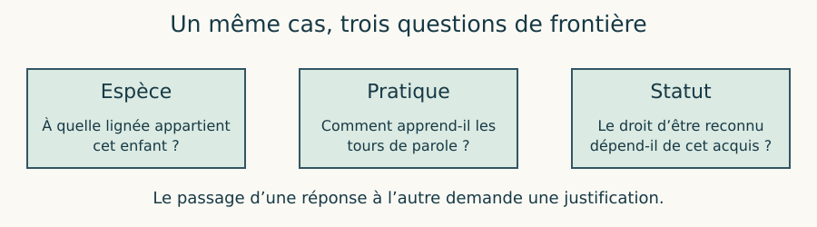

# Peut-on délimiter l’humain ? · BEL 2017 · Corrigé brut

*Corrigé rédigé par IA, non officiel. Signalez toute erreur.*

**Rédaction** · GPT-6.2 Astra Ultra · vitesse non renseignée

**Révision** · GPT-6.2 Astra Ultra · vitesse non renseignée

**Révision (tour 2)** · GPT-6.2 Astra Ultra · vitesse non renseignée · 26 novembre 2026

## Introduction

Un enfant qui balbutie et un automate capable de prononcer les mêmes syllabes peuvent fournir au microphone deux enregistrements également intelligibles. Pour le linguiste, l’un ou l’autre peut servir à tester un dispositif de reconnaissance sonore. Pour le parent qui entend son enfant chercher ses mots, la question est toute différente. Elle porte sur quelqu’un à qui l’on s’adresse avant qu’il puisse répondre comme nous. Où passe ici la limite de l’humain ? Le mot désigne à la fois un mode d’existence, ce qu’on reconnaît dans des pratiques et une qualité que l’on peut refuser à des actes pourtant accomplis par des hommes. Par « délimiter », il faut entendre plus que décrire un caractère fréquent. Une limite doit autoriser à dire pourquoi quelque chose relève de l’humain et pourquoi telle autre chose lui échappe.

Or l’instrument dont nous nous servons pour dessiner cette limite change avec l’enquête. Une différence attestée dans une espèce n’a pas la même force qu’une règle de conversation ou qu’une exigence de respect. Et l’observateur appartient à l’humanité qu’il cherche à circonscrire. Peut-on produire des démarcations justifiées sans transformer l’une d’entre elles en un pouvoir de distribuer l’humanité ? L’enjeu est de savoir ce que les différences permettent de connaître et à quel titre elles pourraient obliger.

## I. Une limite objective peut être légitime sans fournir un propre absolu

L’histoire évolutive donne de bonnes raisons de distinguer *Homo sapiens* d’autres lignées. Un fossile se classe à partir de caractères comparés, dans le contexte d’une population et d’une histoire. Mais distinguer une espèce n’exige pas qu’à un instant identifiable le premier humain ait surgi de parents absolument étrangers à l’humanité. La lignée change à travers des générations apparentées, et des échanges génétiques entre populations anciennes compliquent les partitions nettes. Une délimitation peut donc être opératoire sans opposer deux essences séparées par une rupture intégrale. Elle ne répond pas davantage, à elle seule, à la question de ce qui change pour un être quand il entre dans un monde de promesses ou de règles.

Pourquoi ne pas prendre le langage pour critère de ce dernier passage ? Dans le livre I de la *Politique*, Aristote distingue la voix qui manifeste plaisir et peine du *logos* grâce auquel les hommes mettent en commun des appréciations du juste et de l’injuste. Il ne propose pas simplement de compter les cris ou les sons articulés. Une demande de justice appelle des raisons et une réponse, même quand aucun bruit n’est émis par celui au nom duquel on parle. La distinction éclaire une institution humaine, la cité, et le type de relation qu’elle rend possible. Elle ne fournit pas un test acoustique capable de décider qui est humain.

Le schéma ramène les deux démarches au même enfant. La question de la lignée reçoit déjà une réponse tandis que celle de la participation à une conversation reste ouverte dans le temps. Transformer un caractère de l’existence commune en une performance exigible de tout individu ferait de l’incapacité provisoire ou durable à parler un motif d’exclusion. La généralité « les humains parlent » décrit au mieux une forme de vie dont tous les membres n’exécutent pas chaque opération. La diversité des fins de l’enquête interdit ce glissement, mais elle ne nous dit pas encore comment les sciences humaines choisissent leur objet.

## II. Les sciences humaines mettent à l’épreuve des limites qu’elles ne posent pas une fois pour toutes

Dans « Les techniques du corps », Marcel Mauss prend au sérieux des opérations aussi ordinaires que nager, marcher ou porter un enfant. Une anatomie humaine rend certaines amplitudes de mouvement possibles. Elle ne prescrit pas à tous les nageurs une seule manière de coordonner les bras et la respiration. L’exercice, les habitudes d’une génération, le prestige de celui qu’on imite, le milieu où l’on apprend changent cette coordination. Mauss propose d’étudier le corps comme instrument de l’action apprise. Il ne découvre aucune frontière tracée dans le corps même entre une moitié qui relèverait de la nature et une autre qui dépendrait de la culture. Il distingue des rapports explicatifs à même un seul geste.

Une épreuve de comparaison consiste à regarder deux apprentis qui traversent le même bassin à la même vitesse, l’un formé à la brasse, l’autre au crawl. Un chronomètre permet de les classer ensemble. Une histoire des techniques peut au contraire les séparer en suivant deux lignées d’enseignement. Ce sont bien les mêmes nageurs. La différence tient à ce que chaque enquête veut expliquer. Délimiter son objet, pour l’ethnologue, lui permet précisément de découvrir des continuités là où le découpage par espèces ne disait plus rien.

Ainsi, délimiter le domaine d’une enquête ethnologique ne consiste pas à décider d’avance qu’elle ne rencontrera que des faits absolument étrangers aux autres vivants. Des apprentissages par imitation existent aussi dans d’autres espèces. L’enquête peut les comparer et préciser ce que change, dans un groupe humain, la transmission explicite d’une règle par un maître ou sa discussion publique. Une ressemblance déplace alors la limite là où l’enquête pouvait à tort se satisfaire d’un caractère unique. Une différence interne aux sociétés humaines révèle en retour une dimension du comportement qu’une humanité définie sur notre propre exemple aurait rendue invisible.

On peut éprouver la distinction avec une règle de parenté. Deux cousins germains sont au même degré généalogique, que leurs parents soient frère et sœur ou deux frères. Certaines sociétés distinguent pourtant ces cas lorsqu’elles déterminent les alliances autorisées. Dans *Les Structures élémentaires de la parenté*, Lévi-Strauss demande ce que devient la frontière entre nature et culture devant cette situation. À l’universalité qu’il attribue à la prohibition de l’inceste répond la diversité des catégories de parents que la règle concerne. Pour comparer ces systèmes, l’ethnologue doit délimiter ce qu’il appelle une relation d’alliance. Cette délimitation porte sur les relations qu’il étudie et laisse intacte l’appartenance humaine de ceux dont il cherche à comprendre les usages.

Cette leçon éclaire l’ambition de Lévi-Strauss dans *La Pensée sauvage*. Réintégrer l’homme dans la nature revient à rendre certaines opérations de classement intelligibles en recherchant des relations, y compris là où un jugement ethnocentrique ne voyait que l’infériorité d’un esprit prétendument prélogique. Cela ne veut pas dire qu’un récit mythique et un processus biologique s’expliquent immédiatement par la même loi. Comparer présuppose des découpages, des différences entre les systèmes étudiés et parfois une révision des catégories de l’observateur. Une science humaine peut donc renoncer à isoler l’humain comme un empire sans frontières communes avec le vivant, tout en spécifiant fort exactement les relations qu’elle cherche à comprendre.

## III. La reconnaissance d’un humain ne se distribue pas à proportion de ses performances

On peut dire d’un traitement qu’il est inhumain précisément en reprochant à des hommes de l’avoir choisi. On ne leur reproche pas de changer d’espèce. L’adjectif marque une violation d’une exigence que l’on estime pouvoir leur adresser. Inversement, dire qu’un animal appartient à une espèce non humaine ne justifie aucune cruauté à son égard. La différence des mots signale ici des différences de raisons. D’une appartenance observable, rien ne permet de déduire sans argument la mesure du respect dû ni le degré d’obligation de celui qui agit.

Dans *Race et histoire*, Lévi-Strauss donne à examiner une disposition récurrente, celle de penser que l’humanité s’arrête aux frontières de son propre groupe. Celui qui rejette certains hommes dans la « barbarie » adopte le geste même qu’il impute à ceux qu’il refuse pour semblables. La circularité est instructive. Aucune observation de conduites étrangères ne saura démontrer à elle seule que l’observateur a le droit de soustraire leurs auteurs à la discussion. Le désaccord sur une règle suppose au contraire de pouvoir l’adresser à quelqu’un. Reconnaître un interlocuteur ne signifie pas approuver tous ses actes, pas plus qu’accueillir un enfant au sein d’une communauté ne signifie attendre sa première argumentation réussie.

Il reste possible de tracer des limites normatives. On peut déterminer les actes qu’une institution ne peut légitimement infliger à personne. Ce qui est délimité est alors un pouvoir ou une pratique. Le changement d’objet est décisif. L’humanité comme exigence commande de limiter ce que nous nous permettons de faire à des êtres vulnérables plutôt que d’instituer un examen auquel ils devraient satisfaire pour être reconnus. Cette obligation peut d’ailleurs conduire à repenser le sort d’autres vivants. Elle n’a pas besoin de faire de la totalité de l’univers une seule espèce pour étendre le champ de nos devoirs.

## Conclusion

On peut délimiter un groupe biologique, une pratique ou un domaine d’enquête dès lors qu’on indique l’opération menée et ce qui pourrait en réviser le résultat. Aucune de ces frontières ne possède à elle seule le pouvoir de définir l’humain dans tous ses sens. Lorsque l’enjeu devient la reconnaissance, la limite la mieux fondée peut porter sur notre propre pouvoir d’exclure. Les sciences humaines contribuent à ce jugement en donnant à voir la diversité des conduites et la situation de celui qui les classe.
