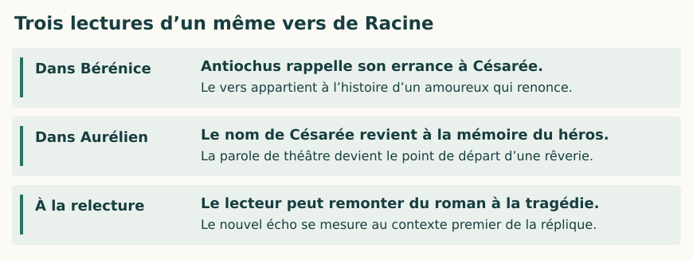

# Lire en compagnie de l’auteur selon Julien Gracq · BEL 2017 · Corrigé guidé

*Corrigé rédigé par IA, non officiel. Signalez toute erreur.*

**Rédaction** · GPT-6.2 Astra Ultra · vitesse non renseignée

**Révision (tour 1)** · GPT-6.2 Astra Ultra · vitesse non renseignée

## Préparer la composition

**Reconstruire la phrase de Gracq.** Tracez trois colonnes sur le brouillon. Dans la première, le lecteur reçoit une organisation d’idées et d’images. Dans la deuxième, il travaille sur des signes. Dans la troisième, une personne le reçoit. Entourez le petit mot « aussi ». Cherchez, dans les trois cas, ce qui demeure réglé. La question gagne alors en précision. Quel supplément l’hospitalité apporte-t-elle à la transmission et au déchiffrement ?

**Faire travailler le mot juridique.** Le nu-propriétaire conserve un droit sur le bien dont l’usufruit revient à une autre personne. Pour rendre le paradoxe sensible, faites jouer la dernière réplique d’Antiochus de deux façons différentes, sans en changer le mot. Le lecteur peut modifier une intonation imaginée ou rapprocher deux passages. L’œuvre lui oppose en retour des mots et un ordre auxquels son interprétation doit pouvoir répondre.

**Construire une confrontation entre genres.** Prenez d’abord les confidences des premiers actes de *Bérénice* et dites ce qu’un spectateur perdrait si l’on inversait leur ordre. Passez à une complainte de Laforgue et demandez ce qu’un lecteur peut reprendre indépendamment des pièces qui l’encadrent. Revenez enfin à *Aurélien*, où un personnage lit un vers de théâtre comme un fragment de poésie. Ces passages d’un genre à l’autre permettent d’éprouver la même proposition à plusieurs échelles.

**Distinguer trois moments de la création.** Qui imagine le parcours ? Qui lui donne une forme ? Qui en dispose après la publication ? Appliquez ces questions à Aragon qui, dans *Les Incipit*, dit découvrir ses personnages en écrivant. Un roman achevé peut orienter fortement la lecture même si sa fin n’était pas connue de son auteur lorsqu’il en a écrit la première phrase.

**Éviter le catalogue de théories.** La formule de Barthes intervient au moment où la diversité des voix du Paris de Laforgue rend difficile de leur assigner une origine unique. Dites ce que l’exemple établit et ce qu’il laisse en discussion. Ce geste permet de suivre le rapport de 2017 sur deux points précis, le rôle distinct des trois modèles de lecture et l’égale mobilisation des œuvres au programme.

## Introduction

Aurélien, chez Aragon, se souvient d’un vers de Racine sans parvenir à se rappeler avec précision la tragédie dont il est tiré. Le nom de Césarée lui fait voir une ville qu’il n’a jamais visitée, et celui de Bérénice vient troubler sa première rencontre avec une jeune femme bien réelle dans l’univers du roman. Voilà un lecteur assez peu respectueux des intentions présumées de Racine. Pourtant, pour raconter sa rêverie, Aragon nous fait entrer dans une phrase dont il a choisi jusqu’à la place des mots. La liberté dont jouit un personnage quand il se souvient d’un livre semble ainsi procéder, chez celui qui lit son histoire, d’une conduite minutieuse de la lecture.

Julien Gracq, dans *En lisant en écrivant*, ajoute au transport des idées et au travail de déchiffrement une troisième expérience de la lecture, la compagnie d’un hôte. Le mot « aussi » lui donne prise sur ce que les deux premiers modèles laissaient échapper. Lire, c’est éprouver les égards et parfois l’autorité de quelqu’un qui a construit l’endroit où l’on se trouve. La métaphore comporte pourtant un détail surprenant. Cet hôte qui règle jusqu’aux virgules n’a gardé que la nue-propriété de son domaine. Il en a donc cédé la jouissance. Quelle sorte de présence un auteur peut-il conserver auprès du lecteur lorsque l’usage du livre lui échappe ? Nous suivrons la manière dont une œuvre prépare notre arrivée, puis les chemins que la lecture fait effectivement prendre, pour nous demander enfin à quoi l’on reconnaît une liberté de lecture que l’œuvre a elle-même rendue possible.

## I. L’auteur accueille en disposant ce que le lecteur peut savoir et sentir

Dans *Bérénice*, la distribution des confidences fait éprouver très concrètement ce qu’est un itinéraire. L’empereur a décidé de se séparer de la reine. Or c’est Antiochus que Racine nous fait d’abord entendre, et c’est lui qui révèle à Bérénice l’amour qu’il lui avait longtemps caché. Le premier renoncement que nous entendons appartient ainsi à celui dont la décision ne fera pas le dénouement. Lorsque Bérénice envisage encore son bonheur avec Titus, le spectateur possède déjà une expérience de l’aveu douloureux dont elle n’a pas mesuré toute la portée. Bientôt il saura par Titus ce que la reine ignore encore. Intervertir ces scènes laisserait presque intact le résumé des faits. Cela détruirait en revanche l’effet d’attente particulier à la pièce. Que le dramaturge nous accompagne tient moins à des conseils qu’il nous soufflerait du dehors qu’à l’ordre irréversible des confidences qu’il nous fait recevoir.

L’auteur peut aussi prendre la parole pour régler la place du destinataire. Au premier livre des *Tragiques*, Agrippa d’Aubigné annonce qu’il veut peindre la France sous les traits d’une mère. Les enfants qui devraient recevoir ensemble son lait se disputent son sein et finissent par prendre part à son supplice. Le lecteur est d’abord invité à regarder une figure dans laquelle il peut reconnaître une histoire biblique, celle d’Ésaü et de Jacob. Le poète lui apprend ensuite combien il est dangereux de se croire simple spectateur d’une telle scène. Les guerres de Religion sont l’affaire de ceux auxquels il s’adresse. En faisant céder la distance du tableau devant la proximité de l’interpellation, l’auteur donne un sens polémique à l’accueil. Rendre les honneurs de son domaine peut consister à demander des comptes au visiteur qui pensait pouvoir circuler sans être vu.

Il arrive enfin que la présence de l’hôte se fasse sentir avant même que le lecteur sache à qui attribuer la voix. Aragon commence *Aurélien* en nous apprenant que le jeune homme a d’abord trouvé Bérénice laide. La formulation de ce premier jugement déçoit une attente romanesque, celle du coup de foudre. Mais « la première fois » fait attendre d’emblée d’autres fois. Le déplaisir lui-même réclame un avenir. Nous suivons ensuite les associations d’Aurélien, ses résistances devant le prénom, le souvenir du vers de Racine. Qui est responsable de notre curiosité ? Le personnage juge et le narrateur raconte, mais le dispositif qui nous fait espérer le démenti du jugement appartient à la construction du roman. On peut sentir une intention de récit sans avoir à convertir chaque opinion du héros en conviction d’Aragon. Ce premier partage introduit déjà une difficulté dans le portrait du propriétaire des lieux. Quelle voix reconnaîtrait-on pour la sienne s’il a pris soin de les multiplier ?

## II. La fixité de la page laisse la visite se disperser

Une tragédie fournit le cas le plus net d’une œuvre où chaque mot soit réglé et où cependant la voix par laquelle il nous parvient soit encore à choisir. Le dernier mot de la *Bérénice* de Racine appartient à Antiochus. Son « Hélas ! » succède à la décision de la reine, qui exige que les trois personnages vivent et se séparent. Un comédien peut le dire comme le dernier souffle d’une plainte que personne ne songe à consoler ou y faire entendre la stupeur d’un homme dont la conduite vient d’être décidée par une autre. Le texte donne des raisons à ces deux lectures, la longue patience d’Antiochus et la soudaineté du dénouement imposé par Bérénice. La distribution des répliques est fixée jusqu’à l’exclamation finale. L’intonation reste à trouver. Quand je lis la scène en silence, je dois moi aussi prêter un corps et une durée aux deux syllabes de cette plainte. Suivre l’auteur mot à mot m’oblige à prendre une initiative que le texte n’a pas matériellement enregistrée.

Ce qui est vrai d’une exclamation l’est davantage encore des voix d’une ville. Dans la « Grande Complainte de la ville de Paris », Laforgue fait entrer les cris publics, le langage de la Bourse et celui des annonces dans le corps du poème. Il y est même question de l’achat de nues-propriétés. L’expression juridique dont Gracq fera la pièce d’une comparaison solennelle circule ici parmi les marchandises et les placements. À qui appartient-elle lorsqu’on la lit ? L’imprimeur d’une annonce, un crieur et le poète peuvent tous y faire entendre quelque chose de leur métier. Le lecteur accomplit une opération comparable à celle d’un auditeur dans une rue. Il distingue une voix, perd le fil d’une autre, rapproche des langages socialement éloignés que la page a rendus voisins. Barthes, dans « La mort de l’auteur », s’oppose précisément à l’idée qu’il faudrait chercher derrière une telle pluralité une voix première qui en garantirait tout le sens. Le sujet de Gracq conserve ici une part de sa force. Quelqu’un a bien ménagé la rencontre de ces cris, mais celui qui les a recueillis n’a pas davantage à les prononcer tous en son nom que le lecteur à les rapporter tous à sa personne.

La mémoire, enfin, change matériellement les conditions de la visite. Le vers qui obsède Aurélien, « Je demeurai longtemps errant dans Césarée », était une parole d’Antiochus sur son éloignement. Dans l’esprit du personnage d’Aragon, la ville et la sonorité du nom prennent le pas sur l’action de la tragédie. L’itinéraire se trouve presque renversé. Un vers détaché entraîne vers des images nouvelles un lecteur qui a oublié le chemin par lequel il était arrivé jusqu’à lui. Notre propre lecture pourra opérer le trajet inverse. Qui revient à Racine après Aragon entendra peut-être, dans l’évocation de Césarée, quelque chose du trouble d’un ancien combattant du vingtième siècle. Racine n’a jamais conçu une telle visite. Faut-il pour autant juger qu’elle lui est entièrement infidèle ? C’est ici que l’image du nu-propriétaire livre sa conséquence la plus féconde.

## III. L’œuvre donne au lecteur les moyens de juger ses propres parcours

La nue-propriété et l’usufruit dissocient le titre que l’on conserve et la jouissance confiée à autrui. Il serait peu pertinent d’appliquer le droit civil à tous les détails de la fabrication des livres. Mais la métaphore permet de tenir ensemble deux expériences très communes. Je peux revenir quand je veux sur le dernier acte de *Bérénice*. Je ne peux faire que la reine y reprenne sa promesse de se séparer sans me mettre à écrire une autre pièce. La limite est assez ferme pour rendre possibles des libertés réelles. Reprenons les deux façons d’entendre l’exclamation d’Antiochus. Pour choisir, l’acteur peut essayer la scène en changeant la longueur du silence laissé après la réplique de la reine. Il met ses lectures en concurrence devant les mêmes mots. Une œuvre nous tient compagnie en ce sens précis qu’elle nous permet de nous dédire. Une interprétation qui n’aurait à répondre qu’au désir du lecteur ne pourrait jamais rencontrer cette heureuse résistance.

Reste que le concepteur et le constructeur ne se confondent pas nécessairement. Dans *Je n’ai jamais appris à écrire ou les Incipit*, Aragon se décrit découvrant en écrivant le devenir de ses propres personnages. Que l’on sente une intelligence présider au parcours achevé ne prouve donc pas que le romancier ait connu d’avance chacune de ses étapes. Ce décalage rend au mot *quelqu’un*, que Gracq souligne sans écrire « auteur », toute sa force. Je rencontre dans l’ordre du livre la trace d’une activité singulière. Je n’ai pas pour autant accès au projet initial de l’écrivain. Le constructeur peut avoir infléchi le plan, et la publication confie à un autre la jouissance de l’ouvrage terminé.

Cette relation se vérifie jusque dans les textes qui cherchent à gagner leur lecteur à une cause. Devant la mère blessée des *Tragiques*, je peux refuser de reconnaître dans le partage des rôles bibliques le jugement qu’Agrippa d’Aubigné porte sur les partis de son temps. Je puis pourtant comprendre son choix en observant qui commence à frapper, qui subit d’abord l’assaut, comment la nourrice souffre de la violence des fils. Ces différences interdisent de réduire le passage à une plainte indifférenciée contre toutes les guerres. La contestation devient d’autant plus précise que je consens à regarder comment le tableau a été fait. L’usufruit de la lecture comporte même un gain possible pour le domaine. Le lecteur qui interroge ce qu’il en est de la France figurée comme une mère découvre combien les liens du lait et du sang compliquent la séparation tranchée que voudrait le polémiste. Il peut mettre en évidence dans l’image une tension dont l’auteur n’a laissé aucun commentaire.

Cette liberté a ses formes propres selon les genres. On peut ouvrir *Les Complaintes* à une pièce isolée, y entendre un refrain, revenir ensuite aux « Préludes autobiographiques » et chercher quelle figure de poète s’y annonçait. La dernière « Complainte-Épitaphe » donne au recueil un terme. Elle invite aussi à réentendre autrement la voix qui, à l’ouverture, essayait de se raconter. La clôture devient une occasion de retour. Une invention romanesque comme celle de *Marelle*, de Julio Cortázar, montre à son tour que le roman peut inscrire plusieurs ordres de parcours dans le livre même. Le tableau de lecture qui ouvre *Marelle* propose au moins deux façons de passer d’un chapitre à l’autre. La lecture qui suit les renvois rencontre aussi des chapitres que le premier parcours laisse de côté. Le choix modifie à la fois l’ordre de la rencontre et ce qu’on aura lu. Il a exercé un choix véritable qui faisait partie des prévisions de l’écrivain. Là où Gracq faisait coïncider l’inflexibilité d’une phrase et la contrainte d’un trajet, de telles œuvres nous engagent à mesurer leur différence. La même phrase peut être la halte de plusieurs voyages.

## Conclusion

Gracq rend justice à une expérience que les descriptions de la lecture comme transmission ou comme déchiffrement risquent de laisser perdre. Un lecteur rencontre quelqu’un lorsqu’un détail d’architecture l’oblige à attendre un aveu, à reconnaître une voix au milieu du tumulte ou à revoir l’opinion qu’il s’était faite d’un personnage. Il y a bien, de Racine à Aragon, une manière de recevoir qui appartient à l’écrivain. Mais les mots dont il a réglé l’ordre entrent dans des mémoires et des histoires qu’il ne gouverne plus. On le vérifie chaque fois que le vers d’Antiochus prend le train d’un autre roman. La plus durable compagnie de l’auteur tient peut-être à cette possibilité de revenir éprouver, contre les mots qu’il a laissés, ce que nous avons fait d’eux en son absence.

[Énoncé](https://www.ens-lyon.fr/sites/default/files/2017-11/17-bel-composition-francaise_1506585817855_0.pdf) · [Rapport du jury](https://www.ens-lyon.fr/sites/default/files/2018-03/FRANCAIS_EXPLIC_TXT_LIT_2017.pdf#page=1)
