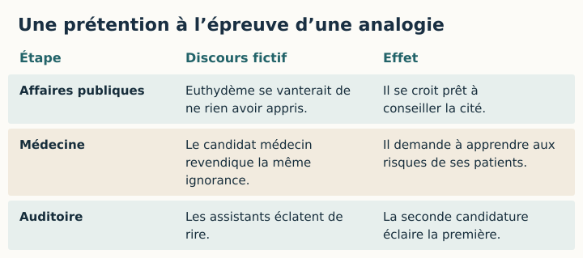

# ENS de Lyon · BEL A/L · Version grecque 2017 — Corrigé brut

*Corrigé rédigé par IA, non officiel. Signalez toute erreur.*

**Rédaction** · GPT-6.2 Astra Ultra · vitesse non renseignée

Xénophon, Socrate prête un discours à Euthydème. Épreuve de spécialité, trois heures.

## Version française

Il est bien clair qu'en prenant la parole il commencera son discours de cette manière : « De ma vie, Athéniens, je n'ai jamais rien appris de personne. Jamais non plus, lorsque j'entendais dire que certains étaient habiles dans la parole et dans l'action, je n'ai cherché à les rencontrer. Je n'ai pas davantage pris soin de me donner pour maître l'un de ceux qui s'y connaissent. Tout au contraire, j'ai constamment évité aussi bien de rien apprendre de quelqu'un que d'en donner l'impression. Et pourtant, quoi qu'il me vienne à l'esprit sans que j'y aie réfléchi, je vous en ferai mon conseil. »

Voilà un exorde qui conviendrait également à ceux qui voudraient obtenir de la cité une charge de médecin. Il serait tout indiqué qu'ils commencent leur discours ainsi : « De ma vie, Athéniens, je n'ai appris de personne l'art de la médecine, et je n'ai cherché à prendre pour maître aucun des médecins. Je me suis toujours gardé aussi bien d'apprendre quoi que ce soit auprès d'eux que de donner l'impression d'avoir appris cet art. Et pourtant, donnez-moi la charge de médecin. Je vais tâcher d'apprendre en faisant mes expériences à vos risques et périls. » Tous ceux qui étaient présents éclatèrent de rire à cet exorde.

[Sujet officiel, passage p. 2](https://www.ens-lyon.fr/sites/default/files/2017-11/17-bel-epreuve-de-specialite-version-grecque_1506586717944_0.pdf#page=2)
