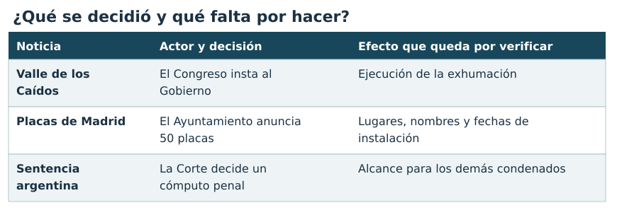

# ENS de Lyon · Séries LA/LV/SH (A/L) · Espagnol oral 2017 — Corrigé brut

*Corrigé rédigé par IA, non officiel. Signalez toute erreur.*

**Rédaction** · GPT-6.2 Astra Ultra · vitesse non renseignée

Les soixante-quatre billets sont traités dans l’ordre du cahier. Treize passages littéraires sont identifiés dans les œuvres, avec leurs bornes ou leurs titres. Pour les cinquante et un billets de presse, l’analyse s’appuie sur les notices, les articles identifiables et le rapport. Les coupes remises en salle ne sont pas reproduites.

## Letras y artes · Siete análisis de prensa

### 1. México grita un “basta ya” a la violencia contra los periodistas

_El País · 16/05/2017._

Tras el asesinato del periodista Javier Valdez, el titular convierte una protesta de colegas y lectores en el grito de un país. Ese desplazamiento expresa solidaridad, pero obliga a preguntar quién tiene capacidad para proteger a la prensa local. Si una amenaza consigue que un reportero calle, sus vecinos pierden información sobre los poderes que gobiernan su vida. Investigar el crimen y garantizar condiciones para seguir publicando son dos pruebas distintas para las instituciones. [Versión publicada en Oaxaca](https://www.rioaxaca.com/2017/05/16/mexico-grita-un-basta-ya-a-la-violencia-contra-los-periodistas/)

**Intercambio.** ¿Por qué importa que Valdez trabajara en Sinaloa? Los riesgos del periodismo regional se entienden atendiendo a las redes locales y a los apoyos de los que efectivamente dispone quien informa.

### 2. El fiscal sobre el plurilingüismo valenciano: “No dificulta ni lesiona la enseñanza en castellano

_El País · 08/06/2017._

La frase entrecomillada pertenece al fiscal. La noticia presenta su argumento en la controversia sobre el decreto educativo valenciano. Para valorar un programa plurilingüe hay que distinguir el derecho a aprender castellano, la enseñanza en castellano y la protección de otra lengua oficial. La presencia del valenciano como lengua vehicular no demuestra por sí sola que un alumno deje de dominar el castellano. El argumento exige observar horarios, recursos y resultados. [Publicación del medio](https://elpais.com/ccaa/2017/06/08/valencia/1496934569_717769.html)

**Intercambio.** ¿Resuelve el fiscal el litigio? Su intervención expone una posición jurídica. La resolución corresponde al órgano judicial.

### 3. Andanadas contra el Diccionario

_El País semanal · 11/06/2017._

Javier Marías conoce desde dentro el esfuerzo de precisar las definiciones. La metáfora de las «andanadas» representa a la Academia como blanco de una ofensiva y orienta desde el título nuestro juicio sobre las críticas. El problema de fondo merece formularse con más calma. Un diccionario debe registrar sentidos documentados, pero decide cómo ordenarlos, ejemplificarlos y marcar su uso. Un lector puede discutir esas decisiones sin pretender prohibir una palabra. [Reproducción de la columna de Javier Marías](https://www.fundeu.es/noticia/andanadas-contra-el-diccionario/)

**Intercambio.** ¿Basta con que una expresión exista para que su definición sea adecuada? Su existencia justifica estudiarla. Una definición adecuada identifica también su ámbito y, cuando procede, sus connotaciones.

### 4. Miles de estudiantes se manifestaron por una educación gratuita

_El Observador · 11/04/2017._

El informe del jurado sitúa la movilización en Chile. La exigencia de gratuidad cuestiona un sistema en el que el acceso a la educación superior puede traducirse en deuda familiar. La marcha hace visible el desacuerdo mientras el Gobierno debe precisar qué centros y estudiantes entrarán en la reforma. El número de asistentes expresa capacidad de movilización. Por sí solo no resuelve la distribución de los recursos entre instituciones públicas y privadas.

**Intercambio.** ¿Qué añade exigir calidad? Una plaza accesible económicamente vale menos si los estudios no cuentan con docentes, infraestructura o reconocimiento suficientes.

### 5. Elogio fúnebre de Carme Chacón

_Info Libre · 11/04/2017._

Una necrológica selecciona rasgos del pasado desde el momento de la pérdida. Recordar a Carme Chacón como primera ministra de Defensa de España hace visible quién podía ejercer autoridad en un espacio históricamente masculino. Su carrera también pertenece a la historia del socialismo catalán y a los debates internos del PSOE. Reducirla a una imagen pionera ocultaría las opciones políticas y derrotas que dan contenido a esa trayectoria. [Reproducción por la redacción de infoLibre](https://blogs.mediapart.fr/la-redaction-dinfolibre/blog/120417/elogio-funebre-de-carme-chacon)

**Intercambio.** ¿Qué implica «elogio» como género? Autoriza una voz afectiva y valorativa. Se puede reconocer esa convención y examinar, al mismo tiempo, qué episodios elige el autor.

### 6. Con México, contra Trump

_El Mundo · 31/03/2017._

Los dos complementos, «con México» y «contra Trump», presentan una solidaridad y una oposición como si fueran inseparables. Durante los primeros meses de 2017 el proyecto de muro y el discurso del presidente estadounidense dieron una dimensión internacional a la campaña. Apoyar a la población mexicana, sin embargo, admite posiciones diversas sobre su propio gobierno, sobre el comercio o sobre la situación de los centroamericanos que atraviesan México.

**Intercambio.** ¿Quién habla al decir «con»? Importa situar al medio español y distinguir el gesto de un observador extranjero de la acción de quienes viven la relación fronteriza.

### 7. El chiste sobre Carrero Blanco

_La Vanguardia · 30/03/2017._

En marzo de 2017 la condena de Cassandra Vera por mensajes de humor sobre el atentado contra Carrero Blanco abrió un debate sobre los límites de la expresión pública. El chiste circulaba mucho antes de las redes. Su repetición en Twitter cambia su público y su permanencia, dos rasgos relevantes para examinarlo. La cuestión jurídica y ética es cómo distinguir la alusión irreverente a un dirigente de la dictadura, la humillación de víctimas y la justificación de la violencia. [Cobertura de La Vanguardia del mismo caso](https://www.lavanguardia.com/politica/20170330/421315143980/chiste-carrero-blanco-tip-y-coll.html)

**Intercambio.** ¿Qué fecha importa al comentar el fallo? Se describe la resolución tal como se conocía en marzo de 2017. El desenlace judicial posterior pertenece a otra etapa.

## Lenguas vivas · Trece explicaciones de textos literarios (LV1)

### Fernando de Rojas, La Celestina, pp. 526–529

Desde «¡O mi señora y mi vida!» hasta «resplandecientes ojos». Calisto habla solo después del encuentro con Melibea. Empieza por reprocharse su falta de contento y va renunciando, en una enumeración, a honra, riquezas y familia. Después invoca al sol, a las estrellas y al reloj como si pudiera adelantar la noche. Las preguntas interrumpen esa fantasía cuando reconoce que el tiempo transcurre por igual para todos. Solo le queda el recurso de la imaginación. Al final oye otra vez la voz de Melibea, pero el lector la oye citada por él: los gestos y palabras de ella llegan bajo la interpretación interesada de quien espera. [Edición de La Celestina](https://pruebatcdn.aprende.org/libros/pdf/La-celestina.pdf)

**Intercambio.** ¿Qué diferencia hay entre el reloj de hierro y el del cielo? La máquina admite un ajuste humano. No puede producir la oscuridad necesaria para el próximo encuentro. La distinción descubre el límite de la autoridad que Calisto se atribuye.

### Fernando de Rojas, La Celestina, pp. 236–240

Desde la llamada a Sempronio hasta la exclamación sobre sus «porradas». El amo que necesita compañía cede a su criado el poder de nombrar su dolencia. Para Calisto, mantenerse fiel prueba la excelencia del amante. Sempronio reclasifica la conducta como obstinación y recuerda el daño que causa la voluntad cautiva. Cada réplica cambia el registro: la protesta devota que eleva a Melibea a la condición de Dios suscita la risa del criado, y los ejemplos eruditos desembocan en una pulla familiar. La comicidad nace del choque de dos voces que intentan apropiarse del significado de las mismas palabras. [Edición de La Celestina](https://pruebatcdn.aprende.org/libros/pdf/La-celestina.pdf)

**Intercambio.** ¿Es Sempronio portavoz inequívoco de la razón? Su ingenio descubre la exageración de Calisto, pero sus ataques contra las mujeres y sus propios intereses impiden confundir su juicio con el de la obra.

### Fernando de Rojas, La Celestina, pp. 547–550

Desde «Calla, por Dios» hasta «me aplaze». Lucrecia llama a Melibea para que escuche los planes matrimoniales de sus padres. La joven empieza pidiendo silencio y termina pronunciando una larga defensa de su elección. Las anáforas, las condiciones hipotéticas y los ejemplos de mujeres de los libros convierten a la hija, objeto de un proyecto familiar, en intérprete de su propia conducta. La comparación del amor con una deuda establece una excepción al intercambio: según Melibea, solo el amor puede pagarlo. Sin embargo, sus promesas de seguir la voluntad de Calisto introducen una tensión dentro de su declaración de autonomía. [Edición de La Celestina](https://pruebatcdn.aprende.org/libros/pdf/La-celestina.pdf)

**Intercambio.** ¿Qué efecto produce la presencia de Lucrecia? Hace posible que una voz que los padres no oyen alcance al público. Su posición espacial organiza la ironía de la escena.

### Fernando de Rojas, La Celestina, pp. 420–423

Desde la protesta de Elicia hasta la conclusión de Areúsa sobre la virtud de los antepasados. El adjetivo «gentil», aplicado a Melibea, basta para alterar la comida. Elicia imagina que basta vestir un palo con buenos atavíos para descubrir cuánto depende la admiración de la riqueza. Areúsa prolonga el ataque contra un ideal de belleza y luego contra la autoridad de la opinión común. Sempronio recurre al rango social de los amantes. La réplica final traslada la discusión del cuerpo de una rival al valor de las acciones de cada individuo. El paso de los celos a una tesis sobre el linaje es el verdadero movimiento del diálogo. [Edición de La Celestina](https://pruebatcdn.aprende.org/libros/pdf/La-celestina.pdf)

**Intercambio.** ¿Desaparece la rivalidad al formularse un principio de igualdad? La máxima de Areúsa nace dentro de una disputa interesada. Esa circunstancia le da voz y también complica su alcance.

### Fernando de Rojas, La Celestina, pp. 250–253

De «¡Albricias!» a la despedida de las paredes. El anuncio festivo de Celestina es peligroso para Elicia, que tiene a Crito en casa. La ocultación en un cuarto crea un conocimiento compartido por el público y negado a Sempronio. Cuando se oyen pasos, Elicia puede enunciar la verdad como si bromeara: decir que hay otro enamorado deja a Sempronio sin una prueba de cómo debe entenderla. Celestina administra los movimientos y las explicaciones hasta conseguir que el visitante se marche con ella por interés común. La puerta del final es un objeto escénico y el límite entre dos negociaciones. [Edición de La Celestina](https://pruebatcdn.aprende.org/libros/pdf/La-celestina.pdf)

**Intercambio.** ¿Dónde se produce la ironía dramática? En la distancia entre la interpretación que se le ofrece a Sempronio y lo que el lector ha visto hacer a Crito antes de su llegada.

### Antonio Machado, Campos de Castilla, «Por tierras de España», pp. 106–107

La primera estrofa presenta un paisaje alterado por quien quema los pinares y espera el despojo como botín. Inmediatamente la tierra devuelve consecuencias: la erosión y la huida de los hijos. El retrato físico y moral del campesino endurece la mirada hasta convertir la envidia en una manera de contemplar la fortuna del vecino. En las últimas estrofas el futuro «veréis» interpela al lector. Las figuras gigantescas del arquero y de Caín proyectan sobre la llanura una interpretación mítica del conflicto. La regularidad de los alejandrinos y las rimas da a esa visión la fuerza de una sentencia. [Texto en la Biblioteca Virtual Miguel de Cervantes](https://www.cervantesvirtual.com/obra-visor/campos-de-castilla-983795/html/53182a83-438f-4e63-8093-1a1e1ffb0861_2.html)

**Intercambio.** ¿Describe el poema a todos los habitantes del campo? Construye una figura moral mediante generalización e imágenes. Leerla como una encuesta sociológica haría desaparecer la intervención del hablante.

### Antonio Machado, Campos de Castilla, «Del pasado efímero», pp. 202–203

El demostrativo inicial sitúa ante los ojos del lector a un hombre del casino provinciano. La ropa y los signos de decadencia física conviven con el recuerdo minucioso de la vida taurina. Cuando la conversación se desplaza a la política, la memoria selectiva y las opiniones heredadas revelan la estrechez de ese mundo. La sucesión de gestos cotidianos prepara una ampliación de escala: el individuo encarna la España que pasó sin dejar obra. El título cobra así un sentido paradójico: perdura la presencia del hombre, mientras su modo de vivir apenas ha producido historia. [Texto de «Del pasado efímero»](https://es.wikisource.org/wiki/Del_pasado_ef%C3%ADmero)

**Intercambio.** ¿Qué hace el casino en el retrato? Es un lugar concreto de sociabilidad en que ciertas anécdotas circulan y se repiten. Permite al poeta mostrar una cultura a través de sus hábitos de conversación.

### Antonio Machado, Campos de Castilla, «La tierra de Alvargonzález», vv. 577–622, pp. 165–167

El tramo corresponde a «La tierra», en cuatro secuencias, desde la mañana de labor hasta la propiedad que adquiere el hermano que volvió de América. Juan abre surcos que parecen cerrarse. La copla asocia la marca de la tierra con una arruga en el rostro del culpable. En el huerto, el color de la azada y el de la luna hacen que el asesinato pasado reaparezca en el presente del trabajo. El último movimiento recobra el lenguaje de la propiedad: los bienes que los hermanos quisieron heredar acaban en manos del indiano. El romance convierte así la labor agrícola en juicio sobre la codicia. [Texto en la Biblioteca Virtual Miguel de Cervantes](https://www.cervantesvirtual.com/obra-visor/campos-de-castilla-983795/html/53182a83-438f-4e63-8093-1a1e1ffb0861_2.html)

**Intercambio.** ¿Hay que narrar aquí el desenlace de los asesinos? Se puede anunciar su función posterior, pero la sección termina con la enumeración de casa, huerto, colmenar y campo. Ahí culmina esta inversión de la herencia.

### Mario Vargas Llosa, Los cachorros, pp. 97–99

Desde «Después de comer» hasta la segunda «risita». La enumeración de locales y vehículos dibuja los hábitos nocturnos del grupo de Miraflores. Al salir, los amigos encuentran a Cuéllar llorando en el coche. Las numerosas preguntas parecen ofrecer apoyo, pero ya incluyen respuestas aceptables: una burla, una copa de más, una indisposición. Cuando Cuéllar habla de la monotonía y la pobreza, sus interlocutores reclaman una prueba de que se le ha pasado. La risa final es una orden cumplida; la narración deja abierto si el dolor ha disminuido. El paso entre «ellos» y «nosotros» compromete al narrador colectivo en la escena. [Copia de Los cachorros en el IES La Albuera](https://ieslaalbuera.centros.educa.jcyl.es/sitio/upload/Los_cachorros.pdf)

**Intercambio.** ¿Por qué repetir la petición de una sonrisa? El primer gesto no basta al grupo. La repetición deja ver que su tranquilidad depende de oír un signo exterior de conformidad.

### Mario Vargas Llosa, Los cachorros, pp. 89–91

Desde «Y Cuéllar, por su parte» hasta la serie de calificativos que termina en «locumbeta». Los amigos llevan a Cuéllar a La Herradura para que declare su amor a Teresita. La cuenta de bebidas marca los esfuerzos por abordar la conversación. Cada consejo presenta como sencillo el paso que él teme por sus consecuencias. Cuando Cuéllar repite la pregunta sobre el después, los demás responden con la secuencia convencional del noviazgo y aplazan el problema decisivo. El bolero «Quizás, quizás, quizás», de Osvaldo Farrés, introduce luego una voz colectiva que convierte en estribillo la indecisión de una persona concreta. [Copia de Los cachorros en el IES La Albuera](https://ieslaalbuera.centros.educa.jcyl.es/sitio/upload/Los_cachorros.pdf)

**Intercambio.** ¿A quién responsabiliza el grupo en la frase final? Afirma que otros le hacen la vida imposible. El propio relato acaba de mostrar cómo participan los amigos en la presión que denuncian.

### Mario Vargas Llosa, Los cachorros, pp. 55–57

Desde «Pero Cuéllar» hasta «su terrible susto». Un hábito ordinario después de entrenar sitúa a Cuéllar y a Lalo en el vestuario. La aparición del perro Judas altera el ritmo de las frases con onomatopeyas intercaladas. Tras ponerse a cubierto, Lalo ya no ve lo que ocurre y el relato se construye sobre sonidos, duración incierta y preguntas insistentes de quienes escuchan su recuerdo. Los adultos llegan también como voces antes de convertirse en figuras visibles. El límite del punto de vista explica por qué se recuerda la escena como trauma colectivo aunque sus consecuencias recaigan ante todo sobre un niño. [Copia de Los cachorros en el IES La Albuera](https://ieslaalbuera.centros.educa.jcyl.es/sitio/upload/Los_cachorros.pdf)

**Intercambio.** ¿Qué consiguen las preguntas sobre la duración? Revelan la diferencia entre los minutos mensurables y el tiempo vivido por el testigo. Introducen además el momento posterior en que el grupo vuelve a contar lo ocurrido.

### Mario Vargas Llosa, Los cachorros, pp. 78–81

Desde «Qué bien las corre» hasta «y él tristoncito eso sí». El dominio de las olas hace de Cuéllar un joven admirado. La pregunta reiterada de las muchachas sobre por qué no tiene enamorada convierte enseguida ese prestigio en enigma. Las respuestas contradictorias de los amigos descubren incertidumbre sobre lo que ellas saben. La narración cambia de ritmo al acumular episodios de malestar, hostilidad y reconciliación. En la fiesta de promoción todos parecen dispuestos a buscarle pareja, pero la solución propuesta vuelve a medir su pertenencia al grupo por la misma norma que lo aísla. [Copia de Los cachorros en el IES La Albuera](https://ieslaalbuera.centros.educa.jcyl.es/sitio/upload/Los_cachorros.pdf)

**Intercambio.** ¿Cuándo pasa de la admiración al escrutinio? En el tránsito casi sin pausa del elogio deportivo a la pregunta sobre la novia. La sintaxis reproduce esa rapidez social.

### Mario Vargas Llosa, Los cachorros, pp. 71–73

El primer noviazgo de Lalo con Chabuca altera la amistad. En el fascículo se lee «enanorada» por «enamorada» al comienzo. Cuéllar vive el anuncio como deslealtad y teme perder los domingos compartidos. En el relato se entrecruzan reproches, exhortaciones para que se calme y las interpretaciones de quienes presencian la escena. La reconciliación parece cerrar el asunto hasta que una breve rectificación del narrador abre la serie de desafíos con los que Cuéllar intenta recuperar la atención. Los amigos celebran su arrojo y luego diagnostican resentimiento: relatan su conducta en términos que disimulan el efecto de su propio estímulo. [Copia de Los cachorros en el IES La Albuera](https://ieslaalbuera.centros.educa.jcyl.es/sitio/upload/Los_cachorros.pdf)

**Intercambio.** ¿Qué valor tiene el cambio de tiempo tras el incidente? Se pasa de una noche particular al relato de acciones reiteradas. Lo que el grupo llama una anécdota aparece como comienzo de una transformación.

## Lenguas vivas · Trece artículos de prensa (LV1)

### 8. Hay un malestar justificado con el turismo, vinculado a la masificación

_El País · 14/05/2017._

Gerardo Pisarello admite en la entrevista que el malestar de los vecinos tiene razones. Al asociarlo a la masificación orienta el debate hacia el modelo turístico barcelonés. Los ingresos pueden distribuirse entre empresas y trabajadores mientras el alza del alquiler y la ocupación del espacio se concentran en ciertos barrios. Esa distribución desigual explica que el mismo visitante sea bienvenido como cliente y discutido como parte de una política urbana. [Entrevista a Gerardo Pisarello](https://elpais.com/ccaa/2017/05/12/catalunya/1494603048_028689.html)

**Intercambio.** ¿Qué interés tiene la forma de entrevista? Permite distinguir las preguntas del periodista de la justificación que ofrece un responsable municipal.

### 9. Gastad en los maestros

_El País · 08/04/2017 (fecha del fascículo)._

«Gastad» es un imperativo dirigido a quienes deciden el presupuesto. La fórmula recuerda la tradición que vinculó la formación de maestros con la construcción de una ciudadanía instruida. La inversión en edificios y programas rinde poco si quienes enseñan carecen de tiempo, formación y estabilidad. El interés del texto está en cómo traduce una declaración solemne a la pregunta concreta por el destino del dinero. [Publicación del medio](https://elpais.com/elpais/2017/03/30/opinion/1490897745_364449.html)

**Intercambio.** ¿El presupuesto mide por completo la calidad educativa? Es una condición observable. Su efecto depende también de cómo llega a las aulas y del respaldo pedagógico que lo acompaña.

### 10. Hazte oír, la “guerrilla” del ultracatolicismo español

_El País · 05/03/2017._

Las comillas de «guerrilla» describen una estrategia de intervención pública provocadora. En la campaña del autobús de Hazte Oír, un mensaje contra el reconocimiento de los menores trans consiguió difusión mucho más allá de su recorrido. El reportaje permite preguntar cómo un grupo organizado convierte la controversia en publicidad y cómo defender la dignidad de los afectados sin identificar a todos los católicos con una organización particular. [Publicación del medio](https://elpais.com/politica/2017/03/03/actualidad/1488543485_414998.html)

**Intercambio.** ¿Qué gana la asociación cuando la noticia se centra solo en el autobús? El vehículo y el lema desplazan del primer plano a las personas cuya vida se discute.

### 11. Cruz Roja advierte de que el acuerdo de paz en Colombia no bastará para acabar con la violencia

_El País · 09/03/2017._

El Comité Internacional de la Cruz Roja observa el acuerdo colombiano desde la situación de los civiles. El desarme negociado con las FARC modifica decisivamente un conflicto, pero en zonas donde siguen actuando otros grupos no garantiza movilidad, seguridad ni acceso a servicios. La advertencia corrige una expectativa sin negar el valor del acuerdo. El verbo «bastará» pone precisamente a prueba la suficiencia de una medida. [Publicación del medio](https://elpais.com/internacional/2017/03/09/colombia/1489080803_014154.html)

**Intercambio.** ¿Qué indicador permitiría juzgar la mejora? Escuchar si una comunidad puede cultivar, desplazarse o regresar tras el desplazamiento aporta una medida distinta del número de firmas.

### 12. Fuerte movilización de torturadores

_El País · 09/05/2017._

La fórmula abreviada del fascículo, «movilización de torturadores», invierte en apariencia el sentido de la noticia argentina. Una referencia contemporánea de El País identifica una movilización para impedir la excarcelación de torturadores tras el fallo del «dos por uno». El beneficiario discutido y el sujeto de la protesta son distintos. Los manifestantes temían que un cómputo favorable redujera penas por crímenes de la dictadura. La reacción ilumina la relación entre justicia penal, legisladores y asociaciones de derechos humanos. [Cobertura de la movilización por El País](https://elpais.com/internacional/2017/05/10/argentina/1494431965_661817.html)

**Intercambio.** ¿Qué debe corregir el lector? Debe reconstruir quién se moviliza y con qué fin, conservando la diferencia entre el título abreviado del jurado y la cobertura periodística comprobable.

### 13. Así camina Colombia hacia la paz

_El País · 24/03/2017._

El adverbio «así» anuncia una explicación del proceso colombiano. Conviene ordenar la secuencia de negociación con las FARC, rechazo del primer acuerdo en el plebiscito de 2016, renegociación e inicio de la ejecución. Ningún eslabón vuelve automático el siguiente. La reintegración, la presencia estatal en territorios antes controlados por la guerrilla y los derechos de las víctimas son problemas materiales que continúan después de la ceremonia de firma. [Dossier de contexto de El País](https://elpais.com/especiales/2016/proceso-de-paz-en-colombia/)

**Intercambio.** ¿Qué revela el presente «camina»? Presenta la paz como proceso susceptible de avance y retroceso. Invita a identificar hechos que permitan medir el recorrido.

### 14. Los machos electos

_El País · 09/06/2017._

La columna «Los machos electos» compara las posiciones de Donald Trump y Alfredo del Mazo respecto de las mujeres, la familia y los derechos de las minorías. La palabra «electos» concede que se trata de triunfos en las urnas. El sustantivo polémico pregunta qué garantías necesitan quienes no comparten las normas de género defendidas por el vencedor. Hay que atribuir esa comparación a la articulista y comprobar los ejemplos que utiliza para sostenerla. [Columna original](https://elpais.com/internacional/2017/06/08/mexico/1496875082_326500.html)

**Intercambio.** ¿Por qué importarían los límites de una comparación internacional? Las instituciones y los poderes de un gobernador mexicano y del presidente estadounidense difieren aunque sus discursos presenten coincidencias.

### 15. El salario rosa, la misma promesa del PRI pintada de otro color

_El País · 01/06/2017 (fecha del fascículo)._

En la campaña del Estado de México, el «salario rosa» promete reconocer a mujeres por el trabajo realizado en casa. El titular de El País lee la innovación cromática como repetición de una promesa del PRI. Llamar «salario» a la ayuda sugiere remuneración y derechos laborales. Para valorar el programa habría que precisar la cuantía, las condiciones y el control sobre la concesión de fondos públicos durante una campaña. [Publicación del medio](https://elpais.com/internacional/2017/05/31/mexico/1496200285_716267.html)

**Intercambio.** ¿La medida cambia el reparto del cuidado? Una transferencia puede mejorar la autonomía económica. Su diseño determina si facilita que los hombres compartan tareas o confirma que corresponden a las mujeres.

### 16. Los cubanos ganaron unos 40 millones de dólares a través de Airbnb en dos años

_14ymedio.com · 06/06/2017._

Los cuarenta millones de dólares son ingresos agregados durante dos años. No son un salario medio ni beneficio neto por hogar. Airbnb hace visible la apertura de un espacio para el alojamiento privado en Cuba, con visitantes que reservan en una plataforma internacional. Interesa preguntar quién dispone de una vivienda adecuada, de acceso a internet y de contactos para cobrar. La noticia dice así tanto sobre oportunidades desiguales como sobre ingresos nuevos. [Información paralela de la agencia EFE](https://www.latimes.com/espanol/noticas-mas/articulo/2017-06-05/efe-3287960-13054094-20170605)

**Intercambio.** ¿Qué precisión histórica pide el jurado? Diferenciar a los anfitriones en la isla, a la diáspora de Miami y a la empresa estadounidense. Sus intereses no coinciden necesariamente.

### 17. La balada del Norte, un viaje a las entrañas de la Revolución de Asturias de 1934

_Eldiario.es · 04/06/2017._

La novela gráfica de Alfonso Zapico convierte la insurrección asturiana de 1934 en una experiencia narrada a través de personajes de clases distintas. El encuentro entre Tristán e Isolina acerca el conflicto a decisiones personales sin reducirlo a una historia de pareja. La expresión «las entrañas» alude materialmente a la mina y a la voluntad de comprender la sociedad que la rodea. El reportaje cultural invita a leer el dibujo y el ritmo de las viñetas como formas de interpretación histórica. [Publicación del medio](https://www.eldiario.es/cultura/comics/balada-norte-entranas-revolucion-asturias_1_3370451.html)

**Intercambio.** ¿Qué no garantiza la verosimilitud de una escena dibujada? Puede hacer inteligible una experiencia y seguir siendo una reconstrucción narrativa cuya relación con las fuentes hay que examinar.

### 18. Este artículo no es ni machista ni feminista

_Eldiario.es · 06/03/2017._

La negativa del título reproduce una postura que suele presentarse como moderada. El artículo permite preguntar si puede defenderse la igualdad y a la vez prescindir de toda reflexión feminista sobre cómo se distribuye el poder. La ironía exige separar una fórmula que la voz ensaya de la posición a la que conduce el razonamiento. Tomar literalmente la primera frase privaría a la columna de su efecto sobre un lector que se creía neutral. [Publicación del medio](https://www.eldiario.es/opinion/zona-critica/machismo-feminismo-igualdad_129_3540974.html)

**Intercambio.** ¿Qué mostraría la ironía en la copia? Una contradicción entre lo que una frase declara y las consecuencias que exponen los ejemplos posteriores.

### 19. Entrevista. Pablo Almodóvar [Pedro Almodóvar en el medio]

_Eldiario.es · 01/03/2017._

El fascículo llama «Pablo» al entrevistado. La entrevista de elDiario.es publicada el 1 de marzo identifica a Pedro Almodóvar. Al imaginar que, de empezar hoy, sería youtuber, el director contrasta su aprendizaje al margen de los circuitos establecidos con las posibilidades de producción actuales. La retrospectiva en la Filmoteca transforma un cine antes periférico en patrimonio reconocido. Su comentario sobre los papeles reservados a las mujeres en Hollywood añade una pregunta sobre quién puede protagonizar un relato. [Entrevista original a Pedro Almodóvar](https://www.eldiario.es/cultura/entrevistas/pedro-almodovar-entrevista_128_3551889.html)

**Intercambio.** ¿Por qué conservar las dos referencias? El nombre impreso permite reconocer el billet. El medio, la fecha y el texto permiten identificar con precisión al interlocutor.

### 20. El infierno mexicano que atraviesan los inmigrantes que quieren vivir el sueño americano

_ABC · 11/05/2017._

El reportaje describe México desde la perspectiva de viajeros que se dirigen hacia Estados Unidos. El contraste entre «infierno» y «sueño» sitúa el peligro durante el tránsito y la esperanza en el destino. Esa oposición puede oscurecer las decisiones de los propios viajeros y la responsabilidad de autoridades, redes criminales o empleadores en etapas distintas. El comentario debe restituir los actores concretos en vez de convertir un país entero en amenaza abstracta.

**Intercambio.** ¿En qué sentido cambia la escala? Desde la frontera estadounidense se ve una llegada. Desde América Central y México se ve una ruta mucho más larga.

## Lenguas vivas · Veintidós artículos de prensa (LV2)

### 21. El talento quiere volver a casa

_El País · 21/05/2017._

«El talento» reúne bajo una etiqueta económica trayectorias de jóvenes españoles emigrados durante la crisis. Volver a casa implica recuperar redes familiares, pero el retorno exige también un puesto adecuado y perspectivas laborales estables. Un reportaje puede dibujar esa tensión por medio de casos individuales. El candidato debe distinguir lo que muestran esos testimonios de la afirmación estadística de que el flujo migratorio se ha invertido. [Publicación del medio](https://elpais.com/economia/2017/05/20/actualidad/1495286170_018584.html)

**Intercambio.** ¿A quién deja fuera la palabra «talento»? Su uso suele privilegiar profesiones muy cualificadas y hace menos visibles otros trabajadores que también emigraron.

### 22. El Congreso aprueba sacar los restos de Franco del Valle de los Caídos

_El País · 12/05/2017._

En mayo de 2017 el Congreso insta al Gobierno a sacar los restos de Franco del Valle de los Caídos. La noticia trata de una decisión parlamentaria cuyo cumplimiento exige trámites y actuaciones posteriores. El emplazamiento de honor de un dictador en un monumento público compromete la manera en que el Estado representa el pasado. Interesa distinguir la situación de Franco de la de las numerosas personas enterradas allí, algunas sin conocimiento de sus familias. [Publicación del medio](https://elpais.com/politica/2017/05/11/actualidad/1494486625_806861.html)

**Intercambio.** ¿Puede decirse que se produjo la exhumación ese día? El voto expresa una voluntad política. La ejecución material pertenece a un momento posterior.

### 23. 1977, el año fundacional

_El País · 17/04/2017._

Calificar 1977 de «fundacional» dirige la atención hacia la legalización del PCE y las elecciones del 15 de junio. Tras décadas de dictadura, quienes compiten necesitan garantías y quienes controlan las instituciones deben aceptar el resultado. El artículo de opinión escoge protagonistas y atribuye mérito. Puede contrastarse el papel del rey y de Suárez con el de la oposición, los sindicatos y los votantes sin adelantar la aprobación de la Constitución, que llegó en 1978. [Publicación del medio](https://elpais.com/elpais/2017/04/16/opinion/1492355907_501233.html)

**Intercambio.** ¿Por qué no basta decir que Franco ya había muerto? El final biológico del dictador no creó por sí solo una representación plural ni elecciones libres.

### 24. Vivir en España al margen de España

_El País · 02/06/2017._

Un reportaje en Berga pregunta cómo se vive dentro del Estado español con un horizonte informativo marcadamente catalán. La prensa comarcal y los símbolos del ayuntamiento permiten observar esa experiencia en lo cotidiano. A la vez, el entrevistado que ve programas de La 2 o Eurovisión desmiente un aislamiento absoluto. La aparente paradoja del titular invita a distinguir pertenencia jurídica, identidad política y hábitos culturales. [Publicación del medio](https://elpais.com/ccaa/2017/06/02/catalunya/1496429632_283792.html)

**Intercambio.** ¿Representa Berga a toda Cataluña? La localidad ofrece un caso elegido por su interés periodístico. Haría falta otro tipo de muestra para generalizar.

### 25. Una mayoría apoya en el Senado de Estados Unidos destrabar el turismo a Cuba

_El País · 27/05/2017._

Una mayoría favorable en el Senado estadounidense da visibilidad a una iniciativa para facilitar los viajes a Cuba. Sumar apoyos a un proyecto, conseguir su tramitación y convertirlo en ley son pasos distintos. Para la isla están en juego ingresos turísticos y oportunidades de contacto. Para Washington se discute también quién controla la política exterior en una fase incierta tras el acercamiento promovido por Obama. [Publicación del medio](https://elpais.com/internacional/2017/05/27/estados_unidos/1495838971_544242.html)

**Intercambio.** ¿Por qué no llamar a esto «fin del embargo»? Una restricción a los viajes forma parte de un conjunto mucho más amplio de normas y sanciones.

### 26. Inquietud en Argentina por un fallo del Supremo que puede acortar las condenas de represores

_El País · 05/05/2017._

El fallo argentino sobre el «dos por uno» planteó la aplicación de una ley penal anterior y potencialmente más favorable en el cómputo de la prisión preventiva. El caso de Luis Muiña preocupó a organizaciones de víctimas por su posible extensión a otros condenados por crímenes de la dictadura. Hay que separar la sentencia concreta, el precedente temido y el juicio político sobre sus consecuencias. [Publicación del medio](https://elpais.com/internacional/2017/05/04/argentina/1493920949_493398.html)

**Intercambio.** ¿Significa el fallo que se reconsideró la culpabilidad? La controversia trata del cálculo de la pena. No anula por ese solo hecho una condena por los delitos juzgados.

### 27. Carmena colocará 50 placas en las calles para recordar a víctimas del franquismo

_El País · 29/05/2017._

El texto de El País identifica a Manuela Carmena y al Ayuntamiento de Madrid. El «Carmona» del fascículo induciría a situar las cincuenta placas en otra ciudad. Una placa interviene en la memoria cotidiana de una calle: nombra a una persona y sitúa un hecho en el espacio por donde pasa el vecino. La selección municipal de nombres y lugares es parte de la política pública de reconocimiento. [Publicación del medio](https://elpais.com/ccaa/2017/05/27/madrid/1495905441_649601.html)

**Intercambio.** ¿Qué alcance tiene el futuro «colocará»? Describe un compromiso anunciado. Para documentar cada instalación harían falta fechas y emplazamientos efectivos.

### 28. España cae a su peor registro en la clasificación mundial de percepción de la corrupción

_El País · 25/01/2017._

La posición 41 entre 176 países corresponde al índice de percepción de la corrupción. Un descenso en la clasificación puede venir de cambios propios y de la evolución de otros países. La noticia conecta esa posición con la confianza en las instituciones españolas. Para comentarla hay que distinguir entre encuestas o valoraciones agregadas, hechos delictivos probados y número de condenas. [Publicación del medio](https://elpais.com/politica/2017/01/25/actualidad/1485334392_950798.html)

**Intercambio.** ¿Podría aumentar la percepción al mejorar la investigación? Sí. La revelación pública de casos antes ocultos puede empeorar la percepción aun cuando crezca la capacidad de fiscalización.

### 29. Miles de argentinos reivindican la cifra oficial de desaparecidos: “Fueron 30.000

_El País · 25/03/2017._

En la manifestación del 24 de marzo el lema «Fueron 30.000» defiende la memoria de los desaparecidos frente a su minimización. La desaparición forzada y la ocultación de archivos dificultan precisamente un recuento exhaustivo. El dato central del reportaje es quién pronuncia la cifra, en qué aniversario y con qué adversario discursivo. Se evita así tanto la falsa precisión documental como la reproducción acrítica del negacionismo. [Publicación del medio](https://elpais.com/internacional/2017/03/24/argentina/1490385910_331028.html)

**Intercambio.** ¿Por qué el título cita voces de manifestantes? Sitúa una reivindicación pública y convierte la memoria de los desaparecidos en un asunto político presente.

### 30. España, país de la UE más castigado por el terrorismo

_El País · 07/05/2017._

El titular sobre España como país de la UE más castigado por el terrorismo expresa el resultado de un recuento concreto. Antes de compararlo conviene identificar el período, la unidad contada y el tratamiento de atentados cometidos fuera del territorio. Las trayectorias de ETA y del terrorismo yihadista forman parte de la experiencia española sin confundirse por sus objetivos, cronología ni formas de actuación. [Publicación del medio](https://elpais.com/politica/2017/05/05/actualidad/1494008754_643831.html)

**Intercambio.** ¿Qué error produciría medir el peligro actual solo con un total histórico? El acumulado combina etapas muy distintas y no describe por sí solo el riesgo en 2017.

### 31. Tres formas de romper el ‘techo de cristal’ de la mujer en el trabajo

_El País · 07/06/2017._

La metáfora del «techo de cristal» apunta a obstáculos que siguen operando cuando ya existe igualdad formal. El contraste entre acceso femenino a la educación y escasa presencia en puestos de decisión muestra que el problema puede aparecer en la promoción. Revisar criterios de ascenso, hacer compatibles los cuidados y abrir redes profesionales actúa sobre mecanismos diferentes. Los ejemplos del artículo deben vincular cada acción con el obstáculo que pretende remover. [Publicación del medio](https://elpais.com/elpais/2017/06/06/planeta_futuro/1496761557_601298.html)

**Intercambio.** ¿Por qué no basta con recomendar mayor cualificación? Si las candidatas ya alcanzan niveles educativos altos, repetir ese consejo deja intactos los procesos de selección y promoción.

### 32. La ultraderecha toma las calles de México para defender la familia tradicional

_El País · 11/09/2016._

Las marchas de septiembre de 2016 en México se opusieron al reconocimiento del matrimonio igualitario. Presentar un modelo como «familia tradicional» puede hacer pasar una propuesta política por una descripción natural de toda la sociedad. El encuadre de El País, que habla de «ultraderecha», también interpreta a los actores. Reconocer ambos vocabularios permite examinar el efecto jurídico que se debate sobre familias que ya existen. [Publicación del medio](https://elpais.com/internacional/2016/09/10/mexico/1473516007_579625.html)

**Intercambio.** ¿Qué diferencia hay entre libertad religiosa y definición civil del matrimonio? Una confesión regula sus ritos. El Estado debe justificar las condiciones que reconoce a sus ciudadanos.

### 33. La RAE revisará la definición de “sexo débil

_El País · 03/03/2016._

La polémica sobre «sexo débil» distingue el registro lexicográfico de una locución de la aceptación del prejuicio que contiene. Una marca de uso permite documentar la expresión y advertir su intención despectiva. La noticia informa de una revisión prevista. La ficha del concurso dice 2016, pero la reproducción atribuida a Manuel Morales en Fundéu sitúa el texto en marzo de 2017. La discrepancia debe conservarse. [Artículo de Manuel Morales](https://elpais.com/cultura/2017/03/03/actualidad/1488539517_507823.html)

**Intercambio.** ¿Bastaría con borrar la entrada? La desaparición del diccionario no elimina una locución. Una descripción histórica y pragmática puede ayudar al lector a entender qué hace cuando la usa.

### 34. Encuentro Colombia 2020: Educar para la paz, no para una cátedra

_El Espectador · 29/05/2017._

En el encuentro Colombia 2020, la fórmula «educar para la paz» amplía el objetivo de una asignatura específica a la vida de la escuela. Si los estudiantes aprenden a escuchar un desacuerdo, a contrastar versiones y a proteger a quien interviene, la convivencia se practica. El texto desplaza así la pregunta desde las horas lectivas hacia las condiciones institucionales que hacen posible discutir un conflicto sin silenciarlo. [Publicación del medio](https://www.elespectador.com/colombia-20/paz-y-memoria/educar-para-la-paz-no-para-una-catedra-article/)

**Intercambio.** ¿Qué indicio permitiría valorar la propuesta? Observar cómo se resuelven conflictos escolares concretos y qué lugar se concede a experiencias distintas de la guerra.

### 35. Cultura política y reconciliación

_El Espectador · 28/05/2017._

Tras los acuerdos colombianos, la reconciliación exige que los adversarios puedan participar políticamente sin miedo. La expresión «cultura política» designa hábitos de trato público y expectativas sobre el rival. Reconocer su derecho a intervenir no exige equiparar responsabilidades ni renunciar a investigar delitos. El artículo invita a pensar qué prácticas cotidianas sostienen la apertura institucional prevista sobre el papel. [Publicación del medio](https://www.elespectador.com/colombia-20/analisis/cultura-politica-y-reconciliacion-article/)

**Intercambio.** ¿Es reconciliarse lo mismo que perdonar personalmente? Una víctima decide su relación personal con el daño sufrido. La convivencia política tiene obligaciones públicas que alcanzan a todos.

### 36. Del Rey del carisma al Rey de la prudencia

_El Mundo · 03/06/2017._

El título contrasta el carisma atribuido a Juan Carlos I con la prudencia asociada a Felipe VI, tres años después de la abdicación. La pareja retórica presenta dos estilos de ejercer una misma jefatura del Estado en momentos distintos. Un comentario debe preguntar qué crisis de legitimidad hace deseable la prudencia y cómo se percibe una autoridad constitucional que depende de actos refrendados por responsables políticos.

**Intercambio.** ¿Puede un cambio de estilo transformar por sí solo la institución? Puede modificar la confianza pública, pero las competencias y la sucesión dependen de reglas constitucionales.

### 37. Jóvenes chilenos vuelven a las calles para exigir educación gratuita y de calidad

_La Jornada («La Jordana» en el fascículo) · 12/04/2017._

La Jornada informa sobre jóvenes chilenos que vuelven a manifestarse. «Vuelven» condensa una secuencia larga de movilizaciones y permite discutir la diferencia entre anuncio gubernamental y reforma valorada por los estudiantes. Educación gratuita y de calidad exige definir financiación, acceso y controles sobre centros diversos. Al atribuir opiniones a dirigentes estudiantiles, la crónica vuelve visibles interlocutores concretos de una negociación. [Publicación del medio](https://www.jornada.com.mx/2017/04/12/mundo/024n1mun)

**Intercambio.** ¿Qué cambia respecto del otro billet sobre Chile? Aquí se puede examinar el verbo que enlaza la nueva marcha con protestas anteriores y la voz identificable de los estudiantes organizados.

### 38. De migrantes a criminales

_La Jornada («La Jordana» en el fascículo) · 16/04/2017._

«De migrantes a criminales» denuncia un cambio de categoría en el discurso político. Una situación administrativa relativa a la estancia y una condena penal son hechos jurídicos distintos. Si se confunden, gana fuerza la idea de que toda movilidad es una amenaza. La columna mexicana de abril de 2017 examina las consecuencias de la retórica de Trump incluso cuando algunas de sus promesas siguen pendientes. [Publicación del medio](https://www.jornada.com.mx/2017/04/16/opinion/013a2pol)

**Intercambio.** ¿Puede un discurso tener efectos antes de una nueva ley? Puede fomentar temor, modificar conductas y cambiar las expectativas de funcionarios o vecinos.

### 39. México, ‘primera contención’ de migrantes de CA: ombudsman

_La Jornada («La Jordana» en el fascículo) · 29/05/2017._

El defensor de derechos presenta a México como «primera contención» de migrantes centroamericanos antes de la frontera estadounidense. La expresión desplaza el mapa habitual del control migratorio y llama la atención sobre detenciones, expulsiones y obligaciones de protección dentro de México. El interés del término «ombudsman» es su función: proporciona una evaluación institucional sobre derechos, no dirige por sí mismo los puestos fronterizos. [Contexto previo de La Jornada](https://www.jornada.com.mx/2016/09/21/politica/004n1pol)

**Intercambio.** ¿Por qué importa indicar la dirección del viaje? Permite distinguir la condición de los mexicanos que emigran de la de quienes piden protección o transitan por territorio mexicano.

### 40. Muertos y torturados: hablan las víctimas de la “guerra de fronteras” de España

_Público · 10/05/2017._

Público abre su reportaje fronterizo con testimonios de víctimas. Llamar «guerra» al régimen de fronteras es una metáfora de la redacción que invita a identificar decisiones, controles y responsabilidades a ambos lados de la frontera española. La palabra de un testigo documenta una experiencia particular. Cruzarla con expedientes y estadísticas permite discutir su alcance sin reducir a las personas a un recuento. [Publicación del medio](https://www.publico.es/sociedad/muertos-torturados-hablan-victimas-guerra-fronteras-espana.html)

**Intercambio.** ¿Qué efecto tienen las comillas del título? Señalan un modo de interpretar la frontera y convierten esa interpretación en materia de debate.

### 41. Ni una menos': el grito de las mujeres latinoamericanas

_El Tiempo · 04/05/2017._

«Ni una menos» transforma experiencias individuales de violencia machista en una reivindicación colectiva. La consigna nació de una movilización argentina y circuló por América Latina. Su fuerza está en la negación de la pérdida como hecho inevitable y en la primera persona implícita de una comunidad que se organiza. Como las instituciones varían entre países, pueden compartir una consigna sin compartir las mismas demandas legales inmediatas. [Reportaje anterior sobre la misma movilización](https://www.vice.com/es/article/ni-una-menos-el-grito-de-las-latinoamericanas-contra-la-violencia-machista/)

**Intercambio.** ¿Qué ejemplo concreta una demanda? Un acceso efectivo a protección y justicia permite pasar del rechazo general de la violencia a una responsabilidad institucional verificable.

### 42. Migrantes cubanos inician huelga de hambre en jungla de Panamá

_El Universal · 30/03/2017._

El Universal sitúa a un grupo de migrantes cubanos en un campamento de Metetí, en el Darién panameño. La protesta expresa el bloqueo de una ruta en un período de cambio de la política estadounidense de admisión. Panamá aparece aquí como lugar de espera entre salida y destino. El reportaje combina una experiencia muy localizada con decisiones administrativas tomadas en países distintos. [Publicación del medio](https://www.eluniversal.com.mx/articulo/mundo/2017/03/30/migrantes-cubanos-inician-huelga-de-hambre-en-jungla-de-panama/)

**Intercambio.** ¿Por qué importa identificar el campamento? La etiqueta «jungla» acentúa el aislamiento. El nombre de Metetí sitúa a personas e instituciones concretas en el relato.

## Ciencias humanas · Nueve artículos de prensa

### 43. El debate para reactivar la ley de Memoria Histórica levanta ampollas en el PP

_Pùblico · 09/05/2017._

Público trata la reactivación de la Ley de Memoria Histórica de 2007. Existir jurídicamente y disponer de presupuestos, archivos accesibles y voluntad administrativa son condiciones distintas. La expresión «levanta ampollas» dramatiza la reacción del PP y delata la perspectiva del medio. Un comentario atento identifica la tarea pública debatida: qué pueden esperar familiares y asociaciones del Estado al buscar o identificar a las víctimas. [Publicación del medio](https://www.publico.es/politica/debate-reactivar-ley-memoria-historica-levanta-ampollas-pp.html)

**Intercambio.** ¿A quién corresponde proponer y a quién ejecutar? El Congreso puede instar al Gobierno. Administraciones y organismos competentes deben convertir las decisiones en actuaciones concretas.

### 44. Cara de piña

_El País · 04/06/2017._

«Cara de piña» era un apodo de Manuel Antonio Noriega. Su muerte en 2017 brinda al columnista la oportunidad de revisar las relaciones entre el poder militar panameño y Estados Unidos. El apodo atrae la atención hacia el aspecto físico del personaje, pero la responsabilidad política se explica por el ejercicio del poder y los apoyos que lo sostuvieron. El contraste entre su antigua relación con Washington y su caída en 1989 descubre una alianza cambiante. [Columna de Mario Vargas Llosa](https://elpais.com/elpais/2017/06/02/opinion/1496417579_129594.html)

**Intercambio.** ¿Qué aporta Panamá al argumento? La posición estratégica del canal y la intervención estadounidense impiden reducir la trayectoria del general a una anécdota personal.

### 45. ¿Esperar otros cien años?

_El País · 09/06/2017._

El artículo discute qué margen tuvieron los nacionalismos catalán y vasco durante la Transición y qué obligaciones se derivan de aquellos pactos para el presente de 2017. «¿Esperar otros cien años?» expresa impaciencia y pone en cuestión una espera indefinida. El autor distingue la correlación de fuerzas de 1977–1979 de una renuncia definitiva. Esa interpretación del pasado sostiene un argumento político actual que conviene atribuirle. [Publicación del medio](https://elpais.com/ccaa/2017/06/08/catalunya/1496928708_055150.html)

**Intercambio.** ¿Por qué examinar el verbo «renunciar»? Aceptar en un momento una solución constitucional y abandonar para siempre una aspiración política son afirmaciones de alcance diferente.

### 46. Mauricio Macri, cada vez más aplaudido en el mundo y más cuestionado en Argentina

_El País · 21/03/2017._

La antítesis del titular opone la recepción internacional de Mauricio Macri a las críticas internas. Para socios extranjeros pueden contar la apertura financiera y la previsibilidad diplomática. Para un hogar argentino pueden pesar más los precios y el empleo. Los dos juicios pueden coexistir porque proceden de observadores e indicadores diferentes. Conviene comprobar qué testimonios aporta el reportaje antes de convertir «el mundo» o «Argentina» en actores unánimes. [Versión portuguesa de El País](https://brasil.elpais.com/brasil/2017/03/20/internacional/1490017688_923566.html)

**Intercambio.** ¿Qué permite el comparativo «cada vez más»? Introduce una evolución que habría que documentar con episodios, encuestas u otras comparaciones fechadas.

### 47. Indígenas peruanos sofocados por el polvo

_El País · 10/11/2016._

En torno a la mina de Las Bambas, en Apurímac, el polvo de las vías de transporte convierte una actividad de exportación en experiencia diaria para comunidades de la zona. La explotación de cobre puede generar ingresos públicos y, a la vez, concentrar costes sanitarios y ambientales a lo largo del corredor. El verbo «sofocados» hace sensible el conflicto. Escuchar a los habitantes ayuda a examinar quién interviene en la evaluación y en la reparación de los daños. [Publicación del medio](https://elpais.com/elpais/2016/11/07/planeta_futuro/1478517137_056984.html)

**Intercambio.** ¿Por qué atender al camino además de la mina? El transporte extiende los efectos del proyecto a poblaciones que pueden estar fuera del emplazamiento principal.

### 48. Perú: los afrodescendientes cuentan

_www.dw.com · 30/04/2017._

«Los afrodescendientes cuentan» admite un doble sentido: importan y pueden ser contados. La incorporación de la autoidentificación étnica al censo peruano de 2017 plantea el problema de hacer visible una población históricamente subrepresentada. Clasificarse exige que la persona conozca y acepte las categorías ofrecidas. Disponer de cifras comparables permite discutir desigualdades, pero no sustituye la participación de los propios interesados. [Contexto sobre la pregunta censal](https://www.americaeconomia.com/politica-sociedad/sociedad/peru-censo-2017-contempla-recabar-informacion-sobre-afrodescendientes)

**Intercambio.** ¿Por qué importa la autoidentificación? Impide que el encuestador atribuya sin más una pertenencia según la apariencia y permite explicitar cómo se construye la estadística.

### 49. Nos están matando”: machismo y violencia en América Latina

_www.dw.com · 08/03/2017._

«Nos están matando» pone en primer plano una voz plural de protesta en el Día Internacional de la Mujer. El presente progresivo comunica urgencia y vincula violencias distintas sin atribuirlas todas a un único mecanismo. El artículo permite relacionar movilización transnacional y respuestas locales en prevención, atención y justicia. Precisar qué institución debe actuar evita que la denuncia se agote en una declaración de solidaridad. [Reproducción bajo el mismo título](https://laoveja100.wordpress.com/2017/03/09/nos-estan-matando-machismo-y-violencia-en-america-latina/)

**Intercambio.** ¿Cómo comentar una estadística regional? Hay que indicar el país, el período y la definición de feminicidio antes de comparar registros.

### 50. Venezuela anuncia su salida de la OEA

_El Mundo · 27/04/2017._

En abril de 2017 el Gobierno venezolano anuncia su salida de la Organización de los Estados Americanos en medio de una disputa sobre la crisis política del país. Anunciar la denuncia de un tratado y que la retirada llegue a surtir efecto son etapas distintas. El Ejecutivo invoca soberanía frente a la presión de otros Estados. Sus críticos apelan a los compromisos regionales con la democracia. El reportaje obliga a distinguir ambas voces. [Cobertura paralela en El País](https://elpais.com/internacional/2017/04/27/america/1493246051_378028.html)

**Intercambio.** ¿Cómo evitar una conclusión apresurada? Precisando el procedimiento, el calendario y las obligaciones que seguían en pie al publicarse la noticia.

### 51. ¿Tiene sentido el olvido histórico? “Las víctimas de ETA no pueden ser los únicos árbitros

_El Mundo · 11/04/2017._

La frase citada sobre las víctimas de ETA separa su condición de testigos y titulares de derechos de la responsabilidad colectiva de elaborar una política de memoria. Ese deslinde puede discutirse sin rebajar el daño ni exigir olvido. Importa atribuir la frase a la voz citada en el artículo y preguntar qué entienden los interlocutores por «árbitros»: decidir una medida penal, escribir historia o intervenir en una conversación pública son funciones distintas.

**Intercambio.** ¿Qué objeción merece oírse? Quien ha sufrido violencia puede temer que la apelación a una memoria plural diluya responsabilidades. Reconocer esa inquietud permite formular criterios de verdad y reparación.

[Fascicule officiel des sujets](https://www.ens-lyon.fr/sites/default/files/2017-11/espagnol-2017_1506588202509.pdf) · [Rapport du jury](https://www.ens-lyon.fr/sites/default/files/2018-03/ESPAGNOL_2017.pdf)
