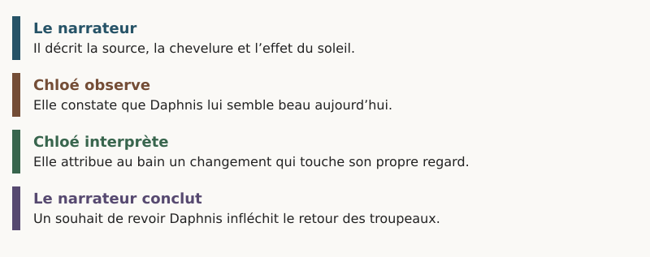
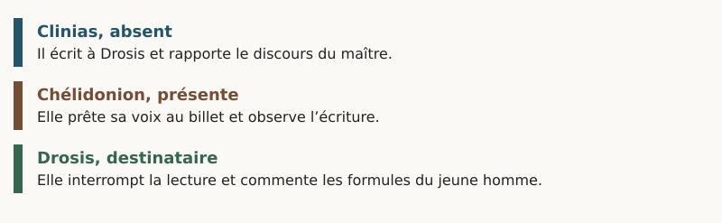
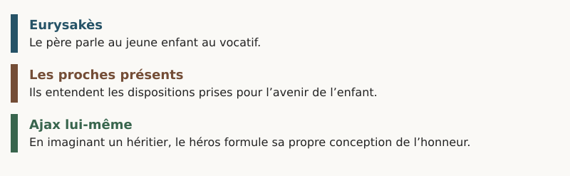

# ENS de Lyon · A/L 2017 · Grec (oral) — Corrigé guidé

*Corrigé rédigé par IA, non officiel. Signalez toute erreur.*

**Lecture du rapport du jury** · GPT-6.2 Astra Ultra · vitesse non renseignée

**Rédaction** · GPT-6.2 Astra Ultra · vitesse non renseignée

**Corrigé partiel.** 22 billets identifiés dans les quatre rubriques du jury. 14 traductions intégrales et 8 traductions partielles. Chaque billet comprend une situation et un commentaire. Les passages rendus par un résumé sont indiqués sur leur fiche.

Le jury de lettres classiques attend d’abord la situation de l’extrait, puis la lecture et la traduction, enfin le commentaire. L’entretien a lieu après le commentaire. Pour chaque billet, formuler une première traduction à partir de la piste de langue avant de comparer avec la proposition française.

## Lettres et arts · Lettres modernes et arts

### LA01 — Les adieux au lit et aux gens de la maison

**Euripide, Alceste** · Vers 183–195

Une servante raconte aux vieillards de Phères les adieux d’Alceste, qui a accepté de mourir à la place d’Admète. Le premier pronom a pour référent le lit conjugal dans les vers précédents.

**Avant de traduire.** Repérer les présents de narration des v. 183–188, puis les imparfaits. Rattacher ὡς θανουμένη au sujet féminin du verbe. L’expression ἄλλοτ’ ἄλλον distribue le geste entre les enfants.

**Traduction.**

« Elle tombe sur le lit et le couvre de baisers. Toute la couche est trempée d’un flot jailli de ses yeux. Quand elle s’est rassasiée de tant de larmes, elle se détache du lit et s’en va, la tête penchée. Mais souvent, en sortant de la chambre, elle se retourne et se jette de nouveau sur la couche. Les enfants, suspendus aux vêtements de leur mère, pleuraient. Elle les prenait dans ses bras et embrassait tantôt l’un, tantôt l’autre, en femme qui allait mourir. Tous les serviteurs pleuraient dans la maison, pris de pitié pour leur maîtresse. Elle tendait à chacun la main droite. Il n’y en eut pas un d’assez humble pour qu’elle ne lui adressât la parole et ne reçût de lui une réponse. »

**Question d’entretien.** Pourquoi le dernier vers comprend-il deux verbes de parole ?

**Réponse possible.** L’actif puis le passif figurent un échange réciproque entre personnes de rang différent. L’adieu associe la voix des domestiques à celle d’Alceste.

**Commentaire.** Les deux élans de la reine vers le lit interrompent le mouvement qui devait l’en éloigner. Puis les regards quittent l’objet conjugal pour suivre une mère et enfin une maîtresse de maison. Même le serviteur le plus humble répond : la parole donnée à chacun trouve un écho dans la présence de la servante qui raconte la scène.

### LA02 — Quelle cité demander à un oiseau ?

**Aristophane, Les Oiseaux** · Vers 112–122

Au début de la comédie, deux Athéniens ont cherché Térée, devenu huppe, pour lui demander conseil.

**Avant de traduire.** Identifier le duel νώ et les marques du duel dans δεομένω et ἤλθετον. Puis repérer le passage de la répétition au tour de supplication ἱκέται.

**Traduction.**

La Huppe : « Quelle affaire vous a donc amenés tous deux ici ? » Évelpide : « L’envie de te rencontrer. » La Huppe : « À quel sujet ? » Évelpide : « D’abord, tu as été un homme autrefois, tout comme nous deux. Tu as dû de l’argent autrefois, tout comme nous deux, et tu étais content de ne pas le rendre, tout comme nous deux. Ensuite tu as changé de nature, tu es devenu oiseau et tu as survolé en cercle la terre et la mer. Tu sais tout ce qu’un homme sait et tout ce que sait un oiseau. Voilà pourquoi nous sommes venus tous deux te supplier de nous indiquer, si tu en connais une, une cité bien douillette où nous puissions nous coucher comme dans une épaisse pelisse toute douce. »

**Question d’entretien.** Quelle idée d’une bonne cité les suppliants avancent-ils ici ?

**Réponse possible.** La cité est jugée selon le confort qu’elle offre au corps. La comparaison finale transforme une question politique en choix de literie.

**Commentaire.** L’expérience humaine est d’abord résumée aux embarras très athéniens du débiteur. La reprise identique en fin de membre peut faire attendre au public une nouvelle confidence compromettante. La métamorphose donne ensuite à Térée le savoir d’un voyageur idéal. Une demande solennelle aboutit au confort d’une pelisse. Dans la lecture scénique, la surprise comique tient à l’objet du dernier rapprochement.

### LA03 — Le bain de Daphnis vu par Chloé

**Longus, Pastorales** · Livre I, 13, 1–3

Daphnis et Chloé arrivent au sanctuaire des Nymphes. Le récit fait découvrir au lecteur un changement dont Chloé ignore encore la cause.

**Avant de traduire.** Distinguer εἴκασεν ἄν τις, hypothèse du narrateur, de ἐνόμιζε, croyance du personnage. Dans la dernière phrase, ὅτι μή introduit l’exception.

**Traduction.**

§ 1. Arrivé avec Chloé au sanctuaire des Nymphes, il lui donna sa petite tunique et sa besace à garder. Lui-même se plaça près de la source et lava ses cheveux et son corps tout entier. § 2. Il avait une chevelure noire et abondante, le teint bruni par le soleil. On aurait cru que l’ombre de ses cheveux lui donnait cette couleur. Chloé le regardait et trouvait Daphnis beau. Comme c’était la première fois qu’elle le trouvait beau, elle imaginait que le bain était la cause de cette beauté. Quand elle lui lava le dos, sa peau lui parut douce. Sans s’en rendre compte, elle le toucha plusieurs fois, pour vérifier si elle était vraiment aussi délicate. § 3. Puis, car le soleil se couchait déjà, ils ramenèrent les troupeaux à la maison. Il n’était rien arrivé d’extraordinaire à Chloé, si ce n’est qu’elle souhaitait revoir Daphnis au bain.

**Question d’entretien.** Que fait le dernier membre de phrase ?

**Réponse possible.** Il donne une conséquence observable au changement intérieur. La prétendue absence d’événement se trouve discrètement démentie par le nouveau souhait de Chloé.

**Commentaire.** La chevelure et le soleil suscitent une première conjecture, proposée au lecteur comme un jeu d’ombre. Chloé fait ensuite son propre raisonnement causal. Elle dispose des mots de la beauté et du bain, mais elle ignore pourquoi son regard s’est modifié. La reprise de la vie pastorale offre le cadre ordinaire où se mesure le changement : elle veut revoir la scène.

## Lettres et arts · Lettres classiques, Lucien

### CL01 — Une rumeur de mariage

**Lucien, Dialogues des hétaïres** · II, 1–2, jusqu’à οὐκ ἤθελεν ἐκτίνειν

Myrtion reproche à Pamphile un mariage qu’elle tient déjà pour décidé. Sa réponse rétablit un autre arrière-plan familial au moment où s’arrête le billet.

**Avant de traduire.** Distinguer γαμεῖς, présent, de γεγαμηκέναι, infinitif parfait après « on dit ». Dans le futur de la première tirade, distinguer le sujet « je » et l’enfant imaginé comme sujet du reproche.

**Traduction.**

Myrtion : « Alors tu épouses la fille de Phidon, l’armateur, Pamphile ? On dit même que tu l’as déjà épousée ! Tant de serments que tu m’as faits, et ces larmes : en un instant, tout est parti. Tu as oublié Myrtion, et cela juste au moment où j’entre dans mon huitième mois de grossesse ! Voilà donc le seul bénéfice que j’aie tiré de ton amour : tu m’as mise dans cet état et bientôt il faudra élever un enfant, si lourd fardeau pour une hétaïre. Je n’abandonnerai pas le nouveau-né, surtout si c’est un garçon. Je l’appellerai Pamphile. Moi, j’aurai une consolation de mon amour ; lui viendra un jour te reprocher ta déloyauté envers sa pauvre mère. D’ailleurs, la fille que tu épouses n’est pas belle. Je l’ai vue dernièrement aux Thesmophories avec sa mère, sans savoir encore qu’à cause d’elle je ne reverrais plus Pamphile. Regarde-la d’abord, son visage, ses yeux. Que cela ne te chagrine pas s’ils sont d’un bleu très clair et s’ils louchent au point de se regarder l’un l’autre ! Ou plutôt, tu as vu Phidon, le père de la mariée. Tu connais son visage, tu peux te dispenser de voir la fille. » Pamphile : « Vais-je t’écouter encore débiter ces sottises sur des jeunes filles et des noces d’armateurs ? Est-ce que je connais une fiancée, camuse ou jolie ? Est-ce que je savais seulement que Phidon d’Alopékè, car c’est de lui, je crois, que tu parles, avait une fille en âge de se marier ? Il n’est même pas l’ami de mon père. Je me souviens d’un procès récent au sujet d’un contrat maritime. Il devait, je crois, un talent à mon père et ne voulait pas le rembourser. »

**Question d’entretien.** Comment l’enfant, encore à naître, acquiert-il une voix ?

**Réponse possible.** Myrtion imagine déjà ce qu’il dira à Pamphile. Sa prédiction devient un reproche présent adressé à son auditeur.

**Commentaire.** Myrtion transforme une rumeur en scène future à trois personnages. Le prénom qu’elle donnera au fils doit la consoler et témoigner contre le père. La charge contre la fiancée glisse ensuite vers la caricature de famille. Pamphile réplique avec une précision de plaideur. Son contrat maritime fournit une autre manière d’envisager les rapports entre les pères.

### CL02 — La leçon de Crobylè

**Lucien, Dialogues des hétaïres** · VI, 3–4, jusqu’à Μάλιστα, ὦ θύγατερ

Corinna questionne sa mère sur la réussite de Lyra. La mère projette sur sa fille le même avenir économique.

**Avant de traduire.** Suivre le contraste entre les négations et les corrections introduites par ἀλλά. La valeur relative de τὸν μισθωσάμενον localise la rémunération avant l’action décrite.

**Traduction partielle.**

Corinna : « Comment Lyra s’est-elle procuré tout cela ? » Crobylè : « D’abord elle s’habille avec goût, elle est soignée et aimable envers tout le monde. Elle ne part pas en grands éclats de rire comme tu en as l’habitude : c’est un sourire doux et attirant. Elle sait parler aux gens ; elle ne se moque ni de celui qui vient lui rendre visite ni de celui qui lui envoie un cadeau. Elle ne s’agrippe pas non plus aux hommes. » La mère poursuit en érigeant le banquet et les relations tarifées en apprentissage destiné à sa fille. Corinna oppose à cette discipline la question très concrète de ce que fait Lyra quand elle a soif. Sa mère répond que c’est précisément alors que la règle s’applique. Elle prétend que le respect des préférences du client et de ses intérêts vaut à Lyra l’éloge général et promet que le même comportement comblerait leur famille. « Pour le reste, tu lui es de loin… Mais je ne dis rien, chère Adrastée ! Puisses-tu seulement vivre ! » Corinna demande si tous les clients ressemblent à Eucritos, qu’elle a rencontré la veille. Crobylè : « Pas tous. Il en est de meilleurs, d’autres sont déjà des hommes faits, certains fort mal pourvus du côté de la beauté. » Corinna lui demande si elle devra aussi accepter ces hommes. « Absolument, ma fille. »

**Délimitation.** Traduction partielle. Les prescriptions par lesquelles la mère prépare sa fille à des relations tarifées et les références intimes au § 4 sont rendues en discours indirect. Les deux limites du billet ont été contrôlées.

**Question d’entretien.** À qui appartient le projet annoncé comme un bonheur commun ?

**Réponse possible.** La mère emploie le pluriel de la prospérité familiale. Les questions de Corinna montrent que celle qui devra en payer le prix ne formule pas ce projet.

**Commentaire.** La série de prescriptions change brusquement d’échelle lorsque l’enfant demande ce qu’il advient de sa soif. Une sensation individuelle interrompt l’énumération des conduites censées plaire au client. Les deux dernières répliques ramènent l’enjeu économique à sa conséquence pour la fille. La brièveté de la réponse de la mère ne lui ouvre aucune possibilité de refus.

### CL03 — Une lettre lue à deux voix

**Lucien, Dialogues des hétaïres** · X, 2, depuis ἤδη δὲ περὶ δείλην, à 4, jusqu’à τοῖς ὡραιοτάτοις τῶν νέων

Drosis, inquiète du silence de Clinias, a envoyé une servante prendre de ses nouvelles. Le billet commence en fin de journée avec l’arrivée d’un autre messager.

**Avant de traduire.** Repérer les trois voix en présence pendant la lecture : Clinias a écrit, Chélidonion lit, Drosis interrompt. L’infinitive après ὑπισχνεῖται porte la promesse du maître rapportée par le jeune homme.

**Traduction.**

Drosis : « Déjà, vers le soir, Dromon arriva de sa part avec ce petit billet. Prends-le et lis-le, Chélidonion : tu dois savoir lire. » Chélidonion : « Voyons. L’écriture n’est pas très nette : on voit que l’auteur s’est dépêché, tant c’est griffonné. Il dit : “Comme je t’aimais, Drosis, les dieux le savent.” » Drosis : « Malheureuse que je suis ! Il ne m’a même pas souhaité le bonjour d’abord ! » Chélidonion reprend la lettre : « “Et si je te quitte maintenant, c’est sous la contrainte, sans te haïr. Mon père m’a confié à Aristénète pour que j’étudie la philosophie. Ayant eu connaissance de notre relation, il m’a fait des reproches. Il jugeait indigne du fils d’Architélès et d’Érasiclée de fréquenter une hétaïre, ajoutant qu’il valait bien mieux préférer la vertu au plaisir.” » Drosis : « Que ce radoteur aille au diable pour apprendre de pareilles choses au garçon ! » Chélidonion : « “Je suis donc forcé de lui obéir. Il me suit de près et me surveille. Je n’ai même le droit de regarder personne d’autre que lui. Si je vis sagement et lui obéis en tout, il promet que je serai parfaitement heureux et que ses exercices d’endurance feront de moi un homme vertueux. J’ai eu grand-peine à m’échapper pour t’écrire. Porte-toi bien, ma chérie, et garde le souvenir de Clinias.” » Drosis : « Que penses-tu de la lettre, Chélidonion ? » Chélidonion : « Le reste est digne d’un Scythe. Mais ce “garde le souvenir de Clinias” laisse quelque espoir. » Drosis : « C’est bien ce que je pensais, moi aussi. Toujours est-il que cet amour me tue. Dromon disait qu’Aristénète recherche les garçons et que, sous prétexte d’enseigner, il fréquente les plus beaux des jeunes gens. »

**Question d’entretien.** Qui est le mieux placé pour interpréter la lettre ?

**Réponse possible.** Chélidonion peut la déchiffrer ; Drosis connaît l’auteur. Lucien partage l’autorité entre les deux sans faire apparaître Clinias pour trancher.

**Commentaire.** Une lettre est un objet avant d’être une preuve. Chélidonion en juge l’écriture, Drosis remarque une formule de salut omise, puis les deux interprètent la formule finale. Le discours du maître accuse la vie de Drosis au nom de la vertu. L’accusation rapportée au dernier membre retourne contre lui le soupçon d’intérêt personnel, sans que la scène permette de vérifier ces versions concurrentes.

### CL04 — La preuve que Bacchis croit tenir

**Lucien, Dialogues des hétaïres** · IV, 4–5, jusqu’à ἐποίησα ὡς προσέταξε

Bacchis veut convaincre Mélitta de l’efficacité d’une magicienne syrienne en rapportant sa propre expérience avec Phanias.

**Avant de traduire.** L’actif ἧκε, « il est revenu », raconte le fait. L’expression qui attribue le retour à l’incantation en fournit l’interprétation de Bacchis. Rattacher les génitifs absolus aux circonstances concomitantes.

**Traduction partielle.**

Bacchis : « J’en connais une, ma très chère, qui peut rendre de grands services. Elle est syrienne, encore pleine de vigueur et bien solide. Autrefois Phanias m’en voulait sans raison, comme Charinos t’en veut aujourd’hui. Elle nous réconcilia au bout de quatre mois entiers. Je désespérais déjà de lui ; ses incantations me l’ont ramené. » Mélitta : « Que fit donc la vieille ? T’en souviens-tu encore ? » Bacchis évoque la modeste rémunération de la praticienne, les offrandes demandées et la coupe de vin qu’elle se réserve. Il faut aussi un objet appartenant à l’homme. Mélitta : « J’ai ses souliers. » Bacchis raconte le rituel, les noms prononcés, un objet tournoyant et les paroles étrangères qui effraient l’auditrice. « Voilà ce qu’elle fit alors. Peu après, ses compagnons faisaient des reproches à Phanias, et Phoibis, avec qui il vivait, lui réclamait beaucoup. Il est revenu vers moi. Que dire de plus ? C’était l’incantation qui l’amenait ! » La praticienne enseigne encore à Bacchis un rite dirigé contre sa rivale, dont les pas figurent symboliquement la domination. « Et j’ai fait comme elle me l’avait ordonné. »

**Délimitation.** Traduction partielle. Les préparations matérielles et la suite opératoire du rite au § 4 et au § 5 sont résumées. Sont traduites notamment les paroles relatives au retour de Phanias et la borne finale.

**Question d’entretien.** Où la conviction de Bacchis se distingue-t-elle le mieux de ce que son récit établit ?

**Réponse possible.** Au retour de Phanias. Ses amis et sa compagne lui donnent simultanément des raisons d’agir, mais Bacchis attribue le résultat au seul charme.

**Commentaire.** La conversation imite un interrogatoire qui devrait établir une preuve. Or Bacchis fournit elle-même deux motifs sociaux du retour de Phanias avant de conclure à la magie. La coupe réservée à la praticienne donne par ailleurs un intérêt matériel très concret à son intervention. Le lecteur peut accueillir le récit comme un portrait de la crédulité de la conteuse.

### CL05 — Léaina cherche ses mots

**Lucien, Dialogues des hétaïres** · V, 3, depuis Ἡ δέ· Ὦ Λέαινα, à 4, jusqu’à καὶ ὀθόνας τῶν λεπτῶν

Léaina rapporte à Clonarion une conversation avec une personne qu’elle connaissait sous le nom de Mégilla. Le billet commence après le récit de la première rencontre.

**Avant de traduire.** Μή με καταθήλυνε attire l’attention sur l’acte même de nommer au féminin. Marquer les changements de destinataire lorsque Léaina se tourne vers Clonarion en plein récit de la conversation.

**Traduction partielle.**

« Et voilà qu’on me dit : “Léaina, as-tu déjà vu un aussi beau jeune homme ?” — “Mais je ne vois pas de jeune homme ici, Mégilla”, répondis-je. — “Ne m’appelle pas au féminin. Je m’appelle Mégillos. Il y a longtemps que j’ai épousé Démonassa que voici, et c’est ma femme.” J’ai ri à ces mots, Clonarion, et j’ai dit : “Alors, Mégillos, tu serais un homme à notre insu, comme on raconte qu’Achille cachait qui il était dans ses vêtements de pourpre parmi les jeunes filles ?” » Léaina poursuit par des questions sur le corps de son interlocuteur, qui récuse ses suppositions. « “Serais-tu donc Hermaphrodite ?” Je ne comprenais toujours pas, Clonarion. — “Non, répond Mégillos, je suis un homme à tous égards.” J’ai entendu Isménodora, la joueuse de flûte béotienne, raconter une histoire de son pays : à Thèbes, une femme serait devenue un homme ; le même personnage était, je crois, un excellent devin nommé Tirésias. “Ne t’est-il pas arrivé quelque chose de ce genre ?” — “Non, Léaina. À la naissance, je ressemblais aux autres femmes comme vous ; mais ma pensée, mon désir, tout en moi est celui d’un homme.” » Léaina s’interroge encore sur leur désir. Mégillos lui propose de sortir du domaine des suppositions et elle rapporte à Clonarion qu’elle y consent après de vives instances et le don d’un collier précieux et de fines étoffes de lin.

**Délimitation.** Traduction partielle. Les échanges intimes sur l’anatomie en fin de § 3 et la proposition en fin de § 4 sont résumés. La déclaration de Mégillos, les comparaisons mythologiques et l’ancrage final sont rendus.

**Question d’entretien.** Pourquoi garder les vocatifs lors de la traduction ?

**Réponse possible.** Ils font entendre à la fois le débat entre Léaina et Mégillos et le récit de ce débat à Clonarion. La correction de genre intervient dans une parole adressée.

**Commentaire.** La langue offre à Mégillos une manière de se désigner ; Léaina, embarrassée, propose successivement le déguisement d’Achille, Hermaphrodite et la métamorphose de Tirésias. Ce sont les hypothèses de la narratrice. Qui parle et qui peut corriger un nom comptent ici autant que les souvenirs mythologiques. Le discours rapporté conserve le désaccord entre ces deux façons de comprendre l’expérience.

### CL06 — Une scène de banquet plaidée devant la mère

**Lucien, Dialogues des hétaïres** · III, 2–3, jusqu’à λέγε δ’ ὅμως τὰ μετὰ ταῦτα

Philinna proteste contre la version du banquet que sa mère a entendue de Diphile.

**Avant de traduire.** Repérer le couple ἐγὼ μέν / ὁ δέ dans le récit de la réaction au baiser. Puis comparer les questions successives de Philinna avec l’impératif final de la mère.

**Traduction.**

Philinna : « Naturellement, mère, il ne t’a pas raconté sa conduite. Tu n’aurais pas plaidé pour lui, vu ses outrages. Il m’a laissée pour bavarder en tête-à-tête avec Thaïs, l’amie de Lamprias, qui n’était pas encore arrivé. Il m’a vue contrariée ; je lui ai fait signe de regarder ce qu’il faisait. Il a pris Thaïs par le bout de l’oreille, renversé son cou et l’a embrassée si longuement qu’il a eu du mal à détacher ses lèvres. Moi, je pleurais ; lui, il riait et lui parlait à l’oreille, de moi, bien sûr ! Et Thaïs me regardait en souriant. Quand ils ont vu approcher Lamprias et ont enfin été rassasiés de baisers, je suis malgré tout allée m’installer à côté de Diphile, pour qu’il ne puisse pas me reprocher cela aussi. Thaïs s’est levée pour danser la première et a largement découvert ses chevilles, comme si elle seule en avait de jolies. Une fois sa danse terminée, Lamprias n’a rien dit, mais Diphile n’en finissait pas de louer sa danse, son costume, le rythme de ses pas au son de la lyre et ses chevilles. On aurait dit qu’il célébrait la Sosandra de Calamis au lieu de Thaïs, dont tu connais la figure pour être allée au bain avec nous ! Et aussitôt, elle s’est moquée de moi : “Qu’elle se lève aussi pour danser, celle qui n’a pas honte de ses jambes maigres !” Que pouvais-je répondre, mère ? Je me suis levée et j’ai dansé. Que faire d’autre ? Rester assise, lui donner raison et laisser Thaïs régner sur le banquet ? » La mère : « Tu as pris les choses bien à cœur, ma fille ; il aurait fallu n’y prêter aucune attention. Mais enfin, raconte la suite. »

**Question d’entretien.** Où le récit donne-t-il accès à un jugement plutôt qu’à un fait ?

**Réponse possible.** Lorsque Philinna assure que l’on parlait certainement d’elle. Elle observait le chuchotement, mais n’en a pas entendu le contenu.

**Commentaire.** Philinna parle comme une avocate de sa propre conduite. Elle rapporte minutieusement les gestes visibles, mais passe au soupçon lorsqu’elle prête un contenu aux chuchotements. Le rapprochement avec une statue célèbre grossit comiquement l’éloge de sa rivale. La mère se réserve le dernier mot et refuse de conclure avant d’avoir entendu le reste.

### CL07 — Le mauvais exemple d’Ampélis

**Lucien, Dialogues des hétaïres** · VIII, 2, depuis Οὐκ οἶδ’ ὅπως, et § 3

Chrysis se plaint de Gorgias. Ampélis lui propose son propre passé comme modèle, alors que la première réplique met en cause le prix de ce prétendu savoir.

**Avant de traduire.** Suivre le contraste entre la première personne de la narratrice et le discours de conseil. Les montants et les durées donnent à l’exemple un air de bilan marchand.

**Traduction.**

Chrysis : « Je ne sais comment tu en viens à vouloir que je reçoive des gifles, ma petite Ampélis ! » Ampélis : « Non, Chrysis. Mais à mon avis, c’est ainsi que commencent les grandes passions, quand ces gens-là se croient négligés. Si un homme est sûr d’être seul à te posséder, il se lasse de toi. Je te parle après vingt ans dans ce métier, alors que toi, tu dois avoir dix-huit ans, ou peut-être moins. Si tu veux, je vais te raconter ce qui m’est arrivé il n’y a pas si longtemps. Démophantos, le prêteur qui habite derrière le Portique peint, était mon amant. Il ne m’avait jamais donné plus de cinq drachmes et se croyait mon maître. Son amour était superficiel, ma chérie : jamais il ne gémissait, ne pleurait ni ne se présentait à toute heure à ma porte. Il venait passer la nuit chez moi seulement de loin en loin. » « Mais une fois il vint et je lui fermai la porte : le peintre Callidès, qui m’avait envoyé dix drachmes, était chez moi. Sur le moment, Démophantos s’en alla en m’injuriant. Bien des jours passèrent sans qu’il eût de mes nouvelles, car Callidès était chez moi. Démophantos se mit enfin à brûler, à flamber de passion. Un jour il s’installa devant ma porte, attendant qu’on l’ouvre. Il se mit à pleurer, il me frappa, menaça de me tuer, déchira mon vêtement. Il n’y eut rien qu’il ne fît. Finalement, il me donna un talent et me garda pour lui seul huit mois entiers. Sa femme prétendait que j’avais eu recours aux drogues pour le rendre fou. Le seul philtre, c’était sa propre jalousie. » Ampélis conclut : « À toi, Chrysis, d’en user de même avec Gorgias : ce sera un jeune homme riche s’il arrive quelque chose à son père. »

**Question d’entretien.** Qu’est-ce qui fragilise l’autorité d’Ampélis ?

**Réponse possible.** Les faits de son propre récit : coups et menaces semblent lui servir de preuve de passion. Le regard de Chrysis, dès l’ouverture, permet de contester cette valorisation.

**Commentaire.** La première phrase de Chrysis identifie bien la violence. Ampélis revendique l’autorité de l’ancienneté et raconte une histoire où les chiffres des versements augmentent à mesure que la situation devient plus dangereuse. Son calcul final sur un héritage empêche de confondre sa morale avec un jugement objectif sur l’amour. Au lecteur de mesurer la contradiction entre son conseil et le récit qui était censé le justifier.

## Lettres et arts · Lettres classiques, Sophocle

### CL08 — Une enquête devant la tente d’Ajax

**Sophocle, Ajax** · v. 1–35

Devant Troie, les Grecs ont attribué les armes d’Achille à Ulysse. Ajax s’estime déshonoré. À l’ouverture de la pièce, Athéna surprend Ulysse devant la tente de son rival, au lendemain d’une nuit dont personne dans le camp ne comprend encore les événements.

**Avant de traduire.** δέδορκά σε est un parfait de δέρκομαι suivi de l’accusatif et du participe θηρώμενον : « je t’ai toujours vu en train de guetter ». ἁνήρ est la crase de ὁ ἀνήρ. Au v. 22, εἴπερ (« si du moins ») corrige aussitôt l’accusation envisagée. Au v. 35, κυβερνῶμαι est au passif et reprend le vocabulaire du pilotage.

**Traduction.**

ATHÉNA. — Toujours, fils de Laërte, je t’ai vu à l’affût, cherchant à saisir quelque avantage sur tes ennemis. Aujourd’hui encore, je te vois près de la tente d’Ajax, du côté des navires, à l’extrémité du camp, là où il a son poste. Voilà longtemps que tu es en chasse et que tu mesures les traces fraîches de ses pas, pour savoir s’il est chez lui ou dehors. Ta marche te mène droit au but, comme celle d’une chienne de Laconie au flair subtil. Oui, l’homme est à l’intérieur depuis un instant. La sueur coule de son front et de ses mains qui ont tué par l’épée. Tu n’as plus besoin d’épier l’intérieur par cette porte. Dis-moi plutôt pourquoi tu t’es donné tant de peine. Tu l’apprendras de quelqu’un qui sait.

ULYSSE. — Ô voix d’Athéna, la plus chère des déesses à mon cœur ! Même quand tu échappes à ma vue, que ta voix m’est reconnaissable ! Je l’entends, mon esprit la saisit à l’instant, comme l’appel d’une trompette étrusque à la bouche de bronze. Cette fois encore tu m’as bien reconnu : je tourne autour d’un ennemi, Ajax au grand bouclier. C’est lui, personne d’autre, que je piste depuis longtemps. Car cette nuit il semble avoir accompli contre nous un acte incompréhensible, si c’est bien lui qui en est l’auteur. Nous ne savons rien de certain, nous errons dans le doute, et je me suis chargé de cette tâche de mon plein gré. Nous venons de retrouver tous les troupeaux du butin abattus de main d’homme, avec ceux qui les gardaient. Tous lui en attribuent la responsabilité. Un éclaireur m’a rapporté qu’il l’avait vu courir seul à travers la plaine, son épée encore tachée de sang. Aussitôt je me lance sur ses traces. J’en reconnais certaines ; d’autres me déconcertent et je ne parviens pas à savoir de qui elles sont. Tu arrives à point. Car en toute chose, hier comme demain, c’est ta main qui me tient le gouvernail.

**Délimitation.** Les v. 1–35 sont traduits dans les deux prises de parole.

**Question d’entretien.** Comment la succession des comparaisons caractérise-t-elle Ulysse ?

**Réponse possible.** Le flair de la chienne exprime sa compétence d’enquêteur. La trompette montre qu’il reconnaît une autorité que ses yeux ne peuvent saisir. Le gouvernail précise enfin le rapport entre son initiative personnelle et la direction qu’il reçoit d’Athéna.

**Commentaire.** Athéna voit Ulysse regarder des traces, mais Ulysse reconnaît Athéna à l’oreille. Sa comparaison avec la trompette répond à celle de la chienne de chasse. À la certitude de la déesse, παρ’ εἰδυίας, répond le pluriel inquiet des Grecs, ἴσμεν γὰρ οὐδὲν τρανές. Le prologue donne ainsi au public un savoir inégalement partagé avant de faire paraître Ajax.

### CL09 — Athéna veut un spectateur

**Sophocle, Ajax** · v. 51–88

Ulysse vient d’apprendre que l’affront lié aux armes d’Achille a poussé Ajax à s’en prendre aux chefs grecs. Athéna explique comment elle a détourné sa colère. Ajax se trouve encore à l’intérieur de la tente.

**Avant de traduire.** ἐγώ, premier mot, insiste sur l’initiative d’Athéna. Le démonstratif de la série τοῦτον, τόνδε désigne sur scène Ajax, même encore invisible. Au v. 82, φρονοῦντα qualifie Ajax lorsqu’il est lucide ; οὐκ ἂν ἐξέστην exprime l’irréel. Au v. 83, οὐ μή suivi du subjonctif est une négation énergique.

**Traduction.**

ATHÉNA. — C’est moi qui l’ai empêché de goûter une joie qui eût été irréparable : j’ai jeté sur ses yeux des visions qui l’égaraient et je l’ai détourné vers les brebis et les troupeaux mêlés que leurs gardiens surveillaient, butin qui n’avait pas encore été partagé. Il s’est jeté au milieu des bêtes à cornes et les a tuées, les frappant à la ronde sur l’échine. Tantôt il croyait tenir les deux Atrides et les tuer de sa propre main, tantôt il pensait attaquer l’un ou l’autre des chefs. Moi, tandis qu’il courait en tous sens dans son délire, je l’encourageais, je le précipitais dans un funeste piège. Puis, quand il a cessé sa besogne, il a lié ensemble les bœufs encore en vie et tous les moutons et les a ramenés chez lui : à ses yeux, il avait capturé des hommes, plutôt que du gibier aux belles cornes. À présent, il maltraite chez lui ces bêtes entravées. Je vais aussi te montrer ce trouble au grand jour, pour que tu puisses en parler à tous les Argiens après l’avoir vu de tes yeux. Reste ici sans crainte ; que cet homme ne t’alarme pas. Je détournerai ses regards pour l’empêcher de voir ton visage. Hé, toi qui lies les bras de tes captifs, c’est toi que j’appelle : viens ici ! C’est Ajax que j’appelle ! Viens devant la tente.

ULYSSE. — Que fais-tu, Athéna ? Surtout, ne l’appelle pas dehors !
ATHÉNA. — Ne vas-tu pas te taire et t’épargner un geste de lâcheté ?
ULYSSE. — Non, par les dieux ! Qu’il lui suffise de rester à l’intérieur.
ATHÉNA. — Que crains-tu donc qu’il arrive ? Cet homme n’était-il pas déjà un homme auparavant ?
ULYSSE. — Mon ennemi, certes ; il l’est encore aujourd’hui.
ATHÉNA. — N’est-ce pas le plus doux des rires que de rire de ses ennemis ?
ULYSSE. — Moi, il me suffit qu’il reste chez lui.
ATHÉNA. — Tu hésites à regarder un homme dont le délire est manifeste ?
ULYSSE. — S’il était maître de son esprit, je ne reculerais pas de peur devant lui.
ATHÉNA. — Même à présent, il ne te verra certainement pas, bien que tu sois tout près.
ULYSSE. — Comment, s’il regarde avec les mêmes yeux ?
ATHÉNA. — Je mettrai ses yeux dans l’ombre, même s’ils sont ouverts.
ULYSSE. — Tout pourrait bien arriver, lorsqu’un dieu s’en mêle.
ATHÉNA. — Tais-toi donc, debout, et reste dans la position où tu te trouves.
ULYSSE. — Je veux bien rester. Mais j’aurais préféré me trouver ailleurs.

**Délimitation.** Les v. 51–88 sont traduits, y compris le récit de la méprise et le dialogue devant la tente.

**Question d’entretien.** Pourquoi la garantie d’invisibilité ne suffit-elle pas à rassurer pleinement Ulysse ?

**Réponse possible.** Athéna répond au risque physique, mais Ulysse hésite aussi à assister à l’humiliation d’un adversaire qui a perdu sa lucidité. Son refus de rire dépasse donc la simple prudence.

**Commentaire.** La déesse veut faire d’Ulysse un témoin qui pourra ensuite informer les Argiens. Elle assimile aussitôt le spectacle à un plaisir de vainqueur. Ulysse reconnaît l’inimitié sans approuver ce plaisir. Sa dernière réplique sépare l’obéissance visible de l’adhésion intérieure et prépare sa réaction de pitié après la démonstration.

### CL10 — Le triomphe imaginaire d’Ajax

**Sophocle, Ajax** · v. 91–120

Athéna a fait sortir Ajax. Ulysse se trouve auprès d’eux, à l’insu d’Ajax. La déesse l’a privé de la capacité de reconnaître ce qui s’est passé et ce qu’il a devant les yeux.

**Avant de traduire.** Au v. 93, χάριν est une postposition avec le génitif : « en remerciement de cette chasse ». Au v. 100, ἀφαιρείσθων est un impératif à la troisième personne du duel, qui renvoie aux deux fils d’Atrée. Le contraste entre ἔσω et ὁρᾷς matérialise la séparation de l’espace où Ajax imagine Ulysse et de celui où il se tient réellement.

**Traduction partielle.**

AJAX. — Salut, Athéna ! Salut, enfant née de Zeus ! Comme tu m’as bien secondé ! Pour te remercier de cette chasse, je te couronnerai de dépouilles toutes d’or.
ATHÉNA. — Voilà de belles paroles. Mais dis-moi une chose. As-tu bien trempé ta lance dans le sang de l’armée argienne ?
AJAX. — J’ai de quoi m’en glorifier ; je ne le nierai pas.
ATHÉNA. — As-tu aussi tourné ta lance contre les Atrides ?
AJAX. — Si bien qu’ils ne feront plus jamais affront à Ajax.
ATHÉNA. — Ces hommes sont morts, si j’ai bien compris ce que tu dis.
AJAX. — Maintenant qu’ils sont morts, qu’ils essaient donc de me prendre mes armes !
ATHÉNA. — Bien. Et le fils de Laërte ? Quel sort lui as-tu fait ? Ou bien t’a-t-il échappé ?
AJAX. — Le maudit renard ! Tu me demandes où il est ?
ATHÉNA. — Oui, je parle d’Ulysse, ton adversaire.
AJAX. — Il est là-dedans, maîtresse, prisonnier à ma grande joie. Je ne veux pas encore qu’il meure.
ATHÉNA. — Avant que tu aies fait quoi ? Que comptes-tu gagner de plus ?
[V. 108–110, résumé du dialogue : Ajax veut prolonger la souffrance de celui qu’il prend pour Ulysse. Athéna l’interroge sur le sort qu’il lui réserve.]
ATHÉNA. — Non, ne maltraite pas ainsi ce malheureux.
AJAX. — Sur tout le reste, Athéna, je te laisse le dernier mot. Mais lui subira cette peine, et aucune autre.
ATHÉNA. — Eh bien, puisque tu prends plaisir à agir ainsi, fais de ta main tout ce que tu as en tête.
AJAX. — Je vais à mon affaire. Et voici ma prière : sois toujours à mes côtés l’alliée que tu as été aujourd’hui.
ATHÉNA. — Vois-tu, Ulysse, quelle est la force des dieux ? Aurais-tu trouvé homme plus prévoyant que lui, ou plus capable d’agir comme il faut, au moment décisif ?

**Délimitation.** V. 108–110 : la description de la punition imaginée par Ajax et la question intermédiaire d’Athéna sont résumées entre crochets. Les v. 91–107 et 111–120 sont traduits.

**Question d’entretien.** Pourquoi Athéna finit-elle en rappelant les qualités intellectuelles d’Ajax ?

**Réponse possible.** Sa démonstration perdrait de sa force si Ajax avait toujours été inconséquent. Même un homme réputé pour prévoir et agir à propos peut être rendu incapable de distinguer un ennemi présent d’un prisonnier imaginaire.

**Commentaire.** Le spectateur entend parler du prétendu captif alors qu’il voit ou imagine le véritable Ulysse libre et silencieux. L’ironie se resserre lorsque Ajax demande à Athéna de demeurer son alliée : il remercie précisément celle qui l’a trompé. L’éloge de sa prévoyance, à la dernière question, fait mesurer l’écart entre la réputation d’un homme et sa perception actuelle.

### CL11 — Tecmesse raconte la nuit

**Sophocle, Ajax** · v. 284–316

La compagne captive d’Ajax, Tecmesse, parle au chœur de marins salaminiens. Elle a vu Ajax partir de nuit puis revenir dans la tente. Son témoignage complète le récit de la déesse avec ce qu’un être humain a pu observer.

**Avant de traduire.** μαθήσει, futur de μανθάνω, annonce ce que saura le chœur. Au v. 293, γύναι (vocatif) interpelle une femme en particulier, γυναιξί (datif pluriel) étend la règle à toutes. ἔμφρων, « qui a retrouvé ses esprits », marque le retournement du v. 306. La restriction ὅσονπερ ἐξηπιστάμην du v. 316 délimite la compétence du témoin.

**Traduction partielle.**

TECMESSE. — Tu apprendras toute l’affaire, puisque tu y as part. En pleine nuit, quand les lampes du soir avaient cessé de brûler, Ajax prit son épée à double tranchant et voulut sortir pour une expédition sans but. Je le reprends : « Que fais-tu, Ajax ? Pourquoi te lances-tu dans cette entreprise sans que personne t’ait appelé, sans avoir reçu de messager ni entendu la trompette ? À cette heure toute l’armée dort. » Il me répondit en peu de mots, avec une phrase qu’on chante à tout propos : « Femme, le silence est la parure des femmes. » J’avais compris ; je me tus. Il s’élança seul.

Ce qui se passa là-bas, je ne peux en parler. Mais je le vis rentrer : il ramenait, liés ensemble, des taureaux, des chiens de berger et des bêtes à belle toison. [V. 298–300, résumé : il tue certains animaux et maltraite ceux qu’il tient captifs, croyant trouver des hommes dans le troupeau.] Finalement, il se précipita à la porte et se mit à parler à une ombre : ses paroles visaient tantôt les Atrides, tantôt Ulysse. Il riait aux éclats en racontant l’outrage dont il s’était vengé sur eux. Puis il s’élança de nouveau à l’intérieur. Avec le temps, à grand-peine, il revint à lui. Quand il comprit que la demeure était pleine des effets de son égarement, il se frappa la tête et poussa un cri. Il s’effondra parmi les corps des bêtes abattues et resta assis là, les cheveux serrés à poignée. Longtemps il resta assis sans un son. Puis il me menaça de paroles terribles si je ne lui révélais pas tout ce qui était arrivé. Il me demandait dans quelle situation il se trouvait. Et moi, amis, sous l’effet de la peur, je lui racontai tout ce qui s’était fait, autant que j’en avais une connaissance certaine.

**Délimitation.** V. 298–300 : les sévices aux animaux sont résumés entre crochets. Les v. 284–297 et 301–316 sont traduits.

**Question d’entretien.** Quelle contradiction les v. 293 et 312–316 font-ils entendre ?

**Réponse possible.** Au départ, Ajax présente le silence comme une vertu obligatoire de femme. Au retour, dépendant de la mémoire de Tecmesse, il exige sa parole. Le récit fait d’elle le témoin dont le héros a besoin pour comprendre ses propres actes.

**Commentaire.** La même voix raconte le silence qu’Ajax lui a imposé puis les explications qu’il a exigées d’elle. Deux limites se répondent : Tecmesse ne sait rien de l’extérieur et ne peut dire à Ajax que ce qu’elle a vu. Entre ces deux déclarations, Sophocle ordonne les signes sensibles du trouble : rire devant une ombre, cri de reconnaissance, long silence.

### CL12 — Ce qu’Ajax veut transmettre à son fils

**Sophocle, Ajax** · v. 545–577

Ajax, revenu à lui, demande que son jeune fils Eurysacès lui soit amené. Tecmesse et les marins assistent à la rencontre. L’adresse à l’enfant devient une série de recommandations confiées aux compagnons du père.

**Avant de traduire.** γένοιο est l’optatif de souhait à la deuxième personne, tandis que γένοι’ ἄν exprime une conséquence envisagée. Le composé γηροβοσκός désigne celui qui nourrit ses proches dans leur vieillesse. Εὐρύσακες, vocatif, fait entendre εὐρύς « large » et σάκος « bouclier ». L’image du poulain rend la force du verbe πωλοδαμνεῖν.

**Traduction.**

AJAX. — Soulève-le, soulève-le jusqu’à moi. Il n’aura pas peur, je pense, en voyant ces bêtes tout juste abattues, s’il tient bien de moi et s’il est vraiment mon fils. Il faut dès maintenant le former, comme on dresse un poulain, aux rudes règles de son père, et façonner sa nature à la ressemblance de la mienne. Mon enfant, puisses-tu être plus heureux que ton père, et lui ressembler pour le reste ! Tu ne serais alors pas un homme de peu. Et pourtant, déjà, je puis t’envier une chose : tu n’as aucune conscience de ces malheurs. La vie est bien douce quand on ne comprend encore rien, jusqu’au jour où l’on apprend réjouissance et chagrin. [Le texte numérique donne aussi, au v. 554b, un vers écarté par l’éditeur : « L’inconscience est un mal tout à fait indolore. »]

Quand tu en seras venu là, il te faudra montrer parmi les ennemis de ton père quel fils est né de quel homme. Jusque-là, nourris-toi de brises légères ; grandis dans la joie de ta jeune vie, pour réjouir ta mère. Aucun Achéen, je le sais, ne t’infligera d’indigne outrage, même quand je ne serai plus près de toi. Je te laisserai en Teucros un tel gardien à ta porte, si infatigable pour t’élever, bien qu’il soit maintenant au loin à la poursuite de l’ennemi.

Et vous, mes compagnons d’armes, gens de mer, c’est à vous aussi que je confie cette tâche d’amitié. Transmettez-lui mon ordre : qu’il conduise cet enfant chez moi et le présente à Télamon et à ma mère, Éribée. Qu’il soit toujours le soutien de leur vieillesse [v. 571, écarté par l’éditeur : « jusqu’à ce qu’ils atteignent les profondeurs où règne le dieu d’en bas »]. Que ni des arbitres de jeux ni celui qui a fait mon malheur ne proposent mes armes comme prix aux Achéens. Toi, mon fils Eurysacès, prends et garde le bouclier qui t’a donné ton nom, le « large bouclier », indestructible avec ses sept peaux de bœuf. Tu le porteras au bras par sa courroie aux coutures serrées. Le reste de mon équipement sera enseveli avec moi.

**Délimitation.** Les v. 545–577 sont traduits. Les leçons 554b et 571, écartées par l’éditeur du texte numérique, sont également traduites entre crochets.

**Question d’entretien.** Comment le souhait des v. 550–551 éclaire-t-il le don final ?

**Réponse possible.** Ajax sépare ce qu’il juge bon en lui de son infortune. En réservant à son fils le bouclier qui explique son nom, il tente de transmettre une identité familiale sans livrer cet héritage à un concours dont les juges pourraient décider autrement.

**Commentaire.** Ajax veut transmettre son caractère sans transmettre son sort. Il traite d’abord l’enfant en futur rival des ennemis de sa maison, puis envie son ignorance et le rend momentanément à la joie de sa mère. L’équipement du père ne doit pas devenir un nouveau prix à disputer, comme les armes d’Achille. Le bouclier appartient d’avance à l’enfant par le nom qu’il porte.

### CL13 — Le temps change tout

**Sophocle, Ajax** · v. 646–682, jusqu’à ὡς αἰὲν οὐ μενοῦντα

Après les supplications de Tecmesse, Ajax tient devant elle et le chœur un discours qui paraît annoncer un changement de résolution. Ses auditeurs peuvent l’entendre comme une promesse rassurante ; le public sait combien certaines de ses expressions restent ambiguës.

**Avant de traduire.** φύει et κρύπτεται organisent la première opposition entre apparition et retrait. Le double οὐ … οὐδέν porte sur ἄελπτον : « rien n’est au-delà de ce qu’on peut attendre ». Les futurs εἰσόμεσθα et μαθησόμεσθα mettent le changement à distance. Aux v. 679–682, ὡς introduit deux participes futurs ; φιλήσων renvoie au locuteur, μενοῦντα à l’ami.

**Traduction partielle.**

AJAX. — Tout, dans sa longueur sans mesure, le temps le fait naître de l’invisible, puis, une fois apparu, il le cache. Rien ne passe toute attente. Même un serment redoutable, même une volonté inflexible se laissent vaincre. Moi aussi, qui naguère tenais bon devant les pires épreuves, j’ai senti, comme le fer à la trempe, le tranchant de ma parole s’adoucir devant cette femme. J’ai pitié d’elle : la laisser veuve, mon fils orphelin, au milieu de mes ennemis !

J’irai aux lieux où l’on se baigne, dans les prairies du rivage. Je veux me purifier de mes souillures pour échapper à la lourde colère de la déesse. [V. 657–660 : Ajax annonce qu’il soustraira aux regards un objet qu’il tient pour funeste ; il le place en paroles sous la garde de la Nuit et d’Hadès.] Depuis que je l’ai reçu de la main d’Hector, mon ennemi le plus acharné, rien de bon ne m’est venu des Argiens. Le proverbe des mortels dit vrai : les dons des ennemis sont des dons qui n’en sont pas et qui ne portent pas bonheur.

Ainsi, désormais, nous saurons céder aux dieux et nous apprendrons à respecter les Atrides. Ce sont des chefs : il faut céder. Comment en serait-il autrement ? Même ce qu’il y a de redoutable et de plus fort s’incline devant les prérogatives d’autrui. Les hivers aux chemins enneigés font place à l’été qui porte les fruits. Le long cercle de la nuit se retire pour laisser le jour aux blancs chevaux allumer sa lumière. Le souffle des vents terribles finit par laisser s’endormir la mer qui gémissait. Et le sommeil tout-puissant libère ceux qu’il avait liés ; il ne garde pas pour toujours ceux qu’il a pris. Comment, nous, n’apprendrions-nous pas la mesure ? Moi, du moins, je viens de comprendre que je dois haïr un ennemi juste assez pour pouvoir un jour l’aimer, et que j’entends servir et aider un ami en pensant qu’il ne restera pas mon ami pour toujours.

**Délimitation.** V. 657–660 : les propos sur les préparatifs sont résumés entre crochets. Les v. 646–656 et 661–682 sont traduits jusqu’aux seuls mots ὡς αἰὲν οὐ μενοῦντα.

**Question d’entretien.** Pourquoi peut-on croire au changement d’Ajax tout en restant inquiet ?

**Réponse possible.** La compassion exprimée pour Tecmesse et les exemples naturels donnent du poids à sa parole. Pourtant l’allusion à Hadès, l’objet funeste et la réversibilité de l’amitié ne constituent aucune promesse claire sur son avenir. Les proches et le public peuvent donc entendre les mêmes mots différemment.

**Commentaire.** Pour rassurer ses proches, Ajax donne des preuves apparemment irréfutables de l’alternance : hiver et été, nuit et jour, veille et sommeil. Mais ce qu’il dit des liens humains est plus inquiétant. Admettre que l’ennemi d’hier puisse être aimé apaise ; envisager que l’ami puisse cesser de l’être invite à la défiance. Le texte autorise ces deux écoutes sans imposer que chacune des maximes soit mensongère.

### CL14 — L’autorité des chefs et la question de la sépulture

**Sophocle, Ajax** · v. 1052–1086

Après la mort d’Ajax, son demi-frère Teucros veut lui rendre les honneurs funèbres. Ménélas, l’un des deux chefs de l’expédition, a interdit l’ensevelissement. Pressé de justifier cet interdit, il répond à Teucros.

**Avant de traduire.** ὁθούνεκα, « parce que », rattache la première phrase à la question de Teucros, antérieure au passage. Aux v. 1057–1060, εἰ μή, l’aoriste puis les indicatifs avec ἄν expriment un irréel du passé prolongé dans le présent. δημότης est le simple citoyen ou particulier envisagé par opposition aux chefs. οὔριος, « favorable à la navigation », prépare βυθός, la profondeur où sombre le vaisseau.

**Traduction.**

MÉNÉLAS. — Parce que nous espérions, en l’emmenant de chez lui, conduire aux Achéens un allié, un ami ; et qu’à l’épreuve, nous avons découvert en lui un homme plus ennemi que les Phrygiens ! Après avoir projeté la mort de l’armée tout entière, il a marché contre elle de nuit pour la vaincre par les armes. Si l’un des dieux n’avait pas étouffé cette entreprise, c’est nous qui, après une mort infamante, serions maintenant étendus là, avec le sort qui lui est échu ; et lui vivrait. En fait, un dieu a détourné sa violence et l’a fait retomber sur les bêtes des troupeaux. Voilà pourquoi nul n’aura assez de force pour ensevelir son corps sous un tombeau. Rejeté sur le sable pâle, il servira de pâture aux oiseaux du rivage.

Ne va donc pas, là-dessus, laisser éclater une colère terrible. Car si, de son vivant, nous n’avons pas été capables de l’emporter sur lui, maintenant qu’il est mort, nous lui commanderons, que tu le veuilles ou non ; nous le tiendrons sous notre autorité. De son vivant, il n’a jamais voulu écouter mes paroles. Et pourtant il est d’un homme sans valeur, quand on n’est qu’un simple particulier, de prétendre ne rien devoir écouter de ceux qui commandent. Jamais les lois ne suivraient un heureux cours dans une cité où ne serait pas établie la crainte. Jamais non plus une armée ne serait gouvernée avec mesure si rien ne lui faisait un rempart de la crainte et du respect.

Un homme, si grand et si fort qu’il soit né, doit se dire que même un petit mal pourrait le faire tomber. Celui en qui la crainte se joint au sens de la honte, sache qu’il tient là son salut. Mais là où l’on est libre d’agir avec démesure et de faire tout ce que l’on veut, dis-toi qu’un jour la cité qui courait sous un vent favorable sombrera dans les profondeurs. Qu’il y ait donc, je le demande, une juste part de crainte. Et quand nous faisons ce qui nous plaît, n’allons pas nous imaginer que nous n’aurons pas à le payer en connaissant la peine à notre tour.

**Délimitation.** Les v. 1052–1086 sont traduits jusqu’à la maxime finale de Ménélas.

**Question d’entretien.** Quel vers empêche de réduire la tirade à une simple défense de la discipline ?

**Réponse possible.** Aux v. 1067–1068, Ménélas oppose expressément son impuissance devant Ajax vivant à la maîtrise qu’il entend exercer maintenant. La règle générale peut donc servir un désir de revanche. Le public doit peser les deux mobiles.

**Commentaire.** Ménélas part d’une inimitié de fait pour aboutir à une théorie du gouvernement par la crainte. Entre les deux s’intercale un aveu : les chefs entendent exercer sur le mort une autorité qu’ils n’ont pas su imposer au vivant. Le passage à la cité et au navire donne au discours une gravité qui n’efface pas cet aveu. C’est l’une des raisons pour lesquelles le jugement sur l’enterrement reste ouvert dans la tragédie.

## Langues vivantes · Grec hors programme, LV2

### LV01 — Le regard de Cléopâtre et le récit du biographe

**Plutarque, Vie d’Antoine** · 71, 6–8

Après la défaite d’Antoine, le biographe situe à la cour d’Alexandrie une série d’expériences meurtrières sur des condamnés. La concordance des deux numérotations est donnée dans le dossier des sources.

**Avant de traduire.** Suivre les participes d’observation, notamment ἐλέγχουσα, et le passage à l’imparfait itératif. Identifier aussi les personnes sur lesquelles le pouvoir s’exerce.

**Traduction partielle.**

Traduction de l’ouverture : « Cléopâtre rassemblait les propriétés de toutes sortes de substances mortelles. » Suite en discours indirect : le biographe dit qu’elle en fait subir les effets à des condamnés en détention, observe les souffrances causées, puis étend les expériences à des animaux. Il attribue à la reine une surveillance quotidienne et termine sur une comparaison avec le sommeil profond. Les comparaisons de procédés et les descriptions détaillées de leurs effets sont résumées.

**Délimitation.** Traduction partielle. L’ouverture est traduite et la suite est analysée. Les comparaisons de substances, de procédés et d’effets en 71.6–8 sont résumées.

**Question d’entretien.** Le point de vue du narrateur coïncide-t-il avec celui des victimes ?

**Réponse possible.** Le récit détaille ce que l’observatrice prétend établir. L’absence de parole des condamnés signale précisément la limite de l’accès offert au lecteur.

**Commentaire.** La progressivité du récit donne aux constatations une apparence d’enquête. Les condamnés demeurent anonymes, tandis que la reine conserve le rôle de sujet qui rassemble, éprouve et observe. Cette distribution grammaticale permet d’interroger la responsabilité du pouvoir et celle d’un biographe qui fait accéder le lecteur à la conduite d’une cour fermée. La comparaison finale avec le sommeil transforme une conclusion rapportée en image narrative.

## Sciences humaines

### SH01 — La reine endeuillée sous la surveillance de César

**Plutarque, Vie d’Antoine** · 82, 3–5

Après les obsèques d’Antoine, la santé de Cléopâtre se dégrade. Au début du § 3, le participe λαβούσης achève la phrase sur les funérailles.

**Avant de traduire.** Avec ὡς αὐτὸς ὁ Ὄλυμπος εἴρηκεν, le biographe interrompt son récit pour nommer sa source. Suivre ensuite la succession de sujets Olympos, César et Cléopâtre.

**Traduction partielle.**

« [La reine] ayant obtenu de pouvoir disposer de tout selon sa volonté. Une douleur et une peine si grandes, jointes aux blessures qu’elle s’était faites en signe de deuil, provoquèrent chez elle des accès de fièvre. » Plutarque ajoute qu’elle voit dans cette maladie une occasion de mettre fin à ses jours. « Elle avait dans son entourage un médecin, Olympos. Après lui avoir dit la vérité, elle en fit son conseiller et son auxiliaire dans son dessein de mourir. Olympos le dit lui-même dans une relation qu’il a publiée de ces événements. César eut des soupçons. Il lui fit craindre pour ses enfants et lui adressa des menaces à leur sujet. Elle céda sous leur effet, comme sous les coups de machines de siège, et remit son corps à ceux qui voulaient la soigner et la nourrir. »

**Délimitation.** Traduction partielle. La proposition sur la conduite suicidaire de la reine à la jonction des § 3–4 est donnée sous forme de résumé. Un raccord entre crochets identifie la fin de phrase initiale.

**Question d’entretien.** Pourquoi la mention de l’ouvrage d’Olympos arrive-t-elle au milieu du récit ?

**Réponse possible.** Le médecin sert de témoin à ce qu’une observatrice extérieure ne pourrait savoir des intentions de Cléopâtre. Son indication de source n’efface pas le caractère intéressé d’un récit de cour.

**Commentaire.** Une douleur de deuil devient d’abord un fait médical, puis un renseignement politique. Plutarque indique où il a trouvé l’information sur les intentions privées de la reine. La comparaison avec des machines de siège donne enfin à une menace touchant les enfants l’efficacité d’un assaut contre une place forte. Le lecteur voit jusqu’où la victoire pénètre dans le domaine du soin et des liens familiaux.

### SH02 — Une intrusion et la mise en cause de l’agresseur

**Lysias, Contre Simon** · § 6–8

Dans un plaidoyer de défense, le locuteur entend démontrer que Simon a pris l’initiative de la violence. Voici son récit à lui des événements.

**Avant de traduire.** Distinguer les sujets des participes au § 7. Les témoins καὶ οἱ μετ’ αὐτοῦ ἐλθόντες comprennent les propres compagnons de Simon. Les présents du § 8 donnent du relief à la fin.

**Traduction.**

§ 6. « J’estime que vous devez entendre ces faits. Ayant appris que le jeune homme était chez moi, il vint de nuit et en état d’ivresse à mon domicile. Il enfonça les portes et pénétra dans l’appartement des femmes où se trouvaient ma sœur et mes nièces, qui ont vécu avec tant de réserve qu’elles rougissent même d’être vues par leurs proches. § 7. Eh bien, son insolence alla si loin qu’il ne voulut partir que lorsque les assistants et ses propres compagnons, trouvant odieux qu’il fût entré chez des jeunes filles orphelines, le chassèrent de force. Et, loin de regretter ces outrages, il apprit où nous dînions et fit une chose tout à fait extravagante et incroyable pour qui ne connaîtrait pas sa folie. § 8. Il m’appela au-dehors. Dès que je sortis il voulut me frapper. Comme je me défendais, il s’écarta et me jeta des pierres. Il me manque, mais atteint d’une pierre Aristocrite, qui était venu avec lui me trouver, et lui blesse gravement le front. »

**Question d’entretien.** Pourquoi finir par le nom d’Aristocrite ?

**Réponse possible.** Ce tiers identifiable a été blessé devant les protagonistes. Le récit quitte l’appréciation morale du comportement pour une conséquence dont un témoin pourrait répondre.

**Commentaire.** L’orateur accumule les circonstances aggravantes avant de relater le coup. L’heure, l’état de Simon et la présence des orphelines caractérisent l’intrusion. Que ses compagnons le chassent constitue un témoignage particulièrement efficace. L’issue absurde de la seconde scène confirme dans la version du défendeur que sa propre conduite relevait de la défense.

### SH03 — Les paroles que peut encore entendre Jocaste

**Euripide, Les Phéniciennes** · Vers 1437–1453

Un messager raconte les derniers instants des deux frères après leur duel. Au début du v. 1437, Antigone achève une apostrophe commencée au vers précédent.

**Avant de traduire.** Les formes du duel, ἀδελφώ au seuil et παρηγορεῖτον dans la demande, ne désignent pas la même paire. La reprise φίλος / ἐχθρός / φίλος articule le paradoxe de la parenté.

**Traduction.**

« … mes deux frères tant aimés qui avez trahi [l’espoir de] mes noces ! » Le roi Étéocle laissa échapper de sa poitrine un souffle où la vie s’attardait avec peine. Il entendit sa mère et, posant sur elle sa main humide, ne fit entendre aucun son. Mais ses yeux lui parlèrent par des larmes qui signifiaient sa tendresse. L’autre respirait encore. Regardant sa sœur et sa vieille mère, Polynice prononça ces mots : « Nous voici perdus, mère. J’ai pitié de toi, de ma sœur que voici, de mon frère qui est mort. Car celui que j’aimais est devenu mon ennemi ; pourtant je l’aime encore. Ensevelissez-moi, toi qui m’as donné le jour, et toi, ma sœur, sur la terre de mes pères. Apaisez toutes deux la cité en colère pour que j’obtienne au moins cette petite portion du sol de mes pères, même si j’ai perdu ma demeure. Ferme de ta main mes paupières, mère », et lui-même pose cette main sur ses yeux, « et adieu à vous. Déjà l’ombre m’enveloppe. »

**Question d’entretien.** Quelle est l’échelle du dernier désir de Polynice ?

**Réponse possible.** Il a disputé le pouvoir de toute une cité, mais réclame seulement la place d’une tombe. La reprise de la terre paternelle fait entendre cette réduction.

**Commentaire.** L’un des frères ne peut produire de voix et parle avec ses yeux. L’autre ordonne encore ses paroles en adieux et en requête funéraire. Les mots enchâssés dans le récit du messager s’interrompent précisément quand un geste accomplit la demande. La requête de terre fait entrer la cité dans ce dernier échange familial.

### SH04 — Chloé cherche le nom de ce qu’elle éprouve

**Longus, Pastorales** · Livre I, 14, 1–3

Chloé, troublée par Daphnis, parle seule. Elle connaît le vocabulaire des accidents et des pertes ordinaires de la vie pastorale.

**Avant de traduire.** Les balancements μέν / δέ et les négations éliminent des causes familières. Εἴθε + indicatif passé exprime ensuite le souhait irréalisable.

**Traduction.**

§ 1. « Maintenant je suis malade, mais j’ignore ma maladie. J’ai mal et je n’ai aucune blessure. J’ai du chagrin et je n’ai perdu aucun mouton. Je brûle, et je suis assise sous une ombre si épaisse ! § 2. Combien de ronces m’ont égratignée sans que je pleure ! Combien d’abeilles m’ont piquée sans m’empêcher de manger ! Mais ce qui aujourd’hui me pique le cœur est plus cruel que tout cela. Daphnis est beau. Les fleurs le sont aussi. Sa flûte a une belle voix. Les rossignols aussi. Eux, pourtant, ne m’occupent en rien. Ah ! si je devenais sa flûte pour qu’il souffle en moi ! § 3. Ah ! si j’étais une chèvre pour qu’il me mène paître ! Méchante eau, tu as rendu Daphnis beau, lui seul ! Moi, c’est en vain que je me suis lavée. Je suis perdue, chères Nymphes ! Ne sauverez-vous donc pas la jeune fille qui a grandi parmi vous ? Après moi, qui vous couronnera de fleurs ? »

**Question d’entretien.** Pourquoi Chloé se reproche-t-elle d’avoir pris un bain en vain ?

**Réponse possible.** Elle attribue à l’eau la beauté qu’elle découvre chez Daphnis et cherche en elle un effet comparable. Le lecteur reconnaît un changement de regard dont elle ignore encore le nom.

**Commentaire.** La plainte avance par diagnostics abandonnés. Les fleurs pourraient expliquer la beauté, les rossignols la musique. Aucun ne produit le même effet que ce garçon. La bergère se rêve alors sous deux formes de son propre univers pastoral. Son appel religieux final rappelle que les mots des soins et des liens qu’elle connaît déjà lui permettent d’imaginer une relation qu’elle découvre.

## Éditions et concordances

Les deux bornes des sept billets de Lucien et la coupe intérieure au v. 682 d’*Ajax* ont été collationnées sur le fac-similé. Pour le grec de Plutarque, les repères 71.6–8 correspondent aux §§ 4–5 du chapitre 71 chez Perrin, et les repères 82.3–5 aux derniers mots du § 1 et au § 2 du chapitre 82 chez Perrin. Les repères numériques du texte grec de comparaison peuvent tomber à l’intérieur d’une phrase. [Liste officielle](https://www.ens-lyon.fr/sites/default/files/2017-11/grec-2017_1506588504714.pdf) · [Rapport du jury](https://www.ens-lyon.fr/sites/default/files/2018-03/GREC_2017.pdf) · [Seconde numérotation de la Vie d’Antoine](https://el.wikisource.org/wiki/Βίοι_Παράλληλοι/Αντώνιος)

[Euripide, Alceste](https://github.com/PerseusDL/canonical-greekLit/blob/master/data/tlg0006/tlg002/tlg0006.tlg002.perseus-grc2.xml) · [Aristophane, Les Oiseaux](https://github.com/PerseusDL/canonical-greekLit/blob/master/data/tlg0019/tlg006/tlg0019.tlg006.perseus-grc2.xml) · [Longus, Pastorales](https://github.com/PerseusDL/canonical-greekLit/blob/master/data/tlg0561/tlg001/tlg0561.tlg001.perseus-grc2.xml) · [Lucien, Dialogues des hétaïres](https://github.com/PerseusDL/canonical-greekLit/blob/master/data/tlg0062/tlg069/tlg0062.tlg069.perseus-grc2.xml) · [Sophocle, Ajax](https://github.com/PerseusDL/canonical-greekLit/blob/master/data/tlg0011/tlg003/tlg0011.tlg003.perseus-grc2.xml) · [Plutarque, Vie d’Antoine](https://github.com/PerseusDL/canonical-greekLit/blob/master/data/tlg0007/tlg058/tlg0007.tlg058.perseus-grc2.xml) · [Lysias, Contre Simon](https://github.com/PerseusDL/canonical-greekLit/blob/master/data/tlg0540/tlg003/tlg0540.tlg003.perseus-grc2.xml) · [Euripide, Les Phéniciennes](https://github.com/PerseusDL/canonical-greekLit/blob/master/data/tlg0006/tlg015/tlg0006.tlg015.perseus-grc2.xml)
