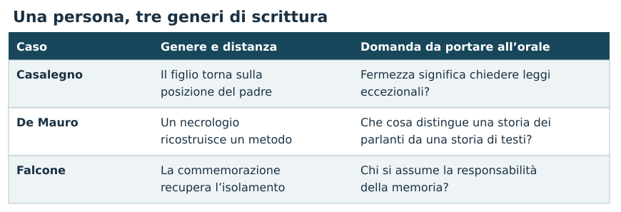

# ENS de Lyon · Séries LA/LV/SH (A/L) · Italien oral 2017 — Corrigé brut

*Corrigé rédigé par IA, non officiel. Signalez toute erreur.*

**Rédaction** · GPT-6.2 Astra Ultra · vitesse non renseignée

**Révision** · GPT-6.2 Astra Ultra · vitesse non renseignée

Neuf billets sont recensés dans les trois séries. Les deux passages littéraires sont délimités et ont été recoupés avec les œuvres. Le cahier de quatorze pages reproduit les sept articles remis au concours, deux pages par billet. Les renvois tiennent compte de leur ordre dans cette annexe.

## Lettere e arti · Stampa

### «Così il turismo è come veleno. Lo Stato salvi Venezia e l’Italia» · *Corriere della Sera*, 14 febbraio

Nella seconda pagina la richiesta di coordinamento nazionale nasce dalla frammentazione delle competenze tra Regioni e dalla debolezza dell’agenzia promozionale. La concessione dell’ultima frase abbassa deliberatamente la richiesta: anche far udire una voce pubblica sarebbe già un passo. [Fascicule des extraits, p. 1–2](https://www.ens-lyon.fr/sites/default/files/2017-11/italien-hors-programme2017pdf_1506588947702.pdf#page=1)

Il paradosso del titolo poggia su una risorsa che consuma le condizioni stesse da cui dipende. Venezia attira i visitatori perché è una città storica; se l’aumento dei flussi espelle chi ci abita e trasforma le attività in servizi rivolti ai soli turisti, la città perde proprio la vita che ne rende possibile la visita. L’articolo fa discutere due scale di responsabilità. Il sindaco evoca il frigorifero da riempire, immagine concreta di un reddito di cui le famiglie hanno bisogno. La replica chiede chi possiede quel frigorifero e chi può aprirlo: la ricchezza complessiva non coincide con la sua distribuzione. Le grandi navi e le prospettive edilizie per Marghera rendono visibile il conflitto tra beneficio immediato e costo collettivo duraturo. Il richiamo allo Stato trasforma il caso veneziano in una domanda sul patrimonio come bene comune. [Articolo del *Corriere*](https://www.corriere.it/cronache/17_febbraio_15/cosi-turismo-come-veleno-stato-salvi-venezia-l-italia-ca0a9aba-f2f5-11e6-a761-60f3fdff5014.shtml)

**Domanda. Il titolo condanna ogni visitatore?** Il bersaglio è soprattutto un modello di sfruttamento. L’articolo riguarda la proporzione tra flussi, risorse e vita dei residenti, dunque una scelta politica, non una colpa personale del singolo turista.

## Langues vivantes · Explication d’un texte d’auteur (LV1)

### Giovanni Verga, *Fantasticheria*, pp. 126–129

Da «Ora rimangono quei monellucci…» a «…o del coltello del palombaro che le stacca dallo scoglio». Nella parte finale il paesaggio di Aci Trezza perde l’aspetto di una scena pittoresca per la signora a cui il narratore si rivolge. Gli abitanti hanno età, rapporti di parentela, morti da piangere e necessità da cui dipendono. Il diminutivo dell’incipit del passo non basta a proteggere i ragazzi che restano. Il salto di scala è decisivo: per chi può ripartire il paese sta in uno sguardo, per chi deve restare è il mondo su cui si regge la vita. [Testo di *Fantasticheria*](https://www.utemilano.it/wp-content/uploads/2022/11/Verga_Fantasticheria.pdf)

L’ostrica dà una forma concreta a questo scarto di prospettiva. Restare attaccati allo scoglio è una condizione di sopravvivenza per chi vive del proprio lavoro e dei legami familiari. Visto dalla villeggiante, lo stesso attaccamento può sembrare mancanza d’immaginazione. Il palombaro dell’ultima immagine aggiunge alla forza del mare un gesto umano. Il pericolo viene anche da chi osserva e raccoglie dall’esterno. La voce narrante è implicata in questo problema: chiede alla donna di mutare sguardo, ma sa di parlare dall’altra parte di una distanza sociale. La futura materia dei *Malavoglia* emerge da questa richiesta di attenzione.

**Domanda. Perché la seconda persona è importante?** Perché il testo mette alla prova una destinataria precisa. Noi lettori finiamo per domandarci quanto il nostro primo sguardo somigli al suo.

### Antonio Manetti, *La novella del Grasso legnaiuolo*, pp. 83–86

Da «El Grasso e ’l compagno, giunti in Ungheria…» a «A Dio sia grazia. Amen». Dopo lo scherzo che gli ha fatto dubitare della propria identità, l’artigiano può ricominciare in Ungheria. Ottiene protezione e riconoscimento professionale, diventa maestro Manetto da Firenze. Il nome della città che lo aveva reso ridicolo funziona ora come segno di competenza. Un ambiente sociale aveva potuto destabilizzare l’identità dell’uomo; un altro contribuisce a ricostruirla. Il successo del protagonista modifica retrospettivamente il valore della beffa e impedisce di ridurlo al ruolo della vittima ingenua. [Finale della novella, redazione Manetti](https://it.wikisource.org/wiki/Novella_del_Grasso_legnaiuolo_%28red._Manetti%29)

Il ritorno sul racconto da parte dei testimoni pone poi un problema diverso. Chi può garantire la verità di una vicenda costruita per far dubitare della verità? L’insistenza sui nomi, sulle memorie e sulle circostanze produce un effetto di autenticazione. Manetti celebra anche l’abilità di Filippo Brunelleschi nell’organizzare un inganno collettivo. Il congedo devoto chiude con una formula familiare una storia che ha mostrato quanto la sicurezza del singolo possa dipendere dalla parola altrui.

**Domanda. L’emigrazione è solo una fuga?** È anche un cambiamento delle condizioni in cui il mestiere è riconosciuto e viene nominato. Il finale invita a confrontare due modi di diventare qualcuno agli occhi degli altri.

## Langues vivantes · Analyse hors programme (LV1)

### Massimo Cacciari, «Ma il nostro destino è essere umili» · *L’Espresso*, 14 agosto 2016

Nel foglio, dalla domanda sull’Italia che «manca» si passa all’ipotesi europea. Una federazione di città, luoghi e idiomi offre un’immagine di unità la cui forza dipende dalle relazioni tra parti libere. L’accenno conclusivo alla moneta unica suggerisce quanto poco basti la sola unità monetaria. [Fascicule des extraits, p. 5–6](https://www.ens-lyon.fr/sites/default/files/2017-11/italien-hors-programme2017pdf_1506588947702.pdf#page=5)

Cacciari interroga l’ambivalenza con cui gli italiani parlano del proprio paese. Una cultura ammirata può convivere con una storia di fragilità politica e di appartenenze locali molto forti. L’allusione dantesca al paese dove si parla il «sì» suggerisce un’Italia riconoscibile anche prima dell’unità statale. L’argomento acquista forza perché la mancanza di un centro ha due esiti possibili. Può alimentare il particolarismo e il disinteresse per il bene comune, ma la pluralità dei centri è stata anche una condizione della ricchezza culturale italiana. L’umiltà del titolo invita a sottrarre l’orgoglio nazionale alla semplice esibizione di una passata grandezza. Il problema è che cosa farne nel presente. [Ripresa del testo di Cacciari](https://icebergitalia.blogspot.com/2020/06/massimo-cacciari-ma-il-nostro-destino-e.html)

**Domanda. Quale funzione svolgono le citazioni letterarie?** Consentono di ascoltare voci diverse dentro un discorso sulla nazione. Sono testimonianze storiche di un rapporto conflittuale con l’Italia, oltre che occasioni di prestigio retorico.

### Andrea Casalegno, «Casalegno, strategia della fermezza» · *Il Sole 24 Ore*, 22 maggio 2017

L’ultimo episodio mette alla prova la parola del titolo. Il direttore propone di sospendere temporaneamente la rubrica per proteggere il giornalista. Carlo rifiuta cortesemente. La voce del figlio cambia allora di scala e invita i lettori a pensare a che cosa si possa trasmettere attraverso un esempio. [Fascicule des extraits, p. 3–4](https://www.ens-lyon.fr/sites/default/files/2017-11/italien-hors-programme2017pdf_1506588947702.pdf#page=3)

Il figlio del vicedirettore della *Stampa* ucciso dalle Brigate rosse nel 1977 ricostruisce il significato di una parola facilmente fraintesa. La fermezza di Carlo Casalegno consisteva nell’applicare le leggi vigenti contro la violenza, tenendo fermi i diritti fondamentali. La sua biografia nella Resistenza illumina questo legame: le libertà democratiche erano una conquista della sua generazione. Perciò chiedere misure eccezionali avrebbe potuto compromettere l’oggetto stesso della difesa. Il ricordo familiare ha qui valore civile perché restituisce all’uomo una posizione politica precisa, invece di fare dell’assassinio l’unica spiegazione della sua vita. [Articolo di Andrea Casalegno](https://st.ilsole24ore.com/art/cultura/2017-05-22/casalegno-strategia-fermezza-105924.shtml)

**Domanda. Perché distinguere il padre da chi scrive?** Carlo formulava giudizi nel conflitto del suo presente. Andrea, quarant’anni dopo, ricostruisce quei giudizi attraverso un legame personale che rende importante attribuire correttamente ogni voce.

## Langues vivantes · Analyse hors programme (LV2)

### Francesco Erbani, «È morto Tullio De Mauro, il più grande linguista italiano. Cultura in lutto» · *La Repubblica*, 5 gennaio 2017

Nella seconda pagina il ricordo di don Milani accompagna una distinzione decisiva tra decifrare i segni e usare una lingua per orientarsi in un problema. Il giornalista segue De Mauro oltre le aule, fin nelle case prive di libri e nell’indifferenza di parte delle classi dirigenti. [Fascicule des extraits, p. 7–8](https://www.ens-lyon.fr/sites/default/files/2017-11/italien-hors-programme2017pdf_1506588947702.pdf#page=7)

Un necrologio seleziona ciò che di una vita riguarda un pubblico più vasto. Erbani porta al centro il gesto intellettuale di De Mauro: chiedere come gli italiani abbiano effettivamente imparato a parlarsi. Accanto alla tradizione dei grandi autori, acquistano rilievo la scolarizzazione, le migrazioni, il rapporto tra lingua nazionale e dialetti. Un dizionario dell’uso e una storia linguistica osservano, con strumenti diversi, i parlanti reali. Il superlativo del titolo segnala l’omaggio; il modo più convincente per spiegarlo è far vedere in quale senso la ricerca linguistica sia diventata anche una questione di cittadinanza. [Necrologio di Francesco Erbani](https://www.repubblica.it/cultura/2017/01/05/news/morto_tullio_de_mauro-155445600/)

**Domanda. Perché uno storico della lingua dovrebbe interessarsi all’analfabetismo?** Perché descrivere la diffusione di un codice comune significa anche chiedersi chi ne sia rimasto escluso e con quali conseguenze nella vita pubblica.

### Michele Ainis, «Liberi con buon senso» · *L’Espresso*, 18 settembre 2016

Il sottotitolo identifica il conflitto tra autonomia alimentare degli adulti e responsabilità verso i figli. Il foglio comincia da una bistecca e conclude sul principio di precauzione. In mezzo Ainis mette in scena le obiezioni di un interlocutore per delimitare ciò che lo Stato può imporre. [Fascicule des extraits, p. 9–10](https://www.ens-lyon.fr/sites/default/files/2017-11/italien-hors-programme2017pdf_1506588947702.pdf#page=9)

Ainis distingue anzitutto i diritti in gioco: tutela della salute, scelte delle minoranze, responsabilità dei genitori e sovranità sul proprio corpo. Gli esempi sull’uso pubblico dei dati e sulle regole alimentari chiedono fino a che punto la protezione della salute autorizzi il controllo. Poi l’argomento cambia soggetto. Il potere di un adulto di scegliere per sé non si trasferisce automaticamente al genitore che sceglie per un minore. Il richiamo finale alla precauzione costituisce la risposta del giurista nel contesto del 2016. La valutazione delle esigenze nutrizionali di un bambino richiede prove e competenze diverse da quelle della sola argomentazione giuridica.

**Domanda. Il «buon senso» è già un criterio giuridico sufficiente?** No. Per giustificare una misura bisogna identificare il diritto coinvolto, il rischio concreto e la proporzione tra il mezzo scelto e lo scopo.

## Sciences humaines · Stampa

### Roberto Saviano, «Falcone voleva vivere e i suoi nemici non erano solo i mafiosi» · *La Repubblica*, 23 maggio 2017

La seconda pagina cita una sentenza sull’attentato dell’Addaura per dare una fonte alla parola «invidia». Nell’ultima sequenza il parallelismo fra Falcone e Borsellino ridà a entrambi il desiderio di vivere. Il coraggio nasce dalla difficoltà della scelta, non da un presunto desiderio di morire. [Fascicule des extraits, p. 11–12](https://www.ens-lyon.fr/sites/default/files/2017-11/italien-hors-programme2017pdf_1506588947702.pdf#page=11)

Il venticinquesimo anniversario di Capaci può favorire una commemorazione unanime. Saviano usa invece il desiderio ordinario di vivere per incrinare l’immagine di un uomo predestinato al sacrificio. Ripercorre l’ostilità incontrata da Falcone ancora in vita e il sospetto gettato perfino sulla realtà dell’attentato fallito all’Addaura. Alla testimonianza morale affianca un richiamo giudiziario alle invidie e alle strumentalizzazioni. Distinguere la responsabilità mafiosa degli attentati dall’isolamento istituzionale del magistrato è essenziale: l’una non cancella l’altro. La memoria diventa un esame del comportamento dei vivi, più scomodo dell’omaggio a un morto. [Testo di Roberto Saviano](https://www.repubblica.it/cronaca/2017/05/23/news/falcone_voleva_vivere_e_i_suoi_nemici_non_erano_solo_i_mafiosi-166149153/)

**Domanda. Perché insistere sulle sconfitte di Falcone?** Perché ridargli un percorso segnato da ostacoli rende visibili anche le scelte di chi avrebbe potuto sostenerlo.

### «Le brigatiste irriducibili che non vogliono uscire dal carcere» · *La Repubblica*, 31 gennaio 2017

Il direttore del carcere racconta nell’ultima pagina che le detenute abbandonarono persino un corso dopo averlo cominciato. La ragione che egli offre è il rifiuto di accettare l’istituzione. L’aggettivo finale ripete il titolo: il lettore può ora confrontare un’etichetta collettiva con una testimonianza e con condotte concrete. [Fascicule des extraits, p. 13–14](https://www.ens-lyon.fr/sites/default/files/2017-11/italien-hors-programme2017pdf_1506588947702.pdf#page=13)

La cronaca entra nel carcere di Latina e mette in scena uno scarto temporale. All’esterno cambiano tecnologie, linguaggi politici e forme della vita quotidiana. All’interno, alcune detenute continuano a riconoscersi in un’identità politica formatasi decenni prima. L’aggettivo «irriducibili» organizza il racconto, ma richiede una verifica: che cosa dicono le scelte delle interessate, che cosa riferiscono le autorità e quale immagine ricava il giornalista dai dettagli della vita carceraria? L’interesse storico del pezzo sta nella persistenza di un’appartenenza politica dopo la fine della stagione in cui si era imposta. L’articolo solleva anche una questione civile: come raccontare la detenzione e la possibilità di un ritorno alla società senza attenuare la gravità delle responsabilità individuali? [Cronaca del 31 gennaio](https://www.repubblica.it/cronaca/2017/01/31/news/brigatiste_irriducibili-157248065/amp/)

**Domanda. Il titolo basta a spiegare perché ciascuna donna resti in carcere?** No. Condizione giuridica, decisione personale e interpretazione politica vanno tenute distinte. Il plurale del titolo crea un ritratto collettivo che non esaurisce le singole situazioni.

[Fascicule officiel des sujets](https://www.ens-lyon.fr/sites/default/files/2017-11/italien-2017_1506588301935.pdf) · [Rapport du jury](https://www.ens-lyon.fr/sites/default/files/2018-03/ITALIEN_2017.pdf)
