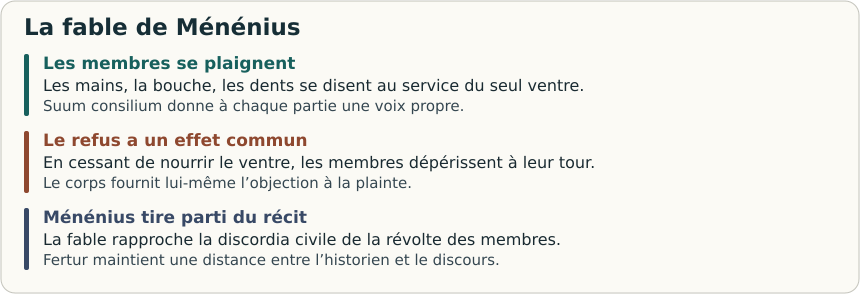
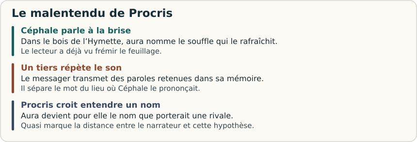
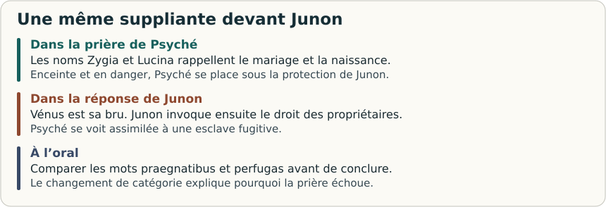
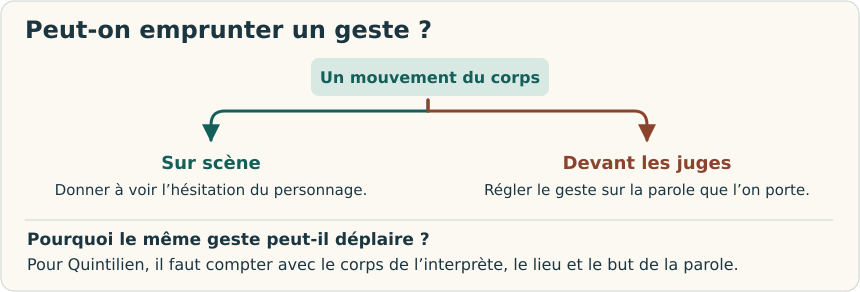
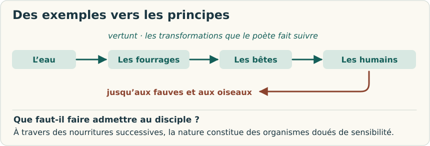

# ENS de Lyon · Latin oral A/L 2017 — Corrigé brut

*Corrigé rédigé par IA, non officiel. Signalez toute erreur.*

**Rédaction** · GPT-6.2 Astra Ultra · vitesse non renseignée

**Rédaction (tour 2)** · GPT-6.2 Astra Ultra · vitesse non renseignée

Le relevé de 2017 recense 54 billets. Il donne les références antiques, parfois jusqu’au vers ou au paragraphe, mais ne reproduit ni les feuillets remis aux candidats ni leurs chapeaux. Les traductions suivent les éditions latines citées à chaque billet. Les compléments nécessaires pour comprendre un début ou une fin de phrase sont indiqués. [Relevé des billets](https://www.ens-lyon.fr/sites/default/files/2017-11/latin-2017_1506588436937.pdf) · [Rapport du jury](https://www.ens-lyon.fr/sites/default/files/2018-03/LATIN_2017.pdf)

Les 54 références sont traitées. Pour Pline le Jeune VII, 1, Pétrone 31–32, Aulu-Gelle XII, 1 et Tite-Live II, 23, les textes traduits couvrent toute l’unité citée. Les limites d’un éventuel extrait distribué ne sont pas connues. Les divergences de référence entre le relevé, le rapport et les éditions sont indiquées sur les billets concernés.

## Lettres et arts · Lettres modernes et arts

### LA 01 · Sénèque, Les Troyennes, 1137–1152

Le messager rapporte le sacrifice de Polyxène à la tombe d’Achille. « Utrosque populos » complète « terror attonitos tenet » au vers précédent. L’extrait s’arrête à « truci vultu ferox », avant la suite du récit. Texte de Peiper et Richter, Teubner.

[La terreur tient frappés de stupeur] les deux peuples. Elle-même garde les yeux baissés par pudeur. Pourtant ses joues rayonnent et, plus qu’à l’ordinaire, sa beauté resplendit à sa dernière heure, comme se fait plus douce la lumière de Phébus tout près de son coucher, lorsque les étoiles reprennent leur tour et que la nuit voisine presse le jour incertain. Toute la foule demeure saisie. Presque tous admirent davantage ce qui va périr. Les uns s’émeuvent de l’éclat de sa beauté, les autres de sa tendre jeunesse, d’autres encore de l’inconstance du sort.

Tous s’émeuvent d’un courage qui va au-devant de la mort. Elle précède Pyrrhus. Tous les cœurs tremblent, ils sont partagés entre admiration et pitié. Dès qu’elle eut atteint le haut de la colline escarpée et que le jeune homme se fut placé au sommet du haut tertre funéraire de son père, la jeune femme, intrépide, ne recula pas d’un pas. Tournée vers le coup qui l’attend, elle se tient droite, le regard farouche.

**Commentaire.** Le public réunit vainqueurs et vaincus dans le même regard. La comparaison solaire ralentit le récit et donne au visage de Polyxène la lumière d’un dernier instant. La reprise de « hos » distribue des réactions individuelles, puis « omnes » les réunit devant son courage. « Pyrrhum antecedit » bouleverse la disposition attendue du cortège. En mettant la captive devant son bourreau, le messager lui rend l’initiative scénique.

[Texte latin de référence](https://github.com/PerseusDL/canonical-latinLit/blob/master/data/phi1017/phi002/phi1017.phi002.perseus-lat2.xml)

### LA 02 · Stace, Achilléide, I, 567–582

À Scyros, Achille est dissimulé parmi les filles de Lycomède. Le v. 567 achève la concessive commencée au v. 566. Le v. 582 suspend « perdita dura », dont « pensa manu » au v. 583 complète le sens. Édition de J. H. Mozley.

[Bien que] tout le groupe s’assemble autour de lui, il tend doucement de nouveaux pièges à celle qui ne soupçonne rien de tel. Il la suit, il la presse sans vergogne, c’est elle que ses yeux retrouvent encore et encore. Tantôt il reste trop près d’elle, qui ne se dérobe pas, tantôt il l’effleure de légères guirlandes, de corbeilles qu’il laisse tomber exprès, ou d’un thyrse qui ménage ses coups. Tantôt il lui montre les douces cordes de sa lyre familière, les airs délicats et les chants de Chiron.

Il guide sa main et ploie ses doigts sur la cithare sonore. Tantôt il interrompt ses lèvres qui chantent, l’entoure de ses bras et mêle mille baisers à ses éloges. Elle apprend volontiers où se dresse la cime du Pélion, qui est le descendant d’Éaque. Au récit du nom et des exploits du jeune homme, son émerveillement se renouvelle. Elle chante Achille, qui est là. Elle lui montre, à son tour, comment mouvoir ses membres robustes avec plus de retenue, comment affiner de son pouce frottant la laine grossière. Elle répare les quenouilles et [le travail] gâté par sa rude [main].

**Commentaire.** Le même enseignement cache deux scènes. Pour Déidamie, il s’agit d’apprendre les chants de Chiron puis de transmettre un savoir textile. Le narrateur fait voir l’insistance d’Achille avec « insidias », « premit », « improbus ». L’asymétrie de l’information interdit de prendre « libens discit » pour une approbation de tous ses gestes. L’ironie culmine dans « praesentem cantat Achillem ». Le nom de l’épopée est déjà sur les lèvres de celle qui ne reconnaît pas son héros.

[Texte latin de référence](https://github.com/PerseusDL/canonical-latinLit/blob/master/data/phi1020/phi003/phi1020.phi003.perseus-lat2.xml)

### LA 03 · Horace, Odes, II, 20, 1–20

Le « je » du poète s’adresse à Mécène. Les cinq premières strophes vont de « Non usitata » à « Rhodanique potor ». L’ode contient encore une strophe sur les honneurs funèbres, hors extrait. Texte de Shorey et Laing.

Sur une aile exceptionnelle et vigoureuse, je serai porté, poète à deux formes, à travers l’éther limpide. Je ne m’attarderai plus longtemps sur terre. Plus grand que l’envie, je quitterai les villes. Moi, issu de parents pauvres, moi que tu appelles auprès de toi, cher Mécène, je ne mourrai pas, l’onde du Styx ne me retiendra pas. Déjà, déjà, une peau rugueuse s’établit sur mes jambes. Dans le haut de mon corps, je me change en oiseau blanc.

Un plumage léger naît sur mes doigts et mes épaules. Bientôt, plus célèbre qu’Icare, fils de Dédale, j’irai voir les rivages du Bosphore qui gronde, les Syrtes de Gétulie et les plaines hyperboréennes, oiseau au chant sonore. L’homme de Colchide me connaîtra, ainsi que le Dace qui dissimule sa crainte de la cohorte marse et les Gélons des confins du monde. L’Ibère instruit m’étudiera, et celui qui boit l’eau du Rhône.

**Commentaire.** L’ode passe d’une promesse au futur (« ferar ») aux indices visibles du présent (« nascuntur »). Les plumes partent des doigts et des épaules du poète. « Canorus » conserve à l’oiseau la faculté de l’artiste. La géographie du dernier mouvement devient une carte des réceptions futures lorsque « visam », c’est-à-dire « je verrai », cède la parole aux peuples sujets de « noscent » et « discet ». L’origine modeste citée devant Mécène rend sensible la distance parcourue.

[Texte latin de référence](https://github.com/PerseusDL/canonical-latinLit/blob/master/data/phi0893/phi001/phi0893.phi001.perseus-lat2.xml)

### LA 04 · Salluste, La Conjuration de Catilina, I

Préface de la monographie historique. Le chapitre entier va de « Omnis homines » à « alterius auxilio eget » dans l’édition d’A. W. Ahlberg. « Omnis » est ici l’ancienne forme de l’accusatif pluriel.

Il convient à tous les hommes qui s’efforcent de dépasser les autres êtres vivants de tendre toutes leurs forces pour ne pas traverser la vie dans le silence, comme du bétail que la nature a façonné penché vers le sol et soumis à son ventre. Or toute notre puissance réside dans l’esprit et dans le corps. Nous nous servons surtout de l’esprit pour commander, du corps pour servir. Par l’un nous avons quelque chose en commun avec les dieux, par l’autre avec les bêtes.

Aussi me semble-t-il plus juste de chercher la gloire par les ressources de l’intelligence que par celles de la force et, puisque cette vie dont nous jouissons est brève, de prolonger le plus possible la mémoire de nous-mêmes. Car la gloire de la richesse et de la beauté passe et se brise, tandis que le mérite est tenu pour éclatant et éternel. Pourtant les mortels ont longtemps beaucoup discuté pour savoir si le succès à la guerre dépendait davantage de la vigueur du corps ou de la valeur de l’esprit. En effet, avant de commencer, il faut réfléchir, et, la décision prise, agir à temps. Ainsi chacun des deux, insuffisant par lui-même, a besoin de l’aide de l’autre.

**Commentaire.** À l’impersonnel « decet » succède le datif personnel « mihi ». Une prétention universelle devient le choix que l’historien doit justifier en son propre nom. Le contraste très net de l’esprit et du corps se complique à la fin du chapitre. Les deux moments marqués par « prius quam » et « ubi » font apparaître une coopération dans le temps. L’exemple militaire oblige Salluste à penser ensemble la décision et son exécution.

[Texte latin de référence](https://github.com/PerseusDL/canonical-latinLit/blob/master/data/phi0631/phi001/phi0631.phi001.perseus-lat3.xml)

### LA 05 · Cicéron, Les Verrines, seconde action, livre V (Les Supplices), 161–162

L’accusation contre Verrès reconstitue le supplice public de Gavius à Messine. Bornes « Agit hominibus gratias » et « comparabatur ». Édition de W. Peterson. L’orateur donne alternativement à entendre les propos de la victime et ceux du magistrat.

Il remercie ces hommes et loue hautement leur bienveillance et leur empressement à son égard. Lui-même, tout brûlant de fureur criminelle, vient au forum. Ses yeux lançaient des flammes, la cruauté se lisait sur tout son visage. Tous attendaient de voir jusqu’où il irait et ce qu’il ferait enfin, quand soudain il ordonne que l’on entraîne cet homme, qu’on le dépouille et l’attache en plein forum, et que l’on apprête les verges. Le malheureux criait qu’il était citoyen romain, originaire du municipe de Consa, qu’il avait servi avec Lucius Raecius, très honorable chevalier romain en affaires à Palerme, auprès de qui Verrès pouvait s’en assurer.

Alors l’autre prétend avoir appris que les chefs des esclaves fugitifs l’avaient envoyé en Sicile comme espion. Il n’existait aucun dénonciateur, aucune trace, et personne n’en avait le moindre soupçon. Puis il ordonne qu’on le frappe de toutes parts avec la dernière violence. On battait de verges, en plein forum de Messine, un citoyen romain, juges. Pourtant, parmi la douleur et le bruit des coups, on n’entendait ni gémissement ni aucune autre parole du malheureux que celle-ci, « Je suis citoyen romain. » Il croyait qu’en rappelant sa citoyenneté il écarterait tous les coups et délivrerait son corps du supplice.

Loin d’obtenir que les verges l’épargnent, chaque fois qu’il invoquait et réclamait encore son titre de citoyen, c’était une croix, oui, une croix, qu’on préparait au malheureux accablé, qui jamais n’avait vu un tel fléau.

**Commentaire.** « Iudices » fait comparaître la scène provinciale devant les juges de Rome. Le forum devrait être le lieu où se fait entendre le droit. La formule « civis Romanus sum » y devient l’unique voix du prisonnier, puis la preuve publique qu’on lui refuse sa protection. La reprise « crux, crux, inquam » dans la bouche de l’accusateur répond à la répétition du titre par la victime. Le retour aux imparfaits prolonge l’attente et isole le scandale juridique.

[Texte latin de référence](https://github.com/PerseusDL/canonical-latinLit/blob/master/data/phi0474/phi005/phi0474.phi005.perseus-lat2.xml)

### LA 06 · Virgile, Énéide, VI, 724–738

Aux Enfers, Anchise expose à Énée le lien entre le monde vivant et les âmes humaines. De « Principio caelum » à « modis inolescere miris », texte de J. B. Greenough.

Tout d’abord le ciel, la terre, les plaines liquides, le globe lumineux de la Lune et les astres de Titan, un souffle les nourrit du dedans. Répandu dans leurs membres, un esprit anime la masse entière et se mêle à ce grand corps. De là viennent la race humaine et celle des troupeaux, la vie des oiseaux et les êtres prodigieux que la mer porte sous sa surface de marbre. Ces germes ont une vigueur de feu et une origine céleste, dans la mesure où les corps qui leur nuisent ne les retardent pas, où les membres terrestres, les organes voués à la mort ne les émoussent pas.

De là les craintes et les désirs des âmes, leurs peines et leurs joies. Elles ne distinguent plus la lumière du ciel, enfermées dans les ténèbres d’une prison aveugle. Même lorsque, au dernier jour, la vie les a quittées, tout leur mal ne quitte pourtant pas ces malheureuses et toutes les souillures du corps ne s’en vont pas jusqu’à la racine. Bien des maux longtemps durcis ensemble doivent avoir pris pied au-dedans d’elles de façon étonnante.

**Commentaire.** Les accusatifs des v. 724–725 font attendre le sujet « spiritus ». La syntaxe fait éprouver l’unité derrière la diversité des régions du monde. « Corpus » change ensuite d’échelle et de valeur. Le corps du monde reçoit un principe de vie, les corps mortels entravent les âmes. Les quatre verbes brefs du v. 733 distribuent les affects par couples. « Quin et » prolonge la difficulté au-delà de la mort et prépare la suite de l’enseignement d’Anchise.

[Texte latin de référence](https://github.com/PerseusDL/canonical-latinLit/blob/master/data/phi0690/phi003/phi0690.phi003.perseus-lat2.xml)

### LA 07 · Pline le Jeune, Lettres, VII, 1

Lettre à Geminus. Le relevé cite toute la lettre, sans préciser le découpage distribué. Ses sept paragraphes dépassent sensiblement le calibre moyen d’environ 130 mots indiqué par le jury. Traduction de la lettre entière, de « Terret me » à « Vale », d’après le texte latin Perseus.

Pline salue son cher Geminus. Cette maladie si tenace qui t’afflige m’effraie. Je te sais fort maître de toi. Je crains pourtant qu’elle n’ait quelque pouvoir jusque sur ton caractère. Aussi je te conseille de résister avec patience. C’est à la fois honorable et salutaire. La nature humaine est capable de ce que je conseille. Moi, du moins, quand je suis en bonne santé, voici ce que j’ai coutume de dire aux miens. « J’espère que, si je tombe malade, je ne désirerai rien dont je doive rougir ou me repentir.

Si pourtant la maladie l’emporte, je vous préviens, ne me donnez rien sans l’autorisation des médecins. Sachez que si vous me le donnez, je vous en tiendrai rigueur comme d’autres le font de ce qu’on leur refuse. » Un jour même, après avoir brûlé d’une fièvre très vive, enfin soulagé et frotté d’huile, je recevais du médecin une boisson. J’ai tendu la main et lui ai demandé de la toucher. La coupe déjà à mes lèvres, je la lui ai rendue. Plus tard, le vingtième jour de ma maladie, on me préparait au bain.

Voyant soudain les médecins parler à mi-voix, j’en demandai la raison. Ils répondirent que je pouvais me baigner en sécurité, avec toutefois un dernier motif d’inquiétude. « Quelle nécessité y a-t-il donc ? », dis-je. Ainsi, renonçant paisiblement, sans effort, à l’espoir de ce bain où je me croyais déjà porté, je disposai de nouveau mon esprit et mon visage à m’en abstenir, comme je venais de les disposer au bain. Je t’ai écrit cela d’abord pour appuyer mon conseil sur un exemple, ensuite pour m’astreindre moi-même, à l’avenir, à la même maîtrise, puisque par cette lettre je me suis lié comme par un gage. Porte-toi bien.

**Commentaire.** L’épistolier prend à témoin sa maisonnée, puis reproduit une question de quatre mots qui suffit à changer le cours de la scène du bain. Le mot « vultum » montre que sa discipline atteint jusqu’au visage présenté à ses proches. Dans la dernière phrase, « primum » et « deinde » distinguent deux effets du conseil. L’ami reçoit un exemple et l’auteur se donne un témoin auquel il devra répondre de sa propre conduite.

[Texte latin de référence](https://github.com/PerseusDL/canonical-latinLit/blob/master/data/phi1318/phi001/phi1318.phi001.perseus-lat1.xml)

### LA 08 · Sénèque, De la colère, II, 3, 1–4

Le livre II examine la naissance de la colère. De « Nihil ex his » à « quae secum rapit ». Au § 2, le latin de l’imprimé de J. W. Basore, p. 172, donne « umoris obsceni », la transcription numérique « umeris » est fautive.

Aucune des choses qui ébranlent fortuitement l’esprit ne doit être appelée passion. L’esprit, pour ainsi dire, les subit plus qu’il ne les produit. La passion consiste donc, au-delà de l’émotion devant les représentations qui se présentent à nous, à s’y abandonner et à prolonger ce mouvement fortuit. Si l’on prend la pâleur, les larmes qui jaillissent, une réaction sexuelle du corps, un profond soupir, un regard soudain plus vif ou quelque phénomène semblable pour l’indice d’une passion, pour le signe d’un état de l’âme, on se trompe.

On ne comprend pas que ce sont là des mouvements du corps. Aussi arrive-t-il au plus brave de pâlir quand il s’arme, au plus ardent soldat d’avoir les genoux un peu tremblants au signal du combat, à un grand général de sentir son cœur bondir avant la rencontre des armées, à l’orateur le plus éloquent d’avoir les extrémités raidies lorsqu’il se prépare à parler. Pour qu’il y ait colère, il faut que le mouvement prenne son élan, car elle est une impulsion.

Or il n’y a jamais d’impulsion sans assentiment de l’esprit. On ne saurait envisager vengeance et punition à l’insu de son propre esprit. Quelqu’un s’est cru offensé, a voulu se venger. Une raison l’en détourne et il se calme aussitôt. Je donne à cela le nom de mouvement de l’âme obéissant à la raison. J’appelle colère celle qui passe par-dessus la raison et l’emporte avec elle.

**Commentaire.** « Patitur » et « facit » distinguent deux manières d’être engagé dans une émotion. La série d’exemples s’achève sur l’orateur, dont le trouble est perceptible à un public romain. L’argument porte sur le statut de ces signes visibles. Une réaction peut survenir à l’insu de l’intéressé, tandis que céder à la colère suppose un assentiment. Au § 4, trois parfaits (« putavit », « voluit », « resedit ») isolent les étapes d’un cas où la raison retrouve prise.

[Texte latin de référence](https://ryanfb.xyz/loebolus-data/L214.pdf)

### LA 09 · Ovide, Métamorphoses, XI, 50–65

Après la mort d’Orphée, le poème suit d’abord sa lyre et sa tête, puis son ombre. Édition de H. Magnus. Le v. 65 se ferme sur « praevius anteit ». Le regard en arrière désormais permis appartient au v. 66, au-delà du billet.

Les membres d’Orphée reposent en des lieux différents. Toi, Hèbre, tu recueilles sa tête et sa lyre. Et, merveille, tandis qu’elle descend au fil du fleuve, la lyre exhale je ne sais quelle plainte, la langue sans vie murmure une plainte, les rives répondent par une plainte. Déjà portées dans la mer, elles quittent le fleuve de leur pays et atteignent le rivage de Lesbos, terre de Méthymne. Là, un serpent sauvage s’en prend au visage déposé sur le sable étranger, aux cheveux mouillés de gouttes.

Enfin Phébus paraît. Il écarte le serpent prêt à mordre, fige dans la pierre sa gueule ouverte et durcit ses mâchoires béantes dans la position même où elles étaient. L’ombre descend sous terre. Elle reconnaît tous les lieux qu’elle avait vus autrefois. Cherchant à travers les campagnes des bienheureux, elle retrouve Eurydice et la serre dans ses bras avides. Là, tantôt ils se promènent tous deux d’un même pas, tantôt il la suit tandis qu’elle le précède, tantôt il passe devant et ouvre la marche.

**Commentaire.** « Flebile » revient trois fois. L’instrument, la langue d’Orphée et les berges produisent tour à tour un son apparenté, même après la disparition du chanteur. La pétrification du serpent suspend un geste sur le point de s’accomplir. Aux Enfers, au contraire, les formes « modo », « nunc », « nunc » laissent varier les pas du couple. La première descente imposait une place à chacun. Cette promenade rend aux deux ombres la liberté de la marche.

[Texte latin de référence](https://github.com/PerseusDL/canonical-latinLit/blob/master/data/phi0959/phi006/phi0959.phi006.perseus-lat2.xml)

### LA 10 · Tite-Live, Histoire romaine, I, 58, 6–12

Lucrèce convoque son père et son mari après le viol commis par Sextus Tarquin. Bornes « Sp. Lucretius » et « conclamat vir paterque », édition de Conway et Walters. Le § 11 est rendu sans le détail du geste mortel.

Spurius Lucretius vient avec Publius Valerius, fils de Volesus, et Collatin avec Lucius Junius Brutus. C’est avec ce dernier, alors qu’il revenait à Rome, que le messager de sa femme l’avait rencontré. Ils trouvent Lucrèce assise, affligée, dans sa chambre. À l’arrivée des siens, les larmes jaillissent. À son mari qui lui demande si tout va bien, elle répond « Nullement. Que peut-il rester de sauf à une femme dont la pudeur a été outragée ? Il y a, Collatin, des traces d’un autre homme dans ton lit.

Mon corps seul a subi la violence. Mon esprit est innocent. Ma mort en témoignera. Mais donnez-moi la main et engagez-vous à ce que le coupable ne demeure pas impuni. C’est Sextus Tarquin. La nuit dernière, venu en ennemi au lieu d’un hôte, il a, par la force, les armes à la main, emporté d’ici une jouissance qui me sera fatale et qui, si vous êtes des hommes, le sera pour lui aussi. » Tous donnent tour à tour leur parole. Ils cherchent à consoler son esprit souffrant en reportant la faute de la victime contrainte sur l’auteur du crime.

C’est l’intention qui pèche, disent-ils, et là où la volonté a manqué, la faute est absente. « À vous de voir, répond-elle, ce qui lui est dû. Pour moi, si je me déclare exempte de faute, je ne me soustrais pas au châtiment. Aucune femme après moi ne se prévaudra, pour vivre dans le déshonneur, de l’exemple de Lucrèce. » Lucrèce se donne alors la mort et s’effondre. Son mari et son père poussent un cri.

**Commentaire.** Tite-Live fait passer l’événement de la chambre familiale à l’histoire politique de Rome. Brutus, nommé avant même que Lucrèce parle, reprendra la parole après le cri final. L’opposition « hostis pro hospite » transforme le fils du roi en ennemi d’une maison qui lui avait accordé l’hospitalité. Les proches désignent l’agresseur comme seul coupable. Lucrèce évoque pour sa part « l’exemple » dont d’autres pourraient se prévaloir. Cette contrainte sociale explique l’écart douloureux entre son innocence, que tous reconnaissent, et le sort qu’elle se croit tenue de subir.

[Texte latin de référence](https://github.com/PerseusDL/canonical-latinLit/blob/master/data/phi0914/phi001/phi0914.phi001.perseus-lat3.xml)

### LA 11 · Ovide, Tristes, III, 3, 37–52

Malade en exil à Tomes, Ovide s’adresse à son épouse restée à Rome. Le billet commence sur « tam procul » et se ferme sur « raptus ero ». Texte d’A. L. Wheeler. Les vers imaginent une mort à venir.

Ainsi donc, si loin, sur des rivages inconnus, je mourrai, et le lieu même rendra mon destin douloureux. Mon corps ne languira pas dans le lit qui m’était familier. Quand on m’aura déposé, personne ne sera là pour me pleurer. Les larmes de ma bien-aimée ne tomberont pas sur mon visage pour ajouter à ma vie quelques courts instants. Je ne donnerai pas mes dernières volontés. Nulle main amie, au dernier appel, ne fermera mes yeux défaillants. Mais sans funérailles, sans l’honneur d’un tombeau, sans que personne l’ait pleuré, ma tête sera recouverte d’une terre étrangère !

Dis-moi, quand tu l’apprendras, en seras-tu bouleversée de toute ton âme ? Ta main tremblante frappera-t-elle ta fidèle poitrine ? Tendras-tu vainement les bras de ce côté-ci, appelleras-tu le nom désormais vide de ton malheureux époux ? Épargne pourtant tes joues et ta chevelure dans ton deuil. Ce ne sera pas, ma lumière, la première fois que je t’aurai été enlevé.

**Commentaire.** La succession de « nec » retranche au mourant les gestes d’une mort entourée. L’épouse, absente comme présence physique, occupe soudain la scène au v. 47 grâce aux questions en « ecquid ». Ses bras tendus mesurent la distance entre Rome et l’exil. Le futur antérieur final « raptus ero » ménage un retour sur l’événement antérieur, le départ forcé. La mort imaginée répéterait la séparation déjà vécue.

[Texte latin de référence](https://github.com/PerseusDL/canonical-latinLit/blob/master/data/phi0959/phi008/phi0959.phi008.perseus-lat2.xml)

### LA 12 · Properce, Élégies, I, 2, 1–16

Dans cette élégie, le poète s’adresse à Cynthie. De « Quid iuvat » au second exemple des filles de Leucippe, « Helaira soror ». Le catalogue mythologique continue après le v. 16. Édition de L. Müller.

À quoi bon, ma vie, sortir les cheveux apprêtés et faire ondoyer les plis légers d’une étoffe de Cos ? À quoi bon baigner tes cheveux de la myrrhe de l’Oronte, te faire valoir par des présents venus d’ailleurs, gâter l’éclat de la nature par une parure achetée et empêcher ton corps de briller de ses propres avantages ? Crois-moi, ta beauté ne réclame aucun apprêt. Amour va nu et n’aime pas une beauté fabriquée. Regarde les couleurs que fait surgir la terre sans avoir été bêchée, comme le lierre vient mieux de lui-même, comme l’arbousier pousse plus beau dans les grottes solitaires, comme l’eau sait courir son chemin sans maître.

Les rivages brillent, parés des galets qui y sont nés, et les oiseaux chantent plus doucement sans aucun art. Ce n’est pas ainsi que Phébé, fille de Leucippe, enflamma Castor, ni par sa parure que sa sœur Hilaïra enflamma Pollux.

**Commentaire.** Les provenances de Cos et de l’Oronte font de la toilette une circulation d’objets coûteux. « Mercato » appuie l’argument du prix. Au « quid iuvat » succède un « aspice » qui semble laisser la femme juger elle-même. Mais le poète choisit le paysage, dispose ses détails et fait même parler l’eau à travers « sciat ». Les vers très travaillés qui louent une beauté sans art autorisent à entendre la tension entre la thèse de l’amant et sa pratique de poète.

[Texte latin de référence](https://github.com/PerseusDL/canonical-latinLit/blob/master/data/phi0620/phi001/phi0620.phi001.perseus-lat3.xml)

### LA 13 · Cicéron, Des devoirs, I, 128–129

Cicéron examine le « decorum », convenance perceptible dans les paroles et le maintien. De « Nec vero audiendi » à « magistra et duce ». Texte de W. Miller.

Il n’y a pas lieu d’écouter les cyniques, ni ceux des stoïciens, s’il y en eut, qui furent presque des cyniques. Ils nous blâment et se moquent de nous parce que nous estimons scandaleux de nommer certaines choses qui n’ont rien de honteux en elles-mêmes, alors que nous donnons leur propre nom à des actions honteuses. Piller, tromper, commettre l’adultère sont des actes honteux, mais leurs noms n’ont rien d’obscène. Travailler à avoir des enfants est en soi honorable, mais l’expression directe en paraît obscène.

Ils développent quantité d’autres raisonnements semblables contre la pudeur. Pour nous, suivons la nature et tenons-nous à distance de ce qui heurte le jugement des yeux ou des oreilles. Que cette convenance règle notre façon de nous tenir debout, de marcher, de nous asseoir et de nous étendre à table, notre visage, nos yeux et les mouvements de nos mains. Dans tout cela, il faut surtout éviter deux excès, ce qui passe pour efféminé ou sans vigueur et ce qui paraît rude ou grossier.

Gardons-nous de réserver aux acteurs et aux orateurs le souci d’un maintien approprié, tout en permettant le laisser-aller chez nous. La discipline ancienne des gens de théâtre inspire à leur métier tant de réserve que personne ne paraît en scène sans porter un vêtement de dessous. Ils craignent que, si le hasard découvre quelque partie du corps, elle ne soit vue d’une manière inconvenante. Chez nous, selon l’usage, les fils pubères ne se baignent pas avec leurs pères, ni les gendres avec leurs beaux-pères. Il faut donc conserver cette réserve, surtout quand la nature elle-même nous instruit et nous guide.

**Commentaire.** Les cyniques dissocient la valeur de l’acte, « re », et celle du mot, « nomine ». Cicéron répond en déplaçant l’attention vers les sens du public, puis vers les usages de différents groupes. Théâtre et bains familiaux font ainsi entrer les manières romaines dans sa démonstration. Le retour de « natura » à la fin invite à se demander comment le philosophe peut en faire la maîtresse de comportements qu’il décrit aussi comme des coutumes héritées, « vetere disciplina », « nostro more ».

[Texte latin de référence](https://github.com/PerseusDL/canonical-latinLit/blob/master/data/phi0474/phi055/phi0474.phi055.perseus-lat2.xml)

### LA 14 · Ovide, Remèdes à l’amour, 325–339

Le professeur fictif prétend apprendre à son élève comment se déprendre d’un amour. De « Qua potes » à « quod rideat, illi ». Le sujet s’arrête au premier vers du dernier distique commencé. Texte de R. Ehwald. La version rapporte ses injonctions au discours indirect pour marquer qui assume ces jugements.

Le maître ordonne à son élève de tourner à son désavantage les qualités de la jeune femme partout où il le pourra et de fausser son propre jugement en franchissant une frontière très mince. S’il la trouve en chair, il la dira gonflée, si elle a le teint brun, il dira qu’il est noir. Il pourra faire un grief de sa minceur à celle qui est élancée. Il fera passer pour effrontée celle qui a de l’aisance, pour mal dégrossie celle qui a de la réserve.

Bien plus, de quelque talent que sa compagne soit dépourvue, il la priera sans relâche, d’une voix flatteuse, de le mettre en œuvre. Qu’il exige qu’elle chante si elle n’a pas de voix, qu’il la fasse danser si elle ne sait pas mouvoir la main. Si sa parole lui semble grossière, qu’il la fasse parler longtemps avec lui. Si elle n’a pas appris à jouer des cordes, qu’il réclame une lyre. Si sa démarche manque de souplesse, qu’il la fasse marcher. Si sa poitrine est forte, il voudrait qu’aucun bandeau ne dissimule ce qu’il appelle son défaut. Si elle a les dents mal rangées, qu’il lui raconte de quoi la faire rire.

**Commentaire.** « Falle tuum » situe l’expérience dans le jugement de l’amant. L’énumération qui suit montre un maître capable d’attribuer successivement à des manières opposées deux étiquettes également défavorables. Aux adjectifs de la première partie succèdent de petites scènes fabriquées par les impératifs. La lyre réclamée à une musicienne inexpérimentée dévoile le parti pris de celui qui organise l’épreuve. Le billet éclaire ainsi la fabrication du regard dépréciatif et le prix que le personnage féminin en paie.

[Texte latin de référence](https://github.com/PerseusDL/canonical-latinLit/blob/master/data/phi0959/phi005/phi0959.phi005.perseus-lat2.xml)

### LA 15 · Tite-Live, Histoire romaine, II, 32, 8–12

Lors de la première sécession de la plèbe, les sénateurs envoient Ménénius Agrippa auprès des plébéiens. De « placuit igitur » à « flexisse mentes hominum ». Édition de Conway et Walters.

On décida donc d’envoyer à la plèbe comme porte-parole Ménénius Agrippa, homme éloquent et cher aux plébéiens, dont il était issu. Introduit dans le camp, il leur conta, dit-on, avec cette vieille manière de parler sans apprêt, la seule histoire que voici. À l’époque où, dans le corps humain, tout ne concourait pas comme aujourd’hui à une même fin, mais où chaque membre avait son avis et sa parole à lui, les autres parties s’indignèrent. Leurs soins, leur labeur et leurs services procuraient tout au ventre, alors que le ventre, tranquille au milieu, jouissait simplement des plaisirs qu’on lui donnait.

Elles se concertèrent donc pour que les mains ne portent plus la nourriture à la bouche, que la bouche ne reçoive plus ce qu’on lui présentait et que les dents ne broient plus ce qu’elles recevaient. Sous l’effet de cette colère, tandis qu’ils voulaient dompter le ventre par la faim, les membres eux-mêmes et le corps tout entier en furent réduits ensemble à un épuisement extrême. Alors apparut que le ventre, lui aussi, accomplissait un service bien actif.

Il nourrissait autant qu’il était nourri, restituant à toutes les parties du corps le sang qui nous fait vivre et nous donne de la vigueur. Ce sang, mûri par la digestion des aliments, se répartissait également dans les veines. En rapprochant cette révolte intérieure du corps de la colère de la plèbe contre les sénateurs, Ménénius aurait infléchi les esprits.

**Commentaire.** « Fertur » avertit de la distance prise par l’historien avec les paroles prêtées à Ménénius. « Suum cuique consilium, suus sermo » fait d’abord du corps une assemblée de membres capables de jugement. Le recours à la faim produit une expérience dont ils éprouvent eux-mêmes les effets. Le rapprochement final dépend pourtant d’une prémisse politique qui peut se discuter. Le service rendu par le ventre prouverait que les sénateurs nourrissent la cité. La suite du récit donne aussi une garantie institutionnelle aux plébéiens, le tribunat.

[Texte latin de référence](https://github.com/PerseusDL/canonical-latinLit/blob/master/data/phi0914/phi001/phi0914.phi001.perseus-lat3.xml)

## Lettres et arts · Lettres classiques

Les numéros de vers ont été contrôlés dans le texte d’Ovide établi par R. Ehwald et R. Merkel (Teubner, 1907). Pour Apulée, le texte latin de S. Gaselee (1915) a été collationné avec la numérotation des paragraphes de l’édition d’E. J. Kenney, *Apuleius: Cupid & Psyche* (Cambridge University Press, 1990).

### LC 01 · Ovide, L’Art d’aimer, III, 7–43

Le vers 43 appartient aussi au billet suivant. À la première borne, l’injonction dont Vénus est le sujet attend encore son verbe au vers 44.

Quelqu’un parmi tant d’autres dira peut-être « Pourquoi ajoutes-tu du venin aux serpents et livres-tu le bercail à une louve enragée ? » Gardez-vous d’étendre à toutes la faute de quelques-unes. Qu’on juge chaque femme sur ce qu’elle mérite. Si le plus jeune des Atrides a de quoi accuser Hélène, et l’aîné sa sœur, si le fils d’Oïclès, par le crime d’Ériphyle, fille de Talaos, descendit vivant au Styx sur son char aux chevaux vivants, Pénélope reste fidèle à un mari qui mena dix ans la guerre et erra dix autres années.

Regarde le descendant de Phylacos et celle qui, dit-on, accompagna son mari et mourut avant son heure. L’épouse de Pagases racheta la vie du fils de Phérès. À la place de son mari, c’est sa femme qui fut portée à ses funérailles. « Accueille-moi, Capanée, nos cendres se mêleront », dit la fille d’Iphis, qui le rejoignit dans les flammes. Vertu elle-même a le costume et le nom d’une femme. Rien d’étonnant qu’elle plaise aux siennes. Notre art pourtant n’exige pas de telles âmes.

De moindres voiles conviennent à ma barque. Chez moi on n’apprend que les jeux de l’amour. J’enseignerai comment une femme peut se faire aimer. Une femme peut aussi peu écarter les flammes et les arcs cruels. Ces traits, je le vois, blessent moins les hommes. Les hommes trompent souvent, les tendres femmes rarement. Cherchez, vous leur trouverez peu de perfidies. Le trompeur Jason abandonna la fille du Phase, déjà mère. Une autre épouse se blottit dans les bras du fils d’Éson.

Thésée, s’il n’avait tenu qu’à toi, comme Ariane, abandonnée seule en terre inconnue, aurait repu les oiseaux marins ! Demande pourquoi une seule route porte le nom de « Neuf Chemins » et apprends que les arbres, dépouillant leur chevelure, pleurèrent Phyllis. Et pourtant il passe pour pieux, cet hôte qui te fournit, Élissa, et la cause de ta mort et l’épée. Vous dirai-je ce qui vous a perdues ? Vous ne saviez pas aimer. L’art vous a manqué. L’art fait durer l’amour. Aujourd’hui encore elles ne sauraient pas, mais la déesse de Cythère [m’a ordonné] de les instruire…

**Commentaire.** Quel maître le plaidoyer fait-il apparaître ? Le procès imaginaire commence sur une objection anticipée au parfait à valeur potentielle, *dixerit*. Ovide répond par une série de précédents qui rétablissent la contradiction, puis il se dérobe à ses propres exemples. Sa petite barque suffit à jouer avec l’élégie, alors que les héroïnes empruntées à l’épopée et à la tragédie meurent. L’*ars* revendiquée à la fin suscite donc autant de curiosité que de doute.

[Texte latin de référence](https://github.com/PerseusDL/canonical-latinLit/blob/master/data/phi0959/phi004/phi0959.phi004.perseus-lat2.xml)

### LC 02 · Ovide, L’Art d’aimer, III, 43–80

*Me Cytherea docere / iussit* fait apparaître Vénus dans une proposition qui enjambe le premier distique.

Aujourd’hui encore elles ne sauraient pas, mais la déesse de Cythère m’a ordonné de les instruire et s’est présentée elle-même à mes yeux. « Qu’ont-elles fait pour mériter ce sort, ces malheureuses ? Une foule sans armes est livrée à des hommes armés. Deux petits livres ont fait d’eux des maîtres. Il faut que tes leçons instruisent aussi l’autre camp. Celui qui avait médit de l’épouse de Thérapné chanta bientôt ses louanges sur une lyre plus heureuse.

Si je te connais bien, ménage les femmes cultivées ! Tu dois chercher leur faveur tant que tu vivras. » Elle dit et, prenant du myrte dont elle avait ceint ses cheveux, me donna une feuille et quelques baies. En les recevant je sentis aussi sa puissance. Le ciel brilla plus pur et toute ma poitrine fut soulagée de son fardeau. Pendant qu’elle me donne l’inspiration, venez donc chercher ici des leçons, femmes que la pudeur, les lois et votre condition autorisent à le faire.

Songez dès aujourd’hui à la vieillesse qui viendra. Ainsi aucune heure pour vous ne passera oisive. Tant que vous le pouvez, tant que vos années sont encore au printemps, jouez. Les années s’en vont comme l’eau qui coule. La vague passée ne reviendra plus à l’appel, l’heure passée ne peut plus revenir. Il faut profiter de la jeunesse. Le temps s’échappe d’un pied rapide, et la période suivante n’a pas les mêmes charmes que la première. Ces buissons qui blanchissent, je les ai vus parterres de violettes.

Cette épine m’a donné une couronne que j’aimais. Un temps viendra où toi qui maintenant fermes ta porte aux amants, tu passeras, vieille et transie, la nuit dans la solitude. Une querelle nocturne n’ébranlera plus ta porte, et au matin tu ne trouveras plus de roses éparses sur le seuil. Comme les corps, hélas, se relâchent vite sous les rides ! Le teint d’un visage éclatant disparaît. Ces cheveux blancs que tu jures avoir depuis ta jeunesse se répandront soudain sur toute ta tête.

Les serpents quittent la vieillesse avec leur mince peau et les bois qu’ils perdent ne vieillissent pas les cerfs. Nos avantages, eux, s’enfuient sans recours. Cueillez la fleur, car si on ne la cueille pas, elle tombera d’elle-même, perdant son éclat.

**Commentaire.** Pourquoi faire parler une déesse avant d’évoquer le seuil vide ? Le déséquilibre entre les sexes vient d’abord des livres mêmes du poète. Vénus lui commande une réparation en convoquant Stésichore, qui revint sur sa condamnation d’Hélène. Le myrte rend la vocation visible. Le maître passe ensuite du pluriel au singulier *tu* et transporte l’auditrice devant sa propre porte, naguère fleurie par les amants. L’avenir imaginaire fait pression sur le présent.

[Texte latin de référence](https://github.com/PerseusDL/canonical-latinLit/blob/master/data/phi0959/phi004/phi0959.phi004.perseus-lat2.xml)

### LC 03 · Ovide, L’Art d’aimer, III, 99–136

Le vent léger du port ouvre la leçon sur le *cultus*. Le miroir clôt le passage.

Avant que j’aille affronter le souffle d’un vent plus fort, qu’une légère brise me porte tant que je suis au port. Je commence par le soin. Bacchus vient bien de raisins cultivés et la moisson se dresse haute sur un sol cultivé. La beauté est un don divin. Combien peu peuvent s’en enorgueillir ! Beaucoup d’entre vous en sont privées. Le soin donnera un beau visage. Un visage négligé perdra sa beauté, ressemblerait-il à celui de la déesse d’Idalie.

Si les femmes d’autrefois ne soignaient pas tant leur corps, les hommes de leur temps étaient tout aussi peu raffinés. Si Andromaque portait des tuniques solides, quoi d’étonnant ? Elle était la femme d’un rude guerrier. Allais-tu vraiment te présenter parée, pour être la femme d’Ajax, lui qui avait pour couverture sept peaux de bœufs ? Autrefois régnait une simplicité sans apprêt. Aujourd’hui Rome est d’or et possède les immenses richesses du monde soumis.

Regarde le Capitole présent, puis celui de jadis. Tu diras que l’ancien était celui d’un autre Jupiter. La curie, si digne aujourd’hui de cette grande assemblée, était en chaume quand régnait Tatius. Ce Palatin qui resplendit à présent sous Phébus et sous nos princes, qu’était-il sinon un pâturage pour les bœufs de labour ? À d’autres le goût de l’ancien. Moi, je me félicite d’être né aujourd’hui. Cette époque s’accorde à mes mœurs. Est-ce parce qu’on retire du sol l’or malléable, que les coquillages nous viennent de lointains rivages, que les montagnes s’abaissent à mesure qu’on en extrait le marbre ou que les digues repoussent la mer bleue ?

C’est que le raffinement existe et que la rusticité, qui avait survécu à nos premiers aïeux, ne s’est pas maintenue jusqu’à nous. Vous non plus, ne chargez pas vos oreilles des pierres précieuses que l’Indien au teint sombre ramasse dans l’eau verte. Ne paraissez pas alourdies de vêtements brodés d’or. Les richesses par lesquelles vous cherchez à nous attirer nous font souvent fuir. La netteté nous charme. Que les cheveux aient leur ordre. Selon la manière dont elles travaillent, les mains donnent ou retirent la beauté. Il existe plus d’une parure. Que chacune choisisse ce qui lui ira et consulte d’abord son miroir.

**Commentaire.** Qu’apprend Rome à celle qui regarde son miroir ? La répétition de *cultis*, *culto*, *cultu* fait passer de la vigne et du champ à la culture de soi. La promenade imaginaire au Capitole donne une histoire monumentale à un choix de coiffure. Le maître réserve pourtant son assentiment. Les négations des vers 123–126 retardent le véritable motif du présent préféré. La dernière injonction restitue une part de jugement à chaque destinataire.

[Texte latin de référence](https://github.com/PerseusDL/canonical-latinLit/blob/master/data/phi0959/phi004/phi0959.phi004.perseus-lat2.xml)

### LC 04 · Ovide, L’Art d’aimer, III, 209–244

Des boîtes sur la table au sanctuaire de la Bonne Déesse, le texte règle les conditions de visibilité du travail.

Que l’amant pourtant ne surprenne pas tes boîtes étalées sur la table. L’art embellit le visage quand il se dissimule. Qui ne serait rebuté par la lie étendue sur tout le visage lorsque, entraînée par son poids, elle coule sur la gorge tiède ? Quelle odeur a le suint, quand bien même on ferait venir d’Athènes cette substance tirée d’une toison de brebis malpropre ! Je ne recommanderais pas de se servir devant lui d’un mélange de moelle de biche, ni de s’y frotter les dents.

Tout cela embellira, mais sera laid à voir. Bien des choses déplaisent quand on les fait et plaisent achevées. Les statues qui font aujourd’hui le renom de Myron le laborieux furent naguère un poids inerte, un bloc de matière dure. Pour faire un anneau, il faut d’abord battre l’or. Les étoffes que vous portez ont été laine souillée. Aux mains de l’artisan, c’était une pierre rugueuse. Aujourd’hui la célèbre Vénus nue presse ses cheveux trempés d’eau.

Toi aussi, pendant que tu t’apprêtes, laisse-nous te croire endormie. Tu paraîtras mieux après la dernière touche. Pourquoi faut-il que je sache à quoi ton visage doit sa blancheur ? Ferme la porte de ta chambre. Pourquoi montrer l’ouvrage à l’état brut ? Il est bien des choses que les hommes gagnent à ignorer. La plupart choqueraient si tu n’en cachais pas les dessous. Les statues d’or qui brillent dans les décors du théâtre, regarde-les de près, tu les dédaigneras.

Une feuille de métal couvre du bois. Le peuple n’en approche d’ailleurs qu’une fois les ouvrages achevés. De même on ne doit préparer sa beauté qu’après avoir écarté les hommes. Je n’interdis pourtant pas que tu laisses peigner devant eux tes cheveux épandus sur ton dos. Garde-toi surtout, à ce moment-là, de la mauvaise humeur et ne fais pas défaire sans cesse ta coiffure. Que la coiffeuse soit en sûreté. Je déteste celle qui s’en prend avec cruauté au visage et aux bras de sa servante.

Celle-ci, en posant la main sur la tête de sa maîtresse, la maudit et pleure, blessée, sur ces cheveux qu’elle déteste. Celle qui a peu de cheveux postera un gardien à sa porte ou se fera toujours coiffer dans le temple de la Bonne Déesse.

**Commentaire.** Pourquoi comparer une coiffure à une statue ? Le contraste entre *dum fiunt* et *facta* impose au spectateur une discipline du regard. Myron confère à un geste jugé trivial la dignité d’un art. Le décor de bois doré rend ensuite au modèle artistique son envers trompeur. Le changement de point de vue au vers 239 dévoile enfin ce que coûterait la beauté à la coiffeuse. Dans un culte romain réservé aux femmes, la dernière plaisanterie prend le secret au pied de la lettre.

[Texte latin de référence](https://github.com/PerseusDL/canonical-latinLit/blob/master/data/phi0959/phi004/phi0959.phi004.perseus-lat2.xml)

### LC 05 · Ovide, L’Art d’aimer, III, 311–348

Le premier distique évoque les Sirènes. Les deux derniers deviennent une prière du poète pour sa propre œuvre.

Les Sirènes étaient des monstres marins dont la voix mélodieuse arrêtait les navires même lancés à toute allure. À les entendre, le descendant de Sisyphe faillit se délier, car ses compagnons avaient les oreilles enduites de cire. Le chant charme. Que les femmes apprennent à chanter. Pour bien des femmes, leur voix s’est chargée de les recommander mieux que leur visage. Qu’elles reprennent tantôt ce qu’elles ont entendu au théâtre de marbre, tantôt des chansons jouées sur des airs du Nil.

Qu’une femme instruite selon mon goût sache tenir le plectre de la main droite, la cithare de la gauche. Orphée du Rhodope a ému de sa lyre les rochers et les bêtes, les lacs du Tartare et le chien à trois têtes. À ta voix, ô très juste vengeur de ta mère, les pierres, obligeantes, ont dressé des murailles neuves. Quoique muet, le poisson passe pour avoir aimé le chant. On connaît l’histoire de la lyre d’Arion. Apprends aussi à faire courir tes deux mains sur les cordes de la joyeuse harpe.

Elle accompagne bien d’aimables jeux. Connais la Muse de Callimaque, celle du poète de Cos et celle du vieux buveur de Téos. Connais aussi Sappho, car qui est plus ardent qu’elle ? Connais aussi le poète chez qui un père se fait jouer par l’astuce de Géta. Sache avoir lu un poème du tendre Properce, quelque œuvre de Gallus ou l’une des tiennes, Tibulle, la célèbre toison aux poils fauves chantée par Varron, dont ta sœur, Phrixos, devait se plaindre, et l’exilé Énée, origine de la haute Rome.

Le Latium n’a rien produit de plus illustre. Peut-être joindra-t-on mon nom aux leurs. Mes écrits échapperont aux eaux du Léthé. Quelqu’un dira « Lis les poèmes raffinés de notre maître, où il instruit les deux partis. Ou bien, dans les trois livres intitulés *Amours*, choisis de quoi exercer avec douceur ta voix docile. Ou encore, que ta voix exercée fasse chanter une *Lettre*. Ce genre inconnu des autres, il l’a inventé. » Puisses-tu le vouloir, Phébus ! Et vous aussi, divinités bienveillantes des poètes, Bacchus aux cornes remarquables et vous, les neuf déesses !

**Commentaire.** Comment le programme de lecture rend-il immortel celui qui l’enseigne ? Des Sirènes à Arion, chanter signifie agir sur des auditeurs inattendus. Puis les impératifs fabriquent le public de la poésie hellénistique, comique et élégiaque. Le futur imaginé introduit un autre maître anonyme qui enseignera Ovide lui-même. Le souhait final dévoile l’ambition personnelle sous le conseil de lecture.

[Texte latin de référence](https://github.com/PerseusDL/canonical-latinLit/blob/master/data/phi0959/phi004/phi0959.phi004.perseus-lat2.xml)

### LC 06 · Ovide, L’Art d’aimer, III, 381–418

*Campus*, *Virgo*, *Tuscus amnis* puis les monuments construisent un itinéraire romain avant la digression sur la gloire.

La nature a accordé aux femmes ces jeux tranquilles. Les hommes jouent avec des ressources plus variées. À eux les balles rapides, le javelot, le cerceau, les armes, le cheval qu’on dresse à tourner en cercle. Le Champ de Mars n’est pas à vous, ni l’eau si froide de la Vierge, le fleuve toscan ne vous porte pas sur son onde paisible. Mais vous pouvez et vous avez intérêt à vous promener sous les ombrages de Pompée quand la tête de la Vierge brûle sous les chevaux du ciel.

Allez voir le Palatin consacré à Phébus couronné de laurier. C’est lui qui a englouti en pleine mer la flotte d’Égypte. Allez voir les monuments qu’ont élevés la sœur du prince, son épouse et son gendre couronné pour sa victoire navale. Visitez les autels où brûle l’encens de la génisse de Memphis, visitez les trois théâtres aux emplacements en vue. Que vos yeux se portent sur l’arène tachée d’un sang encore tiède et sur la borne que contourne la roue échauffée.

Ce qui reste caché demeure inconnu. Nul désir de l’inconnu. Une belle figure reste sans fruit quand elle manque de témoin. Quand ton chant surpasserait ceux de Thamyras et d’Amœbée, une lyre ignorée trouverait peu de faveur. Si Apelle de Cos n’avait exposé sa Vénus nulle part, elle resterait cachée sous les eaux. Que recherchent les poètes inspirés, sinon la seule renommée ? C’est à ce vœu que tend tout mon travail. Autrefois dieux et rois prenaient soin des poètes et de grands prix récompensaient les chœurs anciens.

La majesté des poètes était sacrée, leur nom vénéré et ils recevaient souvent des richesses en abondance. Ennius, né dans les montagnes de Calabre, mérita d’avoir sa place tout à côté de toi, grand Scipion. Aujourd’hui le lierre des poètes gît sans honneur. Les veilles consacrées aux Muses savantes passent pour des occupations d’oisif. Il est pourtant doux de veiller pour la gloire. Qui connaîtrait Homère si l’*Iliade*, œuvre éternelle, était restée cachée ?

Qui connaîtrait Danaé si elle était restée enfermée toujours et avait vieilli à l’abri de sa tour ? La foule vous est utile, belles femmes. Portez souvent au-delà de votre seuil vos pas vagabonds.

**Commentaire.** Comment la promenade devient-elle une réflexion sur le public ? *Visite* désigne d’abord des lieux où regarder. À partir de *teste*, les promeneuses dépendent à leur tour d’un témoin. Entre les deux invitations à sortir, le parallèle avec la poésie permet au maître de confier ses propres inquiétudes. Ennius était honoré près du tombeau des Scipions, tandis que les veilles d’un poète contemporain sont prises pour de l’oisiveté.

[Texte latin de référence](https://github.com/PerseusDL/canonical-latinLit/blob/master/data/phi0959/phi004/phi0959.phi004.perseus-lat2.xml)

### LC 07 · Ovide, L’Art d’aimer, III, 525–562

Le « bon chef » du début cède la parole au poète. L’image finale transforme l’amant inexpérimenté en récolte à enclore.

Qui défend de prendre dans les grandes choses des exemples pour les petites et de regarder sans crainte le titre de chef ? Un bon chef a confié à celui-ci cent hommes à conduire sous sa baguette de centurion, à celui-là des cavaliers, à tel autre la garde des enseignes. Vous aussi, examinez à quel emploi chacun de nous conviendra et assignez à chacun sa place. Que le riche donne des présents, que le jurisconsulte prête assistance, que l’homme éloquent plaide souvent pour sa cliente.

Nous qui faisons des vers, n’envoyons que des vers. Notre chœur sait aimer mieux que tout autre. Nous proclamons au loin la beauté qui nous a plu. Némésis a un nom, Cynthie a un nom. Le couchant et les terres du levant connaissent Lycoris. Et bien des gens demandent qui peut être ma Corinne. Ajoutez que les pièges sont étrangers aux poètes inspirés et que notre art contribue à leur donner leur caractère. Ni l’ambition ni le goût de posséder ne nous touchent.

Nous dédaignons le forum et chérissons le lit de travail et la retraite. Mais nous nous attachons vite et brûlons d’une chaleur puissante. Nous savons aimer avec une fidélité trop constante. Assurément, la douceur de notre art assouplit notre naturel et le caractère va de pair avec l’étude. Soyez accueillantes aux poètes d’Aonie, femmes. Une puissance divine est en eux et les Piérides les favorisent. Un dieu est en nous. Nous commerçons avec le ciel.

Cette inspiration nous vient des demeures de l’éther. Attendre un paiement de poètes savants, c’est un crime. Hélas pour moi, aucune femme ne redoute ce crime ! Cachez-le du moins et ne montrez pas dès l’abord votre avidité. À la vue du piège, le nouvel amoureux s’arrêtera. Un cavalier ne gouvernera pas avec le même mors le cheval qui vient d’éprouver les rênes et celui qui connaît son métier. Pour gagner des âmes affermies par les ans et une verte jeunesse, vous ne suivrez pas la même voie.

Cet homme encore novice, tout nouveau au camp d’Amour, qui vient à ta demeure, proie toute fraîche, qu’il ne connaisse que toi et reste toujours attaché à toi seule. Il faut entourer ce champ de hautes haies.

**Commentaire.** Qui profite de l’analogie militaire ? L’ordre initial semble confier l’autorité aux destinataires. Or le maître quitte la troisième personne dès *qui facimus*. Il vante précisément la catégorie qui pourrait payer en vers. Les noms des amantes, devenus célèbres, tiennent lieu de reçu. Le lecteur entend d’autant mieux l’ironie de *insidiae … absunt* que reviennent, quelques distiques plus bas, le piège et la proie.

[Texte latin de référence](https://github.com/PerseusDL/canonical-latinLit/blob/master/data/phi0959/phi004/phi0959.phi004.perseus-lat2.xml)

### LC 08 · Ovide, L’Art d’aimer, III, 685–722

Le billet s’arrête au battement de cœur de Procris au vers 722, avant le dénouement.

Ne crois pas trop vite. Procris vous montrera par un exemple lourd de sens combien il en coûte de croire trop vite. Près des coteaux pourprés de l’Hymette en fleur, il y a une source sacrée et un sol assoupli par le vert gazon. Des arbres peu élevés y forment un bois. Un arbousier ombrage l’herbe, le romarin, les lauriers et le myrte sombre parfument l’air. On y trouve le buis au feuillage serré, les fragiles tamaris, les grêles cytises et le pin cultivé.

Sous les doux zéphyrs et le souffle salutaire, les feuilles de tant d’espèces et les pointes de l’herbe frémissent. Ce repos plaisait à Céphale. Après avoir laissé serviteurs et chiens, le jeune homme fatigué s’y asseyait souvent. « Toi qui pourrais soulager ma chaleur, brise mobile, viens, que je t’accueille contre moi », avait-il coutume de chanter. Quelqu’un, avec un zèle mal placé, retint les sons entendus et les rapporta aux oreilles craintives de son épouse.

Quand Procris entendit le nom d’« Aura », comme si c’était celui d’une rivale, elle s’effondra. Une douleur soudaine la rendit muette. Elle pâlit comme pâlissent, après les vendanges tardives, les feuilles de vigne que le premier froid a touchées, comme les coings mûrs qui courbent leurs branches et les cornouilles encore impropres à notre table. Revenue à elle, elle déchire sur sa poitrine ses vêtements légers et meurtrit ses joues innocentes.

Aussitôt, les cheveux défaits, éperdue, elle s’élance à travers les rues comme une Bacchante emportée par le thyrse. Une fois près du lieu, elle laisse sa suite dans le vallon et pénètre seule, résolue, à pas furtifs dans le bois. À quoi pensais-tu, Procris, tandis que tu te cachais, l’esprit si égaré ? De quel feu brûlait ton cœur bouleversé ? D’un instant à l’autre, croyais-tu, elle allait venir, cette Aura, qui qu’elle fût. Il te faudrait voir de tes yeux l’outrage.

Tantôt tu regrettes d’être venue, car tu ne voudrais pas les surprendre. Tantôt tu t’en réjouis. L’amour incertain agite ton cœur. Le lieu, le nom, le témoin, tout t’invite à croire, et l’esprit tient toujours pour réel ce qu’il redoute. Quand elle vit dans l’herbe foulée l’empreinte d’un corps, son cœur bondit et frappe sa poitrine tremblante.

**Commentaire.** Comment faire éprouver une erreur que le lecteur a déjà comprise ? Le paysage a d’abord donné au nom commun *aura* son référent matériel. L’informateur répète fidèlement les sons, mais la destinataire y entend un nom propre. Après les comparaisons végétales, l’apostrophe à Procris invite le lecteur à partager l’alternance *nunc … nunc*. L’empreinte dans l’herbe confirme seulement une présence, alors que l’épouse y lit presque un témoignage.

[Texte latin de référence](https://github.com/PerseusDL/canonical-latinLit/blob/master/data/phi0959/phi004/phi0959.phi004.perseus-lat2.xml)

### Psyché et Amour

Dans le récit enchâssé d’Apulée, une vieille femme raconte ce conte à la jeune captive Charité. Les dieux y prennent successivement la voix de proches, de maîtres et de magistrats.

### LC 09 · Apulée, Les Métamorphoses, IV, 32, 1 – 33, 5

Du paradoxe de la beauté solitaire au deuil public. Le § 33, 5 s’achève sur *iustitium*, la suspension officielle des affaires. L’oracle inséré dans la prose est en distiques élégiaques.

Pendant ce temps Psyché, avec sa beauté éclatante, ne retire pour elle-même aucun fruit de ses charmes. Tous la regardent, tous la louent. Personne, ni roi ni prince, ni même un homme du peuple, ne se présente pour demander sa main. Tous admirent en elle une beauté divine, certes, mais comme ils admireraient une statue habilement polie. Il y a longtemps que ses deux sœurs aînées, dont aucun peuple n’avait répandu la renommée plus modeste, ont obtenu d’heureux mariages avec leurs royaux prétendants.

Psyché, elle, jeune fille sans époux, reste à la maison. Elle pleure sa solitude délaissée, malade de corps, blessée dans l’âme. Elle hait en elle la beauté qui plaît à des nations entières. Le malheureux père de la plus infortunée des filles soupçonne une haine céleste et redoute la colère d’en haut. Il consulte le très ancien oracle du dieu de Milet. Par des prières et des sacrifices, il demande à la puissante divinité un mariage et un époux pour cette fille dont personne ne veut.

Apollon, bien que grec et ionien, répond en latin pour faire plaisir à l’auteur de ce conte milésien. « Roi, sur le rocher escarpé d’une haute montagne, fais paraître ta fille, parée pour une chambre nuptiale funèbre. N’espère pas un gendre issu d’une souche mortelle. Ce sera un être cruel, farouche, un fléau de vipère. Volant de ses ailes au-dessus de l’éther, il tourmente toutes choses, affaiblit chacune par la flamme et le fer. Jupiter lui-même tremble devant lui.

Les divinités en sont terrifiées, les fleuves et les ténèbres du Styx frissonnent. » Le roi, heureux jadis, reçoit ces paroles prophétiques, revient chez lui accablé de chagrin et explique à son épouse les prescriptions du sinistre oracle. Plusieurs jours, on s’afflige, on pleure, on se lamente. Mais déjà presse l’horrible accomplissement du sort. Déjà se prépare pour la malheureuse tout l’appareil de ces noces funèbres. Déjà la flamme de la torche languit dans une cendre noire de suie.

La flûte nuptiale change de son et prend le ton plaintif d’un air lydien. Le gai chant d’hyménée finit en hurlement de deuil, et la future épouse essuie ses larmes avec son propre voile nuptial. La cité entière unissait ses plaintes au triste destin de cette maison si éprouvée. Une suspension des affaires publiques fut aussitôt proclamée, comme il convient à un deuil public.

**Commentaire.** Comment la beauté prive-t-elle Psyché de tout échange humain ? Les deux passifs *spectatur*, *laudatur* lui donnent un public, aucun partenaire. L’oracle fournit au lecteur des indices exacts sur Amour tout en suscitant chez le père l’image d’un monstre. Le narrateur laisse même entendre que le dieu adapte sa langue à celle de l’auteur. Le *iustitium* final donne une sanction publique au désespoir de la famille. La série finale des *iam* fait basculer, sous nos yeux, chaque objet des noces dans le rituel des funérailles.

[Texte latin de référence](https://github.com/PerseusDL/canonical-latinLit/blob/master/data/phi1212/phi002/phi1212.phi002.perseus-lat1.xml)

### LC 10 · Apulée, Les Métamorphoses, V, 17, 1 – 19, 2

Des pleurs fabriqués des sœurs à l’assentiment de Psyché, sur *merito consentio*. Le paragraphe suivant revient aux avertissements du mari.

Brûlant de ces passions, les deux misérables adressent à leurs parents un salut dédaigneux. Après une nuit troublée par l’insomnie, elles accourent au rocher dès le matin. De là, avec l’aide habituelle du vent, elles descendent à toute vitesse. Pressant leurs paupières pour en tirer des larmes, elles abordent la jeune femme avec cette ruse. « Toi, bienheureuse et comblée par l’ignorance même où tu es d’un si grand mal, tu restes là sans te soucier du danger.

Nous, qui veillons sans trêve sur ton sort, nous sommes terriblement tourmentées par ton malheur. Nous tenons pour certain un fait que nous ne pouvons te cacher, nous qui partageons naturellement ta peine et tes épreuves. C’est un énorme serpent aux innombrables replis, au cou rougi d’un venin malfaisant et à la gueule béante, qui vient secrètement reposer près de toi la nuit. Rappelle-toi l’oracle de la Pythie, qui te proclamait destinée aux noces d’une bête féroce.

Bien des cultivateurs, des chasseurs des environs et quantité de voisins l’ont vu revenir le soir de sa pâture et nager dans les eaux peu profondes de la rivière voisine. Ils affirment tous qu’il ne t’engraissera pas longtemps de ses aimables attentions. Dès que ta grossesse sera arrivée à terme, il voudra vous dévorer, ton enfant et toi. À toi maintenant de choisir. Veux-tu écouter des sœurs inquiètes de ta précieuse vie et, la mort écartée, vivre sans danger avec nous ?

Ou veux-tu finir engloutie par cette bête cruelle ? Si tu aimes la solitude de cette campagne bruissante de voix, l’intimité de ces amours cachées, répugnantes et périlleuses, et les étreintes d’un serpent venimeux, nous, en tout cas, aurons fait notre devoir de sœurs. » La malheureuse Psyché, simple et tendre, se laisse emporter par la peur que lui inspirent des paroles si terribles. Mise hors d’elle, elle oublie complètement les avertissements de son mari et ses propres promesses et court au plus profond du malheur.

Tremblante, le teint livide et blême, balbutiant les mots à plusieurs reprises d’une voix qui s’échappe à peine, elle leur dit « Vous, mes très chères sœurs, vous demeurez fidèles, comme il se doit, aux devoirs de votre affection. Ceux qui vous donnent ces assurances ne me semblent pas non plus faire un mensonge. Jamais en effet je n’ai vu le visage de mon époux et je ne sais même pas d’où il vient. Je ne perçois que ses paroles dans la nuit et supporte un mari de condition inconnue qui fuit absolument la lumière. Vous dites avec raison que c’est quelque bête, et j’ai lieu de vous croire. »

**Commentaire.** Comment les sœurs obtiennent-elles de Psyché qu’elle fournisse elle-même leur dernière « preuve » ? Les larmes fabriquées disposent le lecteur à se défier de la tendresse affichée. Du pluriel de témoins sans noms elles glissent à une alternative qui écarte d’avance toute autre issue. À la fin, Psyché traduit sa propre ignorance en adhésion positive. L’opposition entre voir et entendre prépare la scène de la lampe.

[Texte latin de référence](https://github.com/PerseusDL/canonical-latinLit/blob/master/data/phi1212/phi002/phi1212.phi002.perseus-lat1.xml)

### LC 11 · Apulée, Les Métamorphoses, V, 24, 3 – 25

Le découpage s’ouvre sur la parole d’Amour, *Ego quidem*, et se termine sur les conseils de Pan. La mise en danger de Psyché est rendue sans décrire son geste.

« Moi, très naïve Psyché, j’ai oublié les ordres de ma mère Vénus. Elle voulait que, liée par la passion à un homme malheureux, au dernier rang de tous, tu lui sois livrée dans le mariage le plus bas. J’ai préféré voler jusqu’à toi en amoureux. J’ai eu la tête légère, je le sais. Moi, l’illustre archer, je me suis blessé de mon propre trait et t’ai faite mon épouse. Voilà donc à quoi bon la chose ! Pour passer à tes yeux pour une bête, pour que tu veuilles frapper cette tête qui porte les yeux épris de toi !

Voilà ce que je te demandais toujours d’éviter, ce que je te rappelais pour ton bien. Quant à tes excellentes conseillères, elles me paieront bientôt le prix de leur enseignement funeste. Toi, ma seule fuite sera ton châtiment. » Achevant ces paroles, il s’élança à tire-d’aile dans les hauteurs. Psyché, étendue à terre, suivait du regard aussi loin qu’elle pouvait le vol de son mari et accablait son âme de plaintes désespérées. Quand la distance lui eut dérobé l’époux qu’emportaient ses ailes pareilles à des rames, elle voulut mettre fin à ses jours.

Mais le fleuve bienveillant, en l’honneur et par crainte du dieu qui embrase jusqu’aux eaux elles-mêmes, la déposa aussitôt d’un doux remous sur la rive fleurie. Pan, dieu champêtre, se trouvait alors assis tout près sur le rebord du fleuve. Il tenait dans ses bras Écho, déesse montagnarde, lui apprenant à répéter des inflexions de toute sorte. Tout près de la rive des chèvres folâtraient en broutant à leur guise la chevelure du fleuve. Le dieu aux traits de bouc, qui n’ignorait pas entièrement ce qui lui était arrivé, appela doucement Psyché, blessée et défaillante, et l’apaisa par ces paroles.

« Jolie jeune femme, je suis assurément un homme de la campagne et un berger. Mais ma longue vieillesse m’a instruit de bien des expériences. Si je conjecture bien, ce que les sages, j’en suis sûr, appellent divination, à voir ton pas incertain et si souvent chancelant, ton extrême pâleur, tes soupirs incessants et même la langueur de tes yeux, tu souffres d’un trop grand amour. Écoute-moi donc. Renonce à chercher la mort. Laisse là le deuil, apaise ta peine. Honore plutôt par tes prières Cupidon, le plus grand des dieux. Il est jeune, délicat, épris de plaisirs. Gagne sa faveur par de douces attentions. »

**Commentaire.** Que change le passage d’Amour à Pan ? Le premier parle en maître blessé et transforme son propre départ en sentence. La reprise d’*ipse* souligne que le dieu n’a pas échappé à l’arme dont il détenait le monopole. Pan apparaît ensuite dans un tableau pastoral occupé à donner une leçon de voix à Écho. Son diagnostic aussi passe par l’attention à une voix, aux soupirs et au pas de Psyché. À l’éloignement punitif succède une invitation à parler.

[Texte latin de référence](https://github.com/PerseusDL/canonical-latinLit/blob/master/data/phi1212/phi002/phi1212.phi002.perseus-lat1.xml)

### LC 12 · Apulée, Les Métamorphoses, V, 29, 1 – 30, 5

Le discours de Vénus s’arrête en V, 30, 5 sur *coerceat*. Les dernières menaces du chapitre sont au paragraphe suivant.

En poussant ces cris, elle sort en hâte de la mer, gagne aussitôt sa chambre d’or et trouve, comme on le lui a dit, son fils malade. Dès le seuil, elle se met à crier de toutes ses forces. « Voilà vraiment de belles actions, dignes de notre naissance et de ta bonne conduite ! D’abord tu foules aux pieds les ordres de ta mère, que dis-je, de ta maîtresse. Au lieu de tourmenter mon ennemie par de basses amours, toi, si jeune encore, tu t’attaches à elle dans des amours aussi indociles que précoces, pour que je sois forcée, bien sûr, de supporter mon ennemie pour belle-fille.

Mais sans doute, vaurien, corrupteur dépourvu d’amabilité, tu t’imagines le seul fils de bonne naissance et me crois trop âgée pour concevoir. Eh bien, apprends que j’aurai un autre fils bien meilleur que toi. Mieux encore, pour que tu ressentes davantage l’affront, j’adopterai l’un des esclaves nés dans ma maison. Je lui donnerai tes ailes, tes flammes, ton arc, tes flèches mêmes et tout mon matériel, que je ne t’avais pas remis pour ces usages.

Des biens de ton père, rien n’a contribué à cet équipement. On t’a mal élevé dès la petite enfance. Tu as les mains bien vives, tu as si souvent frappé tes aînés sans respect ! Et ta propre mère, oui, moi-même, fils indigne, chaque jour tu la dépouilles. Tu m’as plus d’une fois atteinte de tes traits. Tu me méprises comme si j’étais veuve et ne redoutes même pas ton beau-père, pourtant le plus brave et le plus grand des guerriers. Comment en serait-il autrement ?

Pour me faire souffrir d’avoir des rivales, tu as pris l’habitude de lui présenter d’autres femmes. Mais je ferai en sorte que tu regrettes ce jeu et que tu trouves amères et aigres ces épousailles. Maintenant qu’on me tourne en ridicule, que faire ? Où me tourner ? Comment maîtriser ce vaurien insaisissable ? Demanderai-je de l’aide à mon ennemie Sobriété, que les excès de mon propre fils m’ont si souvent fait offenser ? Ah ! Converser avec cette femme rustique, à la mise négligée, me fait frémir.

Il ne faut pourtant pas dédaigner le réconfort d’une vengeance, d’où qu’il vienne. C’est elle, et elle seule, que je dois appeler. Qu’elle châtie sévèrement ce propre-à-rien, qu’elle lui ôte son carquois et ses flèches, détende son arc, éteigne sa torche et lui impose à lui-même une discipline plus sévère. »

**Commentaire.** De quelle sorte de maison Vénus se croit-elle maîtresse ? *Parentis, immo dominae* transforme la plainte familiale en ordre de propriétaire. Le matériel divin se trouve ravalé au rang de mobilier transmissible à un esclave de la maison. Les délibératives font ensuite entendre une mère à court de solutions. Faire entrer Sobriété chez la déesse de l’amour est le trait final d’une comédie domestique à l’échelle de l’Olympe.

[Texte latin de référence](https://github.com/PerseusDL/canonical-latinLit/blob/master/data/phi1212/phi002/phi1212.phi002.perseus-lat1.xml)

### LC 13 · Apulée, Les Métamorphoses, VI, 3–4

Le refus de Cérès ouvre le premier chapitre. Le droit romain invoqué par Junon ferme le second.

Cérès reprend « Tes prières baignées de larmes m’émeuvent et je désire te venir en aide. Mais je ne peux encourir la disgrâce d’une parente, avec qui j’entretiens en outre une vieille alliance d’amitié et qui est, au demeurant, une bonne femme. Quitte donc ce temple sur-le-champ, et estime-toi bien heureuse que je ne t’aie ni retenue ni mise sous garde. » Repoussée contre toute attente, Psyché, accablée d’un double chagrin, revient sur ses pas.

Dans le bois où filtre la lumière, au creux d’un vallon, elle aperçoit un sanctuaire édifié avec un art consommé. Ne voulant négliger aucune voie, même douteuse, qui laisse espérer mieux, résolue à chercher la faveur de quelque dieu que ce soit, elle s’approche des portes consacrées. Elle voit des offrandes précieuses et des étoffes aux inscriptions brodées d’or, fixées aux branches et aux montants des portes. Elles attestent la reconnaissance pour le bienfait obtenu et le nom de la déesse à laquelle on les a dédiées.

Elle s’agenouille, embrasse de ses mains l’autel encore tiède et, après avoir essuyé ses larmes, prie ainsi. « Sœur et épouse du grand Jupiter, que tu habites les sanctuaires antiques de Samos, seule île qui se glorifie de ta naissance, de tes vagissements et des soins qu’elle te donna, que tu fréquentes les demeures prospères de la haute Carthage, qui t’honore comme une vierge parcourant le ciel sur un lion, que, près des rives de l’Inachos, qui garde la mémoire de ton mariage avec le dieu tonnant et de ta royauté parmi les déesses, tu présides aux illustres murailles d’Argos, toi que tout l’Orient vénère sous le nom de Zygia et que tout l’Occident appelle Lucina, sois pour moi, au plus fort du malheur, une Junon secourable.

Après les épreuves qui m’ont épuisée, délivre-moi de la crainte du péril qui me menace. Tu as coutume, que je sache, d’accourir de toi-même auprès des femmes enceintes en danger. » À cette supplication Junon se présente aussitôt, dans toute l’auguste dignité de sa puissance divine. « Comme je voudrais, sur ma foi, incliner ma volonté en faveur de tes prières ! Mais me déclarer contre les volontés de Vénus, ma bru, que j’ai toujours aimée comme une fille, le respect des convenances me l’interdit. En outre, des lois me défendent d’accueillir les esclaves fugitifs d’autrui contre le gré de leurs maîtres. »

**Commentaire.** Pourquoi une prière si bien composée échoue-t-elle ? Les *sive* laissent place à toutes les résidences possibles de la déesse. Psyché invoque précisément la protectrice du mariage et de l’accouchement. À la magnifique amplitude géographique de l’invocation répond toutefois un réseau de parentés et d’intérêts. L’ultime motif, une loi sur les esclaves fugitifs, transporte brusquement la suppliante du sanctuaire mythique dans la société romaine.

[Texte latin de référence](https://github.com/PerseusDL/canonical-latinLit/blob/master/data/phi1212/phi002/phi1212.phi002.perseus-lat1.xml)

### LC 14 · Apulée, Les Métamorphoses, VI, 22, 2 – 23

Jupiter prend Amour par la joue en VI, 22, 2. La coupe d’ambroisie accomplit le mariage perpétuel à la fin du chapitre 23.

Alors Jupiter prend de la main la joue de Cupidon, l’approche de sa bouche et l’embrasse. Puis il lui dit « Mon seigneur et mon fils, tu n’as jamais respecté l’honneur que m’a décrété l’assemblée des dieux. Tu as criblé de traits répétés cette poitrine où je règle les lois des éléments et la succession des astres. Tu l’as souillée par les aventures renouvelées d’un désir tout terrestre. Au mépris des lois, spécialement de la loi Julia, et de la morale publique, par des adultères honteux tu as porté atteinte à mon crédit et à ma réputation, transformant ignominieusement mon visage serein en serpents, en flammes, en bêtes sauvages, en oiseaux, même en bêtes de troupeau.

Cependant, au souvenir de ma propre modération et parce que tu as grandi entre mes mains, je ferai tout. Sache seulement te garder de tes rivaux, et si quelque femme sur terre se distingue aujourd’hui par sa beauté, tu me devras, par son entremise, le prix du service présent. » Cela dit, il ordonne à Mercure de convoquer sans délai tous les dieux en assemblée et d’annoncer qu’on poursuivra pour une amende de dix mille pièces quiconque aura manqué à la réunion des habitants du ciel.

Cette menace remplit aussitôt le théâtre céleste. Jupiter, dans toute sa hauteur, trônant sur son siège élevé, prononce ces mots. « Dieux inscrits sur le registre des Muses, vous savez tous que j’ai élevé cet adolescent de mes mains. J’ai pensé qu’il fallait mettre quelque frein aux vives ardeurs de sa première jeunesse. Assez de bruits quotidiens le déshonorent déjà pour ses adultères et ses intrigues de toute sorte. Il faut lui enlever toute occasion nouvelle et entraver la licence du garçon par les liens du mariage.

Il s’est choisi une femme avec qui il s’est uni. Qu’il la garde donc, qu’elle soit sienne et que, tenant Psyché dans ses bras, il jouisse à jamais de son amour ! » Tournant son visage vers Vénus, il ajoute « Et toi, ma fille, ne t’afflige nullement. Ne crains rien pour ta haute naissance ni pour ton rang du fait d’un mariage avec une mortelle. Je vais rendre cette union assortie, légitime et conforme au droit civil. » Il ordonne aussitôt à Mercure de prendre Psyché et de la conduire au ciel. Lui tendant une coupe d’ambroisie, il dit « Prends-la, Psyché, et sois immortelle. Jamais Cupidon ne s’éloignera de ton étreinte. Ces noces seront pour vous perpétuelles. »

**Commentaire.** Comment la scène privée dément-elle la scène publique qui la suit ? Dans l’intimité, Jupiter propose un échange qui reproduit ses anciennes infidélités. À la tribune il se fait gardien de la respectabilité, jusque dans le pastiche de la formule adressée aux sénateurs, *dei conscripti*. La parole ne suffirait pourtant pas à abolir l’écart de statut. L’ambroisie rend corporellement possible le changement juridique annoncé par le dieu.

[Texte latin de référence](https://github.com/PerseusDL/canonical-latinLit/blob/master/data/phi1212/phi002/phi1212.phi002.perseus-lat1.xml)

## Langues vivantes · Analyse hors programme

### LV 01 · Celse, De la médecine, I, 1, 1–4 — Prescriptions hygiéniques

Le sujet indique les § 1–4, le rapport les § 1–2. Le texte de F. Marx permet de distinguer leur partie commune, de « Sanus homo » à « dummodo hunc concoquat », et le complément jusqu’à « neque dolor sequitur ». Le § 4 contient une lacune dans cette édition. La traduction rapporte les conceptions médicales de Celse.

§ 1–2. Un homme qui se porte bien et qui est maître de lui-même ne doit s’assujettir à aucune règle, ni avoir besoin d’un médecin ou d’un masseur médical. Il lui faut varier son genre de vie, demeurer tantôt à la campagne, tantôt en ville, plus souvent aux champs, naviguer, chasser, se reposer quelquefois et plus souvent prendre de l’exercice. Car l’inaction émousse le corps, le travail l’affermit. L’une hâte la vieillesse, l’autre prolonge la jeunesse. Il est également profitable, dit Celse, d’user tantôt du bain, tantôt de l’eau froide, tantôt de se faire frictionner d’huile, tantôt de s’en dispenser, de ne fuir aucun aliment d’usage courant, de partager parfois un repas, parfois de s’en retirer, de prendre tantôt plus que sa juste mesure, tantôt pas davantage. Il juge préférable de manger deux fois par jour plutôt qu’une, et chaque fois de bon appétit, autant qu’on peut digérer.
§ 3–4, complément du relevé. Mais autant ces exercices et ce régime sont nécessaires, autant ceux des athlètes sont superflus. Si l’on interrompt l’ordre de leurs exercices pour quelque obligation civique, le corps en souffre. Et les corps dont on a fait de cette façon le plein sont très vite sujets à la vieillesse et aux maladies. Quant aux rapports sexuels, Celse estime qu’il ne faut ni les rechercher ni les craindre à l’excès. Rares, ils stimuleraient le corps, fréquents, ils l’affaibliraient. Mais puisque, dit-il, la fréquence s’apprécie d’après la nature […] et compte tenu de l’âge et de la constitution, on peut tenir pour inoffensif ce qui ne laisse au corps ni fatigue ni douleur.

**Commentaire.** La première défense annoncée par Celse consiste à ne pas se laisser enfermer dans des règles. Le paradoxe prend un sens concret grâce aux balancements de « modo » et « interdum ». La variation est elle-même le principe proposé au lecteur. Le § 3 en donne l’envers à travers l’athlète que ses obligations de citoyen peuvent soustraire à son programme. « Suae spontis », à l’ouverture, révèle la condition sociale d’une telle liberté d’emploi du temps.

[Texte latin de référence](https://github.com/PerseusDL/canonical-latinLit/blob/master/data/phi0836/phi002/phi0836.phi002.perseus-lat6.xml)

### LV 02 · Cicéron, Deuxième Philippique, 62–63 — Turpitudes d’Antoine

Réquisitoire de Cicéron contre Antoine. La deuxième Philippique adopte la forme d’un discours de séance et fut diffusée par écrit. « Italiae rursus percursatio » ouvre le § 62, « veniamus ad splendida » ferme le § 63. Édition d’A. C. Clark.

De nouveau, l’Italie parcourue en tous sens avec la même actrice de mime pour compagne. Dans les villes, des implantations de soldats aussi cruelles que lamentables. À Rome, le pillage éhonté de l’or, de l’argent et surtout du vin. Il advint en outre que, César se trouvant à Alexandrie, il fut, à son insu et par la faveur de ses amis, nommé maître de cavalerie. Il se crut alors en droit de vivre avec Hippias et de livrer au mime Sergius des chevaux qui rapportaient un revenu à l’État.

Il avait alors choisi pour résidence la maison de Marcus Pison, différente de celle qu’il a aujourd’hui tant de mal à conserver. Pourquoi rapporter ses décrets, ses rapines, les successions dont il accorda la possession et celles qu’il enleva ? La gêne l’y contraignait. Il ne savait de quel côté se tourner. Les gros héritages de Lucius Rubrius et de Lucius Turselius ne lui étaient pas encore échus. Il ne s’était pas encore substitué, en héritier improvisé, à Gnaeus Pompée et à tant d’autres absents.

Il devait vivre à la manière des brigands, n’ayant à lui que la valeur de ce qu’il avait pu dérober. Mais laissons ces marques d’une friponnerie de plus forte carrure. Parlons plutôt de la forme la plus vile de sa frivolité. Toi, avec un gosier et des flancs pareils, avec la vigueur d’un gladiateur dans le corps tout entier, tu avais absorbé tant de vin aux noces d’Hippias que, le lendemain, il te fallut vomir sous les yeux du peuple romain.

Quel spectacle honteux, même à entendre raconter ! Si cela t’était arrivé à dîner, parmi tes coupes énormes, qui n’aurait trouvé la chose dégradante ? Mais à l’assemblée du peuple romain, en train d’exercer une fonction publique, le maître de cavalerie, pour qui un renvoi eût déjà été honteux, a sali en vomissant le pli de sa toge et la tribune tout entière de restes de nourriture sentant le vin. Voilà, de son propre aveu, ses bassesses. Venons-en à ses exploits éclatants.

**Commentaire.** L’Italie, les villes et Rome fournissent une suite de scènes publiques à trois groupes nominaux initiaux. « Magister equitum » donne à l’accusé un rang qui deviendra une charge contre lui. Le § 63 passe à l’apostrophe « tu », puis retrouve la troisième personne au moment de donner la scène à voir à l’assemblée. Le grotesque du corps sert une accusation institutionnelle précise. Celui qui ne gouverne plus son propre corps demeure assis au tribunal et prétend conduire les affaires publiques.

[Texte latin de référence](https://github.com/PerseusDL/canonical-latinLit/blob/master/data/phi0474/phi035/phi0474.phi035.perseus-lat2.xml)

### LV 03 · Cicéron, Des fins des biens et des maux, III, 62–63 — L’instinct de sociabilité

Dans le dialogue, Caton expose la doctrine stoïcienne. Le relevé et le rapport concordent. De « Pertinere autem » à « coetus, concilia, civitates ». Édition de Th. Schiche.

Ils jugent important, pour notre sujet, de comprendre que c’est naturellement que les parents aiment leurs enfants. C’est à partir de cette origine que nous suivons le développement du lien commun à tout le genre humain. On doit d’abord le comprendre d’après la forme et les membres de nos corps, qui montrent par eux-mêmes que la nature a pourvu à la procréation. Il serait incohérent qu’elle eût voulu que des enfants soient engendrés sans prendre soin que ceux qui le sont soient aimés.

Même chez les bêtes on peut discerner la force de la nature. Quand nous voyons les peines qu’elles prennent à mettre bas et à élever leurs petits, nous croyons entendre la voix de la nature elle-même. Ainsi, tout comme il est manifeste que la nature nous fait reculer devant la douleur, il est évident qu’elle-même nous pousse à aimer ceux que nous avons engendrés. De là vient aussi que la bienveillance commune des hommes pour les hommes est naturelle, et qu’un être humain devrait, du seul fait qu’il est humain, ne pas paraître étranger à un autre.

De même que certains membres semblent nés pour eux-mêmes, ainsi les yeux ou les oreilles, et que d’autres prêtent aussi leur concours aux autres membres, ainsi les jambes ou les mains, de même certaines bêtes sauvages semblent nées pour elles seules. Mais la pinne à la coquille grande ouverte et le petit animal qui sort à la nage de sa coquille, appelé « gardien de la pinne » parce qu’il la protège et qui s’enferme de nouveau avec elle comme s’il l’avait avertie de prendre garde, de même les fourmis, les abeilles et les cigognes, font certaines choses aussi pour autrui. Les humains le font avec des liens bien plus étroits. Aussi sommes-nous naturellement faits pour les groupements, les assemblées et les cités.

**Commentaire.** La démonstration relie deux échelles que rien n’identifiait d’emblée, l’attachement à ses propres enfants et le lien avec tout homme. La voix de la nature est d’abord une image tirée du soin donné aux petits, puis le raisonnement compare les organes et les espèces. « Etiam » importe à chaque changement d’échelle. Une fonction au bénéfice d’un autre peut s’ajouter à la conservation de soi. Les trois derniers noms font alors émerger des institutions à partir de comportements observables.

[Texte latin de référence](https://github.com/PerseusDL/canonical-latinLit/blob/master/data/phi0474/phi048/phi0474.phi048.perseus-lat2.xml)

### LV 04 · Ovide, Métamorphoses, III, 225–252 — Actéon dévoré par ses chiens

Le début achève le catalogue des chiens. H. Magnus conserve aux v. 251–252, en les signalant comme suspects, un distique sur la colère de Diane, de « nec nisi » à « Dianae ». Une autre numérotation, représentée par Tesserae, place en 251–252 le début de la discussion sur la déesse. L’édition du billet est inconnue. Les détails corporels des v. 232–237 et 249–251 sont rendus en termes indirects.

Et ceux qu’il serait trop long de nommer. Toute la troupe, avide de sa proie, le poursuit par les rochers, les escarpements, les pierres inaccessibles, où le chemin est difficile et même où il n’y en a aucun. Lui fuit à travers les lieux où tant de fois il avait mené la poursuite. Hélas, c’est lui qui fuit ses propres serviteurs ! Il brûlait de crier « Je suis Actéon ! Reconnaissez votre maître ! » Les mots manquent à sa pensée. L’air résonne d’aboiements.

Mélanchétès l’atteint le premier, puis Thérodames et Orésitrophos. Ils étaient partis plus tard, mais avaient pris les devants par les raccourcis de la montagne. Tandis qu’ils retiennent leur maître, le reste de la meute les rejoint et l’accable. Il gémit. Le son qu’il produit, sans être humain, dépasse pourtant ce qu’un cerf pourrait faire entendre. Il emplit les hauteurs familières de sa triste plainte. Les genoux pliés en suppliant, comme quelqu’un qui prie, il promène autour de lui son regard silencieux, comme si ses yeux étaient ses bras.

Ses compagnons, ignorants de ce qui se passe, excitent la meute rapide de leurs encouragements habituels et cherchent Actéon des yeux. Comme s’il était absent, c’est à qui appellera Actéon. À son nom, il tourne la tête. Ils regrettent son absence et son peu d’empressement à jouir du spectacle de la proie qui s’offre à eux. Il voudrait bien être absent, mais il est là. Il voudrait voir, sans avoir à les subir, les cruautés de ses propres chiens.

Partout ils l’entourent et, trompés par l’apparence d’un cerf, font périr leur maître. Fin conservée entre marques critiques par Magnus : c’est seulement avec la mort d’Actéon, dit-on, que fut satisfaite la colère de Diane au carquois. Autre numérotation, v. 251–252 : « Les avis sont partagés. Aux uns la déesse parut d’une sévérité excessive. D’autres la louent et trouvent sa conduite digne de son austère… » Le nom « virginitate » complète la phrase au v. 253 de cette numérotation.

**Commentaire.** Le poursuivant devenu la proie conserve la mémoire des lieux et la capacité de comprendre. « Actaeon ego sum » pourrait dénouer la scène, mais la phrase reste à l’état de pensée. Au v. 245, la tête qui se tourne à l’appel du nom prouve au lecteur qu’Actéon répond encore. Ses amis interprètent toutefois son absence de parole comme une absence physique. L’écho « abesse […] adest » condense en quelques syllabes l’impossibilité tragique de se faire reconnaître.

[Texte latin de référence](https://github.com/PerseusDL/canonical-latinLit/blob/master/data/phi0959/phi006/phi0959.phi006.perseus-lat2.xml)

### LV 05 · Ovide, Métamorphoses, IX, 340–358 — Dryopé et Lotis

Iole, sœur de Dryopé, raconte la scène dont elle a été témoin. D’un premier lotos « aquatica lotos » au lait qui cesse de couler. Texte de H. Magnus. « Lotos » désigne ici un végétal portant fleurs et futurs fruits.

Non loin de l’étang fleurissait un lotos d’eau, pareil par ses couleurs à la pourpre de Tyr et laissant espérer des baies. Dryopé y avait cueilli des fleurs pour les tendre à son fils et le distraire. Moi-même j’allais, me semblait-il, en faire autant, car j’étais là. Je vis tomber de la fleur des gouttes de sang et les branches s’agiter d’un frémissement d’horreur. C’est que, comme les paysans se décident bien tard, maintenant seulement, à le raconter, la nymphe Lotis, fuyant les avances indécentes de Priape, était passée sous cette forme nouvelle tout en conservant son nom.

Ma sœur l’avait ignoré. Épouvantée, elle voulait reculer et s’en aller après avoir adressé une prière aux nymphes. Ses pieds demeurèrent fixés par une racine. Elle lutte pour les arracher, mais ne peut remuer que le haut du corps. Une écorce souple croît depuis le bas et gagne peu à peu le tour de ses hanches. À cette vue, elle tente de tirer ses cheveux. Sa main se remplit de feuilles, car déjà le feuillage occupait toute sa tête. Mais le petit Amphissos, c’était le nom que lui avait donné son grand-père Eurytus, sent durcir le sein de sa mère. Il a beau téter, le lait ne vient plus.

**Commentaire.** Trois savoirs se succèdent. Iole certifie par « vidi » les signes troublants qu’elle a vus, prête aux paysans l’explication ancienne de l’arbre, puis rappelle que Dryopé ignorait cette histoire. Le lecteur comprend ainsi le danger après le geste qui l’a déclenché. L’enfant, d’abord destinataire du jouet, devient à la fin le témoin du changement. Sa perception donne à la métamorphose une mesure concrète, la disparition du geste nourricier.

[Texte latin de référence](https://github.com/PerseusDL/canonical-latinLit/blob/master/data/phi0959/phi006/phi0959.phi006.perseus-lat2.xml)

### LV 06 · Ovide, Ibis, 427–446 — Imprécations contre Ibis

Le poème d’exil masque le destinataire sous le nom d’Ibis. Texte de R. Ehwald, de « Nec dapis humanae » à « Graia per arva manu ». Le locuteur enchaîne dix distiques de malédictions. La traduction rapporte ses souhaits au discours indirect et condense les détails violents des v. 427–440.

Le poète souhaite que même le festin interdit de Tydée n’inspire pas le dégoût à son adversaire, qui sera, autant qu’il le peut, le Tydée de son temps. Qu’il commette un acte tel que les chevaux du Soleil, de nouveau épouvantés, repartent du couchant vers le levant. Il renouvellera l’abominable repas servi par Lycaon et tentera d’abuser Jupiter par la tromperie de ce mets. Puisse à son tour, souhaite le poète, quelqu’un mettre à l’épreuve le pouvoir d’une divinité en présentant Ibis lui-même, pour qu’il ait le sort du fils de Tantale et de l’enfant de Céléos.

Puisse-t-il connaître par les vastes campagnes le sort de celui dont les restes arrêtèrent la marche de son père. Qu’il imite les vrais taureaux dans le bronze de Périllos et que sa voix réponde à la forme de l’animal. Que, privé de la parole comme le cruel Phalaris et enfermé dans le bronze de Paphos, il y gémisse comme un bœuf. Tandis qu’il souhaitera revenir aux années d’un âge plus heureux, qu’il se laisse abuser comme le vieux beau-père d’Admète.

Ou que, cavalier, il s’engloutisse au milieu d’un abîme fangeux, pourvu que son destin ne laisse aucun nom derrière lui. Enfin, le poète désire qu’il périsse comme ceux qui naquirent des dents semées à travers les champs grecs par une main sidonienne.

**Commentaire.** Le patient de la malédiction change de rôle. Au v. 432, il tenterait de tromper Jupiter. Au vers suivant, « te […] posito » l’installe à la place de la victime offerte. Le jeu érudit pour reconnaître Pélops, Pélias ou les hommes nés des dents semées par Cadmos fait du savoir mythologique la matière de l’invective. Au v. 444, l’amertume atteint jusqu’au souvenir. Le souhait d’une mort oubliée contraste avec la série de morts légendaires dont le poème conserve les noms.

[Texte latin de référence](https://github.com/PerseusDL/canonical-latinLit/blob/master/data/phi0959/phi010/phi0959.phi010.perseus-lat2.xml)

### LV 07 · Pétrone, Satiricon, 31–32 · Les convives de Trimalcion passent à table

Le narrateur Encolpe entre chez Trimalcion, un affranchi fortuné. L’archive indique deux chapitres sans bornes internes. La traduction couvre donc ces deux chapitres entiers, de « Obligati » à « conexo ». Les deux lacunes signalées dans le chapitre 31 par l’édition de M. Heseltine sont indiquées par des points de suspension entre crochets.

31. Redevables d’une si grande faveur, nous étions entrés dans la salle à manger. Voici qu’accourt le même esclave en faveur de qui nous étions intervenus. À notre stupéfaction, il nous couvre de baisers en nous remerciant de notre humanité. « Bref, dit-il, vous allez savoir à qui vous avez fait du bien. Le vin du maître, c’est celui qui le sert qui en fait cadeau. » […] Nous nous étendons enfin sur les lits. De jeunes esclaves d’Alexandrie nous versent sur les mains de l’eau rafraîchie avec de la neige. D’autres s’occupent ensuite de nos pieds et enlèvent les petites peaux autour des ongles avec une adresse extrême. Même ce soin si peu engageant ne les réduisait pas au silence. Ils chantaient en travaillant. Je voulus savoir si tous les esclaves de la maison chantaient. Je demandai donc à boire. Un garçon, tout prêt, me régala lui aussi d’une chanson aigrelette, et quiconque était prié de donner quelque chose […] On se serait cru au milieu du chœur d’un pantomime plutôt que dans la salle à manger d’un maître de maison. On apporta pourtant des hors-d’œuvre somptueux. Tous les convives avaient déjà pris place, sauf Trimalcion lui-même, à qui, suivant un usage nouveau, on réservait la première place. Au milieu du plateau se dressait un ânon de bronze de Corinthe portant un double bât, avec des olives vertes d’un côté, noires de l’autre. Deux plats couvraient l’ânon. Sur leurs bords étaient inscrits le nom de Trimalcion et le poids de l’argent. De petits ponts de métal soudés portaient des loirs saupoudrés de miel et de pavot. Il y avait aussi des saucisses toutes chaudes sur un gril d’argent et, sous le gril, des prunes de Syrie mêlées à des grains de grenade.

32. Nous en étions à ces raffinements quand on apporta Trimalcion lui-même au son d’un orchestre. Déposé au milieu de tout petits coussins, il nous arracha un rire involontaire. D’un manteau écarlate il laissait sortir un crâne rasé. Autour de son cou déjà chargé d’étoffe, il avait passé une serviette à large bande de pourpre, frangée aux deux extrémités. Il portait au petit doigt de la main gauche une grosse bague dorée. À la dernière phalange du doigt voisin, une bague plus petite, à ce qu’il me semblait tout en or, mais manifestement garnie de petites étoiles de fer soudées. Pour étaler encore d’autres richesses, il découvrit son bras droit orné d’un bracelet d’or et d’un cercle d’ivoire fermé par une plaque étincelante.

**Commentaire.** « Ego experiri volui » fait intervenir le narrateur dans l’observation. Il demande à boire pour vérifier si la maisonnée entière chante. L’expérience tourne le service de table en représentation. À l’arrivée du maître, « allata est […] gustatio » trouve un écho dans « Trimalchio […] allatus est ». Comme les hors-d’œuvre, Trimalcion se fait apporter et contempler. Le poids de l’argent inscrit sur les plats et l’examen hésitant des bagues montrent comment cette hospitalité invite ses bénéficiaires à évaluer tout ce qu’ils voient. Le rire leur échappe avant qu’aucun jugement explicite ne soit prononcé.

[Texte latin de référence](https://github.com/PerseusDL/canonical-latinLit/blob/master/data/phi0972/phi001/phi0972.phi001.perseus-lat2.xml)

### LV 08 · Plaute, Le Soldat fanfaron, 629–647 · Un vieillard charmant

Dialogue de comédie. Périplectomène, hôte du jeune amoureux Pleusiclès, répond à ceux qui le croient vieux. L’édition de F. Leo réunit 639–640 en une ligne. Le changement de voix au milieu du v. 636 est maintenu. La tirade continue après le dernier « mucidus » du billet.

Périplectomène. « Après tout, je n’ai pas plus de cinquante-quatre ans ! J’ai l’œil clair, les mains vives et le pied agile. » Palestrion. « Il a beau avoir les cheveux blancs, à en juger par son caractère, il n’a rien d’un vieillard. Il a en lui une noblesse de naturel bien à lui, réglée au cordeau. » Pleusiclès. « Par Pollux, Palestrion, je vois bien par expérience que tu dis vrai. Son obligeance, elle, est tout à fait jeunette. » Périplectomène.

« Bien mieux, mon hôte, plus tu me mettras à l’épreuve, mieux tu connaîtras ma bonne grâce envers toi qui es amoureux. » Pleusiclès. « À quoi bon apprendre ce que je sais ? » Périplectomène. « Pour que tu aies ici même un exemple dont faire l’épreuve, sans chercher au-dehors. À moins d’avoir aimé soi-même, on pénètre difficilement le caractère d’un amoureux. Moi, j’ai encore dans le corps un peu d’amour et un peu de sève. Je ne suis pas encore tout desséché pour les agréments et les plaisirs.

Veux-tu un plaisantin spirituel, veux-tu un convive accommodant ? Je ferai aussi bien l’un que l’autre. À table, je ne coupe la parole à personne. Je sais fort bien m’abstenir d’importuner les autres convives, prendre la part de conversation qui me revient, et, à mon tour, me taire quand c’est à un autre de parler. Je ne suis pas du tout homme à cracher ni à me racler la gorge, et pas davantage à avoir la goutte au nez. »

**Commentaire.** Trois voix fabriquent le portrait. L’intéressé invoque ses yeux, ses mains et ses pieds. L’esclave interprète ces signes et Pleusiclès rajeunit jusqu’à une qualité abstraite par le diminutif « adulescentula ». Périplectomène peut alors se donner en spectacle. Le rapprochement sonore « amoris […] umoris » prête au sentiment la vigueur d’une sève. Le comédien a de quoi faire rire en prolongeant sa tirade sur l’élégance de savoir se taire. Les trois travers physiques du dernier vers rendent au corps sa place dans la chute.

[Texte latin de référence](https://github.com/PerseusDL/canonical-latinLit/blob/master/data/phi0119/phi012/phi0119.phi012.perseus-lat2.xml)

### LV 09 · Pline l’Ancien, Histoire naturelle, VII, §§ 1–3 · Fragilité de l’homme

Ouverture du livre sur l’être humain. Dans l’édition de K. F. T. Mayhoff, les trois paragraphes se trouvent au premier chapitre. « Mundus » ouvre le § 1 et « se genitos » ferme le § 3. L’édition signale une lacune dans l’énumération initiale. La traduction conserve les affirmations de Pline sur le développement du nourrisson comme éléments de son argument antique.

1. Le monde et, en son sein, les terres, les peuples, les mers, […] les choses remarquables, les îles, les villes, se présentent comme nous l’avons exposé. Dans ce même monde, la nature des êtres animés ne le cède, pour l’intérêt de son étude, à presque aucune autre partie, même si l’esprit humain ne saurait, ici non plus, tout examiner jusqu’au bout. La première place reviendra de droit à l’homme, pour qui la nature paraît avoir engendré tout le reste. Pourtant, en retour de si grands présents, elle exige un prix lourd, cruel, à tel point qu’on peine à juger si elle fut pour lui plutôt une bonne mère ou une marâtre sévère.

2. Tout d’abord, seul de tous les êtres animés, elle l’habille de ressources empruntées. Aux autres, elle a donné leurs revêtements propres et variés, coquilles, écorces, cuirs, piquants, poils épais, soies, pelages, duvets, plumes, écailles, toisons. Même les troncs et les arbres, elle les a protégés du froid et de la chaleur par une écorce, parfois double. L’homme seul, elle le jette nu sur le sol nu, le jour de sa naissance, aussitôt livré aux vagissements et aux pleurs. De tant d’animaux, elle n’en a livré aucun autre aux larmes, et cela dès le début de sa vie. Mais, par Hercule, ce rire qu’on dit précoce, si tôt qu’il vienne, n’est accordé à personne avant le quarantième jour !

3. Au sortir de ce premier apprentissage de la lumière, quels liens l’attendent, que ne connaissent pas même les bêtes sauvages nées chez nous ! Tous ses membres sont entravés. Ainsi l’enfant heureusement né reste couché, pieds et mains liés, animal en larmes destiné à commander aux autres. Il inaugure sa vie par des supplices pour une seule faute, celle d’être né. Hélas ! Quelle folie, après de tels commencements, de se croire né pour l’orgueil !

**Commentaire.** L’encyclopédiste passe du monde au nouveau-né en deux changements de perspective. Un premier classement attribue la première place à l’homme. Un second, celui des enveloppes protectrices, lui fait occuper une place à part par son dénuement. « Nudum et in nuda humo » rapproche l’enfant de la terre qui le reçoit. Le mot « vincula » change une pratique familière, l’emmaillotement, en image de captivité. Le participe futur « imperaturum » loge dans le même corps le souverain à venir et le nouveau-né en larmes. La leçon sur l’orgueil naît de cette simultanéité.

[Texte latin de référence](https://github.com/PerseusDL/canonical-latinLit/blob/master/data/phi0978/phi001/phi0978.phi001.perseus-lat2.xml)

### LV 10 · Quintilien, Institution oratoire, XI, 3, 179–182 · Question de gestuelle

Le relevé abrège la référence en « XI, 179–182 ». Les paragraphes appartiennent au chapitre 3, consacré à l’action oratoire. Le § 178 nomme les deux comédiens Démétrius et Stratoclès, auxquels renvoient les pronoms. De « Adnotandae magis proprietates » à « non imitatione », édition de H. E. Butler.

179. Il vaut davantage la peine de relever les traits propres à chacun et impossibles à transposer. Agiter les mains, prolonger de douces exclamations pour le plaisir de la salle, faire prendre le vent à son vêtement en marchant et, parfois, faire des gestes du côté droit, voilà qui n’allait à personne d’autre qu’à Démétrius. Sa taille et sa remarquable prestance le servaient dans tout cela.

180. Chez l’autre plaisaient les courses, l’agilité, même un rire peu adapté au personnage, qu’il donnait au public en parfaite connaissance de cause, et jusqu’à sa façon de rentrer son petit cou. Quoi que l’un des deux eût emprunté à l’autre, l’effet eût paru tout à fait disgracieux. Que chacun apprenne donc à se connaître et, pour façonner son action, prenne conseil à la fois des préceptes communs et de sa propre nature.

181. Rien n’interdit toutefois que tous ces traits, ou la plupart, conviennent à un seul homme. Ce développement doit recevoir la même conclusion que les autres, la mesure doit régner par-dessus tout. C’est en effet un orateur que je veux former, et non un comédien. Aussi ne rechercherons-nous pas dans le geste tous les raffinements, et, dans la parole, nous n’abuserons pas des coupures, des temps d’arrêt ni des effets d’émotion.

182. Supposons que l’on ait à dire sur scène « Que faire donc ? Ne pas y aller, même à présent qu’elle me fait appeler d’elle-même ? Ou plutôt me mettre en état de ne plus subir les affronts des courtisanes ? » Ici l’acteur emploiera les temps d’arrêt de l’hésitation, les inflexions de la voix, la variété des gestes de la main et des mouvements de tête. Le discours oratoire a une autre saveur et ne veut pas être trop assaisonné. Il consiste à agir, non à imiter.

**Commentaire.** Deux corps d’acteurs suffisent à mettre à l’épreuve une recette universelle du bon geste. Le vêtement de Démétrius forme un spectacle dont l’ampleur convient à sa silhouette. Le petit cou de Stratoclès participe à une autre manière d’occuper la scène. « Quisque » tire de cette comparaison un précepte que chaque élève doit s’appliquer différemment. Quintilien emprunte ensuite à L’Eunuque de Térence les questions d’un jeune amoureux. Le comédien joue une hésitation, alors que l’orateur qui plaide accomplit un acte devant ceux qui doivent décider. La métaphore de l’assaisonnement rend perceptible le point où l’effet technique devient envahissant.

[Texte latin de référence](https://github.com/PerseusDL/canonical-latinLit/blob/master/data/phi1002/phi001/phi1002.phi001.perseus-lat2.xml)

### LV 11 · Sénèque, Thyeste, 1050–1068a · Atrée s’est vengé

La fin du drame oppose Thyeste à son frère Atrée après la révélation du sort de ses enfants. Le sujet donne 1068a, « sed nescientes », fin de la réplique d’Atrée. Le rapport donne 1068b, début de l’invocation suivante de Thyeste. L’édition de R. Peiper et G. Richter distingue les deux parties du vers. Les détails violents du récit des v. 1054–1065 sont ici condensés au discours indirect.

Thyeste. « […] Ou quel Procuste, terreur du pays de Cécrops ? Voici qu’étant leur père je pèse sur mes enfants et que mes enfants pèsent sur moi. Même le crime a une limite. » Atrée. « On doit une limite au crime lorsqu’on le commet, non lorsqu’on le rend. Même ce que j’ai fait est peu pour moi. » Aux v. 1054–1056, Atrée dit qu’il aurait dû imposer à son frère une connaissance encore plus cruelle du sort des enfants. « J’ai trompé ma propre colère en me hâtant. » Aux v. 1057–1065, il rappelle sa responsabilité dans leur mort, travestie en sacrifice aux autels, puis dans la préparation et le service du festin. Il revendique chacun des actes racontés et insiste sur sa présence en personne. « Tout cela, le père aurait pu mieux le faire lui-même. Ma douleur s’est dépensée en vain. De sa bouche sacrilège il a mangé ses enfants, mais sans le savoir, et eux-mêmes sans le savoir. »

Complément du rapport, v. 1068b, Thyeste reprend la parole. « Enfermées par des rivages mouvants… » L’apostrophe reste en suspens à cette borne. Au v. 1069, « maria » en donne le destinataire, les mers qu’il prend à témoin.

**Commentaire.** Le premier vers complète la comparaison avec les figures de cruauté légendaire qui précède le billet. Puis « premo premorque » échange l’actif et le passif. La nouvelle place du père dans sa famille devient impossible à dire autrement que par ce retournement. Atrée reprend « modus » et substitue à la limite morale une distinction qui autoriserait toute représaille. Dans sa tirade, le vocabulaire du sacrifice et la répétition des verbes à la première personne imposent à Thyeste un second supplice, celui de l’écoute. La dernière correction, « nesciens » puis « nescientes », révèle ce qui manquait encore à la vengeance selon Atrée, des victimes conscientes de ce qui leur arrivait.

[Texte latin de référence](https://github.com/PerseusDL/canonical-latinLit/blob/master/data/phi1017/phi008/phi1017.phi008.perseus-lat2.xml)

### LV 12 · Virgile, Énéide, I, 401–417 · Vénus, s’avouant déesse

Le v. 401 achève les indications de Vénus, jusque-là déguisée en chasseresse, à Énée qui vient d’aborder en Afrique. Achate accompagne le héros. L’extrait se ferme sur les autels de Paphos, « sertisque recentibus halant ». Édition de J. B. Greenough.

« Va seulement et dirige tes pas là où la route te conduit. » Elle dit et, en se détournant, fit resplendir sa nuque rose. Sa chevelure d’ambroisie exhala du sommet de sa tête un parfum divin. Sa robe tomba jusqu’au bas de ses pieds et, à sa démarche, elle se révéla déesse pour de vrai. Quand il reconnut sa mère, il poursuivit de ces mots celle qui s’enfuyait. « Pourquoi tant de fois, cruelle toi aussi, joues-tu ton fils sous des apparences trompeuses ?

Pourquoi ne m’est-il pas donné de mettre ma main droite dans la tienne, d’entendre une voix sincère et d’y répondre de même ? » Ainsi lui fait-il reproche et dirige-t-il ses pas vers les remparts. Mais Vénus, tandis qu’ils marchaient, les entoura d’un air sombre et la déesse répandit autour d’eux l’épais manteau d’une nuée, pour que personne ne pût les apercevoir ni les toucher, leur susciter un obstacle ni leur demander les raisons de leur venue.

Elle-même s’en va, dans les hauteurs, vers Paphos et, joyeuse, retrouve sa demeure. Là s’élève son temple, et cent autels brûlent pour elle de l’encens de Saba et exhalent le parfum des guirlandes fraîches.

**Commentaire.** L’apparition devient lisible au moment où Vénus se détourne. « Incessu » fixe le trait décisif après la lumière et le parfum. La reconnaissance d’une déesse devient aussitôt celle d’une mère, « matrem ». Le discours d’Énée change ainsi le sens du merveilleux. Il voulait un échange de paroles et le contact d’une main. Les questions restent sans réponse verbale, mais le geste suivant de Vénus protège les deux voyageurs. Virgile reprend enfin l’odeur de la chevelure dans celle des autels de Paphos. Ce parfum relie la rencontre fugitive du fils à la permanence du culte de la déesse.

[Texte latin de référence](https://github.com/PerseusDL/canonical-latinLit/blob/master/data/phi0690/phi003/phi0690.phi003.perseus-lat2.xml)

## Sciences humaines

### SH 01 · Cicéron, Philippiques, II, 66–67 · Comment Antoine a dilapidé les biens de Pompée

Les deux paragraphes sont traduits. La dernière phrase nominale introduit l’attaque du § 68, hors billet.

Il est incroyable, et cela tient du prodige, qu’il ait dissipé tant de biens en si peu, je ne dis pas de mois, mais de jours. Il y avait une quantité énorme de vin, un poids considérable d’argenterie de premier choix, des étoffes précieuses, un mobilier nombreux et somptueux, des objets magnifiques en maint endroit. Rien de tout cela ne signalait un homme de luxe, assurément, mais un homme dans l’aisance. En quelques jours il n’en restait rien. Quelle Charybde fut jamais si vorace ?

Que dis-je, Charybde ? À supposer qu’elle ait existé, ce n’était qu’un seul monstre. L’Océan lui-même, par ma foi, semble à peine avoir pu engloutir si vite tant d’objets dispersés en des lieux si éloignés. Rien de fermé, rien sous scellés, rien porté sur un registre. Des réserves entières étaient abandonnées en cadeau aux pires individus. Les acteurs de mime emportaient ceci, les actrices cela. La maison regorgeait de joueurs, était pleine d’ivrognes. On buvait des journées entières, et cela en plusieurs endroits. On comblait même souvent ses pertes au jeu, car notre homme ne gagnait pas toujours. On aurait vu, dans les chambres des esclaves, des lits couverts des tentures de pourpre de Cnéus Pompée. Cessez donc de vous étonner que tout cela ait été consommé si vite. Pareille débauche aurait pu dévorer en un instant jusqu’à des villes et des royaumes, à plus forte raison le patrimoine d’un seul homme, si vaste qu’il fût, comme l’était celui-là. Et le même homme, encore, la maison aussi et les jardins…

**Commentaire.** Comment le gaspillage d’un particulier devient-il une menace pour Rome ? La question « quae Charybdis » fait d’Antoine un monstre dévorant, mais la correction « Charybdin dico ? » rend le premier rapprochement insuffisant. Les trois « nihil » suppriment successivement fermetures, scellés et comptes. La discussion quitte le terrain de la valeur marchande pour celui de la garde des biens. Enfin « tanta nequitia », sujet de « devorare », prête à un vice la capacité de ruiner royaumes et villes. Le lecteur rencontre une accusation politique, prononcée dans le cadre de l’invective.

[Texte latin de référence](https://github.com/tesserae/tesserae/blob/master/texts/la/cicero.philippicae.tess)

### SH 02 · Juvénal, Satires, XIII, 211–228 · Tourments du coupable

Le destinataire de la satire a été victime d’un dépôt non restitué. Les dix-huit vers font voir le châtiment intérieur du parjure.

Son anxiété perpétuelle ne fait pas trêve, même à table. Sa gorge est sèche comme dans une maladie, entre ses molaires, une bouchée qui refuse de passer semble grossir. Le pauvre homme recrache le vin, le grand âge d’un vieil alban, si prisé, lui déplaît. Offre-lui mieux encore, une ride profonde se ramasse sur son front, comme tracée par un falerne trop âpre. La nuit, si d’aventure son inquiétude lui a accordé un bref sommeil, si ses membres, après s’être tournés sur toute la couche, reposent enfin, aussitôt il voit en songe le temple, les autels de la divinité qu’il a outragée et, comble de sueurs pour son esprit, il te voit, toi.

Ton image sacrée, plus grande que celle d’un homme, bouleverse l’épouvanté et le force à avouer. Voilà les gens qui tremblent et pâlissent à chaque éclair, à demi morts au premier grondement du ciel quand le tonnerre éclate, comme si le feu tombait sur terre, non par hasard ni par la fureur des vents, mais irrité et chargé de juger. Cet orage ne lui a fait aucun mal. Il redoute le prochain d’une inquiétude plus lourde, comme s’il n’était que différé par cette éclaircie.

**Commentaire.** Quelle peine peut commencer avant toute sanction publique ? La table donne d’abord à voir la perte du plaisir. L’adjectif « difficili » qualifie une nourriture devenue difficile à faire passer, le verbe « crescente » traduit la sensation qu’elle grossit en bouche. La nuit transporte sur la scène intérieure d’un procès l’image de la victime, le « te » de celui que l’on prétendait avoir impunément trompé. À la fin, le coupable prête à la foudre le participe « iratus » et le verbe « iudicet ». Son imagination transforme le temps qu’il fait en juge.

[Texte latin de référence](https://github.com/tesserae/tesserae/blob/master/texts/la/juvenal.satires.tess)

### SH 03 · Sénèque, Lettres à Lucilius, II, lettre 15, §§ 2–4 · Contre le culturisme

Le premier démonstratif reprend la santé de l’âme évoquée avant l’extrait. Le texte traduit les jugements de Sénèque sur les exercices dans la société romaine.

Veille donc avant tout à cette santé-là, ensuite seulement à la seconde, celle du corps. Il ne t’en coûtera pas grand-chose si tu veux être bien portant. Il est sot en effet, mon cher Lucilius, et fort peu digne d’un homme d’étude, de passer son temps à exercer ses bras, à élargir son cou et à affermir ses flancs. Même si tu as réussi à t’étoffer et à grossir tes muscles, tu n’égaleras jamais ni la force ni le poids d’un bœuf bien nourri. Ajoute qu’un corps plus pesant accable l’esprit et lui ôte de son agilité. Aussi, pour autant que tu le peux, fixe des bornes aux soins du corps et fais place à l’esprit.

De nombreux inconvénients s’attachent à ceux qui s’y consacrent. D’abord les exercices : l’effort épuise le souffle et rend l’homme incapable d’attention et d’études soutenues. Ensuite, l’abondance de nourriture entrave la finesse d’esprit. On accepte en outre pour maîtres des esclaves de la plus mauvaise réputation, des hommes occupés entre l’huile et le vin, qui jugent leur journée accomplie à souhait s’ils ont bien transpiré et remplacé ce qu’ils ont perdu par force boisson, laquelle, à jeun, ira plus profond. Boire et transpirer, voilà la vie d’un malade qui souffre du cœur.

Il existe des exercices courts et faciles qui fatiguent vite le corps et ménagent le temps, dont il faut tenir le plus grand compte : courir, mouvoir les mains avec quelque poids, sauter, soit qu’on s’élève en hauteur, soit qu’on se porte en longueur, soit qu’on pratique le saut, si je puis dire, des prêtres saliens ou, pour le dire moins honorablement, des foulons. Choisis, de tous ceux-là, une pratique toute simple et facile.

**Commentaire.** Que cherche le philosophe à réserver par la mesure ? « Animo locum laxa » transforme l’attention en un espace que d’autres occupations risquent d’envahir. La pointe sur le bœuf rend dérisoire la compétition sur le seul terrain de la masse. Le § 4 change de registre en accordant une place à l’exercice, la plaisanterie sur les prêtres saliens et les foulons évoque deux façons très différentes de bondir. Le critère final est le temps disponible pour étudier. L’épître emploie par ailleurs les préjugés sociaux de son époque lorsqu’elle disqualifie les maîtres d’exercice par leur statut.

[Texte latin de référence](https://github.com/tesserae/tesserae/blob/master/texts/la/seneca.ad_lucilium_epistulae_morales.tess)

### SH 04 · Lucrèce, De la nature, II, 865–882 · L’origine de la vie et de la sensibilité

Le raisonnement traduit est celui de l’atomisme antique. La production spontanée de vers dans la matière en décomposition appartient à ce cadre historique.

Maintenant, tout ce que nous voyons pourvu de sensibilité, il te faut reconnaître que tout cela, pourtant, est formé de principes insensibles. Ni les faits manifestes ne le réfutent ni les réalités connues, à notre portée, ne le contredisent. Bien au contraire, elles nous conduisent par la main et nous contraignent de croire, comme je l’affirme, que les êtres vivants naissent d’éléments insensibles. Voyez en effet surgir des vers bien vivants d’un fumier infect, lorsque la terre, mouillée par des pluies hors de saison, s’est mise à pourrir.

Voyez encore toutes choses se transformer les unes dans les autres. Les cours d’eau se changent en feuillages et en gras pâturages, ceux-ci en troupeaux, les troupeaux changent leur substance en nos corps, et de notre corps s’accroissent souvent les forces des bêtes sauvages et le corps des êtres ailés. Ainsi la nature transforme tous les aliments en corps vivants, et de là elle engendre tous les sens des êtres animés, d’une manière bien peu différente de celle dont elle déploie du bois sec en flammes et convertit toute sa matière en feu.

**Commentaire.** Comment raisonner sur des principes que l’on ne perçoit pas ? Le poète fait partir du visible deux séries de transformations, les formes de « vertere » conduisent du fourrage au corps humain et de celui-ci à d’autres vivants. L’analogie du bois clôt le raisonnement : on ne voit pas déjà dans le bois les propriétés de sa flamme. De même la totalité sensible peut acquérir des propriétés que ses constituants n’ont pas isolément. L’apostrophe « confiteare » demande au destinataire de refaire cette inférence.

[Texte latin de référence](https://github.com/tesserae/tesserae/blob/master/texts/la/lucretius.de_rerum_natura.tess)

### SH 05 · Tacite, Annales, XV, 56–57 · Des conjurés soumis à la question

La traduction couvre les deux chapitres de la conjuration de Pison, avec une ellipse signalée sur le geste qui cause la mort d’Épicharis.

On fait donc venir Natalis. On les interroge séparément sur la conversation qu’ils avaient eue et sur son objet. Leurs réponses ne s’accordent pas, les soupçons naissent, on les met aux fers. La vue des instruments de torture et les menaces les firent céder. Natalis parla le premier : il connaissait mieux l’ensemble du complot et avait davantage l’habitude d’accuser. Il avoua d’abord ce qui concernait Pison, puis il ajouta le nom d’Annaeus Sénèque, soit qu’il eût servi d’intermédiaire entre lui et Pison, soit qu’il cherchât la faveur de Néron qui, hostile à Sénèque, recherchait tous les moyens de l’abattre. Dès qu’il connut la déposition de Natalis, Scaevinus, par une faiblesse semblable ou parce qu’il croyait tout découvert et ne voyait plus d’intérêt à se taire, livra le nom des autres. Parmi eux, Lucain, Quintianus et Sénécion nièrent longtemps. Puis ils se laissèrent gagner par la promesse de l’impunité. Pour excuser leur lenteur, Lucain nomma sa propre mère Acilia, Quintianus nomma Glitius Gallus, Sénécion nomma Annius Pollion, ces deux derniers étaient de leurs amis les plus proches.

Pendant ce temps, Néron se rappela qu’Épicharis était détenue sur dénonciation de Volusius Proculus. Persuadé qu’un corps de femme ne pouvait soutenir la douleur, il ordonna de la torturer. Ni les sévices ni la colère de ses bourreaux, d’autant plus acharnés qu’ils ne voulaient pas se laisser braver par une femme, ne la firent cesser de nier. Ainsi passa la première journée d’interrogatoire. Le lendemain on la ramenait, portée sur un siège car elle ne pouvait plus tenir debout. [Elle se donna la mort, le geste précis est omis.] Tacite oppose la discrétion de cette affranchie, qui avait protégé des étrangers, presque des inconnus, aux révélations des hommes nés libres, chevaliers romains et sénateurs : sans avoir été torturés, ils avaient livré chacun ce qu’il avait de plus cher. Lucain, Sénécion et Quintianus continuaient en effet à dénoncer sans distinction leurs complices. Néron, quoique entouré de gardes toujours plus nombreux, s’effrayait toujours davantage.

**Commentaire.** Comment la logique d’une enquête se retourne-t-elle contre l’image du prince ? Les alternatives « sive… sive » et « an » signalent l’incertitude du narrateur quant aux motifs des témoins. « Ratus » attribue en revanche à Néron son préjugé sur les femmes, le texte oppose ensuite ce calcul à la conduite effective des détenus. Le contraste final des statuts, affranchie contre chevaliers et sénateurs, dénonce ce que la menace fait aux liens d’amitié et de parenté. L’ajout de gardes entretient la peur du prince au lieu de la résoudre.

[Texte latin de référence](https://github.com/tesserae/tesserae/blob/master/texts/la/tacitus.annales.tess)

### SH 06 · Tacite, Annales, XV, 63–64 · Sénèque et Pauline à l’article de la mort

Mort imposée à Sénèque sous Néron. Les passages décrivant précisément les moyens de mourir sont remplacés par des ellipses signalées, les voix et leurs attributions sont conservées.

Lorsqu’il eut tenu ces propos et d’autres semblables, comme s’ils s’adressaient à tous, il embrassa sa femme. Un instant, cette fermeté qu’il montrait se relâcha. Il lui demanda, la supplia de modérer sa douleur, d’éviter de la rendre éternelle et de trouver dans la contemplation d’une vie menée selon la vertu de nobles consolations à l’absence de son mari. Elle affirma au contraire que sa mort à elle aussi était décidée et demanda qu’on lui donnât la mort. Alors Sénèque, sans s’opposer à l’honneur qu’elle en attendait et, en même temps, par amour, de peur de laisser celle qu’il aimait par-dessus tout exposée aux outrages, lui rappelle qu’il lui a montré les raisons de rester en vie. [Il interprète ensuite son choix dans le langage antique de la gloire et de la réputation publique, ses exhortations sont résumées.] [Tous deux sont alors blessés, les gestes précis sont omis.] Épuisé de souffrances, pour éviter que sa douleur n’ébranle le courage de sa femme ou que la vue de ses tourments à elle ne le fasse lui-même perdre patience, il lui conseille de se retirer dans une autre chambre. Son éloquence le sert jusque dans ses derniers instants : il fait venir ses secrétaires et dicte quantité de pensées déjà publiées dans ses propres termes, que je me dispense de reformuler.

Mais Néron, qui n’éprouvait aucune haine personnelle envers Pauline et ne voulait pas accroître le reproche de cruauté, ordonne qu’on l’empêche de mourir. Sur les instances des soldats, esclaves et affranchis la secourent, savait-elle ce qu’on faisait ? On ne le sait pas. La foule étant prompte aux pires interprétations, il ne manqua pas de gens pour croire que, tant qu’elle craignait un Néron inflexible, elle avait recherché la renommée d’une mort partagée, et qu’ensuite, une perspective plus clémente s’offrant à elle, elle s’était laissée vaincre par les attraits de la vie. Elle y ajouta peu d’années, gardant de son mari un souvenir digne d’éloge et sur ses traits comme sur ses membres une pâleur qui témoignait de l’épuisement de ses forces. Pendant ce temps, comme sa mort tardait, Sénèque appela Statius Annaeus, depuis longtemps éprouvé pour la fidélité de son amitié et son art de médecin. [La succession des tentatives et leurs effets sont omis.] Devant ses serviteurs, il prononça les mots d’une libation à Jupiter Libérateur. Puis il expira. On procéda à sa crémation sans aucune pompe funéraire, selon ce qu’il avait prescrit dans un codicille lorsqu’il était encore riche et puissant et prenait des dispositions pour sa fin.

**Commentaire.** À qui appartiennent les jugements sur Pauline ? Le texte superpose la parole du philosophe, le calcul de Néron, la malveillance prêtée à la foule et un jugement propre au narrateur. « Incertum » suspend le savoir, « non defuere qui crederent » introduit une rumeur, « laudabili » rétablit une appréciation plus généreuse. Cette diversité empêche de rabattre Pauline sur la scène publique imposée par l’empereur. Le récit part d’une parole collective, laisse un instant apparaître le couple, puis reprend ses distances devant la fabrication de la renommée.

[Texte latin de référence](https://github.com/tesserae/tesserae/blob/master/texts/la/tacitus.annales.tess)

### SH 07 · Plaute, Ménechmes, 828–845 · Un accès de folie furieuse ?

La ligne que certaines éditions occupent par un seul vers est numérotée 829–830 dans Perseus. Au v. 838, l’éditeur signale une leçon incertaine après « hircus ». Le v. 843 est mis entre crochets critiques. Le dernier mouvement se prolonge au-delà du v. 845.

LA MATRONE. « Tu vois ses yeux qui verdissent ? Regarde la couleur verte qui monte à ses tempes et à son front, et comme ses yeux étincellent ! » MÉNECHME, à part. « Que puis-je faire de mieux, puisqu’ils me proclament fou, que de faire semblant de l’être pour les épouvanter et les éloigner ? » LA MATRONE. « Comme il s’étire et bâille ! Que faire à présent, père ? » LE VIEILLARD. « Viens ici, ma fille, le plus loin possible de cet homme. » MÉNECHME.

« Évohé, Bacchus, Bromios ! Dans quelle forêt m’appelles-tu à la chasse ? Je t’entends, mais je ne peux quitter ces parages, tant, là à ma gauche, une chienne enragée monte la garde auprès de moi, et par là, derrière, un bouc [le mot suivant est incertain], qui souvent, en son temps, a perdu un citoyen innocent par un faux témoignage ! » LE VIEILLARD. « Malheur à toi ! » MÉNECHME. « Voici qu’Apollon, de son oracle, m’ordonne de lui faire perdre la vue [la menace précise est condensée]. » LA MATRONE.

« Je suis perdue, mon père ! Il menace de m’aveugler. » MÉNECHME, à part. « [Pauvre de moi ! Ils me disent fou alors que ce sont eux qui le sont.] » LE VIEILLARD. « Hé, ma fille ! » LA MATRONE. « Qu’y a-t-il ? Que faisons-nous ? » LE VIEILLARD. « Et si je faisais venir les esclaves ? Je vais chercher des gens qui l’emporteront d’ici et le ligoteront à la maison… »

**Commentaire.** Qui pose le diagnostic, qui joue la scène ? Au premier « viden » la matrone invite son père à voir dans des couleurs et des mouvements la preuve d’un accès de folie. L’aparté suivant, « adsimulem », livre au public le projet de l’acteur de la ruse. Quand Ménechme décrit son entourage sous des traits animaux, le spectateur entend la double adresse : prétendue vision devant les personnages, insulte transparente pour la salle. Le malentendu devient dangereux lorsque le vieillard veut faire venir du secours pour entraver l’homme qui feint.

[Texte latin de référence](https://scaife.perseus.org/reader/urn:cts:latinLit:phi0119.phi010.perseus-lat2:828-845/)

### SH 08 · Celse, De la médecine, I, préface, 22–26 · Utilité de la dissection

De « at nihil ex his » au dernier argument en faveur de recherches sur des condamnés. Celse expose au discours indirect la thèse d’une école, les §§ 27 et suivants font entendre ses adversaires. Les observations sont traduites sans détail graphique.

Si au contraire, disent-ils, rien n’est digéré, aucune de ces propriétés n’est à rechercher, il faut prendre les aliments qui restent le plus semblables à ce qu’ils étaient à l’ingestion. Par le même raisonnement, lorsque la respiration est difficile, lorsque le sommeil ou la veille accablent le malade, seul peut, à leur avis, le soigner celui qui a d’abord compris comment se produisent ces phénomènes. En outre, puisque douleurs et maladies de toutes sortes prennent naissance dans les parties intérieures du corps, ils estiment que nul ne peut y apporter des remèdes s’il ignore ces parties mêmes.

Il serait donc nécessaire, poursuivent-ils, de faire l’examen anatomique de corps morts et d’en étudier les organes intérieurs. Ils approuvent particulièrement Hérophile et Érasistrate d’avoir, avec l’accord des rois, pratiqué cet examen également sur des prisonniers vivants. Ils auraient observé ce que la nature enfermait jusque-là : disposition, couleur, forme, grandeur, ordre des parties, consistance, surface, rapports de contact, saillies, retraits et insertions réciproques. Lorsqu’une douleur se fait sentir à l’intérieur, quelqu’un qui ignore où se trouve chaque organe ne peut savoir, selon eux, ce qui souffre, on ne peut soigner ce dont on ignore la nature. Si une blessure fait apparaître des tissus, celui qui ignore la couleur de chaque partie saine ne sait pas distinguer ce qui est intact et ce qui est atteint, il ne peut donc porter secours à la partie lésée. On appliquerait aussi plus à propos des remèdes externes en connaissant la place, la forme et la dimension des organes internes. Les autres observations précédemment énumérées auraient des raisons semblables. Enfin, à les entendre, il ne serait pas cruel, contrairement à l’objection commune, de rechercher, aux dépens d’un petit nombre de condamnés, des remèdes pour les populations innocentes de tous les siècles à venir.

**Commentaire.** Comment la parution d’un argument dans la préface se distingue-t-elle de son adoption par Celse ? Les verbes « arbitrantur » et « putant » commandent un discours rapporté. La série des propriétés anatomiques éclaire la prétention de cette école à l’observation directe. La dernière opposition entre un petit nombre de condamnés et les populations de tous les siècles est son argument moral. En la lui attribuant, on peut examiner aussi ce que le statut de condamné laisse sans réponse : le consentement des personnes examinées.

[Texte latin de référence](https://penelope.uchicago.edu/Thayer/l/roman/texts/Celsus/Prooemium%2A.html#22)

### SH 09 · Lucrèce, De la nature, II, 1156–1174 · Le travail des paysans, toujours plus pénible

La première proposition continue la phrase précédente, son sujet reste la terre. Le dernier vers clôt le livre II.

Mais c’est la même terre qui les a engendrés, elle qui les nourrit à présent de sa propre substance. De plus, d’elle-même, au commencement, pour les mortels elle fit croître des récoltes brillantes et de riants vignobles, elle seule donna les doux fruits et les gras pâturages. Aujourd’hui, même accrus par notre travail, ils grandissent à peine. Nous usons les bœufs et les forces des cultivateurs, nous épuisons le fer alors que les champs nous assurent à peine le nécessaire.

À ce point ils ménagent leurs fruits et ajoutent à notre peine ! Déjà le vieux laboureur hoche la tête et soupire plus souvent de voir ses grands travaux tombés en pure perte. Et quand il compare les temps présents aux temps passés, il loue souvent la fortune de son père. De même, le planteur d’une vigne vieille et flétrie accuse tristement le mouvement du temps, s’en prend à son siècle et ne cesse de dire comment les anciens, pleins de piété, vivaient très aisément dans d’étroites limites, alors qu’autrefois chaque homme avait une part de terre bien plus petite. Il ne comprend pas que toute chose dépérit peu à peu et marche vers la tombe, épuisée par la longue durée de son âge.

**Commentaire.** En quel point les voix se séparent-elles ? Le « nous » des cultivateurs mesure la peine présente au prix du fer, des hommes et des bœufs. À partir d’« iamque », le locuteur décrit deux agriculteurs dont il partage l’observation. « Nec tenet », en revanche, l’en distingue : ils attribuent la prospérité passée à la piété des ancêtres et ignorent, selon l’épicurien, le vieillissement général de ce qui naît. La précision des gestes donne un visage humain à la thèse cosmologique qui clôt le livre.

[Texte latin de référence](https://github.com/tesserae/tesserae/blob/master/texts/la/lucretius.de_rerum_natura.tess)

### SH 10 · Virgile, Énéide, I, 314–329 · Vénus en chasseresse

La comparaison se rapporte à la Thrace et à Harpalycé, la question d’Énée reste en suspens à la fin de la coupe.

Au milieu de la forêt, sa mère se présenta à lui. Elle avait les traits et la tenue d’une jeune fille, et les armes d’une jeune Spartiate, ou bien ressemblait à Harpalycé de Thrace quand elle épuise ses chevaux et devance à la course le rapide Hèbre. À ses épaules, en chasseresse, elle avait selon l’usage suspendu un arc maniable, elle avait livré sa chevelure au vent, le genou nu, un nœud retenant les plis flottants de sa robe. Elle parla la première.

« Holà, jeunes gens, dites-moi si vous avez vu l’une de mes sœurs errer par ici, portant carquois et peau tachetée de lynx, ou pressant de ses cris la course d’un sanglier écumant. » Ainsi parla Vénus. Et ainsi en retour commença le fils de Vénus : « De tes sœurs, je n’en ai ni entendu ni vu aucune. Ô jeune fille, de quel nom t’appeler ? Car tu n’as pas le visage d’une mortelle et ta voix n’a pas un accent humain. Ô déesse, certainement ! Serais-tu la sœur de Phébus, ou l’une de la race des nymphes ? »

**Commentaire.** La scène repose sur trois degrés de savoir. « Mater » informe d’emblée le lecteur du lien de parenté. La vue ne donne à Énée qu’une identité sociale possible, celle d’une chasseresse, l’accoutrement est assez précis pour l’étayer. La voix et les traits l’amènent enfin à soupçonner la présence d’une déesse sans reconnaître sa mère. La reprise « Venus… Veneris… filius » force le lecteur à entendre un nom auquel le personnage n’a pas accès. L’intérêt du passage tient à ce décalage plus qu’au seul inventaire du costume.

[Texte latin de référence](https://github.com/tesserae/tesserae/blob/master/texts/la/vergil.aeneid.tess)

### SH 11 · Aulu-Gelle, Nuits attiques, XII, 1 · Plaidoyer en faveur de l’allaitement maternel

Le jury cite le chapitre entier sans préciser les mots de coupe. Les §§ 1–24 sont traduits pour situer tout passage susceptible d’avoir été présenté. La jeune mère dort pendant la scène. Les affirmations sur le lait et les jugements sociaux qui suivent appartiennent à Favorinus. Le chapitre porte le numéro XII, 1 dans l’édition de référence, alors que le fichier Tesserae le range sous 12.12.

§§ 1–4. Un jour, en notre présence, on annonça au philosophe Favorinus que la femme d’un de ses auditeurs et disciples venait d’accoucher et qu’il était père d’un fils. « Allons voir l’enfant et féliciter le père », dit-il. Celui-ci était de rang sénatorial et d’une famille fort noble. Nous partîmes ensemble, tous ceux qui étaient là, nous l’accompagnâmes jusqu’à la maison où il se rendait et nous entrâmes avec lui. Dans le vestibule, il prit le père dans ses bras, le félicita et s’assit. Il demanda combien de temps avait duré l’accouchement et si le travail avait été pénible. Apprenant que la jeune femme, épuisée par le travail et la veille, prenait un peu de sommeil, il se mit à parler plus longuement. « Je suis sûr qu’elle nourrira son fils de son lait. »

§§ 5–9. La mère de la jeune femme objecta qu’il fallait la ménager et employer des nourrices pour l’enfant, afin qu’aux douleurs de l’accouchement ne s’ajoute point la charge pénible et difficile de le nourrir. « Je t’en prie, dit-il, laisse-la être tout entière, pleinement, la mère de son fils. Quelle façon d’être mère à moitié, à l’encontre de la nature : avoir donné le jour à un enfant et se défaire de lui aussitôt ! Avoir nourri dans son sein, de son propre sang, je ne sais quel être encore invisible, et ne pas donner son lait à l’enfant qu’on voit, désormais vivant, désormais humain, qui réclame maintenant les soins de sa mère ! Crois-tu toi aussi que la nature a donné aux femmes les seins comme de jolies marques, pour orner la poitrine au lieu de nourrir leurs enfants ? Certaines femmes, qui n’ont assurément rien de commun avec vous, s’évertuent, au mépris même du danger qu’elles courent, à tarir, à éteindre cette source si sacrée qui nourrit le genre humain, comme si elle leur faisait perdre leur beauté. Elles font preuve, dit-il, de la même déraison que celles qui tentent d’interrompre leur grossesse de peur que leur ventre ne se ride, ne se déforme sous le poids et la peine de l’accouchement. Si faire périr un être à son commencement, au moment où il prend forme et vie entre les mains mêmes de la nature artisane, mérite la réprobation générale et la haine de tous, combien peu s’en faut, poursuit-il, qu’il en aille de même lorsqu’on prive l’enfant, maintenant formé, maintenant né, maintenant son fils, de la nourriture tirée d’un sang qui est le sien, auquel il est habitué et qu’il connaît ! »

§§ 10–14. « “Peu importe”, dit-on pourtant, “pourvu qu’il soit nourri et qu’il vive, de qui vient le lait.” Pourquoi celui qui dit cela, s’il est sourd à ce que fait sentir la nature, ne tient-il pas également pour indifférent le corps dans lequel, le sang à partir duquel un être humain s’est formé et a grandi ? Parce que le souffle et la chaleur l’ont blanchi, le sang présent dans les seins serait-il différent de celui qui était dans la matrice ? L’ingéniosité de la nature n’apparaît-elle pas ici encore ? Ce sang artisan, après avoir façonné en secret le corps humain tout entier, monte, à l’approche de la naissance, vers les parties supérieures, il est là pour entourer de soins les premiers pas dans la vie et la lumière, il offre aux nouveau-nés un aliment connu et familier. On a donc eu raison de croire que, tout comme la force et la nature de la semence contribuent à façonner les ressemblances du corps et de l’esprit, les caractères et les propriétés du lait y contribuent de la même manière. »

§§ 15–20. « On en aurait fait l’observation aussi chez les bêtes. Quand on donne du lait de brebis aux chevreaux ou du lait de chèvre aux agneaux, on constate ordinairement que la laine pousse plus rude chez les agneaux, le poil plus tendre chez les chevreaux. Même pour les arbres et les récoltes, l’eau et les terres nourricières ont le plus souvent plus de pouvoir pour diminuer ou améliorer leurs qualités que la semence elle-même. On voit souvent un arbre vigoureux et éclatant dépérir après transplantation, sous l’action des sucs d’un sol moins bon. Quelle raison y a-t-il donc, au nom du ciel, de gâter par la nourriture étrangère et, dit-il, dégénérée d’un lait d’emprunt la noblesse de cet être qui vient de naître, son corps et son esprit dont les commencements portent un heureux naturel ? Surtout si celle que vous employez est esclave ou de condition servile, de peuple étranger, qualifié de “barbare”, comme c’est souvent le cas, si elle est malhonnête, laide, impudique, ivrogne, on emploie ordinairement sans choisir la première qui donne alors du lait. Laisserons-nous notre enfant subir, dit-il, une influence dangereuse, tirer le souffle de son esprit et de son corps d’un corps et d’un esprit qu’il juge très mauvais ? Voilà bien, par Hercule, ce qui nous étonne si souvent : certains enfants de femmes irréprochables ne ressemblent à leurs parents ni de corps ni d’esprit. Notre Virgile a donc été habile et avisé. Imitant ces vers d’Homère : “Ton père n’était donc pas Pélée le cavalier, ni ta mère Thétis, la mer grise t’a enfanté, ainsi que les rochers escarpés, tant ton cœur est dur”, il n’a pas seulement incriminé comme son modèle une naissance sauvage, il a aussi incriminé la sauvagerie cruelle de la nourriture reçue. Il a ajouté de son cru : “Et des tigresses d’Hyrcanie t’ont tendu leurs mamelles.” Le caractère de la nourrice et la nature du lait, ajoute Favorinus, compteraient beaucoup dans la formation des mœurs : à un naturel marqué dès l’origine par la formation de la semence paternelle, la nature du lait donnerait aussi l’empreinte du corps et de l’esprit maternels. »

§§ 21–24. « De plus, qui pourrait négliger ou mépriser encore cette considération ? Les femmes qui se séparent de leurs enfants, les éloignent d’elles et les remettent à d’autres pour les nourrir rompent ou, à tout le moins, relâchent et usent ce lien, ce ciment de l’âme et de l’amour par lequel la nature unit parents et enfants. Une fois l’enfant envoyé ailleurs, soustrait aux regards, l’ardeur si vive de la mère s’éteint peu à peu, le tumulte de ses inquiétudes les plus impatientes s’apaise tout entier. Elle n’oublierait guère moins, affirme-t-il, un fils éloigné chez une nourrice qu’un fils perdu par la mort. L’attachement de l’enfant lui-même, son affection, son habitude se concentreraient sur celle qui le nourrit. Comme il arrive aux enfants exposés, il n’aurait ni conscience ni regret de la mère qui lui a donné le jour. Une fois effacées et abolies les prémices de l’affection familiale de naissance, l’amour que des enfants ainsi élevés semblent porter à leur père et à leur mère serait en bonne partie un sentiment d’usage et d’opinion, et non cet amour naturel. » J’ai entendu Favorinus tenir ces propos en grec. Dans l’intérêt de tous, j’en ai rapporté les idées dans la mesure de mes souvenirs. Mais le charme, la richesse et la profusion de ses mots, toute l’éloquence latine en retrouverait difficilement une part, mes faibles moyens en sont tout à fait incapables.

**Commentaire.** Qui a la parole pour définir le rôle d’une mère ? La grand-mère présente la fatigue de sa fille comme un fait observable. Favorinus répond en jouant sur « totam integram » et « dimidiatum », qui font d’une pratique particulière le critère de la maternité entière. Ses comparaisons déplacent le débat des familles aux espèces, puis aux textes épiques. La phrase sur le recrutement des nourrices parle des rapports de classe et des préjugés de l’orateur, elle ne démontre aucune transmission du caractère par le lait. Au § 24, « Graeca oratione » et « quantum meminisse potui » rendent visible une médiation supplémentaire : ce plaidoyer grec est devenu un texte latin de mémoire.

[Texte latin de référence](https://scaife.perseus.org/reader/urn:cts:latinLit:phi1254.phi001.perseus-lat2:12.1/)

### SH 12 · Horace, Satires, II, 2, 55–57 et 63–76 · Sordidité et frugalité

Deux fragments disjoints. Le début du v. 55 achève une condition dont la proposition principale est au v. 54. Le v. 57 interrompt le portrait d’Avidienus, les vv. 58–62 sont hors sujet. Le v. 76 laisse en suspens une phrase qui se poursuit au v. 77. L’intitulé imprimé « frugacité » est corrigé en « frugalité » dans le rapport.

Vv. 55–57. [Tu auras évité ce vice en vain] si tu te laisses entraîner tout de travers vers l’autre extrême. Avidienus, à qui colle à juste titre le surnom de « Chien », mange des olives vieilles de cinq ans et des cornouilles sauvages…

Vv. 63–76. Quel ordinaire le sage adoptera-t-il donc et lequel des deux prendra-t-il pour modèle ? Par ici le loup nous presse, par là le chien, dit-on. Il sera propre, sans choquer par la saleté, et saura vivre sans se rendre malheureux en allant vers l’un ou l’autre extrême. Quand il répartira les tâches, il ne maltraitera pas ses esclaves à la manière du vieil Albutius, et ne servira pas non plus, à la manière du brave Naevius, de l’eau graisseuse à ses convives : c’est encore là un grand défaut. Écoute maintenant quels bienfaits, et combien, apporte un ordinaire modeste. D’abord tu te porteras bien. Pour te persuader que la diversité des mets fait du mal, rappelle-toi cet aliment tout simple qui, autrefois, s’installait si bien dans ton estomac. Dès que tu auras mêlé le bouilli au rôti, les coquillages aux grives, les douceurs tourneront en bile, et un flegme visqueux sèmera le désordre dans l’estomac. Tu vois comme chacun est pâle…

**Commentaire.** Le proverbe « hac… hac » met le sage entre deux animaux qui le pressent également. Le couple « neque… nec » lui rend ensuite la liberté de s’écarter de deux conduites, jusque dans la manière de traiter les personnes qui servent à table. Le surnom qui « colle » à Avidienus transforme en personnage un extrême moral. Au v. 70, « accipe » engage une autre preuve, celle que la voix satirique tire de l’expérience ordinaire et de la physiologie antique. La bile et le flegme donnent à la démesure un envers corporel dont l’auditeur serait invité à reconnaître l’effet.

[Texte latin de référence](https://github.com/tesserae/tesserae/blob/master/texts/la/horace.satires.tess)

### SH 13 · Tite-Live, Histoire romaine, II, 23 · Sort d’un débiteur de la plèbe

Le jury cite le chapitre II, 23 sans donner de premiers ni de derniers mots. Les §§ 3–7 portent directement sur le vétéran débiteur, mais la traduction donne les quinze paragraphes pour permettre de situer aussi bien le récit individuel que ses suites politiques. La coupe exacte demeure inconnue.

§§ 1–4. La guerre contre les Volsques menaçait. Dans une cité divisée contre elle-même brûlait la haine intestine entre patriciens et plèbe, surtout à cause des hommes engagés pour dettes. Les plébéiens grondaient : au-dehors ils combattaient pour la liberté et l’autorité de Rome et, chez eux, leurs concitoyens les faisaient prisonniers et les accablaient. La liberté du peuple était plus en sûreté à la guerre qu’en temps de paix, parmi les ennemis que parmi les citoyens. Le malheur insigne d’un seul homme attisa ce ressentiment qui montait déjà de lui-même. Un homme d’un certain âge se précipita sur le forum, portant tous les signes de son malheur. Son vêtement était couvert de saleté, son corps, épuisé par la pâleur et la maigreur, avait un aspect plus pitoyable encore. Sa barbe et ses cheveux longs avaient rendu son visage farouche. Dans pareil état pourtant on le reconnaissait, il avait commandé des rangs de soldats, disait-on, et de toutes parts on rappelait avec compassion les autres distinctions qu’il avait gagnées au service. Lui-même montrait en divers endroits, de face, sur la poitrine, ses cicatrices qui témoignaient de combats honorables.

§§ 5–7. On lui demandait la raison de cet accoutrement, de cet état. Comme une foule s’était pressée autour de lui, formant presque une assemblée, il expliqua que pendant qu’il servait dans la guerre contre les Sabins les ravages l’avaient privé du produit de sa terre, que sa ferme avait en outre brûlé, qu’on avait tout pillé, emmené les troupeaux, et qu’un impôt lui avait été réclamé au moment où il pouvait le moins s’en acquitter. Il s’était donc endetté. La dette, gonflée par les intérêts, l’avait dépouillé d’abord du champ de ses pères et grands-pères, puis de ses autres biens, comme une maladie dévorante, elle avait finalement atteint sa personne. Son créancier l’avait emmené, non pour une simple servitude, mais pour l’enfermement et les tourments d’un atelier de travail forcé. Sur quoi il montra sur son dos la trace des coups récents. À ce spectacle et à ces paroles montent d’immenses cris. L’agitation déborde aussitôt le forum et gagne en tous sens la ville entière.

§§ 8–11. Les hommes engagés pour dettes, qu’ils portent des fers ou en soient délivrés, se précipitent de partout dans les rues, en appellent à la protection des citoyens romains. Nulle part l’émeute ne manque de compagnons volontaires, des groupes nombreux se forment en tous lieux et se hâtent en criant par toutes les rues vers le forum. Les sénateurs qui s’y trouvaient par hasard rencontrèrent cette foule à leurs risques et périls. On en serait venu aux mains si les consuls, Publius Servilius et Appius Claudius, n’étaient intervenus en hâte pour réprimer la sédition. La foule se tourne alors vers eux, montre ses chaînes et les autres marques de sa misère. Voilà ce qu’ils ont mérité, disent-ils, reprochant aux magistrats, chacun de son côté, ses propres services militaires, avec bien plus de menaces que de supplications ils exigent la convocation du Sénat. Ils entourent la curie, prêts à se faire eux-mêmes les juges et les maîtres de la délibération publique.

§§ 12–15. Les consuls ne réunirent que le très petit nombre de sénateurs que le hasard avait mis sur leur chemin. Les autres, par crainte, se tenaient éloignés aussi bien du forum que de la curie, faute d’assistance, le Sénat ne pouvait s’occuper d’aucune affaire. Alors la foule se persuada tout de bon qu’on se jouait d’elle, qu’on la faisait attendre, si des sénateurs manquaient, ce n’était ni le hasard ni la peur, mais la volonté d’empêcher qu’on traitât l’affaire, les consuls eux-mêmes tergiversaient, on se moquait à coup sûr de sa misère. Peu s’en fallait déjà que le prestige même des consuls fût impuissant à contenir la colère des hommes, lorsque les sénateurs, incertains du parti le plus périlleux, tarder ou venir, vinrent enfin siéger. La curie avait enfin fait le plein, mais l’accord ne régnait ni entre les sénateurs ni même entre les consuls. Appius, homme impétueux, voulait recourir à l’autorité consulaire : qu’on saisît un homme ou deux et les autres se tiendraient tranquilles. Servilius, plus porté vers les remèdes doux, pensait qu’il serait à la fois plus sûr et plus facile de fléchir des esprits soulevés que de les briser.

**Commentaire.** Comment le souvenir d’un service rendu à la cité oblige-t-il les institutions à agir ? « Adverso pectore » et « tergum » donnent au même corps deux récits lisibles : les blessures reçues de face attestent l’engagement du soldat, les marques sur le dos révèlent sa condition chez le créancier. Le visage est méconnaissable, mais l’ancien officier est reconnu. La réaction de ceux qui regardent forme une chaîne de lieux : corps, forum, ville, curie. Au dernier paragraphe, la dette est devenue un problème de gouvernement, formulé par les infinitifs « flecti » et « frangi » dont les sonorités rapprochées accusent la divergence entre les consuls.

[Texte latin de référence](https://github.com/tesserae/tesserae/blob/master/texts/la/livy.ab_urbe_condita.tess)
