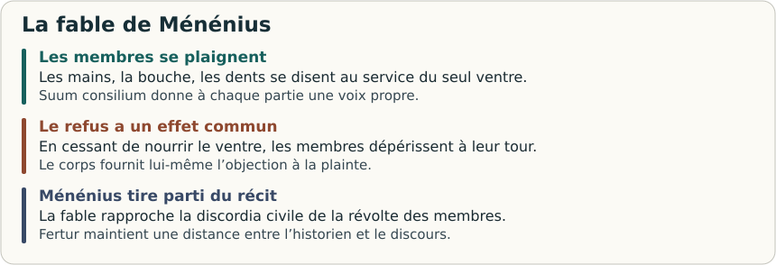
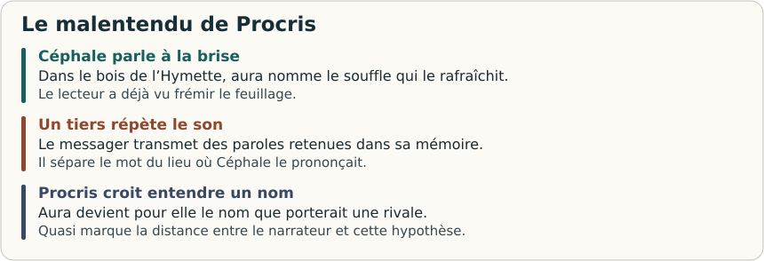
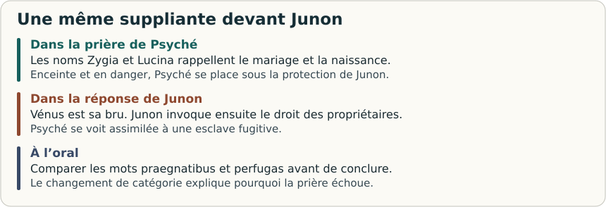

# ENS de Lyon · Latin oral A/L 2017 — Corrigé guidé

*Corrigé rédigé par IA, non officiel. Signalez toute erreur.*

**Rédaction** · GPT-6.2 Astra Ultra · vitesse non renseignée

Le relevé de 2017 recense 54 billets. Il donne les références antiques, parfois jusqu’au vers ou au paragraphe, mais ne reproduit ni les feuillets remis aux candidats ni leurs chapeaux. Les traductions suivent les éditions latines citées à chaque billet. Les compléments nécessaires pour comprendre un début ou une fin de phrase sont indiqués. [Relevé des billets](https://www.ens-lyon.fr/sites/default/files/2017-11/latin-2017_1506588436937.pdf) · [Rapport du jury](https://www.ens-lyon.fr/sites/default/files/2018-03/LATIN_2017.pdf)

Cette livraison présente 29 des 54 billets.

## Préparer l’explication

Le jury attend une brève mise en situation suivie de la lecture et de la traduction. Pour préparer la lecture, encadrer les verbes conjugués, rattacher les sujets et prononcer chaque groupe avec ses dépendances. Devant une question de reprise, nommer la forme qui a entraîné la difficulté et proposer à nouveau la phrase française entière.

Après la traduction, présenter le mouvement du passage, poser une question dont le texte appelle la réponse, puis la soutenir par deux ou trois observations précises. Une série de connecteurs peut signaler une articulation. Il reste à montrer ce qui change dans l’argument, le regard ou la voix.

## Lettres et arts · Lettres modernes et arts

Dans le récit du suicide de Lucrèce, qui prend en charge chaque affirmation ? Distinguer le témoignage du personnage, le jugement de ses proches et ce que l’historien raconte lui-même. Dans la fable de Ménénius, procéder de même avec *fertur*, qui attribue la transmission de la parole à une tradition.

### LA 01 · Sénèque, Les Troyennes, 1137–1152

**Avant de traduire.** Le messager rapporte le sacrifice de Polyxène à la tombe d’Achille. « Utrosque populos » complète « terror attonitos tenet » au vers précédent. L’extrait s’arrête à « truci vultu ferox », avant la suite du récit. Texte de Peiper et Richter, Teubner.

**Traduction proposée**

[La terreur tient frappés de stupeur] les deux peuples. Elle-même garde les yeux baissés par pudeur. Pourtant ses joues rayonnent et, plus qu’à l’ordinaire, sa beauté resplendit à sa dernière heure, comme se fait plus douce la lumière de Phébus tout près de son coucher, lorsque les étoiles reprennent leur tour et que la nuit voisine presse le jour incertain. Toute la foule demeure saisie. Presque tous admirent davantage ce qui va périr. Les uns s’émeuvent de l’éclat de sa beauté, les autres de sa tendre jeunesse, d’autres encore de l’inconstance du sort.

Tous s’émeuvent d’un courage qui va au-devant de la mort. Elle précède Pyrrhus. Tous les cœurs tremblent, ils sont partagés entre admiration et pitié. Dès qu’elle eut atteint le haut de la colline escarpée et que le jeune homme se fut placé au sommet du haut tertre funéraire de son père, la jeune femme, intrépide, ne recula pas d’un pas. Tournée vers le coup qui l’attend, elle se tient droite, le regard farouche.

**Expliquer le passage.** Le public réunit vainqueurs et vaincus dans le même regard. La comparaison solaire ralentit le récit et donne au visage de Polyxène la lumière d’un dernier instant. La reprise de « hos » distribue des réactions individuelles, puis « omnes » les réunit devant son courage. « Pyrrhum antecedit » bouleverse la disposition attendue du cortège. En mettant la captive devant son bourreau, le messager lui rend l’initiative scénique.

**À la reprise.** Qui tremble dans « omnium mentes tremunt » ?

« Omnium » est le génitif pluriel qui détermine « mentes ». Le tremblement gagne les spectateurs. Polyxène demeure maîtresse de sa posture jusque dans le dernier « stat ».

[Texte latin de référence](https://github.com/PerseusDL/canonical-latinLit/blob/master/data/phi1017/phi002/phi1017.phi002.perseus-lat2.xml)

### LA 02 · Stace, Achilléide, I, 567–582

**Avant de traduire.** À Scyros, Achille est dissimulé parmi les filles de Lycomède. Le v. 567 achève la concessive commencée au v. 566. Le v. 582 suspend « perdita dura », dont « pensa manu » au v. 583 complète le sens. Édition de J. H. Mozley.

**Traduction proposée**

[Bien que] tout le groupe s’assemble autour de lui, il tend doucement de nouveaux pièges à celle qui ne soupçonne rien de tel. Il la suit, il la presse sans vergogne, c’est elle que ses yeux retrouvent encore et encore. Tantôt il reste trop près d’elle, qui ne se dérobe pas, tantôt il l’effleure de légères guirlandes, de corbeilles qu’il laisse tomber exprès, ou d’un thyrse qui ménage ses coups. Tantôt il lui montre les douces cordes de sa lyre familière, les airs délicats et les chants de Chiron.

Il guide sa main et ploie ses doigts sur la cithare sonore. Tantôt il interrompt ses lèvres qui chantent, l’entoure de ses bras et mêle mille baisers à ses éloges. Elle apprend volontiers où se dresse la cime du Pélion, qui est le descendant d’Éaque. Au récit du nom et des exploits du jeune homme, son émerveillement se renouvelle. Elle chante Achille, qui est là. Elle lui montre, à son tour, comment mouvoir ses membres robustes avec plus de retenue, comment affiner de son pouce frottant la laine grossière. Elle répare les quenouilles et [le travail] gâté par sa rude [main].

**Expliquer le passage.** Le même enseignement cache deux scènes. Pour Déidamie, il s’agit d’apprendre les chants de Chiron puis de transmettre un savoir textile. Le narrateur fait voir l’insistance d’Achille avec « insidias », « premit », « improbus ». L’asymétrie de l’information interdit de prendre « libens discit » pour une approbation de tous ses gestes. L’ironie culmine dans « praesentem cantat Achillem ». Le nom de l’épopée est déjà sur les lèvres de celle qui ne reconnaît pas son héros.

**À la reprise.** À qui s’applique « libens » et que précise ce mot ?

L’adjectif au nominatif féminin se rapporte à « illa », Déidamie, et porte sur « discit ». Elle se plaît à apprendre les récits concernant Achille.

[Texte latin de référence](https://github.com/PerseusDL/canonical-latinLit/blob/master/data/phi1020/phi003/phi1020.phi003.perseus-lat2.xml)

### LA 03 · Horace, Odes, II, 20, 1–20

**Avant de traduire.** Le « je » du poète s’adresse à Mécène. Les cinq premières strophes vont de « Non usitata » à « Rhodanique potor ». L’ode contient encore une strophe sur les honneurs funèbres, hors extrait. Texte de Shorey et Laing.

**Traduction proposée**

Sur une aile exceptionnelle et vigoureuse, je serai porté, poète à deux formes, à travers l’éther limpide. Je ne m’attarderai plus longtemps sur terre. Plus grand que l’envie, je quitterai les villes. Moi, issu de parents pauvres, moi que tu appelles auprès de toi, cher Mécène, je ne mourrai pas, l’onde du Styx ne me retiendra pas. Déjà, déjà, une peau rugueuse s’établit sur mes jambes. Dans le haut de mon corps, je me change en oiseau blanc.

Un plumage léger naît sur mes doigts et mes épaules. Bientôt, plus célèbre qu’Icare, fils de Dédale, j’irai voir les rivages du Bosphore qui gronde, les Syrtes de Gétulie et les plaines hyperboréennes, oiseau au chant sonore. L’homme de Colchide me connaîtra, ainsi que le Dace qui dissimule sa crainte de la cohorte marse et les Gélons des confins du monde. L’Ibère instruit m’étudiera, et celui qui boit l’eau du Rhône.

**Expliquer le passage.** L’ode passe d’une promesse au futur (« ferar ») aux indices visibles du présent (« nascuntur »). Les plumes partent des doigts et des épaules du poète. « Canorus » conserve à l’oiseau la faculté de l’artiste. La géographie du dernier mouvement devient une carte des réceptions futures lorsque « visam », c’est-à-dire « je verrai », cède la parole aux peuples sujets de « noscent » et « discet ». L’origine modeste citée devant Mécène rend sensible la distance parcourue.

**À la reprise.** Qu’ajoute « discet » au précédent « noscent » ?

« Noscent » promet la renommée. « Discet » évoque aussi l’apprentissage du poème. L’immortalité prend la forme d’une œuvre que d’autres liront et étudieront.

[Texte latin de référence](https://github.com/PerseusDL/canonical-latinLit/blob/master/data/phi0893/phi001/phi0893.phi001.perseus-lat2.xml)

### LA 04 · Salluste, La Conjuration de Catilina, I

**Avant de traduire.** Préface de la monographie historique. Le chapitre entier va de « Omnis homines » à « alterius auxilio eget » dans l’édition d’A. W. Ahlberg. « Omnis » est ici l’ancienne forme de l’accusatif pluriel.

**Traduction proposée**

Il convient à tous les hommes qui s’efforcent de dépasser les autres êtres vivants de tendre toutes leurs forces pour ne pas traverser la vie dans le silence, comme du bétail que la nature a façonné penché vers le sol et soumis à son ventre. Or toute notre puissance réside dans l’esprit et dans le corps. Nous nous servons surtout de l’esprit pour commander, du corps pour servir. Par l’un nous avons quelque chose en commun avec les dieux, par l’autre avec les bêtes.

Aussi me semble-t-il plus juste de chercher la gloire par les ressources de l’intelligence que par celles de la force et, puisque cette vie dont nous jouissons est brève, de prolonger le plus possible la mémoire de nous-mêmes. Car la gloire de la richesse et de la beauté passe et se brise, tandis que le mérite est tenu pour éclatant et éternel. Pourtant les mortels ont longtemps beaucoup discuté pour savoir si le succès à la guerre dépendait davantage de la vigueur du corps ou de la valeur de l’esprit. En effet, avant de commencer, il faut réfléchir, et, la décision prise, agir à temps. Ainsi chacun des deux, insuffisant par lui-même, a besoin de l’aide de l’autre.

**Expliquer le passage.** À l’impersonnel « decet » succède le datif personnel « mihi ». Une prétention universelle devient le choix que l’historien doit justifier en son propre nom. Le contraste très net de l’esprit et du corps se complique à la fin du chapitre. Les deux moments marqués par « prius quam » et « ubi » font apparaître une coopération dans le temps. L’exemple militaire oblige Salluste à penser ensemble la décision et son exécution.

**À la reprise.** Comment traduire « consulto » et « facto » après « opus est » ?

Ces ablatifs de participes parfaits passifs employés substantivement désignent ce dont il est besoin, une délibération puis un acte. Le français peut dire « il faut réfléchir » puis « il faut agir ».

[Texte latin de référence](https://github.com/PerseusDL/canonical-latinLit/blob/master/data/phi0631/phi001/phi0631.phi001.perseus-lat3.xml)

### LA 05 · Cicéron, Les Verrines, seconde action, livre V (Les Supplices), 161–162

**Avant de traduire.** L’accusation contre Verrès reconstitue le supplice public de Gavius à Messine. Bornes « Agit hominibus gratias » et « comparabatur ». Édition de W. Peterson. L’orateur donne alternativement à entendre les propos de la victime et ceux du magistrat.

**Traduction proposée**

Il remercie ces hommes et loue hautement leur bienveillance et leur empressement à son égard. Lui-même, tout brûlant de fureur criminelle, vient au forum. Ses yeux lançaient des flammes, la cruauté se lisait sur tout son visage. Tous attendaient de voir jusqu’où il irait et ce qu’il ferait enfin, quand soudain il ordonne que l’on entraîne cet homme, qu’on le dépouille et l’attache en plein forum, et que l’on apprête les verges. Le malheureux criait qu’il était citoyen romain, originaire du municipe de Consa, qu’il avait servi avec Lucius Raecius, très honorable chevalier romain en affaires à Palerme, auprès de qui Verrès pouvait s’en assurer.

Alors l’autre prétend avoir appris que les chefs des esclaves fugitifs l’avaient envoyé en Sicile comme espion. Il n’existait aucun dénonciateur, aucune trace, et personne n’en avait le moindre soupçon. Puis il ordonne qu’on le frappe de toutes parts avec la dernière violence. On battait de verges, en plein forum de Messine, un citoyen romain, juges. Pourtant, parmi la douleur et le bruit des coups, on n’entendait ni gémissement ni aucune autre parole du malheureux que celle-ci, « Je suis citoyen romain. » Il croyait qu’en rappelant sa citoyenneté il écarterait tous les coups et délivrerait son corps du supplice.

Loin d’obtenir que les verges l’épargnent, chaque fois qu’il invoquait et réclamait encore son titre de citoyen, c’était une croix, oui, une croix, qu’on préparait au malheureux accablé, qui jamais n’avait vu un tel fléau.

**Expliquer le passage.** « Iudices » fait comparaître la scène provinciale devant les juges de Rome. Le forum devrait être le lieu où se fait entendre le droit. La formule « civis Romanus sum » y devient l’unique voix du prisonnier, puis la preuve publique qu’on lui refuse sa protection. La reprise « crux, crux, inquam » dans la bouche de l’accusateur répond à la répétition du titre par la victime. Le retour aux imparfaits prolonge l’attente et isole le scandale juridique.

**À la reprise.** Comment distinguer les deux voix dans « se civem esse Romanum » et « se comperisse » ?

Le premier « se » renvoie au sujet de « clamabat », Gavius. Le second est repris dans les propos de « iste », Verrès, dont le verbe déclaratif est sous-entendu.

[Texte latin de référence](https://github.com/PerseusDL/canonical-latinLit/blob/master/data/phi0474/phi005/phi0474.phi005.perseus-lat2.xml)

### LA 06 · Virgile, Énéide, VI, 724–738

**Avant de traduire.** Aux Enfers, Anchise expose à Énée le lien entre le monde vivant et les âmes humaines. De « Principio caelum » à « modis inolescere miris », texte de J. B. Greenough.

**Traduction proposée**

Tout d’abord le ciel, la terre, les plaines liquides, le globe lumineux de la Lune et les astres de Titan, un souffle les nourrit du dedans. Répandu dans leurs membres, un esprit anime la masse entière et se mêle à ce grand corps. De là viennent la race humaine et celle des troupeaux, la vie des oiseaux et les êtres prodigieux que la mer porte sous sa surface de marbre. Ces germes ont une vigueur de feu et une origine céleste, dans la mesure où les corps qui leur nuisent ne les retardent pas, où les membres terrestres, les organes voués à la mort ne les émoussent pas.

De là les craintes et les désirs des âmes, leurs peines et leurs joies. Elles ne distinguent plus la lumière du ciel, enfermées dans les ténèbres d’une prison aveugle. Même lorsque, au dernier jour, la vie les a quittées, tout leur mal ne quitte pourtant pas ces malheureuses et toutes les souillures du corps ne s’en vont pas jusqu’à la racine. Bien des maux longtemps durcis ensemble doivent avoir pris pied au-dedans d’elles de façon étonnante.

**Expliquer le passage.** Les accusatifs des v. 724–725 font attendre le sujet « spiritus ». La syntaxe fait éprouver l’unité derrière la diversité des régions du monde. « Corpus » change ensuite d’échelle et de valeur. Le corps du monde reçoit un principe de vie, les corps mortels entravent les âmes. Les quatre verbes brefs du v. 733 distribuent les affects par couples. « Quin et » prolonge la difficulté au-delà de la mort et prépare la suite de l’enseignement d’Anchise.

**À la reprise.** À quoi se rapporte le féminin « clausae » au v. 734 ?

Il se rapporte aux âmes, sujet sous-entendu du passage. Le féminin fait passer des « semina », neutres, aux âmes singulières qui éprouvent des passions.

[Texte latin de référence](https://github.com/PerseusDL/canonical-latinLit/blob/master/data/phi0690/phi003/phi0690.phi003.perseus-lat2.xml)

### LA 07 · Pline le Jeune, Lettres, VII, 1

**Avant de traduire.** Lettre à Geminus. Le relevé cite toute la lettre, sans préciser le découpage distribué. Ses sept paragraphes dépassent sensiblement le calibre moyen d’environ 130 mots indiqué par le jury. Traduction de la lettre entière, de « Terret me » à « Vale », d’après le texte latin Perseus.

**Traduction proposée**

Pline salue son cher Geminus. Cette maladie si tenace qui t’afflige m’effraie. Je te sais fort maître de toi. Je crains pourtant qu’elle n’ait quelque pouvoir jusque sur ton caractère. Aussi je te conseille de résister avec patience. C’est à la fois honorable et salutaire. La nature humaine est capable de ce que je conseille. Moi, du moins, quand je suis en bonne santé, voici ce que j’ai coutume de dire aux miens. « J’espère que, si je tombe malade, je ne désirerai rien dont je doive rougir ou me repentir.

Si pourtant la maladie l’emporte, je vous préviens, ne me donnez rien sans l’autorisation des médecins. Sachez que si vous me le donnez, je vous en tiendrai rigueur comme d’autres le font de ce qu’on leur refuse. » Un jour même, après avoir brûlé d’une fièvre très vive, enfin soulagé et frotté d’huile, je recevais du médecin une boisson. J’ai tendu la main et lui ai demandé de la toucher. La coupe déjà à mes lèvres, je la lui ai rendue. Plus tard, le vingtième jour de ma maladie, on me préparait au bain.

Voyant soudain les médecins parler à mi-voix, j’en demandai la raison. Ils répondirent que je pouvais me baigner en sécurité, avec toutefois un dernier motif d’inquiétude. « Quelle nécessité y a-t-il donc ? », dis-je. Ainsi, renonçant paisiblement, sans effort, à l’espoir de ce bain où je me croyais déjà porté, je disposai de nouveau mon esprit et mon visage à m’en abstenir, comme je venais de les disposer au bain. Je t’ai écrit cela d’abord pour appuyer mon conseil sur un exemple, ensuite pour m’astreindre moi-même, à l’avenir, à la même maîtrise, puisque par cette lettre je me suis lié comme par un gage. Porte-toi bien.

**Expliquer le passage.** L’épistolier prend à témoin sa maisonnée, puis reproduit une question de quatre mots qui suffit à changer le cours de la scène du bain. Le mot « vultum » montre que sa discipline atteint jusqu’au visage présenté à ses proches. Dans la dernière phrase, « primum » et « deinde » distinguent deux effets du conseil. L’ami reçoit un exemple et l’auteur se donne un témoin auquel il devra répondre de sa propre conduite.

**À la reprise.** Qui contracte une obligation dans « me hac epistula quasi pignore obligavissem » ?

Pline se lie lui-même. Le réfléchi « me » renvoie à l’auteur, et l’ablatif compare la lettre à un gage déposé auprès de Geminus.

[Texte latin de référence](https://github.com/PerseusDL/canonical-latinLit/blob/master/data/phi1318/phi001/phi1318.phi001.perseus-lat1.xml)

### LA 08 · Sénèque, De la colère, II, 3, 1–4

**Avant de traduire.** Le livre II examine la naissance de la colère. De « Nihil ex his » à « quae secum rapit ». Au § 2, le latin de l’imprimé de J. W. Basore, p. 172, donne « umoris obsceni », la transcription numérique « umeris » est fautive.

**Traduction proposée**

Aucune des choses qui ébranlent fortuitement l’esprit ne doit être appelée passion. L’esprit, pour ainsi dire, les subit plus qu’il ne les produit. La passion consiste donc, au-delà de l’émotion devant les représentations qui se présentent à nous, à s’y abandonner et à prolonger ce mouvement fortuit. Si l’on prend la pâleur, les larmes qui jaillissent, une réaction sexuelle du corps, un profond soupir, un regard soudain plus vif ou quelque phénomène semblable pour l’indice d’une passion, pour le signe d’un état de l’âme, on se trompe.

On ne comprend pas que ce sont là des mouvements du corps. Aussi arrive-t-il au plus brave de pâlir quand il s’arme, au plus ardent soldat d’avoir les genoux un peu tremblants au signal du combat, à un grand général de sentir son cœur bondir avant la rencontre des armées, à l’orateur le plus éloquent d’avoir les extrémités raidies lorsqu’il se prépare à parler. Pour qu’il y ait colère, il faut que le mouvement prenne son élan, car elle est une impulsion.

Or il n’y a jamais d’impulsion sans assentiment de l’esprit. On ne saurait envisager vengeance et punition à l’insu de son propre esprit. Quelqu’un s’est cru offensé, a voulu se venger. Une raison l’en détourne et il se calme aussitôt. Je donne à cela le nom de mouvement de l’âme obéissant à la raison. J’appelle colère celle qui passe par-dessus la raison et l’emporte avec elle.

**Expliquer le passage.** « Patitur » et « facit » distinguent deux manières d’être engagé dans une émotion. La série d’exemples s’achève sur l’orateur, dont le trouble est perceptible à un public romain. L’argument porte sur le statut de ces signes visibles. Une réaction peut survenir à l’insu de l’intéressé, tandis que céder à la colère suppose un assentiment. Au § 4, trois parfaits (« putavit », « voluit », « resedit ») isolent les étapes d’un cas où la raison retrouve prise.

**À la reprise.** Pourquoi « motum animi rationi parentem » prend-il l’accusatif ?

C’est l’attribut de l’objet du verbe « voco » sous-entendu dans la seconde formulation du jugement. « Parentem » vient de « parere », obéir, qui régit le datif « rationi ».

[Texte latin de référence](https://ryanfb.xyz/loebolus-data/L214.pdf)

### LA 09 · Ovide, Métamorphoses, XI, 50–65

**Avant de traduire.** Après la mort d’Orphée, le poème suit d’abord sa lyre et sa tête, puis son ombre. Édition de H. Magnus. Le v. 65 se ferme sur « praevius anteit ». Le regard en arrière désormais permis appartient au v. 66, au-delà du billet.

**Traduction proposée**

Les membres d’Orphée reposent en des lieux différents. Toi, Hèbre, tu recueilles sa tête et sa lyre. Et, merveille, tandis qu’elle descend au fil du fleuve, la lyre exhale je ne sais quelle plainte, la langue sans vie murmure une plainte, les rives répondent par une plainte. Déjà portées dans la mer, elles quittent le fleuve de leur pays et atteignent le rivage de Lesbos, terre de Méthymne. Là, un serpent sauvage s’en prend au visage déposé sur le sable étranger, aux cheveux mouillés de gouttes.

Enfin Phébus paraît. Il écarte le serpent prêt à mordre, fige dans la pierre sa gueule ouverte et durcit ses mâchoires béantes dans la position même où elles étaient. L’ombre descend sous terre. Elle reconnaît tous les lieux qu’elle avait vus autrefois. Cherchant à travers les campagnes des bienheureux, elle retrouve Eurydice et la serre dans ses bras avides. Là, tantôt ils se promènent tous deux d’un même pas, tantôt il la suit tandis qu’elle le précède, tantôt il passe devant et ouvre la marche.

**Expliquer le passage.** « Flebile » revient trois fois. L’instrument, la langue d’Orphée et les berges produisent tour à tour un son apparenté, même après la disparition du chanteur. La pétrification du serpent suspend un geste sur le point de s’accomplir. Aux Enfers, au contraire, les formes « modo », « nunc », « nunc » laissent varier les pas du couple. La première descente imposait une place à chacun. Cette promenade rend aux deux ombres la liberté de la marche.

**À la reprise.** Dans « flebile nescio quid queritur lyra », quelle réalité « nescio quid » désigne-t-il ?

Ce pronom indéfini neutre, déterminé par « flebile », est l’objet du déponent « queritur ». Le narrateur entend une plainte dont il renonce à distinguer les mots.

[Texte latin de référence](https://github.com/PerseusDL/canonical-latinLit/blob/master/data/phi0959/phi006/phi0959.phi006.perseus-lat2.xml)

### LA 10 · Tite-Live, Histoire romaine, I, 58, 6–12

**Avant de traduire.** Lucrèce convoque son père et son mari après le viol commis par Sextus Tarquin. Bornes « Sp. Lucretius » et « conclamat vir paterque », édition de Conway et Walters. Le § 11 est rendu sans le détail du geste mortel.

**Traduction proposée**

Spurius Lucretius vient avec Publius Valerius, fils de Volesus, et Collatin avec Lucius Junius Brutus. C’est avec ce dernier, alors qu’il revenait à Rome, que le messager de sa femme l’avait rencontré. Ils trouvent Lucrèce assise, affligée, dans sa chambre. À l’arrivée des siens, les larmes jaillissent. À son mari qui lui demande si tout va bien, elle répond « Nullement. Que peut-il rester de sauf à une femme dont la pudeur a été outragée ? Il y a, Collatin, des traces d’un autre homme dans ton lit.

Mon corps seul a subi la violence. Mon esprit est innocent. Ma mort en témoignera. Mais donnez-moi la main et engagez-vous à ce que le coupable ne demeure pas impuni. C’est Sextus Tarquin. La nuit dernière, venu en ennemi au lieu d’un hôte, il a, par la force, les armes à la main, emporté d’ici une jouissance qui me sera fatale et qui, si vous êtes des hommes, le sera pour lui aussi. » Tous donnent tour à tour leur parole. Ils cherchent à consoler son esprit souffrant en reportant la faute de la victime contrainte sur l’auteur du crime.

C’est l’intention qui pèche, disent-ils, et là où la volonté a manqué, la faute est absente. « À vous de voir, répond-elle, ce qui lui est dû. Pour moi, si je me déclare exempte de faute, je ne me soustrais pas au châtiment. Aucune femme après moi ne se prévaudra, pour vivre dans le déshonneur, de l’exemple de Lucrèce. » Lucrèce se donne alors la mort et s’effondre. Son mari et son père poussent un cri.

**Expliquer le passage.** Tite-Live fait passer l’événement de la chambre familiale à l’histoire politique de Rome. Brutus, nommé avant même que Lucrèce parle, reprendra la parole après le cri final. L’opposition « hostis pro hospite » transforme le fils du roi en ennemi d’une maison qui lui avait accordé l’hospitalité. Les proches désignent l’agresseur comme seul coupable. Lucrèce évoque pour sa part « l’exemple » dont d’autres pourraient se prévaloir. Cette contrainte sociale explique l’écart douloureux entre son innocence, que tous reconnaissent, et le sort qu’elle se croit tenue de subir.

**À la reprise.** Comment le récit prépare-t-il le passage du deuil domestique à la fin de la royauté ?

La promesse collective demandée et reçue engage déjà d’autres personnes que le couple. La présence de Brutus relie cette scène à l’expulsion des Tarquins que raconte la suite du livre.

[Texte latin de référence](https://github.com/PerseusDL/canonical-latinLit/blob/master/data/phi0914/phi001/phi0914.phi001.perseus-lat3.xml)

### LA 11 · Ovide, Tristes, III, 3, 37–52

**Avant de traduire.** Malade en exil à Tomes, Ovide s’adresse à son épouse restée à Rome. Le billet commence sur « tam procul » et se ferme sur « raptus ero ». Texte d’A. L. Wheeler. Les vers imaginent une mort à venir.

**Traduction proposée**

Ainsi donc, si loin, sur des rivages inconnus, je mourrai, et le lieu même rendra mon destin douloureux. Mon corps ne languira pas dans le lit qui m’était familier. Quand on m’aura déposé, personne ne sera là pour me pleurer. Les larmes de ma bien-aimée ne tomberont pas sur mon visage pour ajouter à ma vie quelques courts instants. Je ne donnerai pas mes dernières volontés. Nulle main amie, au dernier appel, ne fermera mes yeux défaillants. Mais sans funérailles, sans l’honneur d’un tombeau, sans que personne l’ait pleuré, ma tête sera recouverte d’une terre étrangère !

Dis-moi, quand tu l’apprendras, en seras-tu bouleversée de toute ton âme ? Ta main tremblante frappera-t-elle ta fidèle poitrine ? Tendras-tu vainement les bras de ce côté-ci, appelleras-tu le nom désormais vide de ton malheureux époux ? Épargne pourtant tes joues et ta chevelure dans ton deuil. Ce ne sera pas, ma lumière, la première fois que je t’aurai été enlevé.

**Expliquer le passage.** La succession de « nec » retranche au mourant les gestes d’une mort entourée. L’épouse, absente comme présence physique, occupe soudain la scène au v. 47 grâce aux questions en « ecquid ». Ses bras tendus mesurent la distance entre Rome et l’exil. Le futur antérieur final « raptus ero » ménage un retour sur l’événement antérieur, le départ forcé. La mort imaginée répéterait la séparation déjà vécue.

**À la reprise.** À quel rite « cum clamore supremo » fait-il allusion ?

Au dernier appel adressé au mourant ou au mort. Ovide l’associe au geste de la main qui ferme les yeux pour faire sentir l’absence des proches.

[Texte latin de référence](https://github.com/PerseusDL/canonical-latinLit/blob/master/data/phi0959/phi008/phi0959.phi008.perseus-lat2.xml)

### LA 12 · Properce, Élégies, I, 2, 1–16

**Avant de traduire.** Dans cette élégie, le poète s’adresse à Cynthie. De « Quid iuvat » au second exemple des filles de Leucippe, « Helaira soror ». Le catalogue mythologique continue après le v. 16. Édition de L. Müller.

**Traduction proposée**

À quoi bon, ma vie, sortir les cheveux apprêtés et faire ondoyer les plis légers d’une étoffe de Cos ? À quoi bon baigner tes cheveux de la myrrhe de l’Oronte, te faire valoir par des présents venus d’ailleurs, gâter l’éclat de la nature par une parure achetée et empêcher ton corps de briller de ses propres avantages ? Crois-moi, ta beauté ne réclame aucun apprêt. Amour va nu et n’aime pas une beauté fabriquée. Regarde les couleurs que fait surgir la terre sans avoir été bêchée, comme le lierre vient mieux de lui-même, comme l’arbousier pousse plus beau dans les grottes solitaires, comme l’eau sait courir son chemin sans maître.

Les rivages brillent, parés des galets qui y sont nés, et les oiseaux chantent plus doucement sans aucun art. Ce n’est pas ainsi que Phébé, fille de Leucippe, enflamma Castor, ni par sa parure que sa sœur Hilaïra enflamma Pollux.

**Expliquer le passage.** Les provenances de Cos et de l’Oronte font de la toilette une circulation d’objets coûteux. « Mercato » appuie l’argument du prix. Au « quid iuvat » succède un « aspice » qui semble laisser la femme juger elle-même. Mais le poète choisit le paysage, dispose ses détails et fait même parler l’eau à travers « sciat ». Les vers très travaillés qui louent une beauté sans art autorisent à entendre la tension entre la thèse de l’amant et sa pratique de poète.

**À la reprise.** Pourquoi « indocilis » ne signifie-t-il pas ici que l’eau est maladroite ?

« Sciat » lui attribue au contraire un savoir. « Indocilis » fait songer à ce qui n’a pas reçu d’enseignement et sait pourtant se frayer un chemin.

[Texte latin de référence](https://github.com/PerseusDL/canonical-latinLit/blob/master/data/phi0620/phi001/phi0620.phi001.perseus-lat3.xml)

### LA 13 · Cicéron, Des devoirs, I, 128–129

**Avant de traduire.** Cicéron examine le « decorum », convenance perceptible dans les paroles et le maintien. De « Nec vero audiendi » à « magistra et duce ». Texte de W. Miller.

**Traduction proposée**

Il n’y a pas lieu d’écouter les cyniques, ni ceux des stoïciens, s’il y en eut, qui furent presque des cyniques. Ils nous blâment et se moquent de nous parce que nous estimons scandaleux de nommer certaines choses qui n’ont rien de honteux en elles-mêmes, alors que nous donnons leur propre nom à des actions honteuses. Piller, tromper, commettre l’adultère sont des actes honteux, mais leurs noms n’ont rien d’obscène. Travailler à avoir des enfants est en soi honorable, mais l’expression directe en paraît obscène.

Ils développent quantité d’autres raisonnements semblables contre la pudeur. Pour nous, suivons la nature et tenons-nous à distance de ce qui heurte le jugement des yeux ou des oreilles. Que cette convenance règle notre façon de nous tenir debout, de marcher, de nous asseoir et de nous étendre à table, notre visage, nos yeux et les mouvements de nos mains. Dans tout cela, il faut surtout éviter deux excès, ce qui passe pour efféminé ou sans vigueur et ce qui paraît rude ou grossier.

Gardons-nous de réserver aux acteurs et aux orateurs le souci d’un maintien approprié, tout en permettant le laisser-aller chez nous. La discipline ancienne des gens de théâtre inspire à leur métier tant de réserve que personne ne paraît en scène sans porter un vêtement de dessous. Ils craignent que, si le hasard découvre quelque partie du corps, elle ne soit vue d’une manière inconvenante. Chez nous, selon l’usage, les fils pubères ne se baignent pas avec leurs pères, ni les gendres avec leurs beaux-pères. Il faut donc conserver cette réserve, surtout quand la nature elle-même nous instruit et nous guide.

**Expliquer le passage.** Les cyniques dissocient la valeur de l’acte, « re », et celle du mot, « nomine ». Cicéron répond en déplaçant l’attention vers les sens du public, puis vers les usages de différents groupes. Théâtre et bains familiaux font ainsi entrer les manières romaines dans sa démonstration. Le retour de « natura » à la fin invite à se demander comment le philosophe peut en faire la maîtresse de comportements qu’il décrit aussi comme des coutumes héritées, « vetere disciplina », « nostro more ».

**À la reprise.** Quelle valeur prend le subjonctif dans « nos autem naturam sequamur » ?

C’est un subjonctif d’exhortation à la première personne du pluriel. Par « nos », l’auteur associe son destinataire au choix qu’il oppose à celui de ses adversaires.

[Texte latin de référence](https://github.com/PerseusDL/canonical-latinLit/blob/master/data/phi0474/phi055/phi0474.phi055.perseus-lat2.xml)

### LA 14 · Ovide, Remèdes à l’amour, 325–339

**Avant de traduire.** Le professeur fictif prétend apprendre à son élève comment se déprendre d’un amour. De « Qua potes » à « quod rideat, illi ». Le sujet s’arrête au premier vers du dernier distique commencé. Texte de R. Ehwald.

**Traduction proposée**

Partout où tu le peux, tourne à son désavantage les qualités de la jeune femme, et abuse ton jugement en lui faisant franchir une frontière bien mince. Qu’on l’appelle gonflée si elle est bien en chair, noire si elle a le teint brun. Chez la femme élancée, on peut faire de la maigreur un grief. Celle qui a de l’aisance pourra passer pour effrontée, et celle qui a de la réserve pourra passer pour mal dégrossie. Bien plus, de quelque talent que ta compagne soit dépourvue, prie-la sans relâche, d’une voix flatteuse, de le mettre en œuvre.

Exige qu’elle chante, si c’est une jeune femme sans voix. Fais-la danser si elle ne sait pas mouvoir la main. Sa parole te semble grossière ? Fais-la parler longuement avec toi. Elle n’a pas appris à jouer des cordes ? Réclame une lyre. Sa démarche manque de souplesse ? Fais-la marcher. Ses seins occupent toute sa poitrine ? Qu’aucun bandeau ne dissimule ce que tu appelles son défaut. Si elle a les dents mal rangées, raconte-lui de quoi la faire rire.

**Expliquer le passage.** « Falle tuum » situe l’expérience dans le jugement de l’amant. L’énumération qui suit montre un maître capable d’attribuer successivement à des manières opposées deux étiquettes également défavorables. Aux adjectifs de la première partie succèdent de petites scènes fabriquées par les impératifs. La lyre réclamée à une musicienne inexpérimentée dévoile le parti pris de celui qui organise l’épreuve. Le billet éclaire ainsi la fabrication du regard dépréciatif et le prix que le personnage féminin en paie.

**À la reprise.** Que désigne « hanc » dans « hanc moveat » ?

Il reprend « dote », le talent qui manque à la femme. Le maître lui fait précisément réclamer la démonstration d’une aptitude qu’elle ne possède pas.

[Texte latin de référence](https://github.com/PerseusDL/canonical-latinLit/blob/master/data/phi0959/phi005/phi0959.phi005.perseus-lat2.xml)

### LA 15 · Tite-Live, Histoire romaine, II, 32, 8–12

**Avant de traduire.** Lors de la première sécession de la plèbe, les sénateurs envoient Ménénius Agrippa auprès des plébéiens. De « placuit igitur » à « flexisse mentes hominum ». Édition de Conway et Walters.

**Traduction proposée**

On décida donc d’envoyer à la plèbe comme porte-parole Ménénius Agrippa, homme éloquent et cher aux plébéiens, dont il était issu. Introduit dans le camp, il leur conta, dit-on, avec cette vieille manière de parler sans apprêt, la seule histoire que voici. À l’époque où, dans le corps humain, tout ne concourait pas comme aujourd’hui à une même fin, mais où chaque membre avait son avis et sa parole à lui, les autres parties s’indignèrent. Leurs soins, leur labeur et leurs services procuraient tout au ventre, alors que le ventre, tranquille au milieu, jouissait simplement des plaisirs qu’on lui donnait.

Elles se concertèrent donc pour que les mains ne portent plus la nourriture à la bouche, que la bouche ne reçoive plus ce qu’on lui présentait et que les dents ne broient plus ce qu’elles recevaient. Sous l’effet de cette colère, tandis qu’ils voulaient dompter le ventre par la faim, les membres eux-mêmes et le corps tout entier en furent réduits ensemble à un épuisement extrême. Alors apparut que le ventre, lui aussi, accomplissait un service bien actif.

Il nourrissait autant qu’il était nourri, restituant à toutes les parties du corps le sang qui nous fait vivre et nous donne de la vigueur. Ce sang, mûri par la digestion des aliments, se répartissait également dans les veines. En rapprochant cette révolte intérieure du corps de la colère de la plèbe contre les sénateurs, Ménénius aurait infléchi les esprits.

**Expliquer le passage.** « Fertur » avertit de la distance prise par l’historien avec les paroles prêtées à Ménénius. « Suum cuique consilium, suus sermo » fait d’abord du corps une assemblée de membres capables de jugement. Le recours à la faim produit une expérience dont ils éprouvent eux-mêmes les effets. Le rapprochement final dépend pourtant d’une prémisse politique qui peut se discuter. Le service rendu par le ventre prouverait que les sénateurs nourrissent la cité. La suite du récit donne aussi une garantie institutionnelle aux plébéiens, le tribunat.

**À la reprise.** De quel verbe dépendent « indignatas », « conspirasse » et « apparuisse » ?

Ces formes relaient le récit indirect introduit par « narrasse fertur ». Il faut sous-entendre « esse » avec « indignatas ». Le français peut ouvrir un récit autonome après avoir signalé cette médiation.

[Texte latin de référence](https://github.com/PerseusDL/canonical-latinLit/blob/master/data/phi0914/phi001/phi0914.phi001.perseus-lat3.xml)

## Lettres et arts · Lettres classiques

Pour le livre III de l’*Art d’aimer*, identifier à chaque billet le destinataire du conseil et l’exemple qui en change la portée. Pour Apulée, écrire dans la marge qui parle et en quelle qualité. Les noms de parenté, les institutions romaines et une formule de prière suffisent souvent à déplacer le registre.

### LC 01 · Ovide, L’Art d’aimer, III, 7–43

**Avant de traduire.** Le vers 43 appartient aussi au billet suivant. À la première borne, l’injonction dont Vénus est le sujet attend encore son verbe au vers 44.

**Traduction proposée**

Un homme entre mille dira peut-être « Pourquoi ajoutes-tu du venin aux serpents et livres-tu le bercail à une louve enragée ? » Gardez-vous d’étendre à toutes la faute de quelques-unes. Qu’on juge chaque femme sur ce qu’elle mérite. Si le plus jeune des Atrides a de quoi accuser Hélène, et l’aîné sa sœur, si le fils d’Oïclès, par le crime d’Ériphyle, fille de Talaos, descendit vivant au Styx sur son char aux chevaux vivants, Pénélope reste fidèle à un mari qui mena dix ans la guerre et erra dix autres années.

Regarde le descendant de Phylacos et celle qui, dit-on, accompagna son mari et mourut avant son heure. L’épouse de Pagases racheta la vie du fils de Phérès. À la place de son mari, c’est sa femme qui fut portée à ses funérailles. « Accueille-moi, Capanée, nos cendres se mêleront », dit la fille d’Iphis, qui le rejoignit dans les flammes. Vertu elle-même a le costume et le nom d’une femme. Rien d’étonnant qu’elle plaise aux siennes. Notre art pourtant n’exige pas de telles âmes.

De moindres voiles conviennent à ma barque. Chez moi on n’apprend que les jeux de l’amour. J’enseignerai comment une femme peut se faire aimer. Une femme peut aussi peu écarter les flammes et les arcs cruels. Ces traits, je le vois, blessent moins les hommes. Les hommes trompent souvent, les tendres femmes rarement. Cherchez, vous leur trouverez peu de perfidies. Le trompeur Jason abandonna la fille du Phase, déjà mère. Une autre épouse se blottit dans les bras du fils d’Éson.

Thésée, s’il n’avait tenu qu’à toi, comme Ariane, abandonnée seule en terre inconnue, aurait repu les oiseaux marins ! Demande pourquoi une seule route porte le nom de « Neuf Chemins » et apprends que les arbres, dépouillant leur chevelure, pleurèrent Phyllis. Et pourtant il passe pour pieux, cet hôte qui te fournit, Élissa, et la cause de ta mort et l’épée. Vous dirai-je ce qui vous a perdues ? Vous ne saviez pas aimer. L’art vous a manqué. L’art fait durer l’amour. Aujourd’hui encore elles ne sauraient pas, mais la déesse de Cythère m’a ordonné de les instruire…

**Expliquer le passage.** Quel maître le plaidoyer fait-il apparaître ? Le procès imaginaire commence sur une objection anticipée au parfait à valeur potentielle, *dixerit*. Ovide répond par une série de précédents qui rétablissent la contradiction, puis il se dérobe à ses propres exemples. Sa petite barque suffit à jouer avec l’élégie, alors que les héroïnes empruntées à l’épopée et à la tragédie meurent. L’*ars* revendiquée à la fin suscite donc autant de curiosité que de doute.

**À la reprise.** À quoi sert la répétition de *vivus* et *vivis* ?

Elle rend sensible l’exception prodigieuse d’Amphiaraos, entraîné sous terre vivant avec ses chevaux. On mesure le poids du grief avant les contre-exemples.

[Texte latin de référence](https://github.com/PerseusDL/canonical-latinLit/blob/master/data/phi0959/phi004/phi0959.phi004.perseus-lat2.xml)

### LC 02 · Ovide, L’Art d’aimer, III, 43–80

**Avant de traduire.** *Me Cytherea docere / iussit* fait apparaître Vénus dans une proposition qui enjambe le premier distique.

**Traduction proposée**

Aujourd’hui encore elles ne sauraient pas, mais la déesse de Cythère m’a ordonné de les instruire et s’est présentée elle-même à mes yeux. « Qu’ont-elles fait pour mériter ce sort, ces malheureuses ? Une foule sans armes est livrée à des hommes armés. Deux petits livres ont fait d’eux des maîtres. Il faut que tes leçons instruisent aussi l’autre camp. Celui qui avait médit de l’épouse de Thérapné chanta bientôt ses louanges sur une lyre plus heureuse.

Si je te connais bien, ménage les femmes cultivées ! Tu dois chercher leur faveur tant que tu vivras. » Elle dit et, prenant du myrte dont elle avait ceint ses cheveux, me donna une feuille et quelques baies. En les recevant je sentis aussi sa puissance. Le ciel brilla plus pur et toute ma poitrine fut soulagée de son fardeau. Pendant qu’elle me donne l’inspiration, venez donc chercher ici des leçons, femmes que la pudeur, les lois et votre condition autorisent à le faire.

Songez dès aujourd’hui à la vieillesse qui viendra. Ainsi aucune heure pour vous ne passera oisive. Tant que vous le pouvez, tant que vos années sont encore au printemps, jouez. Les années s’en vont comme l’eau qui coule. La vague passée ne reviendra plus à l’appel, l’heure passée ne peut plus revenir. Il faut profiter de la jeunesse. Le temps s’échappe d’un pied rapide, et la période suivante n’a pas les mêmes charmes que la première. Ces buissons qui blanchissent, je les ai vus parterres de violettes.

Cette épine m’a donné une couronne que j’aimais. Un temps viendra où toi qui maintenant fermes ta porte aux amants, tu passeras, vieille et transie, la nuit dans la solitude. Une querelle nocturne n’ébranlera plus ta porte, et au matin tu ne trouveras plus de roses éparses sur le seuil. Comme les corps, hélas, se relâchent vite sous les rides ! Le teint d’un visage éclatant disparaît. Ces cheveux blancs que tu jures avoir depuis ta jeunesse se répandront soudain sur toute ta tête.

Les serpents quittent la vieillesse avec leur mince peau et les bois qu’ils perdent ne vieillissent pas les cerfs. Nos avantages, eux, s’enfuient sans recours. Cueillez la fleur, car si on ne la cueille pas, elle tombera d’elle-même, perdant son éclat.

**Expliquer le passage.** Pourquoi faire parler une déesse avant d’évoquer le seuil vide ? Le déséquilibre entre les sexes vient d’abord des livres mêmes du poète. Vénus lui commande une réparation en convoquant Stésichore, qui revint sur sa condamnation d’Hélène. Le myrte rend la vocation visible. Le maître passe ensuite du pluriel au singulier *tu* et transporte l’auditrice devant sa propre porte, naguère fleurie par les amants. L’avenir imaginaire fait pression sur le présent.

**À la reprise.** Quel changement produit le passage de *puellae* à *nostra bona* ?

Le poète avait adressé son avertissement à des femmes. Avec « nos avantages », il s’inclut dans la condition humaine qu’il oppose à la mue des serpents.

[Texte latin de référence](https://github.com/PerseusDL/canonical-latinLit/blob/master/data/phi0959/phi004/phi0959.phi004.perseus-lat2.xml)

### LC 03 · Ovide, L’Art d’aimer, III, 99–136

**Avant de traduire.** Le vent léger du port ouvre la leçon sur le *cultus*. Le miroir clôt le passage.

**Traduction proposée**

Avant que j’aille affronter le souffle d’un vent plus fort, qu’une légère brise me porte tant que je suis au port. Je commence par le soin. Bacchus vient bien de raisins cultivés et la moisson se dresse haute sur un sol cultivé. La beauté est un don divin. Combien peu peuvent s’en enorgueillir ! Beaucoup d’entre vous en sont privées. Le soin donnera un beau visage. Un visage négligé perdra sa beauté, ressemblerait-il à celui de la déesse d’Idalie.

Si les femmes d’autrefois ne soignaient pas tant leur corps, les hommes de leur temps étaient tout aussi peu raffinés. Si Andromaque portait des tuniques solides, quoi d’étonnant ? Elle était la femme d’un rude guerrier. Allais-tu vraiment te présenter parée, pour être la femme d’Ajax, lui qui avait pour couverture sept peaux de bœufs ? Autrefois régnait une simplicité sans apprêt. Aujourd’hui Rome est d’or et possède les immenses richesses du monde soumis.

Regarde le Capitole présent, puis celui de jadis. Tu diras que l’ancien était celui d’un autre Jupiter. La curie, si digne aujourd’hui de cette grande assemblée, était en chaume quand régnait Tatius. Ce Palatin qui resplendit à présent sous Phébus et sous nos princes, qu’était-il sinon un pâturage pour les bœufs de labour ? À d’autres le goût de l’ancien. Moi, je me félicite d’être né aujourd’hui. Cette époque s’accorde à mes mœurs. Est-ce parce qu’on retire du sol l’or malléable, que les coquillages nous viennent de lointains rivages, que les montagnes s’abaissent à mesure qu’on en extrait le marbre ou que les digues repoussent la mer bleue ?

C’est que le raffinement existe et que la rusticité, qui avait survécu à nos premiers aïeux, ne s’est pas maintenue jusqu’à nous. Vous non plus, ne chargez pas vos oreilles des pierres précieuses que l’Indien au teint sombre ramasse dans l’eau verte. Ne paraissez pas alourdies de vêtements brodés d’or. Les richesses par lesquelles vous cherchez à nous attirer nous font souvent fuir. La netteté nous charme. Que les cheveux aient leur ordre. Selon la manière dont elles travaillent, les mains donnent ou retirent la beauté. Il existe plus d’une parure. Que chacune choisisse ce qui lui ira et consulte d’abord son miroir.

**Expliquer le passage.** Qu’apprend Rome à celle qui regarde son miroir ? La répétition de *cultis*, *culto*, *cultu* fait passer de la vigne et du champ à la culture de soi. La promenade imaginaire au Capitole donne une histoire monumentale à un choix de coiffure. Le maître réserve pourtant son assentiment. Les négations des vers 123–126 retardent le véritable motif du présent préféré. La dernière injonction restitue une part de jugement à chaque destinataire.

**À la reprise.** Qui est *Liber* au vers 101 ?

C’est Bacchus. Son nom désigne ici le produit de la vigne. La métonymie ancre *cultus* dans le travail agricole avant son emploi social.

[Texte latin de référence](https://github.com/PerseusDL/canonical-latinLit/blob/master/data/phi0959/phi004/phi0959.phi004.perseus-lat2.xml)

### LC 04 · Ovide, L’Art d’aimer, III, 209–244

**Avant de traduire.** Des boîtes sur la table au sanctuaire de la Bonne Déesse, le texte règle les conditions de visibilité du travail.

**Traduction proposée**

Que l’amant pourtant ne surprenne pas tes boîtes étalées sur la table. L’art embellit le visage quand il se dissimule. Qui ne serait rebuté par la lie étendue sur tout le visage lorsque, entraînée par son poids, elle coule sur la gorge tiède ? Quelle odeur a le suint, quand bien même on ferait venir d’Athènes cette substance tirée d’une toison de brebis malpropre ! Je ne recommanderais pas de se servir devant lui d’un mélange de moelle de biche, ni de s’y frotter les dents.

Tout cela embellira, mais sera laid à voir. Bien des choses déplaisent quand on les fait et plaisent achevées. Les statues qui font aujourd’hui le renom de Myron le laborieux furent naguère un poids inerte, un bloc de matière dure. Pour faire un anneau, il faut d’abord battre l’or. Les étoffes que vous portez ont été laine souillée. Aux mains de l’artisan, c’était une pierre rugueuse. Aujourd’hui la célèbre Vénus nue presse ses cheveux trempés d’eau.

Toi aussi, pendant que tu t’apprêtes, laisse-nous te croire endormie. Tu paraîtras mieux après la dernière touche. Pourquoi faut-il que je sache à quoi ton visage doit sa blancheur ? Ferme la porte de ta chambre. Pourquoi montrer l’ouvrage à l’état brut ? Il est bien des choses que les hommes gagnent à ignorer. La plupart choqueraient si tu n’en cachais pas les dessous. Les statues d’or qui brillent dans les décors du théâtre, regarde-les de près, tu les dédaigneras.

Une feuille de métal couvre du bois. Le peuple n’en approche d’ailleurs qu’une fois les ouvrages achevés. De même on ne doit préparer sa beauté qu’après avoir écarté les hommes. Je n’interdis pourtant pas que tu laisses peigner devant eux tes cheveux épandus sur ton dos. Garde-toi surtout, à ce moment-là, de la mauvaise humeur et ne fais pas défaire sans cesse ta coiffure. Que la coiffeuse soit en sûreté. Je déteste celle qui s’en prend avec cruauté au visage et aux bras de sa servante.

Celle-ci, en posant la main sur la tête de sa maîtresse, la maudit et pleure, blessée, sur ces cheveux qu’elle déteste. Celle qui a peu de cheveux postera un gardien à sa porte ou se fera toujours coiffer dans le temple de la Bonne Déesse.

**Expliquer le passage.** Pourquoi comparer une coiffure à une statue ? Le contraste entre *dum fiunt* et *facta* impose au spectateur une discipline du regard. Myron confère à un geste jugé trivial la dignité d’un art. Le décor de bois doré rend ensuite au modèle artistique son envers trompeur. Le changement de point de vue au vers 239 dévoile enfin ce que coûterait la beauté à la coiffeuse. Dans un culte romain réservé aux femmes, la dernière plaisanterie prend le secret au pied de la lettre.

**À la reprise.** Dans *tuta sit ornatrix*, quelle personne obtient un statut grammatical nouveau ?

La coiffeuse devient sujet d’un subjonctif de souhait. Elle passait jusque-là inaperçue derrière les gestes de la toilette.

[Texte latin de référence](https://github.com/PerseusDL/canonical-latinLit/blob/master/data/phi0959/phi004/phi0959.phi004.perseus-lat2.xml)

### LC 05 · Ovide, L’Art d’aimer, III, 311–348

**Avant de traduire.** Le premier distique évoque les Sirènes. Les deux derniers deviennent une prière du poète pour sa propre œuvre.

**Traduction proposée**

Les Sirènes étaient des monstres marins dont la voix mélodieuse arrêtait les navires même lancés à toute allure. À les entendre, le descendant de Sisyphe faillit se délier, car ses compagnons avaient les oreilles enduites de cire. Le chant charme. Que les femmes apprennent à chanter. Pour bien des femmes, leur voix s’est chargée de les recommander mieux que leur visage. Qu’elles reprennent tantôt ce qu’elles ont entendu au théâtre de marbre, tantôt des chansons jouées sur des airs du Nil.

Qu’une femme instruite selon mon goût sache tenir le plectre de la main droite, la cithare de la gauche. Orphée du Rhodope a ému de sa lyre les rochers et les bêtes, les lacs du Tartare et le chien à trois têtes. À ta voix, ô très juste vengeur de ta mère, les pierres, obligeantes, ont dressé des murailles neuves. Quoique muet, le poisson passe pour avoir aimé le chant. On connaît l’histoire de la lyre d’Arion. Apprends aussi à faire courir tes deux mains sur les cordes de la joyeuse harpe.

Elle accompagne bien d’aimables jeux. Connais la Muse de Callimaque, celle du poète de Cos et celle du vieux buveur de Téos. Connais aussi Sappho, car qui est plus ardent qu’elle ? Connais le poète chez qui un père se fait jouer par l’astuce de Géta. Sache avoir lu un poème du tendre Properce, quelque œuvre de Gallus ou l’une des tiennes, Tibulle, la célèbre toison aux poils fauves chantée par Varron, dont ta sœur, Phrixos, devait se plaindre, et l’exilé Énée, origine de la haute Rome.

Le Latium n’a rien produit de plus illustre. Peut-être joindra-t-on mon nom aux leurs. Mes écrits échapperont aux eaux du Léthé. Quelqu’un dira « Lis les poèmes raffinés de notre maître, où il instruit les deux partis. Ou bien, dans les trois livres intitulés *Amours*, choisis de quoi exercer avec douceur ta voix docile. Ou encore, que ta voix exercée fasse chanter une *Lettre*. Ce genre inconnu des autres, il l’a inventé. » Puisses-tu le vouloir, Phébus ! Et vous aussi, divinités bienveillantes des poètes, Bacchus aux cornes remarquables et vous, les neuf déesses !

**Expliquer le passage.** Comment le programme de lecture rend-il immortel celui qui l’enseigne ? Des Sirènes à Arion, chanter signifie agir sur des auditeurs inattendus. Puis les impératifs fabriquent le public de la poésie hellénistique, comique et élégiaque. Le futur imaginé introduit un autre maître anonyme qui enseignera Ovide lui-même. Le souhait final dévoile l’ambition personnelle sous le conseil de lecture.

**À la reprise.** Pourquoi rappeler que le poisson d’Arion était muet ?

Sa bienveillance envers le musicien donne au chant une efficacité qui dépasse le langage humain. C’est le paradoxe de l’auditeur, pas une aptitude du dauphin à chanter.

[Texte latin de référence](https://github.com/PerseusDL/canonical-latinLit/blob/master/data/phi0959/phi004/phi0959.phi004.perseus-lat2.xml)

### LC 06 · Ovide, L’Art d’aimer, III, 381–418

**Avant de traduire.** *Campus*, *Virgo*, *Tuscus amnis* puis les monuments construisent un itinéraire romain avant la digression sur la gloire.

**Traduction proposée**

La nature a accordé aux femmes ces jeux tranquilles. Les hommes jouent avec des ressources plus variées. À eux les balles rapides, le javelot, le cerceau, les armes, le cheval qu’on dresse à tourner en cercle. Le Champ de Mars n’est pas à vous, ni l’eau si froide de la Vierge, le fleuve toscan ne vous porte pas sur son onde paisible. Mais vous pouvez et vous avez intérêt à vous promener sous les ombrages de Pompée quand la tête de la Vierge brûle sous les chevaux du ciel.

Allez voir le Palatin consacré à Phébus couronné de laurier. C’est lui qui a englouti en pleine mer la flotte d’Égypte. Allez voir les monuments qu’ont élevés la sœur du prince, son épouse et son gendre couronné pour sa victoire navale. Visitez les autels où brûle l’encens de la génisse de Memphis, visitez les trois théâtres aux emplacements en vue. Que vos yeux se portent sur l’arène tachée d’un sang encore tiède et sur la borne que contourne la roue échauffée.

Ce qui reste caché demeure inconnu. Nul désir de l’inconnu. Une belle figure reste sans fruit quand elle manque de témoin. Quand ton chant surpasserait ceux de Thamyras et d’Amœbée, une lyre ignorée trouverait peu de faveur. Si Apelle de Cos n’avait exposé sa Vénus nulle part, elle resterait cachée sous les eaux. Que recherchent les poètes inspirés, sinon la seule renommée ? C’est à ce vœu que tend tout mon travail. Autrefois dieux et rois prenaient soin des poètes et de grands prix récompensaient les chœurs anciens.

La majesté des poètes était sacrée, leur nom vénéré et ils recevaient souvent des richesses en abondance. Ennius, né dans les montagnes de Calabre, mérita d’avoir sa place tout à côté de toi, grand Scipion. Aujourd’hui le lierre des poètes gît sans honneur. Les veilles consacrées aux Muses savantes passent pour des occupations d’oisif. Il est pourtant doux de veiller pour la gloire. Qui connaîtrait Homère si l’*Iliade*, œuvre éternelle, était restée cachée ?

Qui connaîtrait Danaé si elle était restée enfermée toujours et avait vieilli à l’abri de sa tour ? La foule vous est utile, belles femmes. Portez souvent au-delà de votre seuil vos pas vagabonds.

**Expliquer le passage.** Comment la promenade devient-elle une réflexion sur le public ? *Visite* désigne d’abord des lieux où regarder. À partir de *teste*, les promeneuses dépendent à leur tour d’un témoin. Entre les deux invitations à sortir, le parallèle avec la poésie permet au maître de confier ses propres inquiétudes. Ennius était honoré près du tombeau des Scipions, tandis que les veilles d’un poète contemporain sont prises pour de l’oisiveté.

**À la reprise.** Les deux mentions de *Virgo* désignent-elles le même objet ?

La première évoque l’eau de l’aqueduc Aqua Virgo. La seconde, les chaleurs du passage du soleil dans la constellation de la Vierge.

[Texte latin de référence](https://github.com/PerseusDL/canonical-latinLit/blob/master/data/phi0959/phi004/phi0959.phi004.perseus-lat2.xml)

### LC 07 · Ovide, L’Art d’aimer, III, 525–562

**Avant de traduire.** Le « bon chef » du début cède la parole au poète. L’image finale transforme l’amant inexpérimenté en récolte à enclore.

**Traduction proposée**

Qui défend de prendre dans les grandes choses des exemples pour les petites et de regarder sans crainte le titre de chef ? Un bon chef a confié à celui-ci cent hommes à conduire sous sa baguette de centurion, à celui-là des cavaliers, à tel autre la garde des enseignes. Vous aussi, examinez à quel emploi chacun de nous conviendra et assignez à chacun sa place. Que le riche donne des présents, que le jurisconsulte prête assistance, que l’homme éloquent plaide souvent pour sa cliente.

Nous qui faisons des vers, n’envoyons que des vers. Notre chœur sait aimer mieux que tout autre. Nous proclamons au loin la beauté qui nous a plu. Némésis a un nom, Cynthie a un nom. Le couchant et les terres du levant connaissent Lycoris. Et bien des gens demandent qui peut être ma Corinne. Ajoutez que les pièges sont étrangers aux poètes inspirés et que notre art contribue à leur donner leur caractère. Ni l’ambition ni le goût de posséder ne nous touchent.

Nous dédaignons le forum et chérissons le lit de travail et la retraite. Mais nous nous attachons vite et brûlons d’une chaleur puissante. Nous savons aimer avec une fidélité trop constante. Assurément, la douceur de notre art assouplit notre naturel et le caractère va de pair avec l’étude. Soyez accueillantes aux poètes d’Aonie, femmes. Une puissance divine est en eux et les Piérides les favorisent. Un dieu est en nous. Nous commerçons avec le ciel.

Cette inspiration nous vient des demeures de l’éther. Attendre un paiement de poètes savants, c’est un crime. Hélas pour moi, aucune femme ne redoute ce crime ! Cachez-le du moins et ne montrez pas dès l’abord votre avidité. À la vue du piège, le nouvel amoureux s’arrêtera. Un cavalier ne gouvernera pas avec le même mors le cheval qui vient d’éprouver les rênes et celui qui connaît son métier. Pour gagner des âmes affermies par les ans et une verte jeunesse, vous ne suivrez pas la même voie.

Cet homme encore novice, tout nouveau au camp d’Amour, qui vient à ta demeure, proie toute fraîche, qu’il ne connaisse que toi et reste toujours attaché à toi seule. Il faut entourer ce champ de hautes haies.

**Expliquer le passage.** Qui profite de l’analogie militaire ? L’ordre initial semble confier l’autorité aux destinataires. Or le maître quitte la troisième personne dès *qui facimus*. Il vante précisément la catégorie qui pourrait payer en vers. Les noms des amantes, devenus célèbres, tiennent lieu de reçu. Le lecteur entend d’autant mieux l’ironie de *insidiae … absunt* que reviennent, quelques distiques plus bas, le piège et la proie.

**À la reprise.** Quel sens donner à *vite* ?

C’est l’ablatif de *vitis*, la baguette en bois de vigne qui distingue le centurion. Le détail ancre la comparaison dans l’organisation romaine.

[Texte latin de référence](https://github.com/PerseusDL/canonical-latinLit/blob/master/data/phi0959/phi004/phi0959.phi004.perseus-lat2.xml)

### LC 08 · Ovide, L’Art d’aimer, III, 685–722

**Avant de traduire.** Le billet s’arrête au battement de cœur de Procris au vers 722, avant le dénouement.

**Traduction proposée**

Ne crois pas trop vite. Procris vous montrera par un exemple lourd de sens combien il en coûte de croire trop vite. Près des coteaux pourprés de l’Hymette en fleur, il y a une source sacrée et un sol assoupli par le vert gazon. Des arbres peu élevés y forment un bois. Un arbousier ombrage l’herbe, le romarin, les lauriers et le myrte sombre parfument l’air. On y trouve le buis au feuillage serré, les fragiles tamaris, les grêles cytises et le pin cultivé.

Sous les doux zéphyrs et le souffle salutaire, les feuilles de tant d’espèces et les pointes de l’herbe frémissent. Ce repos plaisait à Céphale. Après avoir laissé serviteurs et chiens, le jeune homme fatigué s’y asseyait souvent. « Toi qui pourrais soulager ma chaleur, brise mobile, viens, que je t’accueille contre moi », avait-il coutume de chanter. Quelqu’un, avec un zèle mal placé, retint les sons entendus et les rapporta aux oreilles craintives de son épouse.

Quand Procris entendit le nom d’« Aura », comme si c’était celui d’une rivale, elle s’effondra. Une douleur soudaine la rendit muette. Elle pâlit comme pâlissent, après les vendanges tardives, les feuilles de vigne que le premier froid a touchées, comme les coings mûrs qui courbent leurs branches et les cornouilles encore impropres à notre table. Revenue à elle, elle déchire sur sa poitrine ses vêtements légers et meurtrit ses joues innocentes.

Aussitôt, les cheveux défaits, éperdue, elle s’élance à travers les rues comme une Bacchante emportée par le thyrse. Une fois près du lieu, elle laisse sa suite dans le vallon et pénètre seule, résolue, à pas furtifs dans le bois. À quoi pensais-tu, Procris, tandis que tu te cachais, l’esprit si égaré ? De quel feu brûlait ton cœur bouleversé ? D’un instant à l’autre, croyais-tu, elle allait venir, cette Aura, qui qu’elle fût. Il te faudrait voir de tes yeux l’outrage.

Tantôt tu regrettes d’être venue, car tu ne voudrais pas les surprendre. Tantôt tu t’en réjouis. L’amour incertain agite ton cœur. Le lieu, le nom, le témoin, tout t’invite à croire, et l’esprit tient toujours pour réel ce qu’il redoute. Quand elle vit dans l’herbe foulée l’empreinte d’un corps, son cœur bondit et frappe sa poitrine tremblante.

**Expliquer le passage.** Comment faire éprouver une erreur que le lecteur a déjà comprise ? Le paysage a d’abord donné au nom commun *aura* son référent matériel. L’informateur répète fidèlement les sons, mais la destinataire y entend un nom propre. Après les comparaisons végétales, l’apostrophe à Procris invite le lecteur à partager l’alternance *nunc … nunc*. L’empreinte dans l’herbe confirme seulement une présence, alors que l’épouse y lit presque un témoignage.

**À la reprise.** Pourquoi traduire *quasi paelicis* par « comme si c’était celui d’une rivale » ?

Le narrateur prend ses distances avec la conclusion de Procris. Le texte atteste un mot entendu, puis reconstruit l’interprétation fautive.

[Texte latin de référence](https://github.com/PerseusDL/canonical-latinLit/blob/master/data/phi0959/phi004/phi0959.phi004.perseus-lat2.xml)

### Psyché et Amour

Dans le récit enchâssé d’Apulée, une vieille femme raconte ce conte à la jeune captive Charité. Les dieux y prennent successivement la voix de proches, de maîtres et de magistrats.

### LC 09 · Apulée, Les Métamorphoses, IV, 32, 1 – 33, 5

**Avant de traduire.** Du paradoxe de la beauté solitaire au voile de noces qui recueille les larmes. L’oracle inséré dans la prose est en distiques élégiaques.

**Traduction proposée**

Pendant ce temps Psyché, avec sa beauté éclatante, ne retire pour elle-même aucun fruit de ses charmes. Tous la regardent, tous la louent. Personne, ni roi ni prince, ni même un homme du peuple, ne se présente pour demander sa main. Tous admirent en elle une beauté divine, certes, mais comme ils admireraient une statue habilement polie. Il y a longtemps que ses deux sœurs aînées, dont aucun peuple n’avait répandu la renommée plus modeste, ont obtenu d’heureux mariages avec leurs royaux prétendants.

Psyché, elle, jeune fille sans époux, reste à la maison. Elle pleure sa solitude délaissée, malade de corps, blessée dans l’âme. Elle hait en elle la beauté qui plaît à des nations entières. Le malheureux père de la plus infortunée des filles soupçonne une haine céleste et redoute la colère d’en haut. Il consulte le très ancien oracle du dieu de Milet. Par des prières et des sacrifices, il demande à la puissante divinité un mariage et un époux pour cette fille dont personne ne veut.

Apollon, bien que grec et ionien, répond en latin pour faire plaisir à l’auteur de ce conte milésien. « Roi, sur le rocher escarpé d’une haute montagne, fais paraître ta fille, parée pour une chambre nuptiale funèbre. N’espère pas un gendre issu d’une souche mortelle. Ce sera un être cruel, farouche, un fléau de vipère. Volant de ses ailes au-dessus de l’éther, il tourmente toutes choses, affaiblit chacune par la flamme et le fer. Jupiter lui-même tremble devant lui.

Les divinités en sont terrifiées, les fleuves et les ténèbres du Styx frissonnent. » Le roi, heureux jadis, reçoit ces paroles prophétiques, revient chez lui accablé de chagrin et explique à son épouse les prescriptions du sinistre oracle. Plusieurs jours, on s’afflige, on pleure, on se lamente. Mais déjà presse l’horrible accomplissement du sort. Déjà se prépare pour la malheureuse tout l’appareil de ces noces funèbres. Déjà la flamme de la torche languit dans une cendre noire de suie.

La flûte nuptiale change de son et prend le ton plaintif d’un air lydien. Le gai chant d’hyménée finit en hurlement de deuil, et la future épouse essuie ses larmes avec son propre voile nuptial.

**Expliquer le passage.** Comment la beauté prive-t-elle Psyché de tout échange humain ? Les deux passifs *spectatur*, *laudatur* lui donnent un public, aucun partenaire. L’oracle fournit au lecteur des indices exacts sur Amour tout en suscitant chez le père l’image d’un monstre. Le narrateur laisse même entendre que le dieu adapte sa langue à celle de l’auteur. La série finale des *iam* fait basculer, sous nos yeux, chaque objet des noces dans le rituel des funérailles.

**À la reprise.** Quel sens donner à *virgo vidua* ?

*Vidua* évoque la privation. La jeune femme connaît la solitude d’une veuve avant d’avoir eu un époux. La traduction doit conserver le paradoxe.

[Texte latin de référence](https://github.com/PerseusDL/canonical-latinLit/blob/master/data/phi1212/phi002/phi1212.phi002.perseus-lat1.xml)

### LC 10 · Apulée, Les Métamorphoses, V, 17, 1 – 19, 2

**Avant de traduire.** Des pleurs fabriqués des sœurs à l’assentiment de Psyché, sur *merito consentio*. Le paragraphe suivant revient aux avertissements du mari.

**Traduction proposée**

Brûlant de ces passions, les deux misérables adressent à leurs parents un salut dédaigneux. Après une nuit troublée par l’insomnie, elles accourent au rocher dès le matin. De là, avec l’aide habituelle du vent, elles descendent à toute vitesse. Pressant leurs paupières pour en tirer des larmes, elles abordent la jeune femme avec cette ruse. « Toi, bienheureuse et comblée par l’ignorance même où tu es d’un si grand mal, tu restes là sans te soucier du danger.

Nous, qui veillons sans trêve sur ton sort, nous sommes terriblement tourmentées par ton malheur. Nous tenons pour certain un fait que nous ne pouvons te cacher, nous qui partageons naturellement ta peine et tes épreuves. C’est un énorme serpent aux innombrables replis, au cou rougi d’un venin malfaisant et à la gueule béante, qui vient secrètement reposer près de toi la nuit. Rappelle-toi l’oracle de la Pythie, qui te proclamait destinée aux noces d’une bête féroce.

Bien des cultivateurs, des chasseurs des environs et quantité de voisins l’ont vu revenir le soir de sa pâture et nager dans les eaux peu profondes de la rivière voisine. Ils affirment tous qu’il ne t’engraissera pas longtemps de ses aimables attentions. Dès que ta grossesse sera arrivée à terme, il voudra vous dévorer, ton enfant et toi. À toi maintenant de choisir. Veux-tu écouter des sœurs inquiètes de ta précieuse vie et, la mort écartée, vivre sans danger avec nous ?

Ou veux-tu finir engloutie par cette bête cruelle ? Si tu aimes la solitude de cette campagne bruissante de voix, l’intimité de ces amours cachées, répugnantes et périlleuses, et les étreintes d’un serpent venimeux, nous, en tout cas, aurons fait notre devoir de sœurs. » La malheureuse Psyché, simple et tendre, se laisse emporter par la peur que lui inspirent des paroles si terribles. Mise hors d’elle, elle oublie complètement les avertissements de son mari et ses propres promesses et court au plus profond du malheur.

Tremblante, le teint livide et blême, balbutiant les mots à plusieurs reprises d’une voix qui s’échappe à peine, elle leur dit « Vous, mes très chères sœurs, vous demeurez fidèles, comme il se doit, aux devoirs de votre affection. Ceux qui vous donnent ces assurances ne me semblent pas non plus faire un mensonge. Jamais en effet je n’ai vu le visage de mon époux et je ne sais même pas d’où il vient. Je ne perçois que ses paroles dans la nuit et supporte un mari de condition inconnue qui fuit absolument la lumière. Vous dites avec raison que c’est quelque bête, et j’ai lieu de vous croire. »

**Expliquer le passage.** Comment les sœurs obtiennent-elles de Psyché qu’elle fournisse elle-même leur dernière « preuve » ? Les larmes fabriquées disposent le lecteur à se défier de la tendresse affichée. Du pluriel de témoins sans noms elles glissent à une alternative qui écarte d’avance toute autre issue. À la fin, Psyché traduit sa propre ignorance en adhésion positive. L’opposition entre voir et entendre prépare la scène de la lampe.

**À la reprise.** Sur quoi porte le superlatif implicite « nous qui veillons » ?

Les sœurs s’attribuent une sollicitude constante, *pervigili cura*, après que le narrateur a présenté leur propre insomnie comme le fruit de leur agitation. Ce décalage construit l’ironie.

[Texte latin de référence](https://github.com/PerseusDL/canonical-latinLit/blob/master/data/phi1212/phi002/phi1212.phi002.perseus-lat1.xml)

### LC 11 · Apulée, Les Métamorphoses, V, 24, 3 – 25

**Avant de traduire.** Le découpage s’ouvre sur la parole d’Amour, *Ego quidem*, et se termine sur les conseils de Pan. La mise en danger de Psyché est rendue sans décrire son geste.

**Traduction proposée**

« Moi, très naïve Psyché, j’ai oublié les ordres de ma mère Vénus. Elle voulait que, liée par la passion à un homme malheureux, au dernier rang de tous, tu lui sois livrée dans le mariage le plus bas. J’ai préféré voler jusqu’à toi en amoureux. J’ai eu la tête légère, je le sais. Moi, l’illustre archer, je me suis blessé de mon propre trait et t’ai faite mon épouse. Voilà donc à quoi bon la chose ! Pour passer à tes yeux pour une bête, pour que tu veuilles frapper cette tête qui porte les yeux épris de toi !

Voilà ce que je te demandais toujours d’éviter, ce que je te rappelais pour ton bien. Quant à tes excellentes conseillères, elles me paieront bientôt le prix de leur enseignement funeste. Toi, ma seule fuite sera ton châtiment. » Achevant ces paroles, il s’élança à tire-d’aile dans les hauteurs. Psyché, étendue à terre, suivait du regard aussi loin qu’elle pouvait le vol de son mari et accablait son âme de plaintes désespérées. Quand la distance lui eut dérobé l’époux qu’emportaient ses ailes pareilles à des rames, elle voulut mettre fin à ses jours.

Mais le fleuve bienveillant, en l’honneur et par crainte du dieu qui embrase jusqu’aux eaux elles-mêmes, la déposa aussitôt d’un doux remous sur la rive fleurie. Pan, dieu champêtre, se trouvait alors assis tout près sur le rebord du fleuve. Il tenait dans ses bras Écho, déesse montagnarde, lui apprenant à répéter des inflexions de toute sorte. Tout près de la rive des chèvres folâtraient en broutant à leur guise la chevelure du fleuve. Le dieu aux traits de bouc, qui n’ignorait pas entièrement ce qui lui était arrivé, appela doucement Psyché, blessée et défaillante, et l’apaisa par ces paroles.

« Jolie jeune femme, je suis assurément un homme de la campagne et un berger. Mais ma longue vieillesse m’a instruit de bien des expériences. Si je conjecture bien, ce que les sages, j’en suis sûr, appellent divination, à voir ton pas incertain et si souvent chancelant, ton extrême pâleur, tes soupirs incessants et même la langueur de tes yeux, tu souffres d’un trop grand amour. Écoute-moi donc. Renonce à chercher la mort. Laisse-là le deuil, apaise ta peine. Honore plutôt par tes prières Cupidon, le plus grand des dieux. Il est jeune, délicat, épris de plaisirs. Gagne sa faveur par de douces attentions. »

**Expliquer le passage.** Que change le passage d’Amour à Pan ? Le premier parle en maître blessé et transforme son propre départ en sentence. La reprise d’*ipse* souligne que le dieu n’a pas échappé à l’arme dont il détenait le monopole. Pan apparaît ensuite dans un tableau pastoral occupé à donner une leçon de voix à Écho. Son diagnostic aussi passe par l’attention à une voix, aux soupirs et au pas de Psyché. À l’éloignement punitif succède une invitation à parler.

**À la reprise.** Comment entendre *remigio plumae* ?

La métaphore donne à l’aile le mouvement d’une rame. Elle fait mesurer la distance croissante par le mouvement régulier qu’aperçoit encore Psyché.

[Texte latin de référence](https://github.com/PerseusDL/canonical-latinLit/blob/master/data/phi1212/phi002/phi1212.phi002.perseus-lat1.xml)

### LC 12 · Apulée, Les Métamorphoses, V, 29, 1 – 30, 5

**Avant de traduire.** Le discours de Vénus s’arrête en V, 30, 5 sur *coerceat*. Les dernières menaces du chapitre sont au paragraphe suivant.

**Traduction proposée**

En poussant ces cris, elle sort en hâte de la mer, gagne aussitôt sa chambre d’or et trouve, comme on le lui a dit, son fils malade. Dès le seuil, elle se met à crier de toutes ses forces. « Voilà vraiment de belles actions, dignes de notre naissance et de ta bonne conduite ! D’abord tu foules aux pieds les ordres de ta mère, que dis-je, de ta maîtresse. Au lieu de tourmenter mon ennemie par de basses amours, toi, si jeune encore, tu t’attaches à elle dans des amours aussi indociles que précoces, pour que je sois forcée, bien sûr, de supporter mon ennemie pour belle-fille.

Mais sans doute, vaurien, corrupteur dépourvu d’amabilité, tu t’imagines le seul fils de bonne naissance et me crois trop âgée pour concevoir. Eh bien, apprends que j’aurai un autre fils bien meilleur que toi. Mieux encore, pour que tu ressentes davantage l’affront, j’adopterai l’un des esclaves nés dans ma maison. Je lui donnerai tes ailes, tes flammes, ton arc, tes flèches mêmes et tout mon matériel, que je ne t’avais pas remis pour ces usages.

Des biens de ton père, rien n’a contribué à cet équipement. On t’a mal élevé dès la petite enfance. Tu as les mains bien vives, tu as si souvent frappé tes aînés sans respect ! Et ta propre mère, oui, moi-même, fils indigne, chaque jour tu la dépouilles. Tu m’as plus d’une fois atteinte de tes traits. Tu me méprises comme si j’étais veuve et ne redoutes même pas ton beau-père, pourtant le plus brave et le plus grand des guerriers. Comment en serait-il autrement ?

Pour me faire souffrir d’avoir des rivales, tu as pris l’habitude de lui présenter d’autres femmes. Mais je ferai en sorte que tu regrettes ce jeu et que tu trouves amères et aigres ces épousailles. Maintenant qu’on me tourne en ridicule, que faire ? Où me tourner ? Comment maîtriser ce vaurien insaisissable ? Demanderai-je de l’aide à mon ennemie Sobriété, que les excès de mon propre fils m’ont si souvent fait offenser ? Ah ! Converser avec cette femme rustique, à la mise négligée, me fait frémir.

Il ne faut pourtant pas dédaigner le réconfort d’une vengeance, d’où qu’il vienne. C’est elle, et elle seule, que je dois appeler. Qu’elle châtie sévèrement ce propre-à-rien, qu’elle lui ôte son carquois et ses flèches, détende son arc, éteigne sa torche et lui impose à lui-même une discipline plus sévère. »

**Expliquer le passage.** De quelle sorte de maison Vénus se croit-elle maîtresse ? *Parentis, immo dominae* transforme la plainte familiale en ordre de propriétaire. Le matériel divin se trouve ravalé au rang de mobilier transmissible à un esclave de la maison. Les délibératives font ensuite entendre une mère à court de solutions. Faire entrer Sobriété chez la déesse de l’amour est le trait final d’une comédie domestique à l’échelle de l’Olympe.

**À la reprise.** Pourquoi conserver une exclamation admirative au début de la tirade ?

*Honesta* est ironique. Vénus feint de féliciter son fils avant de détailler ce qu’elle tient pour un scandale.

[Texte latin de référence](https://github.com/PerseusDL/canonical-latinLit/blob/master/data/phi1212/phi002/phi1212.phi002.perseus-lat1.xml)

### LC 13 · Apulée, Les Métamorphoses, VI, 3–4

**Avant de traduire.** Le refus de Cérès ouvre le premier chapitre. Le droit romain invoqué par Junon ferme le second.

**Traduction proposée**

Cérès reprend « Tes prières baignées de larmes m’émeuvent et je désire te venir en aide. Mais je ne peux encourir la disgrâce d’une parente, avec qui j’entretiens en outre une vieille alliance d’amitié et qui est, au demeurant, une bonne femme. Quitte donc ce temple sur-le-champ, et estime-toi bien heureuse que je ne t’aie ni retenue ni mise sous garde. » Repoussée contre toute attente, Psyché, accablée d’un double chagrin, revient sur ses pas.

Dans le bois où filtre la lumière, au creux d’un vallon, elle aperçoit un sanctuaire édifié avec un art consommé. Ne voulant négliger aucune voie, même douteuse, qui laisse espérer mieux, résolue à chercher la faveur de quelque dieu que ce soit, elle s’approche des portes consacrées. Elle voit des offrandes précieuses et des étoffes aux inscriptions brodées d’or, fixées aux branches et aux montants des portes. Elles attestent la reconnaissance pour le bienfait obtenu et le nom de la déesse à laquelle on les a dédiées.

Elle s’agenouille, embrasse de ses mains l’autel encore tiède et, après avoir essuyé ses larmes, prie ainsi. « Sœur et épouse du grand Jupiter, que tu habites les sanctuaires antiques de Samos, seule île qui se glorifie de ta naissance, de tes vagissements et des soins qu’elle te donna, que tu fréquentes les demeures prospères de la haute Carthage, qui t’honore comme une vierge parcourant le ciel sur un lion, que, près des rives de l’Inachos, qui garde la mémoire de ton mariage avec le dieu tonnant et de ta royauté parmi les déesses, tu présides aux illustres murailles d’Argos, toi que tout l’Orient vénère sous le nom de Zygia et que tout l’Occident appelle Lucina, sois pour moi, au plus fort du malheur, une Junon secourable.

Après les épreuves qui m’ont épuisée, délivre-moi de la crainte du péril qui me menace. Tu as coutume, que je sache, d’accourir de toi-même auprès des femmes enceintes en danger. » À cette supplication Junon se présente aussitôt, dans toute l’auguste dignité de sa puissance divine. « Comme je voudrais, sur ma foi, incliner ma volonté en faveur de tes prières ! Mais me déclarer contre les volontés de Vénus, ma bru, que j’ai toujours aimée comme une fille, le respect des convenances me l’interdit. En outre, des lois me défendent d’accueillir les esclaves fugitifs d’autrui contre le gré de leurs maîtres. »

**Expliquer le passage.** Pourquoi une prière si bien composée échoue-t-elle ? Les *sive* laissent place à toutes les résidences possibles de la déesse. Psyché invoque précisément la protectrice du mariage et de l’accouchement. À la magnifique amplitude géographique de l’invocation répond toutefois un réseau de parentés et d’intérêts. L’ultime motif, une loi sur les esclaves fugitifs, transporte brusquement la suppliante du sanctuaire mythique dans la société romaine.

**À la reprise.** Pourquoi rapprocher *praegnatibus* et *perfugas* dans les deux discours ?

La suppliante se présente comme une femme enceinte relevant des soins de Junon. La déesse raisonne en maîtresse de maison qui assimile son cas à celui des fugitifs. Ce changement de catégorie commande le refus.

[Texte latin de référence](https://github.com/PerseusDL/canonical-latinLit/blob/master/data/phi1212/phi002/phi1212.phi002.perseus-lat1.xml)

### LC 14 · Apulée, Les Métamorphoses, VI, 22, 2 – 23

**Avant de traduire.** Jupiter prend Amour par la joue en VI, 22, 2. La coupe d’ambroisie accomplit le mariage perpétuel à la fin du chapitre 23.

**Traduction proposée**

Alors Jupiter prend de la main la joue de Cupidon, l’approche de sa bouche et l’embrasse. Puis il lui dit « Mon seigneur et mon fils, tu n’as jamais respecté l’honneur que m’a décrété l’assemblée des dieux. Tu as criblé de traits répétés cette poitrine où je règle les lois des éléments et la succession des astres. Tu l’as souillée par les aventures renouvelées d’un désir tout terrestre. Au mépris des lois, spécialement de la loi Julia, et de la morale publique, par des adultères honteux tu as porté atteinte à mon crédit et à ma réputation, transformant ignominieusement mon visage serein en serpents, en flammes, en bêtes sauvages, en oiseaux, même en bêtes de troupeau.

Cependant, au souvenir de ma propre modération et parce que tu as grandi entre mes mains, je ferai tout. Sache seulement te garder de tes rivaux, et si quelque femme sur terre se distingue aujourd’hui par sa beauté, tu me devras, par son entremise, le prix du service présent. » Cela dit, il ordonne à Mercure de convoquer sans délai tous les dieux en assemblée et d’annoncer qu’on poursuivra pour une amende de dix mille pièces quiconque aura manqué à la réunion des habitants du ciel.

Cette menace remplit aussitôt le théâtre céleste. Jupiter, dans toute sa hauteur, trônant sur son siège élevé, prononce ces mots. « Dieux inscrits sur le registre des Muses, vous savez tous que j’ai élevé cet adolescent de mes mains. J’ai pensé qu’il fallait mettre quelque frein aux vives ardeurs de sa première jeunesse. Assez de bruits quotidiens le déshonorent déjà pour ses adultères et ses intrigues de toute sorte. Il faut lui enlever toute occasion nouvelle et entraver la licence du garçon par les liens du mariage.

Il s’est choisi une femme avec qui il s’est uni. Qu’il la garde donc, qu’elle soit sienne et que, tenant Psyché dans ses bras, il jouisse à jamais de son amour ! » Tournant son visage vers Vénus, il ajoute « Et toi, ma fille, ne t’afflige nullement. Ne crains rien pour ta haute naissance ni pour ton rang du fait d’un mariage avec une mortelle. Je vais rendre cette union assortie, légitime et conforme au droit civil. » Il ordonne aussitôt à Mercure de prendre Psyché et de la conduire au ciel. Lui tendant une coupe d’ambroisie, il dit « Prends-la, Psyché, et sois immortelle. Jamais Cupidon ne s’éloignera de ton étreinte. Ces noces seront pour vous perpétuelles. »

**Expliquer le passage.** Comment la scène privée dément-elle la scène publique qui la suit ? Dans l’intimité, Jupiter propose un échange qui reproduit ses anciennes infidélités. À la tribune il se fait gardien de la respectabilité, jusque dans le pastiche de la formule adressée aux sénateurs, *dei conscripti*. La parole ne suffirait pourtant pas à abolir l’écart de statut. L’ambroisie rend corporellement possible le changement juridique annoncé par le dieu.

**À la reprise.** Traduirait-on *immortalis esto* par un simple constat ?

*Esto* est un impératif futur. La parole souveraine, accompagnée du geste d’offrir la coupe, institue une situation désormais permanente.

[Texte latin de référence](https://github.com/PerseusDL/canonical-latinLit/blob/master/data/phi1212/phi002/phi1212.phi002.perseus-lat1.xml)
