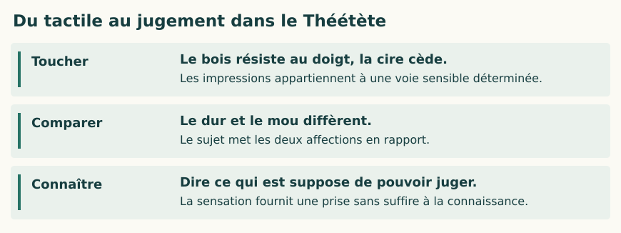

# Philosophie · Oral de spécialité SH · ENS de Lyon 2017 · Corrigé guidé

*Corrigé rédigé par IA, non officiel. Signalez toute erreur.*

**Rédaction** · GPT-6.2 Astra Ultra · vitesse non renseignée

**Portée.** Les 108 options publiées sont étudiées. Le rapport évoque soixante extraits au stade de la préparation. Le cahier en référence cinquante-quatre. Le devenir des six autres reste inconnu.

## Préparer la séance

**Passer des bornes au problème.** Sur une feuille, copiez les deux phrases qui délimitent votre extrait dans l’édition au programme. Notez qui prend la parole et à qui. Dans le *Théétète*, Socrate peut dire « je » pour donner la parole à Protagoras ; vous n’expliquerez pas le même argument si vous faites de cette voix la thèse finale de Socrate. Dans le cours de Hegel, demandez si le passage formule une objection du sens commun ou un moment de la démonstration. Les références du cahier permettront au jury comme au candidat de garder le passage exact en vue.

**Construire l’explication avec le texte à l’appui.** Le rapport présente vingt minutes au plus d’explication, lecture incluse, puis dix minutes au plus d’entretien. Rassemblez trois éléments : la difficulté de départ, l’opération accomplie par un exemple précis et le changement produit par la dernière proposition. À propos de la cire et du bois, demandez où s’arrête l’affection sensible et comment apparaît l’idée de leur différence. Pour la comparaison de l’État et de la famille chez Hegel, distinguez leur unité sans nier la force des deux formes d’appartenance.

**Développer le choix de leçon.** Pour chaque paire, repérez la question à laquelle votre interlocuteur pourrait s’attendre et celle, plus précise, qu’impose l’intitulé. Le travail est-il collectif parce qu’il y a plusieurs personnes dans un atelier, ou parce que le résultat dépend de leur coopération ? La religion est-elle privée parce qu’une croyance est intime, ou parce que la puissance publique ne doit pas l’imposer ? Préparez un exemple qui oblige à séparer les deux réponses. Le rapport indique une leçon d’environ vingt minutes, puis une dizaine de minutes d’entretien.

## Lire les sujets de 2017

L’épreuve de spécialité de la série Sciences humaines comprenait une explication et une leçon. Le candidat choisissait entre deux extraits ou entre deux intitulés. Le fascicule de cinq pages conserve vingt-sept paires de passages et vingt-sept paires de leçons. Le rapport indique que le jury a dû choisir « soixante extraits ». Le cahier publié en référence cinquante-quatre. Le rapport ne précise pas le sort des six autres.

Les cinquante-quatre sujets de leçon sont travaillés ci-dessous dans l’ordre de leurs enveloppes. Parmi les explications, les vingt-six options de Platon ont pu être situées et lues. Les vingt-huit options de Hegel sont expliquées en confrontant les bornes françaises au manuscrit allemand du cours de 1830–1831. Le jury décrit des prestations sur la foi religieuse, la superstition, le divertissement et le travail collectif ; une option figurant dans l’enveloppe n’est pas nécessairement celle qui a été développée devant le jury.

## Hegel. Les quatorze paires de la *Philosophie de l’histoire*

Les numéros et les lettres renvoient aux deux options de chacune des quatorze enveloppes Hegel. Les pages inscrites dans les titres sont celles de l’édition française au programme, dirigée par Myriam Bienenstock. Le fascicule de l’ENS de Lyon publie les deux bornes de chaque extrait. On les a rapprochées du manuscrit allemand de 1830–1831 édité par Walter Jaeschke dans les *Gesammelte Werke*, t. 18. Le lien qui suit chaque explication renvoie à sa première page dans le manuscrit, y compris lorsque les phrases franchissent un changement de page. Les relances sont proposées pour l’entraînement. [Sujets 2017, p. 1–2](https://www.ens-lyon.fr/sites/default/files/2017-11/philosophie-2017_1506587957750.pdf) · [Rapport du jury 2017, p. 9–11](https://www.ens-lyon.fr/sites/default/files/2018-03/PHILO_TC_SP_2017.pdf) · [Notice de l’édition critique](https://www.pe.ruhr-uni-bochum.de/philosophie/i/hegel_edition/works/works.html.de) · [Transcription allemande des *Gesammelte Werke*, t. 18](https://hegel.idealismedition.com/assets/dtabf/GW18.xml)

### Paire 1

**1A. P. 55–56. Comment éprouver la rationalité de l’histoire ?**

*Bornes du sujet — p. 55-56, depuis « C’est donc seulement de la considération de l’histoire mondiale… » jusqu’à « …parmi lesquels ils ne sont pas inhabituels chez nous. »*

Hegel défend une exigence qui peut surprendre chez un philosophe de l’esprit. La rationalité du devenir doit ressortir de l’étude de l’histoire même. Dire que l’esprit a une seule nature ajoute un problème à résoudre. Comment une nature identique peut-elle se déployer sous des formes aussi différentes ? Il faut en restituer le parcours en prenant l’histoire telle qu’elle est. La polémique donne à la précaution sa force. Des historiens de métier imaginent un peuple originaire qui aurait reçu de Dieu toute la science, ou une épopée romaine dont dériveraient les premiers historiens. Qu’une conjecture remplisse un silence des archives ne suffit pas à en faire une source. Hegel retourne donc contre ses adversaires leur accusation de construction a priori. **Relance.** Le philosophe connaît déjà le résultat qu’il annonce. Comment lui conserver valeur de résultat ? Il lui reste à restituer les transitions qui permettent au lecteur d’y parvenir à partir du matériau historique. [Manuscrit, GW 18, p. 142](https://hegel.idealismedition.com/text.html?work=gw-18#page-149)

**1B. P. 83. Pourquoi parler de la famille dans une philosophie de l’État ?**

*Bornes du sujet — p. 83, depuis « Il faut d’abord indiquer ce qu’est l’éthicité familiale. » jusqu’à « …le sentiment de faire un avec un tout. »*

L’éthicité est une forme de vie dans laquelle la fin commune entre dans ce que chacun éprouve et veut. Les parents renoncent à opposer leurs intérêts comme deux prétentions exclusives, les enfants n’ont pas encore acquis une existence personnelle autonome. Lorsque je reconnais dans l’autre une part de ma propre vie, prendre soin de lui modifie ce qu’il faut entendre par mon intérêt. L’éducation des enfants donne un contenu durable à cette unité. Hegel rapproche alors les Pénates, divinités du foyer, et l’esprit politique d’un peuple. Dans les deux cas, un tout existe pour ses membres. La famille le fait éprouver immédiatement sous la forme de l’amour et de la confiance. L’État a donc intérêt à respecter cette première expérience d’appartenance. **Relance.** Faut-il aimer ses concitoyens comme ses enfants ? La comparaison porte sur la disposition à se savoir membre d’un tout. L’amour familial explique comment se forme cette disposition. Il ne donne pas le principe de validité d’une loi commune à des inconnus. [Manuscrit, GW 18, p. 176–177](https://hegel.idealismedition.com/text.html?work=gw-18#page-183)

### Paire 2

**2A. P. 76–77. Que prouve l’indignation de celui qui invoque le droit ?**

*Bornes du sujet — p. 76-77, depuis « Ce qui rend les hommes insatisfaits… » jusqu’à « …au même titre que la religion, l’éthicité, la moralité. »*

L’insatisfaction naît du désaccord entre le présent et l’institution qu’on tient pour juste, puis devient elle-même un titre de gloire morale. Celui qui parle au nom de la liberté revendique pour sa parole une autorité que le simple aveu d’un avantage personnel n’aurait pas. Il faut donc examiner le contenu de ce qu’il exige. Hegel distingue alors deux conflits que l’époque moderne peut faire entendre sous les mêmes mots. Des idées également soucieuses de se justifier publiquement s’opposent réellement. Des passions particulières peuvent aussi adopter le langage des droits supérieurs. La série finale souligne la prétention absolue de pareilles demandes. **Relance.** Hegel donne-t-il d’avance raison au pouvoir en place ? Le problème posé est celui du passage du sentiment à la justification. Exiger qu’une institution traite chaque personne en sujet de droit et réclamer un privilège pour soi peuvent s’appeler « défendre ma liberté ». Le travail du jugement est précisément de les distinguer. [Manuscrit, GW 18, p. 168–169](https://hegel.idealismedition.com/text.html?work=gw-18#page-175)

**2B. P. 90–91. Quels changements méritent le nom d’étapes ?**

*Bornes du sujet — p. 90-91, depuis « L’histoire mondiale présente donc… » jusqu’à « …pour les élaborer dans la suite. »*

Hegel fixe le principe du découpage. La conscience qu’un esprit prend de sa liberté donne un sens déterminé à la succession. Trois positions deviennent distinguables. Dans la première, la forme de vie est tenue pour naturelle et un seul passe pour libre. Dans la deuxième, la liberté apparaît pour elle-même, mais la première rupture demeure partielle, encore liée aux déterminations naturelles dont elle se dégage. Dans la troisième, elle peut se comprendre dans son universalité, comme liberté de l’être humain en tant que tel. Le passage de la deuxième à la troisième oblige à demander *qui* se sait libre et à quel titre. Reconnaître la liberté comme l’attribut d’une catégorie de personnes ouvre une histoire et fait aussi voir sa limite. Chaque étape a enfin sa propre formation et sa propre transition. **Relance.** La seule annonce de trois degrés fournit-elle une histoire ? Hegel réserve à l’exposition la tâche d’expliquer les transitions. Une énumération de civilisations dans trois cases laisserait cette charge de la preuve intacte. [Manuscrit, GW 18, p. 185–186](https://hegel.idealismedition.com/text.html?work=gw-18#page-192)

### Paire 3

**3A. P. 53–54. Quelle pensée la philosophie apporte-t-elle à l’histoire ?**

*Bornes du sujet — p. 53-54, depuis « Sur le concept provisoire du philosophique dans l’histoire… » jusqu’à « …mais aussi l’univers spirituel – dans l’histoire mondiale. »*

Hegel reprend le reproche d’imposer aux événements des pensées toutes faites et en accepte d’abord un élément. La philosophie aborde bien l’histoire avec une pensée, celle de la raison qui gouverne le monde. Son statut dépend de l’enquête entreprise. En histoire elle sert de présupposition, alors que la philosophie spéculative doit en établir le bien-fondé. Hegel précise ensuite ce qu’il faut entendre par « raison ». L’appeler substance signifie que ce qui est possède en elle sa consistance. L’appeler puissance infinie signifie qu’elle a prise sur le réel et ne reste pas à l’état d’idéal. Enfin, un agent fini dépend de matériaux et de moyens qu’il ne produit pas. La raison dont il est ici question se donne à elle-même le contenu, la forme et l’activité par lesquels elle se manifeste. La dernière précision étend cette manifestation de la nature au monde de l’esprit. **Relance.** Suffirait-il d’attribuer à chaque chef d’État une intention raisonnable ? L’intention appartient à un individu et peut échouer. La thèse introduite concerne ce qui donne forme et intelligibilité au devenir de l’ensemble. [Manuscrit, GW 18, p. 140–141](https://hegel.idealismedition.com/text.html?work=gw-18#page-147)

**3B. P. 88–89. À quoi reconnaît-on un développement ?**

*Bornes du sujet — p. 88-89, depuis « En réalité, la perfectibilité est quelque chose… » jusqu’à « … et il se fait ce qu’il est en soi. »*

Si la perfectibilité veut seulement dire qu’un état meilleur peut suivre l’état présent, il reste à savoir en quoi consiste le meilleur. Le développement ajoute une condition. Une détermination intérieure se donne peu à peu une existence. Hegel explique la proposition par l’organisme. Le germe prend une forme différenciée et transforme ce qu’il reçoit de l’extérieur pour se maintenir vivant. Ainsi, ce qui résulte de l’activité est aussi ce qui orientait l’activité. L’esprit présente à son tour cette structure paradoxale. Il doit se faire ce qu’il est en soi. Sans la distinction entre une aptitude et la forme qu’elle se donne, la formule serait contradictoire. **Relance.** Suffit-il d’attendre que la liberté pousse comme une plante ? L’analogie de ce billet établit la différence entre développement et modification extérieure. Le rôle de la volonté dans le développement spirituel fait précisément l’objet d’une autre proposition, 7B. La séparation des deux bornes est ici décisive. [Manuscrit, GW 18, p. 182–183](https://hegel.idealismedition.com/text.html?work=gw-18#page-189)

### Paire 4

**4A. P. 81–82. En quel sens peut-on être libre par nature ?**

*Bornes du sujet — p. 81-82, depuis « Ce que nous trouvons en premier… » jusqu’à « …sans pour autant s’en justifier de manière historique. »*

La thèse adverse fait de l’entrée en société une nécessaire perte de liberté. Elle exploite deux acceptions de « nature ». Si l’on parle du concept de l’être humain et de sa destination, la liberté lui est naturelle. Si l’on parle de la situation dans laquelle il se trouve immédiatement, la proposition devient l’affirmation tout autre qu’il a déjà joui du libre exercice de droits. Hegel demande ce qui, de cette prétendue condition originaire, est attesté. Même les formes d’existence dont les théoriciens font leur exemple comprennent des règles sociales. Une théorie produit une représentation dont elle a besoin, puis prête à cette représentation une existence. **Relance.** Une fiction d’état de nature peut-elle garder un usage ? Une hypothèse explicitement destinée à éprouver la légitimité d’un pouvoir pose une question distincte. Le trait visé ici est le passage subreptice d’une destination conceptuelle à un état effectivement vécu. [Manuscrit, GW 18, p. 174–175](https://hegel.idealismedition.com/text.html?work=gw-18#page-181)

**4B. P. 100–101. Qui distingue l’essentiel dans le passé ?**

*Bornes du sujet — p. 100-101, depuis « Les reproches faits à la considération philosophique… » jusqu’à « …se diriger sur ce qui est vraiment essentiel. »*

On accuse le philosophe d’introduire dans son matériau des pensées qui lui sont étrangères. Hegel observe que l’étrangeté d’une catégorie pour le lecteur n’établit rien sur son rapport à l’objet. Il reconnaît la différence de méthode entre le classement des faits par l’entendement et la recherche philosophique des formes liées de la liberté. Mais l’historien qui s’en tient aux éléments jugés importants a déjà opéré un choix. Il doit pouvoir dire par rapport à quoi un élément est essentiel. S’il s’agit d’histoire mondiale prise comme un tout, Hegel propose les déterminations successives de la conscience de la liberté comme critère. **Relance.** Suffirait-il alors que l’historien annonce sa préférence ? Choisir la liberté comme sujet d’un livre reste une décision personnelle. Lui reconnaître une fonction d’explication suppose de montrer comment une modification de son statut éclaire le devenir effectif. La dernière phrase formule l’ambition du critère. [Manuscrit, GW 18, p. 197–198](https://hegel.idealismedition.com/text.html?work=gw-18#page-204)

### Paire 5

**5A. P. 69–70. Pourquoi faut-il de la passion pour réaliser une fin ?**

*Bornes du sujet — p. 69-70, depuis « Nous disons donc ainsi que rien, absolument rien… » jusqu’à « …son opinion, sa conviction – est compris. »*

Hegel resserre progressivement le sens de l’intérêt. Participer à une entreprise, c’est y engager quelque chose de soi. La passion désigne le cas où l’individu concentre sur un seul objet ses forces, ses besoins et sa volonté jusqu’à reléguer ses autres intérêts. Cette concentration explique l’efficacité que lui reconnaît la formule sur les grandes réalisations. Elle laisse cependant ouverte la question de leur valeur. L’intensité caractérise la forme de l’énergie déployée. Il faut encore examiner le contenu de la fin, de même que la force de ma conviction ne décide pas de sa vérité. La dernière phrase conduit le raisonnement dans l’autre sens. Même une fin qui serait par son contenu raisonnable demeure sans existence effective si personne ne la prend en charge. C’est pourquoi opinion, conviction, impulsion et passion se retrouvent dans l’énumération finale des déterminations du vouloir subjectif. **Relance.** Dire qu’une réforme est juste suffit-il à expliquer qu’elle ait eu lieu ? Sa justice éventuelle éclaire sa justification. Il reste à comprendre pourquoi des individus ont eu des raisons assez fortes de la vouloir et de la réaliser. [Manuscrit, GW 18, p. 160–161](https://hegel.idealismedition.com/text.html?work=gw-18#page-167)

**5B. P. 94–95. À partir de quoi écrire une histoire de la liberté ?**

*Bornes du sujet — p. 94-95, depuis « La seule approche appropriée et valable… » jusqu’à « …une réalité effective qui leur soit conforme – l’État. »*

La frontière que trace Hegel porte sur l’objet de l’enquête. Pour qu’il y ait histoire de l’actualisation de la raison, il faut que celle-ci soit discernable dans un savoir, une volonté et des actes. Le simple possible ne dessine aucune forme de vie effective. Dans la famille, les liens affectifs rendent déjà possible une conduite commune. Ses membres peuvent cependant s’y rapporter les uns aux autres sans se distinguer comme personnes indépendantes. Le surgissement de cette personnalité entraîne une difficulté. Comment un sujet qui se sait centre de ses actes peut-il vouloir une réalité commune ? La réponse finale donne au droit et à la loi un statut précis. Ils deviennent des objets que des individus peuvent connaître et vouloir et auxquels ils donnent une existence institutionnelle. **Relance.** Que fait-on de la vie des communautés sans État ? Le critère restreint ce que Hegel appelle ici histoire philosophique. On peut contester sa définition et confronter cette restriction aux institutions et aux décisions collectives que l’enquête historique établit ailleurs. [Manuscrit, GW 18, p. 190–191](https://hegel.idealismedition.com/text.html?work=gw-18#page-197)

### Paire 6

**6A. P. 71–72. Comment le but de l’histoire agit-il avant d’être connu ?**

*Bornes du sujet — p. 71-72, depuis « …j’ai dit que notre présupposition … » jusqu’à « …je ne peux pas le rendre concevable, comme on le dit. »*

Hegel rappelle le statut de ce qu’il a proposé en commençant. La raison gouverne l’histoire, mais ce que l’exposition anticipe devra se laisser reconnaître comme son résultat. Les fins particulières sont des moyens du procès universel. Ce rapport semble d’abord installer la raison au-dessus des actions comme un maître qui les utiliserait de l’extérieur. Hegel insiste au contraire sur son immanence. C’est *dans* les actions historiques et *par* elles que le mouvement a lieu. Sa thèse concerne donc l’unité de l’universel et du singulier. Pendant que l’histoire se fait, un agent peut connaître son but immédiat et ignorer la signification historique plus vaste de son action. Du fait que cette signification n’est pas l’objet de son désir, on ne peut conclure qu’elle ne se réalise pas par ce qu’il veut. La dernière incise circonscrit la démonstration. Exposer le concept de cette unité serait l’affaire de la logique. **Relance.** L’aveu final d’une limite rend-il la thèse incohérente ? Il distingue deux tâches. L’enquête historique rend repérable une articulation dans des actions déterminées. L’introduction s’abstient de déduire ici la forme spéculative de cette articulation. [Manuscrit, GW 18, p. 162–163](https://hegel.idealismedition.com/text.html?work=gw-18#page-169)

**6B. P. 104–105. Que fait la pensée quand elle emploie un nom ?**

*Bornes du sujet — p. 104-105, depuis « C’est un formalisme tout pareil… » jusqu’à « …et de leur donner des noms particuliers. »*

Retrouver partout « génie », « poésie » ou « philosophie » peut donner le sentiment d’avoir compris des civilisations différentes. Or ces termes sont déjà des produits de réflexion. On peut savoir les manier et classer des œuvres sous leurs rubriques en laissant indéterminé ce qui fait leur signification singulière. La culture intellectuelle a appris à l’entendement à décomposer un contenu, puis à poser chaque élément sous une forme générale. La réflexion philosophique commence lorsque cette activité elle-même devient son objet. La fin retourne l’image naïve de l’observateur recueillant des données toutes prêtes. « Terre », « homme », « Alexandre » et « César » rassemblent sous un seul nom une multiplicité considérable. Distinguer ensuite des propriétés et les nommer est une seconde opération de pensée. **Relance.** Le nom propre ferait-il exception, puisqu’il ne désigne qu’un individu ? Nommer Alexandre maintient l’unité à travers la diversité de ses actes et de ses situations. La référence à un individu présuppose déjà cette synthèse. [Manuscrit, GW 18, p. 202–203](https://hegel.idealismedition.com/text.html?work=gw-18#page-209)

### Paire 7

**7A. P. 75. Un être humain peut-il être un moyen pour l’histoire ?**

*Bornes du sujet — p. 75, depuis « Lorsque nous parlons d’un moyen… » jusqu’à « …au-dessus de la nécessité extérieure et du hasard. »*

On croit d’abord qu’un moyen demeure extérieur à la fin qu’il sert. Même un outil doit avoir une propriété qui convienne à l’usage. Cette remarque prépare une différence de statut. Un agent humain cherche ses propres fins, mais il peut aussi prendre part à la fin rationnelle qui s’accomplit par son action. Il est alors fin en soi par le *contenu* même de son activité. Hegel distingue cette idée du simple fait que tout vivant entretient son existence. L’être humain se détermine par des raisons. Cette possibilité de connaître et vouloir par soi fonde la portée de la moralité, de la vie éthique et de la religion, que la seule succession des fortunes extérieures ne mesure pas. **Relance.** Un résultat historique favorable suffirait-il à justifier de sacrifier quelqu’un ? Un tel calcul réduit l’individu à une utilité extérieure. La démonstration exige précisément de prendre en compte ce en quoi l’agent participe à la fin et vaut pour lui-même. [Manuscrit, GW 18, p. 166–167](https://hegel.idealismedition.com/text.html?work=gw-18#page-173)

**7B. P. 89–90. Pourquoi l’esprit doit-il lutter avec lui-même ?**

*Bornes du sujet — p. 89-90, depuis « Rien ne peut s’infiltrer entre le concept et sa réalisation… » jusqu’à « …ce qui lui donne son sens et sa signification. »*

Dans l’organisme, le développement se déploie selon la détermination du germe. Cela décrit une relation intérieure. Un accident extérieur peut évidemment empêcher une plante de pousser. La différence propre à l’esprit est que son *propre* vouloir peut contrarier ce qu’il a à devenir. La conscience s’attache d’abord aux fins qu’elle trouve en elle, s’y reconnaît et peut mettre toutes ses forces à les défendre. Elle contribue alors à sa propre méconnaissance. Si la difficulté venait seulement du dehors, davantage de puissance la résoudrait. Ici, c’est la manière de déterminer la fin qu’il faut transformer. Le travail historique a dès lors un contenu assignable, la liberté. Elle donne sens aux phases du développement et au récit qui en rend compte. **Relance.** Une résistance révèle-t-elle nécessairement un progrès en préparation ? Encore faut-il dire quelle détermination se transforme et quelle liberté devient possible. La seule présence d’un conflit ne donne pas la solution du problème. [Manuscrit, GW 18, p. 183–184](https://hegel.idealismedition.com/text.html?work=gw-18#page-190)

### Paire 8

**8A. P. 71. Comment agir pour une fin que l’on ne vise pas ?**

*Bornes du sujet — p. 71, depuis « C’est seulement en soi, c’est-à-dire comme nature… » jusqu’à « …comment étant de la rêverie, de la philosophie. »*

« Nature » qualifie ici la présence encore inconsciente du principe de l’esprit. Une fin peut être à l’œuvre avant que les agents la connaissent. Ce que chacun connaît et poursuit, en revanche, ce sont des objets qu’il se représente, des besoins, des intérêts, parfois des passions. L’hypothèse de Hegel est que l’ensemble de ces volontés donne à l’esprit les moyens de se reconnaître dans une réalité qu’il produit. Individus et peuples accompliraient ainsi quelque chose qui excède leur intention immédiate. La fin de l’extrait redonne toute sa force à l’objection. Pourquoi imputer à leurs actions un sens que leurs auteurs ignorent ? **Relance.** Une conséquence imprévue serait-elle déjà une manifestation de l’esprit ? Imaginons que l’action intéressée de créanciers entraîne la codification publique d’une procédure. Le nouvel effet est identifiable. Pour y voir un moment de la liberté, il faut encore établir ce que cette procédure change effectivement au statut des personnes. L’écart entre le but et l’effet ne suffit pas. [Manuscrit, GW 18, p. 161–162](https://hegel.idealismedition.com/text.html?work=gw-18#page-168)

**8B. P. 96–97. Pourquoi les événements et leur récit portent-ils le même nom ?**

*Bornes du sujet — p. 96-97, depuis « Dans notre langue, [le terme d’] histoire… » jusqu’à « …l’intégrer à la conscience, il est besoin du passé. »*

Le même mot allemand désigne les faits accomplis et leur narration. Hegel cherche une raison de leur rencontre. Une famille entretient déjà ses souvenirs de revers ou d’exploits. L’État introduit une différence de fonction. Une instruction donnée oralement pour un besoin immédiat s’épuise avec sa circonstance. Une loi prétend durer et produire des effets dans des circonstances nouvelles. D’où l’intérêt public d’inscrire dans le temps les décisions, leurs circonstances et leurs suites. La conclusion appelle la réalité présente de l’État un présent incomplet. Comprendre le titre d’un pouvoir ou la portée d’une institution exige une mémoire du passé. **Relance.** Les traditions orales donnent-elles déjà accès au passé ? Le texte leur reconnaît une capacité de mémoire. Sa thèse, plus précise et plus contestable, fait de l’État le moteur commun d’une certaine forme de récits et d’actes publics durables. Un exemple de conservation orale durable par une communauté sans État mettrait directement ce critère à l’épreuve. [Manuscrit, GW 18, p. 192–193](https://hegel.idealismedition.com/text.html?work=gw-18#page-199)

### Paire 9

**9A. P. 64–65. Comment la liberté peut-elle être à la fois principe et fin ?**

*Bornes du sujet — p. 64-65, depuis « Ce que nous avons indiqué comme… » jusqu’à « …quels moyens utilise-t-elle ? »*

Hegel reprend le résultat à partir duquel l’enquête va changer de direction. L’esprit a pour fin de savoir sa liberté et de la rendre effective. La répétition du mot « liberté » pourrait dissimuler sa redoutable équivocité. Entre ce qui est présent en principe et ce qui existe dans le monde, l’écart est considérable. C’est pourtant la liberté elle-même qui commande de le franchir. Une liberté condamnée à s’ignorer resterait sans prise sur ce que fait le sujet. C’est en ce sens qu’elle est à elle-même sa fin. Une chose que nous fabriquons peut satisfaire un but qui lui est extérieur. Ici, celui qui cherche à devenir libre s’approprie sa capacité de se donner des fins. Le produit de cette activité transforme le sujet qui agit. **Relance.** Pourquoi finir sur les moyens ? La fin peut donner une orientation à l’enquête. Elle ne montre encore ni qui agit ni comment la conscience de la liberté acquiert une efficacité. [Manuscrit, GW 18, p. 154–155](https://hegel.idealismedition.com/text.html?work=gw-18#page-161)

**9B. P. 77–78. Comment reconnaître une valeur identique à deux vies historiques inégales ?**

*Bornes du sujet — p. 77-78, depuis « La religion et l’éthique sont des essentialités… » jusqu’à « …en même temps affectées de particularités. »*

Hegel demande ce que valent une disposition religieuse et une vie éthique quand les conditions sociales offrent à l’une des occasions d’agir et de s’instruire que l’autre ignore. Ces formes universelles peuvent être effectivement présentes dans une âme individuelle sans y atteindre la même étendue de culture. La vie du berger ou du paysan est son exemple décisif. Une existence consacrée à quelques relations simples peut, dans la manière dont elle se décide et agit, avoir la même valeur qu’une vie dont les relations et les actions s’étendent très loin. Cette conscience intérieure est le lieu de la responsabilité personnelle. Hegel distingue enfin cette valeur de la pérennité du droit particulier qui s’incarne dans une forme de vie. Le mouvement historique peut transformer ou abolir cette forme. **Relance.** Une place étroite dans l’histoire du monde ferait-elle une personne de moindre prix ? Cette déduction effacerait la distinction centrale. Que des formes d’existence se succèdent ne crée aucun barème qui mesurerait la valeur de chacun au rayonnement de son peuple ou de son métier. [Manuscrit, GW 18, p. 169–170](https://hegel.idealismedition.com/text.html?work=gw-18#page-176)

### Paire 10

**10A. P. 60–61. Que demande l’idée d’une révélation à celui qui veut comprendre l’histoire ?**

*Bornes du sujet — p. 60-61, depuis « Dans la religion chrétienne, Dieu s’est révélé… » jusqu’à « …nous est placée devant les yeux. »*

Si Dieu s’est révélé, l’essence divine n’est plus, pour le croyant chrétien, un secret dont l’accès lui serait par principe interdit. Hegel transforme cette possibilité en obligation de connaître. Il faut porter au concept ce qui se donnait d’abord au sentiment et à la représentation. L’histoire mondiale devient à son tour un objet de cette connaissance. Mais une époque ne peut reconnaître une fin ultime que si quelque chose de cette fin a reçu une existence consciente et universelle. C’est en ce sens que comprendre sa propre époque présente un intérêt philosophique. Le mot « théodicée » nomme alors l’épreuve à laquelle s’expose cette entreprise. Leibniz avait cherché une justification de Dieu à travers des catégories métaphysiques. L’histoire met sous nos yeux la masse concrète du mal et oblige à soutenir la question devant elle. La coupure s’arrête sur cette difficulté. **Relance.** A-t-on justifié la souffrance des victimes à la fin de l’extrait ? Hegel a exposé la tâche d’une réconciliation du sujet pensant avec le négatif. Ce geste ne suffit à justifier aucun événement particulier et explique au contraire la gravité de la tâche. [Manuscrit, GW 18, p. 149–150](https://hegel.idealismedition.com/text.html?work=gw-18#page-156)

**10B. P. 103–104. Que vaut moralement l’homme dont le geste fait époque ?**

*Bornes du sujet — p. 103-104, depuis « Ceux que l’éthique et donc la noblesse d’esprit… » jusqu’à « …être abandonnées à l’historiographie proprement dite.»*

Les personnages qui résistent à une transformation peuvent avoir une valeur morale supérieure à celle de criminels dont les actes l’ont favorisée. Le succès ne distribue donc pas les prix de vertu. Dans le bouleversement envisagé, les partis se disputent pourtant un ordre dont la justification vivante s’est déjà défaite. Une revendication peut conserver la forme du droit alors que la réalité commune qui lui donnait sens a disparu. La philosophie de l’histoire demande ce que l’acte a fait devenir à un peuple. Un relevé de vertus personnelles, de la modestie à la bienfaisance, ne répondrait pas à cette question. Elle pourrait même, dit Hegel, réserver les portraits singuliers au récit proprement historique. **Relance.** L’auteur prononce-t-il une amnistie ? Il maintient expressément le terme de « crimes » et le jugement moral porté sur leur auteur. L’évaluation d’une intention et l’intelligibilité d’un effet historique peuvent diverger. La difficulté demeure de justifier sur quel fondement cet effet est déclaré nécessaire. [Manuscrit, GW 18, p. 201–202](https://hegel.idealismedition.com/text.html?work=gw-18#page-208)

### Paire 11

**11A. P. 59–60. De quoi peut-on faire une histoire de la Providence ?**

*Bornes du sujet — p. 59-60, depuis « …il y a des âmes pieuses qui… » jusqu’à « …avec ce principe universel [dont nous avons parlé]. »*

Une personne rencontre un secours inespéré et lui donne un sens providentiel. Cette lecture de l’événement vise la sauvegarde d’une fin particulière. Or les individus dont il s’agit dans l’histoire mondiale sont aussi des peuples, et les ensembles concernés sont des États. Collectionner des sauvetages ne suffit pas à saisir leur devenir. Basculer dans la formule générale « il y a une Providence » laisse tout autant de côté les déterminations concrètes. Hegel demande au contraire qu’on recherche les voies et les moyens par lesquels un principe universel entre dans les événements. La même exigence met donc à l’épreuve le goût des signes particuliers et la confiance en une généralité sans contenu. **Relance.** Si les secours se multipliaient dans les archives, changerait-on de niveau d’analyse ? Leur nombre seul ne le permettrait pas. Il faudrait dégager les médiations par lesquelles les formes de la vie commune se transforment et éprouver leur rapport au principe avancé. [Manuscrit, GW 18, p. 148](https://hegel.idealismedition.com/text.html?work=gw-18#page-155)

**11B. P. 105–106. Pourquoi la philosophie apparaît-elle dans la vie politique ?**

*Bornes du sujet — p. 105-106, depuis « C’est la vie de l’État en tant que telle qui rend nécessaire…… » jusqu’à « …et à le développer dans son élément propre. »*

L’État exige des formes communes de jugement et de culture. Hegel demande comment cette formation rend possibles les sciences, la poésie cultivée et les arts. Une œuvre plastique dépend, jusque dans ses techniques, d’une coopération sociale développée. La poésie autorise une nuance importante. Son matériau, la voix, est directement accessible et une langue peut être élaborée avant la constitution d’un ordre juridique commun. La philosophie dispose pour sa part du travail déjà accompli par l’entendement. Là où les hommes ont appris à penser sous des formes générales, ils peuvent prendre cette activité de pensée elle-même pour objet. Pourquoi en éprouveraient-ils le besoin ? Dans certaines périodes de division, l’entendement critique dissout les certitudes qui s’incarnaient dans les lois, les mœurs et la religion. La raison a alors à chercher dans son propre élément, la pensée, une réconciliation que cette critique a rendue nécessaire. **Relance.** Tout régime organisé produit-il immédiatement des philosophes ? Hegel distingue les conditions intellectuelles que le travail de la vie commune rend possibles et l’expérience historique d’une division qui rend leur mise en œuvre pressante. [Manuscrit, GW 18, p. 203–204](https://hegel.idealismedition.com/text.html?work=gw-18#page-210)

### Paire 12

**12A. P. 63. Qui reconnaît-on comme libre ?**

*Bornes du sujet — p. 63, depuis « Ce qu’il faut indiquer en premier… » jusqu’à « …que cette conscience s’est d’abord éveillée.»*

Hegel demande d’abord une détermination abstraite de l’esprit. L’histoire mondiale présente le travail par lequel il en vient à savoir ce qu’il est en soi. La gradation qui suit concerne le sujet auquel une communauté reconnaît la liberté. Hegel attribue aux sociétés qu’il réunit sous le terme d’« Orient » la pensée qu’un seul est libre. Or un despote incapable de distinguer sa liberté de son bon plaisir reste lui-même livré à ses passions. Les cités grecques et le monde romain reconnaissent plusieurs hommes libres. Le maintien de l’esclavage manifeste cependant combien cette liberté demeure particulière et dépendante d’un statut. Enfin, Hegel attribue aux peuples germaniques, dans le christianisme, la prise de conscience que l’être humain comme tel est libre. Le billet s’arrête sur le lieu de cette prise de conscience, la religion et l’intériorité de l’esprit. **Relance.** La gradation prouve-t-elle l’exactitude de chacune de ces attributions ? Elle met au jour la différence entre privilège et universalité. Sa géographie et sa chronologie sont des constructions de Hegel, dont l’examen critique demanderait de confronter les sociétés ainsi groupées à leur propre histoire. Le rapport signale des allusions aux Grecs et aux Romains au cours des prestations. [Manuscrit, GW 18, p. 152–153](https://hegel.idealismedition.com/text.html?work=gw-18#page-159)

**12B. P. 82. Pourquoi la limitation peut-elle libérer ?**

*Bornes du sujet — p. 82, depuis « Il en est de l’état de nature selon son concept… » jusqu’à « …dans lesquels la liberté se réalise effectivement.»*

La liberté exige de prendre du recul à l’égard de ce qui me pousse immédiatement. La volonté et le savoir s’éduquent donc. Dans l’état que Hegel appelle naturel, l’impulsion la plus forte peut s’imposer par la violence. En limiter l’exercice transforme le rapport que les sujets entretiennent avec leurs désirs. Le droit et les mœurs leur donnent à connaître et à vouloir des objets universels. Définir la liberté comme le pouvoir abstrait de choisir n’importe quoi manque l’opération. Une contrainte qui frappe l’arbitraire particulier peut établir la capacité effective de plusieurs personnes à agir en sujets. Par exemple, une règle d’audience borne la possibilité de parler à tout instant et donne à chacun le pouvoir d’être entendu. **Relance.** Toute limitation légale serait-elle libératrice ? La conclusion exige une médiation rationnelle entre la règle et ce que chacun peut reconnaître et vouloir. Une interdiction destinée à empêcher certains d’être entendus échouerait au test illustré par l’exemple. [Manuscrit, GW 18, p. 175–176](https://hegel.idealismedition.com/text.html?work=gw-18#page-182)

### Paire 13

**13A. P. 80–81. Sur quoi repose l’unité d’une constitution et des convictions d’un peuple ?**

*Bornes du sujet — p. 80-81, depuis « Cet esprit d’un peuple est un esprit déterminé… » jusqu’à « …Ils restent abstraits et indéterminés. »*

L’esprit d’un peuple est déterminé par une histoire. Hegel cherche l’unité de ce dont religion, art et philosophie donnent des présentations distinctes. Un peuple vénère un contenu dans la religion, lui donne une figure sensible dans l’art et le pense dans la philosophie. Si son organisation politique exprime aussi ce contenu, une constitution ne s’importe pas comme un mécanisme indépendant des convictions effectives. Hegel appuie sa critique sur l’opposition qu’il construit entre catholicisme et protestantisme. Tous deux relèvent du christianisme. Selon lui, le rapport catholique à l’autorité empêche toutefois le droit politique de s’enraciner dans la conscience comme le ferait le principe protestant. Isolés de cette intériorité, même des principes constitutionnels expressément proclamés restent abstraits. Il s’agit d’une thèse confessionnelle et historique située. **Relance.** Comment la discuter sans manquer l’argument ? Il est possible d’admettre qu’une constitution a besoin d’une appropriation vécue tout en contestant que seule telle confession puisse la porter. La mention, dans le rapport, d’un passage sur l’État catholique trouve ici un rapprochement textuel précis, sans identification nominative du candidat. [Manuscrit, GW 18, p. 172–173](https://hegel.idealismedition.com/text.html?work=gw-18#page-179) · [Rapport 2017, p. 11](https://www.ens-lyon.fr/sites/default/files/2018-03/PHILO_TC_SP_2017.pdf)

**13B. P. 90. Quel progrès pourrait rendre compte des pertes de l’histoire ?**

*Bornes du sujet — p. 90, depuis « Il y a dans l’histoire mondiale plusieurs grandes périodes… » jusqu’à « …qui est [considéré comme] ultime. »*

Des cultures ont donné naissance à de riches formes de vie dont la destruction a laissé des générations entières devant la nécessité de recommencer. Le coût en travail, en temps, en crimes et en souffrances fait obstacle à toute représentation d’une accumulation continue. À côté de ces disparitions, Hegel place un fait de sens inverse, l’existence de systèmes culturels qui se poursuivent et se perfectionnent dans leur élément propre. Les deux constatations mettent en difficulté un même critère. Si l’on se borne au mot de « développement », on ne sait dire ni pourquoi une forme développée devrait valoir plus qu’une autre, ni quelle signification accorder aux retours en arrière. Le critère reste relatif à chaque développement dès lors que le développement est lui-même tenu pour le terme ultime. **Relance.** Hegel considère-t-il donc toute destruction comme le prix nécessaire d’un bien ultérieur ? Le passage met au contraire en évidence la pauvreté d’une explication qui s’en tiendrait à ce mot. Pour défendre un jugement concret de progrès ou de régression, il faudrait montrer *ce qui* a été gagné, perdu ou rendu possible. [Manuscrit, GW 18, p. 184–185](https://hegel.idealismedition.com/text.html?work=gw-18#page-191)

### Paire 14

**14A. P. 65–66. Pourquoi les passions attirent-elles d’abord l’attention de l’historien ?**

*Bornes du sujet — p. 65-66, depuis « Cette question des moyens par lesquels la liberté… » jusqu’à « …à l’ordre et à la mesure, au droit et à la moralité. »*

Si la liberté est d’abord un concept intérieur, ses moyens doivent devenir repérables dans ce qui se passe. Regarder l’action humaine fait aussitôt apercevoir besoins, intérêts, dispositions et passions. Les fins expressément bonnes existent aussi. Hegel nomme la volonté de faire le bien et l’amour du pays. Mais l’efficacité de telles vertus, considérée depuis le théâtre entier du monde, apparaît limitée. L’intérêt particulier dispose d’un ressort immédiat, et la passion y concentre la force d’un sujet. Celui qui s’oriente vers le droit ou la modération a dû traverser une longue formation. Ce contraste d’énergie expose le problème qui attend la philosophie de l’histoire. **Relance.** Une action produite par une passion sert-elle d’emblée la liberté ? Le texte s’en tient à ce qui se présente d’abord comme ressort efficace. Confondre le constat de la force et le jugement sur la fin reviendrait à déclarer juste n’importe quelle victoire. [Manuscrit, GW 18, p. 155–156](https://hegel.idealismedition.com/text.html?work=gw-18#page-162)

**14B. P. 106–107. Peut-on juger une forme artistique en isolant son contenu ?**

*Bornes du sujet — p. 106-107, depuis « Il est donc vrai qu’il y a un art poétique… » jusqu’à « …ou bien méticuleuse et mesquine. »*

Que plusieurs peuples aient une poésie et une philosophie établit une communauté de noms. Reste à savoir ce que fait chaque œuvre. Hegel oppose à une esthétique des qualités formelles un exemple comparatif. On peut reconnaître aux épopées indiennes et à Homère invention, richesse d’images et beauté de diction. Cette liste laisse ouverte la question de savoir quelle conception de l’action humaine l’œuvre rend sensible. Hegel relie l’intérêt de la raison à la présentation de la liberté dans des individus. Pour lui, un contenu classique donne sa mesure à la forme, et un contenu sans mesure peut conduire aussi bien à la démesure qu’à la minutie. **Relance.** Faut-il reprendre sa hiérarchie entre les traditions ? On peut distinguer deux opérations. Que l’interprète lise la forme à même le contenu est une exigence justifiable par le travail sur les œuvres. Prétendre que les épopées indiennes satisfont moins bien à cette exigence appelle une comparaison textuelle précise que le passage n’apporte pas. Sa hiérarchie demeure celle de Hegel. [Manuscrit, GW 18, p. 204–205](https://hegel.idealismedition.com/text.html?work=gw-18#page-211)

## Platon. Les treize paires du *Théétète*

Les pages et les incipit du fascicule renvoient à la traduction de Michel Narcy, GF. Les références 154b, 155b, etc., dites de Stephanus, se retrouvent d’une édition à l’autre. L’argument de chacune des vingt-six options a été vérifié dans la traduction de Harold N. Fowler. Les analyses développées de 155e–156c et 186b–d s’appuient aussi sur le grec. Le jury évoque deux difficultés particulières, l’image des jumeaux et l’arrêt de l’argument par le verbe « attends ». Le rapprochement avec ces deux billets est étayé par la liste sans être une transcription des prestations. [Traduction de comparaison](https://scaife.perseus.org/reader/urn:cts:greekLit:tlg0059.tlg006.perseus-eng2:142/) · [Texte grec](https://adfonteslibrary.org/work-plato-theaetetus)

### Paire 1

**A. 155b-d (GF, p. 162-163), de « Maintenant, ces trois points… » à « …ou ne le comprends-tu pas encore. »**

Si rien ne devient plus grand ni plus petit sans addition ou soustraction, comment Socrate peut-il devenir plus petit que le jeune Théétète alors que seul celui-ci grandit ? Socrate a rapproché des énoncés qui paraissaient s’imposer isolément et qui, ensemble, mettent l’esprit en difficulté. Théétète dit son vertige. La réponse de Socrate reconnaît dans l’étonnement le commencement du philosopher. Il ne s’agit pas d’admirer un tour de passe-passe : la difficulté oblige à distinguer la grandeur de Socrate et sa grandeur relativement à un autre. La dernière question annonce un essai d’explication dans le cadre de la thèse attribuée à Protagoras. Le passage ne donne pas encore cette explication. Il montre ce qui change quand une contradiction apparente devient un motif de chercher.

**B. 199c-200a (GF, p. 210-271, tel qu’imprimé), de « Oui, mais il apparaît autre chose de pire… » à « …C’est bien cela ? »**

L’image de la volière distinguait le fait de posséder un savoir en réserve et le fait de l’avoir en main au moment d’un calcul. L’erreur pouvait dès lors s’interpréter comme la prise du mauvais oiseau. Socrate soulève une objection nouvelle : si tous les oiseaux sont des savoirs, saisir effectivement un savoir rendrait ignorant celui qui le saisit. L’opposition entre connaissance et ignorance perdrait ainsi son efficacité explicative ; ce serait presque faire de la cécité une manière de voir. Théétète propose alors de mettre aussi des ignorances dans la volière. Celui qui en saisit une croit néanmoins avoir pris un savoir. L’entretien doit porter sur cette reconnaissance de ce qu’il saisit. Ajouter une espèce d’oiseaux a nommé le problème plutôt que résolu son mécanisme. La garde imprime p. 210–271 ; le repère stable est 199c–200a.

### Paire 2

**A. 155e-156c (GF, p. 164), de « Alors regarde, observe… » à « …nées d’une ascendance commune. »**

Le jeune Théétète a proposé de définir le savoir comme sensation. Un problème se pose alors : si une même chose apparaît différemment à deux personnes, où placer la qualité que chacune sent ? Socrate fait entendre une réponse qui déplace la question elle-même. Au lieu de chercher à laquelle des deux personnes la chose apparaît telle qu’elle *est*, il demande ce qui se forme dans chacune des deux rencontres. Le passage introduit ce modèle ; ce serait anticiper sur l’examen du dialogue que d’y voir déjà le dernier mot de Platon sur le savoir. [Texte grec et repères Stephanus](https://adfonteslibrary.org/work-plato-theaetetus)

Socrate demande d’abord de vérifier si personne d’extérieur à l’initiation ne les écoute. Les exclus du secret ont une conception très précise de ce qui existe : il faudrait pouvoir mettre la main dessus. Ils ne font donc aucune place aux actions et aux devenirs en tant que tels. L’image est spirituelle. La main qui veut saisir une chose manifeste justement une *action*, ce dont le critère des « non-initiés » ne sait rendre compte. Le ton de la confidence tourne cette étroitesse en dérision et permet à Théétète d’entendre une proposition plus ambitieuse. Il n’oblige ni à imaginer l’existence d’une école secrète effectivement documentée ni à prendre chaque phrase pour une antiphrase.

La proposition qui suit est radicale. Toute la réalité serait mouvement. On pourrait croire qu’un mouvement doit être celui de quelque chose de fixe et que l’explication s’arrête dès qu’elle en arrive là. Socrate présente au contraire des mouvements organisés par deux puissances, agir et pâtir. Dans leur rencontre apparaissent des produits allant toujours par deux. L’un est une sensation, l’autre ce qui est sensible dans cette sensation. La différence entre deux *puissances* et deux *produits* est décisive. Si je pose au départ un rouge parfaitement déterminé qui provoquerait après coup en moi une perception, j’ai déjà laissé de côté la moitié du modèle. Supposer que la conscience fabrique seule le rouge manquerait tout autant la rencontre. La qualité sensible et sa perception deviennent ensemble ce qu’elles sont dans cette relation.

Le texte met cette conséquence à l’épreuve d’une série qui part de la vue et de l’ouïe et s’étend jusqu’au plaisir, à la peine ou à la crainte. Il existe des noms pour certaines de ces manières d’être affecté et il peut en exister de plus nombreuses que les noms. À des visions diverses correspondent des couleurs diverses. L’image des jumeaux exprime donc la corrélation des deux termes issus d’une même genèse. Elle ne désigne pas la fonction de sage-femme que Socrate joue ailleurs en aidant son interlocuteur à éprouver ses idées. Ce sont deux relations de nature différente, même si les deux images prennent appui sur la naissance. Le rapport relève précisément cette confusion dans une prestation. [Rapport du jury 2017, page 10](https://www.ens-lyon.fr/sites/default/files/2018-03/PHILO_TC_SP_2017.pdf#page=10)

**Relance. Ce modèle prouve-t-il que tous mes jugements soient vrais ?** Il peut expliquer comment deux personnes éprouvent des qualités distinctes sans que l’apparence de l’une efface l’apparence de l’autre. Qu’un jugement portant sur la cause d’une maladie ou sur ce qui sera avantageux demain possède la même autorité immédiate demanderait encore une démonstration. Le passage porte sur la genèse corrélative de la sensation et du sensible.

**B. 201b-d (p. 275-276), de « Eh bien donc, quand la persuasion… » à « …ce que je crois, je survivrais. »**

Des juges que l’on persuade au sujet d’un événement auquel ils n’ont pas assisté peuvent rendre la bonne décision. La véracité de leur opinion et la qualité de leur décision ne prouvent pas qu’ils aient connu l’événement de la façon dont le demande l’exemple. La persuasion produit l’adhésion ; elle ne remplace pas l’apprentissage ou le rapport à la chose requis pour appeler cette adhésion un savoir. Ce contre-exemple suffit à mettre en défaut l’équivalence générale entre savoir et opinion vraie. Théétète se souvient alors d’une nouvelle formule qui ajoute un *logos* à l’opinion vraie. Il distingue d’ailleurs, par son hésitation, se rappeler une formule et pouvoir la développer soi-même. Le texte s’arrête sur cette exigence ; il serait prématuré de lui faire approuver un sens déterminé du *logos*.

### Paire 3

**A. 167a-d (GF, p. 191-192), de « Pourtant, ce n’est pas… » à « …la thèse est sauve. »**

Socrate prête la parole à Protagoras. Si la nourriture paraît amère au malade, nul besoin de traiter son goût d’opinion fausse pour justifier qu’on cherche à le guérir. Le médecin produit une situation autre dans laquelle le même aliment paraîtra et sera meilleur pour lui. Le raisonnement se déplace du vrai et du faux au meilleur et au pire. Le jardinier pour les plantes, puis l’orateur pour la cité, donnent à comprendre en quel sens une compétence peut subsister si chaque apparence est vraie pour celui qui l’éprouve. La parole du sophiste cherche à transformer les dispositions là où le médecin emploie des remèdes. Mais « meilleur » doit conserver un sens déterminé pour que le paiement du savant ou l’autorité du conseiller se justifient. C’est le point vulnérable de cette défense et la raison de la distinguer du jugement définitif de Socrate.

**B. 200a-d (GF, p. 272-273), de « Ayant donc parcouru… » à « …penser comme tu dis. »**

À supposer que l’on puisse prendre dans sa volière une ignorance au lieu d’un savoir, on ne la prendra pour savoir qu’en faisant déjà erreur sur ce que l’on prend. L’interlocuteur exigeant qui revient sur l’image ramène les mêmes possibilités logiques que l’on voulait élucider. Comment une chose connue peut-elle être prise pour une autre chose également connue, ou une chose ignorée pour quelque chose que l’on connaît ? Inventer un savoir de second degré pour reconnaître les oiseaux exigerait une nouvelle volière pour ce savoir, et ainsi de suite. L’image ne manque pas de pittoresque ; elle échoue à procurer un critère indépendant de la reconnaissance dont elle prétend rendre compte. La suite de la discussion pourra donc remettre en question l’ordre même de l’enquête sur le vrai et l’erreur.

### Paire 4

**A. 154d-155b (GF, p. 161-162), de « Suppose, donc, que toi et moi… » à « …Il semble bien, du moins. »**

Plutôt que de se tendre des pièges comme des gens qui auraient déjà toute la sagesse, Socrate propose à Théétète de reprendre tranquillement les accords qui les embarrassent. La manière de discuter constitue ici une partie du raisonnement : une réponse donnée seulement pour éviter une contradiction verbale laisse subsister le problème. Trois engagements sont dégagés. Une chose qui reste égale à elle-même ne croît ni ne décroît ; sans addition ni perte il n’y a pas changement de quantité ; ce qui est maintenant sans l’avoir été a bien dû devenir. Leur rapprochement invite à reprendre les cas de la grandeur relative. En entretien, opposez le gain d’un jeu de réfutation à l’effort de conserver ensemble des propositions plausibles pour localiser précisément l’équivoque qui les oppose.

**B. 192a-c (GF, p. 251-252), de « [1] Ce qu’on sait… » à « …simplement pas de sensation. »**

Dans le modèle de l’empreinte, on peut connaître quelqu’un sans le percevoir maintenant et le percevoir sans savoir encore qui il est. Socrate ordonne ces possibilités avant d’introduire la méprise proprement dite. Tant que l’empreinte et la perception occupent exactement la place que leur assigne la description, on ne voit pas par quel chemin un terme pourrait être pris pour un autre. Dire seulement « je sais et j’ignore » confondrait des opérations que le modèle vient de distinguer. Les multiples cas peuvent lasser Théétète ; leur fonction est d’isoler ceux dans lesquels quelque chose peut être mal ajusté, en particulier le raccord entre l’empreinte conservée et ce qui arrive aux sens. Un visage familier entrevu de loin fait comprendre comment l’objet du souvenir et l’occasion de se tromper peuvent être distincts.

### Paire 5

**A. 157d-158b (GF, p. 167-168), de « …dis si c’est une idée à ton goût… » à « …pensent qu’ils vont en vol.»**

Socrate demande si Théétète veut accueillir le fruit de son raisonnement. L’image de l’enfant rappelle la fonction de la discussion : aider à mettre au jour une thèse pour en examiner la viabilité. L’objection suivante en fait l’épreuve. Si tout ce qui apparaît à quelqu’un est pour lui comme il apparaît, que répondre aux perceptions des malades, aux récits des fous et aux aventures des rêveurs ? Ces personnes éprouvent réellement ce qu’elles décrivent, mais nous sommes d’ordinaire portés à déclarer qu’elles se trompent. L’exemple de celui qui se croit en train de voler fait donc apparaître une tension entre l’immunité de l’éprouvé et la vérité de l’énoncé sur ce qui arrive. Le dialogue examine la difficulté ; le simple rappel de l’usage courant ne suffirait pas à la résoudre.

**B. 206c-207a (GF, p. 291-292), de « Vas-y donc : que veut… » à « …en pensant par les éléments. »**

Après avoir exigé un *logos* en plus de l’opinion vraie, il faut dire ce que ce mot ajoute. Si donner raison signifie rendre sa pensée audible en l’exprimant au moyen de verbes et de noms, presque tout être parlant pourra donner cette expression à ses opinions, y compris quand il n’en sait aucunement davantage. La parole à haute voix ne suffit donc pas à produire une différence entre opinion et science. Un autre sens se présente : rendre compte d’un tout en parcourant ses éléments. L’exemple du chariot aide à opposer une désignation sommaire et le dénombrement des pièces. Le gain n’est pas encore acquis. Savoir égrener des noms de pièces n’explique pas à lui seul comment leur liaison donne un chariot. La transition détermine ainsi ce que le sens suivant du *logos* devra affronter.

### Paire 6

**A. 158b-d (GF, p. 168-169), de « Je crois que tu l’as entendu… » à « …chacune des deux affirmations. »**

Les propos que nous tenons éveillés pourraient être rêvés avec un sentiment de réalité analogue. À quel signe interne au discours puis-je établir que ma conviction appartient justement à la veille ? Il ne suffit pas de remarquer, après le réveil, qu’un rêve avait son étrangeté : cette remarque utilise la distinction qu’on cherche à fonder au moment où l’on juge. Socrate pousse l’essai jusqu’à la dissymétrie des durées. Même si un état occupe davantage de temps, en quoi le nombre de ses heures donnerait-il à ses perceptions un titre supérieur à la vérité ? L’argument n’autorise pas l’affirmation que toute veille est un rêve. Il traite deux prétendants à l’évidence avec la même exigence et prépare la relance sur la maladie, où la durée respective des états peut varier.

**B. 167e-168c (GF, p. 192-193), de « Si, toi, tu es capable… » à « …toutes sortes d’impasses. »**

La défense prêtée à Protagoras s’achève par une distinction entre deux usages de la contradiction. Dans la dispute on peut chercher à faire trébucher l’adversaire. Dans la discussion qui doit lui apprendre quelque chose, on doit aussi lui faire apercevoir sa propre erreur, sans lui imputer ce qu’on peut tirer d’une caricature de sa thèse. Une réfutation humiliante peut produire la haine de l’étude chez les jeunes gens qui en sont témoins. Cette observation pratique éclaire la défense philosophique : celui qui tient plusieurs apparences pour vraies peut encore se demander si telle manière de parler améliore une disposition ou la détériore. Socrate cesse ensuite de prêter sa voix au mort. Il faut tenir séparés l’argument qu’il a rendu plus fort et l’accord qu’il apporterait lui-même à sa conclusion.

### Paire 7

**A. 175b-176a (GF, p. 208-209), de « Oui, mais quand c’est lui… » à « …des hommes heureux. »**

Le philosophe paraissait ridicule lorsqu’il ne savait pas répondre dans la langue des procès et des rangs sociaux. Socrate déplace l’autre interlocuteur sur un terrain où la question ne porte plus sur tel litige mais sur la justice, ni sur les possessions d’un roi mais sur le bonheur humain. Celui qui dominait l’échange local perd à son tour contenance. Ce renversement oblige à préciser qui juge du ridicule et d’après quelle échelle. Il ne constitue pas seulement une revanche plaisante de l’un des deux personnages. En levant les yeux au-delà du cas qui presse, la philosophie peut critiquer les critères de réussite auxquels le premier public accordait son suffrage. Le vœu de Théodore sur une humanité ainsi délivrée de ses maux ouvre une portée pratique. La description des deux modes de vie a engagé un choix sur ce qu’il vaut la peine de savoir.

**B. 179a-d (GF, p. 216-217), de « Par conséquent, c’est avec mesure… » à « …un petit nombre d’adversaires. »**

Quand une cité promulgue une mesure parce qu’elle lui paraît avantageuse, elle se prononce sur un avenir dont elle ne dispose pas encore. Les effets peuvent démentir sa prévision. L’autorité que possède son jugement présent à propos de ce qu’elle institue ne garantit donc pas la justesse de tout pronostic. De là la possibilité de reconnaître que l’un conseille mieux que l’autre et la difficulté, pour Protagoras, de donner même valeur à toutes les opinions tout en se présentant comme maître. Socrate ménage toutefois une différence importante. La thèse reste plus difficile à attaquer s’agissant de l’affection sensible au moment où elle a lieu. Réfuter l’égale compétence des prévisions ne suffit pas à rendre fausse la perception qu’éprouve effectivement quelqu’un. La relance consiste à distinguer le temps où je goûte et celui dont je prétends savoir ce qu’il apportera.

### Paire 8

**A. 154b-d (GF, p. 159-161), de « Dans ce cas, si, d’une part… » à « …je répondrai que c’est possible. »**

Six dés sont plus nombreux que quatre et moins nombreux que douze, sans que leur nombre ait subi de changement. Le cas relève d’une comparaison élémentaire ; sa fonction est de mettre au jour le type d’énoncé que l’on porte quand on appelle quelque chose grand ou petit. Ce qui vaut relativement à tel terme varie lorsque celui-ci change. Si l’on demande simplement « ces dés sont-ils devenus moins nombreux ? », l’embarras de Théétète révèle la tension entre l’invariance du terme compté et la variation de ce qu’on peut véritablement en dire. Il ne faudrait pas conclure que tout comptage est arbitraire. C’est au contraire la précision du calcul qui révèle que le prédicat de comparaison n’appartient pas aux six dés sans autre détermination.

**B. 185c-e (GF, p. 231), de « Tu mentionnes, à propos… » à « …ce soit aussi la tienne. »**

La salure se goûte par la langue. Mais par quel organe saisir que le son et la couleur sont deux, qu’ils ont ceci de commun qu’ils sont et qu’ils diffèrent l’un de l’autre ? Théétète doit chercher une opération qui puisse porter ensemble sur des contenus livrés par des sens différents. Attribuer cette comparaison à une sensation de plus reconduirait la même difficulté pour comparer cette dernière aux autres. Il propose que l’âme examine elle-même les propriétés communes. Ce passage donne un sens plus précis à l’unité du sujet percevant. Il ne prétend pas que l’âme inventerait la couleur ni que tout ce qu’elle juge soit vrai. Il montre ce qu’un sens particulier ne pourrait fournir à lui seul dans la connaissance d’un objet sensible.

### Paire 9

**A. 171c-e (GF, p. 201-202), de « Donc, puisque l’opposition… » à « …c’est bien celui-là ! »**

Si toute opinion est vraie, que devient celle des adversaires de Protagoras qui tiennent sa doctrine pour fausse ? La position doit faire droit à l’opinion qui s’oppose à sa propre prétention universelle. Théodore craint qu’on ne traite durement son ami ; Socrate imagine que le disparu, s’il pouvait reparaître un instant, aurait encore de quoi répondre. Le mouvement n’annule pas l’objection de retournement mais en interdit l’usage comme facile victoire sur un absent. Les interlocuteurs reprennent alors un point moins verbal : en matière de conduite et de santé il semble bien que certains discernent mieux que d’autres ce qu’il convient de faire. Demandez en entretien pourquoi le médecin serait appelé. Quelle que soit la vérité de ce que l’on ressent, le choix d’un traitement fait intervenir une compétence en plus du sentiment actuel.

**B. 184c-e (GF, p. 227-228), de « A vrai dire, employer mots… » à « …A rien d’autre. »**

La question semble d’abord porter sur une minutie de préposition : voyons-nous « par » nos yeux ou sont-ils le moyen « à travers » lequel nous voyons ? L’image du cheval de bois en donne l’enjeu. Si plusieurs sens y logeaient côte à côte comme plusieurs hommes sans communauté d’expérience, comment le même sujet pourrait-il comparer ce qu’ils éprouvent ? Il faut distinguer les organes, par lesquels la sensation se produit, et ce vers quoi convergent leurs données. Socrate laisse ouverte au départ la manière de nommer cette unité. Il examine ensuite la spécificité des voies sensorielles. La couleur n’est pas saisie par l’ouïe. Éviter d’échanger deux prépositions prépare ainsi une question sur les actes nécessaires à toute connaissance, et non la simple correction du langage ordinaire.

### Paire 10

**A. 189b-d (GF, p. 243-244), de « Par conséquent, avoir des opinions… » à « …à ce que tu affirmes.»**

L’opinion fausse paraît d’abord viser ce qui n’est pas. Mais si c’était ne rien viser du tout, comment resterait-ce une opinion ? Socrate essaie une définition différente : penser une chose existante à la place d’une autre chose existante. Cette substitution donne apparemment à l’erreur un objet et rend compte du sentiment de viser quelque chose alors qu’on manque son but. Théétète pense au cas où l’on confond ce qui est beau et ce qui est laid. Le succès provisoire de l’image ne règle cependant pas les conditions de la méprise : il reste à savoir comment l’esprit peut prendre l’un pour l’autre deux termes qu’il a sous les yeux de la pensée. L’extrait donne à comprendre pourquoi il a fallu changer de question, de l’existence de l’objet à l’acte qui lui attribue la mauvaise détermination.

**B. 186b-d (GF, p. 232-234), de « Attends. C’est au moyen… » à « …des impressions, c’est impossible. »**

Le geste initial de Socrate suspend l’échange précédent pour fixer l’attention sur un exemple dont on peut suivre chaque étape. Un morceau de bois et un morceau de cire opposent à mes doigts deux résistances. Théétète accorde que je sens par le toucher la dureté et la mollesse. Tout le problème sera de savoir si c’est de la même façon que je juge ce qu’est chacune, qu’elles existent toutes deux et qu’elles s’opposent. L’exemple est bien choisi : il serait trop facile d’expliquer le besoin d’une synthèse par la seule différence de deux organes, comme s’il s’agissait de joindre une couleur et un son. Ici le contraste se manifeste au sein d’un seul sens. [Texte grec, 186b–d](https://adfonteslibrary.org/work-plato-theaetetus)

Sentir successivement deux résistances ne revient pas à éprouver, après elles, une troisième qualité sensible qui serait leur opposition. Pour comparer, l’âme doit ressaisir les deux affections ensemble. Une pression plus forte me fournirait une nouvelle impression ; elle ne m’indiquerait pas à elle seule si la différence tient à mon geste ou aux objets que je compare. La formulation de Socrate a aussi son importance : l’âme *essaie* de juger. Il ne suffit donc pas qu’une opération soit accomplie par l’âme pour qu’elle réussisse infailliblement. Socrate cherche les conditions auxquelles une prétention à savoir peut prendre sens, et non un certificat de vérité pour tout jugement.

Le passage oppose ensuite l’immédiateté des affections offertes par la nature aux humains et aux autres animaux dès la naissance et la lente acquisition des raisonnements par l’expérience et l’éducation. Du dur et du mou on passe à une question qui intéresse nos décisions : qu’est-ce que cela est, à quoi peut-il être utile ? Un enfant éprouve immédiatement la résistance d’un matériau. Le savoir de celui qui le choisit pour soutenir une charge exige qu’il rapporte cette impression à d’autres observations, à des conditions et à un emploi possible. L’exemple pédagogique fait ressortir un contraste de droit : multiplier les impressions ne suffit pas à faire apparaître le critère selon lequel le jugement sera juste.

Les questions finales resserrent la démonstration. Le savoir exige d’atteindre le vrai. Mais comment viser le vrai si l’on ne porte aucun jugement sur ce qui est ? Les affections ne suffisent donc pas à constituer le savoir. Il faut chercher celui-ci dans le travail de raisonnement à leur sujet. Cette conclusion n’affirme ni que les sensations sont inutiles ni que tout raisonnement est vrai. Elle réfute la définition initiale par une différence de compétence : ce que requiert la connaissance excède ce qui est immédiatement donné par l’affection. La différence change aussi le sens d’un désaccord. À celui qui dit sentir la dureté on ne répond pas comme à celui qui assure qu’un ouvrage résistera aux intempéries. Le second s’avance sur ce qui est ou sera et doit exposer ses raisons. [Traduction française de comparaison avec le grec](https://plato-dialogues.org/fr/tetra_6/theaetts/theetete_184b3-187a9.htm)

**Relance. Socrate introduit-il un sixième sens ?** Un sens spécialisé ajouterait une nouvelle espèce d’impression. Or le jugement porte ici sur ce qu’ont en commun plusieurs affections ou sur la relation qui les oppose. Comprendre cette différence évite de postuler un organe supplémentaire qui repousserait sans la résoudre la question de la comparaison.

### Paire 11

**A. 172a-c (GF, p. 202-203), de « Alors voyons aussi… » à « …se saisit de nous. »**

Une cité peut décider de ce qui sera légalement juste chez elle. Du moins pour qui défend Protagoras, la loi fait alors exister comme juste ce qui paraît juste à la cité le temps où elle en est persuadée. Le cas de l’utile est moins simple, car un législateur peut manquer son but. Distinguer la valeur instituée et le succès d’une décision limite la portée de la formule qui faisait de tout sujet sa propre mesure. Or il y a là plus qu’une querelle à propos des mots. Le tribunal et la conversation philosophique accordent-ils aux raisons et au temps de les développer la même place ? La « digression » qui saisit les interlocuteurs naît de cette différence. La fin du billet en ouvre la possibilité sans livrer encore la description complète des deux modes de vie.

**B. 186e-187c (GF, p. 235-236), de « Par conséquent, Théétète… » à « …ne serait pas à dédaigner. »**

Socrate a distingué l’acte des sens et le jugement qui cherche l’être et le vrai au sujet de leurs impressions. La première proposition de Théétète, le savoir est sensation, ne peut donc être conservée. L’échec ne laisse pas l’enquête au point de départ. Elle sait désormais dans quel registre chercher : celui de l’activité de l’âme qui forme des opinions. Affirmer que toute opinion est savoir serait immédiatement démenti par l’existence d’opinions fausses. La restriction à l’opinion vraie devient alors une hypothèse à examiner ensemble. La manière dont Théétète accepte le risque de se tromper importe ici. Il ne donne pas une réponse de cours qu’il faudrait défendre à tout prix ; il formule un essai qui aura produit quelque chose même s’il faut ensuite le réviser.

### Paire 12

**A. 156e-157c (GF, p. 165-166), de « Il faut soutenir de la même façon que dur… » à « …animal, individu ou espèce. »**

L’œil ne devient pas la vision en général, il devient un œil voyant, et le bois ou la pierre ne devient pas la blancheur mais quelque chose de blanc. Les deux effets se produisent dans la rencontre. Si l’on suit cette théorie du devenir, attribuer à une chose un blanc stable et lui appartenant en soi effacerait donc le rapport qui rend la perception possible. Socrate en éprouve la conséquence jusque dans la grammaire : les noms qui fixent, les démonstratifs qui isolent et le verbe être rendent mal le mouvement dont on veut rendre compte. Il faudrait même se demander comment désigner des ensembles comme l’homme ou l’animal. On distinguera la radicalité de l’hypothèse examinée et la doctrine que Platon ferait sienne. Socrate la fait parler pour en éprouver la force et le prix.

**B. 176e-177b (GF, p. 211), de « Des modèles, mon cher… » à « …en rien d’enfants »**

Socrate oppose deux modèles de vie, l’un ordonné à la justice et l’autre à son contraire. Celui qui croit qu’une injustice réussie est profitable se fabrique par ses actes une ressemblance dont il aura à vivre les effets. La sanction décrite ne se réduit donc pas à une peine extérieure qu’un plus habile pourrait éviter. Le tort est dans la forme que prend la vie de celui qui l’accomplit et dans les compagnies auxquelles elle le rend propre. Le malheur peut rester invisible à celui qui se croit supérieur par son habileté. La conclusion renvoie à l’épreuve de la conversation : qu’ils doivent rendre raison personnellement de ce qu’ils méprisent, et les champions de l’éloquence perdent leur assurance. Le rapport de 2017 rapproche une difficulté de traduction d’une page comprise dans ce billet ; l’identification de la prestation reste un recoupement.

### Paire 13

**A. 159e-160c (GF, p. 174-175), de « Moi, donc, je ne me trouverai… » à « …venons de parcourir.»**

Le vin paraît amer à Socrate malade et doux à Socrate en bonne santé. Dans l’hypothèse du devenir, ni le vin ni Socrate ne doivent être pris comme un terme strictement identique qui produirait à lui seul la sensation. Dans chaque rencontre se constituent ensemble la qualité et celui qui l’éprouve. Parler d’un vin « devenu doux » sans aucun destinataire omet donc une condition du phénomène ; parler d’un Socrate sentant sans aucun sensible fait de même. La conclusion en faveur de la mesure protagoréenne porte sur ce que le sensible est pour ce sujet dans cette situation. Une relance possible consisterait à demander si le passage justifie aussi une prétention à savoir quel effet le vin produira demain. C’est une extension qu’aucune des rencontres décrites n’autorise encore.

**B. 172d-173b (GF, p. 204-205), de « Aux uns, ce que tu as dit… » à « …habiles et compétents »**

Au tribunal, la clepsydre mesure le temps de parole, les écrits des parties fixent l’objet et l’adversaire peut chercher à faire perdre au plaideur bien davantage qu’une discussion. Ces circonstances expliquent par quelle éducation se forme une habileté pressée, attachée à plaire et à prévoir l’objection profitable. À l’inverse, Socrate et Théodore peuvent abandonner puis reprendre une question autant que l’exige la recherche de ce qui est. Le loisir désigne ici la liberté d’orienter le discours, plutôt que les distractions d’un homme sans occupation. Une formation intellectuelle dépend ainsi des conditions dans lesquelles on parle longtemps avant d’expliciter une théorie. Le contraste peut sembler injuste pour un juge scrupuleux. On le comprendra comme une analyse d’habitudes produites par deux dispositifs de parole, non comme la biographie uniforme de tous les avocats.

## Les vingt-sept enveloppes de leçon

La numérotation suit l’ordre du cahier de 2017, pages 4 et 5. Chaque paire offre deux sujets alternatifs. Les rapprochements entre options servent à préparer le choix que le candidat doit faire.

### 1. Pourquoi faut-il travailler ? / L’exploitation par le travail.

**Pourquoi faut-il travailler ?** Un malade incapable d’assurer sa subsistance reçoit des soins et des aliments. Il faut donc que du travail soit accompli pour lui, sans qu’il soit juste de lui dire qu’il doit travailler. Cette dissociation entre nécessité collective et devoir individuel modifie la question. La récurrence des besoins impose de produire et d’entretenir, comme le montre Arendt lorsqu’elle analyse le cycle du travail dans *Condition de l’homme moderne*. La répartition de cet effort exige ensuite des règles justifiables. On peut demander à celui qui le peut de contribuer aux conditions de la vie commune, sans mesurer sa contribution à sa seule fiche de paie. Le parent qui accompagne un enfant malade participe à cette tâche. **Objection.** L’oisif qui vit du travail d’autrui ne prouve-t-il pas qu’un devoir universel s’impose ? Sa situation devient injuste s’il se soustrait sans raison à une charge partagée. C’est la réciprocité qui oblige, et elle tient compte des capacités.

**L’exploitation par le travail.** Deux personnes souffrent également après une journée à la vigne. La première travaille à son compte ; la seconde vend sa force de travail à un propriétaire. La fatigue signale une dépense physique. L’exploitation désigne une relation dans laquelle quelqu’un tire durablement parti de l’activité d’un autre en disposant de ses conditions. Marx, dans le livre I du *Capital*, distingue la valeur nécessaire à la reproduction de la force de travail et celle que son usage produit pendant la journée. Le salaire peut avoir été intégralement versé sans résoudre la question de l’appropriation du surplus. La formule « par le travail » oblige donc à examiner le dispositif qui transforme une puissance productive en source de dépendance. **Objection.** Un avantage mutuel exclurait-il l’exploitation ? L’ouvrier peut préférer cet emploi au chômage tout en subissant un partage qu’il n’a aucun moyen réel de discuter.

### 2. La religion est-elle aliénante ? / Religion et absolu.

**La religion est-elle aliénante ?** Un peuple attribue à une autorité sacrée les règles qu’il contribue historiquement à façonner. Il peut cesser d’y reconnaître son propre pouvoir et éprouver comme étrangère une obligation qui vient de lui. Dans *L’Essence du christianisme*, Feuerbach interprète des attributs divins comme des déterminations de l’espèce humaine projetées et contemplées comme autres. Il faut cependant demander à quelles conditions ce déplacement devient une perte de maîtrise. La liturgie des funérailles, qui inscrit un deuil singulier dans des gestes communs, peut permettre de parler et d’agir là où chacun resterait désemparé. **Objection.** Celui qui se dit libéré par la foi pourrait méconnaître sa dépendance. Certes, son seul témoignage ne tranche pas. Examinons s’il peut interroger une interprétation, refuser une injonction et répondre de son engagement. L’aliénation tient à une manière d’instituer le rapport au sacré.

**Religion et absolu.** L’absolu désigne ce qui ne dépend d’aucune condition extérieure. Une confession, elle, a une langue, une histoire, des institutions. Comment une pratique particulière peut-elle valoir comme rapport à ce qui ne dépend d’aucune particularité ? La théologie qui qualifie Dieu d’inconditionné entend empêcher la communauté de le réduire à son protecteur local. Mais cette affirmation ne transforme pas en vérités absolues les interprétations dont une institution s’autorise. Pascal, dans le *Mémorial*, rapporte l’expérience du Dieu d’Abraham, d’Isaac et de Jacob. Elle donne au rapport à Dieu le caractère d’une rencontre singulière que la seule définition métaphysique ne suffirait pas à produire. **Objection.** Toute religion devrait-elle donc enseigner un être absolu ? La distinction de Durkheim entre sacré et profane permet d’envisager des formes religieuses sans théologie de l’inconditionné. L’absolu fournit une interprétation possible de la visée religieuse ; l’enquête doit encore établir quand elle s’applique.

### 3. Travail et salariat. / Qu’est-ce que travailler à bien penser ?

**Travail et salariat.** Entretenir le jardin d’une famille, le sien propre ou celui d’une entreprise comporte des gestes très semblables. Une modification tient au rapport qui règle leur exécution. Dans le salariat on met à disposition une activité pour une durée ou sous des conditions convenues en échange d’une rémunération. Le jardinier indépendant vend plutôt une prestation déterminée dont il organise l’exécution ; le parent peut accomplir une tâche productive sans rémunération. Avec Marx, demandons ce que celui qui embauche peut commander en acquérant l’usage d’une force de travail. L’encadrement de cet usage ouvre aussi des droits prévisibles, salaire, repos, protection, dont l’indépendant peut être dépourvu. **Objection.** Choisir ses horaires suffirait-il à sortir du salariat ? L’autonomie dans certains gestes n’abolit pas à elle seule le pouvoir de fixer le prix, d’attribuer les missions ou de sanctionner leur refus. Le travail se reconnaît à ce qu’il fait ; le salariat impose d’examiner une relation.

**Qu’est-ce que travailler à bien penser ?** On ne décide pas à volonté qu’un théorème soit vrai. On peut en revanche reprendre la figure, séparer les hypothèses et contrôler le passage à la conclusion. L’activité volontaire porte sur les conditions dans lesquelles la pensée peut se corriger. Le *Discours de la méthode* de Descartes propose de diviser la difficulté, ordonner les raisons et revoir les enchaînements : ces opérations donnent prise sur ce que l’on peut effectivement faire. Mais le meilleur calcul laisse entière la question de savoir si l’on a correctement posé le problème. Il faut aussi apprendre à chercher l’objection que notre formulation écarte. **Objection.** L’intuition soudaine du géomètre semble dispenser de travailler. Elle met au contraire en évidence l’écart entre la découverte, parfois involontaire, et l’examen public qui rend l’idée soutenable. Bien penser requiert la capacité de changer de procédure à la lumière de ce second travail.

### 4. Science et religion. / Les rites religieux.

**Science et religion.** Une éclipse peut être prévue par le calcul et vécue comme un signe. Les deux attitudes entrent-elles nécessairement en concurrence ? Elles y entrent dès qu’une autorité veut tirer de l’interprétation religieuse une prédiction physique qui contredit les observations. Le conflit de Galilée conduit à distinguer les raisons par lesquelles une hypothèse astronomique est éprouvée et les règles par lesquelles un texte sacré est interprété. L’autorité dont relève une démarche ne se transfère pas par décret à l’autre. Il serait pourtant sommaire de déclarer les domaines imperméables. Un récit religieux qui comporte une affirmation sur un événement matériel s’expose à l’enquête historique ou physique. **Objection.** Donner à chaque domaine son critère ne rend-il pas toute croyance invulnérable ? Il faut demander à chaque énoncé ce qu’il prétend établir. Dès qu’il avance des dates ou des causes observables, il accepte les exigences de la preuve correspondante.

**Les rites religieux.** Lors d’un enterrement, se tenir debout ensemble à un moment déterminé change quelque chose même si personne ne prétend modifier par ce geste la cause de la mort. Un rite règle une manière d’entrer en relation avec des personnes, des lieux et des temps tenus pour sacrés. Durkheim, dans *Les Formes élémentaires de la vie religieuse*, examine comment des pratiques communes entretiennent la division entre profane et sacré et rendent sensible une appartenance. Leur efficacité possède donc des critères qui ne se réduisent pas à l’obtention d’un effet physique. **Objection.** Une cérémonie civile rend elle aussi la solidarité sensible. Cette proximité invite à préciser ce qui fait du geste un rite *religieux*. Les participants peuvent s’adresser à un défunt dans une économie du salut, à une divinité ou à un ordre sacré que le rite a pour fonction de maintenir. Un rite exprime et institue ce rapport en même temps.

### 5. Peut-on travailler sans souffrir ? / Travail et communauté.

**Peut-on travailler sans souffrir ?** L’effort du musicien qui répète un passage difficile coexiste avec la satisfaction d’acquérir un geste. La douleur d’un mouvement imposé jusqu’à la blessure est d’une autre nature. Confondre dépense d’énergie, contrariété passagère et souffrance durable rendrait la question indécidable. Le travail confronte nos projets à une résistance extérieure, mais la résistance peut fournir la mesure d’un progrès. Dans *La Condition ouvrière*, Simone Weil analyse ce que la cadence et l’obéissance font au temps et à l’attention de l’ouvrier. Ici la souffrance vient aussi de l’impossibilité d’approprier la manière et le rythme du geste. **Objection.** Les tâches pénibles à accomplir continueront d’exister. Leur existence justifie des moyens d’en réduire la charge, de les répartir et de reconnaître ceux qui les assument. Elle n’établit pas que la souffrance définisse tout travail ni qu’elle en atteste la valeur.

**Travail et communauté.** Un refuge de montagne reste utilisable parce que des personnes qui ne se croisent jamais y déposent du bois et réparent la toiture. Leur participation produit un bien dont d’autres auront l’usage. La communauté se manifeste dans le caractère durable de l’obligation, même en l’absence de liens affectifs étroits. Chez Durkheim, la division du travail peut faire naître une solidarité par la dépendance mutuelle de fonctions différentes. Mais cette interdépendance ne crée pas spontanément une communauté juste. Une chaîne de sous-traitance peut relier fortement des travailleurs qui ne savent rien les uns des autres et ne disposent d’aucune prise sur les conditions de production. **Objection.** Faut-il donc partager une identité préalable pour travailler ensemble ? L’exemple du refuge indique l’inverse : c’est parfois la participation, appuyée sur des règles de réciprocité et de décision, qui fait découvrir et entretenir un bien commun.

### 6. Religion et mystère. / La religion est-elle le fruit de la peur ?

**Religion et mystère.** Une énigme cesse d’être telle lorsque sa solution est connue. Dans certaines traditions, un mystère religieux donne encore à penser à celui qui connaît son énoncé. Le christianisme enseigne la Trinité sans prétendre qu’une information manquante suffirait à en dissiper la difficulté. Le croyant tient pour révélée une réalité dont l’intelligence reste inépuisable. Cela n’autorise pas à traiter chaque incohérence d’un discours comme une profondeur secrète. Le travail rationnel peut établir que deux formules relèvent d’ordres de prédication différents ou qu’une prétendue révélation sert un pouvoir. **Objection.** Invoquer le mystère empêcherait toute mise en question. L’objection atteint un usage défensif du terme. Un mystère devient objet d’une recherche lorsqu’on précise ce qui est transmis, ce qui est compris et pourquoi la question renaît. Son statut engage ainsi un certain usage de la raison à l’intérieur d’une tradition.

**La religion est-elle le fruit de la peur ?** Un marin exposé à une tempête promet une offrande pour que le vent tombe. Dans la préface du *Traité théologico-politique*, Spinoza analyse comment l’incertitude et les oscillations entre crainte et espoir rendent les hommes disposés à la superstition. Il explique la force d’une conduite dont la situation éclaire le mécanisme. Mais passer de ce cas à une origine unique de toute religion est hasardeux. La gratitude après une naissance ou une liturgie vécue dans la joie ne se décrivent pas d’abord comme des stratégies de protection. **Objection.** La joie même pourrait dissimuler la peur de perdre le bien reçu. Une telle hypothèse doit être établie dans chaque cas ; si tout comportement devient d’avance sa confirmation, elle n’explique plus leurs différences. La peur peut engendrer et entretenir certaines pratiques. Elle ne suffit ni à définir le religieux ni à décider de la vérité de la croyance.

### 7. Le travail manuel. / Peut-on forcer autrui à travailler ?

**Le travail manuel.** Pour dresser une surface de bois, l’artisan observe les fibres, incline le rabot et modifie sa pression au son et à la résistance du copeau. Dire que la main « exécute » manquerait le fait que le geste révèle à son tour quelque chose qui transforme le projet. L’habileté articule perception, décision et mémoire corporelle. Elle n’est pas une pensée toute faite que la main traduirait ensuite. L’analyse des métiers de réparation chez Matthew B. Crawford dans *Éloge du carburateur* fait voir cette intelligence exposée au verdict d’un objet qui fonctionne ou demeure défectueux. **Objection.** À la chaîne, le même geste est parfois réduit à une consigne répétitive. Cette réduction renseigne sur l’organisation du poste, qui peut retirer au travailleur le diagnostic et le contrôle du résultat. Elle ne démontre pas l’infériorité intellectuelle de ce qui se fait avec les mains.

**Peut-on forcer autrui à travailler ?** Faire déplacer un objet sous la menace est physiquement possible. Obtenir ainsi un véritable travail suppose déjà une part d’initiative que l’ordre ne détermine pas entièrement. Celui qui exécute peut connaître seul les signes qui annoncent une panne. La question de droit diffère de cette limite de fait. Être soumis à la volonté particulière d’un maître nie la capacité de décider de ses fins. Une obligation publique de contribuer à un secours commun, bornée dans le temps et justifiée par un péril précis, offre un cas différent. **Objection.** Le résultat identique, un effort auquel on ne consent pas sur le moment, ne rend-il pas toute distinction illusoire ? Les intéressés disposent-ils de voies de contestation, les charges sont-elles partagées, qui décide de leur durée ? Ces différences permettent de distinguer une contrainte justifiable d’un droit général de s’approprier le travail d’autrui.

### 8. La force des religions. / La religion peut-elle être une affaire privée ?

**La force des religions.** Une institution peut conserver ses biens et perdre la faculté de convaincre ou, à l’inverse, survivre à l’interdiction de ses cérémonies. Il faut préciser ce qu’on nomme sa force : résistance historique, puissance de mobilisation ou crédit accordé à une parole. Durkheim analyse la vitalité que les participants éprouvent dans une assemblée et qui peut rendre leurs obligations sensibles. Cette énergie sociale explique en partie la persévérance d’une pratique. Elle n’explique pas à elle seule comment une foi donne à une minorité les ressources pour critiquer les pouvoirs dominants. **Objection.** La longévité d’une religion ferait-elle la preuve de sa vérité ? Des croyances incompatibles présentent une longévité comparable. La vérité exige d’autres raisons que la capacité à durer. Comparer les sources de force permet précisément d’éviter d’ériger le succès social en critère de validité.

**La religion peut-elle être une affaire privée ?** On peut demander qu’une confession ne commande pas l’exercice du pouvoir politique. Cela protège aussi bien celui qui quitte cette confession que ceux qui lui restent fidèles. Dans la *Lettre sur la tolérance*, Locke distingue l’objet des intérêts civils et celui du salut, qui ne saurait être acquis par contrainte. Mais le droit de croire inclut pour beaucoup la possibilité de se réunir, pratiquer et faire entendre une conviction en public. Reléguer toute expression visible dans la maison viderait donc en partie cette liberté de son contenu. **Objection.** La présence publique de cultes rivaux menacerait l’unité commune. Une règle de coexistence peut garantir l’usage partagé des lieux et la liberté de s’abstenir sans exiger l’invisibilité de tous. La religion peut être privée par la liberté de la conscience et publique par ses formes d’association.

### 9. La foi religieuse. / Religion et tolérance.

**La foi religieuse.** Lorsque je crois un témoin, je tiens une affirmation pour vraie en lui accordant ma confiance. La foi religieuse joint souvent ces deux actes, adhérer à un enseignement et s’en remettre à quelqu’un, sans que l’un épuise l’autre. Savoir réciter une profession de foi n’implique pas qu’on confie sa conduite à ce qu’elle enseigne. Dans les *Pensées*, le pari de Pascal s’adresse à celui qui hésite. Un calcul peut montrer qu’il est impossible d’éviter tout engagement pratique ; il ne suffit pas à produire l’acte de croire. Cet écart invite à comprendre le rôle de l’habitude et de la prière. **Objection.** Si l’adhésion n’est pas démontrable, toutes les crédulités se valent-elles ? La foi peut encore interroger la fiabilité d’un témoignage, la cohérence de l’enseignement et ses fruits pratiques. Admettre le risque de la confiance laisse ouvert l’examen de ses raisons.

**Religion et tolérance.** Tolérer une pratique implique qu’on ait motif de la désapprouver et qu’on renonce à l’empêcher. Ainsi un catholique peut juger fausse une doctrine protestante tout en défendant le droit de ses voisins à célébrer leur culte. La tolérance n’exige pas une indifférence aux questions de vérité. Dans la défense de la tolérance chez Bayle, l’erreur sincère de la conscience est décisive : celui qui se trompe suit lui aussi ce qui lui paraît être son devoir, et le contraindre à feindre l’accord détruit l’intégrité qu’on prétend former. **Objection.** Le groupe qui refuse ce droit aux autres doit-il encore être toléré ? Il faut distinguer l’expression d’une vérité exclusive de l’action qui prive autrui de droits. La tolérance organise cette frontière à partir de la réciprocité des libertés et requiert des institutions capables de la faire respecter.

### 10. Le religieux et le profane. / La fin des religions.

**Le religieux et le profane.** Une salle ordinaire devient lieu de prière certains soirs. Les mêmes chaises, personnes et paroles y changent de fonction parce que des règles fixent ce qui peut s’y faire. Chez Durkheim, le sacré regroupe les choses séparées et soumises à des interdits dont les rites règlent l’approche. Le profane désigne ce qui relève d’un autre régime d’usage. Il faut donc examiner une relation instituée pour comprendre pourquoi un même matériau peut se trouver tantôt offert, tantôt vendu. **Objection.** Un athée peut juger un lieu de mémoire inviolable. Toute séparation du commun est-elle religieuse ? Un interdit ne suffit pas isolément. Il faut examiner à quelles croyances, pratiques et formes de communauté il s’articule. La catégorie de sacré aide à comparer certaines situations et demande que leurs différences historiques restent visibles.

**La fin des religions.** Le mot « fin » suggère la disparition, mais aussi ce en vue de quoi les pratiques sont instituées. Commençons par la première lecture. Si une institution perd son pouvoir sur le droit civil ou l’école, cette sécularisation n’implique ni la disparition des assemblées ni celle des engagements personnels. Une prophétie de disparition générale exigerait de justifier le passage de cette transformation particulière à une loi de l’histoire. La seconde lecture déplace le débat : une religion visant le salut ou la réconciliation pourrait-elle atteindre un jour un état qui rendrait inutiles ses formes présentes ? Ce sens se détermine à l’intérieur d’une doctrine et ne livre pas une prévision sociologique. **Objection.** Le progrès scientifique rend bien certaines explications religieuses superflues. Il faut alors préciser quelle explication a perdu sa fonction ; établir la fin d’un usage ne permet pas encore d’annoncer celle de tous les cultes.

### 11. Quelle est la valeur du travail ? / Les enfants travaillent-ils ?

**Quelle est la valeur du travail ?** Une nuit de veille auprès d’un parent malade peut n’avoir aucun prix de marché et une importance exceptionnelle pour celui dont elle préserve la santé. De quelle instance attend-on une évaluation ? Sur un marché du travail, une rémunération dépend de rapports économiques et de la possibilité de remplacer une compétence. Dans une activité coopérative comptent aussi la qualité du résultat et la charge effectivement prise en commun. Sur le plan moral, la qualité de la fin poursuivie et le respect des personnes limitent la dignité qu’on pourrait attribuer à tout effort indistinctement. **Objection.** Faute d’une mesure unique, le jugement serait arbitraire. On peut au contraire présenter des raisons déterminées : qui bénéficie de l’activité, quelle dépendance elle prend en charge et à quoi conduirait sa disparition. Une différence de salaire appelle alors examen sans être d’emblée une mesure d’utilité ou de mérite.

**Les enfants travaillent-ils ?** À l’école un élève reprend une division, se corrige à l’aide d’une règle et recommence. Ce qu’il produit disparaît bientôt du tableau ; une capacité durable demeure. La finalité d’apprentissage ne retire donc pas à l’exercice son caractère de travail. Mais le même mot désigne aussi l’activité imposée à l’enfant pour que d’autres en tirent une production ou un revenu. Dans le premier cas l’épreuve doit être pensée en fonction du développement de celui qui la traverse. Dans le second, sa vulnérabilité peut être exploitée par ceux qui disposent de son temps. **Objection.** L’enfant qui aide volontairement à préparer un repas travaille-t-il ou joue-t-il ? Regardons s’il assume une tâche effective dont d’autres attendent le résultat, quelle marge de refus il possède et si les attentes sont adaptées à son âge. Dire qu’il travaille n’autorise aucunement à lui imposer toutes les obligations d’un adulte.

### 12. La religion révélée. / A-t-on besoin de religion ?

**La religion révélée.** Une démonstration prétend pouvoir être refaite par quiconque en examine les raisons. Une révélation suppose au contraire un acte par lequel quelque chose s’est donné à connaître à des destinataires situés dans l’histoire. Pour d’autres croyants surgit la médiation d’un témoignage, d’une tradition et de l’interprétation de signes. Le problème dépasse donc la simple opposition entre croire et savoir : à quoi reconnaître l’autorité de ce qui se donne comme parole divine ? Dans le *Traité théologico-politique*, Spinoza examine les conditions historiques et linguistiques des récits bibliques et distingue l’enseignement de l’obéissance de la recherche spéculative. **Objection.** Soumettre l’annonce à des critères humains revient-il à lui dénier d’avance toute autorité ? Comprendre son sens, apprécier ses témoins et juger ce qu’elle exige sont les conditions de sa réception. L’autorité qu’elle revendique ne dispense pas de les examiner.

**A-t-on besoin de religion ?** Pour répondre, distinguons ce dont un individu a besoin pour supporter une épreuve, ce qui rend une société viable et ce qu’on juge nécessaire au salut dans une doctrine déterminée. Un rite d’adieu peut permettre à des proches de traverser le deuil là où aucune formule personnelle ne se présente. Le constat d’une telle fonction n’établit pas que tout être humain en soit privé sans religion. D’autres pratiques, civiles ou amicales, peuvent entretenir la mémoire et la solidarité. Freud, dans *L’Avenir d’une illusion*, rapporte certaines représentations religieuses au désir de protection. Une explication de leur attrait laisse toutefois ouverte la question de leur vérité. **Objection.** La présence durable de rites dans de nombreuses sociétés en ferait un besoin universel. Encore faudrait-il montrer que le besoin d’une forme commune de signification ne peut recevoir qu’une réponse religieuse.

### 13. Travail et paresse. / Le travail est-il une expression de la liberté ?

**Travail et paresse.** Voir une personne assise ne permet pas de décider si elle se repose, cherche une solution ou refuse sa part d’une corvée. La paresse est déjà un jugement porté à partir d’une certaine distribution des obligations. Un premier critère concerne celui qui supporte les conséquences de l’inaction : abandonner à un collègue le soin d’achever un travail commun sans son accord n’a pas le même sens que laisser reposer un champ. Dans *Le Droit à la paresse*, Lafargue retourne contre l’éloge de l’activité incessante la question du temps de vie sacrifié à la production. **Objection.** Toute inaction serait-elle alors une résistance admirable ? Le loisir d’un propriétaire peut reposer sur le surtravail d’autres personnes. L’alternative décisive porte sur la possibilité de disposer équitablement de son temps et d’exiger des raisons pour les charges communes.

**Le travail est-il une expression de la liberté ?** Un menuisier transforme un projet en une table qui demeure devant lui. En éprouvant dans une matière la conséquence de ses choix, il acquiert une connaissance pratique de sa puissance. Dans la *Phénoménologie de l’esprit*, le travail de la conscience servile forme celle-ci par le désir différé et la persistance de ce qu’elle a façonné. On ne peut pourtant inférer de cette fonction formatrice que la servitude elle-même soit une expression de liberté. Le même geste exécuté sous menace donne au travailleur une capacité sans lui permettre d’en choisir les fins. **Objection.** La nature de la matière borne toujours l’action, même en atelier indépendant. Une contrainte matérielle à laquelle on peut répondre par l’invention diffère de la décision imposée par celui qui dispose des produits et du temps. La liberté s’exprime à travers le travail quand l’activité ouvre prise sur ces fins et ces conditions.

### 14. Le travail éduque-t-il ? / La force de travail.

**Le travail éduque-t-il ?** Dans le livre III d’*Émile*, Rousseau fait apprendre un métier à son élève. Un ouvrage expose son auteur à des résistances dont il ne négocie pas le verdict par la flatterie. Une pièce mal ajustée ne tient pas du seul fait qu’Émile a voulu bien faire. Le travail peut ainsi former son jugement et lui faire éprouver sa dépendance envers d’autres métiers. Mais il peut aussi enseigner le silence devant l’arbitraire ou ne laisser à l’apprenti aucun moyen de comprendre son geste. **Objection.** Toute activité répétée forme au moins une habitude. Ce sens causal d’« éduquer » est trop faible pour porter l’évaluation recherchée. Une éducation digne de ce nom étend les capacités de comprendre, d’agir et de corriger ses propres règles. Il faut donc demander qui définit la tâche, qui en explique le sens et si l’apprenti peut reprendre son erreur.

**La force de travail.** Une imprimerie embauche un typographe qui connaît trois alphabets. Avant l’ouverture de l’atelier, aucune page n’est composée ; la capacité nécessaire existe pourtant. Marx appelle force de travail l’ensemble des facultés physiques et intellectuelles dont un être humain fait usage en produisant. L’acheteur de son usage ne fixe pas par le seul contrat quelle quantité de valeur résultera de son exercice. Le temps de formation, la subsistance et le repos nécessaires à sa reproduction introduisent aussi une limite dans ce qu’on peut exiger du travailleur. **Objection.** S’agit-il seulement d’une autre manière de nommer une marchandise ordinaire ? La capacité vendue demeure attachée à un vivant que l’emploi de ses forces fatigue, forme ou abîme. La distinction entre disposer temporairement d’une capacité et disposer de la personne explique pourquoi la durée et les conditions de travail deviennent enjeux de droit.

### 15. Morale et religion. / La religion exclut-elle l’usage de la raison ?

**Morale et religion.** Je peux secourir un voisin parce qu’il est mon prochain au regard de Dieu, parce que sa souffrance l’exige ou pour obéir à une règle de secours mutuel que je serais prêt à défendre devant tous. L’acte identique n’a pas dans ces trois cas le même fondement ni la même motivation. Dans l’*Euthyphron*, Platon fait demander si le pieux est aimé des dieux parce qu’il est pieux, ou s’il est pieux parce qu’ils l’aiment. Transposée avec précaution, la difficulté invite à préciser si un commandement découvre le bien ou le constitue. **Objection.** Quand la religion soutient le courage d’agir, la distinguer de la morale serait artificiel. La distinction porte sur les questions que l’on pose : quels motifs permettent effectivement à quelqu’un d’aider, et pour quelles raisons ce secours est-il dû ? Une pratique peut apporter une réponse à la première et devoir encore argumenter la seconde.

**La religion exclut-elle l’usage de la raison ?** Interpréter un texte sacré suppose déjà de comparer des passages, reconnaître des métaphores et écarter des lectures contradictoires. Un enseignement reçu par la foi peut donc donner lieu à un véritable raisonnement. Thomas d’Aquin, dans la *Somme contre les Gentils*, distingue des vérités au sujet de Dieu que l’examen rationnel peut atteindre et d’autres que la foi reçoit par révélation. La distinction reconnaît une portée autonome à l’argumentation tout en lui assignant des limites. **Objection.** Une raison dont les conclusions sont fixées d’avance mérite-t-elle encore ce nom ? L’objection devient décisive lorsqu’une autorité refuse tout examen des objections ou décide par décret de résultats relevant d’une autre enquête. Examiner la consistance des propositions, le statut des témoignages et la portée des preuves constitue un usage effectif de la raison, même si la foi garde un objet qui excède la démonstration.

### 16. Travailler, est-ce un droit ? / Travail et divertissement.

**Travailler, est-ce un droit ?** La suppression d’une interdiction d’exercer un métier ouvre une liberté. Elle ne procure ni formation, ni atelier, ni emploi à qui en est privé. Le droit de travailler peut donc désigner la protection de l’accès à une activité et l’exigence positive de conditions qui la rendent effectivement possible. L’alinéa 5 du préambule de la Constitution française de 1946 associe devoir de travailler et droit d’obtenir un emploi. Transformer ce droit en obligation directe, pour n’importe quel employeur, d’embaucher n’importe qui ne découle pas de cette formule. **Objection.** Un droit dépourvu d’emploi garanti à chacun serait pure rhétorique. Il fournit pourtant une norme à partir de laquelle juger des politiques d’accès, de formation et de protection contre les exclusions, à la condition que des dispositifs lui donnent réellement effet. Un droit au travail appelle aussi la possibilité de refuser des conditions indignes.

**Travail et divertissement.** Un employé peut souhaiter que son travail quotidien le détourne de pensées angoissantes et trouver un effort considérable dans le jeu de ses loisirs. Il faut donc distinguer le divertissement comme activité plaisante du *divertissement* pascalien, mouvement par lequel on s’empêche de considérer sa condition. Dans les *Pensées*, le chasseur s’attache à une poursuite qu’il ne remplacerait pas volontiers par la remise immédiate du lièvre. On peut de même se charger d’occupations parce qu’elles empêchent tout retour sur soi. L’activité qui détourne n’est pas discréditée par sa seule fonction psychique. **Objection.** Un soin urgent détourne lui aussi des soucis personnels. À quelles fins répond-il et que se passe-t-il quand il cesse ? Un travail dont on comprend et assume la fin peut absorber l’attention ; l’incapacité à en suspendre la poursuite signale une autre relation à soi.

### 17. Le travail est-il une punition ? / L’idéologie du travail.

**Le travail est-il une punition ?** Une peine suppose une faute et une autorité qui répond à cette faute. La nécessité de faire du pain pour se nourrir n’indique, par elle-même, aucune faute. Dans la *Genèse*, l’homme reçoit avant la faute une tâche de culture et de garde du jardin. Après la transgression, c’est notamment la peine attachée à la subsistance qui s’impose. Même ce récit invite donc à distinguer la condition active de l’homme et la pénibilité qui affecte son travail. Dans une société humaine, la corvée infligée à titre de sanction fait bien d’une activité un châtiment. **Objection.** Le sentiment quotidien d’être puni au travail ne serait-il qu’une confusion ? Il peut révéler une humiliation réelle lorsque des tâches inutiles sont imposées pour manifester un pouvoir. En qualifier le mécanisme permet de critiquer ces conditions au lieu d’accorder à toute organisation pénible la nécessité d’un destin.

**L’idéologie du travail.** Une affirmation tenue pour évidente, « qui travaille assez réussit », transforme facilement l’absence d’emploi en preuve de défaillance personnelle. On peut appeler idéologique un discours qui universalise l’expérience située d’un groupe et rend invisibles les conditions sociales dont dépend ce qu’il affirme. L’idéal du métier bien fait a du sens pour l’artisan qui contrôle son ouvrage. Transposé à l’ouvrier évalué sur une cadence imposée, il peut faire prendre pour manque de volonté un défaut d’organisation. **Objection.** Toute valorisation du travail serait-elle suspecte ? Reconnaître une activité de soin jusque-là dépréciée peut au contraire rendre visible une dépendance réelle. On éprouve le caractère idéologique d’un discours en demandant quels travaux il compte, qui peut effectivement répondre à son exigence et quelles relations il soustrait à la discussion. Ce sont ces mécanismes qui séparent reconnaissance et injonction.

### 18. Le génie travaille-t-il ? / Peut-on penser un travail collectif ?

**Le génie travaille-t-il ?** Dans la *Critique de la faculté de juger*, Kant caractérise le génie par son aptitude à donner à l’art une règle que l’artiste ne saurait formuler d’avance pour la transmettre comme une recette suffisante. Cela ne revient nullement à lui attribuer la production immédiate d’une œuvre achevée. Les cahiers de Beethoven, où se succèdent des variantes de thèmes, rendent visible une recherche qui porte aussi sur les critères du choix. L’artiste peut retravailler une phrase avant de savoir décrire pourquoi la nouvelle répond mieux à l’œuvre en train de naître. **Objection.** Accumuler les corrections n’a jamais suffi à devenir génial. Justement, reconnaître que l’œuvre exige du travail ne signifie pas mesurer sa valeur au nombre d’heures. Le problème est de comprendre un travail où la règle s’invente dans l’exécution et ne précède pas entièrement le geste.

**Peut-on penser un travail collectif ?** Comparons des élèves écrivant chacun une copie dans le même local et des déménageurs portant ensemble un piano. Dans le second cas, l’accord des gestes fait exister une capacité qu’aucun participant ne pourrait produire en travaillant plus longtemps. Avec Marx, on comprend la coopération comme une force résultant du rapport entre des activités. Une entreprise peut toutefois recueillir cette puissance en empêchant ceux qui l’exercent de décider de ses fins. **Objection.** Seules les personnes réelles font des efforts et prennent des décisions. On peut en convenir tout en attribuant au groupe ce que permet leur coordination et en distinguant les responsabilités de chacun. Pour juger le caractère collectif d’un travail, examinons ce que les participants rendent possible ensemble et la part qu’ils prennent à l’organisation de cette mise en commun. La leçon développée examine séparément ces deux conditions.

### 19. Le travail intellectuel. / Pourquoi réformer le travail ?

**Le travail intellectuel.** Une traductrice peut passer une matinée à substituer deux mots dans une phrase très courte. La longueur de l’objet obtenu ne mesure pas le travail : elle a essayé des sens, comparé des usages et renoncé à une solution élégante que démentait le contexte. Son activité transforme un objet soumis à des critères de correction qu’un lecteur peut discuter. Elle mobilise pourtant une main, une voix, un instrument d’écriture et des gestes de relecture. La distinction de l’intellectuel et du manuel caractérise la nature de la difficulté décisive sans isoler deux substances ou deux espèces de travailleurs. **Objection.** Si toute activité exige de l’intelligence, le terme devient-il inutile ? Il garde un usage précis quand le résultat attendu est une démonstration, une interprétation ou une décision argumentée, dont la qualité dépend des raisons qu’on peut en donner.

**Pourquoi réformer le travail ?** Une entreprise modifie les horaires pour accroître sa production. Des salariés demandent une relève qui leur permette de dormir à des heures régulières. Deux changements de la même organisation portent le nom de réforme et répondent à des raisons différentes. Il faut donc chercher le principe au nom duquel la transformation peut être jugée souhaitable. L’enquête de Simone Weil sur la condition ouvrière fait apparaître dans l’obéissance à la cadence un problème d’attention, de dignité et de pouvoir sur le temps, même lorsque le salaire reste stable. Réformer demande ici de redistribuer la faculté d’organiser le poste. **Objection.** Quand l’activité elle-même est nocive, corriger son organisation la pérennise. La critique est fondée si l’objectif demeure soustrait au jugement. Les critères d’une réforme doivent porter ensemble sur le produit, les conditions de sa fabrication et la voix des personnes affectées.

### 20. La liberté religieuse. / Religion et superstition.

**La liberté religieuse.** On peut faire profession d’une foi, en changer ou ne déclarer aucune croyance. Ces trois possibilités sont solidaires. Une permission accordée aux seuls cultes déjà établis ne protège pas la conscience du dissident. Pour Locke, la contrainte extérieure ne produit pas l’adhésion interne que la foi réclame. Mais la liberté de conscience resterait précaire si l’on pouvait interdire au croyant d’accéder à tout lieu de culte ou de s’associer. Elle a donc des conditions publiques et collectives. **Objection.** Une communauté peut réclamer au nom de sa liberté le droit d’empêcher ses membres de la quitter. L’autonomie d’une association ne fait pas disparaître le droit individuel qui la justifie. Une institution protectrice doit garantir l’association et la sortie, la pratique et l’abstention, tout en arbitrant les conflits avec les droits des autres.

**Religion et superstition.** Un voyageur traite une médaille comme la cause mécanique de son arrivée à bon port. Un autre porte la même médaille en mémoire d’un proche et ajuste sa conduite à ce qu’il estime lui devoir. Juger par le seul objet reviendrait à confondre leurs usages. Spinoza analyse le va-et-vient entre crainte et espoir qui pousse à chercher des signes favorables dans des coïncidences. Une pratique devient superstitieuse lorsqu’on prétend par cette lecture disposer d’un pouvoir sur ce qui nous échappe. **Objection.** La frontière serait définie par chaque religion de manière à disqualifier ses rivales. On peut limiter cet arbitraire en interrogeant aussi ses propres pratiques : quels effets leur attribue-t-on, sur quelles raisons s’appuie-t-on et que ferait-on d’un démenti ? Une même tradition peut entretenir cette confusion ou élaborer des moyens de la critiquer.

### 21. Les communautés religieuses. / Religion et vérité.

**Les communautés religieuses.** Une assemblée peut réunir des personnes dont les convictions divergent sur bien des points mais qui savent quand se lever, comment accueillir un nouveau venu et quels engagements survivront à la rencontre. Durkheim explique comment des croyances et des pratiques relatives au sacré unissent une communauté morale. Cette définition permet de repérer autre chose qu’un simple décompte de croyants individuels. La communauté conserve une mémoire, forme les dispositions et rend possibles des actions durables. **Objection.** Un ermite retiré du monde ou une croyante qui n’assiste plus au culte contredisent-ils la définition ? Leur pratique peut encore emprunter ses mots, ses gestes et ses critères à une tradition collective. Une autre question est celle de l’adhésion actuelle. Il importe de distinguer les médiations communes qui rendent une foi possible et l’autorité que ses institutions peuvent légitimement exercer sur une personne.

**Religion et vérité.** Croire qu’un événement sacré s’est produit, soutenir qu’une parabole éclaire la condition humaine et témoigner de sa fidélité n’engagent pas le mot *vrai* de la même façon. Pour la première affirmation, les témoignages et leurs conditions de transmission importent. Pour la seconde, il faut déplier l’interprétation que l’on propose. La troisième peut être sincère sans rendre vraies toutes les propositions auxquelles le fidèle adhère. La distinction de Spinoza entre l’enseignement pratique des Écritures et la connaissance philosophique aide à faire apparaître ces niveaux. **Objection.** Cette pluralité ne revient-elle pas à immuniser toute croyance ? Elle oblige au contraire à demander de quelle assertion on doit répondre. Une affirmation empirique ne se soustrait pas à l’examen en empruntant après coup le statut d’une métaphore. Reconnaître plusieurs usages de la vérité appelle des critères explicites pour chacun.

### 22. Religion et société. / Y a-t-il un progrès des religions ?

**Religion et société.** Un calendrier liturgique règle des rassemblements, des repos et des solidarités. La religion contribue ici à produire la société qui lui donne ses fidèles. En sens inverse, Durkheim montre comment les formes d’organisation d’un groupe et l’expérience des rassemblements donnent prise à une certaine représentation du sacré. La relation possède donc deux directions explicatives. Il faut encore se garder de prendre pour identiques la religion majoritaire et la vie du corps social tout entier. Une minorité religieuse peut donner à ses membres la ressource d’une critique de l’ordre politique, tandis qu’un État peut protéger des engagements qui n’ont aucune référence sacrée. **Objection.** Même une contestation religieuse est socialement située. Cela indique qu’elle a des conditions de formation ; il demeure à expliquer ce qu’elle vise et pourquoi ses raisons peuvent dépasser les intérêts immédiats de son groupe.

**Y a-t-il un progrès des religions ?** Affirmer qu’une religion est plus récente relève d’une chronologie. La dire plus accomplie exige de préciser la valeur qui sert d’échelle. Une confession peut interpréter son histoire comme l’approfondissement d’une révélation ; une autre refusera ce critère. D’un point de vue politique, l’abandon d’une contrainte imposée aux dissidents constitue un gain identifiable de liberté, mais ne prouve pas que les croyances soient devenues plus vraies. **Objection.** Sans critère universel, devrait-on renoncer à tout jugement ? Il est possible de distinguer des progrès situés — par exemple la capacité d’une communauté à examiner ses interprétations ou la protection effective de la conscience — et une histoire nécessaire dans laquelle tous les cultes occuperaient un rang fixé d’avance. Les premiers demandent une enquête comparative ; la seconde aurait à justifier la fin unique qu’elle postule.

### 23. Travailler, est-ce innover ? / Travail et plaisir.

**Travailler, est-ce innover ?** Restaurer un parquet ancien peut exiger d’inventer une cale et de modifier le rythme d’application d’un produit, précisément pour conserver l’apparence initiale. Il faut distinguer nouveauté du résultat, nouveauté du procédé et simple adaptation du geste. Le travail humain comporte souvent un écart entre la consigne et ce que permettent les matériaux. Cet écart donne prise à l’inventivité. Cependant répéter fidèlement une procédure éprouvée peut être un excellent travail, notamment lorsqu’une norme de sécurité exige la stabilité du résultat. **Objection.** Aucun geste réel n’étant exactement identique au précédent, toute occurrence serait nouvelle. Ce sens purement numérique fait perdre au verbe *innover* son intérêt. Une innovation introduit une différence significative et susceptible d’être reprise. Le travail peut en être le lieu privilégié sans avoir pour fin constante la nouveauté.

**Travail et plaisir.** Dans l’*Éthique à Nicomaque*, Aristote caractérise un plaisir propre à l’exercice réussi d’une activité. Le plaisir de l’accordeur qui entend enfin disparaître un battement peut se comprendre de cette façon : il dépend de la qualité du geste et de l’attention au résultat. Il diffère du soulagement lié au salaire ou au repos qui suivra. Le plaisir peut soutenir la vigilance et contribuer à la formation d’une compétence. **Objection.** L’éloge du travail passionnant peut servir à faire accepter des horaires excessifs ou des rémunérations faibles. Cette critique est d’autant plus forte qu’on distingue le plaisir réel de l’intéressé et ce qu’un employeur prétend en déduire. Aimer une tâche ne dispense pas de répartir justement les charges. La présence de plaisir indique une modalité possible du rapport au travail, sans suffire à en juger les conditions.

### 24. Le fanatisme religieux. / La religion dans l’histoire.

**Le fanatisme religieux.** Une personne peut être tout à fait convaincue d’une vérité et admettre le droit d’autrui à l’interroger. L’intensité de l’adhésion ne suffit donc pas à définir le fanatisme. Celui-ci apparaît lorsque se croire dépositaire d’un ordre absolu autorise à imposer sa lecture à autrui et à soustraire ses propres moyens à tout examen. Dans le *Traité sur la tolérance*, Voltaire mobilise l’affaire Calas pour examiner ce que des préjugés confessionnels peuvent faire au jugement judiciaire. L’intime certitude devient alors un substitut à l’établissement des faits. **Objection.** Une conviction politique peut produire le même mécanisme. Cette parenté oblige à préciser ce qu’ajoute sa forme religieuse : l’autorité invoquée peut rendre sacrée une lecture pourtant humaine. Protéger la liberté religieuse demande ainsi des institutions où l’accusation soit soumise à la contradiction et à la preuve.

**La religion dans l’histoire.** Un historien qui étudie la Réforme doit traiter des croyances et des institutions comme des faits exposés à des transformations ; il doit aussi comprendre les raisons pour lesquelles des acteurs ont pensé engager leur salut. Réduire la religion à un reflet des intérêts sociaux manque ce que les raisons de croire font faire. Prendre le récit providentiel de ses acteurs pour la loi du devenir reviendrait, inversement, à abandonner les critères de l’enquête. Dans *L’Éthique protestante et l’esprit du capitalisme*, Weber examine, sous des conditions historiques précises, des affinités entre certaines conduites religieuses et certains usages du travail et des profits. **Objection.** Expliquer historiquement une foi l’invaliderait-il ? Établir d’où vient une conviction et quels effets elle produit ne décide pas de la vérité de son objet. La distinction rend possible une histoire attentive aux croyances sans exiger de l’historien un acte de foi.

### 25. Religion et laïcité. / Quelle est la fonction de la religion ?

**Religion et laïcité.** Une mairie doit traiter les demandes de ses administrés suivant les mêmes règles, quelle que soit leur croyance. Cette neutralité de la puissance publique n’implique pas que les citoyens doivent taire toute appartenance dans leurs rencontres. En France, les deux premiers articles de la loi de 1905 articulent liberté de conscience, libre exercice des cultes dans les limites de l’ordre public et principe de séparation. Leur articulation oblige à distinguer les responsabilités : l’agent qui agit au nom du service public et l’usager qui s’adresse à lui n’occupent pas la même place. **Objection.** Des pratiques visibles peuvent néanmoins nuire aux libertés d’autrui. Il faut en établir le préjudice, examiner la règle applicable et la proportionnalité de la restriction. La laïcité ne consiste ni à mesurer la sincérité des convictions ni à confier à une religion la définition des obligations communes.

**Quelle est la fonction de la religion ?** Une même cérémonie funéraire rend un hommage, organise l’aide aux proches et exprime dans certains cas une espérance de salut. L’observation d’une fonction sociale demande de montrer quels effets relativement stables la pratique exerce. Elle diffère de l’identification du but que le fidèle lui donne. La définition durkheimienne permet de tester l’hypothèse intégratrice en examinant les solidarités effectivement renouvelées par des rites communs. Elle rencontre une limite devant une religion qui divise la société ou fournit aux exclus les moyens de contester son ordre. **Objection.** Une religion divisant un pays peut encore intégrer fortement une minorité. L’échelle de l’analyse importe précisément. Une fonction reconnue pour un groupe n’explique pas tous les effets de la pratique, et aucun de ces effets ne décide par lui-même de la valeur de la croyance.

### 26. La religiosité. / Faut-il tolérer toutes les religions ?

**La religiosité.** Deux personnes assistent à la même cérémonie. L’une accomplit une obligation familiale, l’autre éprouve dans le silence une manière de se rapporter au sacré. Le terme désigne ici une disposition, plus large que l’adhésion explicite à une doctrine ou la fréquence d’une observance. Mais prendre la seule intensité d’un sentiment pour critère ferait d’un concert bouleversant un acte religieux par définition. Pour préciser cette disposition, examinons vers quoi elle s’oriente et ce qu’elle organise dans la durée : attention, gratitude, sens d’une dépendance radicale ou pratiques de recueillement peuvent recevoir une interprétation religieuse. **Objection.** Une disposition intérieure serait inaccessible à toute analyse. L’étude de témoignages et de formes de vie fournit des indices publics sans autoriser à juger la foi d’autrui sur son comportement visible seul. La religiosité nomme cette articulation, variable, entre disposition vécue et formes partagées.

**Faut-il tolérer toutes les religions ?** Si un État devait d’abord décider quels dieux sont vrais pour accorder des droits aux fidèles, chacun demeurerait exposé à la croyance du magistrat. L’universalité de la liberté de conscience lui interdit ce tri. Mais garantir le droit égal des personnes n’oblige pas à autoriser tout acte qu’une communauté qualifie de religieux. Un groupe qui fait pression sur quelqu’un pour l’empêcher de le quitter porte atteinte à la même liberté dont il se réclame. **Objection.** Interdire une telle pratique revient-il à interdire la religion qui la prescrit ? Il faut distinguer croyance, expression, action et organisation de cette action. Une limitation doit être fondée sur une atteinte définie aux droits, intervenir suivant une règle commune et laisser des voies de contestation ; elle ne doit pas devenir un moyen indirect de sélectionner les croyances admises. Tolérer implique ici une exigence de justice plutôt qu’une faveur accordée par les majorités.

### 27. Le travail de l’artiste. / Pourquoi diminuer le temps de travail ?

**Le travail de l’artiste.** À la répétition, une comédienne propose de laisser un silence avant une réplique. La mise en scène, l’écoute du partenaire et la réponse du public conduisent à raccourcir ou déplacer ce silence. Le travail se laisse repérer dans cette succession de décisions qui donnent une forme perceptible à une possibilité encore incertaine. Avec un spectacle vivant, il faut en outre renouveler l’œuvre plutôt que la conserver sous la forme d’un produit stable. La distinction kantienne entre les beaux-arts et l’application d’une règle entièrement enseignable permet de comprendre pourquoi le jugement de goût intervient au cours de la fabrication elle-même. **Objection.** On rétablit ainsi le mythe d’une création solitaire. L’exemple du plateau montre le contraire. On doit déterminer qui propose, interprète, modifie et rend l’œuvre présente ; la singularité d’une signature peut dépendre d’une coopération aussi technique qu’artistique.

**Pourquoi diminuer le temps de travail ?** Supposons qu’une amélioration technique permette de produire en six heures ce qui en exigeait huit. Rien n’oblige à convertir le gain en deux heures de loisir : on peut augmenter les quantités produites ou concentrer le bénéfice chez les propriétaires. La réduction est donc un choix sur l’affectation collective d’un gain et sur le statut du temps qu’on rend disponible. Au livre III du *Capital*, Marx rattache la possibilité d’une activité libre au-delà du travail nécessaire à la réduction de la journée de travail. La vie politique, le soin et le repos en font sentir l’enjeu. **Objection.** Une baisse des heures payées peut appauvrir les ménages ou intensifier les cadences. Il faut juger ensemble le salaire, la charge réelle, la répartition des emplois et le temps domestique. Un décompte plus faible n’émancipe que s’il accroît réellement la maîtrise du temps de vie.

## Une leçon développée en vue de l’entretien

### Peut-on penser un travail collectif ?

Quatre déménageurs montent un piano dans un escalier. Si l’un tourne de quelques degrés au mauvais moment, la manœuvre échoue, même si chacun soulève exactement sa part du poids. Il est tentant de dire que c’est l’équipe qui a porté le piano. Mais qui a éprouvé son poids, qui a décidé du moment de tourner, qui devra répondre si l’instrument est endommagé ? Seuls des individus ont fourni l’effort. Aucune cinquième paire de bras n’est venue se joindre aux quatre premières. Si pourtant on efface de la description le fait qu’ils ont agi ensemble, on ne comprend plus comment le piano est arrivé en haut. Il faut donc préciser à quelles conditions le pluriel des travailleurs constitue une unité de travail, puis se demander ce que cette unité permet d’attribuer au groupe.

**L’effort individuel et l’unité du produit.** Une même tâche peut être accomplie par un individu dans la solitude ou par dix personnes assises à la même table. À l’examen, dix élèves recopient chacun le même texte. Leur travail est simultané, le résultat agrégé tient en dix copies ; chacun aurait pu écrire ailleurs sans rien changer au résultat des autres. À présent, dix correcteurs préparent l’édition d’un long manuscrit. Si chacun modernise l’orthographe à sa manière, le volume sera inutilisable. Une règle de transcription commune entre dans le geste de chacun en tant qu’il prépare le travail des suivants. Le caractère collectif réside déjà dans cette dépendance organisée. Les participants n’ont pas besoin d’être réunis dans une pièce ni de faire les mêmes gestes. Une véritable coopération peut relier des personnes qui ne se sont jamais vues.

L’exemple classique de la manufacture d’épingles, dans le premier livre de la *Richesse des nations* d’Adam Smith, rend cette unité plus concrète. Tirer le fil, le redresser, le couper, l’aiguiser, fabriquer et fixer la tête sont des opérations séparables. Chacune acquiert sa fonction dans une série ordonnée. Si le premier ouvrier continue à tirer du fil quand le poste suivant est arrêté, son activité mesurée à sa seule tâche peut sembler excellente. Pour la manufacture, elle engendre surtout un stock inutile. On comprend ainsi pourquoi la somme des performances locales ne suffit même pas toujours à juger le résultat commun.

**La coopération produit une puissance propre.** Dans le chapitre du livre I du *Capital* consacré à la coopération, Marx montre que certaines opérations deviennent possibles par la mise en mouvement conjointe de plusieurs forces. Cent travailleurs qui disposent chacun d’une heure peuvent, dans certaines conditions, faire ce qu’un seul ne pourrait accomplir en cent heures. Il n’y a pas que le temps économisé. Le piano ne restera pas en suspension entre deux efforts successifs. L’accord des gestes crée une capacité qui se perd si on les isole. Encore faut-il penser cet accord comme un travail à son tour. Quelqu’un vérifie l’angle de l’escalier, annonce le tournant, modifie la répartition de la charge quand un collègue glisse. La coordination peut être partagée ou confiée à une personne. Dans un cas comme dans l’autre, elle mérite d’être décrite et reconnue.

Une difficulté politique surgit alors. Dans le salariat étudié par Marx, les travailleurs sont embauchés et payés individuellement. La mise en rapport de leurs forces a lieu sous une direction qui possède les instruments et dispose du produit. L’efficacité nouvelle peut alors sembler appartenir naturellement au chef ou au propriétaire. À l’autre extrême, célébrer le collectif peut faire oublier la personne qui porte la charge la plus pénible ou dont la remarque a évité un accident. Mesurer séparément les contributions fait disparaître la coopération. Les déclarer identiques au nom de la solidarité masque les asymétries par lesquelles elle s’organise.

**Une activité commune suppose-t-elle une volonté commune ?** Les employés de deux services qui ne partagent aucun idéal peuvent néanmoins coopérer à l’expédition d’un colis. Une articulation objective des tâches suffit en ce premier sens. Elle ne suffit pas pour qu’ils puissent dire qu’ils travaillent *en commun* au sens fort. Il faut alors que les travailleurs puissent intervenir dans la définition du résultat, discuter des critères de qualité et corriger l’organisation. Dans un atelier qui raccourcit le délai de contrôle pour augmenter la cadence, qui a qualité pour dire que le produit est achevé ? Le personnel chargé du contrôle peut seul remarquer un défaut récurrent. Si sa parole demeure sans effet sur les décisions, le travail est très collectif par ses dépendances et fort peu par le pouvoir de ses participants.

On objectera qu’une équipe ne peut délibérer à chaque marche d’escalier. L’objection permet de préciser la condition. L’autorité ponctuelle de celui qui aperçoit l’obstacle ne ruine pas la coopération ; elle en est parfois la condition. Ce qui importe est de pouvoir lui demander des raisons, redéfinir les tâches et attribuer équitablement la responsabilité d’un résultat. Une action peut être imputée au collectif sans que chacun de ses membres soit responsable de tous ses détails. L’équipe a pris un engagement auprès du client ; le choix imprudent du trajet peut relever d’une décision particulière. Ces deux propositions peuvent être vraies ensemble.

Il est donc possible et nécessaire de penser un travail collectif, car certaines productions n’ont pas d’explication à la seule échelle des efforts individuels. L’unité ainsi découverte est celle d’un système de dépendances dont les participants peuvent ou non devenir les coauteurs. Savoir qui a porté le piano impose finalement de raconter comment les personnes ont tenu compte les unes des autres. Savoir à qui revient le mérite oblige en outre à examiner qui pouvait décider, alerter et faire modifier la manœuvre.

**Relance. Une foule prise dans le même embouteillage travaille-t-elle collectivement ?** Une dépendance mutuelle suffit à modifier les vitesses, mais il n’y a pas à ce seul titre de tâche définie en commun ou de contribution ordonnée à un résultat de travail. En revanche une équipe de régulation du trafic effectue bien une tâche collective, même à distance.

**Travail guidé.** Reprenez l’exemple de l’édition du manuscrit en supposant successivement que chacun ignore les consignes des autres, que tous appliquent une règle imposée, puis que les premiers lecteurs peuvent la modifier à la lumière d’une difficulté. Qu’est-ce qui s’améliore à chaque étape : l’addition des efforts, leur coordination, le pouvoir de définir le résultat ? C’est cette dernière distinction qui fournit une réponse à l’objection politique.

[Fascicule officiel de sujets](https://www.ens-lyon.fr/sites/default/files/2017-11/philosophie-2017_1506587957750.pdf) · [Rapport du jury](https://www.ens-lyon.fr/sites/default/files/2018-03/PHILO_TC_SP_2017.pdf)
