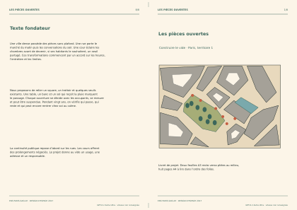
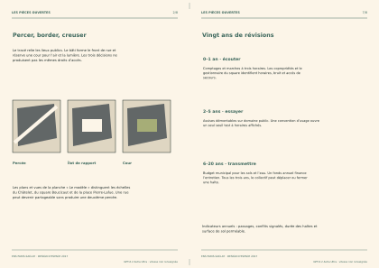
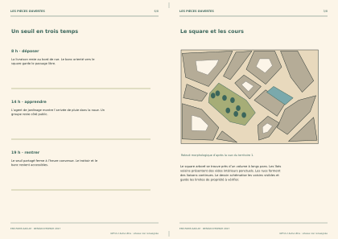
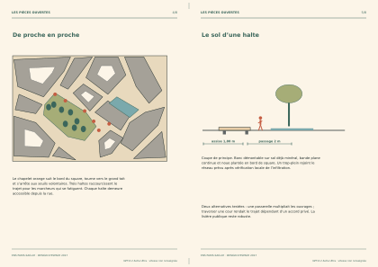

# ENS Paris-Saclay — Design d'espace 2017 · Corrigé brut

*Corrigé rédigé par IA, non officiel.*

**Rédaction** · GPT-6.2 Astra Ultra · vitesse non renseignée

Les pièces ouvertes est un livret à plier. Les plans sont des schémas morphologiques du territoire parisien donné en annexe. Les deux feuilles sont composées pour un pli médian. Les 4 planches numérotées et anonymes sont au format 420 × 297 mm. Les échelles indiquées valent pour une planche seule imprimée sur A3 à 100 %.

## Planche 1 — Couverture et texte fondateur

Imprimer les quatre faces à 100 % en recto verso avec retournement sur bord court, assembler les feuilles en cahier, plier sur la médiane et vérifier la suite des folios. La feuille extérieure réunit les pages 8 et 1 puis 2 et 7. La feuille intérieure réunit 6 et 3 puis 4 et 5. La dernière page porte le texte fondateur intégral.

## Planche 2 — Du type haussmannien à la décision collective

L’îlot associe continu de façade, commerces sur rue et cours intérieures. Son fonctionnement donne à la fois de la lumière et une forte différenciation entre rue publique et fond privé. Les formes des grands travaux résultent aussi de démolitions et de déplacements. Le projet conserve les façades et le logement. La promenade reste possible sur domaine public même en cas de refus des occupants.

## Planche 3 — Conséquences quotidiennes et lecture du territoire

Le territoire parisien est choisi sur les deux autorisés. La photographie et la vue oblique de l’annexe 1 permettent d’observer le square, les cours encloses et le voisinage d’un grand bâtiment couvert de toits parallèles. Le dessin conserve ces rapports et simplifie les rues. Le statut juridique, les cotes et les accès n’y sont pas lisibles. Ces données conditionneraient le passage à une étude opérationnelle.

## Planche 4 — Relier des espaces sans démolir

La promenade n’ajoute pas de percée. Elle améliore le passage au pied des arbres, rend les usages visibles et prévoit les conditions concrètes de leur révision. Les largeurs et positions sont des hypothèses dimensionnelles, à vérifier par relevé. Dans les vingt prochaines années, réchauffement, densité d’usage et vieillissement peuvent augmenter simultanément la demande d’ombre, de siège et d’accès facile. Le montage par petites interventions permet de répondre en plusieurs étapes.

[Énoncé et annexes du concours](https://ens-paris-saclay.fr/sites/default/files/CONCOURS/ANNALES_1C/1C_Design/2017_Sujet_1A_Design_Espace.pdf)
