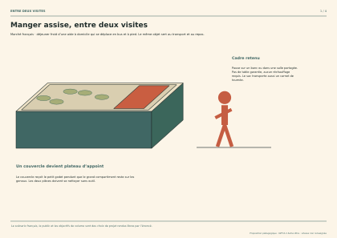
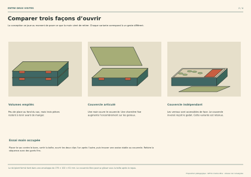
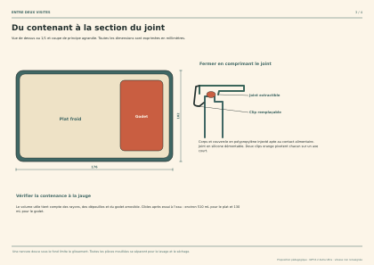
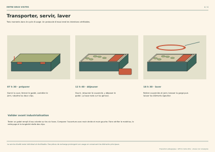

# ENS Paris-Saclay — Design de produit 2017 · Corrigé brut

*Corrigé rédigé par IA, non officiel.*

**Rédaction** · GPT-6.2 Astra Ultra · vitesse non renseignée

Entre deux visites est un bento réutilisable pour un repas froid pendant une tournée d’aide à domicile en France. Le PDF officiel se termine en page 3 par « FIN DE L’ÉPREUVE ». La garde annonce deux pages A4 d’annexe qui ne figurent pas dans ce fichier. La consigne complète, les critères et le choix libre du scénario sont reproduits dans la partie distribuée accessible. Les 4 planches numérotées et anonymes sont au format 420 × 297 mm. Les échelles indiquées valent pour une planche seule imprimée sur A3 à 100 %.

## Planche 1 — Manger assise, entre deux visites

Ce bento vise une pause courte dans une tournée urbaine. Une salade de pâtes et un accompagnement se mangent froids. La petite pièce sépare jusqu’au repas la garniture humide ou un dessert. Le produit circule dans le sac personnel et se lave le soir au domicile. Pour des denrées qui nécessitent le froid, l’usage suppose une poche isotherme munie d’un accumulateur ou une mise au froid sur le lieu de travail. La boîte seule n’assure pas de réfrigération.

## Planche 2 — Comparer trois façons d’ouvrir

La boîte empilée gêne quand on ne peut poser aucun couvercle. L’option articulée est rapide mais demeure très large. La solution retenue libère le dessus, transforme le couvercle en support et conserve seulement deux volumes avec leurs fermetures. La petite pièce a son propre couvercle et peut rester au fond si elle n’est pas servie immédiatement.

## Planche 3 — Du contenant à la section du joint

La cuve intérieure hypothétique fait environ 165 × 90 × 47 mm avant arrondis, soit 698 mL pour le parallélépipède. Le petit godet extérieur de 48 × 79 mm occupe environ 160 mL avec ses parois. L’objectif de 510 mL pour le plat et de 130 mL pour le godet est donc compatible avec l’enveloppe ; il se vérifie sur prototype. Les parois injectées doivent recevoir des dépouilles et des rayons compatibles avec le moule. Le joint est mis en place après moulage et peut être remplacé indépendamment.

## Planche 4 — Transporter, servir, laver

Le godet reçoit les préparations humides et doit rester étanche au retournement. Compter les fuites après une série d’ouvertures puis après des lavages répétés. Vérifier si le couvercle peut être saisi sans contact avec la face alimentaire et si la boîte pleine reste stable sur une assise. L’autonomie recherchée se juge auprès de personnes en tournée et non d’après une durée d’essai inventée.

[Sujet officiel de trois pages](https://ens-paris-saclay.fr/sites/default/files/CONCOURS/ANNALES_1C/1C_Design/2017_Sujet_1A_Design_Produit.pdf)
