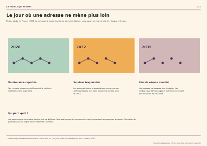
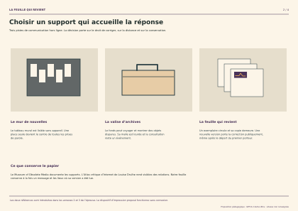
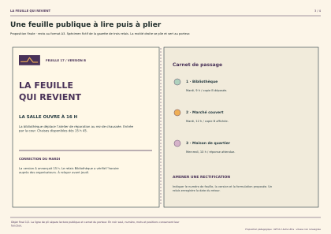
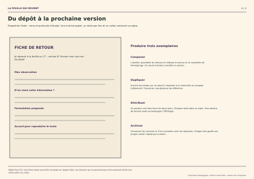

# ENS Paris-Saclay — Design graphique 2017 · Corrigé brut

*Corrigé rédigé par IA, non officiel.*

**Rédaction** · GPT-6.2 Astra Ultra · vitesse non renseignée

La feuille qui revient équipe trois lieux d’un quartier pour publier une annonce et en recevoir la correction dans un monde fictionnel privé de réseau mondial. Les 4 planches numérotées et anonymes sont au format 420 × 297 mm. Les échelles indiquées valent pour une planche seule imprimée sur A3 à 100 %.

## Planche 1 — Le jour où une adresse ne mène plus loin

Le sujet distingue Internet, infrastructure d’interconnexion, et le Web, qui est l’un de ses usages. Dans la fiction proposée, des décisions successives de maintenance, d’énergie et de financement finissent par dissocier les réseaux locaux. Personne ne peut rétablir à lui seul une liaison universelle. La mairie peut encore afficher un horaire, mais un habitant ne peut plus rapporter une modification au-delà de sa propre place publique. C’est cette circulation des réponses que le projet équipe.

## Planche 2 — Choisir un support qui accueille la réponse

Les annexes proposent notamment l’archivage de supports physiques et une réflexion graphique sur la structure d’Internet. La feuille conserve, d’une part, des récits d’usages révolus et, d’autre part, les versions successives d’une information actuelle. Chaque lieu conserve une copie et peut ouvrir un droit de réponse. Le stylo et le stencil demeurent accessibles à des bénévoles et l’affichage reste utile aux lecteurs qui ne se déplacent pas.

## Planche 3 — Une feuille publique à lire puis à plier

Le numéro stable désigne l’information et la lettre la version. Les mots et les positions demeurent lisibles en monochrome. Le numéro de relais, la date et le motif accompagnent une rectification. Les identités privées peuvent rester confidentielles et un témoignage personnel n’est reproduit qu’avec accord. La réception d’une feuille n’engage pas le lieu à endosser une opinion. Une réponse publiée en vis-à-vis conserve les deux prises de parole.

## Planche 4 — Du dépôt à la prochaine version

En cas d’absence d’un relais, la copie va au suivant et la case reste datée comme non desservie. Un exemplaire agrandi peut être affiché, l’essentiel peut être lu à voix haute, puis une personne peut dicter sa réponse. Le coût principal est le temps des relecteurs et porteurs. Le prototype se teste en comptant les versions A restées affichées après diffusion de B et les corrections effectivement retournées. Pour évoquer la mémoire du Web, une rubrique périodique décrit un usage ancien et sa traduction sur papier, avec une source et une date.

[Énoncé et annexes du concours](https://ens-paris-saclay.fr/sites/default/files/CONCOURS/ANNALES_1C/1C_Design/2017_Sujet_1A_Design_Graphique.pdf)
