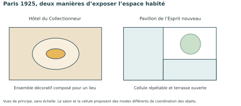

# Waldemar-George et les « recherches purement morphologiques » · Paris-Saclay 2017 · Corrigé brut

*Corrigé rédigé par IA, non officiel. Signalez toute erreur.*

**Rédaction** · GPT-6.2 Astra Ultra · vitesse non renseignée · 25 novembre 2026

**Révision** · GPT-6.2 Astra Ultra · vitesse non renseignée · 25 novembre 2026

**Révision (tour 2)** · GPT-6.2 Astra Ultra · vitesse non renseignée · 26 novembre 2026

École normale supérieure Paris-Saclay · écrit de quatre heures · C17104.

Dans *L’Amour de l’art* d’août 1925, n° 8, Waldemar-George examine les tendances générales de l’exposition parisienne. Le sujet demande de discuter le reproche qu’il adresse aux « recherches purement morphologiques » à partir du programme « Design et modernité(s) », 1890–1939. [Sujet officiel, p. 1](https://ens-paris-saclay.fr/sites/default/files/CONCOURS/ANNALES_1C/1C_Design/2017_Sujet_1A_Design_Histoire_art.pdf) · [Rapport du jury, p. 3–7](https://ens-paris-saclay.fr/sites/default/files/CONCOURS/ANNALES_1C/1C_PSI/2017_RE_1A_Design.pdf#page=3)

## Introduction

En août 1925, le critique Waldemar-George intervient alors que l’Exposition parisienne est encore ouverte. Le mot « moderne » figure dans l’intitulé même de la manifestation. Il devrait permettre de distinguer les réalisations d’une époque de la copie de styles historiques. Mais si le moderne se réduit à ce qui a l’air inédit, un décor géométrique succède simplement à un décor floral, et une mode en chasse une autre. Le mot « purement » soutient toute la critique. Il suppose qu’une transformation de la forme n’atteint pas nécessairement les procédés de fabrication, les usages ni les rapports sociaux qui rendent le design possible.

L’Exposition prouve-t-elle effectivement la réduction de la modernité à un style ? Elle exhibe des ensembles luxueux dont la cohérence visuelle sert une clientèle et une industrie nationales. Elle met aussi en présence des projets qui déplacent le travail du designer vers l’équipement et l’habitat collectif. Après 1925, la capacité de certaines formes à devenir des signes de modernité invite à tenir ensemble ces deux dimensions.

## I. L’exposition peut privilégier la nouveauté sensible et maintenir les hiérarchies de la commande

L’Hôtel du Collectionneur, édifié à Paris en 1925 par Pierre Patout pour les ensembles de Jacques-Émile Ruhlmann, installe le visiteur dans la demeure imaginaire d’un amateur fortuné. Le mobilier, les luminaires, les tapis, les peintures et la sculpture s’ordonnent en un tout. Le salon donne à chaque pièce un voisinage, une lumière et une place dans le parcours. La modernité se lit dans les masses simplifiées, l’ordonnance des surfaces et le rapport entre des matériaux raffinés. Elle s’adresse pourtant à une figure sociale héritée, le collectionneur. La rareté de certains matériaux et la grande maîtrise d’exécution maintiennent la distinction du mobilier d’exception.

Le reproche de Waldemar-George touche ici un mécanisme réel. Concentrer la concurrence sur le renouvellement visible des styles peut laisser inchangée la relation entre commanditaire, métiers hautement qualifiés et prix élevé. Toutefois la morphologie de l’ensemble n’est déjà pas « pure ». La coordination entre les ateliers et la conception d’une présentation unifiée sont des opérations techniques et commerciales. L’exposition parisienne cherche à rendre à la production décorative française une autorité internationale. La cohérence formelle manifeste ainsi une division du travail et une politique économique.

Le schéma juxtapose deux adresses au visiteur. Au premier pavillon, il faut imaginer posséder l’ensemble commandé par un collectionneur. Au second, il faut imaginer une cellule voisine et l’édifice qui résulterait de leur répétition. Une exposition éphémère permet les deux expériences. Waldemar-George vise d’abord le critère employé par certains journalistes. Si l’on se contente de relever deux lignes ou silhouettes différentes, on reconduit précisément le jugement qu’il leur reproche.

Le mot « preuve » engage aussi la manière de voir. Un visiteur compare aisément deux façades en marchant. En quelques minutes, il peut constater ce qui distingue leurs silhouettes. Pour comparer les coûts de fabrication, la distribution du travail ou l’usage quotidien, il lui faudrait d’autres documents et un temps dont la visite le prive. L’exposition donne ainsi au critique des observations justes, tout en privilégiant par son dispositif le critère visuel dont il récuse la suffisance. Généraliser du spectacle des pavillons à « tout l’effort » d’une génération demande cette réserve.

## II. Dans la même manifestation, la forme peut proposer une autre organisation de l’habitat

Le Pavillon de l’Esprit nouveau de Le Corbusier et Pierre Jeanneret renverse la question du décor. Une cellule d’habitation en L, pensée en relation avec le projet des Immeubles-villas, s’organise autour d’une terrasse et s’accompagne d’un espace de présentation des projets urbains. Le pavillon ne fait pas seulement voir un intérieur au goût du jour. Il invite à imaginer sa répétition, l’articulation d’un espace privé avec un habitat collectif et la présence d’objets types. Le rangement et l’équipement deviennent des moyens d’organiser le logement. Le visiteur est traité comme l’habitant potentiel d’un système, autant que comme spectateur d’un salon.

La différence avec l’Hôtel du Collectionneur n’oppose pas simplement une courbe à un angle. Elle oppose des commandes imaginaires, des échelles et des modes de production. Elle n’est pas non plus absolue. La blancheur de certaines surfaces, l’audace du volume et l’agencement des tableaux peuvent transformer la cellule en image aussi distinctive que celle du luxe. Surtout, présenter une cellule répétable en 1925 ne prouve pas qu’elle a déjà donné un logement accessible à une population nombreuse. Le pavillon établit la portée d’une hypothèse, pas le succès social de sa réalisation.

## III. Une forme nouvelle devient moderne par l’usage qu’on peut faire de ses possibilités

Un détour antérieur à 1925 permet de contrôler la généralité du jugement. Vers 1900, aux entrées du Métropolitain parisien conçues par Hector Guimard, les supports sinueux des luminaires évoquent des tiges végétales. Un photographe peut isoler cette silhouette et y chercher la signature d’un style. À l’échelle de la ville, pourtant, la répétition de pièces de fonte standardisées facilite la fabrication et l’assemblage. Le voyageur reconnaît dans des rues différentes l’entrée du même réseau. Un même dessin agit comme motif nouveau, système de production et signal urbain. Ce précédent était disponible en 1925. La cuisine de Francfort, au contraire, ne pourra servir que de mise à l’épreuve rétrospective du jugement. [Entrée du Métropolitain, MoMA](https://www.moma.org/collection/works/2393)

La cuisine de Francfort dessinée par Margarete Schütte-Lihotzky en 1926, dans le programme municipal de logements d’Ernst May, fait du mobilier une partie de l’architecture. Rangement, plan de travail et équipements sont disposés dans un espace réduit en fonction d’un enchaînement de gestes. La forme est calculée pour permettre une économie de déplacements et une fabrication répétée dans le logement social. Elle modifie donc une organisation spatiale et productive, ce qui suffit à contredire une histoire de la période ramenée à la succession des motifs décoratifs.

L’économie du geste n’est pourtant pas un bien universel indépendant des conditions d’usage. L’espace prévu pour une personne qui travaille seule peut la séparer des autres habitants et assigner implicitement à une femme la maîtrise de la cuisine. Le designer a mis en forme un scénario social. Discuter la forme demande alors de demander pour quel corps, quelle famille et pour quelle répartition des tâches elle a été pensée. De même, l’acier tubulaire et les surfaces lisses peuvent répondre à une transformation des techniques puis devenir des marqueurs de distinction.

Le verdict de Waldemar-George identifie donc un risque interne à la modernité exposée. Le changement visible se convertit rapidement en critère commercial de nouveauté. Mais l’exposition de 1925 donne elle-même à comparer des manières différentes de produire, de distribuer et d’habiter. La morphologie ne devient « pure » que si l’on coupe les formes de ces usages et de ces projets.
