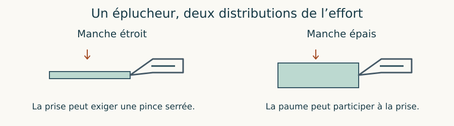

# De quoi le designer est-il responsable ? · 2017 · Corrigé brut

*Corrigé rédigé par IA, non officiel. Signalez toute erreur.*

**Rédaction** · GPT-6.2 Astra Ultra · vitesse non renseignée

## Introduction

Une personne souffrant des mains peut-elle préparer seule un repas ? La question semble relever de son état physique. Elle dépend aussi du diamètre du manche et de l’effort nécessaire pour manœuvrer l’éplucheur que nous lui tendons. Dans *Design pour un monde réel*, Victor Papanek exige du designer la conscience de sa responsabilité sociale et morale. Une forme produite en série organise en effet pour beaucoup de personnes les circonstances d’un geste intime. Mais pourquoi en rendre responsable celui qui l’a dessinée, quand d’autres décident du prix, des matériaux, de la distribution et de l’usage ? Et que vaut sa conscience si les conséquences prévisibles se réalisent malgré lui ? Il faut partir de la portée de ses décisions, en mesurer les limites, puis déterminer ce qui peut être exigé dans l’exercice même du métier.

## I. Une décision de forme déplace les possibilités d’agir

Un manche mince et lisse peut imposer une pince forte entre les doigts. Un manche plus épais et moins glissant peut répartir l’effort sur une plus grande surface. Le schéma isole cette variable pour que l’on puisse suivre la décision de dessin jusque dans le mouvement de la main. Les ustensiles *Good Grips*, commercialisés par OXO en 1990, rendent familière cette recherche sur la préhension. Le gain d’autonomie d’une personne qui peine à fermer les doigts tient ici à un travail d’équipe situé au début de la chaîne, bien avant sa rencontre avec l’objet.

La portée de la modification est sociale dès lors que l’autonomie de cuisiner, la possibilité de tenir un poste ou le besoin d’appeler quelqu’un ne se distribuent pas également. Elle devient un enjeu moral au moment où l’on demande quelles raisons pourraient justifier l’effort supplémentaire imposé à certains. Une majorité d’utilisateurs serait-elle satisfaite par le manche mince ? Cela établit une fréquence, mais pas un droit à ignorer les autres. Il faut encore comparer le gain réel, la gêne éventuelle pour d’autres prises et les solutions accessibles. Ici, traiter l’usager comme une moyenne est déjà choisir quels efforts compter.

## II. L’imputation exige de distinguer pouvoir d’agir et résultat produit

Le concepteur ne décide pas seul. Un prototype peut être satisfaisant, puis un fournisseur modifier la matière, un acheteur choisir une finition moins chère ou un magasin tenir le produit hors de portée de ceux auxquels il servirait le plus. Remonter d’une conséquence à un auteur unique serait aussi trompeur que de croire que la responsabilité disparaît parce qu’elle est partagée. Le dessinateur qui pouvait signaler une perte de prise n’occupe pas la même position que l’ouvrier tenu de monter le manche retenu. La question pertinente devient celle des informations et des leviers dont chacun disposait, puis de l’usage qu’il en a fait.

La conscience recommandée par Papanek comporte ainsi une obligation de s’informer. Une personne qui a passé son projet entre toutes les mains disponibles sauf celles des premiers intéressés peut se croire bienveillante tout en restant volontairement mal renseignée. Inversement, la mise à l’épreuve la plus attentive n’autorise pas à prédire toutes les transformations futures. Répondre du projet signifie pouvoir rendre raison des hypothèses, transmettre ce qu’on sait des limites et ouvrir un chemin pour signaler une défaillance. Cette exigence tient à la place exercée dans une décision, non à un rêve de maîtrise absolue.

## III. Répondre aux intéressés leur laisse une part de décision

Supposons qu’une nouvelle poignée soit testée uniquement par des personnes ayant de grandes mains. Son diamètre généreux peut faciliter une prise et gêner les doigts courts. La même pièce change alors de valeur selon la personne qui l’essaie. Il devient insuffisant de juger l’objet d’après la bonté de son intention. Il faut organiser l’essai de solutions de plusieurs tailles, observer un geste entier, y compris le nettoyage et le rangement, puis rendre la comparaison discutable pour ceux qui l’emploieront. La participation ne consiste pas à faire approuver un prototype déjà arrêté.

Dans cette situation, la responsabilité morale n’est pas dissoute dans le vote des usagers. Il revient encore au professionnel de faire connaître une contrainte de solidité que les personnes consultées ne voient pas. S’il obtient un délai pour vérifier un choix ou refuse de garantir une performance qu’il n’a pas testée, il agit aussi dans un cadre économique qui peut lui opposer un coût. La conscience du rôle social devient ainsi un travail de négociation, parfois de désaccord explicite. Elle donne aux intéressés des raisons qu’ils peuvent examiner, et au designer un devoir qui dépasse celui de livrer à temps un objet séduisant.

## Conclusion

Papanek a raison d’attacher une obligation à la faculté de façonner les conditions de vie d’autrui. Elle s’exerce à la mesure du pouvoir et du savoir réellement disponibles. La conscience n’en est que le commencement. Elle prend une forme professionnelle dans l’enquête, l’explicitation des compromis et la possibilité offerte aux usagers de faire reprendre une décision qui les concerne.
