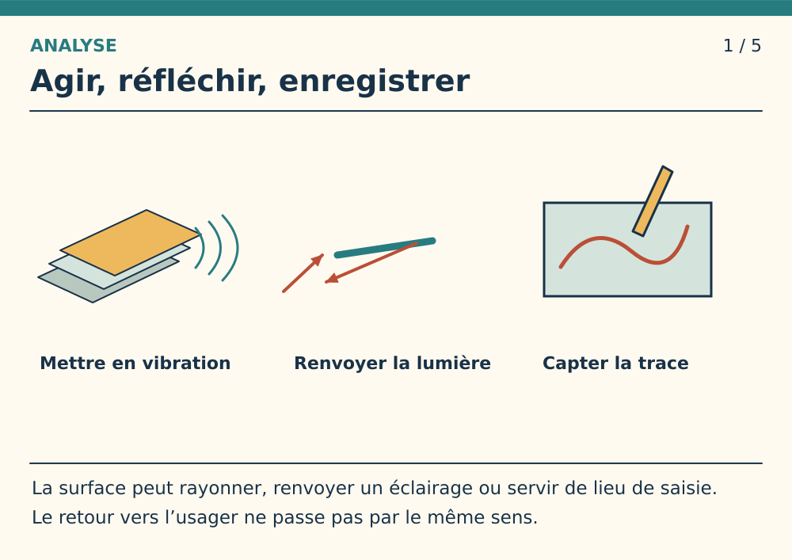
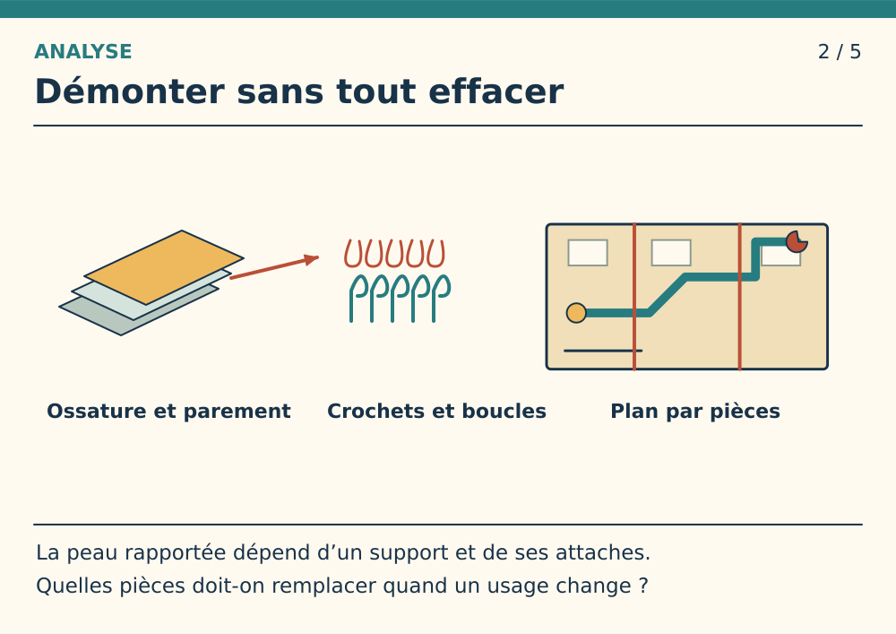
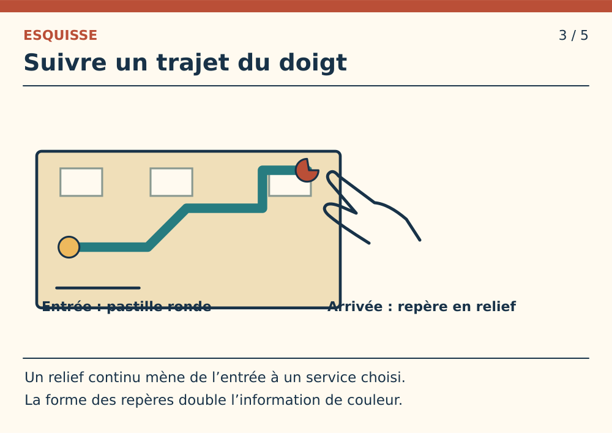
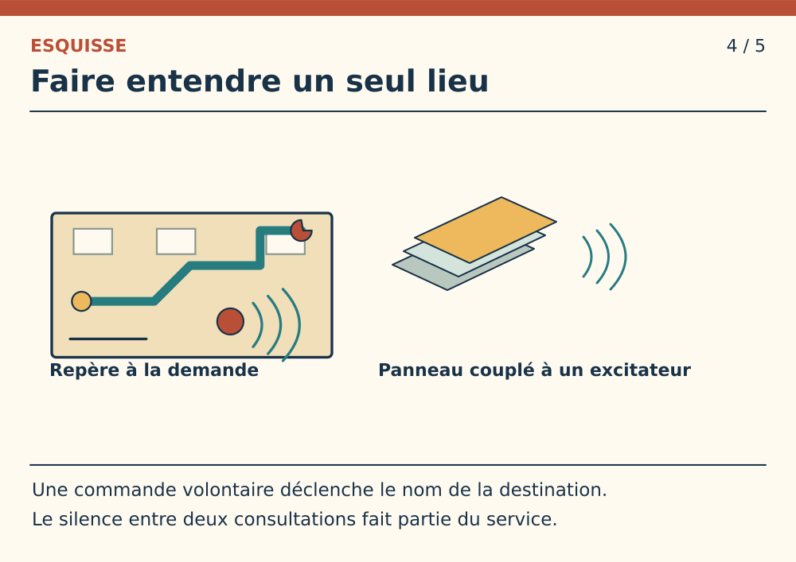
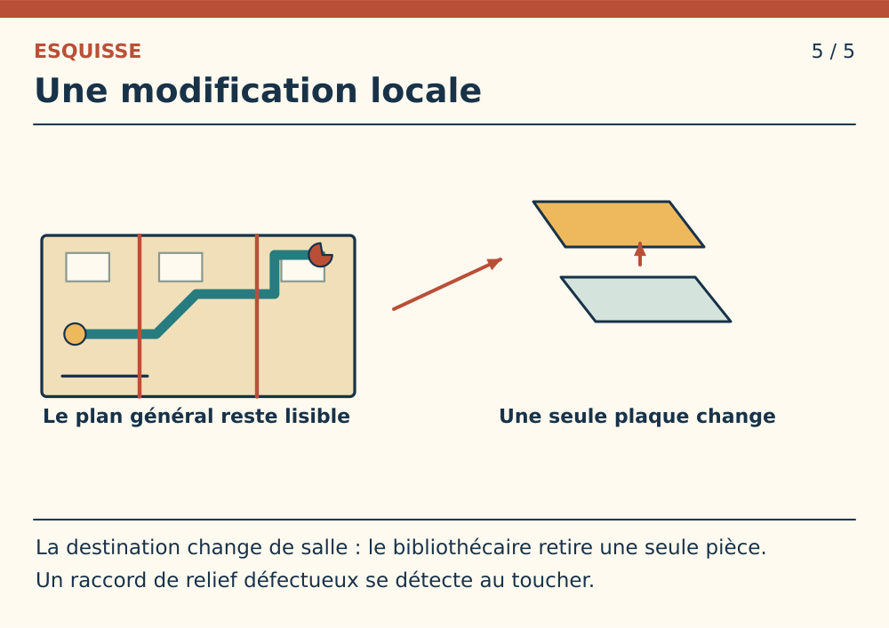

# ENS Paris-Saclay · Design 2017 · Techno-design · Corrigé brut

*Corrigé rédigé par IA, non officiel.*

**Lecture du rapport du jury** · GPT-6.2 Astra Ultra · vitesse non renseignée

**Rédaction** · GPT-6.2 Astra Ultra · vitesse non renseignée

**Révision (tour 1)** · GPT-6.2 Astra Ultra · vitesse non renseignée

## Surfaces utiles

Une surface peut être successivement un support, un instrument et une interface de lecture. Je cherche à guider les visiteurs d’une médiathèque sans immobiliser son mobilier ni imposer un écran. Deux analyses et trois esquisses forment cinq A3.

### Analyse 1 · Agir, réfléchir, enregistrer

Chez Pierre Charrié (2013), le multiplis d’érable est couplé à un haut-parleur à vibration. Excitée, la surface entière participe à l’émission du son. Le Life Paint de Volvo (2015) modifie la réponse du textile à la lumière incidente. La visibilité dépend de l’éclairage et de l’angle d’observation. La Slate d’ISKN (2014) ajoute au geste habituel une mesure de position et d’orientation, au moyen de la bague et des capteurs de la tablette. Le trait laissé sur la feuille et la trace enregistrée peuvent alors être comparés.

### Analyse 2 · Démonter sans tout effacer

La photographie de chantier de la Philharmonie de Jean Nouvel (2015) montre le support avant le parement, tandis que le détail fini concentre l’attention sur les oiseaux modulaires. Une même peau recouvre des situations d’angle différentes. Chez Georges de Mestral (1951), le crochet s’engage dans une boucle et se libère par pelage. Cela rend la liaison réversible, au prix d’usure et de salissures possibles. Dans le plan du métro londonien dessiné par Harry Beck (1933), simplifier la forme spatiale sert le choix d’un trajet. Je retiens cette différence entre exactitude géométrique et exactitude des correspondances pour repenser le plan d’une médiathèque qui déplace souvent ses services.

### Esquisse 3 · Suivre un trajet du doigt

Première hypothèse. Un rail en relief, posé sur un fond calme, guide le doigt de l’entrée à une destination. Le départ est rond, l’arrivée reçoit en plus une encoche. Un lecteur malvoyant peut choisir le sens du parcours sans devoir identifier les teintes. Maquette en carton sur table inclinée, avec tracés droit et coudé. J’observe les pertes de piste aux changements de direction et j’élargis les rayons qui font dévier le doigt.

### Esquisse 4 · Faire entendre un seul lieu

Deuxième hypothèse. À la demande, une pastille déclenche la lecture du nom du service. Un excitateur fixé derrière une petite plaque l’utilise comme surface rayonnante, en reprenant le principe de Charrié. Un joint souple sépare la plaque du grand panneau. Je compare sur table la compréhension d’un seul mot près du plan et sa perception à l’autre bout de la salle. Si le nom se propage au-delà de la zone d’accueil, la solution tactile reste utilisable seule.

### Esquisse 5 · Une modification locale

Troisième hypothèse. Les modules portent le segment de route et l’indication du service. Une encoche de montage interdit de les retourner. Deux fixations sont comparées, une fente de glissement et des bandes autoagrippantes accessibles en rive. Pendant un changement fictif de salle, je mesure le temps de remplacement et demande à une seconde personne de parcourir le joint sans indication. La fixation qui ralentit le moins la maintenance peut rester mauvaise si le raccord accroche le doigt. Le prototype est révisé sur les deux critères.

## Sources

Les sept pages du sujet contiennent les cinq notices illustrées. Le rapport global de 2017 comporte une section consacrée au techno-design à partir de la page 8.

[Fascicule officiel](https://ens-paris-saclay.fr/sites/default/files/CONCOURS/ANNALES_1C/1C_Design/2017_Sujet_1A_Design_Techno_design.pdf) · [Rapport du jury](https://ens-paris-saclay.fr/sites/default/files/CONCOURS/ANNALES_1C/1C_PSI/2017_RE_1A_Design.pdf)
