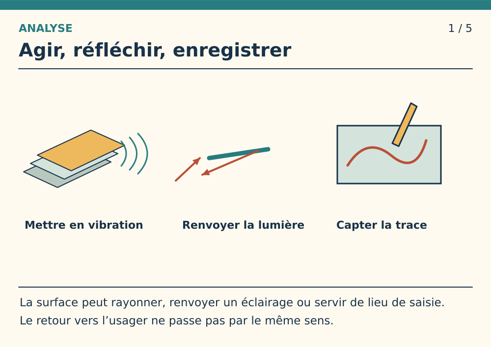
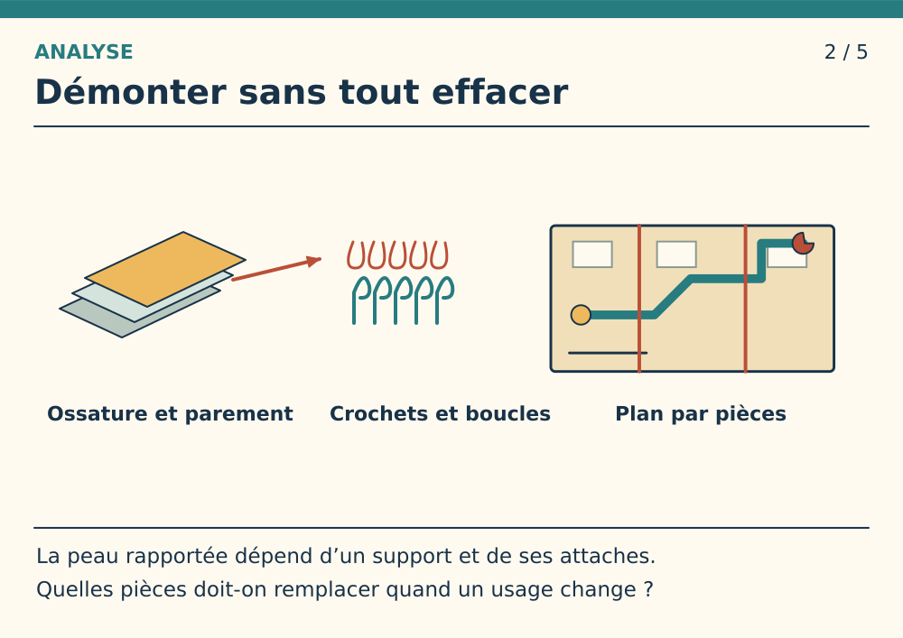
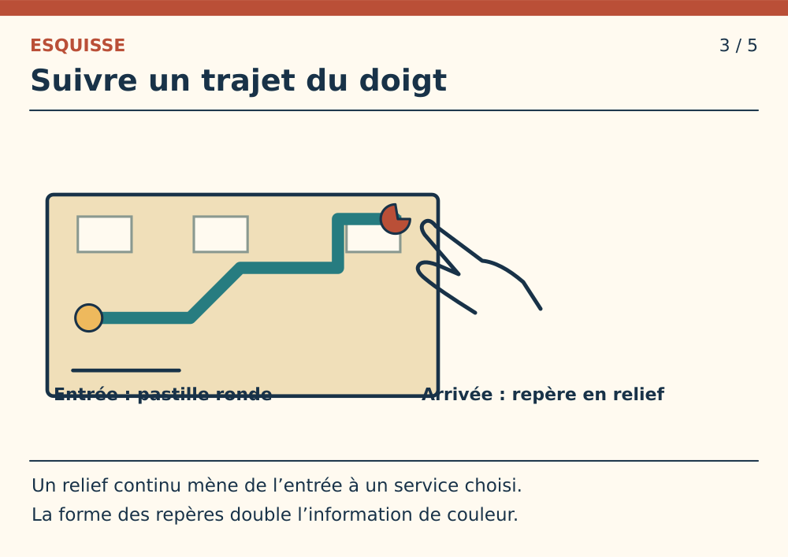
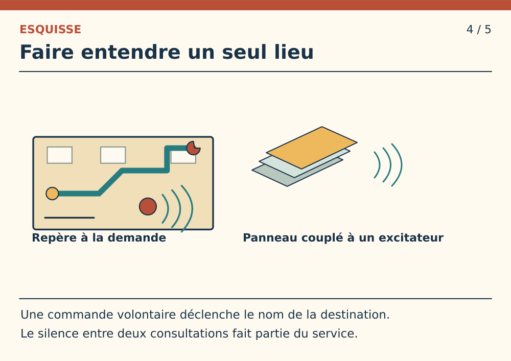
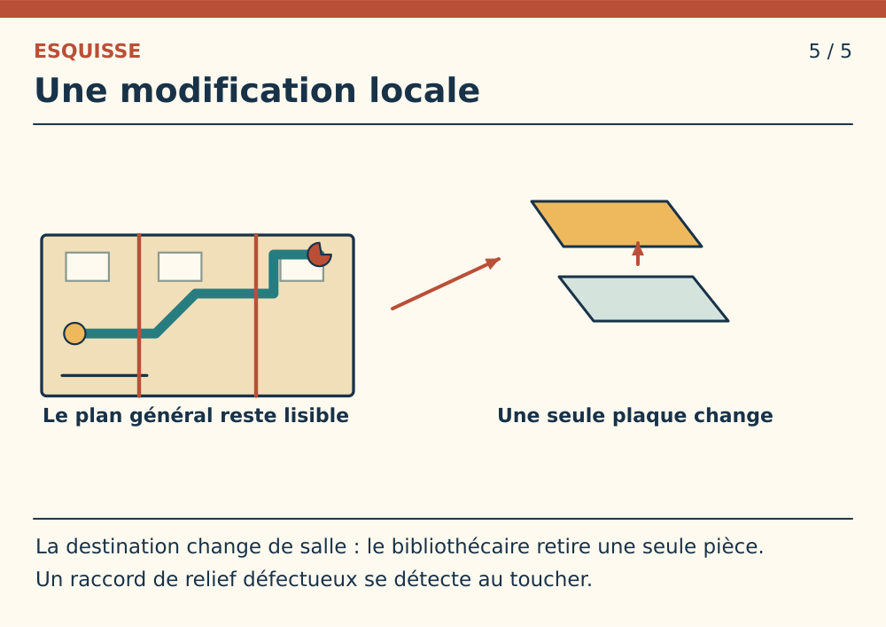

# ENS Paris-Saclay · Design 2017 · Techno-design · Corrigé guidé

*Corrigé rédigé par IA, non officiel.*

**Lecture du rapport du jury** · GPT-6.2 Astra Ultra · vitesse non renseignée

**Rédaction** · GPT-6.2 Astra Ultra · vitesse non renseignée

**Révision (tour 1)** · GPT-6.2 Astra Ultra · vitesse non renseignée

## Surfaces utiles

Le fascicule propose quatre heures d’analyse et quatre heures d’esquisse. Le rapport demande d’aller au-delà de l’inventaire des matériaux et de dégager les limites de la transposition. Dans ce dossier, chaque hypothèse a un usager, un revers matériel et un essai susceptible de l’invalider.

### Analyse 1 · Agir, réfléchir, enregistrer

Identifier, pour les trois surfaces, l’énergie ou l’information qui entre, ce qui est transformé et ce que la personne perçoit.

Sur le dessin de Life Paint, remonter le trajet lumineux jusqu’à une source extérieure. Pour la Slate, dessiner la feuille, le crayon muni de sa bague et le plan des capteurs. Le papier peut être remplacé. Le système de mesure reste nécessaire à l’enregistrement.

### Analyse 2 · Démonter sans tout effacer

À quelle opération correspond le joint, dans la façade puis dans la bande autoagrippante ?

Partir de la vue inachevée et dessiner deux couches. Mettre une main en bord de bande pour montrer le pelage. L’occasion de projet naît du besoin de remplacer une seule indication de trajet quand aucun autre service n’a déménagé.

### Esquisse 3 · Suivre un trajet du doigt

Qu’est-ce qui distingue les extrémités si l’on ferme les yeux ?

Poser deux repères identiques en témoin, puis introduire l’encoche sur l’arrivée. Comparer le nombre de retours au point de départ. Solliciter des personnes concernées lors des essais, en leur laissant la possibilité de refuser le guidage tactile.

### Esquisse 4 · Faire entendre un seul lieu

Pourquoi tester deux points d’écoute et un panneau témoin sans joint ?

La réussite est double. Le mot doit être intelligible près du repère sans perturber les lecteurs voisins. La comparaison entre montage rigide et montage découplé vérifie si la vibration gagne toute la table.

### Esquisse 5 · Une modification locale

Comment éviter qu’un changement réussi en réserve crée une erreur à l’accueil ?

Vérifier à deux le nom annoncé, le symbole d’arrivée et le chemin continu avant de rouvrir le plan. Noter séparément le temps de préparation et les erreurs d’orientation. Le choix de liaison dépend de ces deux observations.

## Sources

Les sept pages du sujet contiennent les cinq notices illustrées. Le rapport global de 2017 comporte une section consacrée au techno-design à partir de la page 8.

[Fascicule officiel](https://ens-paris-saclay.fr/sites/default/files/CONCOURS/ANNALES_1C/1C_Design/2017_Sujet_1A_Design_Techno_design.pdf) · [Rapport du jury](https://ens-paris-saclay.fr/sites/default/files/CONCOURS/ANNALES_1C/1C_PSI/2017_RE_1A_Design.pdf)
