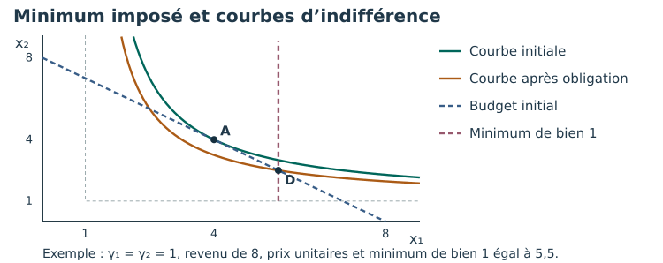
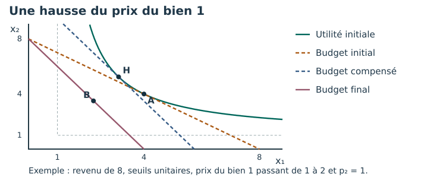

# ENS Paris-Saclay · Analyse économique générale 2017 — Corrigé brut

*Corrigé rédigé par IA, non officiel. Signalez toute erreur.*

**Rédaction** · GPT-6.2 Astra Ultra · vitesse non renseignée

Banque ENS Cachan et ENSAI, option économique et de gestion, quatre heures. Les numéros suivent le sujet de la session. Aucun rapport distinct de cet écrit n’est identifié sur la page d’annales de la session.

## 1.1 à 1.9. Préférences et rationnement

**1.1. Seuils.** Le domaine économique est $x_i\ge\gamma_i$. Chaque $\gamma_i$ est une consommation de base. L’utilité positive provient des excédents $z_i=x_i-\gamma_i$. Écrivons $G=p_1\gamma_1+p_2\gamma_2$ et $m=y-G$, le revenu restant après les dépenses incompressibles. Les prix sont positifs.

**1.2. Courbes d’indifférence.** Au niveau $u>0$,

$$
x_2=\gamma_2+u^{1/\alpha_2}(x_1-\gamma_1)^{-\alpha_1/\alpha_2}.
$$

Les courbes sont décroissantes, strictement convexes, asymptotes aux droites $x_i=\gamma_i$. Un déplacement vers le nord-est augmente l’utilité. Les deux courbes de la figure 1 illustrent deux niveaux différents. Les demi-droites frontières du domaine ont l’utilité nulle.

**1.3. Logarithme.** Sur l’intérieur du domaine, $\ln U$ conserve l’ordre puisque le logarithme est strictement croissant. Sur la frontière, on peut représenter les paniers d’utilité nulle par la même valeur étendue $-\infty$.

**1.4. Logarithme négatif.** Sur le même domaine intérieur, $-\ln U$ renverse toutes les préférences strictes. Il pourrait représenter un critère de coût à minimiser.

**1.5. Ajout du produit $x_1x_2$.** Le même ordre n’est pas garanti. Prenons $\gamma_1=1,\gamma_2=0,\alpha_1=\alpha_2=1$. Les paniers $(2,4)$ et $(3,2)$ ont tous deux $U=4$, alors que $Z$ vaut respectivement 12 et 10. Dans des cas particuliers, le produit ajouté est lui-même une fonction croissante de $U$.

**1.6. Normalisation.** Remplacer $U$ par $U^{1/(\alpha_1+\alpha_2)}$ préserve les préférences et donne deux exposants de somme un. C’est une normalisation ordinale, sans hypothèse empirique supplémentaire sur les goûts.

**1.7 et 1.8. Valeur nulle et coin.** Si $m>0$, il existe un panier avec les deux excédents strictement positifs et donc $U>0$. Aucun panier avec $x_i=\gamma_i$ ne peut alors maximiser $U$. En particulier, $x_i$ est positif même lorsque $\gamma_i=0$. Si $m=0$, le seul panier faisable sur ce domaine est $(\gamma_1,\gamma_2)$, comportant une consommation nulle pour tout seuil nul. Pour $m<0$, aucun panier n’atteint les seuils.

**1.9.1. Équilibre.** Avec $m>0$, la droite de budget est tangente à la plus haute courbe accessible en A. Le taux marginal de substitution $\alpha_1 z_2/(\alpha_2 z_1)$ y égale $p_1/p_2$.

**1.9.2. Minimum imposé.** Lorsque l’obligation est $x_1\ge X_1>x_1^*$ et $p_1X_1+p_2\gamma_2<y$, le segment budgétaire admissible débute à D, où $x_1=X_1$, $x_2=(y-p_1X_1)/p_2>\gamma_2$. Au-delà de l’optimum libre, augmenter encore $x_1$ sur la droite fait baisser l’utilité. D est donc le nouvel optimum, à un niveau strictement inférieur à celui de A. Le même point est obtenu si le niveau imposé est exactement $X_1$.

## 1.10 et 1.11. Demandes, dépense et effet d’un prix

**1.10.1. Demandes marshalliennes.** Désormais $a=\alpha_1$, $b=\alpha_2$, $a+b=1$, et $m>0$. Maximiser $a\ln z_1+b\ln z_2$ sous $p_1z_1+p_2z_2=m$ donne $p_1z_1=am$ et $p_2z_2=bm$. Les demandes sont donc $x_1=\gamma_1+am/p_1$ et $x_2=\gamma_2+bm/p_2$.

**1.10.2. Utilité indirecte.** Avec $K(p)=(p_1/a)^a(p_2/b)^b$, la substitution donne $V(p,y)=m/K(p)$. Les dépenses de base influent via $m$, les possibilités de substitution via $K$.

**1.10.3. Demandes hicksiennes.** Minimiser $G+p_1 z_1+p_2 z_2$ sous $z_1^az_2^b\ge u$. La contrainte est saturée et les conditions de tangence imposent les mêmes parts $a,b$ de la dépense excédentaire. Puisque $u$ exige un budget excédentaire $uK$, on trouve $h_1=\gamma_1+a uK/p_1$ et $h_2=\gamma_2+b uK/p_2$.

**1.10.4. Dépense minimale.** $E(p,u)=G+uK(p)$. En effet $E(p,V(p,y))=y$. Dériver $E$ par rapport à $p_i$ redonne $h_i$.

**1.11.1. Décomposition graphique.** La hausse de $p_1$ fait pivoter la droite budgétaire autour de son intercept sur l’axe $x_2$ et la rend plus pentue. Au nouveau prix relatif, une droite compensée est tangente à l’ancienne courbe en H. De A à H le consommateur réduit $x_1$ et augmente $x_2$. De H à B, le retrait du revenu compensatoire réduit les deux consommations, normales. Ces comparaisons supposent que les seuils restent finançables au nouveau prix.

**1.11.2. Quantification de Slutsky.** Calculer les dérivées au point initial, avec $u=V(p,y)$ pour la partie compensée. La variation compensée par unité de hausse du prix vaut $\partial h_1/\partial p_1=-abm/p_1^2$. La perte de revenu réel est équivalente, à la marge, à $x_1$ unités monétaires par unité de hausse. Comme $\partial x_1/\partial y=a/p_1$, son effet vaut $-a x_1/p_1$. La somme est

$$
\frac{\partial x_1}{\partial p_1}
=-\frac{abm}{p_1^2}-\frac{a}{p_1}\left(\gamma_1+\frac{am}{p_1}\right)
=-\frac{a\gamma_1}{p_1}-\frac{am}{p_1^2}.
$$

La dérivation directe de $\gamma_1+am/p_1$ à revenu nominal constant confirme le résultat.

**1.11.3. Substitution et complémentarité.** Au sens compensé, les biens sont substituts puisque $\partial h_2/\partial p_1=ab uK/(p_1p_2)>0$. Au sens brut, $\partial x_2/\partial p_1=-b\gamma_1/p_2$. Il y a complémentarité brute si $\gamma_1>0$, indépendance brute dans ce sens si $\gamma_1=0$. Symétriquement, $\partial x_1/\partial p_2=-a\gamma_2/p_1$. Le renchérissement de la consommation incompressible absorbe du revenu disponible.

## 2. Autarcies et équilibre de libre-échange

**2.1.1. Demandes de la zone 1.** Prenons $p_1=1$, notons $k=p_2$, $w=p_3$ et $R$ le revenu de chaque habitant d’une zone. Les deux consommateurs ont les mêmes préférences et revenus. Chacun achète $x_1=R/2$, $x_2=R/(2k)$. En zone 1, $R=100w+(\pi_1+\pi_2)/2$.

**2.1.2. Entreprises.** Si $l$ est la ressource utilisée, la première firme maximise $\sqrt l-wl$. Elle demande $l_1=1/(4w^2)$, offre $Y_1=1/(2w)$ et réalise $\pi_1=1/(4w)$. La seconde maximise $(2k-w)l$. Elle n’utilise aucune ressource si $2k<w$, est indifférente entre toutes les productions si $2k=w$ et ne possède pas de maximum fini si $2k>w$. En autarcie sa production est positive, donc $2k=w$ et $\pi_2=0$.

**2.1.3. Prix et quantités.** Les deux emplois du facteur vérifient $l_1+l_2=200$, et les dépenses égales impliquent $Y_1=kY_2$. Comme $Y_1=\sqrt{l_1}$ et $kY_2=wl_2$, on a $l_2=2l_1$. Ainsi $l_1=200/3$, $l_2=400/3$. Posons $A=\sqrt{200/3}$. Les prix sont $w=1/(2A)$ et $k=1/(4A)$. Les productions sont $A$ et $800/3$, les profits $A/2$ et zéro. Chaque ménage a pour revenu $R=A$ et consomme $(A/2,400/3)$.

**2.2 et 2.3.1. Zone 2.** Chaque ménage possède cette fois 200 unités de ressource. Ses demandes restent $R/2$ et $R/(2k)$ avec $R=200w+(\pi_1+\pi_2)/2$.

**2.3.2. Entreprises.** La première technologie, $Y_1=l_1$, donne un profit $(1-w)l_1$. Une production positive et finie au prix d’équilibre impose $w=1$ et $\pi_1=0$. Pour $w>1$ la production optimale est nulle, et pour $w<1$ elle est sans borne. La seconde firme maximise $2k\sqrt{l_2}-wl_2$. Elle choisit $l_2=(k/w)^2$, offre $Y_2=2k/w$ et réalise $\pi_2=k^2/w$.

**2.3.3. Prix et quantités.** Avec $w=1$, l’égalité des dépenses donne $l_1=2l_2$. D’où $l_2=400/3$, $l_1=800/3$. Posons $B=\sqrt{400/3}$. On obtient $k=B$, $Y_1=800/3$, $Y_2=2B$, $\pi_2=400/3$, $R=800/3$. Chaque ménage consomme $(400/3,B)$.

**2.4.1. Ouverture.** Le sujet établit le libre-échange entre les zones sans préciser si la ressource productive peut aussi circuler. Les deux conventions se calculent et leurs prix diffèrent.

*Avec un marché mondial pour les trois biens*, la présence des deux activités à rendements constants impose $w=1=2k$, donc $k=1/2$. Les secteurs concaves demandent chacun $1/4$ d’unité de facteur. Le secteur 1 de la première zone produit $1/2$, le secteur 2 de la seconde produit 1, et chacun réalise $1/4$ de profit. Les deux firmes linéaires se partagent les $599{,}5$ unités restantes. En notant $t$ l’input du secteur 1 linéaire et $v$ celui du secteur 2 linéaire, l’égalité mondiale des dépenses impose $t+1/2=k(2v+1)$, donc $t=v=299{,}75$. Les quantités mondiales sont $Y_1=300{,}25$, $Y_2=600{,}5$. La zone 1 mobilise 300 unités de facteur et en importe 100 de la zone 2. Les deux firmes linéaires ont un profit nul. Chaque habitant de la première zone reçoit $R_1=100+1/8$ et consomme $(R_1/2,R_1)$. Pour chacun de la seconde zone, $R_2=200+1/8$ et les consommations sont $(R_2/2,R_2)$. Ces quantités vérifient a posteriori l’activité des deux firmes linéaires.

*Si seuls les biens finaux circulent*, les prix du facteur sont $w_1=2k$ et $w_2=1$. Les inputs de la zone 1 sont $1/(16k^2)$ et $200-1/(16k^2)$, les productions $1/(4k)$ et $400-1/(8k^2)$, les profits $1/(8k)$ et zéro. En zone 2 les inputs sont $400-k^2$ et $k^2$, les productions $400-k^2$ et $2k$, les profits zéro et $k^2$. En écrivant $Y_1^{monde}=kY_2^{monde}$, on trouve

$$
3k^3+400k^2-400k-3/8=0.
$$

Le polynôme présente un seul changement de signe dans la suite des coefficients, donc au plus une racine positive. Il change de signe entre 0 et 1. Sa racine est environ $0{,}99354$. Les deux activités linéaires sont bien positives. Les revenus individuels deviennent $R_1=200k+1/(16k)$ et $R_2=200+k^2/2$. Chaque habitant consomme $(R_j/2,R_j/(2k))$ dans sa zone $j$. La zone 1 exporte le bien 2 et la zone 2 le bien 1. L’égalité mondiale des valeurs ferme les marchés malgré les deux prix distincts de la ressource.

**2.4.2. Gain de bien-être.** Avec un prix commun $k$, chaque ménage obtient $U=R/(2\sqrt k)$. En autarcie, les niveaux sont $\sqrt{(A/2)(400/3)}\simeq23{,}33$ en zone 1 et $\sqrt{(400/3)B}\simeq39{,}24$ en zone 2. Si le facteur circule, les utilités deviennent respectivement $R_1/\sqrt2\simeq70{,}80$ et $R_2/\sqrt2\simeq141{,}51$. Si le facteur reste local, la substitution de la racine précédente donne environ $99{,}71$ et $100{,}57$. Dans les deux cas, les quatre consommateurs gagnent relativement à leur propre autarcie. La comparaison entre les deux formes d’ouverture est différente, car la mobilité du facteur change les revenus de ses propriétaires.

[Sujet officiel](https://ens-paris-saclay.fr/sites/default/files/CONCOURS/ANNALES_1C/1C_D2_1/2017_SE_D2-1_AnalyseEco.pdf)
