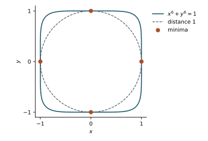

# ENS Cachan · Économie et gestion · Mathématiques et statistiques 2017 · Corrigé brut

*Corrigé rédigé par IA, non officiel. Signalez toute erreur.*

**Rédaction** · GPT-6.2 Astra Ultra · vitesse non renseignée

**Révision (tour 1)** · GPT-6.2 Astra Ultra · vitesse non renseignée

La composition de quatre heures comporte trois problèmes indépendants. Pour le deuxième problème, on numérote les deux multiplicateurs pour le carré de la distance et le signe de Lagrangien fixé en II.2.

## Problème 1 · Changement de base et projection

### Question I.1a

La matrice des colonnes $v_1=(3,-2)^t$ et $v_2=(-1,1)^t$ est $P=\begin{pmatrix}3&-1\\-2&1\end{pmatrix}$. Son déterminant vaut $3-2=1$. Les deux vecteurs forment une base de $\mathbb R^2$.

### Question I.1b

On a $P^{-1}=\begin{pmatrix}1&1\\2&3\end{pmatrix}$. Ainsi $e_1=v_1+2v_2$ et $e_2=v_1+3v_2$, ce que confirme directement l’addition de leurs coordonnées.

### Question I.2a

On considère l’application linéaire déterminée par les images de la base, comme le suppose la demande d’une matrice. Puisque $g(v_1)=v_1$ et $g(v_2)=-v_2$, sa matrice dans $(v_1,v_2)$ est $M=\operatorname{diag}(1,-1)$.

### Question I.2b

On a $M^2=\operatorname{diag}(1,1)=I_2$. Ainsi $g\circ g$ est l’identité de $\mathbb R^2$, et $g$ est une involution.

### Question I.2c

Par linéarité, $g(e_1)=v_1-2v_2=(5,-4)^t$ et $g(e_2)=v_1-3v_2=(6,-5)^t$. La matrice dans la base canonique vaut donc $A=\begin{pmatrix}5&6\\-4&-5\end{pmatrix}=PMP^{-1}$.

### Question I.2d

Le produit direct donne $A^2=\begin{pmatrix}25-24&30-30\\-20+20&-24+25\end{pmatrix}=I_2$, conformément à I.2b.

### Question I.3a

Si $v=(x,y)^t$, alors $\langle v,v_1\rangle=3x-2y$ et $\|v_1\|^2=13$. On obtient $f(v)=((9x-6y)/13,(-6x+4y)/13)^t$.

### Question I.3b

La matrice est $F=\frac1{13}\begin{pmatrix}9&-6\\-6&4\end{pmatrix}=v_1v_1^t/(v_1^tv_1)$.

### Question I.3c

On a $F^2=v_1(v_1^tv_1)v_1^t/(v_1^tv_1)^2=F$. L’application fixe $v_1$ et annule $(2,3)$, qui lui est orthogonal. Cette décomposition de $\mathbb R^2$ identifie son image et son noyau, et confirme que $F$ est la projection orthogonale sur $\mathbb Rv_1$.

## Problème 2 · Distance à une courbe du sixième degré

### Question II.1

La distance à l’origine est $\sqrt{x^2+y^2}$. Comme la racine carrée est strictement croissante, on choisit de minimiser $f(x,y)=x^2+y^2$ sous $x^6+y^6=1$. À la fin, il suffira de prendre la racine carrée des valeurs pour retrouver les distances.

### Question II.2

Posons $h(x,y)=x^6+y^6-1$ et choisissons $L(x,y,\lambda)=x^2+y^2-\lambda h(x,y)$. Cette convention fixe le signe de toutes les valeurs de $\lambda$ qui suivent.

### Question II.3

Dans l’ordre $(x,y,\lambda)$, $\nabla L=(2x-6\lambda x^5,2y-6\lambda y^5,1-x^6-y^6)$. À un point critique admissible les trois composantes sont nulles. La contrainte est régulière car $(6x^5,6y^5)$ ne s’annule pas sur la courbe.

### Question II.4

Toute coordonnée non nulle $t$ vérifie $t^4=1/(3\lambda)$. Si une coordonnée est nulle, l’autre vaut $\pm1$ et $\lambda_1=1/3$. Si les deux sont non nulles, elles ont même module $t=2^{-1/6}$ par la contrainte. Alors $\lambda_2=1/(3t^4)=2^{2/3}/3>\lambda_1$. Ces deux configurations sont réalisables, et elles épuisent les possibilités.

### Question II.5

Pour $\lambda_1=1/3$, les points admissibles sont $(1,0),(-1,0),(0,1),(0,-1)$.

### Question II.6

Notons $a=2^{-1/6}$. Les points correspondant à $\lambda_2$ sont $(a,a),(a,-a),(-a,a),(-a,-a)$.

### Question II.7

Aux quatre points de II.5, le carré de la seule coordonnée non nulle vaut un. Ainsi $V_1=1$.

### Question II.8

Aux quatre points de II.6, $V_2=2a^2=2^{2/3}$. Les distances correspondantes sont donc $2^{1/3}$.

### Question II.9

La courbe est un fermé borné non vide, donc un compact. La fonction continue $f$ y atteint ses extrema, et la régularité établie en II.3 permet d’appliquer les conditions de Lagrange en chacun d’eux. Comme $1<2^{2/3}$, les quatre points axiaux de II.5 sont exactement les minima, de distance un. On peut aussi établir la borne directement par $x^6+y^6\le(x^2+y^2)^3$, avec égalité exactement si $xy=0$.

## Problème 3 · Temps d’identification d’un dé

### Question III.1a

En développant, $(1-x)(1+x+\cdots+x^n)=(1+x+\cdots+x^n)-(x+\cdots+x^{n+1})=1-x^{n+1}$.

### Question III.1b

Comme $0<x<1$, la somme vaut $(1-x^{n+1})/(1-x)$ et $x^{n+1}\to0$. La limite est $1/(1-x)$.

### Question III.1c

En dérivant la formule de la somme finie, on trouve $\sum_{k=1}^nkx^{k-1}=[1-(n+1)x^n+nx^{n+1}]/(1-x)^2$. Pour tout $0<x<1$ fixé, $nx^n\to0$ par décroissance géométrique. Le membre de gauche tend donc vers $1/(1-x)^2$.

### Question III.2a

Le dé pipé donne toujours 6. Un second tour est nécessaire exactement si le dé équilibré donne 6 au premier tour, de probabilité $1/6$.

### Question III.2b

Par indépendance des tours, $\mathbb P(I=2)=(1/6)(5/6)=5/36$.

### Question III.2c

Pour $k\ge1$, le dé équilibré doit donner $k-1$ fois 6 puis une autre face. Donc $\mathbb P(I=k)=(1/6)^{k-1}(5/6)$. Ainsi $I$ suit une loi géométrique sur les entiers strictement positifs.

### Question III.2d

On obtient $\mathbb E I=(5/6)\sum_{k\ge1}k(1/6)^{k-1}=(5/6)/(1-1/6)^2=6/5$.

### Question III.3a.i

Avec deux dés équilibrés indépendants, on croit identifier le dé pipé si exactement un des deux donne 6. Il y a deux ordres possibles, d’où $\mathbb P(I=1)=2(1/6)(5/6)=10/36$. Un double six fait poursuivre. Deux résultats distincts de 6 révèlent que les deux dés sont équilibrés, même si ces résultats sont égaux entre eux.

### Question III.3a.ii

Pour $k\ge1$, il faut $k-1$ doubles six puis un tour avec exactement un six. L’indépendance donne $\mathbb P(I=k)=(1/36)^{k-1}(10/36)$.

### Question III.3a.iii

La probabilité de poursuivre indéfiniment vaut $\lim_{k\to\infty}(1/36)^k=0$. La masse des valeurs positives est $(10/36)/(1-1/36)=2/7$. Ainsi $\mathbb P(I=0)=5/7$.

### Question III.3a.iv

La formule de III.1c donne $\mathbb E I=(10/36)\sum_{k\ge1}k(1/36)^{k-1}=(10/36)(36/35)^2=72/245$. L’espérance peut être inférieure à un parce que $I=0$ code la découverte de deux dés équilibrés.

### Question III.3b.i

Pour $k\ge1$, $\mathbb P(I=k\mid I>0)=(10/36)(1/36)^{k-1}/(2/7)=(35/36)(1/36)^{k-1}$.

### Question III.3b.ii

Les masses conditionnelles sont positives et leur somme pour $k\ge1$ vaut $(35/36)/(1-1/36)=1$. Elles définissent donc bien une loi de probabilité.

### Question III.3b.iii

La loi conditionnelle est géométrique de paramètre $35/36$. Son espérance est $36/35$, ou encore $(35/36)\sum_{k\ge1}k(1/36)^{k-1}$.

### Question III.3b.iv

Non, $36/35\ne6/5$. La formule des espérances conditionnelles donne d’ailleurs $\mathbb E I=\mathbb P(I>0)\mathbb E[I\mid I>0]=(2/7)(36/35)=72/245$, puisque la valeur fixée sur l’autre issue est zéro. Avec un dé véritablement pipé, chaque report a probabilité $1/6$. Avec deux dés équilibrés, il faut deux six simultanés pour reporter. La condition $I>0$ porte sur la nature de la décision finale et laisse un rapport géométrique de $1/36$ entre deux masses successives.
