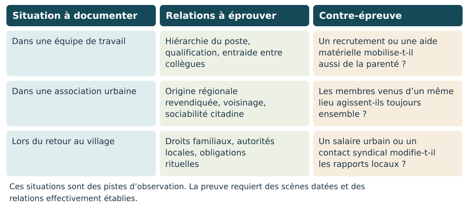

# ENS-PSL · Sélection internationale Lettres — Anthropologie — Max Gluckman et la ville 2017 · Corrigé brut

*Corrigé rédigé par IA, non officiel. Signalez toute erreur.*

**Rédaction** · GPT-6.2 Astra Ultra · vitesse non renseignée

**Autocontrôle** · GPT-6.2 Astra Ultra · vitesse non renseignée

## Commentaire de Max Gluckman

Un mineur qui quitte le poste pour rendre visite à sa famille traverse-t-il deux sociétés ou plusieurs situations dans une même histoire ? En 1960, Gluckman commence par une formule presque tautologique. Rappeler qu’un mineur est un mineur devient polémique lorsqu’une partie de l’anthropologie décrit d’abord cette personne par son origine « tribale ». Le passage affirme que la priorité relative des appartenances change avec les relations effectivement engagées. Il faut comprendre cette priorité sans faire disparaître les rapports entre lieux, ni l’histoire coloniale qui a organisé certaines de ces circulations.

### L’emploi de mineur impose sa propre question

Au fond de la mine, l’embauche, la qualification, le rythme du travail, l’autorité du contremaître et les revendications salariales établissent des positions spécifiques. Deux ouvriers d’origines différentes peuvent défendre une même revendication face à l’encadrement. Deux personnes venues du même lieu peuvent occuper des positions opposées dans la hiérarchie de production. Classer d’avance les travailleurs selon une carte des origines conduit à méconnaître les solidarités ou les conflits qu’il faudrait précisément expliquer. Le redoublement de « mineur » invite à partir d’une relation de travail et à prendre au sérieux le caractère durable de la vie citadine.

« Secondaire » désigne alors un ordre de pertinence. Une relation de parenté peut compter pour l’accès à un logement, alors que l’apprentissage d’un geste ou la participation à une grève s’organisent selon d’autres lignes. L’observateur ne peut décréter qu’une identité est toujours première. Il doit préciser pour quelle opération, entre quels interlocuteurs et avec quelles conséquences elle acquiert du poids.

### Un changement de situation laisse subsister des influences

Les deux mouvements du passage se répondent. L’homme quitte une zone politique puis peut y revenir. Dans chaque sens, Gluckman fait agir le lieu quitté à l’intérieur même du lieu d’arrivée. Les guillemets autour de « détribalisé » et de « tribalisé » invitent à lire ces mots comme des qualifications de situation. Ils deviendraient trompeurs si l’on y voyait des phases irréversibles d’une évolution qui conduirait une fois pour toutes de la « tradition » à la « modernité ».

Dans *The Kalela Dance* (1956), Clyde Mitchell étudie sur le Copperbelt de Rhodésie du Nord, aujourd’hui en Zambie, une danse urbaine. Des danseurs revendiquent une appartenance bisa et donnent sens à leur performance devant un public qui connaît des origines diverses. Leur tenue évoque le prestige urbain, tandis que la danse met en jeu des distinctions ethniques. Y chercher la simple reproduction d’un village ferait perdre son public, ses codes de prestige et sa scène urbaine. En sens inverse, conclure à la disparition de l’appartenance d’origine rendrait incompréhensible une part de la performance. L’enquête de Mitchell permet de préciser ce que Gluckman appelle une influence. La ville peut recréer une différence sociale dans une forme nouvelle.

### Quelle frontière l’enquêteur observe-t-il ?

L’image de la frontière fait comprendre un changement de régime de relations. Prise trop littéralement, elle enfermerait à nouveau ville et campagne dans deux ensembles homogènes. Des envois d’argent, des visites et des obligations à distance peuvent relier durablement un foyer urbain et des proches au village. Une enquête limitée à un poste de travail saisira mal ces circulations. De plus, le recrutement de la main-d’œuvre minière, la ségrégation et les règles de résidence ont parfois imposé des déplacements ou limité l’installation des familles. L’explication doit donc rapporter les passages entre espaces aux contraintes de leur histoire, ainsi qu’aux choix de ceux qui les parcourent.

La part personnelle de la consigne demande une scène issue du terrain du candidat. On peut partir d’une même personne observée dans deux situations, par exemple au travail et dans une association, si le carnet en conserve effectivement la trace. Il faut alors donner le lieu et les circonstances, préciser qui emploie quel terme d’identification, décrire une action dont l’issue dépend de cette relation et confronter l’hypothèse à un cas contraire. À défaut d’accès au lieu de retour, une déclaration sur l’entraide au village reste un témoignage rapporté. Une observation en ville n’autorise pas à parler au nom des habitants restés sur place.

La force de Gluckman tient ainsi à un déplacement d’unité d’analyse. La question devient celle des relations dont dépendent effectivement les conduites dans une situation. La symétrie du départ et du retour oblige à tester aussi les liens entre situations, y compris ceux que les acteurs et l’enquêteur ne voient qu’en changeant de lieu.
