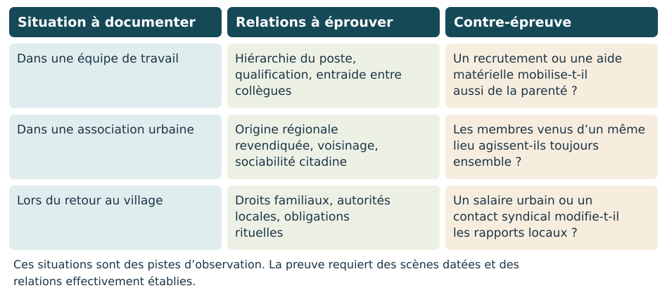

# ENS-PSL · Sélection internationale Lettres — Anthropologie — Max Gluckman et la ville 2017 · Corrigé guidé

*Corrigé rédigé par IA, non officiel. Signalez toute erreur.*

**Rédaction** · GPT-6.2 Astra Ultra · vitesse non renseignée

**Autocontrôle** · GPT-6.2 Astra Ultra · vitesse non renseignée

## Lire les deux trajets du texte

Tracer deux flèches sur le brouillon. La première va vers la ville et pose deux questions distinctes. De quelle autorité le travailleur dépend-il dans son emploi ? Que reste-t-il des relations nouées avant son arrivée ? La seconde flèche retourne vers la zone politique d’origine. Quelles obligations locales reprennent de l’importance ? Quels effets de la vie citadine restent perceptibles ? Les deux dernières propositions de Gluckman interdisent de répondre à chaque fois par un effacement complet du passé.

Placer ensuite le mot « secondaire » au centre de la problématique. Pour décider si une relation est secondaire, il faut nommer une situation et ce qu’il s’agit d’y expliquer. Un logement trouvé par un parent, un salaire négocié avec un chef d’équipe et une manifestation organisée par des collègues peuvent concerner la même personne. Une origine commune peut expliquer le premier événement tout en apportant peu à l’analyse du second. Ce raisonnement fait apparaître pourquoi la répétition des mots « ville » et « mineur » au début du texte porte une thèse.

### Faire travailler une ethnographie précise

Résumer en trois opérations la lecture de la danse kalela par Clyde Mitchell. D’abord, situer une performance sur le Copperbelt colonial. Ensuite, noter que les danseurs peuvent marquer l’appartenance bisa, alors que leur présentation et leur public appartiennent au monde urbain. Enfin, demander quelle relation sociale se construit dans cette représentation. Une différence d’origine devient reconnaissable et significative parmi des personnes qui se côtoient en ville. La danse apporte à la thèse de Gluckman un cas qui la confirme et la complique. La ville est un lieu où la référence aux origines peut précisément être retravaillée.

Ne pas présenter cette enquête publiée comme un souvenir personnel. C’est un point de comparaison pour interpréter les observations que le candidat doit tirer de sa propre expérience. Si le seul terrain pratiqué est une association de quartier ou un lieu d’études, comparer les mécanismes relationnels en situant la distance historique avec le Copperbelt. Une analogie de méthode n’établit aucune identité entre ces mondes.

### Insérer sa propre expérience sans combler les blancs du carnet

Choisir une entrée de carnet datée dans laquelle l’enquêteur sait qui agit, qui observe et qui rapporte. Commencer par une action située. Par exemple, si une personne a présenté un nouvel arrivant, qui présente qui, à quel interlocuteur, par quels mots et avec quel effet visible ? Un terme de parenté dans une conversation montre d’abord que ce terme a été employé. Pour lui donner une portée plus grande, chercher si cette relation a pesé sur l’accès à une ressource ou sur une obligation.

Trouver une seconde situation mettant la première interprétation en difficulté. La personne présentée comme un parent est-elle aussi appelée collègue dans une autre interaction ? La première désignation disparaît-elle vraiment ou devient-elle moins pertinente à cet instant ? Si le second lieu n’a jamais été observé, distinguer ce que les interlocuteurs en disent et les conduites constatées sur place. Lorsqu’aucun épisode de terrain personnel n’est fourni, cette étape demeure à personnaliser. Une hypothèse proposée pour une future visite ne peut tenir lieu de résultat.

### Discuter la portée de la frontière

L’écriture d’une dernière partie peut partir d’une exception. Un salaire gagné en ville sert à financer des engagements au village. Quel mécanisme une frontière binaire manquerait-elle ? L’exemple oblige à suivre une relation à distance et à choisir, si possible, plusieurs lieux d’enquête. Interroger ensuite l’histoire des catégories. Le terme « tribu » figure dans le passage et peut être étudié comme un classement historiquement situé. Le reprendre comme catégorie intemporelle du chercheur occulterait les institutions politiques, administratives et savantes qui ont contribué à le fixer.

Conclure avec une proposition que l’expérience personnelle pourrait contredire. Dans une situation donnée, la relation de travail peut organiser une action collective, tandis que les relations au lieu d’origine organisent d’autres échanges. La preuve de leur hiérarchie varie avec l’activité et avec le point d’observation.
