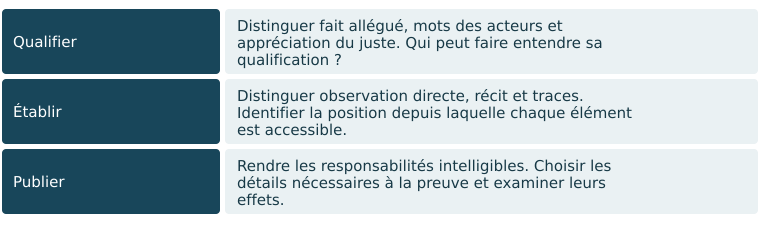

# ENS-PSL · Anthropologie — Michel Naepels et la violence (oral) 2017 — corrigé guidé

*Corrigé rédigé par IA, non officiel. Signalez toute erreur.*

**Rédaction** · GPT-6.2 Astra Ultra · vitesse non renseignée · 26 novembre 2026

## Sujet

Commenter les extraits de Michel Naepels, « Quatre questions sur la violence », *L’Homme*, 2006. L’auteur discute l’anthologie de Nancy Scheper-Hughes et Philippe Bourgois, *Violence in War and Peace* (2004).

## Préparer le commentaire

**Distinguer les voix.** Scheper-Hughes et Bourgois portent un projet d’anthropologie engagée. Naepels en éprouve les conditions. Claverie et Jamin éclairent la qualification des faits. Zulaika, Sluka, Bourgois et Hatzfeld servent à comparer des positions d’enquête. Fassin interroge l’intérêt même du chercheur pour cet objet. Regrouper les références selon l’opération qu’elles éclairent évite un catalogue d’auteurs.

**Travailler une phrase.** Qu’une qualification soit performative signifie ici que désigner publiquement un fait comme violence modifie la situation morale et politique. Cela ne rend pas le fait invérifiable. Demander ce qui s’est passé, qui le qualifie, qui conteste cette qualification, et sur quels éléments elle repose. Le saut de l’un à l’autre constitue le problème du texte.

**Répondre à une relance sur le témoignage.** Face à deux récits incompatibles, décrire ce dont chaque personne a pu être témoin, la situation dans laquelle le récit a été recueilli, les silences et les autres traces. Les contradictions peuvent éclairer des positions sociales. Elles ne rendent pas tous les récits également probants sur un fait précis.

## Commentaire proposé

Désigner un fait comme une violence engage déjà une appréciation du juste et de l’injuste. Peut-on dès lors l’étudier par des méthodes empiriques ? En commentant le projet de Scheper-Hughes et Bourgois, Michel Naepels examine tour à tour les mots de l’enquête, la position du témoin et la responsabilité de la publication. Ces trois opérations sont liées. À chaque étape, on peut à la fois mieux établir un fait et modifier la situation de ceux qui en parlent.

### Nommer engage

L’anthologie citée souhaite mobiliser les moyens de la discipline face à des situations insoutenables. Avec Élisabeth Claverie, Naepels rappelle que chaque qualification s’inscrit dans une conception de ce qui est juste. Avec Jean Jamin, qui reprend le vocabulaire d’Austin, il distingue décrire un événement et accomplir un acte en parlant. Dire en public qu’une pratique est violente peut rendre audible une plainte, ouvrir une controverse ou au contraire disqualifier un interlocuteur. L’opposition formulée avec Wittgenstein entre proposition soumise à vérification et jugement éthique éprouve la prétention de l’ethnographe à simplement enregistrer le réel. Elle invite à établir les faits et à rendre explicites les critères de qualification, y compris lorsque les acteurs divergent sur le mot à employer.

### Être présent donne accès à une perspective située

Joseba Zulaika auprès d’interlocuteurs liés à l’ETA, comme Jeffrey Sluka en Irlande du Nord, doit tenir compte de la façon dont on comprend sa présence. Être reçu comme allié, témoin ou étranger modifie ce qu’on lui raconte. La participation peut rendre certaines relations intelligibles et en rendre d’autres impossibles à observer. Jamin rapproche l’enquête de l’instruction judiciaire parce qu’il faut souvent reconstituer des faits après coup. L’analogie porte sur des opérations de preuve. Le chercheur et le tribunal n’ont ni les mêmes compétences ni la même finalité. Les expériences de Bourgois au Salvador et à Harlem empêchent de faire de la reconstitution tardive une loi générale. Il a été témoin direct de certains événements. Même alors, ce qu’il voit ne contient ni toute l’histoire de la situation ni les intentions des personnes.

L’expression *in media res* désigne ce commencement au milieu d’événements déjà engagés. Il faut rechercher les traces antérieures et celles que le terrain ne livre pas immédiatement. Le récit, souligne Naepels à travers Michael Taussig, apporte une médiation. Chez Jean Hatzfeld, les récits de survivants et ceux d’auteurs du génocide des Tutsi appellent des modes de lecture différents. Dans les seconds, les formes de dénégation, de justification ou d’aveu rendent le commentaire et la contextualisation particulièrement nécessaires. Cette asymétrie tient ici à la construction des ouvrages et aux positions de ceux qui parlent. Elle ne fournit pas un classement automatique de toutes les paroles possibles.

### Comment écrire ce que l’on a établi ?

Deux risques encadrent l’écriture. Une présentation qui efface les auteurs ou leurs responsabilités peut faciliter la dénégation. Une description faite pour retenir le lecteur par l’intensité du spectacle peut confisquer une seconde fois l’expérience des personnes qui ont subi les faits. Une solution consiste à choisir des détails selon ce qu’ils permettent de démontrer, à expliciter les limites des témoignages et à examiner les conditions de publication avec les personnes concernées lorsque cela est possible. Le tact demandera parfois de taire un détail identifiant tout en maintenant ce qui est nécessaire à la preuve.

Enfin, Didier Fassin fait porter le questionnement sur l’attrait du sujet pour le chercheur. La valeur morale prêtée à une cause ne se transfère pas à l’auteur qui l’étudie. Naepels laisse donc ouvertes des questions qui font partie de la méthode. De quelle relation provient le savoir publié ? Quel lecteur suppose-t-il ? À qui restitue-t-il la possibilité de parler et de contester, et à quel prix ?

## Source

[Sujet officiel](https://web.archive.org/web/20201230063148id_/https://www.ens.psl.eu/sites/default/files/anthropologie-oral-si2017.pdf)
