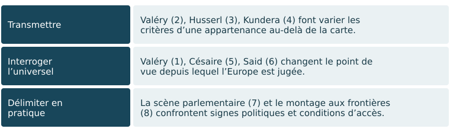

# ENS-PSL · Étude de documents — l’Europe et le monde 2017 — corrigé brut

*Corrigé rédigé par IA, non officiel. Signalez toute erreur.*

**Rédaction** · GPT-6.2 Astra Ultra · vitesse non renseignée · 26 novembre 2026

## Sujet

« L’Europe et le monde ». Rédiger en quatre heures un commentaire synthétique des huit documents. La photographie et le dessin réunis sur la dernière page constituent ensemble le document 8.

## Copie proposée

En 1919, Paul Valéry voit l’Europe entrer parmi les civilisations qui savent pouvoir disparaître. En 2017, des panneaux souhaitant la bienvenue en Europe surplombent, dans le dessin final du dossier, des rangées de barbelés. Entre les deux images, le monde change de place. Il est tantôt le terme auquel l’Europe prétend donner forme, tantôt le point de vue depuis lequel ses promesses sont jugées. Qui peut tracer la frontière de l’Europe et au nom de quel héritage ?

### Des filiations intellectuelles qui débordent la carte

La *Note (l’Européen)* de Valéry (document 2) compose une généalogie en trois influences. Rome transmet la puissance de l’institution et de la loi, le christianisme travaille la conscience, la Grèce donne une méthode de pensée à laquelle l’auteur rattache la science. L’ordre de l’argument construit une définition. La propagation de ces héritages lui permet d’inclure l’Amérique dans l’extension d’un « esprit » européen. L’affirmation d’une exclusivité européenne de la science est cependant un jugement de l’auteur. Une histoire des savoirs y opposerait les circulations entre mondes grec, arabe, indien et européen.

Husserl (document 3), dans le contexte de la crise européenne des années 1930, inclut aussi des populations situées hors du continent. Il fait de l’Europe une orientation spirituelle vers une tâche infinie. Sa notion de finalité s’écarte d’un cycle biologique qui mènerait les peuples à maturité et disparition. Mais la comparaison avec l’Inde suppose une dissymétrie. Les autres sociétés seraient attirées par l’européanisation alors que l’Européen ne se pense pas appelé à un mouvement réciproque. Le propos s’expose à la question de savoir qui peut définir l’universel.

Kundera, dans *Les Testaments trahis* (document 4), bâtit une autre unité transnationale. Une œuvre appartient à l’histoire du roman commencée avec Rabelais et Cervantès selon les problèmes esthétiques qu’elle reprend. Les traditions chinoise ou japonaise ont leur histoire. L’auteur conteste du même geste la suffisance des découpages par littératures nationales. Une filiation entre œuvres est un critère plus circonscrit que le destin de l’humanité avancé par Husserl.

### La crise de l’universel et le renversement du jugement

Dans *La Crise de l’esprit* (document 1), Valéry observe dès 1919 ce que l’optimisme d’une généalogie peut dissimuler. Des qualités exaltées par l’Europe, discipline, instruction et science, ont rendu possible la destruction pendant la Grande Guerre. Les noms de Babylone ou de Ninive cessent d’évoquer des périls réservés à autrui. Les patries présentes peuvent devenir des noms de civilisations disparues. Le dossier rapproche ainsi deux positions d’un même écrivain, sans effacer l’écart de date ni de question entre les documents 1 et 2.

Avec le *Discours sur le colonialisme* d’Aimé Césaire (document 5), c’est depuis les sociétés colonisées que se formule le jugement. Les contradictions du continent portent à la fois sur la condition prolétarienne et sur la domination coloniale. La violence impériale contredit la prétention à apporter la civilisation. Césaire défend en revanche le contact entre sociétés et reconnaît ce que l’Europe doit au fait d’être un carrefour. Il dissocie ainsi la valeur de l’échange de l’appropriation des personnes et des richesses qui se donne pour un échange.

Edward Said (document 6) déplace cette critique vers les instruments de représentation. Le journaliste qui regarde Beyrouth en guerre y cherche l’Orient de Chateaubriand et de Nerval. La littérature lui rend un paysage familier, au prix de reléguer l’expérience des habitants derrière une mémoire européenne. L’orientalisme, chez Said, dispose aussi d’institutions, de traditions savantes et de bureaux coloniaux. Il produit des effets matériels. La comparaison avec les représentations américaines de l’Orient rappelle que les objets ainsi imaginés dépendent de l’histoire particulière des puissances qui les construisent.

### Des frontières que les images rendent discutables

La photographie du document 7 montre Elizabeth II au Parlement britannique lisant le discours de politique générale du gouvernement de Theresa May en juin 2017. Dans le contexte ouvert par le référendum sur le Brexit de 2016, le bleu du vêtement et le jaune de certains motifs du chapeau ont pu rappeler les couleurs européennes. Le fait vérifiable est le contraste entre cette lecture possible d’une image et la fonction constitutionnelle de la reine, qui lit le programme gouvernemental. La photographie expose les tensions entre symbole national, institutions européennes et projections des spectateurs. L’Union européenne désigne d’ailleurs un ordre politique délimité dont la définition diffère de celle de l’Europe culturelle invoquée par Kundera.

Le document 8 juxtapose une photographie d’embarcations côtoyant un canot chargé de personnes, plusieurs en gilet de sauvetage, et un dessin où un adulte et un enfant regardent des barbelés. Les salutations en plusieurs langues font entendre une promesse d’ouverture que le trait du dessinateur dément sur le terrain. La photographie sans légende laisse indéterminés le lieu précis, l’identité des passagers et l’issue de la rencontre. Le montage interroge le regard de celui qui accueille et de celui qui arrive. À la projection unilatérale décrite par Said répond une scène où la frontière européenne se voit depuis son dehors.

L’Europe du dossier a donc plusieurs périmètres, selon que l’on suit les filiations artistiques, les revendications d’universalité ou les institutions qui contrôlent l’accès au territoire. Une tradition peut circuler au-delà d’une frontière qu’un individu ne peut franchir. Tenir ensemble ces deux propositions permet d’expliquer pourquoi l’Europe se définit aussi par les récits, les critiques et les expériences qui lui reviennent du monde.

## Source

[Sujet officiel](https://web.archive.org/web/20201230063147id_/https://www.ens.psl.eu/sites/default/files/commentaire-documents-sil2017.pdf)
