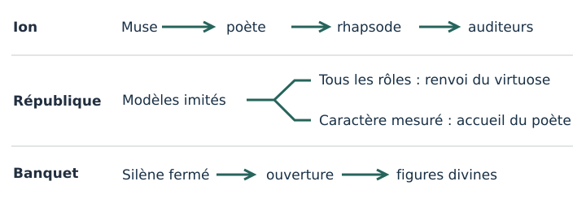

# ENS-PSL · Études classiques · 2017 — corrigé brut

*Corrigé rédigé par IA, non officiel. Signalez toute erreur.*

**Rédaction** · GPT-6.2 Astra Ultra · vitesse non renseignée · 26 novembre 2026

## Aspects et enjeux de la poésie chez Platon

La cité imaginée par Socrate reconduit à sa frontière un poète qu'elle vient de couronner. Pourquoi tant d'égards pour celui qu'elle se refuse à entendre ? Dans l’*Ion*, Socrate accorde à la poésie la puissance du divin. Dans *Le Banquet*, Alcibiade a besoin d’images de sculpteur et de musicien pour rendre sensible l’effet des entretiens de Socrate. Il y a donc lieu de reprendre la question que paraît trancher l’exil du poète. De quel droit attendons-nous d’une parole qui transporte qu’elle nous apprenne aussi à vivre ? Les trois scènes distinguent le pouvoir de faire éprouver, la compétence pour instruire et la fin que l’on donne aux images.

### Que passe-t-il d'un anneau à l'autre ?

Dans l’*Ion* (533d-e), Socrate s’adresse à un rhapsode, interprète et commentateur d’Homère. L’objet immédiat de son enquête est le talent de cet interprète lorsqu’il parle du poète. L’explication remonte pourtant jusqu’aux poètes épiques et lyriques. Une pierre de Magnésie attire un premier anneau de fer. Celui-ci acquiert à son tour le pouvoir d’en attirer un second. L’intérêt de l’expérience tient à ce second effet. L’anneau intermédiaire est simultanément mû et moteur, et la chaîne entière reste suspendue à la première pierre. La Muse inspire le poète, dont la parole entraîne à son tour l’interprète et ceux qui l’écoutent. Une œuvre peut continuer d’agir en passant par une autre voix.

Socrate accorde ainsi à Ion plus qu’une virtuosité de scène, mais il lui ôte une prétention déterminée. Ce que le rhapsode reçoit comme une *dynamis*, une puissance, ne constitue pas une *technè*, une compétence dont on pourrait expliquer et étendre les principes. Savoir émouvoir à propos d’Homère établirait-il qu’on puisse juger avec la même compétence tous les poètes ? Ou que le récit d’une course de chars rende son interprète compétent pour conduire un attelage ? Le charme dont témoigne le public répond à une autre question. L’image est à la fois généreuse et ironique. Le rhapsode peut être fier de sa parenté avec la Muse, mais il devrait renoncer à tirer de ses succès l’autorité d’un maître. La beauté des poèmes, explicitement reconnue, rend cette distinction nécessaire.

### Quels caractères la cité fait-elle répéter ?

Dans la *République* (III, 398a-b), l’interlocuteur a changé. Les fondateurs délibèrent sur les récits par lesquels se formeront les gardiens. Le poète polyvalent arrive dans la cité pour s’y produire. Socrate imagine une scène d’accueil très précise. Les habitants se prosternent devant lui, lui offrent parfum et couronne, puis l’envoient exercer son talent ailleurs. L’hommage et le congé ne se contredisent qu’à la condition de confondre admiration et mandat d’éducateur. Ce que la cité distingue, c’est ce qu’elle admire de ce qu’elle veut faire pratiquer à ses futurs gardiens.

L’homme capable d’assumer tous les caractères peut faire parler aussi bien l’être effrayé, lâche ou injuste que l’être courageux. L’ancien art de la performance donne à ces voix un corps, un rythme et une allure que celui qui les joue s’exerce à reprendre. Si la répétition crée une habitude, la souplesse de l’imitateur devient un problème pour une éducation qui cherche la fermeté du caractère. Le texte ne prononce donc pas un interdit général. Dans la même phrase Socrate retient un poète et conteur plus austère, capable d’imiter la parole d’un homme de bien. L’imitation demeure un ressort éducatif. Ce qu’on en écarte est la disponibilité à n’importe quel rôle. Le titre donné au passage par le sujet évoque Homère. Dans les mots de la scène, le visiteur est le type du poète capable de tout imiter.

### Qu'apprend-on en ouvrant le Silène ?

Le *Banquet* (215a-d) complique cette sélection. Alcibiade annonce qu’il louera Socrate en images. Une statuette de Silène, grotesque au-dehors, s’ouvre sur des figures divines. L’image oblige d’abord à suspendre le verdict de l’œil. Ressembler à un Silène échappe au choix sommaire entre ressemblance physique exacte et caricature insultante. La ressemblance pertinente tient à une opération à faire sur la statuette, puis sur notre première impression. Alcibiade invite les convives à refaire cette découverte. Il prend même soin de préciser que le rire éventuel ne décide pas de la vérité de son portrait.

La comparaison avec Marsyas déplace l’examen de l’œil vers l’oreille. Les airs de ce musicien saisissent même lorsqu’un exécutant médiocre les reprend. Les simples paroles de Socrate produisent, dit Alcibiade, le même effet, sans instrument, jusque dans la bouche d’autrui. Voici retrouvée la transmission de l’*Ion*. Mais que révèlerait le seul fait d’être saisi ? La comparaison rend sensible la singularité d’une rencontre, et laisse entière l’obligation de juger ce que dit Socrate. Alcibiade témoigne en admirateur, dans une scène d’éloge. Sa voix dramatique ne suffit à garantir ni tous ses jugements ni la conversion durable de celui qui admire. Le dialogue donne au lecteur les moyens de prendre pour objet d’examen l’enthousiasme même qu’il suscite.

### Conclusion

Platon reconnaît à la poésie un pouvoir que ses critiques présupposent. Si rien ne passait d’un rythme, d’une voix ou d’une image à un auditeur, l’éducation des gardiens pourrait se désintéresser des poètes. La vraie difficulté est d’orienter cette puissance. La cité choisit les modèles dont la fréquentation façonne ses membres. Le dialogue philosophique fait une autre expérience avec les images. Il nous donne le Silène à ouvrir et l’éloge à interpréter. Une parole poétique peut ainsi participer à l’enquête sur le vrai à condition que le mouvement d’admiration se prolonge en examen.

### Pour l'entretien

**Platon se contredit-il en critiquant la poésie au moyen d’une image ?** L’aimant a précisément une propriété que chacun peut distinguer et discuter. La comparaison explique la dépendance d’un interprète à l’égard d’une source. Elle laisse ouverte la question de savoir quelles autres capacités suppose son métier.

**Peut-on conclure des transports d’Alcibiade à la vérité de la philosophie ?** L’émotion atteste l’impact des paroles tel que l’orateur le raconte. La vérité de ces paroles demanderait d’en suivre les raisons. Cette distance sépare l’éloge que compose Alcibiade de l’expérience de lecture que construit Platon.
