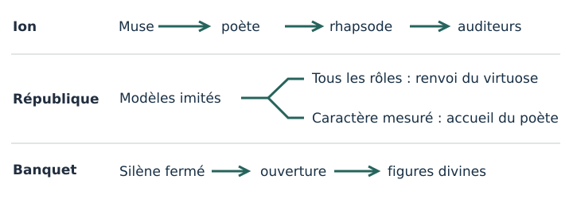

# ENS-PSL · Études classiques · 2017 — corrigé guidé

*Corrigé rédigé par IA, non officiel. Signalez toute erreur.*

**Rédaction** · GPT-6.2 Astra Ultra · vitesse non renseignée · 26 novembre 2026

## Construire l’exposé sur la poésie chez Platon

Vous disposez de vingt minutes de présentation et de dix minutes d’échange. Le feuillet demande une prise de position sur la poésie et les poètes dans trois passages précis. Pour préparer l’exposé, partez d’un fait surprenant. On couronne le poète que l’on renvoie. Quel jugement la couronne exprime-t-elle et quel jugement motive son renvoi ? Gardez cette énigme à l’esprit lorsque vous revenez à la première et à la troisième scène.

### Entrer dans les trois scènes

**Première lecture, la chaîne de fer (*Ion*, 533d-e).** Dessinez la pierre et deux anneaux. Qui attire le deuxième ? Le premier. D’où lui vient ce pouvoir ? De la pierre. Vous venez d’isoler la double propriété de tout intermédiaire. Il reçoit une puissance qu’il exerce réellement. Transposez l’expérience à la Muse, au poète, au rhapsode et à l’auditoire. Ion parle particulièrement bien d’Homère. Une capacité à commenter par méthode devrait pouvoir rendre raison de ses jugements et s’appliquer à d’autres représentants du même art. L’inspiration rend compte de la sélectivité du don. Elle explique qu’un homme proclame de belles choses sans posséder, par là même, une science des sujets qu’il aborde. Dites bien qu’Ion est le rhapsode. Homère et lui occupent des places différentes dans la chaîne.

**Deuxième lecture, l'accueil et le départ (*République*, III, 398a-b).** Marquez trois verbes sur votre brouillon : honorer, congédier, garder. Auquel correspond un jugement de beauté ? Aux honneurs rendus au virtuose. Lequel précise l’objet politique de la discussion ? Le troisième, car on garde un autre poète pour l’éducation des gardiens. Demandez ce qui arrive à quelqu’un qui répète tour à tour les manières d’être de toutes sortes de personnages. Passer aisément d’un rôle à l’autre est un talent dramatique. Dans une formation morale, ces exercices peuvent aussi inculquer les dispositions que le jeu donne à incarner. L’alternative positive du passage est décisive : le poète plus austère imite encore, mais il donne des paroles mesurées à exercer. Le renvoi vise le modèle d’imitateur polyvalent. On peut le relier à Homère sans transformer le titre du sujet en citation du dialogue.

**Troisième lecture, la statuette et la musique (*Banquet*, 215a-d).** Qui parle ? Alcibiade prononce un éloge. Que veut-il atteindre par ses images ? Une vérité sur Socrate que sa physionomie ne suffit pas à livrer. Imaginez la statuette fermée puis ouverte. L’opération révèle sous le Silène des figurines divines. L’image engage l’auditeur à chercher sous l’aspect familier du philosophe ce qui lui avait échappé. Deuxième expérience : entendre les airs de Marsyas exécutés par une musicienne médiocre, puis entendre les paroles de Socrate répétées par un autre. Dans les deux cas l’effet survit au changement d’interprète. Chez Socrate les mots seuls agissent. Alcibiade l’atteste par ce qu’éprouvent les auditeurs. Il ne fournit pas dans ces lignes une démonstration de chaque thèse socratique.

### Passer d’une scène à une thèse

Commencez par l’énigme de la couronne, puis énoncez la question : comment faire place à une parole qui forme les âmes lorsque le pouvoir d’entraîner ne garantit aucune compétence pour les guider ? Consacrez environ deux minutes à présenter les œuvres, les locuteurs et le problème. Réservez environ cinq minutes à chacun des trois mouvements ci-dessous, puis trois minutes pour reprendre la difficulté et conclure. Dans chaque mouvement, expliquez une expression et faites dialoguer deux scènes.

1. **Pourquoi croire le poète ?** Développez l’analogie de l’aimant et confrontez-la à la musique de Marsyas. Les deux images isolent une force transmissible et indépendante de la maîtrise propre à chaque interprète. Distinguez alors deux questions. « Pourquoi suis-je ému ? » appelle un récit de la transmission. « Pourquoi ce qui est dit est-il vrai ? » demande des raisons supplémentaires.
2. **À qui confier l’éducation ?** Revenez au parfum, à la couronne et au départ du poète. Il est cohérent de l’admirer et de refuser qu’il règle l’apprentissage des futurs gardiens. Un maître de toutes les voix multiplie les modèles, y compris incompatibles. Appuyez le dernier pas sur la présence d’un second conteur. La cité veut se servir de la puissance de l’imitation en choisissant les conduites qu’on exerce.
3. **Que peut une image qui fait penser ?** Faites ouvrir le Silène par votre auditoire en décrivant d’abord sa forme, puis l’intérieur. Rapprochez ce retard de l’éloge entier. Le témoin Alcibiade peut raconter un transport que ses auditeurs doivent encore interpréter. La philosophie utilise ici le pouvoir d’une image pour rendre une apparence discutable et inviter à une enquête.

**Conclusion possible.** Le point commun aux trois textes est le passage d’un état d’âme à un autre par la parole. L’*Ion* explique la puissance de ce passage, la *République* demande quels caractères il fait répéter, et le *Banquet* montre une image dont il faut découvrir la portée. Le jugement de Platon sur les poètes dépend donc de ce qu’on attend d’eux. Leur pouvoir d’éveiller une émotion est considérable. La compétence nécessaire pour dire le vrai et l’autorité d’éduquer doivent être justifiées autrement.

### Répondre pendant l’entretien

**« La *République* condamne-t-elle toute imitation ? »** Revenez au dernier membre de phrase, où le poète retenu prend précisément pour modèle la manière de parler d’un homme de bien. Citez ce détail avant de généraliser.

**« L’aimant et Marsyas sont-ils deux versions de la même idée ? »** Ils illustrent tous deux la persistance d’un effet à travers des intermédiaires. L’aimant remonte vers la Muse pour interroger la compétence du rhapsode. Marsyas sert au témoin Alcibiade à faire comprendre, par similitude et par différence, la force des simples paroles de Socrate.

**« Où entendez-vous la voix de Platon ? »** Attribuez d’abord chaque affirmation à son locuteur. Socrate interroge Ion, Socrate et ses interlocuteurs choisissent une éducation, Alcibiade parle de son expérience. C’est en composant ces scènes et en faisant éprouver leurs écarts que Platon soumet la poésie au jugement du lecteur.
