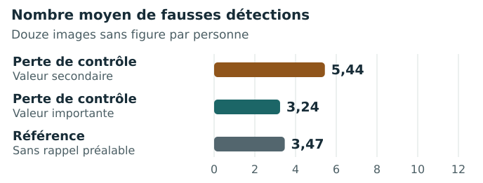
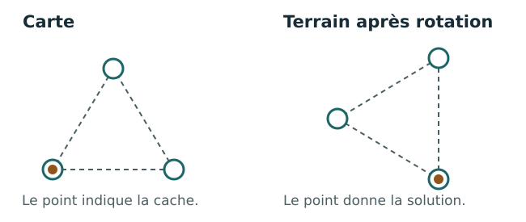

# ENS-PSL · Sélection internationale Lettres — Études cognitives 2017 · Corrigé brut

*Corrigé rédigé par IA, non officiel. Signalez toute erreur.*

**Rédaction** · GPT-6.2 Astra Ultra · vitesse non renseignée

## Whitson et Galinsky · Quand on ne maîtrise plus les événements

### 1. Le but

Pourquoi arrive-t-il qu’on voie une silhouette dans du bruit, qu’on prête une efficacité à un rituel ou qu’on attribue une coïncidence à une action concertée ? Les auteurs demandent si ces jugements différents peuvent avoir une cause commune. Leurs expériences examinent l’effet d’une diminution du contrôle éprouvé par la personne sur la recherche de régularités, jusque dans des données où aucun lien n’est établi.

### 2. Les hypothèses

Pouvoir influer sur ce qui nous arrive rend l’environnement plus maîtrisable. Quand ce pouvoir semble manquer, trouver une structure pourrait restaurer un sentiment d’ordre. Le modèle prévoit une augmentation du besoin de structure et de la propension à relier des événements sans preuve. Il prévoit que l’effet pourra apparaître à niveau de menace comparable et s’atténuer si une autre activité apaise le malaise. Ces prédictions distinguent la recherche compensatoire d’ordre d’une simple réaction à toute situation menaçante.

### 3. Six expériences et leurs mesures

1. Les participants tentent d’identifier des concepts. Les uns reçoivent un retour aléatoire, indépendant de leurs réponses, les témoins travaillent sans retour. Le groupe au retour incontrôlable exprime un besoin de structure plus élevé sur un questionnaire.
2. Après cette même manipulation, les sujets examinent 24 images granuleuses, dont 12 comportent une figure et 12 ont été traitées pour la supprimer. La reconnaissance des figures présentes reste élevée. Sur les images vides, le premier groupe signale davantage de formes, avec un écart seulement tendanciel dans cette expérience.
3. Un souvenir de contrôle ou de perte de contrôle précède trois scénarios de superstition. Les personnes ayant évoqué l’impuissance relient davantage une conduite rituelle au résultat qui suit et se préoccupent davantage de reproduire cette conduite.
4. Tous évoquent une situation menaçante, mais leur contrôle a varié. Ceux qui en avaient peu voient davantage de figures dans dix nuages de points aléatoires et jugent plus vraisemblable une action concertée dans des scénarios ambigus.
5. Un marché est décrit comme stable ou volatil. Pour chacune de deux entreprises, deux tiers des informations sont favorables. L’entreprise B est moins souvent mentionnée. En marché volatil, les participants surestiment le nombre d’informations négatives concernant B et la choisissent moins souvent comme investissement.
6. Après un souvenir de perte de contrôle, les sujets répondent à propos d’une valeur personnelle importante ou peu importante. Un groupe de référence n’évoque pas de perte de contrôle. Les mesures portent sur les formes vues dans des images granuleuses et sur la probabilité attribuée à une conspiration.

### 4. Départager menace et contrôle

Un accident menaçant peut combiner danger et impuissance. Si l’on compare ce seul cas à une journée tranquille, on ignore à quel facteur attribuer un écart. L’expérience 4 demande donc aux deux groupes de se rappeler un événement menaçant. Des juges ignorant les conditions ne relèvent pas de différence significative de menace dans les récits. Les participants sans contrôle voient en moyenne 2,92 figures sur dix nuages aléatoires, contre 0,92 dans l’autre groupe. Leur score d’interprétation conspiratrice augmente aussi. La menace seule explique mal la différence entre ces conditions. La comparaison étaye un effet propre au contrôle perçu, dans les limites du rappel autobiographique.

### 5. La mise à l’épreuve par l’auto-affirmation

Réfléchir à une valeur importante pour soi pourrait rétablir un sentiment d’intégrité personnelle et diminuer le besoin de compenser par l’invention d’un ordre extérieur. La théorie prédit donc une atténuation malgré le même souvenir de perte de contrôle. Le nombre moyen de formes signalées dans les images sans figure vaut 5,44 sans affirmation d’une valeur importante, 3,24 avec affirmation et 3,47 dans le groupe de référence. Le contraste prévu est significatif et les jugements de conspiration présentent la même configuration (4,76, 4,18 et 4,20). L’expérience étaye la prédiction, sans mesurer directement chaque étape du mécanisme psychologique.

### 6. Une détection erronée peut-elle avoir une utilité ?

Le libellé français demande si la perception « illusoire » est nécessairement illusoire. Dans les nuages aléatoires, une figure signalée est bien un faux positif par construction. Dans les scénarios sociaux ambigus, seul le surcroît d’adhésion à une interprétation est observé. Il reste possible qu’une action concertée existe dans une situation réelle. La page anglaise demande si cette tendance est nécessairement inadaptée.

La réponse à cette deuxième question est négative. Quand manquer un signal important coûte très cher et que vérifier une alerte coûte peu, une politique de détection sensible peut rendre service, même si elle produit des fausses alertes. Chercher une explication à une coïncidence peut faire découvrir une régularité réelle. Agir sans vérification comporte en revanche un coût, par exemple écarter systématiquement l’entreprise B malgré la même proportion d’informations favorables. Aucune des six expériences ne mesure un bénéfice adaptatif à long terme.

### 7. Les limites

Un retour arbitraire peut susciter frustration ou incertitude en même temps que perte de contrôle. Un marché volatil modifie aussi le risque perçu. Les échantillons sont modestes. L’écart de fausses alarmes en expérience 2 correspond à $p = 0{,}09$ et les bonnes détections sont proches du plafond. Il est donc difficile de séparer changement de perception et habitude de répondre « oui » sur cette seule tâche. La diversité des tâches appuie la portée de l’hypothèse, mais les jugements brefs recueillis au laboratoire renseignent peu sur la formation de croyances durables. Il serait intéressant de faire varier indépendamment la prévisibilité et la possibilité d’agir, en relevant les bonnes détections aussi bien que les fausses alarmes.

## Dehaene, Izard, Pica et Spelke · Quelles connaissances géométriques sont partagées ?

### 1. Le but

Les auteurs recherchent les relations géométriques dont une personne peut se servir avant ou en dehors d’un enseignement explicite de la géométrie. Ils étudient à la fois le jugement porté sur des figures planes et l’utilisation de relations spatiales pour retrouver un objet dans le monde environnant.

### 2. L’hypothèse

Un noyau d’intuitions sur les points, lignes, parallèles, angles et relations spatiales pourrait être commun aux humains et se développer sans scolarisation en géométrie ni vocabulaire technique étendu. Ce noyau rendrait possible la reconnaissance de certaines relations à travers des changements de taille ou d’orientation. Un apprentissage culturel pourrait ensuite améliorer les performances et rendre possibles la mesure exacte ou la démonstration.

### 3. Deux épreuves non verbales

La première présente 45 planches de six dessins. Cinq exemplifient une propriété, par exemple le parallélisme, et le sixième la viole. Il faut désigner l’intrus, sans nommer la relation. Les tailles et orientations varient pour empêcher qu’un seul indice superficiel suffise systématiquement. Une réponse au hasard réussit une fois sur six.

Dans la seconde, trois récipients forment un triangle rectangle ou isocèle. Une étoile indique la cache sur une carte réduite, présentée au participant tournant le dos aux récipients. Il se retourne et choisit où chercher en premier. La carte change d’orientation. Une boîte rouge sert de point de repère dans certains blocs, puis les récipients sont identiques. Le hasard vaut une chance sur trois. En l’absence de repère coloré, la réussite exige d’exploiter les relations entre emplacements.

### 4. L’intérêt de l’enquête auprès des Munduruku

La plupart des participants vivent dans des villages où les instruments scolaires de géométrie et les cartes métriques sont peu familiers. Leur langue dispose de peu de termes géométriques spécialisés. Leurs activités de navigation, de fabrication d’objets et de décoration demandent pourtant une grande expérience spatiale. Une réussite rend donc moins plausible l’idée qu’une instruction scolaire, les conventions cartographiques usuelles ou la connaissance des mots techniques soient des conditions nécessaires. Comparer enfants et adultes munduruku et américains permet en outre de rechercher ce qui varie et ce qui se maintient d’un contexte à l’autre.

### 5. Les indices et leur force respective

La tâche de l’intrus donne 66,8 % de réponses correctes en moyenne chez les participants munduruku, contre environ 16,7 % au hasard. Le classement des difficultés se ressemble entre les groupes, malgré l’avantage global des adultes américains. Cependant une dissemblance perceptive peut parfois suffire à désigner une figure. La réussite à elle seule dit peu sur la manière dont le participant décrirait la règle.

Le transfert carte-terrain est à mes yeux plus probant. Sans repère distinctif, la réussite moyenne atteint 72 % pour un hasard de 33,3 %. Aux deux positions symétriques du triangle isocèle dans le dernier bloc, elle atteint encore 67,7 %. Angle et distances aux autres sommets y coïncident en miroir. Pour choisir le bon côté, il faut aussi respecter le sens de l’arrangement. Cette réussite à travers un changement d’échelle et d’orientation soutient l’utilisation de relations géométriques. Elle ne tranche pas entre extraction directe de la relation et rotation mentale de la carte.

### 6. L’implication la plus notable

Une personne peut raisonner géométriquement en actes avant de posséder les termes d’une propriété. Reconnaître une configuration sous une autre orientation et chercher au bon endroit sont deux manifestations observables de cette compétence. L’enseignement pourrait s’appuyer sur cette capacité, puis expliciter les propriétés, la mesure et les procédures de preuve. Les écarts de niveau entre groupes montrent aussi la place que conserve l’expérience culturelle.

### 7. Ce que l’étude laisse ouvert

Les plus jeunes participants ont environ six ans et ont déjà acquis de l’expérience en se déplaçant et en manipulant des objets. Une compétence précoce et présente dans ces deux populations peut provenir d’apprentissages partagés. Elle n’établit ni sa présence à la naissance ni sa distribution dans toutes les populations. Les transformations en miroir sont difficiles sur les planches statiques, ce qui peut tenir en partie au format des stimuli. Observer d’autres âges et d’autres populations, faire varier les supports et suivre les stratégies dans le temps permettrait de distinguer développement, effets de l’enseignement et contraintes de la tâche.

## Documents de l’épreuve

[Questionnaire bilingue de l’ENS-PSL](https://www.ens.psl.eu/sites/default/files/etudes-cognitives-ecrit.pdf) · [Whitson et Galinsky (2008)](https://www.ens.psl.eu/sites/default/files/whitson-science-2008.pdf) · [Dehaene, Izard, Pica et Spelke (2006)](https://www.ens.psl.eu/sites/default/files/dehaene2006.pdf)
