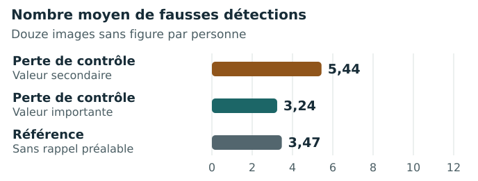
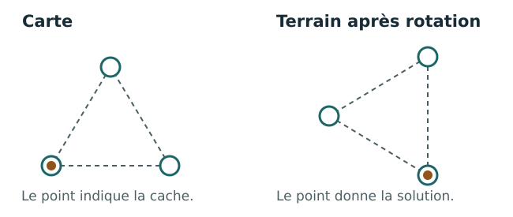

# ENS-PSL · Sélection internationale Lettres — Études cognitives 2017 · Corrigé guidé

*Corrigé rédigé par IA, non officiel. Signalez toute erreur.*

**Rédaction** · GPT-6.2 Astra Ultra · vitesse non renseignée

## Whitson et Galinsky · Remonter du jugement à sa cause

### 1. Poser la question commune

Rapprochez une silhouette vue dans du bruit et deux événements successifs qu’on croit liés. Dans les deux cas, la personne impose une organisation à des données qui ne suffisent pas à l’établir. Les six expériences demandent si la perte de contrôle ressentie peut déclencher cette tendance dans des tâches aussi différentes que la vision, l’investissement et l’explication d’un événement social.

### 2. Tirer les prédictions d’une même idée

Imaginez une tâche dont les résultats varient quoi que vous fassiez. Disposer d’une règle, même hypothétique, pourrait rendre la situation plus intelligible et compenser l’impuissance éprouvée. Si cette explication est correcte, les participants devraient exprimer un besoin d’ordre accru et voir davantage de liens après la perte de contrôle. L’effet devrait persister quand la menace est tenue aussi constante que possible et diminuer si la personne peut se rassurer par un autre moyen.

### 3. Suivre les six comparaisons

Pour chaque étude, repérez ce que l’expérimentateur fait varier, puis ce qu’il enregistre.

| Expérience | Ce qui varie | Ce que la mesure permet d’observer |
|---|---|---|
| 1 | Retour arbitraire pendant l’identification de concepts ou absence de retour | Le questionnaire indique un besoin de structure accru après le retour arbitraire. |
| 2 | Même manipulation, puis images avec ou sans figure | Les groupes détectent bien les figures réelles. L’écart va dans le sens attendu pour les fausses alarmes, avec $p = 0{,}09$. |
| 3 | Souvenir de contrôle ou d’impuissance | Dans trois scénarios, l’impuissance accroît le lien perçu entre un geste superstitieux et sa suite, ainsi que le souci de répéter ce geste. |
| 4 | Évocation d’un épisode menaçant, avec ou sans contrôle | En l’absence de contrôle, les sujets voient plus d’images dans des points aléatoires et jugent plus vraisemblable une coordination entre personnes. |
| 5 | Description d’un marché stable ou volatil | Les nouvelles défavorables à B, société citée moins souvent, sont surestimées en marché volatil. B attire moins d’investissements. Les proportions objectives sont les mêmes pour les deux sociétés. |
| 6 | Après une perte de contrôle, réflexion sur une valeur importante ou secondaire, avec une référence sans rappel | L’auto-affirmation atténue les fausses détections et les interprétations conspiratrices. |

### 4. Introduire l’explication rivale

Une personne en danger peut se sentir menacée et incapable d’agir. C’est pourquoi l’expérience 4 demande aux deux groupes un **souvenir menaçant**. Des évaluateurs ignorant les hypothèses et les groupes jugent comparables les niveaux de menace exprimés. Le nombre moyen de formes signalées dans le bruit passe de 0,92 avec contrôle à 2,92 sans contrôle. Les réponses aux scénarios vont dans le même sens. Cet écart étaye une contribution spécifique du contrôle ressenti. Une absence d’écart statistiquement détecté dans la cotation de la menace laisse toutefois une incertitude sur son égalité exacte.

### 5. Tester l’hypothèse de compensation

Énoncez la prédiction avant de décrire le graphe. Si chercher de l’ordre répond à un malaise, réaffirmer une valeur importante pour soi devrait réduire ce besoin. Comparez maintenant les trois moyennes. Après la même évocation d’impuissance, l’auto-affirmation rapproche le groupe du niveau de référence, dans les images comme dans les scénarios. Le contraste publié soutient la prédiction de compensation. Il reste possible que d’autres conséquences de l’exercice de valeurs contribuent à l’effet.

### 6. Relire les deux versions du sujet

La page française porte « illusoire » dans la question et dans le nom du phénomène. Le texte anglais demande si la détection illusoire est toujours *maladaptive*, donc inadaptée. Traitez les deux sens. Une figure annoncée dans une image construite sans signal est bien une fausse alerte. Dans un récit ambigu, la coordination demeure seulement non établie. Une stratégie qui déclenche parfois une fausse alerte peut être utile si elle permet de repérer tôt un signal réel dont l’omission serait coûteuse. Si l’on prend l’alerte pour une certitude et qu’on agit à grands frais sans vérifier, elle peut aussi nuire. L’expérience mesure les jugements produits, ce qui laisse ouverte la question de leur utilité dans la durée.

### 7. Demander ce que la mesure distingue réellement

Deux participants peuvent avoir une expérience visuelle similaire et des critères différents pour dire « je vois quelque chose ». En expérience 2, les formes réelles sont presque toujours identifiées et la différence sur les images vides est incertaine. Il faudrait des stimuli de plusieurs difficultés pour départager sensibilité et seuil de réponse. Les souvenirs personnels ajoutent une autre limite, puisque perte de contrôle, frustration et incertitude peuvent aller ensemble. Des manipulations indépendantes de ces facteurs, davantage de participants et un suivi des jugements hors du laboratoire renforceraient l’épreuve du modèle.

## Dehaene, Izard, Pica et Spelke · Lire une relation dans deux espaces

### 1. Formuler l’objectif à partir d’un geste

Une personne qui ignore le nom d’un angle droit peut-elle repérer le dessin qui brise cette relation ou trouver une cache sur un plan ? Les auteurs veulent découvrir quelles ressources géométriques on peut mobiliser spontanément et quel rôle jouent l’école, les mots et les conventions graphiques dans leur acquisition.

### 2. Préciser ce que prévoit le noyau géométrique

Si des intuitions de base sont largement partagées, une personne peu familiarisée avec la géométrie scolaire devrait reconnaître des relations simples dans des figures nouvelles. Elle pourrait aussi passer d’une petite carte à une disposition réelle malgré la rotation. Cette prédiction concerne des connaissances de base. Elle permet que l’éducation élargisse le répertoire ou facilite les problèmes complexes.

### 3. Refaire les deux tâches

Pour l’intrus, dessinez cinq paires de droites parallèles dans diverses orientations et une paire sécante. On peut désigner l’intrus en pointant, sans donner le mot « parallèle ». C’est le principe des 45 planches qui testent plusieurs propriétés.

Pour la carte, posez trois récipients aux sommets d’un triangle. Le participant regarde, le dos tourné à l’installation, un plan réduit où une étoile signale la cache, puis se retourne et cherche. L’expérimentateur note son premier choix. Le plan peut être tourné et les trois récipients peuvent devenir identiques après des blocs avec un repère rouge. La relation entre les sommets reste alors la principale information disponible.

### 4. Expliquer le choix de la population

Demandez ce que l’expérience scolaire pourrait expliquer si l’on ne testait que des personnes habituées aux cartes et aux manuels. Une réussite pourrait venir d’un exercice déjà appris. Beaucoup de participants munduruku ont peu de familiarité avec ces outils et disposent de peu de termes géométriques spécialisés. Ils ont une expérience quotidienne riche de la navigation et des formes. Leur réussite teste donc la nécessité de certains apprentissages précis tout en laissant la place à d’autres voies d’acquisition. La comparaison inclut des enfants et des adultes des deux populations.

### 5. Partir du niveau de hasard de chaque épreuve

Avec six dessins, le hasard est de 16,7 %. Les 66,8 % de réussite moyenne des participants munduruku, et la ressemblance des profils de difficulté avec les Américains, appuient l’hypothèse. Un dessin saillant peut cependant attirer le regard sans que l’on puisse spécifier une règle abstraite.

Avec trois caches, le hasard est de 33,3 %. La réussite atteint 72 % sans repère coloré. Les deux extrémités de la base d’un triangle isocèle ont les mêmes distances et les mêmes angles en miroir. Les choisir correctement à 67,7 % dans le dernier bloc indique que le sens de la disposition est aussi exploité. Je donnerais davantage de poids à ce transfert carte-terrain, qui survit à des changements d’orientation et d’échelle. Il reste compatible avec plusieurs stratégies mentales.

### 6. Séparer usage intuitif et savoir explicite

Reprenez le cas de l’intrus. Pointer la paire sécante suppose de discerner une relation commune aux autres figures. Définir le parallélisme ou prouver un théorème exige des ressources supplémentaires. La conséquence majeure est que l’on peut disposer d’une base pour le raisonnement géométrique en l’absence du vocabulaire et de l’enseignement formels. Les différences de performances, notamment chez les adultes américains scolarisés, montrent qu’une telle base peut encore se développer.

### 7. Situer la limite sur une échelle de temps

Entre la naissance et six ans, un enfant a rencontré de multiples occasions de comparer les formes et les positions. La réussite d’enfants de cet âge répond à la question de la nécessité d’une scolarisation géométrique poussée. Pour séparer une disposition initiale d’un apprentissage spatial commun, il faudrait examiner le développement plus tôt et dans davantage de contextes. Enfin, une difficulté sur les transformations en miroir peut tenir à leur présentation statique. Varier cette présentation permettrait de tester la portée exacte du résultat.

## Documents de l’épreuve

[Questionnaire bilingue de l’ENS-PSL](https://www.ens.psl.eu/sites/default/files/etudes-cognitives-ecrit.pdf) · [Whitson et Galinsky (2008)](https://www.ens.psl.eu/sites/default/files/whitson-science-2008.pdf) · [Dehaene, Izard, Pica et Spelke (2006)](https://www.ens.psl.eu/sites/default/files/dehaene2006.pdf)
