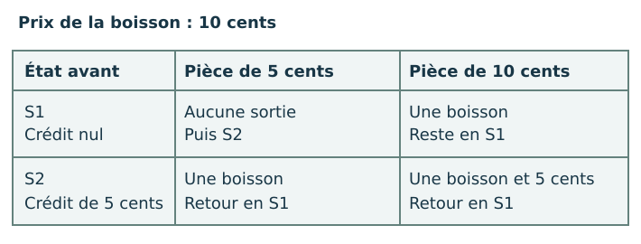

# ENS-PSL · Études cognitives · 2017 — corrigé guidé

*Corrigé rédigé par IA, non officiel. Signalez toute erreur.*

**Rédaction** · GPT-6.2 Astra Ultra · vitesse non renseignée · 26 novembre 2026

## Préparer les dix réponses sur Fodor

Travaillez avec les repères de la pagination imprimée. Les pages 114 à 118 introduisent les doctrines, les pages 119 et 120 leurs modèles mécaniques, la page 122 les questions du vécu et de la signification. La consigne bilingue présente dix questions identiques dans les deux langues.

### 1. Faire apparaître le problème

Partez d’un geste, par exemple prendre un parapluie après avoir regardé le ciel. Une description mentionne la lumière reçue par l’œil et les mouvements musculaires. Une autre fait intervenir une attente de pluie. Que doit être cette attente pour contribuer au geste ? Votre réponse doit poser à la fois le rapport entre les descriptions mentale et physique, le statut des états qu’elles décrivent et leur efficacité causale. Une simple corrélation entre activité cérébrale et comportement laisse encore ouverte la nature de ce rapport.

### 2. Tester l’hypothèse dualiste

Le dualiste pose une substance pensante immatérielle distincte du corps. Suivez le sens précis de l’objection de Fodor. Le geste du bras est un événement situé. Quelle interaction le relie à une cause censée n’avoir aucune position dans l’espace ? Comment cette interaction respecte-t-elle les lois de conservation ? Présentez ensuite la réponse possible : le passage d’un événement physique à un autre demande lui-même explication. Fodor juge néanmoins inutile de multiplier les types de causalité tant que l’enquête empirique traite avec succès les processus mentaux par les méthodes des sciences physiques. Cela soulève une difficulté pour le dualisme sans constituer une réfutation expérimentale de toute substance immatérielle.

### 3. Reconstituer le paradoxe béhavioriste

Chez le béhavioriste radical décrit par Fodor, l’explication se concentre sur les régularités entre stimulations et réponses. Les causes mentales sont écartées. Faites varier un élément de la scène initiale. Deux personnes voient le même ciel, l’une pense qu’il va pleuvoir et l’autre attend le retour du soleil. Pourquoi une seule emporte-t-elle son parapluie ? Le langage ordinaire donne spontanément un rôle causal à l’attente. Le radical peut tenir cette intuition pour trompeuse. L’objection scientifique de Fodor porte alors sur les théories réellement fécondes : elles ont multiplié les processus internes postulés pour rendre compte des conduites.

### 4. Distinguer les matérialismes

Pour classer les doctrines, demandez ce qui reste de la phrase « Lucie a soif ». La voie radicale peut se passer de l’invocation d’un état mental causal. Le béhaviorisme logique veut analyser le sens de cette phrase en dispositions à agir. On énumérerait, en principe, des conditions observables et les réponses qu’elles appelleraient. La théorie de l’identité, elle, maintient l’existence d’un état interne et l’identifie à un état neurophysiologique. Les deux descriptions peuvent désigner le même événement sans avoir le même sens. Cette distinction évite de confondre la traduction d’un énoncé et une découverte sur son référent.

### 5. Séparer type et occurrence par un test

Prenez deux douleurs, l’une éprouvée par Lucie à midi, l’autre par Paul le lendemain. Cela fait deux événements singuliers sous une description psychologique commune. Supposons les deux événements physiques, réalisés par des processus différents. Le physicaliste des occurrences peut l’accepter. Le physicaliste des types doit montrer quelle même propriété physique identifie le type « douleur ». Un organisme autrement constitué qui souffrirait mettrait en difficulté l’universalité d’une définition par nos seuls neurones. Fodor utilise cet organisme comme possibilité de pensée. Une démonstration que tel objet technique souffre demanderait des arguments supplémentaires.

### 6. Refaire le raisonnement qui mène au fonctionnalisme

Posez deux exigences. Il faut laisser des événements internes causer d’autres événements. Il faut aussi que la même catégorie psychologique puisse s’appliquer à des dispositifs matériellement différents. La théorie de l’identité des types satisfait mal la seconde exigence. Le béhaviorisme logique satisfait mal la première lorsqu’une croyance ou un désir en modifie un autre. Pour concilier les deux, caractérisez un état par sa contribution à un réseau causal d’entrées, de sorties et d’états internes. Le désir d’éviter la pluie joint à la croyance qu’il pleuvra explique un geste que la croyance seule ne produit pas. Le rôle est défini par ses relations et chaque interaction peut prendre place dans un mécanisme physique.

### 7. Simuler le distributeur

Gardez en tête le prix de dix cents. Dessinez S1, le crédit nul, et S2, le crédit de cinq cents. À partir de S1, essayez deux pièces successives de cinq cents : la première ne livre rien et ouvre S2, la seconde donne la boisson et ramène à S1. Essayez ensuite cinq puis dix : la première ouvre encore S2, la seconde donne la boisson, rend cinq cents et ramène à S1. Enfin, dix cents directement en S1 donnent la boisson et laissent en S1. Vous avez ainsi vérifié les quatre transitions. L’autre machine n’a que S0 et une relation spécifiée : à dix cents correspond une boisson. La description à deux états conserve l’histoire du premier dépôt et explique comment une entrée identique trouve deux réponses possibles.

### 8. Repérer trois niveaux de difficulté

Un « ouvreur » peut être le simple nom donné à ce qui ouvre une vanne. Une explication fonctionnelle convaincante doit préciser un mécanisme réalisable. Mais une machine ainsi décrite peut encore être dépourvue d’états mentaux. Il reste à rendre compte, d’une part, de la qualité vécue d’un état et, d’autre part, de son contenu intentionnel. Le spectre inversé imagine deux sujets ayant les mêmes relations causales et utilisant tous deux « rouge » à propos d’une tomate mûre, mais des vécus différents. L’expérience met en cause la suffisance fonctionnelle si elle est cohérente. La croyance concernant Galilée pose une autre question : elle est *à propos de* quelqu’un et peut être vraie ou fausse. Appeler son support un symbole mental déplace l’enquête vers la façon dont un symbole acquiert cette signification.

### 9. Soumettre l’analogie informatique à deux contrôles

Premier contrôle, le mécanisme. Peut-on décomposer la tâche en opérations élémentaires sur des symboles, comme lire, écrire, déplacer un ruban et changer d’état ? Une telle décomposition évite de cacher un « petit esprit » dans l’explication de l’esprit. Elle peut être mise en œuvre sur plusieurs supports. Deuxième contrôle, la portée. Avoir construit un programme qui accomplit la tâche démontre une possibilité de réalisation. Il reste à établir par des données que le sujet humain mobilise ce mécanisme. Et ni la signification des symboles ni le fait d’éprouver quelque chose ne découlent de la seule table des transitions. Ces deux contrôles répondent séparément à l’intérêt de l’analogie et à ses limites.

### 10. Défendre et éprouver sa propre solution

Une réponse possible est de conserver le fonctionnalisme pour expliquer les capacités et le physicalisme des occurrences pour rechercher leurs mécanismes chez l’humain. À l’appui, reprenez deux agents qui donnent la même réponse aujourd’hui mais qui ont des croyances différentes : des observations nouvelles pourront révéler la différence de leurs dispositions au cours du temps. Opposez ensuite à votre thèse une vraie difficulté, par exemple l’impossibilité apparente d’inférer du seul rôle causal la qualité d’une douleur. Un partisan de l’identité des types privilégierait ici le mécanisme biologique commun. Il lui faudrait toutefois établir cette identité au-delà des groupes effectivement examinés. Vous pouvez préférer une autre solution si vous explicitez son gain, l’objection qu’elle laisse subsister et ce qui permettrait d’enquêter sur elle.
