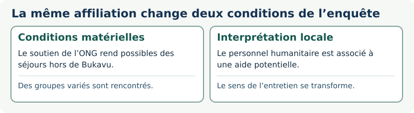

# ENS-PSL · Sélection internationale Lettres · Études politiques — Brabant et la recherche en ONG (oral) 2017 — Corrigé brut

*Corrigé rédigé par IA, non officiel. Signalez toute erreur.*

**Rédaction** · GPT-6.2 Astra Ultra · vitesse non renseignée

## Une position d’enquête qui facilite la rencontre et en change le sens

À la fin d’un entretien, un interlocuteur demande à Justine Brabant une aide que celle-ci ne peut lui apporter. Lui a compris leur conversation à travers les attentes associées au personnel humanitaire. Elle cherchait à recueillir un récit sur les conflits ruraux. Ce désaccord sur la signification de la rencontre pose la question centrale de l’extrait de *Genèses* paru en 2013. Que peut-on savoir lorsque l’institution qui permet d’accéder au terrain donne en même temps une signification sociale à la présence du chercheur ?

Brabant distingue deux relations à l’humanitaire. On peut étudier les ONG, leurs pratiques et leurs modes de gouvernement. On peut aussi enquêter au sein de l’une de ces organisations sur un autre objet. C’est le second cas qu’elle développe. Entre janvier et juillet 2012, elle mène pour le bureau d’une ONG à Bukavu une enquête de six mois sur certains conflits ruraux du Sud-Kivu, en République démocratique du Congo. Même un chercheur sans contrat avec l’organisation peut dépendre de ses ressources pour se déplacer. Tenir compte du rapport institutionnel suppose donc d’examiner les conditions effectives de production des données.

## L’accès au terrain est un premier résultat à analyser

Grâce à la prise en charge matérielle, l’autrice peut passer près de deux mois hors de Bukavu en zone rurale ou semi-rurale. Elle réalise au total 105 entretiens. Les interlocuteurs comprennent des agriculteurs, des éleveurs, différentes autorités locales et des personnes appartenant à des organisations armées. L’affiliation facilite des démarches administratives. Le contraste décisif porte sur les lieux, les durées et les catégories de personnes que des ressources logistiques permettent de rencontrer. Un chercheur dépourvu de ces appuis aurait pu accéder à certains des mêmes lieux, mais selon un calendrier et des itinéraires susceptibles de différer.

Cette observation a une conséquence pour l’interprétation. Cent cinq entretiens attestent une activité d’enquête et une diversité de positions rencontrées. Ce chiffre ne fournit ni un échantillon représentatif du Sud-Kivu ni une mesure de la fréquence des conflits. Il faudrait notamment savoir quels espaces restaient difficiles d’accès, quelles introductions ont été décisives et qui a refusé de parler.

## Les attentes des enquêtés entrent dans les données

Dans la région décrite, les organisations internationales sont associées à la distribution de ressources et au financement de projets. Plusieurs personnes demandent du matériel, des médicaments ou un soutien à leur association. La chercheuse rapporte que le statut universitaire qu’elle aurait pu revendiquer avait peu de sens pour certains interlocuteurs. La catégorie pertinente dans l’interaction est celle qu’ils lui attribuent. Une demande en fin d’entretien peut alors éclairer l’attente qui a accompagné le récit, même si l’on ne peut pas supposer que l’intégralité de ce récit a été fabriquée pour l’occasion.

La réflexivité consiste ici à traiter les conditions de l’échange comme une partie de l’explication. Qui a présenté la chercheuse ? Dans quel lieu la conversation a-t-elle eu lieu ? À quel moment la demande s’est-elle formulée ? Une réponse peut être à la fois une information sur un parcours et une tentative d’obtenir une reconnaissance ou une ressource de l’interlocutrice. C’est aussi un renseignement politique sur la place attribuée aux organisations humanitaires dans l’économie locale de l’aide.

## Des arbitrages individuels à une discussion collective sur la méthode

La fin du texte distingue des demandes manifestement incompatibles avec la recherche et des situations plus ordinaires. Faut-il considérer une dépense de transport comme un coût que la personne ne devrait pas supporter, ou comme une rémunération qui modifie la relation ? L’existence de pratiques d’indemnisation par les organismes présents contribue à fixer des attentes envers d’autres intervenants. Une réponse rigoureuse consiste à documenter la situation, la décision et ses conséquences possibles sur les entretiens suivants, puis à discuter ces pratiques entre chercheurs. L’autrice ne formule pas de règle universelle applicable à chaque rencontre.

Un rapprochement avec un projet de recherche est proposé à titre facultatif. Dans une enquête, par exemple, sur l’accès aux prestations sociales conduite dans les locaux d’une association, une personne pourrait croire que son témoignage influencera le traitement de son dossier. Comparer les conditions de présentation de l’enquête et les attentes exprimées aiderait à lire ses propos. Dans les deux cas, mettre au jour l’effet de la position occupée élargit ce que l’on peut apprendre de la rencontre et précise la portée de ses résultats.

[Feuillet de l’ENS](https://www.ens.psl.eu/sites/default/files/et.politiques-oral-si17.pdf) · [Attentes générales du jury, p. 3](https://www.ens.psl.eu/sites/default/files/qqs-attentes-jury-pageweb.pdf#page=3)
