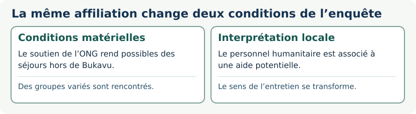

# ENS-PSL · Sélection internationale Lettres · Études politiques — Brabant et la recherche en ONG (oral) 2017 — Corrigé guidé

*Corrigé rédigé par IA, non officiel. Signalez toute erreur.*

**Rédaction** · GPT-6.2 Astra Ultra · vitesse non renseignée

## Délimiter l’objet et la consigne

Le sujet demande de commenter l’extrait et de s’interroger sur les apports de la réflexivité dans une enquête conduite au sein d’une ONG. Le rapprochement avec le projet de la personne candidate est facultatif. Ouvrez avec une situation du texte : la chercheuse recueille un récit, son interlocuteur attend d’elle une aide. La même conversation engage deux définitions différentes de ce que fait quelqu’un qui vient travailler pour une organisation humanitaire.

Repérez ensuite le lieu, les périodes et l’unité d’observation. Le bureau de l’ONG se trouve à Bukavu. L’enquête dure six mois en 2012, dont près de deux mois en zones rurales ou semi-rurales hors de cette ville. Les 105 entretiens correspondent au total annoncé pour l’enquête. Ces chiffres ne permettent pas d’identifier le nombre d’entretiens par groupe, ni de mesurer des proportions dans la population.

## Construire les deux colonnes de l’argument

Dans la première colonne, mettez un fait : la prise en charge matérielle permet de prolonger des séjours et facilite certaines formalités. Écrivez à côté la conséquence scientifique : des personnes vivant loin du bureau et appartenant à des groupes différents peuvent être rencontrées. Interrogez aussi l’envers de cette possibilité : qui a pu rester hors des itinéraires accessibles ?

Dans la deuxième colonne, mettez un autre fait : certains interlocuteurs associent l’enquêtrice à une institution distributrice d’aide. Demandez quelle dimension du discours cela peut affecter. Un récit peut être adressé à quelqu’un dont on espère un appui. Il serait excessif d’en conclure que les informations sont fausses ; il serait tout aussi fragile de lire le propos en oubliant à qui il est destiné.

## Répondre à la relance sur la réflexivité

**À quoi sert exactement le retour sur soi ?** La réflexivité est une enquête sur une relation. Elle documente la position institutionnelle, le rôle attribué par les enquêtés et leurs effets sur le matériau. La simple confidence sur l’embarras de la chercheuse ne suffit pas. Prenez la demande de soutien à une association et montrez comment elle renseigne sur le rôle perçu de l’ONG dans les échanges locaux. Vous pouvez ensuite proposer de comparer ce qui est demandé selon les circonstances de la rencontre. Ce prolongement doit rester distinct des observations déjà réalisées.

**Que faire du dernier paragraphe ?** Il élargit la question aux pratiques de compensation dans un univers où circulent déjà des indemnités. Le cas d’un déplacement occasionné par l’entretien permet d’en parler avec précision. Il faut savoir qui supporte le coût de l’échange, comment les modalités de participation sont comprises et ce que celles-ci changent pour les témoignages recueillis. La discussion collective de ces arbitrages peut améliorer la comparaison entre enquêtes.

## Choisir ou laisser de côté le rapprochement facultatif

Vous pouvez terminer en revenant à la distinction entre recherche *sur* et recherche *dans* une organisation. Si votre projet se prête à un rapprochement, choisissez une seule propriété commune. Par exemple, un accès aux usagers par un centre social peut faire percevoir l’enquêtrice comme membre du service. Dites alors ce que vous observeriez pour repérer cet effet et quelles comparaisons aideraient à l’interpréter. La singularité du Sud-Kivu, de la commande de recherche et de l’histoire de l’aide décrite par Brabant doit rester présente dans votre conclusion.

[Feuillet de l’ENS](https://www.ens.psl.eu/sites/default/files/et.politiques-oral-si17.pdf) · [Attentes générales du jury, p. 3](https://www.ens.psl.eu/sites/default/files/qqs-attentes-jury-pageweb.pdf#page=3)
