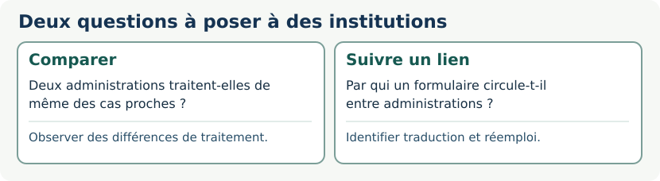
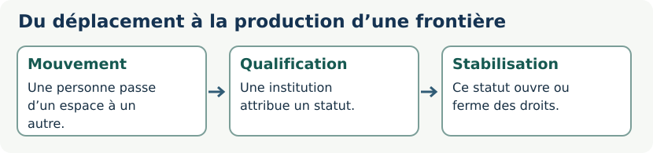

# ENS-PSL · Sélection internationale Lettres · Études politiques — la perspective transnationale 2017 — Corrigé brut

*Corrigé rédigé par IA, non officiel. Signalez toute erreur.*

**Rédaction** · GPT-6.2 Astra Ultra · vitesse non renseignée

## Ce qu’un passeport permet de voir

Suivre un réfugié muni d’un titre de voyage oblige à regarder à la fois le déplacement qu’il entreprend et les administrations qui définissent le statut sous lequel il pourra se déplacer. Cette double enquête donne son sens à la proposition de Blaise Wilfert-Portal. Dans un article d’histoire culturelle de l’Europe publié en 2013, il déplace l’attention des récits nationaux vers les relations entre territoires, tout en insistant sur les opérations qui fixent les personnes et les choses. Que gagne la science politique à prendre ces relations pour objet ? Elle peut étudier comment des institutions souvent décrites comme déjà constituées se forment et exercent leur pouvoir en organisant des circulations inégalement accessibles.

## Changer l’unité d’observation

La première partie de l’extrait associe des personnes, des biens, des techniques, des capitaux et des institutions. L’inventaire a une fonction argumentative. Si l’on écrit séparément l’histoire de chaque nation, un exilé risque de disparaître de l’histoire politique de son pays au moment de son départ, puis de réapparaître dans l’histoire du pays d’accueil sous le seul statut d’étranger. Suivre sa trajectoire permet de retrouver les journaux, les organisations et les relations qu’il maintient de part et d’autre. La politique d’un mouvement peut dépendre des ressources de l’exil aussi bien que de l’action de ses membres restés sur place.

L’unité d’enquête devient ici une relation dont il faut établir l’existence. Deux partis peuvent adopter des mots d’ordre proches parce qu’ils affrontent des situations analogues. Pour conclure à une circulation, il faudrait retrouver des relais, une traduction, une correspondance ou une réunion, puis examiner les changements d’usage. Un mot importé peut désigner un autre adversaire après son passage dans un nouvel espace politique. Une comparaison entre pays décèle des ressemblances et des écarts. Le suivi des connexions examine par quels canaux des phénomènes très éloignés peuvent dépendre l’un de l’autre.

## Les circulations suscitent des opérations de fixation

Le second mouvement du texte porte sur la territorialisation. Suivre ce qui circule fait apparaître des contrôles et des catégories dont les effets passent parfois inaperçus si l’on prend les frontières pour de simples traits sur une carte. Le passeport Nansen, créé au début des années 1920 dans le cadre de la Société des Nations pour des réfugiés d’abord russes, en donne un exemple. Un document reconnu par plusieurs États peut rendre possible le voyage d’une personne dépourvue d’une protection nationale ordinaire. Il fixe en même temps une catégorie administrative. Son efficacité dépend de sa reconnaissance par les autorités concernées. La possession du document ne confère en elle-même ni nationalité ni droit général d’entrer dans tous les pays.

Le même dossier permet ainsi d’étudier la construction d’une catégorie internationale, la marge de décision des administrations nationales et les stratégies permises aux personnes concernées. La science politique y gagne une analyse située de la souveraineté. Plusieurs autorités peuvent coopérer pour rendre une mobilité possible tout en conservant chacune le pouvoir d’en fixer les conditions. Les trajectoires interrompues sont particulièrement révélatrices. Comparer deux personnes dont une seule a pu obtenir ou faire reconnaître le même titre permet d’étudier concrètement qui bénéficie du dispositif.

## Des infrastructures aux décisions politiques

L’Union postale universelle, mentionnée par Wilfert-Portal, invite à étudier la circulation des objets et de l’information. Un courrier ordinaire franchit plusieurs espaces de souveraineté grâce à des règles qui rendent compatibles les opérations de services différents. Une enquête pourrait comparer les accords, les formulaires et le traitement d’envois particuliers pour déterminer où sont répartis les coûts, les responsabilités et l’autorité de régler un différend. À une autre échelle, l’Organisation mondiale du commerce constitue un terrain pour étudier comment des règles négociées entre États sont interprétées et disputées dans des espaces nationaux. La présence d’une organisation internationale dans un dossier est un point de départ. L’analyse transnationale commence véritablement lorsqu’on reconstitue ce qui circule entre ses agents, les administrations et les autres groupes concernés.

Ce regard permet de traiter ensemble l’évolution des institutions, la mobilisation collective et la stratification des possibilités de déplacement. Il exige cependant de préciser le territoire, la période et les sources. Un réseau bien documenté dans une capitale ne représente pas l’ensemble des personnes qu’il affirme représenter. Il faut aussi pouvoir observer les traductions abandonnées, les demandes rejetées ou les groupes exclus de l’échange. La formule finale du texte propose une méthode : partir du mouvement pour comprendre empiriquement qui est en mesure d’établir des règles durables, pour qui et avec quels effets.

[Feuillet de l’ENS](https://www.ens.psl.eu/sites/default/files/et.politique-ecrit-si17.pdf) · [Attentes générales du jury, p. 3](https://www.ens.psl.eu/sites/default/files/qqs-attentes-jury-pageweb.pdf#page=3)
