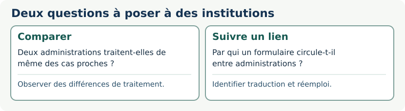
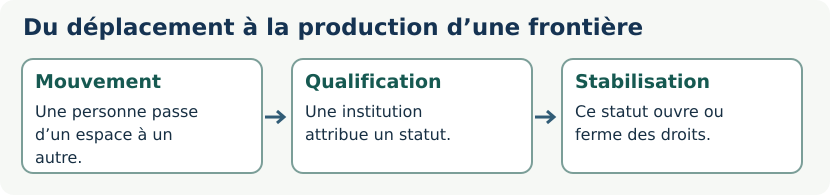

# ENS-PSL · Sélection internationale Lettres · Études politiques — la perspective transnationale 2017 — Corrigé guidé

*Corrigé rédigé par IA, non officiel. Signalez toute erreur.*

**Rédaction** · GPT-6.2 Astra Ultra · vitesse non renseignée

## Repérer les deux opérations que demande le sujet

La première consigne porte sur un extrait d’histoire culturelle de l’Europe. La seconde demande ce que la perspective décrite permettrait d’étudier en science politique. Préparez une réponse aux deux opérations. Pour la première, repérez le changement d’objet dans la première partie du texte, puis les termes qui désignent des contrôles et des fixations. Pour la seconde, choisissez un objet politique dont on pourrait effectivement suivre la circulation.

Une question de copie possible est : « Comment suivre des mobilités pour comprendre la construction d’autorités politiques territoriales ? » Elle conserve le paradoxe final de Wilfert-Portal. La phrase « le monde est de plus en plus connecté » serait trop générale et imposerait au passage un récit continu de l’ouverture des frontières.

## Donner une fonction précise aux exemples

Prenez un exilé. Écrire deux portraits successifs, avant puis après son départ, peut faire disparaître les liens qu’il maintient avec une organisation ou une presse dans son pays d’origine. Étudiez ce qui passe par ces liens : informations, textes traduits, financement d’un journal, prises de position. Puis demandez quelles traces permettraient de montrer qu’un contact a effectivement eu lieu et qu’il a changé une pratique. Une ressemblance de discours, à elle seule, ne suffit pas.

Faites un deuxième essai avec l’Union postale universelle. Ici, l’objet qui circule peut être un courrier, une convention ou un formulaire. Dites quel pouvoir vous voulez étudier : fixer les règles d’identification, répartir des frais entre administrations ou arbitrer une contestation. L’acronyme d’une organisation ne tient pas lieu d’explication. Il prend sens lorsque vous montrez comment un acteur utilise une règle dans une situation concrète.

## Déplier le paradoxe du mouvement et de la frontière

Le titre de voyage dit passeport Nansen, établi à partir de 1922 d’abord pour des réfugiés russes, constitue une illustration extérieure au passage. Il permet de distinguer trois échelles. Un dispositif est négocié au niveau international. Une administration nationale reconnaît un document et statue selon les règles applicables. Une personne obtient ou non la possibilité de voyager. Elle n’acquiert pas pour autant la nationalité du pays auquel elle s’adresse. En reliant ces décisions, vous expliquez comment un projet destiné à faciliter les déplacements produit aussi une catégorie durable.

**Comment éviter de n’étudier que ceux qui réussissent à circuler ?** Cherchez des demandes refusées, des déplacements interrompus et des groupes restés hors des archives institutionnelles. Les restrictions font partie du mécanisme à expliquer. Elles donnent un sens concret aux mots « contrôle » et « orientation » employés par l’auteur.

## Rédiger la transition vers la science politique

Après le commentaire, nommez ce qui change dans la question scientifique. Pour l’histoire d’un mouvement, il peut s’agir du rôle des réseaux d’exil dans la construction de répertoires politiques. Pour l’étude de l’État, il peut s’agir de la manière dont plusieurs administrations fabriquent des catégories pourtant appliquées à une frontière nationale. Pour les organisations internationales, examinez les médiateurs qui traduisent les accords en pratiques et les groupes qui en contestent les conséquences.

Avant de conclure, testez chaque exemple : avez-vous identifié quelque chose qui circule, un intermédiaire, une transformation et un effet de stabilisation ? Indiquez enfin jusqu’où les documents permettent de suivre le lien. La perspective transnationale devient alors une méthode d’enquête qui explique des relations de pouvoir et se prête à une vérification.

[Feuillet de l’ENS](https://www.ens.psl.eu/sites/default/files/et.politique-ecrit-si17.pdf) · [Attentes générales du jury, p. 3](https://www.ens.psl.eu/sites/default/files/qqs-attentes-jury-pageweb.pdf#page=3)
