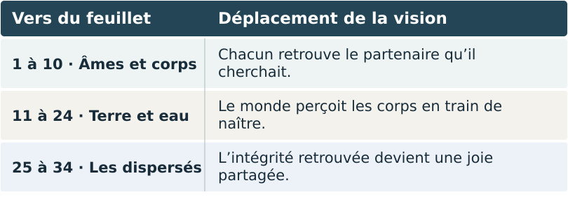

# Agrippa d’Aubigné et Les Tragiques · Oral de littérature ENS-PSL 2017 · Corrigé brut

*Corrigé rédigé par IA, non officiel. Signalez toute erreur.*

**Lecture du rapport du jury** · GPT-6.2 Astra Ultra · vitesse non renseignée

**Rédaction** · GPT-6.2 Astra Ultra · vitesse non renseignée

**Révision (tour 1)** · GPT-6.2 Astra Ultra · vitesse non renseignée

## Feuillet de l’oral

Vous commenterez le texte ci-dessous en 20 minutes environ. Vous pouvez choisir de le commenter en suivant l’ordre de la lecture, ou de rassembler vos remarques selon un plan qui met en valeur les principaux enjeux du texte. Votre interprétation tiendra compte, par exemple, de son genre littéraire, de son contexte historique et culturel, de sa structure, de sa forme (vocabulaire, syntaxe, effets stylistiques et poétiques), de sa thématique et de sa tonalité. Votre commentaire sera suivi d’un entretien avec le jury.

Agrippa d’Aubigné, *Les Tragiques*, livre VII, « Jugement », vers 651 à 684. Dans le recueil de huit pages, le passage occupe les pages 3 et 4. Il s’ouvre sur « Réjouissez-vous donc, ô vous, âmes célestes ! » et s’achève par « Riants au ciel riant d’une agréable audace. ». Le feuillet numérote localement ces 34 vers. Les huit notes de vocabulaire et d’interprétation accompagnent l’extrait.

## Commentaire de la résurrection des corps

Au livre VII des *Tragiques*, « Jugement », le poète protestant Agrippa d’Aubigné envisage ce que devient le corps que les persécuteurs ont cru pouvoir anéantir. Les trente-quatre alexandrins du feuillet, vers 651 à 684 du livre, donnent à voir le moment de la résurrection. Le premier impératif s’adresse à des êtres célestes. Le dernier participe fait sourire jusqu’au ciel. Que s’est-il passé entre ces deux façons d’exprimer la joie ? Le poème transforme l’assurance d’une promesse en expérience sensible, jusque dans les éléments du monde que l’on aurait crus incapables de rien éprouver.

### Vers 1 à 10 du feuillet. Retrouver un partenaire

Le premier vers appelle les âmes, le troisième appelle les corps. Le parallélisme des deux injonctions les met à égalité comme destinataires du poème. « Restes » rime avec « célestes ». La déchéance matérielle entre ainsi dans le couple sonore où s’énonce la dignité des âmes. Les corps, livrés jusqu’alors au mépris, peuvent reprendre leurs esprits. La répétition, au comparatif, de l’adjectif qui les dit heureux donne le sentiment d’un bonheur qui s’accroît en passant des uns aux autres.

L’échange se déploie dans le temps. Une fois, les esprits ont voulu descendre du ciel vers les corps. Au vers 7, le poète oppose le passé simple au futur autour de l’adverbe ancien « ore », maintenant. Les pronoms échangent leurs fonctions de sujet et de complément. Celui qui était recherché devient celui qui recherche. Cette réciprocité fait comprendre la métaphore nuptiale des vers 9 et 10. La note du sujet identifie les corps aux « femelles » des âmes. La mortalité assumée lors de leur première union est appelée à devenir, dans les retrouvailles, une immortalité partagée. De même que les rimes vont par deux, chacun semble exiger son répondant pour être pleinement lui-même.

### Vers 11 à 24. Un monde qui sent des corps revenir

Le poète interrompt son propre chant. La brusquerie de « Mais quoi ! » donne à entendre un témoin qui risque, à force de célébrer, de manquer l’événement. Après les yeux éblouis sur le chemin céleste, le vers 15 tourne le regard vers le sol. La déclaration très brève « C’est fait » avait déjà substitué le fait accompli à la promesse. Le présent des verbes fait maintenant assister à ce que la prophétie avait annoncé. Il faut à la fois recevoir une parole et apprendre à regarder autrement.

La terre ouvre son sein et les tombeaux ont un ventre. Au passage du vers 15 au vers 16, le verbe de naissance surgit en tête du second vers. Ceux que désigne encore le mot « enterrés » offrent déjà des visages. Le rythme énumère des lieux ordinaires puis les démonstratifs de lieu précisent des points successifs d’apparition. Une construction humaine se laisse percer par ceux qui remontent. Dans l’arbre, les bras de la racine donnent l’espace nécessaire à une tête et à une poitrine. L’arbre lui-même est sujet du verbe de sensation. L’eau éprouve à son tour un éveil en elle. Le lecteur doit donc déplacer son attention de ce qui émerge vers le milieu qui sent arriver la vie. Même le bouillonnement ou le grouillement, que l’on pourrait associer à la corruption, deviennent des mouvements de naissance.

### Vers 25 à 34. Rendre à chacun son corps

Le saut de page du fascicule n’interrompt pas la vision. Au bas de la page 3, le dernier verbe évoque un éveil ; en haut de la page 4 la comparaison du nageur débouche, au vers suivant, sur le réveil de celui qui sort d’un songe. À voix haute, on peut maintenir la continuité entre ces deux mouvements tout en marquant la place nouvelle du mot « Tous ». Une sensation que l’imagination peut attribuer à une seule personne prépare une affirmation qui porte sur chacun. L’allure familière de la comparaison donne à l’espérance collective sa force sensible.

Le nageur qui remonte à la surface offre une mesure familière à une scène hors de toute expérience. Le jeu de rime entre la plongée, que le feuillet nomme « plonge », et le songe rapproche le retour à l’air du réveil. Le pluriel « Tous » étend à tous les ressuscités le savoir du souffle retrouvé que suggère cette comparaison individuelle. Mais l’image paisible du dormeur rencontre tout de suite la mention des tyrans. Certains corps ont été dispersés par une action humaine. L’enjeu historique des *Tragiques*, les violences des guerres de Religion, revient ainsi dans l’accomplissement d’une espérance chrétienne.

Le trajet d’un seul bras, entre l’Afrique brûlante et la froide Thulé, oppose l’immensité des distances au bref moment nécessaire au rassemblement. Le membre isolé et les restes réduits à l’état de cendres constituent deux difficultés croissantes pour l’imagination. Le vers 32 renverse pourtant l’ordre attendu de la dispersion et de la réunion. Les plus petits fragments paraissent unis plus vite encore qu’ils ne furent dispersés. L’extrême fragilité de la matière mesure la puissance de ce qui la réunit.

Le dernier vers fait correspondre le rire des ressuscités au rire du ciel. La proximité sonore des deux formes du même verbe traduit leur accord, et l’adjectif attaché à l’audace en fait l’expression heureuse d’une assurance retrouvée. Les corps naguère exposés au mépris peuvent se tenir face au ciel. La joie recommandée par le poète au premier vers est devenue, au dernier, un geste que chacun peut voir.

[Feuillets officiels archivés](https://web.archive.org/web/20201230063150id_/https://www.ens.psl.eu/sites/default/files/litterature-4oraux-si17.pdf#page=3) · [Rapport de la session](https://www.ens.psl.eu/sites/default/files/ens_rapport_sil_litterature_2017.pdf#page=2)
