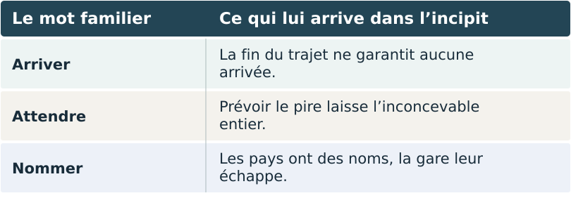

# Charlotte Delbo et Aucun de nous ne reviendra · Oral de littérature ENS-PSL 2017 · Corrigé brut

*Corrigé rédigé par IA, non officiel. Signalez toute erreur.*

**Lecture du rapport du jury** · GPT-6.2 Astra Ultra · vitesse non renseignée

**Rédaction** · GPT-6.2 Astra Ultra · vitesse non renseignée

## Commentaire de l’incipit de *Aucun de nous ne reviendra*

Une gare se reconnaît aux personnes qui y attendent d’autres personnes. Le début de « Rue de l’Arrivée, rue du Départ » permet à chacun de retrouver ce savoir très simple. À la fin, les voyageurs qui cherchent le nom de la gare ne peuvent même pas satisfaire ce besoin de s’orienter. Entre les deux, le titre du livre de Charlotte Delbo, déportée à Auschwitz, s’est chargé d’un poids que chaque mot de l’incipit fait éprouver. Écrit en 1946 et publié en 1965, ce témoignage commence à la troisième personne. Comment faire approcher le sort des déportés en conservant à la fois leur savoir de l’instant et celui de la survivante qui écrit ?

### Une gare que chacun sait lire

Le titre local juxtapose deux rues parallèles. La première série de phrases distribue de même ceux qui arrivent et ceux qui partent. Le présentatif qui les introduit a la simplicité d’un geste qui montre. Même les enseignes des cafés répètent ce partage. Mais les groupes n’existent que les uns par les autres. La première phrase sur la foule emboîte les regards de ceux qui cherchent et de ceux qui attendent. L’étreinte et la fatigue dite à voix haute supposent quelqu’un pour accueillir la personne qui a voyagé. La banalité de ces gestes installe un monde où les mots permettent de prévoir une suite.

La conjonction « Mais » ouvre une exception. La prose répétitive s’espace et se découpe en lignes inégales. Arriver et partir peuvent désormais se dire des mêmes êtres. Le présent de l’arrivée encore visible rencontre le passé composé accompagné de « jamais ». La présence sur le quai est un fait matériel, tandis que l’arrivée qui devrait la prolonger en rencontre humaine est rendue impossible. Lorsque la gare est dite la plus grande du monde, cette grandeur se comprendra à partir de la multitude des provenances, puis de la disparition de toute issue. Aucune mesure du bâtiment n’est donnée.

### Ce que des familles emportent et espèrent

La distance franchie se mesure en jours et en nuits. Les enfants apparaissent avant les objets de valeur. Emmener un enfant, garder de l’or ou des papiers répond à des raisons que les propositions introduites par « parce que » rendent intelligibles. Une règle de prudence ordinaire conduit de ce qui a du prix à ce qu’on a de plus cher, puis à sa propre vie, devenue dans la phrase quelque chose que l’on emporte avec soi. La formule prend toute sa force au moment où pouvoir garder sa vie cesse précisément d’aller de soi.

La disposition en lignes brèves isole l’hypothèse de l’enfer. Cette image appartient encore aux moyens dont les voyageurs disposent pour penser qu’ils peuvent affronter une épreuve. L’énumération des membres de la famille et des souvenirs rend à cette résolution une forme familière. Puis la voix du texte indique une limite entre le pire que l’on peut attendre et « l’inconcevable ». Le lecteur peut connaître le nom du camp sans pouvoir se substituer aux personnes qui découvrent le quai.

Les ordres leur parviennent dans une langue qu’elles ne comprennent pas. La répétition du verbe comprendre change de sens quand les coups imposent le geste exigé. Des mères continuent de penser qu’elles vont enfin pouvoir s’occuper de leurs enfants. Les paquets et les souvenirs peuvent être déposés parce qu’on leur en donne l’ordre. La lassitude du voyage, déjà énoncée à la gare ordinaire, revient ici dans un monde où personne ne recevra la plainte. Répéter une formule permet à Delbo de faire mesurer l’écart entre deux situations dont les mots ordinaires semblaient les mêmes.

### À la fin du rail, la recherche d’un nom

L’expression « fin d’un rail » rend au lieu sa matérialité la plus nue. Le brouillard du matin dérobe les marais tandis que l’éclairage du soir découpe les barbelés avec la précision paradoxale d’une photographie. Voir distinctement une clôture ne fournit pourtant aucune prise sur ce qui va se passer. La nuit et le jour règlent ensuite le mouvement du récit. Après l’attente des familles viennent les rangs qu’on met en marche et la séparation imposée. Les hommes peuvent encore se sentir soulagés de voir passer leurs proches d’abord. Leur raisonnement suppose un usage de politesse qui, partout ailleurs, protégerait les plus fatigués. La reprise par la narratrice de la formule de priorité expose cette confiance au savoir rétrospectif du lecteur. Le texte s’abstient de décrire ce que le lecteur redoute et lui donne à entendre ce que les familles pouvaient effectivement se dire.

Les saisons font éprouver à des corps différents le même lieu. La neige est nouvelle à certains voyageurs. Le soleil d’été aveugle ceux qui sortent de l’obscurité des wagons. Puis une suite de pays, de mers et de fleuves, presque sans pauses, inscrit dans une même phrase l’étendue de l’Europe traversée. Chacune de ces provenances peut être dite, tandis que le lieu vers lequel elles convergent échappe à ceux qui y arrivent. Le mot déterminant de la fin est « eux ». L’absence de nom est celle des voyageurs qui cherchent une plaque. Le chapeau du sujet, lui, a permis au lecteur de situer le témoignage à Auschwitz.

Delbo rend à ces personnes le droit à leur ignorance d’alors, à leurs pensées pour les enfants et à leurs façons coutumières de chercher le chemin. Le témoignage exige de tenir ensemble ce que savaient ceux qui descendaient du train et ce que la lectrice ou le lecteur peut désormais savoir de leur destination.
