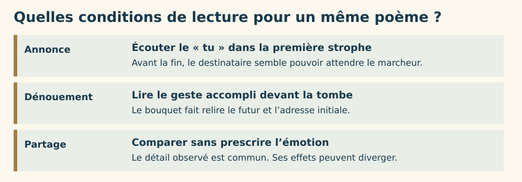

# ENS-PSL · Sélection internationale Lettres — Littérature — Hélène Merlin-Kajman et la lecture 2017 · Corrigé guidé

*Corrigé rédigé par IA, non officiel. Signalez toute erreur.*

**Lecture du rapport du jury** · GPT-6.2 Astra Ultra · vitesse non renseignée

**Rédaction** · GPT-6.2 Astra Ultra · vitesse non renseignée

**Relecture** · GPT-6.2 Astra Ultra · vitesse non renseignée · 26 novembre 2026

**Autocontrôle** · GPT-6.2 Astra Ultra · vitesse non renseignée

Le sujet porte sur l’analyse de la lecture littéraire par Hélène Merlin-Kajman, dans Lire dans la gueule du loup (2016). Il demande des œuvres françaises et étrangères, des textes de critique et l’expérience de lecture.

## Distinguer ce que le texte contient et ce qu’une lecture en fait

La première proposition dit que les textes « transportent » des possibilités contraires. La seconde dit ce qu’il faut « privilégier ». Repérez ce changement entre description et choix. Le mot de partage place à côté de l’auteur les personnes qui donnent à lire et celles qui lisent.

> [!INDICATION]
> Comment mettre une expérience de lecture à l’épreuve ?

Dans le poème de Hugo, prenez note de l’hypothèse que suscite l’adresse avant de lire la dernière strophe. Revenez ensuite au début. Ce commentaire de lecteur repose sur des mots et sur leur ordre. Il n’exige aucune confidence autobiographique.

> [!INDICATION]
> Quelle objection apporte Dickens ?

Le conte vise bien une conversion morale. Dans la scène familiale, demandez ce qui retient néanmoins l’attention au-delà de cette conversion. Distinguer le projet de l’écrivain et les débats des lecteurs évite de confondre toute œuvre engagée avec une lecture instrumentale.

> [!INDICATION]
> Quelle limite garder en vue ?

Une forme littéraire peut aider à partager un deuil, sans que la seule lecture garantisse un effet réparateur pour tous. Le contraste entre lecture solitaire et lecture à plusieurs permet de discuter cette condition avec précision.

## Qu’est-ce qui se partage lorsqu’on lit ensemble ?

À qui entend pour la première fois « Demain, dès l’aube », l’adresse à une personne attendue peut faire supposer un rendez-vous amoureux. La dernière strophe révèle la tombe devant laquelle le marcheur déposera un bouquet. Si, avant la lecture, j’annonce seulement que le poème prouve la vertu consolatrice de la poésie, je risque de priver l’auditeur du chemin par lequel il aurait éprouvé lui-même l’écart entre l’attente et le deuil. Rien ne garantit d’ailleurs que ce chemin le consolera. La proposition d’Hélène Merlin-Kajman tient ensemble ces deux difficultés. Un texte peut servir une cause, ouvrir un lieu où partager une expérience douloureuse et parfois rendre cette expérience plus pénible. Son appel à « privilégier » une fonction réparatrice est un choix dans la manière de transmettre. Qu’est-il possible de réparer, et comment choisir cette fonction sans assigner d’avance à chaque lecteur ce qu’il devra ressentir ?

## Un partage peut être confisqué par la leçon qu’il prétend transmettre

Le mot « rhétorique » pourrait désigner tous les moyens par lesquels un texte s’adresse à quelqu’un. Pris en ce sens très large, il serait absurde de demander d’y soustraire le partage littéraire. Une fable, un poème funèbre ou un roman disposent les mots pour produire des effets. La citation vise plus précisément des « buts […] déterminés ». L’instrumentalisation survient lorsqu’un texte ne vaut plus que comme moyen de faire atteindre une conclusion choisie avant la lecture. Elle peut tenir à un choix de l’auteur, mais aussi à l’usage scolaire, politique ou moral d’une œuvre qui, dans sa forme, ménageait d’autres possibilités.

Le parcours de Scrooge dans *Un chant de Noël* de Dickens montre pourquoi il ne faut pas confondre la présence d’un dessein moral et la fermeture de toute lecture. La visite des esprits soumet au personnage sa propre histoire, les conditions de vie des Cratchit et une anticipation de sa mort. Le récit souhaite la conversion d’un homme avare et indifférent. Pourtant, l’émotion attachée aux gestes de la famille Cratchit ne se réduit pas au changement de Scrooge. Selon que l’on suit l’enfant, les parents ou le vieil homme qui regarde la scène, l’économie morale du conte se déplace. Une lecture collective peut même demander si la générosité d’un seul répond suffisamment aux conditions de pauvreté auxquelles l’intrigue donne un visage. Une visée persuasive de l’œuvre n’empêche pas qu’une discussion argumentée dépasse la thèse qu’on en tire ordinairement.

À l’inverse, un poème difficile et dépourvu de morale explicite peut être instrumentalisé si le lecteur doit retrouver la seule émotion déjà reconnue par le groupe. Il reste libre de réciter une formule. Il n’est plus libre de dire ce qui lui a résisté. C’est donc la relation entre l’œuvre, son médiateur et ceux qui la reçoivent qu’il faut examiner.

La syntaxe de Merlin-Kajman marque le point de bascule. Deux fois, le même verbe, « transportent », présente le texte comme dépositaire de possibilités jusque dans leurs effets opposés. Avec « partager » et « privilégier », le sujet de l’action change. Une personne choisit comment lire avec d’autres. On peut en faire l’expérience sur le poème des Contemplations. Si un groupe connaît déjà le deuil de Hugo, la dernière strophe ne lui apprend peut-être rien sur l’identité de la destinataire. En revanche, il peut entendre comment les futurs font de cette visite un rendez-vous encore à venir. Même informée de la fin, une assemblée de lecteurs garde ainsi quelque chose à découvrir dans la forme de l’adresse.

> [!INDICATION]
> Comment comparer deux lectures si les deux groupes connaissent déjà le deuil de Hugo ?

Demandez d’abord où chaque groupe ferait une pause dans le premier vers, puis quels futurs il accentuerait. La discussion porte sur le mouvement de la marche et de la parole. La connaissance du contexte éclaire le texte, mais elle ne prédit ni le rythme choisi ni l’émotion de chacun.

## Réparer une relation sans effacer la perte

Dans le poème de Hugo, le futur donne à la marche une direction assurée. Le « tu » fait exister dans le langage une interlocutrice à laquelle le lecteur ne sait pas encore qu’aucune réponse vivante ne pourra être prêtée. Le mouvement régulier à travers le paysage est accompagné d’un refus de se laisser distraire par ce que les yeux pourraient y découvrir. À la fin, houx et bruyère déposés sur la tombe constituent un geste très simple. Relire les premières lignes après cette découverte fait entendre dans le rendez-vous la fidélité d’une adresse maintenue malgré l’absence. La poésie ne rétablit aucune présence réelle. Elle donne une forme communicable à l’acte de continuer à s’adresser.

Le lecteur peut trouver dans le rythme et dans la finitude du poème une distance à l’égard d’une douleur qui, dans la vie, n’a pas de dernier vers. Mais la même adresse à la deuxième personne peut réveiller un souvenir intime sans rapport avec l’histoire de Hugo. Aucun critique ne peut en déduire une guérison, encore moins la prescrire. Une pratique de lecture attentive peut rendre sensible un écart, offrir des mots et permettre d’interrompre ou de reprendre une lecture. Ce sont des conditions d’un partage et non des effets cliniques mesurables à partir du seul texte.

Georges Perec, dans *W ou le Souvenir d’enfance*, donne une autre forme à cette difficulté. Le livre alterne un récit d’enfance marqué par les lacunes de la mémoire et une fiction où la croyance dans une société réglée par le sport se transforme. L’alternance oblige le lecteur à chercher des rapports que les deux récits ne déclarent pas immédiatement. Elle rend perceptible qu’un manque dans un souvenir n’est pas une case vide que l’interprète aurait le droit de remplir à sa guise. Le partage consiste aussi à reconnaître la part d’une histoire qui demeure inaccessible. Faire du livre une simple devinette dont la bonne réponse expliquerait rétrospectivement chaque détail risquerait d’abolir cette réserve.

## La façon de transmettre fait partie de la lecture

On pourrait objecter à Merlin-Kajman que refuser toute mise au service d’une rhétorique tout en privilégiant une fonction précise revient à imposer une fin comme une autre. L’objection porte si la réparation est annoncée comme un résultat obligatoire. Elle porte moins si le privilège demandé concerne les conditions de la rencontre. On peut proposer un texte à plusieurs personnes, leur laisser entendre une première lecture, revenir aux mots qui ont modifié leur attente, et permettre que leurs jugements divergent. Le médiateur ne renonce pas à vérifier que le « tu » de Hugo est adressé à une morte. Il renonce à déduire de cet accord sur le texte une juste façon unique d’éprouver la scène.

Hans Robert Jauss étudie, dans Pour une esthétique de la réception, l’horizon d’attente à partir duquel un public découvre une œuvre. L’attente d’un public est formée par les genres qu’il connaît, par ce qu’on lui a annoncé et par des lectures antérieures. Une discussion qui met ces attentes en regard peut rendre à un texte familier sa capacité de surprendre. Elle ne constitue pas toujours un remède. La lecture solitaire accepte parfois plus facilement le silence dont une personne a besoin, tandis qu’une lecture à voix haute peut rendre audible à une autre le déplacement d’un accent ou une pause jusque-là inaperçue.

Je comprends donc la formule comme une éthique de la transmission. La littérature fournit des formes qui peuvent porter un témoignage, une consolation ou une contestation, et qui peuvent aussi être détournées en injonctions. Privilégier ce qui répare signifie alors rendre possible une relation qui ménage l’écart entre l’expérience de l’œuvre et celle de chaque lecteur. C’est précisément ce qui interdit de promettre la réparation à quiconque ou de réduire une œuvre à la cause que l’on souhaiterait lui faire servir.

[Feuille de l’écrit](https://www.ens.psl.eu/sites/default/files/litterature-ecrit.pdf) · [Rapport du jury](https://www.ens.psl.eu/sites/default/files/ens_rapport_sil_litterature_2017.pdf) · [Hugo, texte de Demain, dès l’aube](https://fr.wikisource.org/wiki/Les_Contemplations/%C2%AB_Demain%2C_d%C3%A8s_l%E2%80%99aube%2C_%C3%A0_l%E2%80%99heure_o%C3%B9_blanchit_la_campagne_%C2%BB) · [Hans Robert Jauss, Pour une esthétique de la réception](https://www.cercle-enseignement.com/Ouvrages/Gallimard/Tel/Pour-une-esthetique-de-la-reception)
