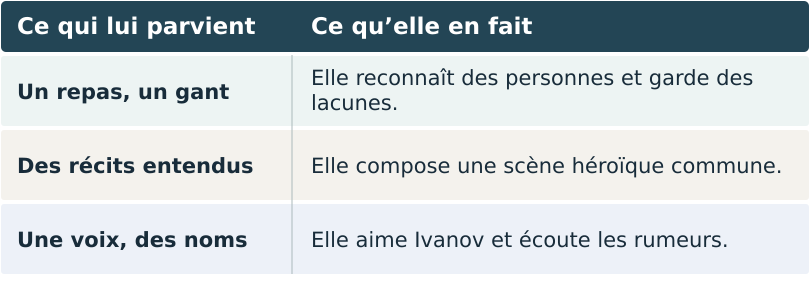

# Sarraute et Enfance · Oral de littérature ENS-PSL 2017 · Corrigé guidé

*Corrigé rédigé par IA, non officiel. Signalez toute erreur.*

**Lecture du rapport du jury** · GPT-6.2 Astra Ultra · vitesse non renseignée

**Rédaction** · GPT-6.2 Astra Ultra · vitesse non renseignée

## Préparer les vingt minutes

Au brouillon, associez à Bilit un objet, à l’ensemble des convives une scène et à Ivanov un son. Pour chacun, indiquez ce que Natacha voit, ce qu’elle sait pour l’avoir entendu et ce qu’elle imagine. Entraînez-vous à lire la période qui aboutit au cri révolutionnaire. La succession des subordonnées retarde le cri et donne à la voix de l’enfant le temps d’occuper la scène.

> [!INDICATION]
> Commencez par les deux fins de phrase sur les invités moins connus et sur les espions. Comment l’une mesure-t-elle les limites de la mémoire, l’autre celles de la confiance ?

> [!METHODE]
> Lors du portrait, passez du mot abstrait désignant une vertu à deux détails du visage. Expliquez ensuite pourquoi le bégaiement exige un récit de seconde main.

> [!JURY]
> Le rapport 2017, page 2, demande de situer l’œuvre, de lire à haute voix les premières lignes et d’appuyer le commentaire sur le détail de l’extrait. À l’ouverture, faites entendre la souplesse de la première énumération et le glissement du dimanche aux autres soirs.

## Commentaire du dimanche dans la colonie russe

Un convive qui vient dîner sans prévenir aime une omelette si copieuse qu’on la prépare exprès pour lui. Quelques lignes plus bas, les invités de la même table semblent prêts à mourir pour la liberté. Dans *Enfance* (1983), Nathalie Sarraute se remémore les réunions de révolutionnaires russes exilés chez son père, à Paris. Le tiret ouvre une prise de parole dans un livre où le souvenir se construit à deux voix. Sur ce feuillet, personne ne vient interrompre la narratrice. Pourtant plusieurs manières de connaître les mêmes personnes se rencontrent au sein de sa parole. Comment le récit retrouve-t-il ce que cela faisait, pour une enfant, de dîner parmi des héros ?

### Une place à table

Le dimanche n’a pas de date. La proposition ouverte par « Si » pose une hypothèse et les présents de l’indicatif la réalisent sous nos yeux. Une réunion habituelle prend ainsi l’allure d’un événement en cours. Les noms se succèdent, reliés par des « et ». Le convive qui aime les visites imprévues entraîne avec lui la possibilité de tous les autres soirs. À cette souplesse du récit correspond un geste d’hospitalité très simple, ajouter un couvert. L’omelette de Bilit serait un détail disproportionné dans la biographie d’un militant. Ici, elle a précisément la bonne taille. L’enfant a vu l’appétit du visiteur et l’amusement de Véra, et c’est par cet échange entre les deux adultes qu’elle les reconnaît.

L’évocation procède par voisinages. Après le dessert viennent les mathématiques, puis la perte du bras gauche. La précision est frappante pour le gant de cuir et pour le côté du corps. La narratrice hésite en revanche sur l’événement qui a causé la blessure. Le gant est visible à la table, l’événement appartient à une histoire antérieure à sa présence. La fin du paragraphe rapproche la moindre familiarité avec d’autres invités de l’effacement de leur souvenir. On surprend ainsi, dans le présent même de la scène, l’activité de l’écrivaine qui recherche jusqu’où porte sa mémoire.

### Ce que l’admiration donne à voir

Un second présent, celui du regard posé sur la table, lance une métamorphose. La fatigue et le vieillissement des convives rendent leur héroïsme indéchiffrable pour un observateur qui ignorerait leur passé. Natacha jouit d’un savoir qui lui permet de voir à travers les apparences. Les noms communs vont en s’amplifiant jusqu’aux « héros ». Puis les actions s’enchaînent au pluriel. L’énumération réunit poursuites, exil et condamnations dans une histoire partagée. Distribuer chaque action à un convive reviendrait à défaire le geste exprimé ensuite par le verbe « confonds ».

Le mouvement atteint sa plus grande précision au moment où il entre dans le virtuel. Les conditionnels et les propositions introduites par « quand » projettent les condamnés au pied du gibet. La phrase suspend l’infinitif « crier » jusqu’après les préparatifs de l’exécution. Un cri de liberté, au discours direct, remplit tout à coup la salle à manger du récit. Natacha fait entendre ce que ces hommes et ces femmes auraient été prêts à dire. Son admiration se mesure à la netteté de ce qu’elle se représente, même là où elle n’a pu être témoin de rien.

### La préférence pour Ivanov et le retour des voix

Le mouvement de la phrase change avec la préférence pour un seul invité. Le nom d’Ivanov se fait attendre derrière ceux d’amis que Natacha aime pourtant. La bonté, d’abord suggérée par une locution entre guillemets, devient perceptible dans des traits peu attendus pour un portrait élogieux, les plis des lèvres et les poches sous les yeux. Le regard trouve une tendresse singulière jusque dans les marques du vieillissement qui, vues de plus loin, paraissaient communes aux invités. Le léger bégaiement appartient lui aussi à la douceur présente d’Ivanov avant d’appartenir à son passé.

Le lien avec l’annonce de la commutation de peine dépend de ce que l’enfant a entendu raconter. Le bouleversement durable survient au moment où le condamné apprend qu’il vivra. Cet effet interdit de réduire l’homme soit au courage, soit à la fragilité. Puis la parole change de régime. L’assurance avec laquelle la narratrice exclut qu’il ait signé un recours en grâce traduit le code d’honneur de la table. Les parents et les juges ont eu beau le presser, une demande au tsar aurait laissé sur lui une marque que d’autres auraient commentée à mi-voix. La « marque » serait invisible et infamante, quand la difficulté audible de parler rend Ivanov plus cher à l’enfant.

La durée mesurable de l’enfermement, de vingt à quarante-cinq ans, cède enfin la place aux noms de forteresses et d’organisations qui circulent dans les conversations. L’enfant les retient comme elle avait retenu les noms des convives. Seulement, le dernier pluriel, celui des espions possibles, fait de l’identité d’un visiteur une question ouverte. À partir d’un repas ordinaire, Sarraute reconstitue les différents degrés de certitude, d’affection et de peur avec lesquels une enfant habitait un monde politique.

## Après l’exposé

**Qui parle dans le récit de la pendaison ?** La dernière exclamation donne une voix aux héros. Elle est préparée par un infinitif dépendant de leur disposition à crier, telle que se la représente Natacha. Lire cette préparation à haute voix rend audible le passage de l’admiration aux paroles imaginées.

**Que gagne-t-on à rapprocher Bilit et Ivanov ?** Le premier porte une main dont Natacha voit le gant sans connaître l’histoire précise. Pour le second, elle connaît un récit expliquant une particularité de la voix. L’un et l’autre obligent à interroger l’origine d’une information.

> [!PIEGE]
> Le passage signale expressément que la peine d’Ivanov est commuée. Distinguez la menace de pendaison, l’annonce de la détention et la durée effectivement donnée par le feuillet.

**Bilan.** Refaites le parcours en partant du dernier mot sur les espions. La possibilité d’un faux révolutionnaire fait réentendre autrement l’assurance enfantine avec laquelle tous les convives avaient été confondus dans l’admiration.
