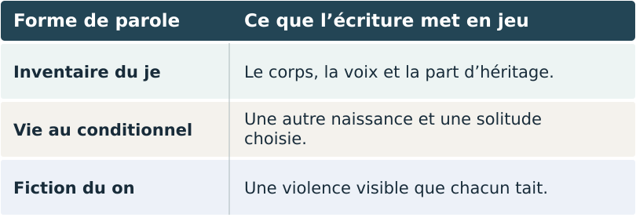

# Tahar Ben Jelloun et L’Enfant de sable · Oral de littérature ENS-PSL 2017 · Corrigé brut

*Corrigé rédigé par IA, non officiel. Signalez toute erreur.*

**Lecture du rapport du jury** · GPT-6.2 Astra Ultra · vitesse non renseignée

**Rédaction** · GPT-6.2 Astra Ultra · vitesse non renseignée

## Commentaire du journal d’Ahmed

Dans *L’Enfant de sable* (1985), le père d’Ahmed a présenté son enfant comme un fils pour que la famille ait un héritier masculin. Le feuillet donne à lire le journal tenu à l’âge adulte, après la mort des parents. La disparition de ceux qui gardaient le secret devrait rendre simple la réponse à une question d’identité. Or une personne qui cherche les mots pour se désigner finit par décrire une violence que tout un pays s’accorde à taire. Comment le passage du « je » au « on » se prépare-t-il à même les hésitations d’une confidence ?

### Éprouver ce que les mots permettent de dire

L’ouverture semble annoncer un règlement des affaires en suspens. Dès la troisième phrase pourtant, l’urgence porte sur une connaissance encore à conquérir. « Je sais » précède une série de formulations qui se reprennent. Avoir un corps de femme, se dire vieille fille, reconnaître une conduite apprise ne répondent pas à la même question. L’expression qui fait d’Ahmed une vieille fille révèle une singulière exclusion. Le personnage peut se reconnaître dans ce nom et se sentir privé jusqu’aux inquiétudes que l’entourage accorderait à celle qui le porte.

Le correctif « plus exactement » déplace surtout l’origine d’une conduite. Au « je » qui constate ce qu’il fait succède un « on » qui lui a enseigné des manières de penser et d’agir. La supériorité masculine est dite naturelle dans la formulation même qui raconte comment on l’apprend. La suite énumère les autorités auxquelles Ahmed attribue cette possibilité. Après les institutions et les proches, le dernier membre, isolé par les points de suspension, implique le sujet lui-même. Une confidence qui se serait limitée à accuser le père laisserait inexpliquée la part prise à la perpétuation du secret.

Le journal alterne ensuite les indices du corps comme s’ils devaient former un portrait cohérent. La voix inquiète particulièrement Ahmed parce qu’elle met l’identité à l’épreuve de l’oreille d’autrui. Le projet de parler la main devant la bouche ajoute encore un signe à interpréter, celui d’un mal de dents imaginaire. Même la tentative d’être enfin soi conduit à inventer une petite scène. À la phrase très brève sur la finesse du visage et sur la barbe succède la preuve matérielle de ce que la famille a fait de cette apparence, une part d’héritage double de celle des sœurs.

### Un autre avenir, une autre enfance

L’abandon de l’argent est formulé au présent, puis le désir de sortir de la maison se déploie au conditionnel. La répétition de « naître » attribue au départ la puissance d’un commencement, bien que la mention précise de l’âge en révèle l’impossibilité littérale. Aux soustractions envisagées, parents et famille, répondent les appuis souhaités, un prénom et un corps délivré de l’histoire du mensonge. On comprend ainsi ce que l’argent disponible ne peut acheter.

Cette projection en avant se complique d’un retour en arrière. Que se serait-il passé si Ahmed avait grandi comme huitième fille de la maison ? Le conditionnel passé permet d’habiter provisoirement cette existence possible. Il fait alterner la crainte du malheur commun aux sœurs et la conviction de disposer d’une force capable de bouleverser l’ordre imposé. La formule de l’instrument du père coexiste avec l’aveu d’avoir aussi joué. Les nuances de responsabilité que le journal essaie tour à tour constituent l’examen moral d’Ahmed.

L’accord au féminin d’« éloignée » dans l’image des miroirs est ici un événement de langue. Le sujet qui rêve de briser les images imposées peut déjà infléchir grammaticalement la façon de se raconter. La solitude prend deux sens opposés selon que l’on peut la désirer ou que la famille l’impose. De cette distinction naît la difficulté suivante. Quelle place la collectivité laisserait-elle à une femme capable de décider seule ?

### Porter à la parole une exclusion collective

La « société morale » se présente comme une distribution ordonnée des places. La phrase se retourne aussitôt contre cette apparente évidence, puisqu’il est des personnes auxquelles aucune place n’est offerte. De la femme isolée, le regard descend vers l’enfant né hors d’une union reconnue. La privation d’un nom fait écho au prénom qu’Ahmed désirait choisir. Les expressions associées à la bonté et à la prière se chargent d’ironie lorsque la protection promise à l’enfant côtoie le souhait de le voir disparaître.

Une fiction terrible achève le raisonnement. Par une succession de conditionnels, une voix imagine que chaque ville institutionnalise le rejet des enfants qu’elle condamne déjà à l’abandon. L’énoncé emprunte le ton pratique d’une suggestion administrative. L’expression de « délivrance » promet un bienfait et masque le sort de l’enfant. Cette distance entre le vocabulaire et ses conséquences donne à entendre l’indignation. La publicité de ce qui arriverait coexiste avec un interdit qui porterait jusque sur l’allusion. L’impossible accord entre la connaissance publique et le silence général est précisément ce que la fiction fait apparaître.

La dernière phrase revient au présent et au possessif du pays. Les yeux et les regards chargent la communauté d’une action qu’elle pourrait croire toute passive. La distinction finale entre résignation et indifférence oblige même à imaginer des témoins qui voient et qui souffrent, mais qui se détournent. Le journal parti d’un secret domestique devient l’acte de quelqu’un qui refuse, au moins en écrivant, de continuer à se taire.
