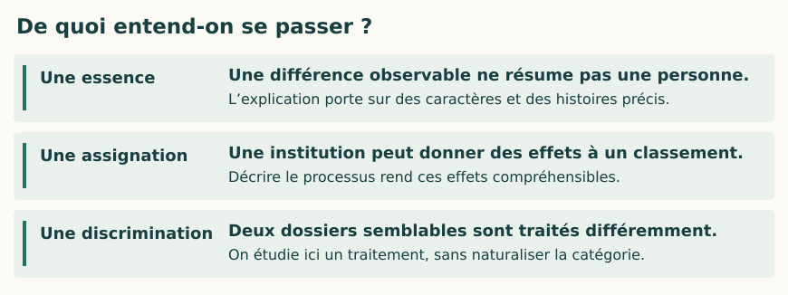

# Philosophie — Comment se passe-t-on de la notion de race ? · Oral PSL 2017 · Corrigé guidé

*Corrigé rédigé par IA, non officiel. Signalez toute erreur.*

**Rédaction** · GPT-6.2 Astra Ultra · vitesse non renseignée

**Révision (tour 1)** · GPT-6.2 Astra Ultra · vitesse non renseignée

## Préparer l’exposé

Placez « décrire une variation », « assigner un groupe » et « mesurer un traitement » en regard de trois exemples. Dans chacun, identifiez l’acteur qui classe et la conclusion qui serait injustifiée. Revenez ensuite au « comment » de la question en nommant une opération concrète de remplacement ou de critique.

Pour développer une objection, comparez deux façons d’enquêter, assigner au participant une identité fixe ou documenter la manière dont un tiers le perçoit. Dites ce que l’on peut comprendre de l’inégalité de traitement dans le second cas.

## Exposé

Dans une enquête sur le logement, on peut établir que deux dossiers présentant les mêmes ressources, le même garant et la même demande peuvent recevoir des réponses différentes quand le nom affiché change. La différence de traitement ne prouve aucune différence naturelle entre les candidats. Elle ne disparaîtrait pas pour autant si le chercheur se contentait de déclarer que les races humaines n’existent pas. La forme de la question, « comment se passe-t-on », nous conduit à distinguer plusieurs opérations. Il faut se défaire d’un principe d’explication du genre humain, décrire les pratiques de classement qui lui ont donné une force sociale, puis déterminer avec quels instruments une société peut juger des différences de traitement. Comment retirer son autorité à la notion tout en gardant les moyens de comprendre ce qu’on a fait en son nom ?

### Changer d’unité d’explication

La notion de race a servi à réunir sous une même division des caractères corporels, une ascendance supposée, des capacités et des habitudes culturelles. Elle prétendait que l’appartenance à une classe naturelle héréditaire fournirait la clef de ce qu’un individu pouvait devenir. Un premier geste critique consiste à séparer les questions que cette notion avait rendues artificiellement solidaires. Décrire une différence de pigmentation, retracer une migration ancienne, étudier une langue et expliquer une institution sont des recherches différentes. L’une ne fournit pas d’avance la conclusion des trois autres.

Les populations humaines ont des histoires de migrations, d’échanges et de parentés entrecroisées. Les fréquences de certains caractères peuvent varier avec l’histoire et la géographie. Les frontières que l’on tracerait en partant d’un caractère ne fournissent cependant pas des blocs homogènes qui résumeraient les personnes, moins encore leur intelligence ou leurs comportements. La critique de l’idée de race laisse donc place à des questions de biologie historique mieux définies. Elle retire à une catégorie totalisante un pouvoir d’inférence qu’elle ne possédait pas. Une société ne devient pas visible dans la couleur de peau de ses membres, pas plus qu’un individu ne devient l’exemplaire prévisible d’une histoire familiale.

Dans *Race et histoire*, Lévi-Strauss examine la diversité des cultures et met en question le privilège que les sociétés s’accordent en prenant leurs propres critères de changement pour l’étalon unique du développement humain. La transposition est tentante, substituer aux anciennes races de grandes cultures fermées auxquelles chacun appartiendrait intégralement. Elle reconduirait pourtant la difficulté en changeant son nom. Les cultures ont des contacts, des désaccords internes, des emprunts et des transformations. Se passer d’une catégorie exige ici qu’on cesse aussi de chercher à sa place une explication unique et totale.

### Comprendre la fabrication de la catégorie

Une seconde opération semble prendre le chemin inverse. Comment la classification a-t-elle pu devenir effective, être enregistrée dans des papiers, imposée par le droit et apprise au quotidien ? L’existence d’une catégorie administrative ne démontre pas l’existence d’une espèce naturelle. Elle prouve cependant que des institutions ont pu donner à une distinction des effets sur le droit de se déplacer, d’étudier, de travailler ou d’habiter un lieu. Pour étudier la ségrégation dans une ville, il serait impossible de partir du principe qu’une division sans fondement biologique ne saurait avoir d’histoire.

Le terme de racialisation aide à formuler la question comme celle d’un processus. Qui est assigné à quel groupe, par qui, dans quelles circonstances et avec quelles conséquences ? La voix d’une personne qui se présente à la location d’un appartement peut recevoir au téléphone une signification que n’y entendrait aucune des personnes qui vivent habituellement avec elle. Le nom, l’accent, la couleur supposée se combinent selon les attentes de celui qui classe. La situation s’explique par ces relations et ces attentes. Le chercheur n’a pas besoin de décider dans quelle race véritable il faudrait ranger le candidat. L’effet réellement subi peut en revanche être décrit et comparé.

Il serait insuffisant de situer cette opération exclusivement dans la tête de quelques individus malveillants. Les pratiques administratives, les représentations héritées et les situations de dépendance sociale peuvent maintenir des écarts même lorsque tel acteur ne se pense pas animé d’une intention discriminatoire. Déplacer l’explication des essences vers les relations est donc aussi un moyen de rendre des pratiques modifiables. Une différence attribuée par nature aux candidats semblait dispenser de revoir le fonctionnement de la sélection. Une régularité produite par les procédures ouvre au contraire une question sur ce que l’on peut changer.

### Agir sans reconduire la croyance que l’on combat

Faut-il alors faire disparaître tout mot de la famille de « race » ? Il y a un motif de le souhaiter. Nommer régulièrement des groupes peut donner à croire que les divisions de l’enquête sont naturelles et fixes. Un questionnaire qui forcerait une personne à choisir une identité dont elle ne se reconnaît pas détentrice contribuerait à fabriquer ce qu’il prétendait simplement relever. Il faut donc se demander, pour chaque usage, qui formule la catégorie et ce que l’on sera tenté d’inférer de la réponse.

La préposition « de » cache ainsi une difficulté. On peut vouloir se passer de la notion pour expliquer ce qu’est une personne et continuer d’en avoir besoin comme objet d’étude. Ainsi un historien qui lit une règle ancienne doit dire qui le texte classait et quelles conséquences cette règle entraînait. S’il remplace tous les termes du document par « personnes », la rédaction paraît plus respectueuse, mais il devient impossible de comprendre pourquoi des droits étaient refusés à certains habitants. Dire qui classait qui et dans quel but permet de rendre intelligible la règle ancienne et d’en contester le principe.

Mais l’interdiction des mots peut aussi faire perdre un savoir. Revenons à l’enquête sur le logement. On peut comparer des réponses à des dossiers fictifs dont on a fait varier un signe perçu comme marquant une origine, en s’attachant précisément à l’assignation par l’interlocuteur. Une telle comparaison mesure un effet de traitement, sous les conditions que l’enquête a construites. Elle ne fournit aucun renseignement sur une supposée nature des personnes. La différence méthodologique est vérifiable dans la question posée et dans le type de conclusion que le résultat autorise. Les catégories employées doivent demeurer discutables et délimitées par ce but.

Se passer de la notion de race n’est donc pas une opération unique que l’on achèverait dans un dictionnaire. Il s’agit de soustraire l’enquête aux inférences essentialistes, de conserver l’intelligibilité historique des classements et de rendre contestables leurs effets présents. La réussite se juge à ce qu’un individu cesse de voir ses capacités et ses droits décidés par une identité que d’autres lui assignent, tout en restant capable de nommer cette assignation lorsqu’elle a lieu.

## Questions d’entraînement pour l’entretien

**La variation entre populations humaines justifie-t-elle un classement racial ?** Une variation se décrit à propos de caractères déterminés et d’une histoire précise. Elle ne justifie pas de rassembler des personnes en types fixes dont on pourrait déduire des aptitudes ou une culture.

**Pourquoi conserver dans un travail d’histoire des termes dont on critique la validité ?** Ce sont des objets d’enquête qui pouvaient organiser des institutions et des parcours. Les citer en les attribuant et en décrivant leurs usages évite de les reprendre comme catégories naturelles du chercheur.

**Un seul refus de location permet-il d’établir une discrimination ?** Une différence inexpliquée mérite qu’on l’examine. Elle ne suffit pas à isoler sa cause. Une enquête compare des demandes équivalentes, répétées dans des conditions explicites, puis décrit ce qu’elle a observé. Le résultat porte sur le traitement d’un signe perçu. Il ne révèle rien d’une prétendue essence de la personne.

## Relire le résultat de l’enquête

Prenez une phrase d’enquête, « le bailleur a préféré l’un des dossiers ». Qui décrit-on ? Faites varier successivement les ressources économiques, le nom lu par le bailleur et le nombre de comparaisons observées. Expliquez ce que chacun de ces changements permet d’avancer. Cela empêche d’attribuer à la personne classée ce qui relève de celui qui la classe.

[Énoncé](https://www.ens.psl.eu/sites/default/files/philo-oral-sil17-sujet1.pdf)
