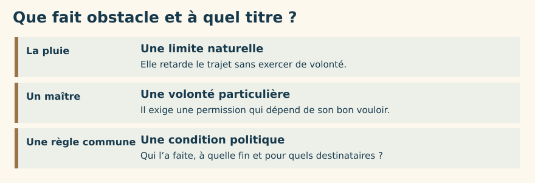

# ENS-PSL · Sélection internationale Lettres — Philosophie — liberté et fers 2017 · Corrigé guidé

*Corrigé rédigé par IA, non officiel. Signalez toute erreur.*

**Rédaction** · GPT-6.2 Astra Ultra · vitesse non renseignée

**Autocontrôle** · GPT-6.2 Astra Ultra · vitesse non renseignée

**Révision (tour 1)** · GPT-6.2 Astra Ultra · vitesse non renseignée

Le sujet demande de commenter la formule d’un philosophe des Lumières selon laquelle l’homme naît libre et se trouve partout dans les fers. La formule ouvre le livre I du *Contrat social* de Rousseau, paru en 1762.

## Distinguer un fait et un titre

Commencez par la dépendance évidente du nouveau-né. Que prouve-t-elle sur le besoin de soins ? Que ne prouve-t-elle pas sur la propriété ou le droit de commander ? Cette objection de départ permet de préciser le mot « libre » sans esquiver la première moitié de la phrase.

**Comment lire le « partout » ?** Il attire l’attention sur les rapports sociaux observables et sur leur légitimité. Une obéissance habituelle ne justifie pas par elle-même l’autorité qui la reçoit. Ne transformez pas la formule en récit documenté d’un premier gouvernement historique.

**Pourquoi distinguer la nature, le maître et la loi ?** La pluie retarde un trajet. Un maître peut imposer sa volonté particulière. Une loi générale peut limiter chacun pour assurer à tous une capacité d’action. Dans chaque cas demandez qui commande, à quel titre et à quelles conditions la règle cesse de respecter ses propres principes.

**Comment garder place au désaccord ?** Les citoyens n’ont pas tous la même préférence. Le vote n’établit pas mécaniquement la justice d’une décision. C’est une objection à examiner quand on explique le passage de la liberté naturelle à la liberté civile.

## Comment une obligation pourrait-elle obliger un être libre ?

Comment lire ensemble « né » et « partout » ? Le premier terme évoque l’origine de chacun, le second embrasse l’étendue des relations sociales. Leur rapprochement oppose ce qui serait vrai de l’homme en naissant et ce qui paraît vrai partout où on l’observe. Une difficulté surgit aussitôt. Nul nouveau-né ne dispose seul des forces nécessaires à sa vie. Et l’organisation sociale qui rend cette vie possible nous impose des règles longtemps avant que nous ayons pu y consentir. Quel sens donner alors à cette naissance libre, et comment juger des « fers », si l’absence de tout lien s’avère à la fois impossible et peu désirable ?

## Être né libre ne signifie pas naître capable de tout faire seul

La dépendance d’un enfant à l’égard de ceux qui le nourrissent est un fait. On peut en tirer l’obligation pour des adultes de garantir sa vie. Il ne s’ensuit pas qu’un adulte déterminé possède naturellement la personne dont il a pris soin, encore moins que ses descendants aient un titre à la commander. Rousseau dissocie la question des forces disponibles et celle du droit qu’aurait un homme à disposer d’un autre. Dire qu’on est né libre exprime d’abord l’absence de titre naturel à une domination personnelle. L’affirmation ne décrit pas une autonomie physique et psychologique déjà achevée à la naissance.

Cette distinction explique l’importance du singulier « l’homme ». Le propos ne réserve pas une liberté d’origine à certains individus particulièrement forts ou instruits. Si tout être humain reçoit la qualité qui interdit à un autre de le posséder, il faut juger les inégalités réelles de puissance à l’aune d’une égalité qui ne se lit pas directement dans les faits. Le plus fort peut obtenir qu’on lui laisse le passage. Sitôt que le rapport de force s’inverse, l’effet risque de disparaître. Il manque encore ce qui expliquerait pourquoi son ordre devrait être reconnu indépendamment de sa capacité à s’imposer. Tirer un droit de la seule réussite d’une contrainte ferait de tout changement de vainqueur une nouvelle source de justice.

Le premier membre n’établit pas non plus une histoire vérifiée d’êtres d’abord isolés qui seraient entrés un jour dans une société déterminée. Rousseau distingue, aussitôt après la formule, la question des circonstances du changement et celle de sa légitimité. Le commentaire peut suivre cette dernière sans avoir à reconstruire par hypothèse un premier contrat conclu à date connue.

## Quels liens deviennent des fers ?

Le second membre porte un jugement sur un état de fait présent. Le mot « fers » suggère la servitude, donc davantage que la simple rencontre d’une limite. Je dépends du temps qu’il fait pour traverser une montagne. Je dépends du bon vouloir d’un maître si je dois lui demander à chaque instant la permission d’aller et venir. Ces deux empêchements ne mettent pas en jeu la même relation. Dans le second cas, une volonté particulière peut décider pour la mienne sans avoir à lui répondre de son choix. L’image des fers met en cause cette subordination entre personnes.

Elle concerne aussi celui qui se croit maître. Un homme qui ne pourrait maintenir son rang qu’en obtenant chaque jour l’obéissance et les marques d’approbation d’autrui devient dépendant de ceux qu’il prétend traiter comme de simples moyens. La suite immédiate du chapitre signale ce paradoxe. Il ne s’agit pas de prétendre que gouvernant et gouverné endurent la même privation de liberté. On peut subir des torts profondément inégaux tout en vivant dans une relation qui place chacun à la merci des actions de l’autre. La liberté ne consiste donc pas à occuper à son profit la place autrefois tenue par un maître.

Pour autant, considérer tout ordre comme des fers rendrait toute association illégitime par définition. Un passage piéton réglé par un feu m’oblige à attendre, comme il oblige les autres à attendre à leur tour. La seule minute perdue ne tranche pas la question de ma liberté politique. Il faut encore examiner de qui la règle émane, à qui elle s’applique, quelle raison commune la justifie et quelle possibilité demeure de la réviser.

## L’association doit transformer le type de dépendance

Le problème du pacte social consiste à penser une association dont la force commune protège ses membres et dans laquelle chacun puisse encore se rapporter à la règle comme à une œuvre à laquelle il prend part. Cette construction réclame une distinction entre celui qui participe à la formation de la loi comme citoyen et celui qui lui obéit comme sujet. La même personne occupe ces deux places. Elle conserve des intérêts particuliers qui peuvent entrer en conflit avec l’intérêt commun. Envisager sa liberté civile comme participation à une règle générale ne signifie donc pas qu’elle approuvera en son for intérieur toutes les décisions du corps politique.

L’exemple du passage montre la difficulté. Si les règles sont fixées pour assurer les déplacements du seul dirigeant et ménagent à sa suite une dispense permanente, elles préservent sous une apparence publique la dépendance envers une personne. Si les usagers concernés sont membres égaux d’un corps qui décide à des fins communes, une limitation des mouvements peut assurer à chacun une capacité de circuler plus effective. Une loi ne réalise toutefois pas la seconde situation par le seul fait de porter ce nom. Elle doit pouvoir être discutée comme règle de tous, et son application ne doit pas installer durablement un groupe en maître de l’autre.

Le passage de la contrainte à l’obligation peut se vérifier en changeant un détail. Imaginons que chacun soit tenu de faire la queue pour franchir le passage et que le dirigeant s’accorde une priorité permanente. Tous subissent encore une règle écrite. Pourtant, l’exception ne se justifie que par le nom de son bénéficiaire. Accordons maintenant la priorité à toute personne chargée d’un secours urgent. Le régime paraît de nouveau inégal au moment du passage, mais le motif est formulable pour tous et pourrait concerner chacun. La généralité d’une loi porte donc sur la raison des distinctions qu’elle autorise, autant que sur les mots dont elle se sert.

Une objection surgit dès que l’on invoque la volonté générale. Une majorité réelle peut proclamer qu’elle parle pour tous et traiter le désaccord d’une minorité comme la preuve que celle-ci ignore son propre bien. La généralité de l’objet et l’égalité des membres du souverain sont donc des conditions à éprouver, et non un certificat que donnerait le simple nombre des voix. L’écart entre le principe et les sociétés effectives redonne alors à l’adverbe « partout » sa force. La formule oblige à examiner les formes ordinaires de dépendance même là où le vocabulaire officiel affirme que les citoyens sont libres.

La contradiction initiale n’appelle ainsi ni la nostalgie d’une autosuffisance originelle ni la résignation à tout pouvoir établi. Être né libre oblige à demander aux autorités qui prétendent gouverner un titre différent de leur seule existence. Des liens communs peuvent donner une forme politique à cette liberté lorsqu’ils soumettent également leurs auteurs et leurs destinataires à une règle répondant d’un intérêt commun. Ils redeviennent des fers dès que la règle met certains à la discrétion durable d’une volonté étrangère.

## Suivre le changement de question

Imaginez deux copies. L’une cherche qui a imposé les premiers liens. L’autre demande à quelle condition un lien pourrait obliger légitimement une personne née libre. Situez la première dans l’histoire des sociétés, la seconde dans l’examen du droit. Pour revenir aux mots de la citation, montrez comment le constat d’une obéissance répandue laisse ouverte la question de son titre.

[Feuille de l’écrit](https://www.ens.psl.eu/sites/default/files/philo-ecrit-sil17.pdf) · [Rousseau, Du contrat social, livre I, édition de 1762](https://fr.wikisource.org/wiki/Du_contrat_social/%C3%89dition_1762/Livre_I/Chapitre_1)
