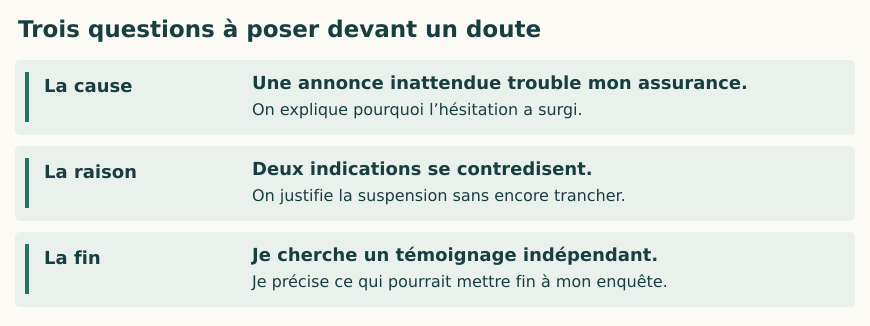

# Philosophie — Pourquoi doute-t-on ? · Oral PSL 2017 · Corrigé guidé

*Corrigé rédigé par IA, non officiel. Signalez toute erreur.*

**Rédaction** · GPT-6.2 Astra Ultra · vitesse non renseignée

**Révision (tour 1)** · GPT-6.2 Astra Ultra · vitesse non renseignée

Le feuillet de 2017 porte la seule question « Pourquoi doute-t-on ? ».

## Préparer l’exposé

Construisez trois réponses à « pourquoi ? », une cause, une raison et une fin. Pour chacune, gardez le même objet de croyance et changez la situation du sujet. Ce procédé fait apparaître la différence sans la réduire à une distinction de dictionnaire.

Pour l’entretien, préparez une raison de douter qui ne soit pas une raison d’affirmer le contraire. Décrivez ensuite ce qui pourrait raisonnablement faire lever la suspension.

**Préparer une relance.** Que répondre à quelqu’un qui dit « trois écrans donnent la même heure » ? Demandez d’où vient chaque indication. Donnez ensuite un cas où leur accord renforce votre jugement et un cas où il le laisse en suspens. Indiquez enfin quelle vérification vous accepteriez. Vous pourrez expliquer en quoi le doute peut être raisonné même quand l’inquiétude subsiste.

## Exposé

Deux personnes hésitent devant un horaire affiché à une gare. La première éprouve la même inquiétude que le jour où elle a manqué une correspondance, alors que les indications concordent. La seconde remarque que l’écran donne deux heures différentes pour le même train. Le souvenir explique l’état de la première. La contradiction donne à la seconde un motif que tout autre voyageur peut vérifier. Leurs hésitations pourraient se ressembler trait pour trait et pourtant elles n’ont ni la même cause ni la même justification. « Pourquoi » peut demander ce qui met un esprit dans le doute, quelles raisons légitiment sa suspension de jugement et en vue de quoi il peut choisir de la maintenir. Ces sens se tiennent sans se confondre. Comment passe-t-on d’une confiance troublée à un exercice raisonné du doute, et à quoi reconnaît-on que cet exercice a rempli sa fonction ?

### Une assurance cesse de régler l’action

Nous ne commençons pas par douter de tout. Pour vérifier l’horaire, le voyageur sait déjà se servir des nombres, reconnaître le nom d’une gare et distinguer un jour de semaine d’un autre. Le doute survient d’autant plus vivement qu’une situation ne répond pas à une attente antérieure qui, jusque-là, allait de soi. Une annonce dément l’écran. Deux souvenirs auxquels nous accordions également confiance nous conduisent dans des directions incompatibles. La croyance n’ordonne plus la conduite assez fermement pour que l’on puisse partir sans hésiter.

Peirce, dans « La fixation de la croyance », oppose l’habitude d’action liée à la croyance à l’irritation du doute qui nous met en recherche. Cela permet de comprendre pourquoi le doute possède une dimension pratique même lorsqu’il porte sur une proposition abstraite. Qu’une prédiction échoue, et le chercheur ne peut plus simplement reconduire le même raisonnement sans rencontrer le même obstacle. Mais l’inconfort n’est pas une mesure de la force de la raison. Une personne anxieuse peut ressentir une hésitation très vive devant des informations convergentes. À l’inverse, quelqu’un de confiant peut ne pas être ébranlé par une véritable contradiction. Pour passer d’une description des causes à un examen de la légitimité du doute, il faut demander ce qui fait obstacle à l’assentiment et ce qui pourrait lever cet obstacle.

### Il y a des raisons de suspendre un jugement que l’on pourrait déjà former

Une raison de douter n’est pas encore une preuve du contraire. Si je découvre que l’horloge d’une gare s’est arrêtée plusieurs fois au cours du mois, je ne sais pas d’emblée qu’elle indique actuellement une heure fausse. J’ai toutefois une raison de ne pas régler une correspondance serrée sur sa seule indication. La suspension porte sur la qualité d’une garantie. Elle mérite d’être distinguée de la négation de la proposition elle-même. Cette différence explique pourquoi nous pouvons douter sans tomber dans le refus de toute vérité.

Descartes donne au doute des *Méditations métaphysiques* une extension que n’exigerait pas la conduite ordinaire. Il cherche un fondement assez certain pour une entreprise de connaissance et décide de soumettre à une épreuve rigoureuse ses raisons de croire. L’expérience du rêve ne lui apprend pas que toutes les perceptions présentes sont fausses. Elle montre que leur seule vivacité peut, dans certaines circonstances, être reproduite sans que l’objet soit là. Le sujet fait donc varier délibérément les conditions dans lesquelles une croyance lui semblait assurée, jusqu’à découvrir une affirmation dont la tentative même de douter atteste la vérité. Pour me tromper ou douter, il faut que j’existe au moment de cet acte. Le doute méthodique possède ici une fin qui détermine sa sévérité. Son extension ne fait pas de l’incertitude une vertu recherchée pour elle-même.

Le voyageur consulte maintenant deux applications qui donnent la même heure. Leur accord apaise son inquiétude. Puis il apprend que les deux reprennent la même base de données que le panneau. Le nombre de réponses a augmenté, mais la garantie n’a guère changé. Une annonce faite par le chef de gare après vérification auprès du conducteur constituerait un indice d’une autre origine. Cet exemple permet de distinguer trois moments. Une hésitation naît, un motif la rend partageable, une réponse appropriée à ce motif peut y mettre fin.

Le motif d’une suspension dépend aussi de ce qui est en jeu. Un messager peut accepter une indication de direction sans en exiger une démonstration et vérifier plus loin. Un historien qui va attribuer à quelqu’un une lettre décisive doit, dans une situation comparable de premier indice, rechercher le manuscrit, sa date et sa transmission. La vérité ne varie pas avec les conséquences d’une erreur. Ce qui varie, c’est le degré de garantie qu’une personne a de bonnes raisons d’exiger avant d’agir ou d’affirmer publiquement. Douter peut ainsi être une responsabilité envers ceux qui feront usage de notre jugement.

### Pourquoi maintenir ou lever le doute ?

Une communauté de recherche peut protéger l’expression d’un doute minoritaire sans conclure que toutes les hypothèses ont la même valeur. L’utilité du désaccord tient à sa capacité de formuler des questions précises. Quelle observation a été mal identifiée ? Quelle inférence dépend d’une hypothèse que l’on peut tester autrement ? Si la réponse obtenue ne peut par principe jamais faire changer d’avis la personne qui exige des preuves, le doute risque de devenir un moyen de se dispenser de juger. On peut affecter de rester scrupuleux tout en déplaçant indéfiniment les conditions de son assentiment.

Wittgenstein, dans *De la certitude*, invite à regarder les pratiques réelles où quelque chose prend sens comme doute. Pour examiner une carte, il faut déjà que certains repères, l’identité des symboles ou la fiabilité ordinaire de la lecture, jouent le rôle de points fixes. Cela ne signifie pas qu’aucun de ces repères ne puisse un jour être révisé. Cela signifie que nous ne pouvons pas en même temps les suspendre tous et conserver l’opération déterminée appelée ici vérifier. Au voyageur qui hésite on peut demander ce qu’il entendrait comme une réponse. Une confirmation par le conducteur, l’arrivée effective du train ou une annonce corrigée peuvent selon le cas suffire. Cette possibilité d’indiquer ce dont on doute et à quelles conditions le doute sera levé distingue un travail de recherche d’une attitude générale de suspicion.

Nous doutons parce qu’une confiance antérieure rencontre une résistance, parce que le jugement demande une garantie que nous n’avons pas encore et parfois parce que nous voulons mettre cette garantie à l’épreuve avant de nous engager. Les raisons de continuer doivent cependant rester exposées à la réponse de l’enquête. Un doute fidèle à sa fonction peut accueillir le moment où il n’y a plus de motif suffisant de douter.

## Questions d’entraînement pour l’entretien

**Peut-on décider de douter ?** On peut décider de chercher des contre-exemples ou de traiter une croyance comme incertaine dans un exercice méthodique. Se donner instantanément une inquiétude sincère sur commande est une autre affaire.

**Être certain, est-ce avoir cessé de réfléchir ?** Tout dépend des raisons de cette certitude et de la question. Une enquête qui met fin à un doute bien formulé accomplit son objet. Elle peut ouvrir d’autres questions à partir de ce résultat.

[Énoncé](https://www.ens.psl.eu/sites/default/files/philo-oral-sil17-sujet4.pdf)
