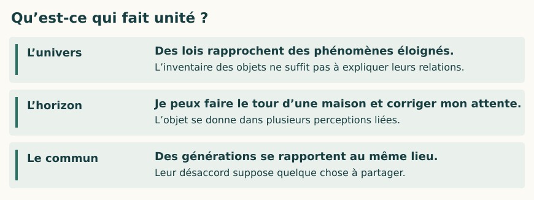

# Philosophie — Qu’est-ce qui fait le monde ? · Oral PSL 2017 · Corrigé brut

*Corrigé rédigé par IA, non officiel. Signalez toute erreur.*

**Rédaction** · GPT-6.2 Astra Ultra · vitesse non renseignée

**Révision (tour 1)** · GPT-6.2 Astra Ultra · vitesse non renseignée

## Exposé

Les mêmes pierres peuvent se trouver sur un terrain vague et appartenir, pour un archéologue ou un habitant, aux ruines d’une ancienne cité. Une liste des pierres présentes serait-elle une description complète de ces deux situations ? En demandant « qu’est-ce qui fait le monde ? », on peut chercher ce dont il est composé, la cause qui lui aurait donné naissance ou ce qui fait qu’une multiplicité de choses compte comme *un* monde. L’article défini pousse vers l’unité de ce qui est, tandis que l’usage ordinaire permet de parler du monde des marins ou de la disparition d’un monde. Comment penser cette unité sans confondre l’existence des choses avec les relations par lesquelles elles prennent place pour nous ?

### Un univers, un ordre, une totalité

La réponse la plus immédiate ferait du monde l’ensemble de ce qui existe. Nulle chose réelle ne pourrait alors se trouver à l’extérieur de lui. Mais dire que toutes les pierres, tous les vivants et tous les astres appartiennent à cet ensemble ne dit pas encore ce qui les lie. Un inventaire peut rassembler, par une décision de classement, ma chaise, deux canards et une galaxie. Qu’ajouterait à cette liste l’idée qu’ils appartiennent à un seul monde ? La notion grecque de *kosmos* met l’accent sur un ordre. Comprendre le monde peut ainsi vouloir dire chercher des relations qui en font un tout intelligible. La possibilité de rapporter la chute d’un objet et le mouvement d’un corps céleste à des lois communes a un tout autre pouvoir d’unification qu’une simple addition d’éléments.

Faut-il aller au-delà de ces relations et chercher qui ou quoi a fabriqué le monde ? La grammaire du verbe « faire » peut encourager cette inférence. Pour une table, j’identifie un artisan, des matériaux préalables et un temps au cours duquel la fabrication commence. Étendre ce modèle à la totalité de ce qui est soulève une difficulté. Où situer les matériaux et le temps présupposés s’il s’agit de rendre compte de la totalité ? Kant montre dans la première antinomie de la *Critique de la raison pure* les difficultés auxquelles se heurte une raison qui traite le monde entier comme un objet donné et prétend décider si sa série temporelle a un commencement absolu. Une enquête cosmologique peut déterminer des états anciens de l’univers et en construire des modèles contrôlables. Elle ne se confond pas avec la représentation d’un artisan placé devant le tout. La question sur ce qui « fait » monde peut dès lors se porter vers ce qui rend possible l’expérience d’un ensemble lié.

### Les choses apparaissent ensemble à partir d’un horizon

Lorsque je regarde le devant d’une maison, je ne vois pas simultanément sa façade arrière, ni la rue qui se poursuit au prochain tournant. Pourtant la façade ne se présente pas comme une mince surface colorée suspendue dans le vide. Je pourrais avancer, tourner ou rencontrer d’autres habitants qui ont vu l’autre côté. Husserl appelle horizon cette ouverture d’un champ de perceptions possibles autour de ce qui se donne actuellement. Le monde, en ce sens phénoménologique, est ce dans quoi un objet peut se montrer à plusieurs reprises et où ses apparences sont susceptibles de se confirmer ou de se démentir. Il n’est pas une dernière apparence que l’on ajouterait à toutes les autres.

Cela permet de préciser la différence entre faire et fabriquer. Mes habitudes corporelles et mes anticipations contribuent à constituer le sens de ce que je rencontre. Elles ne décident pourtant pas de ce que je trouverai derrière la maison. Le passage peut être muré et l’ami que je croyais y trouver a pu partir. L’unité du monde comprend cette résistance d’une expérience à une autre. Si tout ce qui me surprenait était rejeté dans un univers étranger, je ne pourrais ni corriger une erreur ni apprendre où je suis. En un sens, ce qui fait monde est donc la possibilité de rapprocher des perspectives différentes et de soumettre une attente à la suite de l’expérience.

Un décor de théâtre permet d’isoler la différence. De face, sa porte ressemble à celle d’une maison. En passant sur le côté, j’aperçois les montants qui soutiennent une simple façade. Je peux alors dire que ma première interprétation était fausse. Or cette correction suppose que mes déplacements m’ont conduit devant la même chose. Le changement de perspective ne fabrique pas la maison qu’il me semblait voir. Il révèle ce dont l’objet est fait et m’amène à le situer autrement dans un monde où les expériences se répondent. Le monde comme horizon inclut ainsi la possibilité d’une surprise autant que la continuité des habitudes.

Une objection surgit toutefois. Le champ de mon expérience ne peut pas contenir à lui seul tout ce qui est. La rue continue pendant mon absence et ceux qui l’habitaient il y a cent ans y avaient d’autres affaires que les miennes. Pour parler d’un monde plutôt que du décor de ma vie, il faut expliquer ce qui tient ensemble des expériences auxquelles une seule personne n’aura jamais accès.

### Un monde commun se transmet et peut se perdre

Arendt donne dans *Condition de l’homme moderne* une image précise du monde commun. Une table réunit les personnes qui prennent place autour d’elle et les maintient à une certaine distance les unes des autres. Le monde de leurs affaires communes comporte des œuvres durables, des institutions et des récits qui survivent au passage des générations. Il permet à ceux qui n’occupent jamais exactement le même point de vue de parler de quelque chose dont l’identité résiste à la diversité des perspectives. Deux habitants d’une ancienne cité peuvent contester le sens d’un monument parce qu’ils reconnaissent la même pierre et peuvent rapporter à son histoire des récits différents. Le désaccord suppose déjà quelque chose de commun et peut encore en élargir l’intelligibilité.

Ce qui est fait de cette manière peut aussi se défaire. Si une communauté perd ses archives et les usages qui donnaient un sens à ses lieux, les matériaux de construction peuvent subsister tandis qu’un monde devient illisible. Il ne faudrait pas en conclure que tout l’univers n’est qu’une construction humaine. Une rivière en crue peut faire obstacle à un projet et contraindre des groupes qui lui donnent des significations différentes à réviser leurs pratiques. Inversement, l’étude physique de la rivière ne dira pas toute seule qui a le droit d’y accéder et pourquoi des personnes tiennent à y retrouver la trace d’une histoire. L’objectivité physique, l’horizon de perception et la durabilité d’un monde partagé se recoupent sans se confondre.

Qu’est-ce donc qui fait le monde ? L’unité des choses demande des relations réelles que la connaissance explore, un champ de perceptions qui permet leur rencontre et, lorsqu’il s’agit d’un monde humain, des œuvres et des pratiques où plusieurs générations peuvent prendre place. La question interdit de prendre le simple fait de compter tout ce qui existe pour une explication de ce qui tient ensemble. Elle invite aussi à reconnaître que les hommes peuvent rendre leur monde commun habitable ou méconnaissable sans être les fabricants de tout ce qui est.

## Questions d’entraînement pour l’entretien

**Y aurait-il encore un monde sans personne pour le voir ?** La question distingue l’univers physique et le monde comme horizon d’apparition. On peut soutenir la réalité de l’univers avant les humains tout en étudiant les conditions auxquelles il fait monde pour un être percevant.

**Deux cultures habitent-elles des mondes absolument étrangers ?** Des institutions et des découpages symboliques peuvent différer profondément. La rencontre, la traduction et la résistance de certaines choses communes seraient pourtant incompréhensibles si toute comparaison était impossible.

**Une carte périmée fait-elle disparaître le monde qu’elle décrivait ?** Elle a perdu une part de sa justesse si elle donne encore pour praticable un passage fermé. Elle demeure une trace du parcours autrefois possible. Cette distinction suppose que le lieu puisse à la fois démentir une attente actuelle et conserver les marques d’un usage ancien.

[Énoncé](https://www.ens.psl.eu/sites/default/files/philo-oral-sil17-sujet3.pdf)
